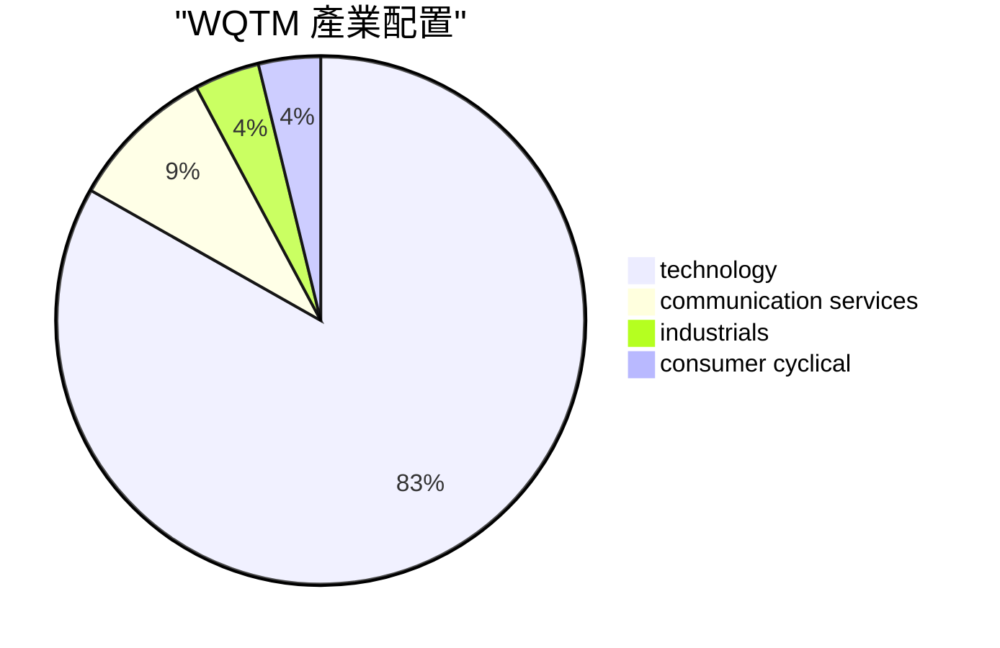

# WQTM ETF 分析報告

> **報告日期**：2026-11-16 ｜ **語言**：繁體中文 ｜ **數據來源**：Yahoo Finance、Finviz ｜ **類型**：ETF／指數基金

## 目錄

| # | 章節 | 核心結論 |
|---|------|----------|
| 1 | 執行摘要 | 量子運算主題基金，費用低於同類平均，但近期相對基準落後且波動、回撤偏高，較適合作為衛星配置。 |
| 2 | 基金概況 | WisdomTree 旗下採被動管理方式的科技類基金，投資主題為量子運算。 |
| 3 | 成本與規模 | 費用率為 0.45%，低於同類平均 0.90%；淨資產為 291.05M USD。 |
| 4 | 持股與集中度 | 前十大持股合計 46.4%，最大單一持股權重為 7.10%。 |
| 5 | 產業配置 | 科技產業權重為 83.2%，產業曝險集中於科技。 |
| 6 | 績效與風險 | 1 年價格報酬為 -7.1%，相對 VTI 落後 -17.6%；年化波動率為 42.2%。 |
| 7 | 估值與配息 | 投資組合 P/E 為 26.9x、P/B 為 4.0x，配息殖利率為 0.00%。 |
| 8 | 適合對象、風險與觀察重點 | 適合可承受較大波動、希望增加量子運算主題曝險的投資人；不宜視為分散型核心市場配置。 |

---

## 1. 執行摘要

WQTM 是 WisdomTree 旗下科技類 ETF，採被動管理方式追蹤指數，基金通常將至少 80% 的淨資產及投資用途借款投資於指數成分股或具相似經濟特性的投資。  
基金費用率為 0.45%，同類平均為 0.90%，淨資產為 291.05M USD。  
前十大持股合計 46.4%，最大單一持股為 7.10%；截至 2026-11-13，1 年價格報酬為 -7.1%，相對 VTI 的超額報酬為 -17.6%。  
截至 2026-11-13 收盤價為 25.07 USD；年化波動率為 42.2%、最大回撤為 -42.7%，3 年與 5 年報酬資料為 N/A（資料未提供）。

### 1.1 一頁式摘要

| 項目 | 內容 |
|------|------|
| 追蹤標的／類別 | WisdomTree／Technology；被動管理，投資主題為量子運算；未提供更詳細的指數名稱或編製規則。 |
| 費用率（同類平均） | 0.45%（0.90%） |
| 資產規模 | 291.05M USD |
| 前十大合計權重／最大持股 | 46.4%／7.10% |
| 1 年／3 年／5 年價格報酬 | -7.1%／N/A（資料未提供）／N/A（資料未提供） |
| 相對基準的超額報酬（1 年／3 年／5 年） | -17.6%／N/A（資料未提供）／N/A（資料未提供） |
| 年化波動率／最大回撤 | 42.2%／-42.7% |
| 折溢價 | +0.25%（市價相對 NAV 溢價） |
| 最新收盤價及日期 | 25.07 USD；2026-11-13 |
| 定位 | **衛星配置** |

### 1.2 五項評分

| 評分項目 | 分數（0–10） | 依據（引用數字） |
|----------|-------------:|------------------|
| 成本 | 8/10 | 費用率為 0.45%，同類平均為 0.90%；低於同類平均，成本面具相對優勢。 |
| 規模與流動性 | 6/10 | 淨資產為 291.05M USD，足以作為規模評估依據；實際成交量、買賣價差及市場流動性資料為 N/A（資料未提供），因此不對交易流動性作過度推論。 |
| 分散度 | 6/10 | 前十大合計 46.4%，最大單一持股為 7.10%；個股權重未由單一持股主導，但基金標示為 non-diversified，且產業曝險集中於科技。 |
| 相對績效 | 2/10 | 1 年超額報酬為 -17.6%；3 年及 5 年超額報酬為 N/A（資料未提供），目前可用的長期相對績效資訊有限。 |
| 風險 | 2/10 | 年化波動率為 42.2%，最大回撤為 -42.7%；兩項風險指標均顯示價格波動與下跌幅度不可忽視。 |

> **評分說明**：五項分數為各面向的個別判斷，不計算總分或平均。規模資料不等同成交流動性資料。

## 2. 基金概況

| 項目 | 資料 |
|------|------|
| 基金名稱 | WisdomTree Quantum Computing Fund |
| 代號 | WQTM |
| 基金家族／類別 | WisdomTree／Technology |
| 管理方式 | 被動管理，或稱指數化投資方式 |
| 投資主題 | 量子運算 |
| 分散性描述 | Non-diversified |
| 指數名稱及編製規則 | N/A（資料未提供） |
| 產業／國家／員工資料 | N/A（資料未提供；基金並非營運公司） |

基金資料指出，正常情況下，WQTM 至少將 80% 的淨資產及投資用途借款，配置於指數成分股及／或具有高度相似經濟特性的投資。  
由於沒有提供指數名稱、編製規則或完整成分股清單，本報告不推測其選股條件、再平衡方式或持股範圍。  
已列出的持股包括科技公司、量子運算相關公司及其他大型企業；實際持股特徵以本報告列出的前十大及產業權重為限。

### 在投資組合中的角色

| 角色面向 | 說明 |
|----------|------|
| 主題曝險 | 提供量子運算主題相關基金曝險；科技產業權重為 83.2%。 |
| 核心市場替代性 | 不宜直接視為美國整體市場基金的替代品；VTI 在本報告中是績效比較基準。 |
| 配置定位 | 由於基金標示為 non-diversified，且科技權重高，較適合作為補充性主題曝險，而不是單靠此基金建立廣泛市場配置。 |
| 追蹤品質 | 追蹤誤差為 N/A（資料未提供）；不能僅依基金採被動管理，就推斷其追蹤精準度。 |

## 3. 成本與規模

### 費用率與簡化費用試算

| 項目 | 數值 | 解讀 |
|------|------|------|
| WQTM 淨費用率 | 0.45% | 基金持有期間的費用負擔指標。 |
| 同類平均費用率 | 0.90% | 用於與 WQTM 費用率比較。 |
| 10 年費用試算 | 45,000 USD | 以 1,000,000 USD 為例，按目前費用率、不假設報酬的簡化試算。 |

費用試算是簡化情境，不代表投資人實際必然支付的金額，也未考慮投資報酬、資產變動、稅負或交易成本。  
費用率若調整，試算結果也會改變；報告未提供未來費用率變化資訊。

### 資產規模與週轉率

| 項目 | 數值 | 解讀 |
|------|------|------|
| 淨資產 | 291.05M USD | 可用於觀察基金規模；不能單憑資產規模判斷交易時的買賣價差或流動性。 |
| 年度持股週轉率 | 48.0% | 反映基金持股更替程度；不等於基金的投資報酬，也不能單獨說明交易成本。 |
| 成交量與買賣價差 | N/A（資料未提供） | 缺乏相關資料，無法進一步評估交易流動性。 |

### 折溢價

| 項目 | 數值 |
|------|------:|
| 2026-11-13 收盤價 | 25.07 USD |
| NAV | 25.01 USD |
| 市價相對 NAV 折溢價 | +0.25% |

截至資料所列日期，市價相對 NAV 為溢價。  
這項數值是特定時點的折溢價資料，不代表其他交易日的價格與 NAV 關係。

## 4. 持股與集中度

### 前十大持股

| 代號 | 名稱 | 權重 |
|------|------|------:|
| IBM | International Business Machines Corp | 7.10% |
| IONQ | IonQ Inc | 5.39% |
| QNT | Quantinuum Inc Class A | 5.38% |
| RGTI | Rigetti Computing Inc | 4.89% |
| MSFT | Microsoft Corp | 4.12% |
| QBTS | D-Wave Quantum Inc | 4.11% |
| 6702.T | Fujitsu Ltd | 4.08% |
| INFQ | Infleqtion Inc Ordinary Shares - Class | 3.88% |
| AMZN | Amazon.com Inc | 3.79% |
| GFS | GLOBALFOUNDRIES Inc | 3.69% |

### 集中度觀察

| 指標 | 數值 | 解讀 |
|------|------:|------|
| 前十大持股合計 | 46.4% | 前十大持股合計未達基金資產的一半；其餘持股不在本報告列示範圍內。 |
| 最大單一持股 | IBM，7.10% | 單一持股權重可用於觀察個股集中風險，但不能據此推斷基金完整的持股數量。 |
| 基金分散性標記 | Non-diversified | 基金資料明確標示為非多元化基金；此標記與前十大持股合計權重是不同層次的資訊。 |
| 前十大以外持股 | N/A（資料未提供） | 依資料限制，不列示或推測前十大以外的持股。 |

前十大持股合計 46.4%，代表基金資產有一部分配置於這十檔股票，其餘持股明細未提供。  
因此，基金的表現會受到前十大持股影響，但無法只依前十大資料精確衡量所有個股對整體報酬的貢獻。  
基金被標示為 non-diversified，投資人應同時留意主題集中和基金分類所反映的風險，而不只看最大單一持股權重。

## 5. 產業配置

| 產業 | 權重 |
|------|------:|
| technology | 83.2% |
| communication services | 9.0% |
| industrials | 4.0% |
| consumer cyclical | 3.8% |

科技產業權重為 83.2%，是基金最大的產業曝險。  
持有 WQTM，除了接受量子運算主題相關公司的表現，也代表投資人對科技產業有明顯曝險。  
產業分類並不等於單一產業內所有公司都具有相同業務或風險；本報告不對未提供的個別公司業務占比作推測。

## 6. 績效與風險

### 各期間價格報酬

| 期間 | WQTM 價格報酬 | VTI 基準報酬 | 超額報酬 |
|------|--------------:|--------------:|---------:|
| 1 個月 | -13.0% | -1.9% | -11.0% |
| 3 個月 | -29.0% | -2.9% | -26.1% |
| 6 個月 | -26.3% | +2.3% | -28.6% |
| 1 年 | -7.1% | +10.5% | -17.6% |
| 3 年 | N/A（資料未提供） | N/A（資料未提供） | N/A（資料未提供） |
| 5 年 | N/A（資料未提供） | N/A（資料未提供） | N/A（資料未提供） |

以上為價格報酬，不含配息。  
基準為 VTI，代表美國整體市場。  
資料顯示，列出的 1 個月、3 個月、6 個月及 1 年期間，WQTM 相對 VTI 的超額報酬均為負值。  
3 年與 5 年報酬均為 N/A（資料未提供），不能據此判斷更長期間的相對表現。

### 波動與回撤

| 風險指標 | 數值 | 說明 |
|----------|------:|------|
| 年化波動率（1 年） | 42.2% | 反映所列期間的價格波動程度。 |
| 最大回撤 | -42.7% | 依資料庫已儲存歷史資料計算，期間為 1.1 年；谷底日期為 2026-11-05。 |
| 儲存歷史期間 CAGR | -15.9% | 僅代表所列儲存歷史期間，不能替代完整長期績效資料。 |

| 最大回撤情境試算 | 金額 |
|------------------|-----:|
| 1,000,000 USD 對應的帳面減少金額 | 427,300 USD |

最大回撤情境的帳面減少金額為資料所列試算，並非對所有投資人的實際損失預測。  
回撤是歷史價格資料的風險觀察，不代表未來跌幅上限；投資人仍須考量自身持有期間與承受能力。

## 7. 估值與配息

| 指標 | 數值 | 解讀 |
|------|------:|------|
| 投資組合 P/E | 26.9x | Yahoo Finance 所列加權投資組合倍數。 |
| 投資組合 P/B | 4.0x | Yahoo Finance 所列加權投資組合倍數。 |
| 配息殖利率 | 0.00% | 基金資料所列殖利率。 |
| 配息紀錄 | N/A（資料未提供） | 未提供歷史配息明細，不能由殖利率推測過往配息情況。 |

P/E 與 P/B 是基金所持成分股的加權組合指標，不是基金本身的合理價值。  
這些倍數也不足以單獨判斷成分股估值偏高或偏低；本報告不據此估算基金合理價值或目標價。  
配息殖利率為 0.00%；未提供配息紀錄，因此不對未來配息作預測。

## 8. 適合對象、風險與觀察重點

### 8.1 適合與不適合的投資人

| 投資人類型 | 適合度 | 原因（引用數字） |
|------------|--------|------------------|
| 希望增加量子運算主題曝險者 | 較適合 | 基金名稱為 WisdomTree Quantum Computing Fund，科技產業權重為 83.2%。 |
| 可承受較大價格波動者 | 視風險承受度而定 | 年化波動率為 42.2%，最大回撤為 -42.7%。 |
| 重視費用率的長期投資人 | 可納入比較 | 費用率為 0.45%，同類平均為 0.90%；仍須同時衡量基金主題與風險。 |
| 尋求廣泛市場分散的投資人 | 不宜單獨作為主要配置 | 基金標示為 non-diversified，且科技產業權重為 83.2%。 |
| 以穩定配息為主要目標者 | 不適合度較高 | 配息殖利率為 0.00%；配息紀錄為 N/A（資料未提供）。 |
| 需要完整長期相對績效資料者 | 資料不足 | 3 年及 5 年基金報酬、基準報酬與超額報酬均為 N/A（資料未提供）。 |

### 8.2 主要風險

| 風險 | 資料依據 | 對投資人的意義 |
|------|----------|----------------|
| 主題及產業集中 | 科技產業權重為 83.2%；基金標示為 non-diversified。 | 科技產業或量子運算相關投資環境變化，可能對基金表現造成較大影響。 |
| 個股集中風險 | 前十大持股合計 46.4%；最大單一持股 IBM 權重為 7.10%。 | 個別成分股表現可能影響基金報酬；前十大以外的持股明細為 N/A（資料未提供）。 |
| 價格波動與回撤 | 年化波動率為 42.2%；最大回撤為 -42.7%。 | 投資人可能面臨較大的短期價格變動與帳面損失。 |
| 相對基準表現風險 | 1 年超額報酬為 -17.6%；3 年及 5 年超額報酬為 N/A（資料未提供）。 | 可用資料顯示近期相對 VTI 落後；較長期間比較仍缺資料。 |
| 海外持股與匯率風險 | 持股包含 6702.T Fujitsu Ltd，權重為 4.08%；實際貨幣曝險資料為 N/A（資料未提供）。 | 海外持股可能帶來匯率及市場差異風險；其實際影響程度無法由現有資料量化。 |

### 8.3 什麼情況下要重新評估

| 可查核條件 | 重新評估方式 |
|------------|--------------|
| 最大單一持股權重高於目前的 7.10% | 檢視單一公司曝險是否擴大，並重新衡量持股集中風險。 |
| 前十大持股合計高於目前的 46.4% | 檢視前十大持股集中程度是否增加；需使用更新後的持股資料核對。 |
| 費用率不同於目前的 0.45% | 與更新後費用率及同類平均比較，重新檢視持有成本。 |
| 更新後的 1 年相對 VTI 超額報酬低於目前的 -17.6% | 查看更新期間與計算口徑，並評估相對績效是否進一步轉弱。 |
| 更新後資產規模低於目前的 291.05M USD | 核對基金規模變化；並另查成交量與買賣價差，因目前流動性資料為 N/A（資料未提供）。 |
| 新資料仍未提供 3 年或 5 年績效 | 保持對長期相對績效的保留，不以較短期間結果替代長期資料。 |
| 更新後科技產業權重高於目前的 83.2% | 檢視產業集中度是否進一步升高，以及是否仍符合投資組合配置目的。 |

### 最終定位

**衛星配置。**  
主要依據為科技產業權重 83.2%、基金標示為 non-diversified、年化波動率 42.2% 與最大回撤 -42.7%；此外，1 年相對 VTI 超額報酬為 -17.6%，而 3 年及 5 年相對績效資料為 N/A（資料未提供）。  
此定位是基金配置特性的說明，不是買入或賣出建議。

---

> **免責聲明**：本報告為 AI 自動生成，僅供研究與教育參考，不構成投資建議。報酬為價格報酬，未計入配息、稅負與交易成本；投資有風險。

---

## 資料與來源

| 項目 | 內容 |
|------|------|
| 價格 | 25.07 USD，2026-11-13 收盤（Yahoo Finance 日線） |
| 基金資料 | Yahoo Finance（持股、費用率、規模）；績效與回撤由價格資料庫計算 |
| 有回應的資料來源 | Yahoo Finance、Finviz |
| 未回應的資料來源 | SEC 申報資料 (XBRL)、StockAnalysis、Roic.ai |
| 由程式計算 | 基金的集中度、績效、費用與回撤試算 |
| 撰寫模型 | openai / gpt-6-luna |

> 本區塊由產生報告的程式依實際取得的資料填寫，非模型撰寫。「由程式計算」的數字不是模型的估計；其餘判斷（評分、情境、策略）是模型的分析。
