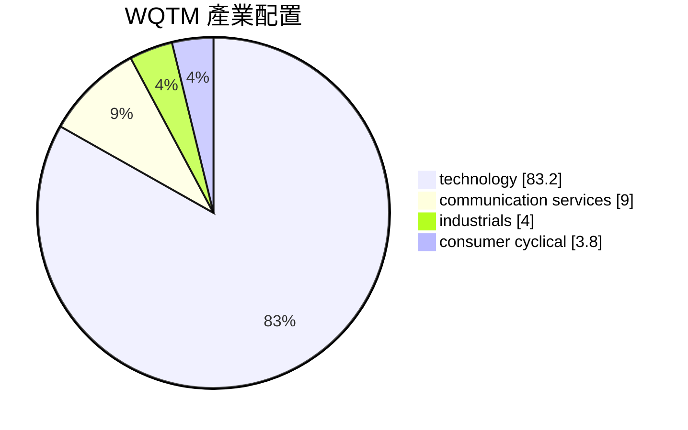

# WQTM ETF 分析報告

> **報告日期**：2026-11-19 ｜ **語言**：繁體中文 ｜ **數據來源**：Yahoo Finance、Finviz ｜ **類型**：ETF／指數基金

## 目錄

| # | 章節 | 核心結論 |
|---|------|----------|
| 1 | 執行摘要 | 量子運算主題 ETF；費用率低於同類平均，但近期相對基準落後且波動與回撤較大。 |
| 2 | 基金概況 | 採被動管理方式追蹤指數，指數名稱與編製規則未提供。 |
| 3 | 成本與規模 | 費用率為 0.45%，資產規模為 291.05M USD。 |
| 4 | 持股與集中度 | 前十大合計 46.4%，最大單一持股權重為 7.10%。 |
| 5 | 產業配置 | 科技產業權重為 83.2%，基金具高度科技產業曝險。 |
| 6 | 績效與風險 | 1 年相對 VTI 落後 17.8%；年化波動率與最大回撤均偏高。 |
| 7 | 估值與配息 | 投資組合 P/E 為 26.9x、P/B 為 4.0x，配息殖利率為 0.00%。 |
| 8 | 適合對象、風險與觀察重點 | 較適合作為主題型配置，並持續檢視持股、績效與基金規模。 |

---

## 1. 執行摘要

WQTM 是 WisdomTree 旗下的量子運算主題 ETF，採被動管理方式追蹤指數，並在一般情況下將至少 80% 的淨資產（加上投資用途借款）投資於指數成分股或經濟特性相近的投資。  
基金淨費用率為 0.45%，低於同類平均 0.90%；前十大持股合計 46.4%，最大單一持股權重為 7.10%。  
截至 2026-11-17，WQTM 1 年價格報酬為 -8.7%，相對 VTI 的超額報酬為 -17.8%；3 年與 5 年報酬及超額報酬均為 N/A（資料未提供）。  
2026-11-18 收盤價為 23.39 USD；1 年年化波動率為 42.2%，已提供歷史期間的最大回撤為 -43.3%。

### 1.1 一頁式摘要

| 項目 | 內容 |
|------|------|
| 追蹤標的／類別 | WisdomTree／Technology；量子運算主題。指數名稱與編製規則：N/A（資料未提供）。 |
| 費用率（同類平均） | 0.45%（0.90%） |
| 資產規模 | 291.05M USD |
| 前十大合計權重／最大持股 | 46.4%／7.10% |
| 1 年／3 年／5 年價格報酬 | -8.7%／N/A（資料未提供）／N/A（資料未提供） |
| 相對基準的超額報酬（1 年／3 年／5 年） | -17.8%／N/A（資料未提供）／N/A（資料未提供） |
| 年化波動率／最大回撤 | 42.2%／-43.3% |
| 折溢價 | +0.12% |
| 定位 | **衛星配置** |

### 1.2 五項評分

| 評分項目 | 分數（0–10） | 依據（引用數字） |
|----------|-------------:|------------------|
| 成本 | 8 | 費用率為 0.45%，同類平均為 0.90%；分數依費用率與同類平均的相對水準判斷。 |
| 規模與流動性 | 6 | 資產規模為 291.05M USD；交易量與買賣價差為 N/A（資料未提供），此分數主要依資產規模評估，不代表市場流動性已充分確認。 |
| 分散度 | 6 | 前十大合計 46.4%，最大持股權重為 7.10%；分散度評分同時考量前十大合計權重與最大持股權重。 |
| 相對績效 | 2 | 1 年超額報酬為 -17.8%；3 年與 5 年超額報酬為 N/A（資料未提供），因此無法用較長期間比較。 |
| 風險 | 2 | 年化波動率為 42.2%，最大回撤為 -43.3%；兩項數據顯示歷史價格波動與下跌幅度均較大。 |

## 2. 基金概況

| 項目 | 資料 |
|------|------|
| 基金名稱 | WisdomTree Quantum Computing Fund |
| 代號 | WQTM |
| 基金公司／類別 | WisdomTree／Technology |
| 投資方式 | 被動管理／指數化投資 |
| 基金摘要所述主題 | Quantum Computing／量子運算 |
| 追蹤指數名稱 | N/A（資料未提供） |
| 指數編製規則 | N/A（資料未提供） |
| 分類資訊 | Sector、Industry、Country 均為 N/A（資料未提供） |
| 基金型態 | 非多元化基金（non-diversified） |

基金管理人採被動管理方式，目標為追蹤指數表現。基金摘要指出，在一般情況下，至少 80% 的淨資產，加上投資用途借款，會投資於指數成分股及／或經濟特性與指數成分股大致相近的投資。

基金名稱與列出的持股顯示其投資主題為量子運算，但可取得的資料沒有提供追蹤指數名稱、成分股選取條件、權重設定方式或再平衡規則。因此，不能據此推定基金如何界定量子運算公司，或推測其指數方法細節。

就投資組合角色而言，WQTM 屬特定科技主題基金，而非涵蓋整體股票市場的廣泛型基金。投資人可將它視為對量子運算相關公司的主題曝險；是否配置及配置比重，需一併考量其產業集中、持股組成與歷史價格波動。

## 3. 成本與規模

### 3.1 費用與營運資料

| 項目 | 數值 | 解讀 |
|------|------:|------|
| 淨費用率 | 0.45% | 基金資料所列的年度淨費用率。 |
| 同類平均費用率 | 0.90% | Yahoo Finance 所列類別平均；WQTM 費用率低於此數值。 |
| 年度持股週轉率 | 48.0% | 反映基金持股買賣周轉情形；不等同於基金報酬或交易成本。 |
| 淨資產 | 291.05M USD | 可用來觀察基金資產規模；規模本身不保證交易流動性或未來績效。 |
| NAV | 23.36 USD | 基金每股淨值資料。 |
| 市價相對 NAV 折溢價 | +0.12% | 顯示市價較 NAV 略有溢價。 |

WQTM 的費用率為 0.45%，同類平均為 0.90%。兩者呈現 WQTM 費用率低於類別平均；本報告不另行計算兩者差額。

### 3.2 費用試算

| 試算項目 | 數值 |
|----------|------:|
| 假設投資金額 | 1,000,000 USD |
| 試算期間 | 10 年 |
| 假設報酬 | 不計報酬 |
| 費用試算結果 | 45,000 USD |

上述費用試算為區塊提供的簡化試算，採用目前費用率，並假設期間內沒有投資報酬；它不是對未來實際費用的保證，也未反映投資報酬、資金流動或費率變動的影響。

### 3.3 資產規模與交易流動性

淨資產為 291.05M USD，可作為基金規模的參考。基金規模與二級市場交易流動性並非同一指標；成交量、買賣價差及基金申購贖回狀況均為 N/A（資料未提供），因此無法僅憑資產規模判斷實際下單成本或交易深度。

### 3.4 折溢價

目前 NAV 為 23.36 USD，市價相對 NAV 的折溢價為 +0.12%。這項資料代表所列時點的市價與淨值關係，不足以單獨判斷其他交易時段的折溢價情形。

## 4. 持股與集中度

### 4.1 前十大持股

| 排序 | 代號 | 名稱 | 權重 |
|-----:|------|------|-----:|
| 1 | IBM | International Business Machines Corp | 7.10% |
| 2 | IONQ | IonQ Inc | 5.39% |
| 3 | QNT | Quantinuum Inc Class A | 5.38% |
| 4 | RGTI | Rigetti Computing Inc | 4.89% |
| 5 | MSFT | Microsoft Corp | 4.12% |
| 6 | QBTS | D-Wave Quantum Inc | 4.11% |
| 7 | 6702.T | Fujitsu Ltd | 4.08% |
| 8 | INFQ | Infleqtion Inc Ordinary Shares - Class | 3.88% |
| 9 | AMZN | Amazon.com Inc | 3.79% |
| 10 | GFS | GLOBALFOUNDRIES Inc | 3.69% |

### 4.2 集中度觀察

| 指標 | 數值 | 說明 |
|------|------:|------|
| 前十大合計權重 | 46.4% | 基金資產中有接近一半由所列前十大持股構成。 |
| 最大單一持股 | IBM，7.10% | 單一持股權重可影響基金報酬，但不能據此推定其對基金報酬的實際貢獻。 |
| 持股分散標示 | Diversified | 資料指出所列持股合計低於基金資產的一半。 |
| 完整成分股數量 | N/A（資料未提供） | 無法據此確認基金全部持股數量。 |

前十大合計 46.4%，其中最大單一持股權重為 7.10%。這代表基金報酬會受到多檔成分股表現影響，但所列前十大並未涵蓋全部基金資產；前十大以外的持股資料為 N/A（資料未提供），本報告不列出或推測其他持股。

基金摘要另將 WQTM 描述為非多元化基金。這項基金型態描述與前十大持股權重是不同資訊，投資人不宜只看前十大合計權重，就推定基金整體風險與廣泛市場型基金相同。

## 5. 產業配置

### 5.1 產業權重

| 產業 | 權重 |
|------|-----:|
| technology | 83.2% |
| communication services | 9.0% |
| industrials | 4.0% |
| consumer cyclical | 3.8% |

technology 權重為 83.2%，是基金最大的產業曝險。持有 WQTM 不只是押注量子運算主題，也代表投資組合承受科技產業的價格變動；其他列出的產業權重分別為 communication services 9.0%、industrials 4.0% 與 consumer cyclical 3.8%。

上述分類僅反映提供的產業權重，不代表基金的指數編製規則，也不能據此補充未列出的產業分類或個別持股。

## 6. 績效與風險

### 6.1 各期間價格報酬

以下為截至 2026-11-17 的價格報酬，未計入配息。

| 期間 | WQTM | VTI 基準 | 超額報酬 |
|------|-----:|---------:|---------:|
| 1 個月 | -15.7% | -4.1% | -11.7% |
| 3 個月 | -29.5% | -5.2% | -24.3% |
| 6 個月 | -28.5% | +0.0% | -28.6% |
| 1 年 | -8.7% | +9.2% | -17.8% |
| 3 年 | N/A（資料未提供） | N/A（資料未提供） | N/A（資料未提供） |
| 5 年 | N/A（資料未提供） | N/A（資料未提供） | N/A（資料未提供） |

資料中的基準為 VTI（美國整體市場）。WQTM 在所列的 1 個月、3 個月、6 個月與 1 年期間，超額報酬均為負；3 年與 5 年資料為 N/A（資料未提供），不宜據此推論較長期相對績效。

### 6.2 波動與回撤

| 風險指標 | 數值 | 觀察方式 |
|----------|------:|----------|
| 年化波動率（1Y） | 42.2% | 反映所列期間的價格波動程度。 |
| 最大回撤 | -43.3% | 依已存價格歷史計算；資料標示歷史期間為 1.1 years，谷底日期為 2026-11-17。 |
| 已存歷史期間 CAGR | -20.7% | 依已存價格歷史資料所列；期間為 1.1 years。 |

最大回撤的帳面影響試算如下，金額照錄資料所列：

| 試算項目 | 數值 |
|----------|------:|
| 假設投資金額 | 1,000,000 USD |
| 對應最大回撤的帳面減少金額 | 432,800 USD |

最大回撤試算反映歷史最大跌幅套用於指定投資金額的帳面減少情境，不代表未來一定會發生，也不代表投資人已實現的損失。

### 6.3 價格歷史

以下為資料列出的月收盤價；表格數值照錄，不含配息。

| 月份 | 收盤價 |
|------|------:|
| 2025-10 | 30.29 |
| 2025-11 | 26.05 |
| 2025-12 | 25.88 |
| 2026-01 | 26.98 |
| 2026-02 | 27.10 |
| 2026-03 | 24.69 |
| 2026-04 | 31.72 |
| 2026-05 | 39.35 |
| 2026-06 | 37.81 |
| 2026-07 | 31.43 |
| 2026-08 | 32.04 |
| 2026-09 | 32.06 |
| 2026-10 | 26.33 |
| 2026-11 | 23.39 |

這段月收盤價資料顯示基金價格曾上升，也曾明顯回落。單看月收盤價不能取代含配息總報酬，也不能代表未來走勢。

## 7. 估值與配息

| 項目 | 數值 | 說明 |
|------|------:|------|
| 投資組合 P/E | 26.9x | Yahoo Finance 所列的加權投資組合倍數。 |
| 投資組合 P/B | 4.0x | Yahoo Finance 所列的加權投資組合倍數。 |
| 配息殖利率 | 0.00% | 基金資料所列殖利率。 |
| 配息紀錄 | N/A（資料未提供） | 未提供逐次配息金額與日期。 |

P/E 與 P/B 是成分股加權後的投資組合指標，反映資料來源對基金持股的彙整評價，不是對 WQTM 基金本身的合理價值估算。配息殖利率為 0.00%；配息紀錄資料未提供，不能據此補充過往配息情形。

本報告不以市價或投資組合倍數推算合理價值，也不提供目標價。

## 8. 適合對象、風險與觀察重點

### 8.1 適合與不適合的投資人

| 投資人類型 | 適合度 | 原因（引用數字） |
|------------|--------|------------------|
| 想取得量子運算主題曝險，且能接受科技產業集中者 | 較適合 | technology 權重為 83.2%，基金名稱與持股資料呈現量子運算主題。 |
| 尋求廣泛市場核心配置者 | 較不適合 | 基金為非多元化基金；technology 權重為 83.2%，且所列基準 VTI 代表美國整體市場。 |
| 重視低費用、但也會比較投資波動者 | 可進一步評估 | 費用率為 0.45%，低於同類平均 0.90%；年化波動率為 42.2%。 |
| 偏好穩定配息者 | 較不適合 | 配息殖利率為 0.00%，配息紀錄為 N/A（資料未提供）。 |
| 無法承受大幅價格回落者 | 不適合度較高 | 最大回撤為 -43.3%，年化波動率為 42.2%。 |
| 需要完整長期績效資料者 | 較不適合 | 3 年與 5 年報酬及超額報酬均為 N/A（資料未提供）。 |

### 8.2 主要風險

| 風險 | 數據依據 | 對投資人的意義 |
|------|----------|----------------|
| 科技產業集中風險 | technology 權重為 83.2%。 | 基金價格可能受到科技產業整體評價與市場氣氛影響；產業權重集中時，產業下行可能對基金造成較大影響。 |
| 個別持股風險 | 前十大合計 46.4%，最大單一持股權重為 7.10%。 | 個別成分股的價格變化可能影響基金表現；前十大以外持股資訊為 N/A（資料未提供）。 |
| 主題與成長型資產價格波動 | 1 年年化波動率為 42.2%，最大回撤為 -43.3%。 | 投資人需能承受明顯價格波動與帳面回落；過往資料不代表未來結果。 |
| 相對基準落後風險 | 1 年超額報酬為 -17.8%；1 個月、3 個月與 6 個月超額報酬亦為負。 | 短期與 1 年資料顯示落後 VTI；3 年與 5 年比較資料為 N/A（資料未提供）。 |
| 國際市場與匯率風險 | 前十大持股中 6702.T（Fujitsu Ltd）權重為 4.08%。 | 存在日本上市持股曝險；實際貨幣曝險、避險政策與匯率影響資料為 N/A（資料未提供），不能量化其影響。 |
| 折溢價與交易成本風險 | 目前市價相對 NAV 折溢價為 +0.12%；成交量與買賣價差為 N/A（資料未提供）。 | 單一折溢價數據不能代表不同交易時點；投資人仍需留意實際交易價格與交易成本。 |
| 評價指標解讀風險 | 投資組合 P/E 為 26.9x，P/B 為 4.0x。 | 兩項倍數是持股加權後的投資組合指標，不是基金合理價值或未來報酬的保證。 |

### 8.3 什麼情況下要重新評估

| 可查核條件 | 觀察方式 |
|------------|----------|
| 最大持股權重高於目前水準 | 目前最大單一持股權重為 7.10%；若後續揭露的最大持股權重高於此水準，重新檢視個別持股集中度。 |
| 前十大合計權重高於目前水準 | 目前前十大合計權重為 46.4%；若持股揭露顯示集中度上升，重新檢視分散程度。 |
| 費用率調整 | 目前費用率為 0.45%，同類平均為 0.90%；若基金費率變更，應重新比較其成本位置。 |
| 相對基準持續落後 | 目前 1 年超額報酬為 -17.8%；日後可依新公布的相同期間資料持續檢查相對 VTI 的表現。 |
| 基金資產規模變化 | 目前淨資產為 291.05M USD；若後續資產規模明顯縮減，應重新確認基金規模與交易條件。 |
| 產業權重或持股結構改變 | 目前 technology 權重為 83.2%；若未來產業配置或前十大持股明顯變動，應確認基金曝險是否仍符合投資目的。 |
| 折溢價與交易條件改變 | 目前折溢價為 +0.12%；後續可與新的 NAV、成交價格及可取得的交易資料一併檢視。 |
| 長期績效資料補齊 | 目前 3 年與 5 年報酬及超額報酬為 N/A（資料未提供）；待有可比較資料時，再檢視長期相對表現。 |

### 8.4 最終定位

**衛星配置。** WQTM 費用率為 0.45%，低於同類平均 0.90%，但 technology 權重為 83.2%；1 年超額報酬為 -17.8%，年化波動率為 42.2%，最大回撤為 -43.3%。這些數據支持將它視為需留意主題集中與價格波動的配置，而非僅憑本報告數據視為廣泛市場核心持有。此定位為基金研究分類，不是買入或賣出建議。

---

> **免責聲明**：本報告為 AI 自動生成，僅供研究與教育參考，不構成投資建議。報酬為價格報酬，未計入配息、稅負與交易成本；投資有風險。

---

## 資料與來源

| 項目 | 內容 |
|------|------|
| 價格 | 23.39 USD，2026-11-18 收盤（Yahoo Finance 日線） |
| 基金資料 | Yahoo Finance（持股、費用率、規模）；績效與回撤由價格資料庫計算 |
| 有回應的資料來源 | Yahoo Finance、Finviz |
| 未回應的資料來源 | SEC 申報資料 (XBRL)、StockAnalysis、Roic.ai |
| 由程式計算 | 基金的集中度、績效、費用與回撤試算 |
| 撰寫模型 | openai / gpt-6-luna |

> 本區塊由產生報告的程式依實際取得的資料填寫，非模型撰寫。「由程式計算」的數字不是模型的估計；其餘判斷（評分、情境、策略）是模型的分析。
