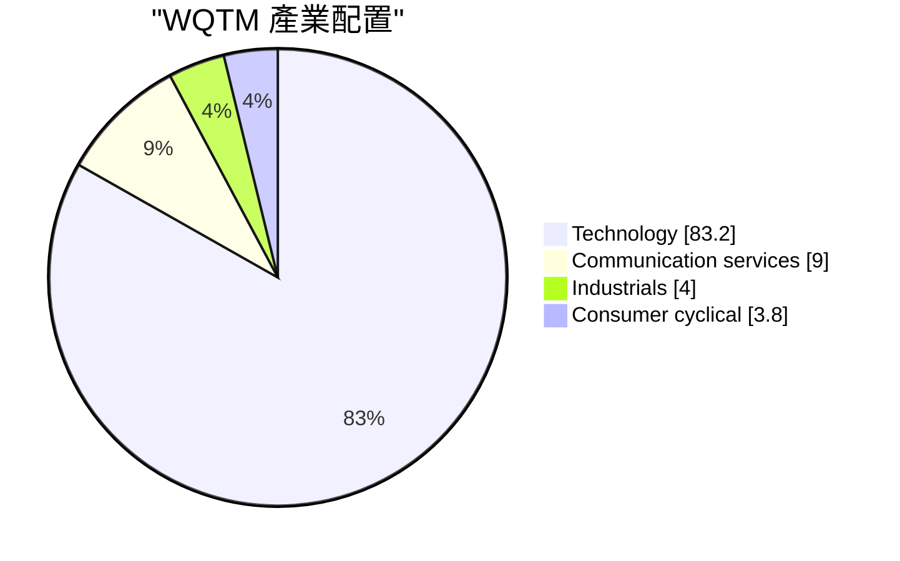

# WQTM ETF 分析報告

> **報告日期**：2026-11-20 ｜ **語言**：繁體中文 ｜ **數據來源**：Yahoo Finance、Finviz ｜ **類型**：ETF／指數基金

## 目錄

| # | 章節 | 核心結論 |
|---|------|----------|
| 1 | 執行摘要 | 聚焦量子運算主題，近期相對 VTI 落後且波動風險高，定位為衛星配置。 |
| 2 | 基金概況 | WisdomTree 被動式 ETF，依公司簡介主要投資於指數成分股或經濟特性相近的投資。 |
| 3 | 成本與規模 | 費用率低於同類平均；資產規模為 291.05M USD。 |
| 4 | 持股與集中度 | 前十大持股合計 46.4%，最大單一持股權重為 7.10%。 |
| 5 | 產業配置 | 科技產業占 83.2%，基金曝險集中於科技及量子運算相關主題。 |
| 6 | 績效與風險 | 1 年價格報酬落後基準；年化波動率與最大回撤顯示價格波動風險高。 |
| 7 | 估值與配息 | 投資組合 P/E 為 26.9x、P/B 為 4.0x，配息殖利率為 0.00%。 |
| 8 | 適合對象、風險與觀察重點 | 適合能承受主題型股票波動、並限制配置比重的投資人。 |

---

## 1. 執行摘要

WQTM 是 WisdomTree 發行的量子運算主題 ETF，採被動式管理；截至 2026-11-19 收盤，價格為 **22.69 USD**。  
基金費用率為 **0.45%**，同類平均為 **0.90%**；前十大持股合計 **46.4%**，最大單一持股 IBM 權重為 **7.10%**。  
截至資料所列期間，基金 1 年價格報酬為 **-7.6%**，低於 VTI 的 **+10.1%**，相對基準超額報酬為 **-17.7%**；3 年及 5 年資料為 N/A。  
基金 1 年年化波動率為 **42.2%**，歷史最大回撤為 **-43.4%**；綜合主題集中、績效落後與波動風險，定位為**衛星配置**。

### 1.1 一頁式摘要

| 項目 | 內容 |
|------|------|
| 追蹤標的／類別 | WisdomTree／Technology；量子運算主題 ETF。指數名稱及編製規則細節：N/A（資料未提供）。 |
| 費用率（同類平均） | 0.45%（0.90%） |
| 資產規模 | 291.05M USD |
| 前十大合計權重／最大持股 | 46.4%／IBM，7.10% |
| 1 年／3 年／5 年價格報酬 | -7.6%／N/A（資料未提供）／N/A（資料未提供） |
| 相對基準的超額報酬（1 年／3 年／5 年） | -17.7%／N/A（資料未提供）／N/A（資料未提供）；基準為 VTI |
| 年化波動率／最大回撤 | 42.2%／-43.4% |
| 折溢價 | -0.43%，相對 NAV 為折價 |
| 定位 | **衛星配置** |

### 1.2 五項評分

| 評分項目 | 分數（0–10） | 依據（引用數字） |
|----------|-------------:|------------------|
| 成本 | 8 | 費用率為 0.45%，低於同類平均 0.90%；以同類比較，成本具吸引力。 |
| 規模與流動性 | 6 | 資產規模為 291.05M USD，基金已有一定規模；成交量及買賣價差資料為 N/A（資料未提供），因此不將規模視為流動性的完整替代指標。 |
| 分散度 | 6 | 前十大持股合計 46.4%，最大持股為 7.10%；前十大未超過基金資產的一半，但主題及產業曝險仍集中。 |
| 相對績效 | 2 | 1 年超額報酬為 -17.7%；3 年及 5 年超額報酬為 N/A（資料未提供）。 |
| 風險 | 2 | 1 年年化波動率為 42.2%，最大回撤為 -43.4%；兩項指標均反映高波動與較大下跌風險。 |

## 2. 基金概況

| 項目 | 資料 |
|------|------|
| 基金名稱 | WisdomTree Quantum Computing Fund |
| 代號 | WQTM |
| 基金公司／家族 | WisdomTree |
| 基金類別 | Technology |
| 管理方式 | 被動式管理／指數化投資 |
| 追蹤指數名稱 | N/A（資料未提供） |
| 指數編製規則細節 | N/A（資料未提供） |
| 基金是否非多元化 | 是；公司簡介標示為 non-diversified |
| 主要投資方向 | 量子運算主題；依基金名稱及所列持股辨識 |
| 目前價格與日期 | 22.69 USD，2026-11-19 收盤 |

基金公司簡介指出，基金目標是追蹤指數表現，採被動式管理方式。  
在一般情況下，基金至少將淨資產的 **80%**，加上為投資目的借入的資金，投資於指數成分股及／或經濟特性與該等成分股實質相近的投資。  
資料未提供指數名稱及更細的成分股選取、調整或加權規則，因此本報告不推定其指數方法。

從所列持股可見，組合包含 IBM、IonQ、Rigetti Computing、D-Wave Quantum、Microsoft、Amazon、Fujitsu 等公司。  
基金在投資組合中較適合作為**主題型衛星部位**，而非單獨承擔整體股票市場配置的工具。  
這項定位反映其科技產業權重、量子運算主題特性及歷史風險數據，不代表個別投資人的適合度。

## 3. 成本與規模

### 3.1 費用與資產規模

| 項目 | 數值 | 解讀 |
|------|------:|------|
| 淨費用率 | 0.45% | 基金持有成本的一項主要指標。 |
| 同類平均費用率 | 0.90% | WQTM 費用率低於此同類平均。 |
| 淨資產 | 291.05M USD | 反映基金資產規模；不等同於成交量或買賣價差。 |
| 年度持股週轉率 | 48.0% | 反映持股更替程度；不直接代表基金報酬或交易成本。 |

### 3.2 費用試算

依資料提供的簡化試算，持有 **1,000,000 USD**、以目前費用率計算 **10 年**、假設期間報酬為零，費用合計為 **45,000 USD**。  
這是**不計報酬的簡化試算**，不包含投資報酬變化、稅負、交易成本或實際持有期間中費用率可能發生的變動。

### 3.3 折溢價

| 項目 | 數值 |
|------|------:|
| 2026-11-19 收盤價格 | 22.69 USD |
| NAV | 22.79 USD |
| 相對 NAV 折溢價 | -0.43% |

目前價格相對 NAV 為折價。這是所列日期的折溢價資料，不代表其他交易日的價格與 NAV 關係，也不能單獨用來判斷基金是否便宜。

## 4. 持股與集中度

### 4.1 前十大持股

| 排序 | 代號 | 名稱 | 權重 |
|-----:|------|------|-----:|
| 1 | IBM | International Business Machines Corp | 7.10% |
| 2 | IONQ | IonQ Inc | 5.39% |
| 3 | QNT | Quantinuum Inc Class A | 5.38% |
| 4 | RGTI | Rigetti Computing Inc | 4.89% |
| 5 | MSFT | Microsoft Corp | 4.12% |
| 6 | QBTS | D-Wave Quantum Inc | 4.11% |
| 7 | 6702.T | Fujitsu Ltd | 4.08% |
| 8 | INFQ | Infleqtion Inc Ordinary Shares - Class | 3.88% |
| 9 | AMZN | Amazon.com Inc | 3.79% |
| 10 | GFS | GLOBALFOUNDRIES Inc | 3.69% |

### 4.2 集中度解讀

| 指標 | 數值 | 解讀 |
|------|------:|------|
| 前十大持股合計 | 46.4% | 前十大持股合計不到基金資產的一半；其餘持股不在本報告列示範圍內。 |
| 最大單一持股 | IBM，7.10% | 單一持股權重低於前十大合計，但仍會對組合報酬有所影響。 |
| 基金多元化標示 | non-diversified | 基金資料將其標示為非多元化基金。 |
| 全部成分股數量 | N/A（資料未提供） | 無法據此計算整體成分股數量或完整持股分散程度。 |

前十大合計權重為 **46.4%**，代表接近一半的資產配置於這十檔列示持股；單一持股權重最高為 **7.10%**。  
因此，基金報酬會受這些主要持股影響，但其整體風險也不能只從前十大判斷：基金本身標示為 non-diversified，且產業配置另有集中情形。  
前十大以外持股資料未提供，本報告不列出或推測其他持股。

## 5. 產業配置

### 5.1 產業權重

| 產業 | 權重 |
|------|-----:|
| Technology | 83.2% |
| Communication services | 9.0% |
| Industrials | 4.0% |
| Consumer cyclical | 3.8% |

科技產業權重為 **83.2%**，是基金最大的產業曝險。  
對投資人而言，持有 WQTM 不只是押注量子運算主題，也承受科技產業相關公司的共同波動；若科技股整體表現疲弱，基金可能面臨產業層面的拖累。  
產業分類依基金提供的配置資料呈現，不代表每一項持股只受單一產業因素影響。

## 6. 績效與風險

### 6.1 各期間價格報酬

以下為價格報酬，**不含配息**；基準為 VTI（美國整體市場）。

| 期間 | WQTM 價格報酬 | VTI 基準報酬 | 超額報酬 |
|------|---------------:|--------------:|---------:|
| 1 個月 | -16.3% | -4.7% | -11.6% |
| 3 個月 | -28.6% | -4.5% | -24.1% |
| 6 個月 | -31.3% | -1.3% | -30.1% |
| 1 年 | -7.6% | +10.1% | -17.7% |
| 3 年 | N/A（資料未提供） | N/A（資料未提供） | N/A（資料未提供） |
| 5 年 | N/A（資料未提供） | N/A（資料未提供） | N/A（資料未提供） |

上述期間中，WQTM 的價格報酬均低於所列 VTI 基準報酬；3 年及 5 年資料缺漏，不能據此評估較長期間的相對績效。  
價格報酬不含配息，因此不能直接視為包含所有現金分配的總報酬。

### 6.2 波動與回撤

| 風險指標 | 數值 | 期間或範圍 |
|----------|------:|-------------|
| 年化波動率 | 42.2% | 1 年 |
| 最大回撤 | -43.4% | 歷史資料範圍為 1.1 年；低點日期為 2026-11-18 |
| 儲存歷史期間 CAGR | -20.8% | 儲存歷史期間 |

年化波動率為 **42.2%**，最大回撤為 **-43.4%**；兩者代表基金價格可能出現大幅且快速的上下波動。  
最大回撤所涉期間僅為資料庫儲存歷史的 **1.1 年**，不能據此推定更長時間尺度的完整歷史風險。

### 6.3 最大回撤的金額示例

資料提供的最大回撤帳面損失示例為：以 **1,000,000 USD** 為例，最大回撤對應的帳面減少金額為 **433,800 USD**。  
這是歷史最大回撤的金額示例，不代表未來一定會出現相同幅度的下跌，也不代表實際投資人的損失金額。

## 7. 估值與配息

| 項目 | 數值 |
|------|------:|
| 投資組合 P/E | 26.9x |
| 投資組合 P/B | 4.0x |
| 配息殖利率 | 0.00% |

P/E 與 P/B 是基金持股組合的加權估值指標，反映成分股整體評價，不是對 WQTM 基金本身的估值。  
配息殖利率為 **0.00%**；資料未提供配息紀錄，因此不推定基金過往是否曾配息或未來是否配息。  
上述估值倍數不構成基金合理價值、預期報酬或目標價判斷。

## 8. 適合對象、風險與觀察重點

### 8.1 適合與不適合的投資人

| 投資人類型 | 適合度 | 原因（引用數字） |
|------------|--------|------------------|
| 想以小部位接觸量子運算主題的投資人 | 較適合 | 基金以量子運算為主題；科技產業權重為 83.2%，可作為主題曝險工具，但不宜忽略集中風險。 |
| 能承受高波動、投資期間較長的投資人 | 有條件適合 | 1 年年化波動率為 42.2%，歷史最大回撤為 -43.4%；需能承受明顯價格波動。 |
| 尋求廣泛市場核心配置的投資人 | 不適合單獨作為核心 | 基金標示為 non-diversified，且科技產業權重為 83.2%；與廣泛市場 ETF 的配置角色不同。 |
| 需要穩定現金配息的投資人 | 不適合 | 配息殖利率為 0.00%，資料未提供配息紀錄。 |
| 不能接受短期大幅下跌的投資人 | 不適合 | 最大回撤為 -43.4%，歷史帳面減少示例為 433,800 USD（以 1,000,000 USD 為例）。 |

### 8.2 主要風險

| 風險 | 數據依據 | 對投資人的含義 |
|------|----------|----------------|
| 主題及產業集中 | Technology 權重為 83.2%；基金標示為 non-diversified | 科技產業或量子運算相關公司若面臨不利環境，基金可能受到共同拖累。 |
| 個別持股影響 | 前十大持股合計 46.4%；最大持股 IBM 為 7.10% | 主要持股的價格變化會影響基金表現；前十大以外持股資料未提供。 |
| 高波動及回撤風險 | 1 年年化波動率為 42.2%；最大回撤為 -43.4% | 投資人需能承受大幅帳面波動，且不應把歷史回撤視為未來損失上限。 |
| 成分股估值波動 | 投資組合 P/E 為 26.9x，P/B 為 4.0x | 若市場對成分股的估值評價下降，基金價格可能承受壓力；倍數不代表基金合理價值。 |
| 海外持股與匯率資訊不足 | 前十大包含 6702.T Fujitsu Ltd，權重為 4.08%；國家配置及避險資料為 N/A（資料未提供） | 可能涉及海外市場及匯率因素，但整體外幣曝險與避險狀況無法由現有資料量化。 |

### 8.3 什麼情況下要重新評估

以下為可查核的追蹤條件，並非對未來市場走勢的預測：

| 觀察項目 | 重新評估條件 |
|----------|--------------|
| 最大持股權重 | 若最大單一持股高於 **10.0%**，重新檢視單一公司曝險；目前資料列示最大持股為 IBM，權重 **7.10%**。 |
| 費用率 | 若基金費用率高於目前 **0.45%**，重新比較同類基金成本及基金提供的主題曝險。 |
| 相對基準績效 | 後續查核時，若 1 年超額報酬仍為負，重新檢視持有理由；目前 1 年超額報酬為 **-17.7%**。 |
| 資產規模 | 若基金淨資產低於目前 **291.05M USD**，重新確認規模變化及交易條件；成交量與買賣價差資料為 N/A（資料未提供）。 |
| 持股與產業配置 | 若科技產業權重或前十大持股合計權重明顯高於本次列示數值，重新評估產業與集中度風險；目前兩者分別為 **83.2%** 及 **46.4%**。 |
| 折溢價 | 後續交易日若折溢價偏離目前 **-0.43%**，可再檢查市場價格與 NAV 的差距；其他交易日資料為 N/A（資料未提供）。 |
| 長期績效資料 | 待 3 年及 5 年報酬資料可查核後，再評估較長期相對 VTI 的表現；目前兩期間資料均為 N/A（資料未提供）。 |

### 結論

**定位：衛星配置。**  
依據為科技產業權重 **83.2%**、前十大持股合計 **46.4%**、1 年相對 VTI 超額報酬 **-17.7%**，以及年化波動率 **42.2%**、最大回撤 **-43.4%**。這是基金在投資組合中的角色定位，不是買入或賣出建議。

---

> **免責聲明**：本報告為 AI 自動生成，僅供研究與教育參考，不構成投資建議。報酬為價格報酬，未計入配息、稅負與交易成本；投資有風險。

---

## 資料與來源

| 項目 | 內容 |
|------|------|
| 價格 | 22.69 USD，2026-11-19 收盤（Yahoo Finance 日線） |
| 基金資料 | Yahoo Finance（持股、費用率、規模）；績效與回撤由價格資料庫計算 |
| 有回應的資料來源 | Yahoo Finance、Finviz |
| 未回應的資料來源 | SEC 申報資料 (XBRL)、StockAnalysis、Roic.ai |
| 由程式計算 | 基金的集中度、績效、費用與回撤試算 |
| 撰寫模型 | openai / gpt-6-luna |

> 本區塊由產生報告的程式依實際取得的資料填寫，非模型撰寫。「由程式計算」的數字不是模型的估計；其餘判斷（評分、情境、策略）是模型的分析。
