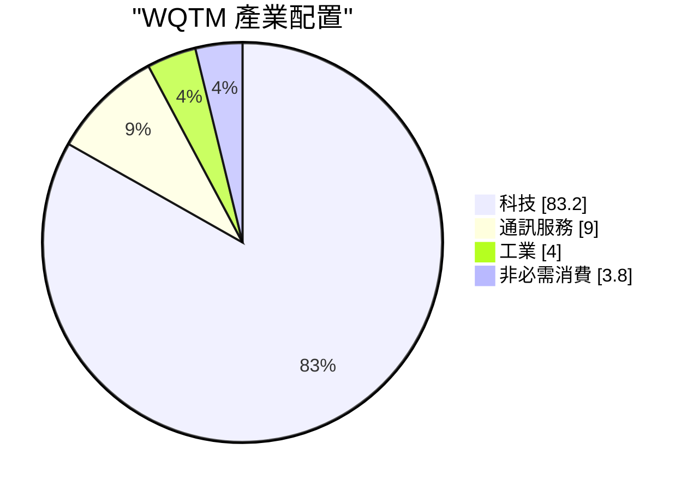

# WQTM ETF 分析報告

> **報告日期**：2026-11-22 ｜ **語言**：繁體中文 ｜ **數據來源**：Yahoo Finance、Finviz ｜ **類型**：ETF／指數基金

## 目錄

| # | 章節 | 核心結論 |
|---|------|----------|
| 1 | 執行摘要 | WQTM 聚焦量子運算相關投資，費用低於同類平均，但近期落後基準且波動與回撤偏高；定位為觀望。 |
| 2 | 基金概況 | 採被動式指數投資方式，基金非多元化，指數名稱與編製規則未提供。 |
| 3 | 成本與規模 | 費用率為 0.45%，資產規模為 291.05M USD；週轉率為 48.0%。 |
| 4 | 持股與集中度 | 前十大持股合計 46.4%，最大持股 IBM 權重為 7.10%。 |
| 5 | 產業配置 | 科技產業占 83.2%，投資曝險高度集中在科技相關產業。 |
| 6 | 績效與風險 | 1 年價格報酬落後 VTI，年化波動率與最大回撤均高。 |
| 7 | 估值與配息 | 投資組合 P/E 為 26.9x、P/B 為 4.0x，配息殖利率為 0.00%。 |
| 8 | 適合對象、風險與觀察重點 | 適合理解主題風險並能承受大幅波動的投資人；需持續檢視集中度、績效與基金規模。 |

---

## 1. 執行摘要

WQTM 是 WisdomTree 旗下量子運算主題基金，採被動式指數投資方式；基金至少將淨資產及投資用途借款的 80% 投入指數成分股或經濟特性實質相似的投資。  
基金費用率為 0.45%，同類平均為 0.90%；前十大持股合計 46.4%，最大單一持股 IBM 占 7.10%，基金資料並標示為非多元化。  
截至 2026-11-20，WQTM 收盤價為 21.13 USD；1 年價格報酬為 -16.1%，相對 VTI 的超額報酬為 -20.6%，3 年及 5 年報酬資料為 N/A。  
基金 1 年年化波動率為 42.8%，已儲存歷史資料中的最大回撤為 -48.9%；近期價格波動與相對績效顯示持有風險較高，以下定位為**觀望**。

### 1.1 一頁式摘要

| 項目 | 內容 |
|------|------|
| 追蹤標的／類別 | 被動式指數投資；WisdomTree／Technology。指數名稱與指數編製規則：N/A（資料未提供）。 |
| 費用率（同類平均） | 0.45%（同類平均 0.90%） |
| 資產規模 | 291.05M USD |
| 前十大合計權重／最大持股 | 46.4%／IBM 7.10% |
| 1 年／3 年／5 年價格報酬 | -16.1%／N/A（資料未提供）／N/A（資料未提供） |
| 相對基準的超額報酬（1 年／3 年／5 年） | -20.6%／N/A（資料未提供）／N/A（資料未提供） |
| 年化波動率／最大回撤 | 42.8%／-48.9% |
| 折溢價 | -0.56%（折價） |
| 定位 | 觀望 |

### 1.2 五項評分

| 評分項目 | 分數（0–10） | 依據（引用數字） |
|----------|-------------:|------------------|
| 成本 | 8 | 費用率為 0.45%，低於同類平均 0.90%；依相對成本水準給予較高分數。 |
| 規模與流動性 | 6 | 資產規模為 291.05M USD，依基金資產規模給予中等評分；交易量與買賣價差資料為 N/A（資料未提供），無法直接評估實際交易流動性。 |
| 分散度 | 6 | 前十大持股合計 46.4%，最大單一持股權重為 7.10%；資料標示前十大低於基金資產的一半，但基金仍標示為非多元化。 |
| 相對績效 | 2 | 1 年相對 VTI 的超額報酬為 -20.6%；3 年與 5 年超額報酬為 N/A（資料未提供）。 |
| 風險 | 2 | 1 年年化波動率為 42.8%，最大回撤為 -48.9%；波動與回撤均顯示較高的本金波動風險。 |

## 2. 基金概況

### 2.1 基金基本資料

| 項目 | 資料 |
|------|------|
| 代號 | WQTM |
| 名稱 | WisdomTree Quantum Computing Fund |
| 基金家族／類別 | WisdomTree／Technology |
| 基金類型 | ETF／指數基金 |
| 投資方式 | 被動式管理，採指數投資方式 |
| 指數名稱 | N/A（資料未提供） |
| 指數編製規則 | N/A（資料未提供） |
| Sector／Industry／Country | N/A（資料未提供） |
| 是否多元化 | 非多元化 |
| 配息紀錄 | N/A（資料未提供） |

### 2.2 投資方式與主題定位

- 基金經理人採用被動管理或指數投資方式，設計目標為追蹤指數表現。
- 在一般情況下，基金至少將淨資產及投資用途借款的 80% 投入指數成分股，或投入經濟特性與指數成分股實質相似的投資。
- 基金名稱與所列持股顯示其主題為量子運算相關投資。
- 指數名稱、成分股選取條件、再平衡方式及其他指數細節皆為 N/A（資料未提供）。
- 成分股數量為 N/A（資料未提供）。
- 追蹤誤差為 N/A（資料未提供）；不能僅憑價格報酬推定基金追蹤指數的精確程度。
- 基金資料標示為非多元化；主題型基金即使持有多檔證券，也不等於廣泛分散的整體市場基金。

### 2.3 在投資組合中的角色

- WQTM 提供的是量子運算主題相關曝險，不是以涵蓋整體股票市場為目標的廣泛市場配置。
- 前十大持股合計占基金資產 46.4%，且產業配置以科技為主，投資結果可能受到特定主題與科技產業共同影響。
- 因此，投資人可將其視為主題配置候選，而非僅憑基金名稱或持股檔數就視為已充分分散的核心市場持有。
- 是否適合納入投資組合，仍須與投資人的其他持有、風險承受度及投資期限一併評估。

## 3. 成本與規模

### 3.1 費用與持有成本

| 項目 | 數值 | 解讀 |
|------|------:|------|
| 淨費用率 | 0.45% | 基金持有期間需承擔的年度基金費用率。 |
| 同類平均費用率 | 0.90% | WQTM 的費用率低於所列同類平均。 |
| 10 年費用試算 | 45,000 USD | 以 1,000,000 USD 為例，不假設任何報酬的簡化試算。 |

- 上表試算金額照錄基金資料中的例子，不代表實際投資人的未來費用。
- 試算假設不計投資報酬；實際持有成本還會受到投資金額、持有期間及基金費用變化等因素影響。
- 基金資料未提供交易佣金、買賣價差或稅負資料，這些項目不包含在上述費用試算中。

### 3.2 資產規模、週轉率與交易資訊

| 項目 | 數值 | 解讀 |
|------|------:|------|
| 資產規模 | 291.05M USD | 可作為觀察基金規模的參考，並非交易流動性的完整衡量。 |
| 年度持股週轉率 | 48.0% | 反映基金持股在年度期間的更替程度；不等於交易成本或投資報酬。 |
| 日均成交量 | N/A（資料未提供） | 無法由現有資料判斷日常成交量。 |
| 買賣價差 | N/A（資料未提供） | 無法由現有資料判斷即時交易成本。 |
| 追蹤誤差 | N/A（資料未提供） | 無法量化基金與追蹤指數報酬的偏離程度。 |

- 資產規模可作為評估基金產品規模的資料之一，但不應直接等同於實際可交易深度。
- 實際進出成本可能受成交量、買賣價差及交易時點影響；相關數據未提供，故不對其作定量判斷。
- 年度持股週轉率可用來觀察組合更替，但單憑該比率不能判定更替的原因或未來表現。

### 3.3 折溢價

| 項目 | 數值 |
|------|------:|
| 收盤價（2026-11-20） | 21.13 USD |
| NAV | 21.25 USD |
| 價格對 NAV 折溢價 | -0.56% |

- 所列價格對 NAV 的差異為 -0.56%，代表該資料時點顯示折價。
- 折溢價是特定時點的比較值，不代表基金長期固定以折價或溢價交易。
- 交易時點、實際成交價格與 NAV 更新時間可能不同；無法只用單一觀察值推定後續交易狀況。

## 4. 持股與集中度

### 4.1 前十大持股

| 排名 | 代號 | 名稱 | 權重 |
|---:|------|------|------:|
| 1 | IBM | International Business Machines Corp | 7.10% |
| 2 | IONQ | IonQ Inc | 5.39% |
| 3 | QNT | Quantinuum Inc Class A | 5.38% |
| 4 | RGTI | Rigetti Computing Inc | 4.89% |
| 5 | MSFT | Microsoft Corp | 4.12% |
| 6 | QBTS | D-Wave Quantum Inc | 4.11% |
| 7 | 6702.T | Fujitsu Ltd | 4.08% |
| 8 | INFQ | Infleqtion Inc Ordinary Shares - Class | 3.88% |
| 9 | AMZN | Amazon.com Inc | 3.79% |
| 10 | GFS | GLOBALFOUNDRIES Inc | 3.69% |

### 4.2 集中度解讀

- 前十大持股合計占基金資產 46.4%；這些持股合計低於基金資產的一半。
- 最大單一持股 IBM 權重為 7.10%；單一持股的權重仍可能影響基金表現，但基金報酬並非只由最大持股決定。
- 前十大持股以外的持股不在本報告列示，亦不對其名稱或權重作推測。
- 基金標示為非多元化；前十大合計低於一半，並不能取代基金整體多元化程度的完整評估。
- 前十大以外的持股分布、持股數量及各持股流動性資料皆為 N/A（資料未提供）。
- 集中度評估須同時看單一持股權重、前十大合計，以及基金主題與產業配置；不能僅以持股檔數判斷風險分散程度。

## 5. 產業配置

| 產業 | 權重 |
|------|------:|
| 科技 | 83.2% |
| 通訊服務 | 9.0% |
| 工業 | 4.0% |
| 非必需消費 | 3.8% |

- 最大產業曝險為科技，權重為 83.2%。
- 持有 WQTM，實際上主要承擔科技產業相關的投資風險，並透過基金持股取得量子運算主題相關曝險。
- 通訊服務、工業與非必需消費亦有配置，但各自權重均低於科技產業。
- 產業分類反映基金持股的分類方式，不代表各持股都只經營單一業務，也不構成未來報酬的保證。

## 6. 績效與風險

### 6.1 各期間價格報酬

以下報酬為價格報酬，不含配息；相對基準為 VTI（美國整體市場）。

| 期間 | WQTM | VTI 基準 | 超額報酬 |
|------|------:|---------:|---------:|
| 1 個月 | -22.7% | -9.3% | -13.4% |
| 3 個月 | -34.5% | -9.8% | -24.7% |
| 6 個月 | -44.8% | -7.3% | -37.5% |
| 1 年 | -16.1% | +4.5% | -20.6% |
| 3 年 | N/A（資料未提供） | N/A（資料未提供） | N/A（資料未提供） |
| 5 年 | N/A（資料未提供） | N/A（資料未提供） | N/A（資料未提供） |

- 所列 1 個月、3 個月、6 個月與 1 年期間，WQTM 價格報酬均低於 VTI 基準。
- 3 年與 5 年基金報酬、基準報酬及超額報酬均為 N/A（資料未提供），因此無法評估較長期間的相對表現。
- 報酬資料來自價格資料，不含配息；不可將其視為包含所有投資收益的總報酬。

### 6.2 波動與回撤

| 風險指標 | 數值 | 期間或資料範圍 |
|----------|------:|---------------|
| 年化波動率 | 42.8% | 1 年 |
| 最大回撤 | -48.9% | 已儲存歷史資料；谷底日期為 2026-11-20 |
| 已儲存歷史期間 CAGR | -27.6% | 已儲存歷史期間為 1.1 年 |

- 年化波動率代表基金價格波動程度的歷史衡量，不代表未來波動幅度。
- 最大回撤衡量歷史資料範圍內價格從高點至低點的下跌幅度；歷史最大回撤不等於未來最大可能損失。
- 若以資料提供的 1,000,000 USD 範例，最大回撤對應的帳面減少金額為 488,500 USD。
- 上述帳面減少金額為依基金資料所列最大回撤情境提供的範例，不代表投資人的實際損失。

### 6.3 歷史價格脈絡

| 月份 | 收盤價 |
|------|------:|
| 2025-10 | 30.29 |
| 2025-11 | 26.05 |
| 2025-12 | 25.88 |
| 2026-01 | 26.98 |
| 2026-02 | 27.10 |
| 2026-03 | 24.69 |
| 2026-04 | 31.72 |
| 2026-05 | 39.35 |
| 2026-06 | 37.81 |
| 2026-07 | 31.43 |
| 2026-08 | 32.04 |
| 2026-09 | 32.06 |
| 2026-10 | 26.33 |
| 2026-11 | 21.13 |

- 上表僅列示所提供的月度收盤價，並非完整的每日價格序列。
- 歷史價格變化本身不能證明未來價格方向，也不能用來推定基金下跌或上漲的原因。
- 基金資料未提供可用來歸因各持股或產業對期間報酬貢獻的數據。

## 7. 估值與配息

| 項目 | 數值 |
|------|------:|
| 投資組合 P/E | 26.9x |
| 投資組合 P/B | 4.0x |
| 配息殖利率 | 0.00% |
| 配息紀錄 | N/A（資料未提供） |

- P/E 與 P/B 為 Yahoo Finance 所列的加權投資組合指標，反映成分股整體評價指標，不是對 ETF 本身的合理價值估算。
- 這些倍數不構成基金未來報酬的保證，也不能單獨判斷成分股或基金是否便宜。
- 配息殖利率為 0.00%；配息紀錄為 N/A（資料未提供），不據此推定未來配息政策。
- 本報告不以這些倍數推算合理價值，也不提供基金目標價。

## 8. 適合對象、風險與觀察重點

### 8.1 適合與不適合的投資人

| 投資人類型 | 適合度 | 原因（引用數字） |
|------------|--------|------------------|
| 想取得量子運算主題曝險的投資人 | 有條件適合 | 基金以量子運算為主題，並採被動式指數投資方式；但指數名稱與編製規則為 N/A（資料未提供）。 |
| 能承受高波動、且願意承受大幅回撤的投資人 | 有條件適合 | 1 年年化波動率為 42.8%，已儲存歷史資料中的最大回撤為 -48.9%。 |
| 尋求廣泛市場分散的核心持有者 | 較不適合 | 科技產業占 83.2%，基金另標示為非多元化。 |
| 主要追求近期相對基準表現的投資人 | 較不適合 | 1 年相對 VTI 的超額報酬為 -20.6%；3 年與 5 年超額報酬為 N/A（資料未提供）。 |
| 主要依賴基金配息取得現金流的投資人 | 較不適合 | 配息殖利率為 0.00%，配息紀錄為 N/A（資料未提供）。 |
| 無法接受主題型基金價格大幅波動的投資人 | 較不適合 | 近期價格報酬為負，且最大回撤與年化波動率顯示較高波動風險。 |

### 8.2 主要風險

| 風險 | 區塊數據與可能影響 |
|------|--------------------|
| 持股集中與非多元化風險 | 前十大持股合計為 46.4%，最大持股 IBM 為 7.10%；基金並標示為非多元化，少數成分股的價格變動可能影響整體基金表現。 |
| 產業集中風險 | 科技產業權重為 83.2%；若科技相關持股整體表現不佳，可能對基金報酬造成較大影響。 |
| 主題與相對績效風險 | 1 年相對 VTI 的超額報酬為 -20.6%；3 年與 5 年超額報酬為 N/A（資料未提供），長期相對表現尚無法由現有數據判讀。 |
| 市場波動與回撤風險 | 1 年年化波動率為 42.8%，歷史最大回撤為 -48.9%；投資人可能面臨顯著的帳面波動。 |
| 跨市場與匯率資訊不足 | 前十大持股包含 6702.T（Fujitsu Ltd），權重為 4.08%；實際匯率曝險與基金是否進行匯率避險為 N/A（資料未提供）。 |
| 評價指標風險 | 投資組合 P/E 為 26.9x、P/B 為 4.0x；這些是成分股加權指標，不代表基金具有確定的估值支撐或未來報酬。 |
| 流動性資料不足 | 日均成交量與買賣價差均為 N/A（資料未提供）；僅憑資產規模不足以完整判斷實際交易成本。 |

### 8.3 什麼情況下要重新評估

| 可查核條件 | 重新評估原因 |
|------------|--------------|
| 最大單一持股權重高於目前的 7.10% | 檢視單一持股對基金整體報酬的影響是否增加。 |
| 前十大持股合計高於目前的 46.4% | 檢視基金集中度是否上升，以及持股風險是否更集中。 |
| 基金費用率異動，或同類平均費用率更新 | 重新比較持有成本及其相對同類產品的位置。 |
| 更新後 1 年相對 VTI 的超額報酬仍為負 | 檢視基金主題曝險是否仍符合投資組合目的；目前資料所列 1 年超額報酬為 -20.6%。 |
| 資產規模低於目前的 291.05M USD | 將其作為重新檢視基金規模的參考條件，並另查成交量與買賣價差。 |
| 年化波動率或最大回撤相較目前的 42.8% 或 -48.9% 有明顯變化 | 重新檢查投資人能否承受基金的實際波動與回撤程度。 |
| 指數名稱、編製規則或基金投資方式有更新 | 現有指數細節為 N/A（資料未提供），若取得新資訊，應重新確認基金投資曝險是否符合預期。 |

> **定位：觀望。** 目前可查資料顯示 WQTM 的 1 年超額報酬為 -20.6%，年化波動率為 42.8%，最大回撤為 -48.9%；同時 3 年與 5 年超額報酬資料為 N/A（資料未提供）。此定位僅概括基金特性與資料限制，不構成買入或賣出建議。

> **免責聲明**：本報告為 AI 自動生成，僅供研究與教育參考，不構成投資建議。報酬為價格報酬，未計入配息、稅負與交易成本；投資有風險。

---

## 資料與來源

| 項目 | 內容 |
|------|------|
| 價格 | 21.13 USD，2026-11-20 收盤（Yahoo Finance 日線） |
| 基金資料 | Yahoo Finance（持股、費用率、規模）；績效與回撤由價格資料庫計算 |
| 有回應的資料來源 | Yahoo Finance、Finviz |
| 未回應的資料來源 | SEC 申報資料 (XBRL)、StockAnalysis、Roic.ai |
| 由程式計算 | 基金的集中度、績效、費用與回撤試算 |
| 撰寫模型 | openai / gpt-6-luna |

> 本區塊由產生報告的程式依實際取得的資料填寫，非模型撰寫。「由程式計算」的數字不是模型的估計；其餘判斷（評分、情境、策略）是模型的分析。
