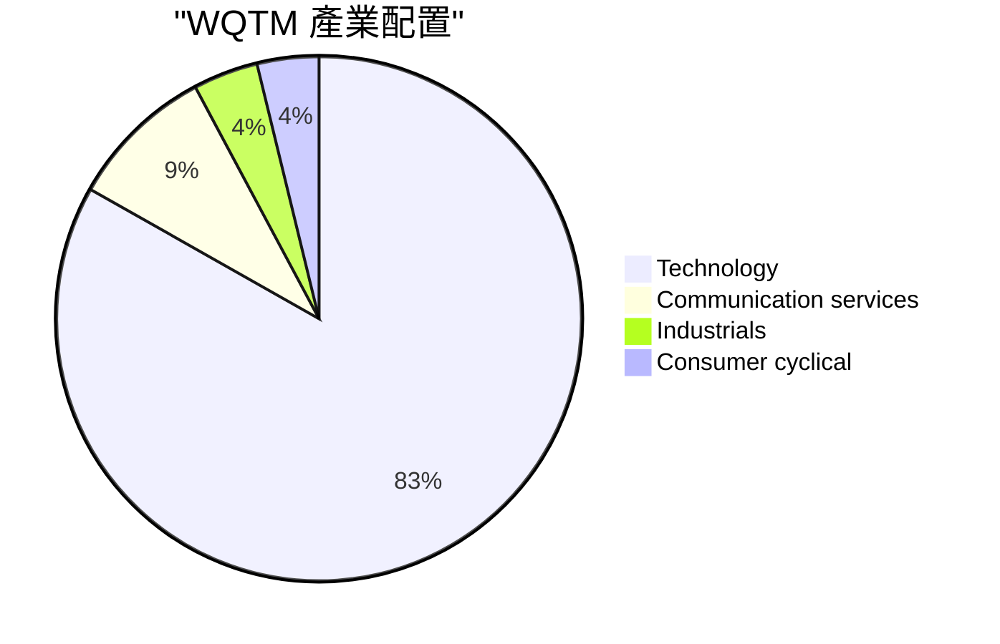

# WQTM ETF 分析報告

> **報告日期**：2026-11-25 ｜ **語言**：繁體中文 ｜ **數據來源**：Yahoo Finance、Finviz ｜ **類型**：ETF／指數基金

## 目錄

| # | 章節 | 核心結論 |
|---|------|----------|
| 1 | 執行摘要 | 主題集中於量子運算相關股票，費用率低於類別平均，但近期相對基準落後且波動與回撤偏高。 |
| 2 | 基金概況 | 採被動式指數投資方式；基金簡介未提供所追蹤指數的名稱或編製細節。 |
| 3 | 成本與規模 | 費用率為 0.45%，低於類別平均；資產規模為 291.05M USD。 |
| 4 | 持股與集中度 | 前十大持股合計 46.4%，最大單一持股為 7.10%。 |
| 5 | 產業配置 | 科技產業占 83.2%，產業風險集中。 |
| 6 | 績效與風險 | 1 年價格報酬落後 VTI；年化波動率為 43.3%，最大回撤為 -48.9%。 |
| 7 | 估值與配息 | 投資組合 P/E 為 26.9x、P/B 為 4.0x，配息殖利率為 0.00%。 |
| 8 | 適合對象、風險與觀察重點 | 適合能承受高波動、且希望配置量子運算主題的投資人；定位為衛星配置。 |

---

## 1. 執行摘要

WQTM 是 WisdomTree 旗下科技類 ETF，採被動式指數投資方式；基金簡介指出，正常情況下至少 80% 淨資產及投資用途借款投入指數成分股或具相近經濟特性的投資。  
費用率為 0.45%，類別平均為 0.90%；前十大持股合計 46.4%，最大持股權重為 7.10%。  
截至 2026-11-23，基金 1 年價格報酬為 -3.5%，相對 VTI 的超額報酬為 -14.5%；3 年與 5 年報酬及超額報酬均為 N/A。  
2026-11-24 最近一個已完成交易日收盤價為 21.99 USD；年化波動率為 43.3%，歷史最大回撤為 -48.9%，因此本報告將基金定位為「衛星配置」。

### 1.1 一頁式摘要

| 項目 | 內容 |
|------|------|
| 追蹤標的／類別 | WisdomTree / Technology；被動式指數投資，追蹤指數名稱及編製規則細節為 N/A（資料未提供） |
| 費用率（同類平均） | 0.45%（0.90%） |
| 資產規模 | 291.05M USD |
| 前十大合計權重／最大持股 | 46.4%／7.10% |
| 1 年／3 年／5 年價格報酬 | -3.5%／N/A／N/A |
| 相對基準的超額報酬（1 年／3 年／5 年） | -14.5%／N/A／N/A；基準為 VTI |
| 年化波動率／最大回撤 | 43.3%／-48.9% |
| 折溢價 | -0.06%（折價） |
| 價格與日期 | 21.99 USD；2026-11-24 最近一個已完成交易日收盤價 |
| 定位 | 衛星配置 |

### 1.2 五項評分

| 評分項目 | 分數（0–10） | 依據（引用數字） |
|----------|-------------:|------------------|
| 成本 | 8 | 費用率為 0.45%，低於類別平均 0.90%；此分數依現有類別平均比較。 |
| 規模與流動性 | 6 | 資產規模為 291.05M USD；成交量、買賣價差等交易流動性資料為 N/A（資料未提供），因此不能單靠資產規模判定實際交易流動性。 |
| 分散度 | 7 | 前十大持股合計 46.4%，最大單一持股為 7.10%；基金資料將持股描述為 diversified，但基金簡介同時標示 non-diversified。 |
| 相對績效 | 2 | 1 年相對 VTI 超額報酬為 -14.5%；3 年與 5 年相對基準超額報酬為 N/A（資料未提供）。 |
| 風險 | 2 | 年化波動率為 43.3%，最大回撤為 -48.9%；兩項指標均顯示價格波動風險較高。 |

## 2. 基金概況

### 基金基本資料

| 項目 | 資料 |
|------|------|
| 代號 | WQTM |
| 名稱 | WisdomTree Quantum Computing Fund |
| 基金公司／類別 | WisdomTree / Technology |
| 基金性質 | 基金／ETF |
| 管理方式 | 被動式管理，採指數投資方式 |
| 產業 | N/A（資料未提供） |
| 國家 | N/A（資料未提供） |
| 追蹤指數名稱 | N/A（資料未提供） |
| 指數編製規則細節 | N/A（資料未提供） |

### 投資方式與用途

基金簡介表示，基金以追蹤指數表現為目標，採被動式管理方式。  
正常情況下，基金至少將 80% 淨資產及投資用途借款投入指數成分股，或投入具備與指數成分股大致相似經濟特性的投資。  
現有資料未列出追蹤指數名稱、成分股數量、納入條件或再平衡規則，故不對相關細節作推測。  
基金名稱指向量子運算主題，前十大持股則包括量子運算企業，以及大型科技與半導體相關公司；投資人應以實際持股及產業權重理解其曝險，而非只依基金名稱判斷。

### 在投資組合中的角色

WQTM 可作為科技與量子運算主題的專項配置，不宜只依其科技類別或主題名稱視為廣泛分散的整體市場基金。  
科技產業權重為 83.2%，顯示基金仍以科技相關企業為主要曝險。  
基金簡介標示為 non-diversified；另一方面，資料指出前十大持股合計低於基金資產的一半，並將這些持股描述為 diversified。兩者描述角度不同，投資人不應把前十大未過半直接解讀為涵蓋全市場的廣泛分散。  
若投資人已持有大型科技股或量子運算相關個股，持有 WQTM 可能增加相近產業或主題曝險；實際重疊程度須依個人持倉另行確認。

## 3. 成本與規模

### 費用與資產資料

| 項目 | 數值 | 解讀 |
|------|------:|------|
| 淨費用率 | 0.45% | 基金持有成本的主要年度指標；實際投資結果仍會受其他因素影響。 |
| 類別平均費用率 | 0.90% | Yahoo Finance 所列科技類別平均。 |
| 淨資產 | 291.05M USD | 反映基金資產規模；不能單獨代表成交量或買賣價差。 |
| 年度持股週轉率 | 48.0% | 顯示投資組合持股調整情形；不是投資報酬率。 |

### 費用試算

| 試算項目 | 數值 | 說明 |
|----------|------:|------|
| 投資金額假設 | 1,000,000 USD | 區塊提供的試算基礎。 |
| 期間 | 10 年 | 區塊提供的試算期間。 |
| 費用試算 | 45,000 USD | 依區塊所列費用試算，照抄原數值。 |

這是依目前費用率作出的簡化試算，假設不計投資報酬；它不是實際帳戶費用預測，也沒有反映持有期間費用率變動或交易成本。  
基金費用率低於其類別平均；是否符合個人需求，仍須連同基金主題、風險與投資組合角色判斷。

### 資產規模、週轉率與折溢價

資產規模為 291.05M USD，可作為基金規模參考；資料未提供成交量與買賣價差，因此無法單憑資產規模完整評估交易流動性。  
年度持股週轉率為 48.0%，代表投資組合有一定程度的持股調整；該數字本身不表示基金績效較佳或較差。  
NAV 為 22.00 USD，最近一個已完成交易日收盤價為 21.99 USD，價格相對 NAV 的折溢價為 -0.06%，屬折價。  
折溢價是特定時點的價格與淨值關係，不代表基金具有固定折價，也不能視為基金合理價值的判斷。

## 4. 持股與集中度

### 前十大持股

| 代號 | 名稱 | 權重 |
|------|------|------:|
| IBM | International Business Machines Corp | 7.10% |
| IONQ | IonQ Inc | 5.39% |
| QNT | Quantinuum Inc Class A | 5.38% |
| RGTI | Rigetti Computing Inc | 4.89% |
| MSFT | Microsoft Corp | 4.12% |
| QBTS | D-Wave Quantum Inc | 4.11% |
| 6702.T | Fujitsu Ltd | 4.08% |
| INFQ | Infleqtion Inc Ordinary Shares - Class | 3.88% |
| AMZN | Amazon.com Inc | 3.79% |
| GFS | GLOBALFOUNDRIES Inc | 3.69% |

### 集中度解讀

前十大持股合計 46.4%，最大單一持股 IBM 權重為 7.10%。  
因此，基金表現不完全取決於單一公司，但仍會受到前十大持股及科技產業共同走勢影響。  
最大持股權重可用來觀察單一公司對基金的相對影響；在基金整體投資中，單一持股仍是重要成分之一。  
前十大合計權重低於一半，表示其餘資產配置在未列出的持股或其他投資；本報告不列出前十大以外的持股，因相關明細為 N/A（資料未提供）。  
基金簡介另標示 non-diversified。這項基金分類描述與前十大持股權重是不同資訊，投資人不應僅以「前十大未達一半」推斷基金已充分分散風險。  
持股明細及權重會隨基金投資組合變化；本表反映提供資料所列持股，不代表未來固定配置。

## 5. 產業配置

### 產業權重

| 產業 | 權重 |
|------|------:|
| technology | 83.2% |
| communication services | 9.0% |
| industrials | 4.0% |
| consumer cyclical | 3.8% |

科技產業權重為 83.2%，是基金最主要的產業曝險。  
投資人持有 WQTM，實際上承擔的是以科技產業為主、並聚焦量子運算相關主題的股票投資風險。  
若科技類股評價、資金偏好或產業發展預期轉弱，基金可能受到影響；這項風險不能只靠持有多檔股票消除。  
communication services、industrials 與 consumer cyclical 亦有配置，但權重均低於科技產業。  
產業分類反映提供資料中的分類結果；資料未提供更細的次產業配置或分類定義。

## 6. 績效與風險

### 各期間價格報酬

| 期間 | WQTM | 基準 VTI | 超額報酬 |
|------|-----:|---------:|---------:|
| 1 個月 | -15.9% | -4.8% | -11.1% |
| 3 個月 | -30.3% | -6.1% | -24.2% |
| 6 個月 | -40.7% | -3.8% | -36.8% |
| 1 年 | -3.5% | +11.0% | -14.5% |
| 3 年 | N/A（資料未提供） | N/A（資料未提供） | N/A（資料未提供） |
| 5 年 | N/A（資料未提供） | N/A（資料未提供） | N/A（資料未提供） |

以上為截至 2026-11-23 的價格報酬，不含配息。  
表中基準為 VTI（美國整體市場）；超額報酬引用資料所列數值，不另行計算。  
1 個月、3 個月、6 個月及 1 年期間，WQTM 的價格報酬均低於 VTI。  
3 年與 5 年資料為 N/A（資料未提供），因此不能據此判定較長期間的相對表現。  
資料未提供追蹤誤差，不能由基金報酬與基準報酬替代推算追蹤誤差。

### 波動與回撤

| 風險指標 | 數值 | 資料範圍或說明 |
|----------|------:|----------------|
| 年化波動率 | 43.3% | 1 年年化波動率。 |
| 最大回撤 | -48.9% | 儲存歷史資料範圍為 1.1 年；低點日期為 2026-11-20。 |
| 儲存歷史期間 CAGR | -21.9% | 依提供資料的儲存歷史期間。 |

年化波動率為 43.3%，代表該基金在所列期間的價格波動程度偏高。  
最大回撤為 -48.9%，反映儲存歷史資料中的高點至低點跌幅；這是歷史風險觀察，不代表未來最大跌幅上限。  
區塊列出的 1,000,000 USD 試算，在最大回撤情境下的帳面減少金額為 488,500 USD。  
該金額是依所列最大回撤提供的試算值，不代表實際投資人必然遭遇同等金額損失。  
儲存歷史期間 CAGR 為 -21.9%；資料範圍為 1.1 年，不能直接視為長期績效紀錄。

### 近期價格歷史

| 月份 | 收盤價 |
|------|------:|
| 2025-10 | 30.29 |
| 2025-11 | 26.05 |
| 2025-12 | 25.88 |
| 2026-01 | 26.98 |
| 2026-02 | 27.10 |
| 2026-03 | 24.69 |
| 2026-04 | 31.72 |
| 2026-05 | 39.35 |
| 2026-06 | 37.81 |
| 2026-07 | 31.43 |
| 2026-08 | 32.04 |
| 2026-09 | 32.06 |
| 2026-10 | 26.33 |
| 2026-11 | 21.99 |

表列價格呈現期間內先升後降的走勢；歷史價格不是未來報酬的保證。  
2026-11 的收盤價資料與報告日期附近的最近一個已完成交易日價格一致；績效報酬的資料截止日則依價格資料庫所列日期。

## 7. 估值與配息

| 項目 | 數值 | 說明 |
|------|------:|------|
| 投資組合 P/E | 26.9x | Yahoo Finance 所列加權投資組合倍數。 |
| 投資組合 P/B | 4.0x | Yahoo Finance 所列加權投資組合倍數。 |
| 配息殖利率 | 0.00% | Yahoo Finance 所列基金配息殖利率。 |

P/E 與 P/B 是基金持有成分股的加權投資組合指標，反映成分股整體評價特徵，不是對 WQTM 基金本身的估值。  
這些倍數不能單獨說明基金是否便宜或昂貴，也不能據此推導基金合理價值或目標價。  
配息殖利率為 0.00%；資料未提供配息紀錄，因此不對過往配息頻率、金額或未來配息作推測。  
對重視定期現金流的投資人而言，現有殖利率資料不支持將 WQTM 視為收益型配置。

## 8. 適合對象、風險與觀察重點

### 8.1 適合與不適合的投資人

| 投資人類型 | 適合度 | 原因（引用數字） |
|------------|--------|------------------|
| 希望配置量子運算主題、可承受較大波動的投資人 | 較適合 | 科技產業權重為 83.2%；年化波動率為 43.3%，須能承受較大價格波動。 |
| 尋求廣泛市場核心配置的投資人 | 不宜單獨作為核心 | 基金以科技與量子運算主題為主，且 1 年相對 VTI 的超額報酬為 -14.5%。 |
| 重視穩定配息的投資人 | 不適合 | 配息殖利率為 0.00%。 |
| 不接受大幅帳面波動的投資人 | 不適合 | 最大回撤為 -48.9%；區塊提供的 1,000,000 USD 試算帳面減少金額為 488,500 USD。 |
| 希望以低費用作為主要選擇條件的投資人 | 可納入比較 | 費用率為 0.45%，低於類別平均 0.90%；但費用不代表基金風險較低。 |

### 8.2 主要風險

| 風險 | 數字依據 | 對投資人的意義 |
|------|----------|----------------|
| 科技產業集中 | technology 權重為 83.2%。 | 基金對科技產業景氣、評價與資金偏好變化較敏感。 |
| 個別持股與主題波動 | 前十大持股合計 46.4%；最大持股權重為 7.10%。 | 多檔持股不代表主題或產業風險消失；成分股波動仍可能影響基金。 |
| 價格波動及深度回撤 | 年化波動率為 43.3%；最大回撤為 -48.9%。 | 投資人須能承受顯著帳面波動，並避免只根據短期價格走勢作判斷。 |
| 相對基準落後 | 1 年相對 VTI 超額報酬為 -14.5%；3 年及 5 年超額報酬為 N/A（資料未提供）。 | 已提供期間顯示落後基準；較長期間資料不足，無法確認長期相對表現。 |
| 成分股評價風險 | 投資組合 P/E 為 26.9x，P/B 為 4.0x。 | 成分股評價可能影響基金價格；倍數不等於合理價值或未來報酬。 |
| 匯率風險 | 前十大持股包含 6702.T Fujitsu Ltd，權重為 4.08%；基金其餘外幣曝險明細為 N/A（資料未提供）。 | 持有非美國上市股票可能涉及匯率變動；資料未提供完整幣別曝險，無法量化其影響。 |
| 配息與現金流需求不匹配 | 配息殖利率為 0.00%。 | 依現有資料，基金不適合作為穩定配息來源。 |

### 8.3 什麼情況下要重新評估

| 可查核條件 | 重新評估方式 |
|------------|--------------|
| 最大持股權重高於目前 7.10% | 檢視單一成分股對基金的影響是否增加，並重新檢查個人投資組合的重疊持倉。 |
| 前十大持股合計權重高於目前 46.4% | 重新評估集中度變化，以及基金是否仍符合原先配置用途。 |
| 費用率不同於目前 0.45% | 核對更新後費用率，並重新比較同類平均 0.90% 及其他同類基金成本。 |
| 後續期間相對 VTI 持續落後 | 依新公布的同期間基金報酬、基準報酬與超額報酬，檢視主題配置是否仍符合投資理由；避免以未提供的期間數字推論。 |
| 資產規模較目前 291.05M USD 明顯縮減 | 查核更新後資產規模，以及可取得的成交量和買賣價差資料；本報告未提供這些交易資料。 |
| 科技產業權重不同於目前 83.2% | 檢視產業曝險變化，確認基金仍符合個人設定的科技與量子運算配置比例。 |
| 波動或回撤指標更新 | 將更新後年化波動率及最大回撤與目前 43.3% 及 -48.9% 比較，重新評估個人可承受程度。 |

### 結論定位

**衛星配置。** WQTM 的科技產業權重為 83.2%，前十大持股合計 46.4%；其 1 年相對 VTI 超額報酬為 -14.5%，年化波動率為 43.3%，最大回撤為 -48.9%。這些數字顯示基金具有明確主題曝險，也伴隨較高波動與回撤風險，較適合作為投資組合中的專項配置，而非僅依本報告數字取代廣泛市場基金。此定位不是買入或賣出建議。

> **免責聲明**：本報告為 AI 自動生成，僅供研究與教育參考，不構成投資建議。報酬為價格報酬，未計入配息、稅負與交易成本；投資有風險。

---

## 資料與來源

| 項目 | 內容 |
|------|------|
| 價格 | 21.99 USD，2026-11-24 收盤（Yahoo Finance 日線） |
| 基金資料 | Yahoo Finance（持股、費用率、規模）；績效與回撤由價格資料庫計算 |
| 有回應的資料來源 | Yahoo Finance、Finviz |
| 未回應的資料來源 | SEC 申報資料 (XBRL)、StockAnalysis、Roic.ai |
| 由程式計算 | 基金的集中度、績效、費用與回撤試算 |
| 撰寫模型 | openai / gpt-6-luna |

> 本區塊由產生報告的程式依實際取得的資料填寫，非模型撰寫。「由程式計算」的數字不是模型的估計；其餘判斷（評分、情境、策略）是模型的分析。
