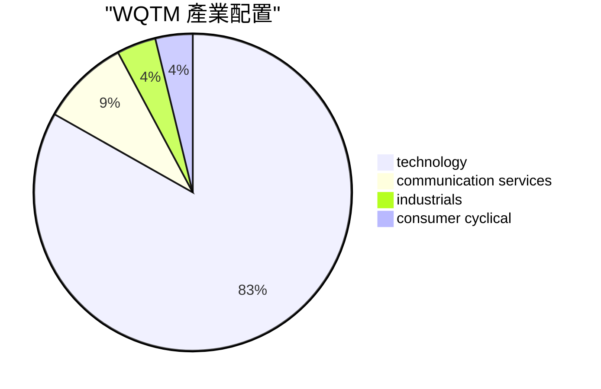

# WQTM ETF 分析報告

> **報告日期**：2026-11-28 ｜ **語言**：繁體中文 ｜ **數據來源**：Yahoo Finance、Finviz ｜ **類型**：ETF／指數基金

## 目錄

| # | 章節 | 核心結論 |
|---|------|----------|
| 1 | 執行摘要 | 量子運算主題 ETF；費用率低於類別平均，但近期相對基準落後且波動與回撤偏高，定位為衛星配置。 |
| 2 | 基金概況 | 採被動式指數管理，正常情況下至少 80% 淨資產投資於指數成分股或經濟特性相近的投資。 |
| 3 | 成本與規模 | 費用率為 0.45%，淨資產為 291.05M USD；規模之外的交易流動性資料未提供。 |
| 4 | 持股與集中度 | 前十大持股合計 46.4%，最大單一持股為 IBM，權重 7.10%。 |
| 5 | 產業配置 | 科技業占 83.2%，基金主要承擔科技與量子運算主題相關風險。 |
| 6 | 績效與風險 | 1 年價格報酬落後 VTI 20.5%；年化波動率為 43.2%，最大回撤為 -48.9%。 |
| 7 | 估值與配息 | 投資組合 P/E 為 26.9x、P/B 為 4.0x，配息殖利率為 0.00%。 |
| 8 | 適合對象、風險與觀察重點 | 適合能承受較大波動、且希望配置主題型部位的投資人；須留意產業集中與回撤。 |

---

## 1. 執行摘要

WQTM 是 WisdomTree 旗下科技類 ETF，採被動式指數管理，投資主題聚焦量子運算相關企業；基金說明指出，正常情況下至少 80% 淨資產投資於指數成分股或經濟特性相近的投資。  
基金費用率為 0.45%，低於類別平均 0.90%；前十大持股合計 46.4%，最大單一持股 IBM 權重為 7.10%。  
截至 2026-11-25，WQTM 1 年價格報酬為 -13.0%，相對 VTI 的超額報酬為 -20.5%；3 年與 5 年報酬及超額報酬均為 N/A（資料未提供）。  
2026-11-27 收盤價為 23.19 USD；年化波動率為 43.2%，最大回撤為 -48.9%，顯示其價格可能大幅波動。

### 1.1 一頁式摘要

| 項目 | 內容 |
|------|------|
| 追蹤標的／類別 | WisdomTree／Technology；採被動式指數管理，投資主題為量子運算相關企業；具體追蹤指數名稱及編製規則為 N/A（資料未提供）。 |
| 費用率（同類平均） | 0.45%（0.90%） |
| 資產規模 | 291.05M USD |
| 前十大合計權重／最大持股 | 46.4%／IBM 7.10% |
| 1 年／3 年／5 年價格報酬 | -13.0%／N/A（資料未提供）／N/A（資料未提供） |
| 相對基準的超額報酬（1 年／3 年／5 年） | -20.5%／N/A（資料未提供）／N/A（資料未提供） |
| 年化波動率／最大回撤 | 43.2%／-48.9% |
| 折溢價 | +0.44%（相對 NAV 為溢價） |
| 定位 | **衛星配置**；主題集中、波動與回撤較高，且 1 年相對基準落後。 |

### 1.2 五項評分

| 評分項目 | 分數（0–10） | 依據（引用數字） |
|----------|-------------:|------------------|
| 成本 | 8 | 費用率為 0.45%，低於類別平均 0.90%；依相對成本水準評分。 |
| 規模與流動性 | 6 | 淨資產為 291.05M USD；未提供成交量、買賣價差等交易流動性資料，評分主要依資產規模。 |
| 分散度 | 6 | 前十大合計權重為 46.4%，最大持股權重為 7.10%；前十大低於基金資產一半，但基金說明同時標示為 non-diversified。 |
| 相對績效 | 2 | 1 年超額報酬為 -20.5%；3 年與 5 年相對基準報酬為 N/A（資料未提供）。 |
| 風險 | 2 | 年化波動率為 43.2%，最大回撤為 -48.9%；波動與歷史回撤均高。 |

---

## 2. 基金概況

| 項目 | 資料 |
|------|------|
| 基金名稱 | WisdomTree Quantum Computing Fund |
| 代號 | WQTM |
| 基金公司／類別 | WisdomTree／Technology |
| 投資方式 | 被動式管理，或稱指數化投資方式。 |
| 主要投資主題 | 量子運算相關企業；此描述依基金名稱、簡介及列示持股整理。 |
| 指數名稱與編製細節 | N/A（資料未提供） |
| 正常情況下的投資要求 | 至少 80% 淨資產，加上投資用途借款，投資於指數成分股及／或經濟特性大致相近的投資。 |
| 基金分類特徵 | 基金簡介標示為 non-diversified。 |
| 成分股數量 | N/A（資料未提供） |
| 追蹤誤差 | N/A（資料未提供） |

### 基金在投資組合中的角色

- 這檔基金提供量子運算主題曝險，適合作為投資組合中的主題型部位來評估，而非單憑其科技類別就視為廣泛市場基金。
- 列示持股涵蓋大型科技公司、半導體相關企業及量子運算公司；但資料沒有提供指數完整持股或成分股數量，不能據此前十大推定基金的全部投資範圍。
- 被動管理代表基金以追蹤指數為目標；資料未提供指數編製規則及追蹤誤差，因此無法進一步評估指數篩選方法或追蹤品質。
- 基金簡介標示 non-diversified；另一方面，前十大持股合計權重低於基金資產一半。兩者分別是基金分類資訊與持股權重資訊，不宜混為同一個概念。

---

## 3. 成本與規模

### 3.1 費用與規模資料

| 指標 | 數值 | 解讀 |
|------|------:|------|
| 淨費用率 | 0.45% | 基金持續持有成本的主要指標之一。 |
| 類別平均費用率 | 0.90% | 可作為同類成本比較參考。 |
| 淨資產 | 291.05M USD | 反映基金資產規模；不等同於每日交易流動性。 |
| 年度持股週轉率 | 48.0% | 反映持股在年度內的更換程度；本數據不代表投資人的實際交易成本。 |
| 成交量、買賣價差 | N/A（資料未提供） | 無法由淨資產規模直接判斷 ETF 的即時交易流動性。 |

- 費用率為 0.45%，類別平均為 0.90%；依提供數據，WQTM 的費用率低於其類別平均。
- 費用率是長期持有時應留意的基金成本，但實際投資結果還會受到市場報酬、交易成本及其他因素影響。
- 年度持股週轉率為 48.0%；週轉率反映基金持股變動程度，不等同於基金費用率，也不能直接視為投資人買賣 WQTM 的成本。

### 3.2 費用試算

| 試算項目 | 數值 |
|----------|------:|
| 投入金額 | 1,000,000 USD |
| 試算期間 | 10 年 |
| 假設報酬 | 不計報酬 |
| 依目前費用率估算的費用 | 45,000 USD |

> 上述 45,000 USD 為不計報酬的簡化試算，金額照錄提供數據；不代表實際未來費用，也未納入投資報酬變化。

### 3.3 折溢價

| 指標 | 數值 |
|------|------:|
| 2026-11-27 收盤價 | 23.19 USD |
| NAV | 23.09 USD |
| 價格相對 NAV 的折溢價 | +0.44% |

+0.44% 表示價格相對 NAV 為溢價。這是資料所列時點的折溢價資訊，不代表其他交易時段的折溢價水準。

---

## 4. 持股與集中度

### 4.1 前十大持股

| 代號 | 名稱 | 權重 |
|------|------|------:|
| IBM | International Business Machines Corp | 7.10% |
| IONQ | IonQ Inc | 5.39% |
| QNT | Quantinuum Inc Class A | 5.38% |
| RGTI | Rigetti Computing Inc | 4.89% |
| MSFT | Microsoft Corp | 4.12% |
| QBTS | D-Wave Quantum Inc | 4.11% |
| 6702.T | Fujitsu Ltd | 4.08% |
| INFQ | Infleqtion Inc Ordinary Shares - Class | 3.88% |
| AMZN | Amazon.com Inc | 3.79% |
| GFS | GLOBALFOUNDRIES Inc | 3.69% |

### 4.2 集中度解讀

| 指標 | 數值 | 解讀 |
|------|------:|------|
| 前十大持股合計 | 46.4% | 前十大持股合計低於基金資產一半；其餘部位不在本報告列示範圍。 |
| 最大單一持股 | IBM，7.10% | 單一持股權重可影響基金報酬，但基金的整體走勢仍由全部持股共同決定。 |
| 完整持股清單 | N/A（資料未提供） | 本節只列資料中提供的前十大，不推列其他持股。 |

- 前十大合計權重為 46.4%，表示基金有相當部分資產配置在前十大以外；但前十大以外的持股名稱與權重為 N/A（資料未提供）。
- 最大單一持股 IBM 權重為 7.10%；單一公司風險存在，但不能只用最大持股權重判斷整體基金風險。
- 基金簡介標示 non-diversified；這項基金分類資訊與前十大持股合計權重低於一半的現象應分開理解。
- 列示持股中包含 IBM、Microsoft、Amazon 等大型科技公司，也包含 IonQ、Rigetti Computing、D-Wave Quantum 等量子運算相關公司；本報告不對未列示持股作推測。

---

## 5. 產業配置

### 5.1 產業權重

| 產業 | 權重 |
|------|------:|
| technology | 83.2% |
| communication services | 9.0% |
| industrials | 4.0% |
| consumer cyclical | 3.8% |

### 5.2 配置代表的曝險

- technology 權重為 83.2%，是基金最大的產業曝險；基金表現可能高度受科技股整體表現影響。
- communication services 權重為 9.0%，industrials 為 4.0%，consumer cyclical 為 3.8%。
- 對投資人而言，持有 WQTM 不只是押注量子運算主題，也代表承擔以科技業為主的產業曝險。
- 產業權重描述的是產業配置，不能直接推導各公司的國別、營收來源或各幣別曝險比例。

---

## 6. 績效與風險

### 6.1 各期間價格報酬

| 期間 | 本基金 | 基準 VTI | 超額報酬 |
|------|-------:|---------:|---------:|
| 1 個月 | -22.8% | -6.5% | -16.2% |
| 3 個月 | -33.2% | -7.2% | -26.0% |
| 6 個月 | -44.0% | -5.0% | -39.1% |
| 1 年 | -13.0% | +7.5% | -20.5% |
| 3 年 | N/A（資料未提供） | N/A（資料未提供） | N/A（資料未提供） |
| 5 年 | N/A（資料未提供） | N/A（資料未提供） | N/A（資料未提供） |

> 表中報酬為價格報酬，不含配息；資料截至 2026-11-25。基準為 VTI（美國整體市場）。

- 在已提供的各期間中，WQTM 的價格報酬均為負值，且超額報酬亦為負值。
- 1 年本基金價格報酬為 -13.0%，VTI 報酬為 +7.5%，提供數據所列超額報酬為 -20.5%。
- 3 年與 5 年的本基金、基準及超額報酬均為 N/A（資料未提供），因此不能據此判斷長期相對績效。
- 價格資料不包含配息；基金配息紀錄為 N/A（資料未提供）。

### 6.2 波動與回撤

| 風險指標 | 數值 | 說明 |
|----------|------:|------|
| 年化波動率（1 年） | 43.2% | 反映過去期間價格波動程度，不代表未來波動必然相同。 |
| 最大回撤 | -48.9% | 依資料庫所存歷史計算；歷史期間為 1.1 年。 |
| 最大回撤低點日期 | 2026-11-20 | 資料所列最大回撤低點日期。 |
| 資料庫期間 CAGR | -24.4% | 資料所列儲存期間年化成長率；不代表完整長期績效。 |

- 年化波動率為 43.2%，代表該期間價格波動幅度較大。
- 最大回撤為 -48.9%，發生於資料庫所存 1.1 年歷史期間；最大回撤是歷史高點至低點的跌幅，不是未來虧損上限。
- 對 1,000,000 USD 部位而言，最大回撤對應的帳面減少金額為 **488,500 USD**。此金額依提供的 Worked example 照錄，並非對個人投資結果的預測。
- WQTM 的月度收盤價資料涵蓋 2025-10 至 2026-11；所列紀錄中，2026-05 收盤價為 39.35 USD，2026-11 收盤價為 23.19 USD。這些月度資料呈現期間內價格有起伏，不能單獨用來推斷未來走勢。

### 6.3 追蹤與資料限制

| 項目 | 資料 |
|------|------|
| 追蹤誤差 | N/A（資料未提供） |
| 指數名稱 | N/A（資料未提供） |
| 指數編製規則細節 | N/A（資料未提供） |
| 3 年、5 年績效 | N/A（資料未提供） |

---

## 7. 估值與配息

| 指標 | 數值 |
|------|------:|
| 投資組合 P/E | 26.9x |
| 投資組合 P/B | 4.0x |
| 配息殖利率 | 0.00% |
| 配息紀錄 | N/A（資料未提供） |

- P/E 與 P/B 是 Yahoo Finance 所列的投資組合加權指標，反映基金成分股整體的評價資訊，不是 WQTM 本身的合理價值。
- 上述倍數不能單獨用來判定基金便宜或昂貴，也不能據此推算基金目標價。
- 配息殖利率為 0.00%；實際配息紀錄為 N/A（資料未提供），因此不對未列出的配息情形作推測。

---

## 8. 適合對象、風險與觀察重點

### 8.1 適合與不適合的投資人

| 投資人類型 | 適合度 | 原因（引用數字） |
|------------|--------|------------------|
| 能承受大幅價格波動、希望配置量子運算主題的投資人 | 較適合以衛星部位評估 | 年化波動率為 43.2%，最大回撤為 -48.9%；投資人須能承受較大的帳面波動。 |
| 希望以單一基金分散配置到多個產業的投資人 | 不宜視為廣泛分散工具 | technology 權重為 83.2%；基金簡介亦標示 non-diversified。 |
| 重視短期相對基準表現的投資人 | 較不適合 | 1 年超額報酬為 -20.5%；其他期間表現仍須留意資料可用性。 |
| 以穩定現金配息為主要需求的投資人 | 不適合以此為主要配息工具 | 配息殖利率為 0.00%，配息紀錄為 N/A（資料未提供）。 |
| 需要評估 ETF 交易價差與成交量的投資人 | 資料不足以判斷 | 成交量及買賣價差為 N/A（資料未提供）；淨資產規模不能取代交易流動性指標。 |
| 只接受低波動投資工具的投資人 | 不適合 | 年化波動率與最大回撤均顯示較高的歷史價格風險。 |

### 8.2 主要風險

| 風險 | 對應資料 | 可能影響 |
|------|----------|----------|
| 產業集中風險 | technology 權重為 83.2%。 | 科技產業走弱時，基金可能受到較大的產業性影響；實際影響仍取決於持股表現。 |
| 個股與主題風險 | 前十大合計權重為 46.4%，最大單一持股權重為 7.10%；基金簡介標示 non-diversified。 | 少數成分股或量子運算主題相關公司的表現，可能影響基金價格。 |
| 高波動與回撤風險 | 年化波動率為 43.2%，最大回撤為 -48.9%。 | 投資人可能面臨較大的短期帳面損失，且歷史回撤不能視為未來虧損上限。 |
| 相對市場落後風險 | 1 年超額報酬為 -20.5%；3 年與 5 年超額報酬為 N/A（資料未提供）。 | 已提供的 1 年資料顯示落後 VTI；長期比較資料不足。 |
| 國際持股與匯率風險 | 前十大持股包含 6702.T Fujitsu Ltd，權重為 4.08%；基金整體幣別曝險與避險資訊為 N/A（資料未提供）。 | 國際持股可能帶來匯率與市場差異風險；資料不足以量化整體影響或判定避險情形。 |
| 估值波動風險 | 投資組合 P/E 為 26.9x、P/B 為 4.0x。 | 成分股評價變動可能影響基金價格；倍數本身不代表未來報酬或合理價值。 |

### 8.3 什麼情況下要重新評估

| 可查核條件 | 觀察方式 |
|------------|----------|
| 最大持股權重上升 | 追蹤 IBM 權重是否高於本報告所列的 7.10%，並檢視前十大合計權重是否同步上升。 |
| 費用率調整 | 核對基金公告及基金資料中的費用率是否異於目前列示的 0.45%。 |
| 相對基準表現持續落後 | 在更新的價格資料中，追蹤 WQTM 相對 VTI 的超額報酬；若多個可比較期間持續為負，重新檢視其作為主題配置的必要性。 |
| 基金規模明顯變化 | 定期核對淨資產是否偏離目前列示的 291.05M USD；資料沒有提供過往資產規模序列，因此不能預先量化縮減幅度。 |
| 產業配置改變 | 追蹤 technology 權重是否明顯偏離目前列示的 83.2%，並評估基金實際曝險是否仍符合投資目的。 |
| 交易流動性資料出現變化 | 查核成交量與買賣價差；目前兩項資料均為 N/A（資料未提供）。 |
| 折溢價擴大 | 追蹤市價相對 NAV 的折溢價是否明顯偏離目前列示的 +0.44%。 |
| 長期績效資料更新 | 待 3 年或 5 年報酬與超額報酬資料可查核後，再評估較長期間的相對績效；目前為 N/A（資料未提供）。 |

**整體定位：衛星配置。** WQTM 的費用率為 0.45%，但 technology 權重為 83.2%；1 年超額報酬為 -20.5%，年化波動率為 43.2%，最大回撤為 -48.9%。這些數字顯示基金具有主題曝險與較高歷史波動，較適合依投資人風險承受度作衛星部位評估，而非直接視為廣泛分散的核心市場配置。

> **免責聲明**：本報告為 AI 自動生成，僅供研究與教育參考，不構成投資建議。報酬為價格報酬，未計入配息、稅負與交易成本；投資有風險。

---

## 資料與來源

| 項目 | 內容 |
|------|------|
| 價格 | 23.19 USD，2026-11-27 收盤（Yahoo Finance 日線） |
| 基金資料 | Yahoo Finance（持股、費用率、規模）；績效與回撤由價格資料庫計算 |
| 有回應的資料來源 | Yahoo Finance、Finviz |
| 未回應的資料來源 | SEC 申報資料 (XBRL)、StockAnalysis、Roic.ai |
| 由程式計算 | 基金的集中度、績效、費用與回撤試算 |
| 撰寫模型 | openai / gpt-6-luna |

> 本區塊由產生報告的程式依實際取得的資料填寫，非模型撰寫。「由程式計算」的數字不是模型的估計；其餘判斷（評分、情境、策略）是模型的分析。
