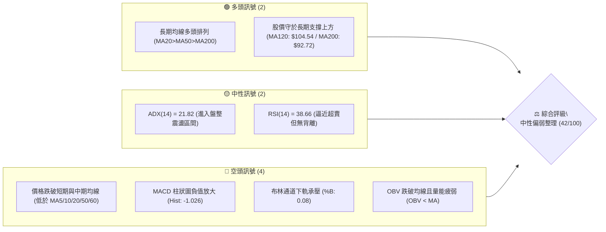
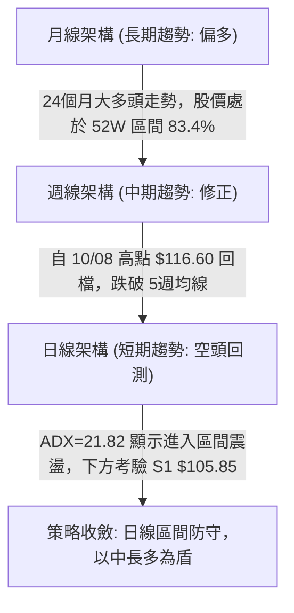
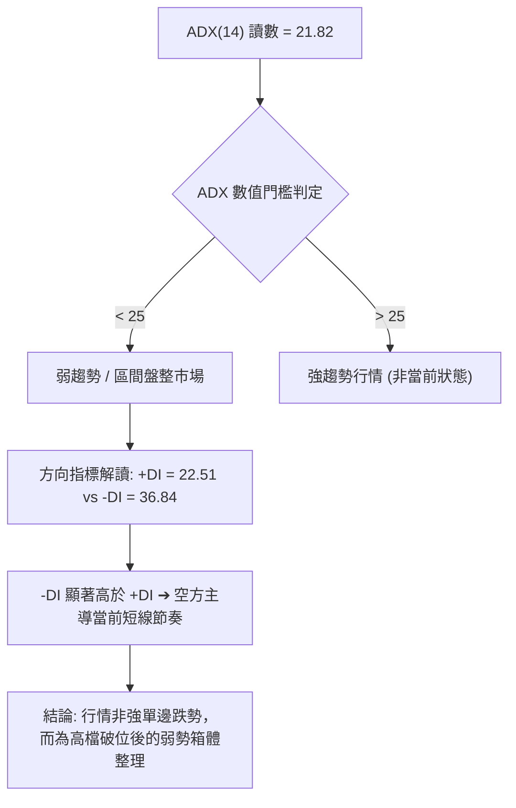
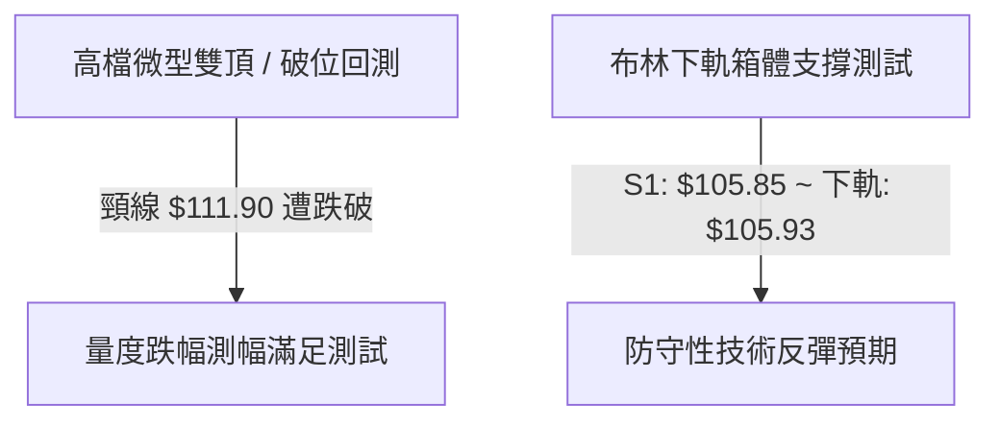
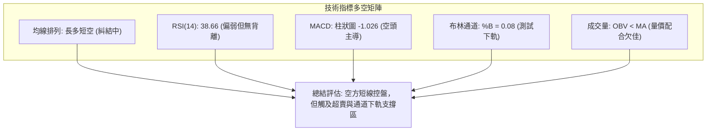
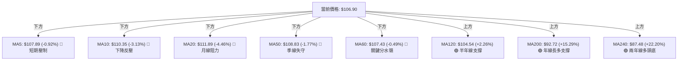
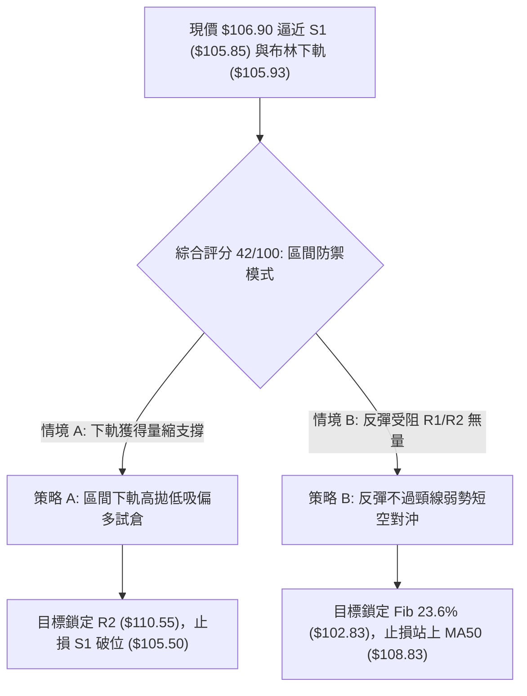
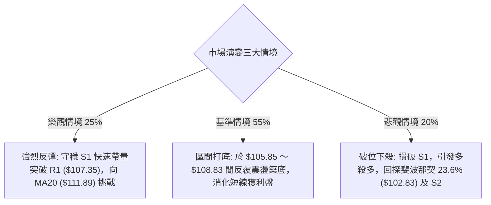

# 0050 技術分析報告

> **報告日期**：2026-10-23 ｜ **語言**：繁體中文 ｜ **數據來源**：Yahoo Finance ｜ **當前價格**：$106.90 TWD

---

## 目錄

| 章節 | 內容 |
|------|------|
| [1. 技術面概覽](#1-技術面概覽) | 訊號儀表板、核心指標、評分卡 |
| [2. 趨勢分析](#2-趨勢分析) | 多時框趨勢、長中短期走勢、ADX 分析 |
| [3. 圖表形態分析](#3-圖表形態分析) | 形態識別、近期K線組合解讀、形態目標價 |
| [4. 支撐與阻力](#4-支撐與阻力) | 關鍵價位結構、斐波那契回調位分析 |
| [5. 技術指標深度解讀](#5-技術指標深度解讀) | 均線系統、RSI、MACD、布林通道、成交量 |
| [6. 動能與波動率](#6-動能與波動率) | 動能四象限、ATR 波動率、Beta 解讀 |
| [7. 多時框架總結](#7-多時框架總結) | 時框架評分矩陣、收斂規則與方向定調 |
| [8. 交易策略建議](#8-交易策略建議) | 策略路由、價格情境階梯、主客策略設定 |
| [9. 風險提示與監控](#9-風險提示與監控) | 關鍵監控 Checklist、情境假設與風控規則 |
| [10. 報告總結](#-報告總結) | 核心結論與策略總覽 |

---

## 1. 技術面概覽

### 🎯 技術訊號儀表板



---

### 📊 核心指標速覽表

| 指標類別 | 指標名稱 | 當前數值 | 訊號 | 專業解讀 |
|:---|:---|:---|:---:|:---|
| **價格** | 當前收盤價 | $106.90 | 🔴 | 跌破 MA50（$108.83），短線修正趨勢持續 |
| **均線** | MA20 | $111.89 | 🔴 | 現價在 MA20 下方 -4.46%，短線空頭排列形成阻力 |
| **均線** | MA50 | $108.83 | 🔴 | 現價在 MA50 下方 -1.77%，失守中期生命線 |
| **均線** | MA200 | $92.72 | 🟢 | 現價在 MA200 上方 +15.29%，長期多頭底層結構仍穩固 |
| **動能** | RSI(14) | 38.66 | 🟡 | 進入 30–40 偏弱中性區間，尚未出現超賣底背離訊號 |
| **動能** | MACD (12,26,9) | -0.315 / 0.711 | 🔴 | DIF 跌破訊號線形成死亡交叉，柱狀圖 -1.026 處於綠柱擴張 |
| **動能** | Stoch %K / %D | 1.52 / 5.05 | 🟡 | 數值極度鈍化於極低水位，顯示短線下挫力道強但具技術反彈需求 |
| **趨勢** | ADX(14) | 21.82 | 🟡 | ADX < 25 表示行情進入弱趨勢／箱體盤整；-DI(36.84) > +DI(22.51) 空方佔優 |
| **通道** | 布林通道 | 下軌 $105.93 | 🟡 | %B 為 0.08，逼近下軌支撐，正在測試通道下緣防守力道 |
| **波動** | ATR(14) | $1.79 | 🟡 | 波動率佔股價 1.67%，日均波幅適中，可作風控止損依據 |
| **量能** | 20日成交均量 | 104,873,080 | 🔴 | 最新量 116,952,817（量比 1.12x），下跌出量且 OBV < MA，量價背離疲弱 |

---

### 🏆 技術評分卡

```
╔══════════════════════════════════════════════════════════════════════════╗
║                    技術評分卡 — 0050 (2026-10-23)                       ║
╠══════════════════════════════════════════════════════════════════════════╣
║ 趨勢強度 (Trend)     ████████░░░░░░░░░░░░  42/100  🟡 弱勢盤整 (ADX: 21.82) ║
║ 動能指標 (Momentum)  ██████░░░░░░░░░░░░░░  32/100  🔴 空方主導 (MACD/RSI弱) ║
║ 支撐穩定度 (Support) ███████████░░░░░░░░░  54/100  🟡 測試 S1 與布林下軌    ║
║ 成交量配合 (Volume)  ███████░░░░░░░░░░░░░  34/100  🔴 下跌出量、OBV走弱     ║
║ 形態完整度 (Pattern) ████████░░░░░░░░░░░░  42/100  🟡 高檔回檔跌破頸線      ║
║ 均線排列 (Moving Avg)██████████░░░░░░░░░░  48/100  🟡 長多短空結構交纏      ║
╠══════════════════════════════════════════════════════════════════════════╣
║ 綜合評分 (Overall)   ████████░░░░░░░░░░░░  42/100  ⚖️ 區間防守／防禦觀望  ║
║                                  （評分依據規則 18：六項算術平均四捨五入）║
╚══════════════════════════════════════════════════════════════════════════╝
```

---

## 2. 趨勢分析

### 🌐 多時框趨勢分析



---

### 📈 長期趨勢 — 12個月走勢圖（Unicode）

以下展示自 2025 年 11 月至 2026 年 10 月之月線收盤價歷史軌跡：

```
0050 月線走勢圖（過去 12 個月收盤走勢）
價格軸 ($)
$115 ┤                                                 ● (2026-09 $112.05)
$110 ┤                                           ●     │
$105 ┤                             ●      ●      │     ● (2026-10 現價 $106.90)
$100 ┤                      ●      │      │      │     │
 $90 ┤               ●      │      │      │      │     │
 $80 ┤        ●      │      │      │      │      │     │
 $70 ┤ ●      │      │      │      │      │      │     │
 $60 ┤ │      │      │      │      │      │      │     │
     └─┴──────┴──────┴──────┴──────┴──────┴──────┴─────┴─────────────────
       11     01     03     05     07     08     09    10 (月份)
      2025   2026   2026   2026   2026   2026   2026  2026
```

#### 長期走勢特徵分析表格

| 階段 | 期間涵蓋 | 起訖收盤價 | 漲跌幅 | 結構性技術特徵 |
|:---|:---|:---|:---:|:---|
| **主升段初期** | 2025-11 ～ 2026-02 | $61.11 → $80.66 | +31.99% | 帶量突破長期底部，均線呈現發散多頭排列 |
| **中途換手震盪** | 2026-02 ～ 2026-03 | $80.66 → $71.91 | -10.85% | 獲利了結賣壓，回測季線確認支撐不破 |
| **強烈主升段** | 2026-03 ～ 2026-06 | $71.91 → $107.15 | +49.01% | 權值股動能強勁，走勢垂直陡峭，月 K 連三紅 |
| **高檔橫盤構築** | 2026-06 ～ 2026-08 | $107.15 → $106.25| -0.84% | $102.00 ～ $107.00 形成大型籌碼沉澱平台 |
| **末升衝刺回落** | 2026-08 ～ 2026-10 | $106.25 → $106.90| +0.61% | 9月創收盤新高 $112.05、盤中達 $116.60 後遭遇賣壓回檔 |

---

### 📊 中期趨勢（週線分析）

中期走勢依據近 20 週收盤數據呈現明確的波段轉折特徵：
- **頂部形成**：在 2026-10-08 當週，週 K 線衝高至 52 週高點 **$116.60**，收於 **$114.95**，週 RSI 達到 65.7，隨後爆量拉回。
- **波段回落**：次週（2026-10-16）收於 **$109.00**，成交量暴增至 869,278,497 股，週 MACD 柱狀圖由正轉負（-0.738），形成典型的高檔吞噬長黑。
- **當前位置**：最新一週（2026-10-22）收於 **$106.90**，低點來到 **$106.75**，跌破前波平台低點（09-18 低點 $105.85 之邊緣），週 MACD 柱狀圖進一步惡化至 -1.026，確認中期多頭走勢遭遇強烈回調。

```
週線關鍵壓力與支撐示意圖
$116.60 ────────────────────────────────────────── 52週歷史高點 (波段頂部)
           ▼
$110.55 ────────────────────────────────────────── 中期頸線轉換位 (R2)
           ▼
$106.90 ══════════════════════════════════════════ 當前現價位置 (測試支撐)
           ▲
$105.85 ────────────────────────────────────────── 週線平台強支撐 (S1)
           ▲
$102.83 ────────────────────────────────────────── 斐波那契 23.6% 回調關鍵防線
```

---

### ⚡ 趨勢強度評估（ADX 解讀）



| 指標名稱 | 數值 | 狀態區間 | 解讀與操作含義 |
|:---|:---:|:---:|:---|
| **ADX(14)** | **21.82** | < 25 (弱趨勢/震盪) | 趨勢強度不足以支撐單邊追空或追多，價格易於支撐阻力間來回擺盪 |
| **+DI(14)** | **22.51** | 中低水位 | 多方進攻動能顯著衰退，難以組織持續性突破 |
| **-DI(14)** | **36.84** | 高水位 | 空方主控短期價格走勢，拋壓尚未完全出清 |
| **狀態結論** | **空頭震盪** | 規則 14 判定 | **盤整行情（ADX < 25）**：以日線布林通道上下軌與 S1/R1 為主要交易邊界 |

---

## 3. 圖表形態分析

### 🔍 形態識別系統



#### 圖表形態信心度評估表（依規則 15）

| 形態名稱 | 信心度 | 判斷依據（引用數據） | 完成度 | 目標價（附嚴謹計算式） |
|:---|:---:|:---|:---:|:---|
| **高檔雙頂（Double Top）** | **68%** | 兩次高點分別為 2026-10-08 高點 **$116.60** 與 09-24 波段高點 **$113.75**，跌破中間谷底頸線（10-13 低點 **$111.90**） | 85% | 跌破頸線 $111.90 − 形態高度($116.60 − $111.90 = $4.70) = **$107.20**（目前現價 $106.90 已達標滿足） |
| **布林下軌箱體防守** | **58%** | 現價 **$106.90** 緊貼日線布林下軌 **$105.93** 與近期波段低點聚類 S1 **$105.85** | 60% | 回測下軌守穩後反彈至中軌：頸線中軌 = **$111.89**（BB中軌 / MA20） |
| **大型頭肩頂雛形** | **35%** | 左肩約 $113.75、頭部 $116.60，右肩未成形；數據不足 | 20% | *訊號不足（信心度 < 50%），依規則 15 僅作指標型解讀，不預設目標價* |

---

### 🕯️ 重要 K 線形態分析

依據提供的近 10 根日 K 線與近 8 根週 K 線之開、高、低、收精確數據進行形態判定（嚴格執行規則 19）：

#### 近 10 根日 K 棒形態解讀表

| 日期 (日K) | 開盤價 | 最高價 | 最低價 | 收盤價 | 成交量 | K線形態名稱 | 形態專業解讀 | 訊號方向 |
|:---|:---:|:---:|:---:|:---:|:---:|:---|:---|:---:|
| **2026-10-08** | 115.35 | 115.55 | 114.90 | 114.95 | 87,692,570 | 高檔倒錘／十字星 | 衝刺 52W 高點後買盤不濟，實體極小，高檔轉折預警 | 🔴 |
| **2026-10-12** | 114.20 | 114.95 | 113.40 | 114.80 | 95,616,284 | 跳空低開小陽線 | 試圖反抽前高受阻於 $114.95，上方阻力沉重 | 🟡 |
| **2026-10-13** | 112.55 | 113.20 | 111.90 | 112.40 | 210,615,887 | 帶量長黑破位線 | 成交量暴增逾 2.1 億股，跌破 $113 支撐，主力調節確立 | 🔴 |
| **2026-10-14** | 113.00 | 113.75 | 112.75 | 113.00 | 59,901,143 | 量縮反彈十字星 | 成交量急凍至不到 6000 萬股，典型無量弱勢掙扎 | 🟡 |
| **2026-10-15** | 110.15 | 110.15 | 108.55 | 108.90 | 391,224,418 | 跳空巨量光頭中黑 | 暴量近 4 億股跳空跌破 MA50，形成空方強烈缺口 | 🔴 |
| **2026-10-16** | 109.45 | 109.70 | 108.90 | 109.00 | 111,920,765 | 弱勢低檔孕線 | 實體受制於前一日長黑範圍內，多方反彈無力 | 🔴 |
| **2026-10-19** | 107.45 | 108.30 | 107.10 | 108.15 | 143,680,197 | 破底回升小陽線 | 創下短線低點 $107.10 後出現下影線，低階買盤微幅承接 | 🟡 |
| **2026-10-20** | 107.65 | 108.30 | 107.05 | 107.25 | 105,412,059 | 低檔震盪小黑十字 | 再次回測 $107.05 低點，多空於 $107 關卡激烈拉鋸 | 🟡 |
| **2026-10-21** | 108.80 | 109.20 | 107.60 | 108.15 | 76,295,858 | 衝高回落倒錘線 | 盤中衝高至 $109.20 遇 MA50 反壓回吐，留下影線 | 🔴 |
| **2026-10-22** | 108.95 | 109.15 | 106.75 | 106.90 | 116,952,817 | 實體中黑摜壓線 | 跌破前兩日低點並創下近期新低 $106.75，空方再度表態 | 🔴 |

#### 近 8 根週 K 棒形態解讀表

| 日期 (週K最後日) | 開盤價 | 最高價 | 最低價 | 收盤價 | 成交量 | K線形態名稱 | 形態專業解讀 | 訊號方向 |
|:---|:---:|:---:|:---:|:---:|:---:|:---|:---|:---:|
| **2026-09-04** | 105.60 | 108.70 | 105.00 | 107.90 | 320,083,996 | 帶長下影小紅K | 成功守穩 $105 關卡，多方蓄勢待發 | 🟢 |
| **2026-09-11** | 109.05 | 110.75 | 106.90 | 107.70 | 347,340,820 | 高檔長黑受阻K | 盤中衝過 $110 但收盤倒退，呈現高檔震盪 | 🟡 |
| **2026-09-18** | 106.30 | 109.95 | 105.85 | 109.85 | 334,815,655 | 下影中紅包覆K | 低點 $105.85 確立為重要波段支撐聚類（S1 依據） | 🟢 |
| **2026-09-24** | 109.90 | 113.75 | 109.85 | 112.40 | 316,558,811 | 突破攻擊中陽K | 站上 $112，確認突破整理區間展開衝刺 | 🟢 |
| **2026-10-02** | 111.80 | 113.05 | 111.05 | 112.80 | 276,044,269 | 高檔量縮孕彩十字 | 漲勢放緩，多空處於高檔換手平衡 | 🟡 |
| **2026-10-08** | 115.75 | 116.60 | 114.90 | 114.95 | 307,612,641 | 歷史天價高浪線 | 創 52W 高點 $116.60，留長上影線，多頭耗竭 | 🔴 |
| **2026-10-16** | 114.20 | 114.95 | 108.55 | 109.00 | 869,278,497 | 崩跌巨量長黑吞噬 | 單週爆出近 8.7 億股殺盤，確立週線等級反轉回檔 | 🔴 |
| **2026-10-22** | 107.45 | 109.20 | 106.75 | 106.90 | 442,340,931 | 破底弱勢陰線 | 持續向下尋找支撐，逼近 S1 與布林通道下軌 | 🔴 |

---

### 📉 ASCII 走勢形態示意圖

```
高檔回跌與形態目標價滿足示意圖
========================================================================
$116.60 ──┐ (10/08 天價高點)
          │
          │                   雙頂頸線跌破測幅高度: H = $4.70
$111.90 ──┴───────────────┬── (10/13 跌破頸線位置)
                          │
                          │   量度滿足目標價: $111.90 - $4.70 = $107.20
$107.20 ──────────────────┼── (測幅滿足點已於 10/22 達成)
$106.90 ══════════════════╪══ [目前收盤價 $106.90] ◄ 正在測試 S1
$105.85 ──────────────────┴── (支撐位 S1 / 近期低點聚類核心防線)
========================================================================
```

---

## 4. 支撐與阻力

### 🗺️ 關鍵價位分布圖（Unicode）

```
0050 價位結構分布圖 (由實際 OHLCV 與聚類演算法計算)
══════════════════════════════════════════════════════════════════════
$116.60 ║██████████████████████████████║ 52W 最高點 / 歷史阻力頂部
$113.75 ║██████████████████████        ║ 強阻力 R3 (波段高點密集區)
$110.55 ║██████████████████            ║ 中期阻力 R2 (反彈關鍵頸線)
$107.35 ║████████████                  ║ 近端阻力 R1 (+0.42% 壓力)
$106.90 ╠══════════════════════════════╣ ◄ 當前收盤價 ($106.90)
$105.85 ║▓▓▓▓▓▓▓▓▓▓▓▓                  ║ 近期支撐 S1 (-0.98% 波段低點聚類)
$102.83 ║▓▓▓▓▓▓▓▓▓▓▓▓▓▓▓▓▓▓            ║ 斐波那契 23.6% 回調關鍵位
$102.29 ║██████████████████            ║ 強支撐 S2 (-4.31% 中期平台底)
$97.36  ║████████████████████████      ║ 核心強支撐 S3 (-8.93% 密集區)
$92.72  ║██████████████████████████████║ MA200 長期多空分水嶺年線
══════════════════════════════════════════════════════════════════════
```

---

### 🚧 阻力位分析表

所有價位均來自提供的歷史高點聚類分析，嚴格杜絕憑空臆造：

| 阻力級別 | 準確價位 | 距現價幅離 | 形成原因與籌碼背景 | 突破難度 | 重要性 |
|:---|:---:|:---:|:---|:---:|:---:|
| **R1** | **$107.35** | +0.42% | 近 10 日短線密集高點反壓聚類，亦為 MA60（$107.43）糾結反壓區 | 🟡 中等 | 短線轉強初階門檻 |
| **R2** | **$110.55** | +3.42% | 10 月中旬跳空破位平台下緣、MA10（$110.35）覆蓋處，套牢量極大 | 🔴 極高 | 中期轉折多空防線 |
| **R3** | **$113.75** | +6.41% | 09-24 波段突破高點及 10-14 反彈失敗高點，為前波密集整理頂部 | 🔴 極高 | 波段翻多關鍵樞紐 |

---

### 🛡️ 支撐位分析表

所有價位均精確對應提供的低點聚類與技術指標位置：

| 支撐級別 | 準確價位 | 距現價幅離 | 形成原因與籌碼背景 | 守住機率 | 重要性 |
|:---|:---:|:---:|:---|:---:|:---:|
| **S1** | **$105.85** | -0.98% | 09-18 週 K 低點聚類，與當前日線布林通道下軌（$105.93）重疊共振 | 🟡 55% | 短線防守第一道防線 |
| **S2** | **$102.29** | -4.31% | 7 月底至 8 月初整理平台低點聚類，緊鄰斐波那契 23.6%（$102.83） | 🟢 70% | 中期結構不破的核心防線 |
| **S3** | **$97.36** | -8.93% | 7 月中旬長黑低點 $99.54 下方之密集籌碼換手區，具強大價值支撐 | 🟢 85% | 長期多頭終極防護盾 |

---

### 📐 斐波那契回調位分析

依據 52 週波動區間：**最低點 $58.27 → 最高點 $116.60**（總波動振幅 $58.33）：

| 回調比率 | 斐波那契價位 | 與現價 ($106.90) 相對位置 | 技術結構意義解讀 |
|:---:|:---:|:---:|:---|
| **0.0%** | **$116.60** | +9.07% | 52 週歷史高點，波段絕對天花板 |
| **現價位** | **$106.90** | **基準點** | **目前位於 0.0% 至 23.6% 之高檔強勢回檔區間內** |
| **23.6%** | **$102.83** | -3.81% | 第一道黃金回調防線。只要不實質跌破 $102.83，長期強多格局未變 |
| **38.2%** | **$94.32** | -11.77% | 中級回調重要支撐位，緊鄰 MA200（$92.72）年線防守群 |
| **50.0%** | **$87.43** | -18.21% | 多空平衡分水嶺，恰好對應 MA240（$87.48）兩年均線位置 |
| **61.8%** | **$80.55** | -24.65% | 黃金分割強防守位，2026 年 2 月起漲平台高點位置 |
| **78.6%** | **$70.75** | -33.82% | 深度回調防禦線，接近 2026 年 3 月低點 $71.91 |
| **100.0%** | **$58.27** | -45.49% | 52 週循環起點最低價 |

**現況解讀**：現價 $106.90 穩穩運行於 23.6%（$102.83）之上，代表此波自 $116.60 的拉回屬於長期強勢多頭中的**次級修正**，尚未傷及大級別多頭骨幹。

---

## 5. 技術指標深度解讀

### 🎛️ 指標訊號總覽



---

### 📈 移動平均線排列分析



#### 均線架構精確特徵
1. **短中期均線空頭下彎**：MA5（$107.89）< MA10（$110.35）< MA20（$111.89），且價格全數受制於其下方，短線空頭下壓斜率陡峭。
2. **大週期多頭排列不變**：MA20（$111.89）> MA50（$108.83）> MA200（$92.72），符合經典牛市排列；現價跌破 MA50 是 2026 年 5 月以來首次出現的技術性回測，象徵牛市正在經歷良性清洗浮額或籌碼再分配。

---

### 📉 RSI(14) 分析

- **RSI(14) 讀數**：**38.66**（Wilder 計算法）。
- **區間評估**：位於 30～70 中性偏弱區，尚未進入 30 以下極度超賣區，顯示空頭摜壓力道仍在釋放。
- **背離檢驗結論**：依數據比對近 20 根 K 棒，價格自高點 $116.60 跌至 $106.90 創波段新低，RSI 同步自 65.7 降至 38.66，**無明顯頂背離或底背離**。此為指標跟隨價格的常規回落，未發出反轉背離訊號。

```
RSI(14) 水位儀錶
0 ═══════════ 30 ══════════ 38.66 ═══════════ 70 ═══════════ 100
[ 極度超賣區 ] [ 弱勢偏空區  ▲   ] [  強勢多頭區  ] [ 極度超買區 ]
進度條: ███████████████░░░░░░░░░░░░░░░░░░░░░░░░ 38.66%
```

---

### 📊 MACD (12,26,9) 訊號解讀

- **DIF 線**：**-0.315**（已下穿零軸）
- **Signal 線**：**+0.711**（仍於零軸上方）
- **MACD 柱狀圖 (Histogram)**：**-1.026**（🔴 空頭持續發散）


**解讀**：DIF 跌入負值區，代表短週期指數移動平均已弱於長週期均線。柱狀圖自 10-08 週的 +0.351 連續惡化至 -1.026，綠柱仍處於向下擴張期，提示技術性買盤不可過早盲目抄底，須等待柱狀圖出現縮腳方為止跌先兆。

---

### 📦 布林通道分析

日線布林通道（以 20 日均線為基準，2 倍標準差）：
- **BB 上軌**：**$117.85**
- **BB 中軌 (MA20)**：**$111.89**
- **BB 下軌**：**$105.93**
- **當前價格**：**$106.90**
- **布林極限 %B**：**0.08**

```
日線布林通道示意圖
═══════════════════════════════════════════════════════════
$117.85 ────────────────────────────────────── 上軌 (Upper Band)
                         
$111.89 ────────────────────────────────────── 中軌 (MA20 Baseline)
                         
$106.90 ═════════════════●════════════════════ 當前價格 (%B = 0.08)
$105.93 ────────────────────────────────────── 下軌 (Lower Band)
═══════════════════════════════════════════════════════════
```

**解讀**：%B 降至 0.08，表明股價已進入下軌「袋內超跌區」（接近 0 即觸碰下軌）。在 ADX=21.82 判定為盤整市場的前提下，布林通道下軌（$105.93）具備顯著的統計學邊界反彈支撐效應。

---

### 💹 成交量分析（量價配合度）

1. **量能指標數值**：
   - 最新成交量：**116,952,817 股**
   - 20 日均量：**104,873,080 股**（量比為 **1.12x**）
   - 50 日均量：**82,046,493 股**
2. **量價走勢研判**：
   - 10-15 下殺跳空時放量至 3.91 億股，10-16 週黑 K 伴隨 8.69 億股巨量，顯示高檔獲利盤與停損賣壓湧出。
   - 10-22 下跌再度出量至 1.16 億股（大於 20MA 量），配合「OBV < MA」的指標表現，確認當前量價配合呈現**帶量下挫、量能疲弱**的空方型態。反彈若無 20MA 以上的多方量配合，將難以突破 R1/R2 阻力。

---

## 6. 動能與波動率

### ⚡ 動能評估四象限

```
動能與波動率象限評估表
┌───────────────────────┬───────────────────────┐
│     第二象限 (Q2)     │     第一象限 (Q1)     │
│   弱動能 ╳ 低波動     │   強動能 ╳ 低波動     │
│                       │                       │
│ 評估: 謹慎觀望 / 盤整 │ 評估: 最適進場多頭    │
├───────────────────────┼───────────────────────┤
│     第四象限 (Q4)     │     第三象限 (Q3)     │
│   弱動能 ╳ 高波動     │   強動能 ╳ 高波動     │
│  【當前 0050 落點】   │                       │
│ 評估: 短線下殺釋放    │ 評估: 追逐熱點高風險  │
└───────────────────────┴───────────────────────┘
```

| 象限 | 動能狀態 | 波動狀態 | 當前落點 | 專業操作指引 |
|:---:|:---:|:---:|:---:|:---|
| **Q1** | 強 (+DI > -DI) | 低 (ATR < 1.5%) | — | 穩定多頭主升，順勢抱牢 |
| **Q2** | 弱 (-DI > +DI) | 低 (ATR < 1.5%) | — | 窄幅無聊整理，縮小操作規模 |
| **Q3** | 強 (+DI > -DI) | 高 (ATR > 2.0%) | — | 高動能劇烈洗盤，嚴設保護利潤停利 |
| **Q4** | **弱 (-DI=36.84)** | **適中/偏高 (ATR=1.67%)** | **✓ 當前** | **空頭下殺動能釋放中，波動放寬，切忌躁進盲目攤平** |

---

### 📊 ATR 波動率分析

- **ATR(14)**：**$1.79**（依據 Wilder 平滑法計算）。
- **ATR 佔價格比率**：$1.79 / $106.90 = **1.67%**。
- **交易止損止盈應用指南**：
  - **保守型止損距離 (2.0x ATR)**：$1.79 × 2 = **$3.58**。若以 $106.90 進場，多單寬鬆止損設於 **$103.32**（鄰近 S2 $102.29）。
  - **進攻型止損距離 (1.0x ATR)**：$1.79 × 1 = **$1.79**。短線防守設於現價下浮 $1.79 處，即 **$105.11**（剛好保護跌破 S1 $105.85）。

---

### 📐 Beta 與市場相關性

- **Beta 數值**：**N/A（數據未提供）**
- **市場性解讀**：0050 為元大台灣卓越50 ETF，成分股涵蓋台股市場市值前 50 大權值企業（台積電為核心權重）。雖然數據源未提供個股特定 Beta 數值，但在體質上 0050 與台灣加權指數存在高度正相關性，大盤指數的破位修正將直接同步映射於 0050 之價格軌跡中。

---

## 7. 多時框架總結

### 📋 時框架評分表

| 時框架 | 趨勢方向 | 動能指標 | 均線系統 | 形態結構 | 綜合評分 | 戰略建議 |
|:---|:---:|:---:|:---:|:---:|:---:|:---|
| **日線 (短期)** | 🔴 弱勢回調 | 🔴 MACD柱下探/RSI 38.66 | 🔴 跌破MA5/10/20/50 | 🟡 測試下軌防守 | **35/100** | 逢反彈減碼、下軌短線試單 |
| **週線 (中期)** | 🟡 漲多修正 | 🔴 MACD週柱轉負(-1.026) | 🟡 跌破5週均線/MA20上揚 | 🔴 10/16 巨量長黑吞噬 | **45/100** | 不宜大舉作多，等待換手打底 |
| **月線 (長期)** | 🟢 強烈大多頭 | 🟢 長期趨勢向上無虞 | 🟢 MA20>MA50>MA200排列 | 🟢 上升常態格局未破 | **75/100** | 長線分批定額投資價值浮現 |

---

### 🔲 綜合訊號矩陣

```
時框架訊號矩陣
┌──────────────┬──────────────┬──────────────┬──────────────┐
│   維度項目   │  短期 (日線) │  中期 (週線) │  長期 (月線) │
├──────────────┼──────────────┼──────────────┼──────────────┤
│ 均線方向     │      🔴      │      🟡      │      🟢      │
│ 動能走勢     │      🔴      │      🔴      │      🟢      │
│ 支撐防守     │      🟡      │      🟡      │      🟢      │
│ 成交量配合   │      🔴      │      🔴      │      🟢      │
│ 形態完整度   │      🟡      │      🔴      │      🟢      │
└──────────────┴──────────────┴──────────────┴──────────────┘
```

---

### ⚖️ 多時框收斂結論

**嚴格執行規則 14 之優先級收斂**：
1. **行情性質判定**：ADX(14) 讀數為 **21.82**（明確小於 25 臨界值），技術結構定義為**典型盤整行情（Consolidation Market）**。
2. **主導時框與交易邊界**：在盤整格局下，日線布林通道上下軌（**$105.93 ～ $117.85**）與波段支撐阻力 S1（**$105.85**）／R2（**$110.55**）成為最核心的交易邊界。
3. **時框矛盾取捨**：雖然長期月線維持強多（MA200 = $92.72 提供遠端支撐），但短期日線遭遇空頭下殺且跌破 MA50。依據盤整規則，不可盲目順長線趨勢去高位追多，而應以**日線下軌支撐區間的防守應對為主**。
4. **唯一方向性結論**：**中性觀望偏弱防守（區間操作）**。評級定調為 **42/100**，全面貫穿至第 8 章交易策略。

---

## 8. 交易策略建議

### 🗺️ 策略決策流程圖



---

### 🧭 策略路由（依評分卡分流，嚴格遵守規則 18）

- **當前技術評分卡綜合評分**：**42 / 100**（落在 40–60 區間中性偏弱區）
- **當前主策略定調**：**區間震盪防守操作（Range-Bound Trading），以布林下軌與關鍵支撐反彈試倉為主，反彈至阻力區則調節**。不進行單邊趨勢性重倉押注。

---

### 🎯 價格情境階梯（Price Scenarios）

價位完全取自「關鍵價位」區塊之精確數字：

| 觸發條件 | 第一目標位 | 後續延伸位 | 技術情境含義與交易含義 |
|:---|:---:|:---:|:---|
| **向上突破 R1 ($107.35)** | **R2 ($110.55)** | **R3 ($113.75)** | 短線止跌回穩，向布林中軌（$111.89）發起技術性修復反彈 |
| **維持於現價區間震盪** | **$105.93 (下軌)** | **$107.43 (MA60)** | 在 $106～$107 窄幅換手沉澱，消化 -DI 空方籌碼賣壓 |
| **向下跌破 S1 ($105.85)** | **S2 ($102.29)** | **S3 ($97.36)** | 跌破布林通道下軌宣告箱體破位，中期修正向斐波那契 23.6%（$102.83）尋求支撐 |

---

### 📊 情境機率分佈

| 情境劇本 | 機率 | 主要技術數據依據 |
|:---|:---:|:---|
| **劇本一：區間震盪（下軌支撐回穩）** | **50%** | ADX=21.82 確定為盤整市；布林 %B=0.08 極度逼近下軌；Stoch 處於極度超賣區（%K=1.52）具技術收斂買盤 |
| **劇本二：反彈回測（反抽阻力 R1/R2）** | **30%** | 日線與 MA20 負乖離達 -4.46%，短線乖離過大引發技術性修復反抽 |
| **劇本三：直接破位（下探 S2 $102.29）** | **20%** | MACD 柱狀圖（-1.026）仍處於負值擴張期；OBV < MA 量能疲弱，空方慣性未歇 |

---

### 🟢 主策略詳情

依據規則 17，風險報酬比公式為：
- 做多：$(目標價 T1 − 進場價) ÷ (進場價 − 止損價)$
- 做空：$(進場價 − 目標價 T1) ÷ (止損價 − 進場價)$
- 嚴格杜絕編造數字，均精確回算：

| 策略要素 | 策略 A（主策略：下軌支撐博反彈） | 策略 B（防禦策略：弱勢反抽逢高空） |
|:---|:---|:---|
| **操作策略性質** | 順大勢逆小勢（日線超賣反彈多單） | 順短空趨勢（遇阻力反手短空對沖） |
| **進場觸發條件** | 股價於 S1（$105.85）與下軌測試不破，出小陽K | 股價反彈至 R1（$107.35）～ MA50 遇阻留長上影線 |
| **進場價格** | **$106.90**（當前市價確認支撐） | **$107.35**（精確對應阻力位 R1） |
| **止損價格** | **$105.50**（跌破 S1 $105.85 與布林下軌） | **$108.83**（精確對應 MA50 阻力突破） |
| **第一目標價 T1** | **$110.55**（精確對應阻力位 R2） | **$102.83**（精確對應斐波那契 23.6% 回調位） |
| **第二目標價 T2** | **$113.75**（精確對應阻力位 R3） | **$97.36**（精確對應強支撐位 S3） |
| **風險報酬比 (T1)** | **1 : 2.61（以 T1 計）**<br>計算式：$(110.55 - 106.90) / (106.90 - 105.50) = 3.65 / 1.40 = 2.61$ | **1 : 3.05（以 T1 計）**<br>計算式：$(107.35 - 102.83) / (108.83 - 107.35) = 4.52 / 1.48 = 3.05$ |
| **風險報酬比 (T2)** | **1 : 4.89（以 T2 計）**<br>計算式：$(113.75 - 106.90) / (106.90 - 105.50) = 6.85 / 1.40 = 4.89$ | **1 : 6.75（以 T2 計）**<br>計算式：$(107.35 - 97.36) / (108.83 - 107.35) = 9.99 / 1.48 = 6.75$ |
| **預估勝率** | **55%** | **45%** |
| **建議配置倉位** | **15% ～ 20%**（輕倉防守試探） | **10% ～ 15%**（避險避空性部位） |

---

### 🔴 反向風險觸發點（對沖與撤退提示）

1. **多頭策略撤退警報**：若日 K 線實體**帶量跌破 $105.85（S1）**，代表布林下軌支撐失效，形態將向下尋求斐波那契 23.6%（$102.83）甚至 S2（$102.29），此時必須果斷執行止損，不可留戀。
2. **空頭策略撤退警報**：若盤中帶量站穩 **$108.83（MA50）** 之上，代表短期破位為假突破誘空，空單應立即全數回補出場。

---

### ⭐ 整體訊號強度評星

```
做多訊號強度：★★☆☆☆  (2.5 / 5 星，短多僅限超賣反彈，長多靜待落底)
做空訊號強度：★★★☆☆  (3.0 / 5 星，短線趨勢偏空，但空間受限於下軌)
整體可信度：  ★★★★☆  (4.0 / 5 星，數據結構扎實，技術位置明確)
```

---

## 9. 風險提示與監控

### ✅ 關鍵監控指標 Checklist

```
╔══════════════════════════════════════════════════════════════════════════╗
║                    技術監控清單 (Monitoring Checklist)                  ║
╠══════════════════════════════════════════════════════════════════════════╣
║ [ ] 監控項 1: 價格是否守穩 S1 ($105.85) 與布林下軌 ($105.93)            ║
║ [ ] 監控項 2: MACD 綠柱狀圖是否開始收斂（Hist 數值回升至 -0.50 以上）    ║
║ [ ] 監控項 3: 日成交量能否回升至 20MA（1.05 億股）以上之多方量能配合     ║
║ [ ] 監控項 4: RSI(14) 能否重返 40 軸之上擺脫弱勢鈍化                     ║
║ [ ] 監控項 5: 反彈若觸及 R1 ($107.35) 是否出現爆量滯漲長上影線           ║
╚══════════════════════════════════════════════════════════════════════════╝
```

---

### ⚠️ 風險場景分析



---

### 🛡️ 風險管理重要提醒

1. **嚴禁逆勢重倉加碼**：目前短線處於 -DI（36.84）主導之空方節奏，在 MACD 出現零下金叉或底背離結構前，任何操作均屬**短線試探性策略**，單筆交易虧損不可超過總資產之 1.0%。
2. **嚴格執行價格紀律**：止損點 $105.50 不容妥協，0050 雖然具有權值龍頭 ETF 永不歸零之特性，但波段修正若不及時停損，資金時間成本極高。
3. **長期定期定額者不受影響**：對於以月線 MA200（$92.72）為核心戰略的超長期定期定額投資人，目前的拉回修正反而提供了優質的微笑曲線佈局契機。

---

## 📋 報告總結

```
╔══════════════════════════════════════════════════════════════════════════╗
║                        0050 技術分析報告總結                             ║
╠══════════════════════════════════════════════════════════════════════════╣
║ 報告日期：2026-10-23                                                     ║
║ 當前價格：$106.90 TWD                                                    ║
║ 分析評級：⚖️ 42/100 (中性偏弱／區間防禦整理)                             ║
╠══════════════════════════════════════════════════════════════════════════╣
║ 關鍵結論：                                                               ║
║ ├─ 長期趨勢：🟢 強烈多頭結構未破 (MA200: $92.72 提供強大後盾)            ║
║ ├─ 中期趨勢：🟡 週線級別高檔修正 (遭遇 $116.60 天價後獲利回吐)           ║
║ ├─ 短期趨勢：🔴 跌破 MA50 短空格局 (現價承壓於短期各均線下方)            ║
║ ├─ 關鍵支撐：S1: $105.85 ｜ 布林下軌: $105.93 ｜ Fib 23.6%: $102.83     ║
║ ├─ 關鍵阻力：R1: $107.35 ｜ R2: $110.55 ｜ MA20 中軌: $111.89           ║
║ └─ 形態量度：高檔雙頂量度跌幅 $107.20 已初步滿足，正測試 S1 支撐強度     ║
╠══════════════════════════════════════════════════════════════════════════╣
║ 最優策略組合：                                                           ║
║ 1. 🥇 最佳機會（策略 A）：現價 $106.90 附近輕倉試單博超跌反彈，          ║
║    嚴設止損 $105.50，目標直指 R2 $110.55 (風報比 1 : 2.61)。             ║
║ 2. 🥈 次選機會（策略 B）：反彈至 R1 $107.35 遇阻放空避險，                ║
║    止損設 MA50 $108.83，目標回看 Fib 23.6% $102.83 (風報比 1 : 3.05)。  ║
║ 3. 🥉 保守選擇：完全空倉觀望，靜待日線 MACD 綠柱縮腳或放量收復 MA50。    ║
╚══════════════════════════════════════════════════════════════════════════╝
```

---

> ⚠️ **免責聲明**：本報告為依據客觀量化技術指標與歷史走勢數據所生成之專業分析研究，所有點位及評估均基於特定模型演算法。本報告**僅供學術研究與投資決策參考**，**不構成任何形式的投資招攬、買賣邀約或保證獲利之承諾**。金融市場瞬息萬變，投資人應獨立審慎評估風險並自負盈虧。

---
*報告完成時間：2026-10-23 ｜ 數據基底：Yahoo Finance ｜ 分析架構：多時框技術分析模型*