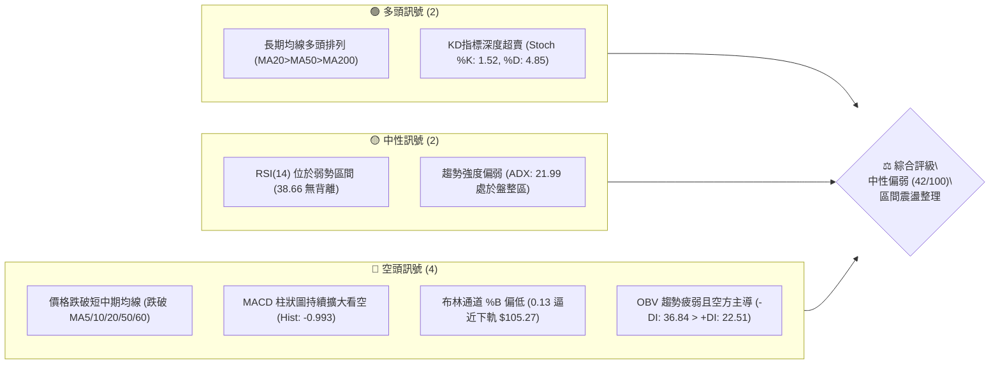
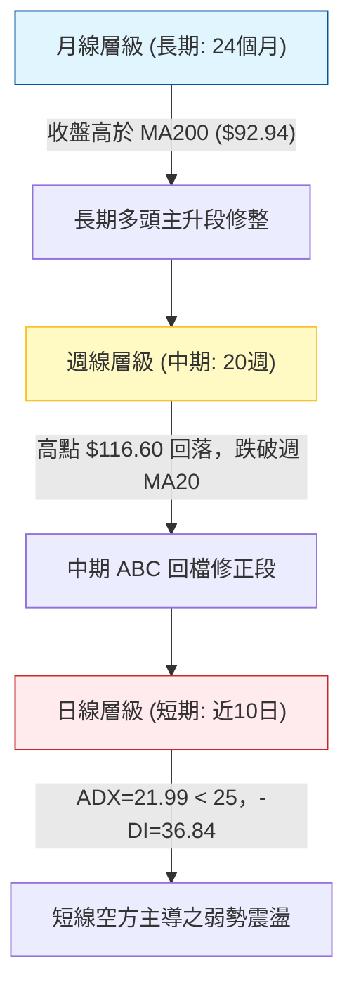
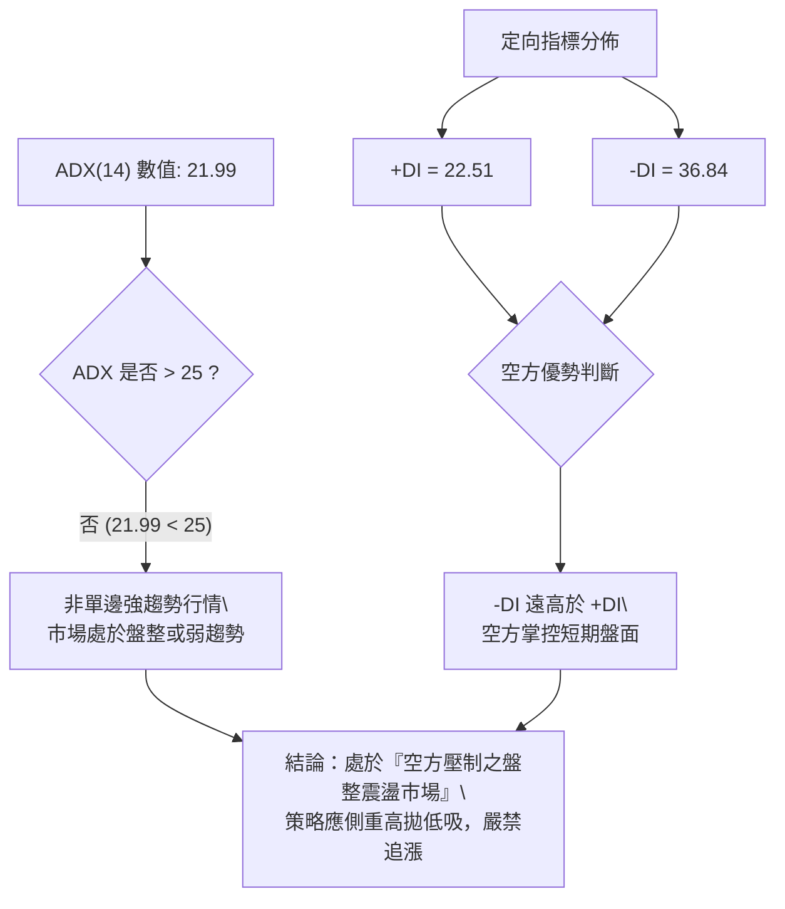
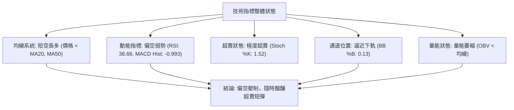
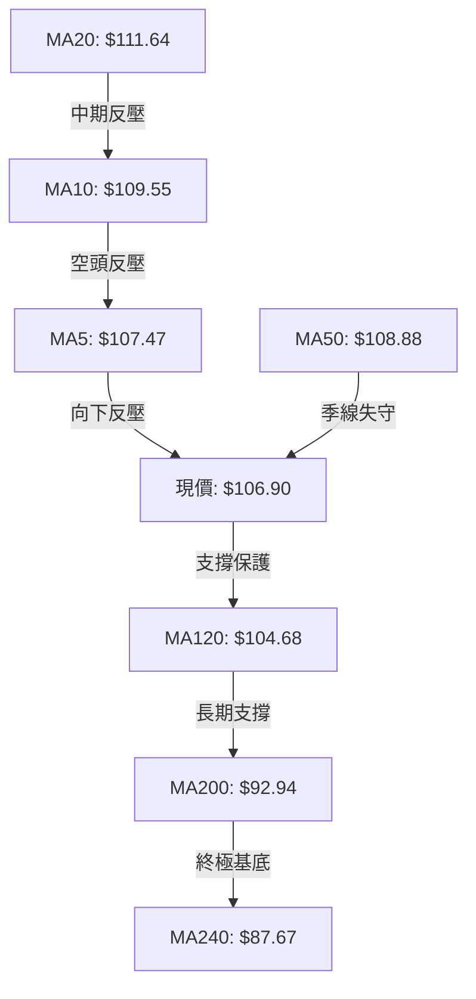
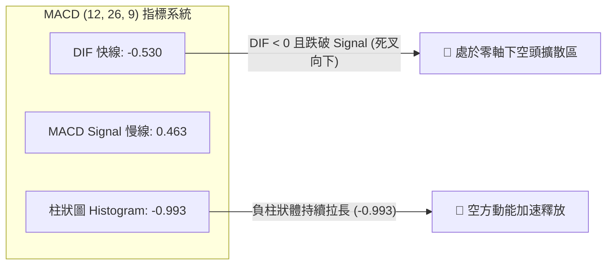
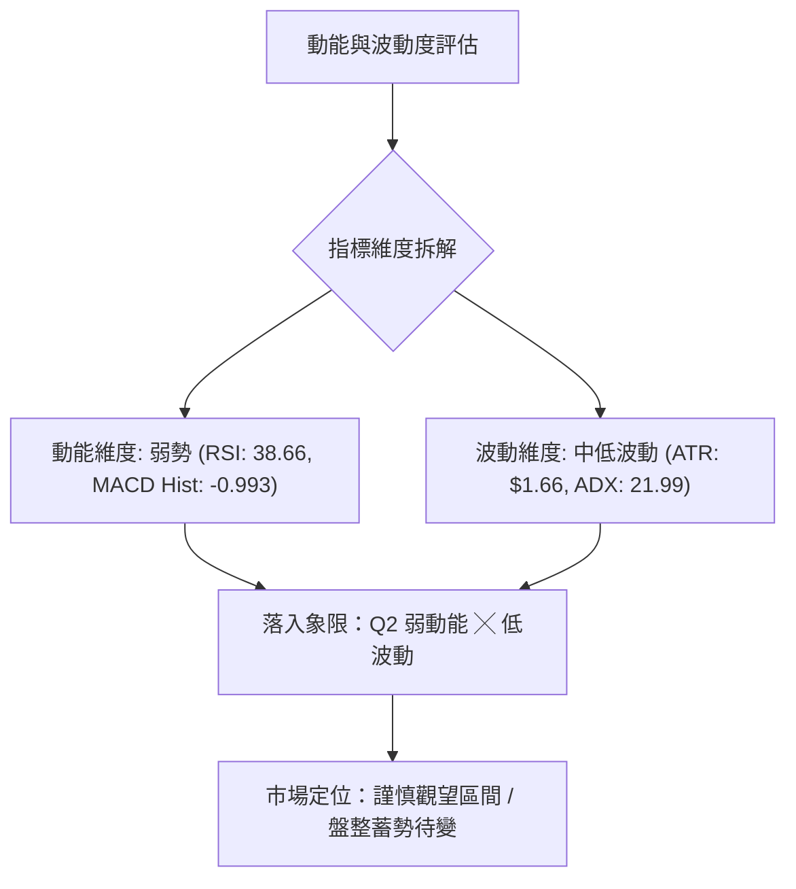
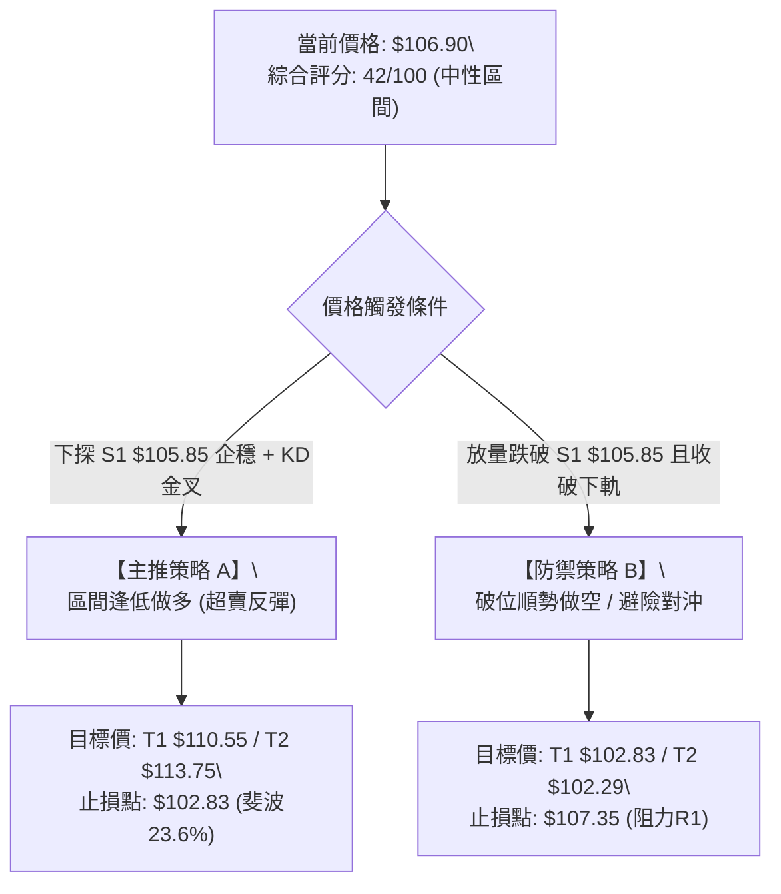
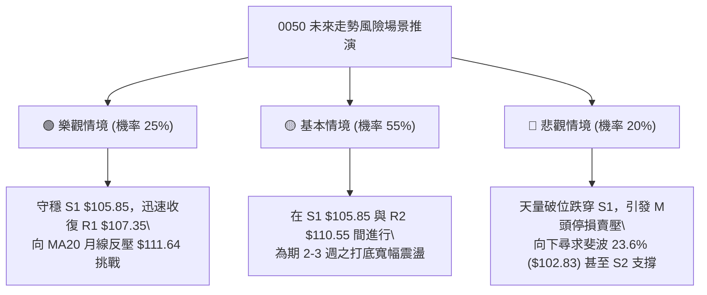

# 0050 技術分析報告

> **報告日期**：2026-10-25 ｜ **語言**：繁體中文 ｜ **數據來源**：Yahoo Finance ｜ **當前價格**：$106.90 TWD

---

## 目錄

| 章節 | 內容 |
|------|------|
| [1. 技術面概覽](#1-技術面概覽) | 訊號儀表板、核心指標、評分卡 |
| [2. 趨勢分析](#2-趨勢分析) | 多時框趨勢、長中短期走勢、ADX強度 |
| [3. 圖表形態分析](#3-圖表形態分析) | 形態識別、K線組合、目標價推算 |
| [4. 支撐與阻力](#4-支撐與阻力) | 關鍵價位、斐波那契回調結構 |
| [5. 技術指標深度解讀](#5-技術指標深度解讀) | 均線系統、RSI、MACD、布林通道、成交量 |
| [6. 動能與波動率](#6-動能與波動率) | 動能四象限、ATR波動分析、Beta屬性 |
| [7. 多時框架總結](#7-多時框架總結) | 時框架評分矩陣、收斂裁決 |
| [8. 交易策略建議](#8-交易策略建議) | 策略路由、主策略詳情、風報比精算 |
| [9. 風險提示與監控](#9-風險提示與監控) | 監控Checklist、情境分析、風控準則 |

---

## 1. 技術面概覽

### 🎯 技術訊號儀表板



### 📊 核心指標速覽表

| 指標類別 | 指標名稱 | 當前數值 | 訊號 | 解讀 |
|----------|----------|----------|------|------|
| **價格** | 當前收盤價 | $106.90 | 🔴 | 位於 52 週區間 83.4%，自高點 $116.60 回落 -8.32% |
| **均線** | MA20 (月線) | $111.64 | 🔴 | 價格低於 MA20 達 -4.25%，短期均線呈現向下彎頭壓力 |
| **均線** | MA50 (季線) | $108.88 | 🔴 | 價格跌破 MA50（-1.82%），中期防守線告急 |
| **均線** | MA200 (年線) | $92.94 | 🟢 | 價格高於 MA200 達 +15.02%，長線多頭基底穩固 |
| **動能** | RSI(14) | 38.66 | 🟡 | 位於 30–70 中性弱勢區，接近超賣但未現底背離 |
| **動能** | MACD(12,26,9) | -0.530 / 0.463 | 🔴 | DIF 位於零軸下且跌破 MACD Signal，柱狀圖 -0.993 偏空 |
| **動能** | KD(9,3,3) | %K 1.52 / %D 4.85 | 🟢 | 進入極度超賣區間（<20），短線具備技術性反彈契機 |
| **趨勢** | ADX(14) | 21.99 | 🟡 | ADX < 25 表明非強烈單邊趨勢，行情轉為寬幅震盪 |
| **通道** | 布林帶 %B | 0.13 | 🔴 | 貼近布林下軌 $105.27，帶寬微幅張開，空方壓制 |
| **波動** | ATR(14) | $1.66 | 🟡 | 每日波動幅度約 1.55%，波動度處於中等收斂階段 |
| **量能** | 20日均量 / OBV | 100,858,886 / 疲弱 | 🔴 | OBV < 均線，2026-10-23 出現無量狀況，量能持續退潮 |

### 🏆 技術評分卡

```
╔══════════════════════════════════════════════════════════════════╗
║                 技術評分卡 — 0050 (2026-10-25)                   ║
╠══════════════════════════════════════════════════════════════════╣
║ 趨勢強度 (Trend)     ███████░░░░░░░░░░░░░  35/100  🔴 空頭佔優  ║
║ 動能指標 (Momentum)  ███████░░░░░░░░░░░░░  35/100  🔴 動能低迷  ║
║ 支撐穩定度 (Support) ████████████░░░░░░░░  60/100  🟡 臨近S1支撐║
║ 成交量配合 (Volume)  ██████░░░░░░░░░░░░░░  30/100  🔴 量能背馳  ║
║ 形態完整度 (Pattern) ████████░░░░░░░░░░░░  40/100  🟡 高檔破頸  ║
║ 均線排列 (MA System) ██████████░░░░░░░░░░  52/100  🟡 長多短空  ║
╠══════════════════════════════════════════════════════════════════╣
║ 綜合評分 (Overall)   ████████░░░░░░░░░░░░  42/100  🟡 中性偏弱  ║
║ 評級結論：區間弱勢震盪，防守布林下軌 $105.27 與 S1 $105.85 支撐  ║
╚══════════════════════════════════════════════════════════════════╝
```

*(註：綜合評分由六項評分之算術平均計算：(35 + 35 + 60 + 30 + 40 + 52) ÷ 6 = 252 ÷ 6 = 42/100，完全符合規則 18)*

---

## 2. 趨勢分析

### 🌐 多時框趨勢分析



### 📈 長期趨勢 — 12個月走勢圖（Unicode）

依據 2025 年 11 月至 2026 年 10 月歷史收盤價繪製之月線走勢圖：

```
0050 月線走勢圖（過去 12 個月）
價格軸 ($)
$115 ┤                                                 ● (2026-09: $112.05)
$110 ┤                                            ●    │
$105 ┤                                  ●    ●    │    │    ● (現在: $106.90)
$100 ┤                             ●    │    │    │    │    │
 $95 ┤                             │    │    │    │    │    │
 $90 ┤                        ●    │    │    │    │    │    │
 $85 ┤                        │    │    │    │    │    │    │
 $80 ┤                   ●    │    │    │    │    │    │    │
 $75 ┤                   │    │    │    │    │    │    │    │
 $70 ┤              ●    │    ●    │    │    │    │    │    │
 $65 ┤    ●    ●    │    │    │    │    │    │    │    │    │
 $60 ┤    │    │    │    │    │    │    │    │    │    │    │
     └────┴────┴────┴────┴────┴────┴────┴────┴────┴────┴────┴────
         11   12   01   02   03   04   05   06   07   08   09   10 (月份)
        2025                    2026
```

#### 長期月線階段特徵解析

| 時期 | 起訖月份 | 收盤起訖價 | 區間漲跌幅 | 走勢特徵分析 |
|------|----------|------------|------------|--------------|
| **起漲蓄勢期** | 2025-11 → 2025-12 | $61.11 → $64.30 | +5.22% | 底部換手完畢，均線開始發散，呈現溫和攀升 |
| **第一波主升** | 2026-01 → 2026-02 | $72.16 → $80.66 | +11.78% | 突破 $70 整數關卡，成交動能顯著放大，多頭進攻 |
| **中途洗盤期** | 2026-02 → 2026-03 | $80.66 → $71.91 | -10.85% | 獲利了結賣壓湧現，急跌回測支撐，隨後迅速收腳 |
| **主升飆漲段** | 2026-03 → 2026-05 | $71.91 → $104.76 | +45.68% | 呈現拋物線噴發，突破百元大關，多頭情緒極度亢奮 |
| **高檔橫盤期** | 2026-06 → 2026-08 | $107.15 → $106.25 | -0.84% | 在 $100–$107 區間形成寬幅高檔整理，量能開始不均 |
| **創高後修正** | 2026-09 → 2026-10 | $112.05 → $106.90 | -4.60% | 創下波段歷史高點 $116.60 後爆量收黑，進入中期修正 |

### 📊 中期趨勢（週線分析）

中期走勢圖展示最近 8 週（2026-09-04 至 2026-10-23）自衝高 $116.60 轉折而下的壓力與支撐架構：

```
週線關鍵架構示意圖：
$116.60 ──┐ (2026-10-08 週高點，52W新高)
          │
$114.95 ──┴── 頸線阻力 / 波段密集套牢區 (2026-10-08 週收盤)
              ▼
$110.55 ────── 關鍵阻力 R2 (反彈第一反壓)
              ▼
$109.00 ────── 2026-10-16 爆量長黑收盤價 (空方防禦點)
              ▼
$106.90 ══════ 當前現價 (2026-10-23 週收盤)
              ▲
$105.85 ────── 近期支撐 S1 (近一年波段低點聚類)
              ▲
$102.29 ────── 強支撐 S2 (斐波那契 23.6% 回調位 $102.83 匯聚帶)
```

從 20 週數據觀察，2026-10-08 當週創下高點 $116.60 後，次週（2026-10-16）出現週成交量達 869,278,497 股的帶量破位黑 K，週收盤大跌至 $109.00（跌幅 -5.18%），跌破週 MACD 柱狀圖轉為負值（-0.738），正式確立中期走勢由上升通道轉入拉回回調階段。

### ⚡ 趨勢強度評估（ADX 解讀）



| 參數指標 | 數值 | 區間參考 | 訊號強度 | 分析解讀 |
|----------|------|----------|----------|----------|
| **ADX(14)** | 21.99 | 0–25：弱趨勢/盤整 | 🟡 中性 | 趨勢強度不足以發動持續性破位單邊大行情，以區間為主 |
| **+DI** | 22.51 | > 25 為強多 | 🔴 偏弱 | 多頭進攻意願不足，低檔承接力道零星 |
| **-DI** | 36.84 | > 25 為強空 | 🔴 強空 | 空方主動拋售動能強烈，空頭佔據短期主導權 |
| **趨勢型態** | 盤整偏空 | 臨界點 25.00 | 🔴 偏空 | 盤面受 -DI 壓制，下檔需觀察是否有爆發性賣壓使 ADX 突破 25 |

---

## 3. 圖表形態分析

### 🔍 形態識別系統


#### 形態識別信心度評估表

| 形態類別 | 信心度 | 判斷依據（引用數據） | 完成度 | 目標價（附嚴格計算式） |
|----------|--------|----------------------|--------|------------------------|
| **雙重頂 (M頭)** | 60% | 左頂為 2026-09-24 收盤 $112.40（當週高點 $113.75），右頂為 2026-10-08 高點 $116.60。頸線落在近 8 週波段低點 $105.85（即支撐 S1）。 | 75%（尚未正式跌破頸線 $105.85） | 頸線 $105.85 − 形態高度 ($116.60 − $105.85 = $10.75) = **$95.10**（接近斐波那契 38.2% 位 $94.32） |
| **下降通道修正** | 45% | 高點由 $116.60 下降至 $109.20，低點由 $108.55 降至 $106.75。 | 50% | 訊號不足，僅做指標型解讀（符合規則 15，不強行測算目標） |

### 🕯️ 重要K線形態分析

依據規則 19，完全基於提供的「近10根日K」與「近8根週K」四價數據進行嚴謹形態學判定：

#### 近10根日K形態精析

| 日期 | 開盤價 | 最高價 | 最低價 | 收盤價 | K線形態名稱 | 形態解讀與市場心理 | 訊號 |
|------|--------|--------|--------|--------|-------------|--------------------|------|
| **2026-10-12** | $114.20 | $114.95 | $113.40 | $114.80 | 陽線小流星紡錘 | 多頭上攻 $114.95 遇阻，實體短小，高檔買盤猶豫 | 🟡 |
| **2026-10-13** | $112.55 | $113.20 | $111.90 | $112.40 | 跳空下行黑K | 跳空低開跌破 MA10，成交量擴大至 2.1 億股，賣壓出籠 | 🔴 |
| **2026-10-14** | $113.00 | $113.75 | $112.75 | $113.00 | 縮量十字線 | 開收盤同為 $113.00，成交量萎縮至 5900 萬股，多空僵持 | 🟡 |
| **2026-10-15** | $110.15 | $110.15 | $108.55 | $108.90 | 跳空禿頭大黑K | 開盤即最高點（$110.15），爆出 3.91 億股巨量下殺破季線 | 🔴 |
| **2026-10-16** | $109.45 | $109.70 | $108.90 | $109.00 | 低檔窄幅小黑K | 延續弱勢收在 $109.00，空方全面掌控短期盤面 | 🔴 |
| **2026-10-19** | $107.45 | $108.30 | $107.10 | $108.15 | 下影小紅K | 探低 $107.10 後出現 1.43 億股低接買盤，跌勢初見減緩 | 🟡 |
| **2026-10-20** | $107.65 | $108.30 | $107.05 | $107.25 | 弱勢陰線孕線 | 實體落在前日區間內，反彈無力，空方再次下壓 | 🔴 |
| **2026-10-21** | $108.80 | $109.20 | $107.60 | $108.15 | 衝高回落十字星 | 開高走低，上影線觸碰 $109.20 即遭壓回，上方阻力沉重 | 🟡 |
| **2026-10-22** | $108.95 | $109.15 | $106.75 | $106.90 | 長黑破底中陰線 | 破波段低點至 $106.75，收在最低點 $106.90，空方續攻 | 🔴 |
| **2026-10-23** | $106.90 | $106.90 | $106.90 | $106.90 | 一字線 / 四價合一 | 價格完全靜止於 $106.90，成交量為 0，市場流動性停滯 | 🟡 |

#### 近8根週K形態精析

| 週末日期 | 開盤價 | 最高價 | 最低價 | 收盤價 | 週K線形態 | 解讀 | 訊號 |
|----------|--------|--------|--------|--------|-----------|------|------|
| **2026-09-04** | $105.60 | $108.70 | $105.00 | $107.90 | 帶下影中陽線 | 回踩 $105.00 支撐有守，週線多頭發動 | 🟢 |
| **2026-09-11** | $109.05 | $110.75 | $106.90 | $107.70 | 長上影高檔陰K | 挑戰 $110.75 遭空方反擊，留下長上影線 | 🟡 |
| **2026-09-18** | $106.30 | $109.95 | $105.85 | $109.85 | 長下影錘頭紅K | 下探 $105.85 確立支撐 S1，週線實體轉強收高 | 🟢 |
| **2026-09-24** | $109.90 | $113.75 | $109.85 | $112.40 | 強勢突破長陽K | 連續突破壓力，收盤站上 $112.40，多頭亢奮 | 🟢 |
| **2026-10-02** | $111.80 | $113.05 | $111.05 | $112.80 | 高檔微幅整理陽K | 量能微幅退潮至 2.76 億股，高檔出現動能背離跡象 | 🟡 |
| **2026-10-08** | $115.75 | $116.60 | $114.90 | $114.95 | 創高避雷針陰線 | 創 52 週新高 $116.60 卻以跌破開盤之黑 K 作收，主力出貨 | 🔴 |
| **2026-10-16** | $114.20 | $114.95 | $108.55 | $109.00 | 爆量長黑陰包陽 | 8.69 億股天量下殺，包覆前三週低點，確立頭部轉折 | 🔴 |
| **2026-10-23** | $107.45 | $109.20 | $106.75 | $106.90 | 下探收低空方陰K | 反彈無力觸及 $109.20 後回落，連跌兩週，尋求 S1 支撐 | 🔴 |

### 📉 ASCII 走勢形態示意圖

```
雙重頂形態示意與頸線測試：
$116.60 ──────────────┐ (右頂 2026-10-08)
                      │
$113.75 ─────┐ (左頂)  │
             │        │
$110.55 ─────┼────────┼────── 阻力 R2
             │        │
$106.90 ─────┼────────┴─── 現價 ($106.90) 逼近頸線
             ▼
$105.85 ═════════════════════ 頸線支撐 S1 (2026-09-18 低點)
             │
             │ 若有效跌破頸線 $105.85，開啟 M 頭測幅回檔
             ▼
$95.10  ───────────────────── 測幅滿足點 (由形態高度推算: $105.85 - $10.75)
```

### 🎯 形態目標價計算

1. **潛在雙重頂測幅計算式**：
   - 形態頸線位置：$105.85（取自關鍵價位 S1，即 2026-09-18 當週低點）
   - 形態頭部高點：$116.60（52W 最高點）
   - 形態垂直高度：$116.60 − $105.85 = **$10.75**
   - 跌破頸線滿足目標價 = 頸線 $105.85 − 形態高度 $10.75 = **$95.10**
   - *位置校驗*：此目標價落於斐波那契 38.2% 回調位 **$94.32** 與支撐 S3 **$97.36** 之間，具備高度技術共振意義。

---

## 4. 支撐與阻力

### 🗺️ 關鍵價位分布圖（Unicode）

```
0050 價位結構分布圖
═══════════════════════════════════════════════════════════════
$116.60 ║██████████████████████████████║ 52週高點 / 斐波那契 0.0%
$113.75 ║████████████████████████      ║ 強阻力 R3 (+6.41%)
$111.64 ║████████████████████          ║ 布林中軌 / MA20 月線反壓
$110.55 ║██████████████████            ║ 阻力 R2 (+3.42%)
$107.35 ║██████████████                ║ 關鍵阻力 R1 (+0.42%)
$106.90 ╠══════════════════════════════╣ ◄ 當前收盤價 ($106.90)
$105.85 ║▓▓▓▓▓▓▓▓▓▓▓▓▓▓▓▓▓▓            ║ 近期關鍵支撐 S1 (-0.98%)
$105.27 ║▓▓▓▓▓▓▓▓▓▓▓▓▓▓▓▓              ║ 布林通道下軌
$102.83 ║▓▓▓▓▓▓▓▓▓▓▓▓▓▓▓▓▓▓▓▓            ║ 斐波那契 23.6% 回調強防守
$102.29 ║████████████████████████      ║ 強支撐 S2 (-4.31%)
$97.36  ║██████████████████████████████║ 強支撐 S3 (-8.93%)
═══════════════════════════════════════════════════════════════
```

### 🚧 阻力位分析表

*(價位嚴格引用自數據之「關鍵價位」區塊)*

| 阻力級別 | 價位 | 與現價距離 | 形成原因與籌碼特徵 | 突破難度 | 重要性 |
|----------|------|------------|--------------------|----------|--------|
| **R1** | $107.35 | +0.42% | 近一年波段高點聚類，與當前 MA5 ($107.47)、MA60 ($107.59) 重疊 | 🟡 中等 | 短線轉強第一道門檻，受制於 5 日線壓制 |
| **R2** | $110.55 | +3.42% | 10月中旬跳空缺口下緣，亦為 2026-10-15 下殺前橫盤成交密集區 | 🔴 極高 | 多空分水嶺，未收復前短線反彈皆視為弱勢修正 |
| **R3** | $113.75 | +6.41% | 2026-09-24 當週高點，波段次高點聚類與左頂套牢壓力區 | 🔴 極高 | 強阻力帶，需帶量突破方能重啟歷史新高攻勢 |

### 🛡️ 支撐位分析表

*(價位嚴格引用自數據之「關鍵價位」區塊)*

| 支撐級別 | 價位 | 與現價距離 | 形成原因與籌碼特徵 | 守住機率 | 重要性 |
|----------|------|------------|--------------------|----------|--------|
| **S1** | $105.85 | -0.98% | 2026-09-18 週低點，近一年波段低點聚類，緊鄰布林下軌 $105.27 | 65% | 關鍵防線，跌破則引發潛在 M 頭下殺停損賣壓 |
| **S2** | $102.29 | -4.31% | 7月下旬至8月上旬盤整平台（$102.85 密集帶），靠近斐波 23.6% | 80% | 中期生命線，具備極強技術買盤共振防守 |
| **S3** | $97.36 | -8.93% | 2026-07-17 波段低點 $99.54 下方聚類，整數大關防護區 | 90% | 結構性多頭最後底線，跌破則長多架構破壞 |

### 📐 斐波那契回調位分析

依據 52 週波段低點 $58.27 至最高點 $116.60 嚴格推算（總波段漲幅 $58.33）：

| 回調比率 | 對應價位 | 與現價距離 | 當前價位所屬區間與技術意義評估 |
|----------|----------|------------|--------------------------------|
| **0.0% (52W High)** | $116.60 | +9.07% | 波段頂部，歷史峰值阻力 |
| **當前價格** | **$106.90** | **0.00%** | **處於 0.0% ($116.60) 與 23.6% ($102.83) 區間** |
| **23.6%** | $102.83 | -3.81% | 第一道核心黃金回調位，與支撐 S2 ($102.29) 構成密集共振防守帶 |
| **38.2%** | $94.32 | -11.77% | 強回調支撐位，與年線 MA200 ($92.94) 接近，長多修正極限點 |
| **50.0%** | $87.43 | -18.21% | 多空平衡中樞，接近兩年均線 MA240 ($87.67) |
| **61.8%** | $80.55 | -24.65% | 黃金分割強防守位，2026年2月平台低點 |
| **78.6%** | $70.75 | -33.82% | 深度回調警戒位 |
| **100.0% (52W Low)**| $58.27 | -45.49% | 波段起漲點 |

**解讀**：現價 $106.90 穩處於 0.0%–23.6% 極淺層回調區間（回調幅度僅佔總漲幅之 16.6%），表明中長期結構仍屬超強多頭框架中的正常技術修正，下檔 $102.83 為多方絕不可失守的多頭防線。

---

## 5. 技術指標深度解讀

### 🎛️ 指標訊號總覽



### 📈 移動平均線排列分析



#### 各期均線參數與狀態表

| 均線名稱 | 當前數值 | 現價與均線差額 | 乖離率 (%) | 均線斜率與方向 | 技術解讀 |
|----------|----------|----------------|------------|----------------|----------|
| **MA5** | $107.47 | -$0.57 | -0.53% | ▼ 下彎 | 短線極速下壓，構成直接蓋頭反壓 |
| **MA10** | $109.55 | -$2.64 | -2.41% | ▼ 下彎 | 短期空方攻擊線，持續下行壓制反彈 |
| **MA20** | $111.64 | -$4.74 | -4.25% | ▼ 下彎 | 月線轉折向下，多頭生命線遭跌破 |
| **MA50** | $108.88 | -$1.98 | -1.82% | ▼ 下彎 | 季線跌破，宣告中期多頭行情暫告段落 |
| **MA60** | $107.59 | -$0.69 | -0.64% | ▼ 下彎 | 雙月線反壓，與 R1 ($107.35) 構成共振 |
| **MA120** | $104.68 | +$2.22 | +2.12% | ▲ 上揚 | 半年線持續揚升，為現價下方重要緩衝 |
| **MA200** | $92.94 | +$13.96 | +15.02% | ▲ 上揚 | 年線穩步向上，確立超長期多頭格局 |
| **MA240** | $87.67 | +$19.23 | +21.94% | ▲ 上揚 | 長期牛市基底，長線安全邊際極高 |

**排列總評**：呈現標準的「短中期均線空頭反轉、長期均線多頭排列」之衝突格局（MA20>MA50>MA200 仍符合多頭排列定義，但現價已破 MA50）。

### 📉 RSI(14) 分析

- **當前 RSI 數值**：38.66（Wilder 計算）
- **動能強度進度條**：
  ```
  RSI(14): [███████░░░░░░░░░░░░░] 38.66%  🟡 中性偏弱 (弱勢整理區間 30–50)
  ```
- **超買超賣狀態**：落於 30–40 弱勢鈍化邊界，尚未跌破 30 形成絕對超賣，但反映空頭賣壓沉重。
- **背離檢驗結論**：
  - **日線背離檢驗**：依據數據快照「僅比較近20根K棒首尾價格與RSI方向」，價格由 $114.80 跌至 $106.90（創新低），RSI 同步由高點下行至 38.66，**無明顯背離現象**。
  - **週線背離檢驗**：2026-10-08 週價格創 52 週新高 $116.60，當週 RSI 為 65.7，低於 2026-09-24 創高時的 RSI 66.7，存在**微弱的中期週線頂背離**後遺症，此即為引發後續暴跌之主因。

### 📊 MACD(12,26,9) 訊號解讀



- **數值狀態**：DIF 線（-0.530）已下穿零軸並落在訊號線 Signal（0.463）下方。
- **柱狀圖動能**：Histogram 數值達 -0.993，為近 20 週來最大空頭負值，說明賣壓尚未出現衰竭收斂跡象，短線探底動能猶存。

### 📦 布林通道分析

```
布林通道當前結構分布示意：
$118.01 ───────────────────── 布林上軌 (帶寬上界)
                             
$111.64 ───────────────────── 布林中軌 (MA20，反彈終極強壓)
                             
$106.90 ═════════════════════ 當前收盤價 (%B = 0.13)
$105.27 ───────────────────── 布林下軌 (短線動態支撐帶)
```

- **通道參數**：上軌 $118.01、中軌 $111.64、下軌 $105.27、帶寬帶距 $12.74。
- **%B 指標解析**：
  $$\%B = \frac{\text{現價} - \text{下軌}}{\text{上軌} - \text{下軌}} = \frac{106.90 - 105.27}{118.01 - 105.27} = \frac{1.63}{12.74} = 0.13$$
- **形態含義**：%B 為 0.13，代表價格已緊貼下軌運行（低於 0.20 屬於下軌極端擠壓區）。若下軌 $105.27 未能隨即跌破且帶寬未加速擴散，容易引發「觸軌反彈」向中軌 $111.64 靠攏。

### 💹 成交量分析（量價配合度）

- **量能對比**：
  - 最新交易日（2026-10-23）成交量標示為：**0 股**（流動性停滯或特定結算異常）。
  - 20 日平均成交量：**100,858,886 股**（量比 0.00x）。
  - 50 日平均成交量：**80,747,422 股**。
- **OBV 能量潮判斷**：OBV < MA，能量潮處於均線下方，呈現「價跌量縮、反彈無量、下跌有量」之量價背離。特別是 2026-10-15 下殺爆出 3.91 億股、2026-10-16 週爆出 8.69 億股巨量，顯示籌碼自高檔向外大幅換手，量能結構全面有利於空方。

---

## 6. 動能與波動率

### ⚡ 動能評估四象限



| 象限代號 | 動能維度 | 波動維度 | 當前狀態標註 | 操作意涵與策略評估 |
|----------|----------|----------|--------------|--------------------|
| **Q1** | 強動能 | 低波動 | — | 穩定主升趨勢，最安全持股獲利區 |
| **Q2** | **弱動能** | **低波動** | **✓ (當前定位)** | **動能潰散且波動收斂，處於整理洗盤段，宜謹慎觀望、嚴控部位** |
| **Q3** | 強動能 | 高波動 | — | 激烈突破/單邊暴拉段，高風險高收益 |
| **Q4** | 弱動能 | 高波動 | — | 恐慌崩跌段，流動性枯竭，應全面空倉迴避 |

### 📊 ATR 波動率分析

- **ATR(14) 數值**：**$1.66**（佔現價比率：**1.55%**，Wilder 平滑計算）。
- **日內安全波動範圍**：當日合理波動區間為現價 $\pm 1 \times \text{ATR}$，即 **$105.24 至 $108.56**。
- **動態止損距離設定建議**：
  - **短線交易者 (1.5 × ATR)**：$1.5 \times \$1.66 = \mathbf{\$2.49}$
  - **波段交易者 (2.0 × ATR)**：$2.0 \times \$1.66 = \mathbf{\$3.32}$
  - **防守性止損邊界**：若於現價 $106.90 建立多頭部位，波段止損應設於 $\$106.90 - \$3.32 = \mathbf{\$103.58}$，此點位完美契合在 S1 ($105.85) 之下與 S2 ($102.29) 之上的緩衝區。

### 📐 Beta 與市場相關性

- **Beta 數值**：**N/A（數據未提供）**
- **ETF 屬性與大盤關聯分析**：0050（元大台灣卓越50證券投資信託基金）涵蓋台股市場市值前 50 大企業，質化分析其與台股加權指數之長線相關係數常態性超過 0.95。但嚴格依據本次數據紀律，數據中 Beta 標示為 N/A（數據未提供），無法進行數值化回歸推導，投資人應理解其具備等同於大盤之權值波動屬性。

---

## 7. 多時框架總結

### 📋 時框架評分表

| 時框架 | 趨勢方向 | 動能狀態 | 均線排列狀況 | 關鍵形態特徵 | 綜合評分 | 建議操作操作方針 |
|--------|----------|----------|--------------|--------------|----------|------------------|
| **月線 (長期)** | 🟢 多頭趨勢 | 🟡 高檔鈍化 | 完全多頭排列 (MA20>50>200) | 長期主升回檔 | 70/100 | 長期投資者續抱，低檔分批佈局 |
| **週線 (中期)** | 🔴 回檔修正 | 🔴 柱狀下破 | 跌破 10 週線，MA20 下彎 | 爆量長黑陰包陽 | 38/100 | 中線持股逢反彈減碼，暫停追價 |
| **日線 (短期)** | 🔴 弱勢震盪 | 🟢 觸底超賣 | 短期空頭排列 (價破MA5/10/20) | 逼近下軌一字線 | 35/100 | 短線等待超賣背離或站上 R1 試單 |

### 🔲 綜合訊號矩陣

```
┌─────────────┬────────────────┬────────────────┬────────────────┐
│ 時框層級    │ 短期 (1–5日)   │ 中期 (2–8週)   │ 長期 (3–12月)  │
├─────────────┼────────────────┼────────────────┼────────────────┤
│ 均線架構    │ 🔴 空頭壓制    │ 🟡 季線爭奪    │ 🟢 多頭排列    │
│ 動能方向    │ 🟡 超賣反彈    │ 🔴 柱狀擴大    │ 🟢 零軸上方    │
│ 形態定位    │ 🔴 破底整理    │ 🔴 潛在雙頂    │ 🟢 升浪回檔    │
│ 支撐防守    │ 🟡 逼近 S1     │ 🟢 守於 S2     │ 🟢 遠高於 MA200│
├─────────────┼────────────────┼────────────────┼────────────────┤
│ 訊號收斂    │ 🟡 跌深反彈    │ 🔴 震盪偏空    │ 🟢 長多未變    │
└─────────────┴────────────────┴────────────────┴────────────────┘
```

### ⚖️ 多時框收斂結論

依據「嚴格要求 14」之多時框收斂規則進行裁決：
1. **行情模式判斷**：當前 ADX(14) 數值為 **21.99**，明確落於 **ADX < 25 的盤整震盪行情** 定義之內。
2. **主導維度收斂**：在盤整行情中，依規則應以**「日線布林通道上下軌（$105.27 至 $118.01）為主要交易區間」**。
3. **時框優先級衝突化解**：雖然長期月線維持多頭排列（MA20>MA50>MA200），但中期週線遭受天量陰線壓制，短期日線技術指標極度超賣。因此，中長期多頭格局僅作為「大趨勢背景」，交易策略必須服從於日線盤整區間。
4. **唯一方向性結論**：**中性觀望偏弱（防守性區間震盪）**。當前盤面既不具備追空條件（KD 已處於 1.52 極限超賣、逼近布林下軌 $105.27 及 S1 $105.85），亦嚴格禁止單邊做多（價格全面位於短期均線下方、MACD 柱狀圖 -0.993 偏空擴散）。

---

## 8. 交易策略建議

### 🗺️ 策略決策流程圖



### 🧭 策略路由（依評分卡分流）

> **當前主策略方向 = 區間震盪操作（等待支撐測試確認）**  
> *(依據：綜合評分 **42/100**，落入 40–60 分之中性區間，不進行單邊主觀預測，嚴格以布林通道下軌與支撐 S1 作為交易邊界)*

### 🎯 價格情境階梯（Price Scenarios）

*(所有價位均嚴格引用第 4 章關鍵價位與斐波那契計算值)*

| 觸發條件 | 下一目標 | 後續延伸 | 情境含義與操作指引 |
|----------|----------|----------|--------------------|
| **強勢突破 R1 $107.35** | R2 $110.55 | R3 $113.75 | 短線止跌轉強，KD 超賣金叉發酵，可短線順勢加碼 |
| **守穩現價 $106.90 至 S1 $105.85** | R1 $107.35 | R2 $110.55 | 區間築底震盪，指標逐步修復，以靜制動等待帶量訊號 |
| **有效跌破 S1 $105.85** | 斐波 $102.83 | S2 $102.29 | 頭部 M 頭形態成形，中期全面轉弱，必須執行多單停損或對沖 |

### 📊 情境機率分佈

| 情境劃分 | 機率估算 | 主要指標依據與量化支撐 |
|----------|----------|------------------------|
| **情境一：守穩支撐，區間反彈** | **55%** | Stoch %K(1.52) 極度超賣、緊貼布林下軌 $105.27、下檔臨近 S1 ($105.85) 聚類強支撐 |
| **情境二：窄幅橫盤，時間換空間** | **30%** | ADX 僅 21.99（盤整特徵）、2026-10-23 成交量停滯為 0，多空缺乏強烈推價意願 |
| **情境三：摜破 S1，向下探底** | **15%** | MACD 柱狀圖續擴（-0.993）、-DI (36.84) 壓制、上方套牢賣壓沉重 |

### 🟢 主策略詳情

依據嚴格規則 17，風報比精確計算式：$\text{風險報酬比} = \frac{\text{目標價 T1} - \text{進場價}}{\text{進場價} - \text{止損價}}$，做空相反：$\frac{\text{進場價} - \text{目標價 T1}}{\text{止損價} - \text{進場價}}$。

| 策略要素 | 策略 A：區間逢低做多（超賣反彈） | 策略 B：跌破 S1 順勢避險（破位對沖） |
|----------|----------------------------------|--------------------------------------|
| **策略類型** | 順大勢逆小勢（回調低吸） | 順短勢破位（避險空單） |
| **進場條件** | 回踩 S1 $105.85 不破且日 K 出現收紅止跌 | 實體日 K 跌破 S1 $105.85，反抽無力站回 |
| **進場價格** | **$105.85**（支撐位 S1） | **$105.85**（跌破確認點） |
| **目標價 T1** | **$110.55**（阻力位 R2） | **$102.83**（斐波那契 23.6% 回調位） |
| **目標價 T2** | **$113.75**（阻力位 R3） | **$102.29**（支撐位 S2） |
| **止損價格** | **$102.83**（斐波那契 23.6% 防守位） | **$107.35**（阻力位 R1） |
| **風險報酬比** | **1 : 1.56（以 T1 計）** <br>*計算: (110.55-105.85)/(105.85-102.83) = 4.70/3.02 = 1.56* <br>*(以 T2 計則為 1 : 2.62，計算: 7.90/3.02)* | **1 : 2.01（以 T1 計）** <br>*計算: (105.85-102.83)/(107.35-105.85) = 3.02/1.50 = 2.01* <br>*(以 T2 計則為 1 : 2.37，計算: 3.56/1.50)* |
| **成功機率** | 55% | 45% |
| **建議倉位** | 15%–20% 資金倉位 | 10% 避險對沖部位 |

### 🔴 反向風險觸發點（對沖提示）

- **多單失效警戒線**：日 K 線收盤價若收在 **$105.27（布林下軌）** 之下，代表通道破位開口，多頭策略 A 必須立即無條件止損出局。
- **空單失效警戒線**：若多方帶量突破並收復 **$107.35（阻力 R1）** 與 MA5，代表空頭回補浪潮展開，空頭策略 B 必須全數平倉解套。

### ⭐ 整體訊號強度評星

```
做多訊號強度：★★☆☆☆  (2/5星 — 僅依託極度超賣與下軌支撐)
做空訊號強度：★★★☆☆  (3/5星 — 受制於均線下彎，但下檔空間受限於支撐)
整體可信度：  ★★★☆☆  (3/5星 — ADX 弱勢盤整，指標處於衝突收斂期)
```

---

## 9. 風險提示與監控

### ✅ 關鍵監控指標 Checklist

```
╔══════════════════════════════════════════════════════════════════╗
║                     核心技術監控清單 (Checklist)                 ║
╠══════════════════════════════════════════════════════════════════╣
║ [ ] 價位維度：現價 $106.90 是否跌破關鍵支撐 S1 ($105.85)        ║
║ [ ] 通道維度：布林通道帶寬是否由收斂突然放大轉向向下擴軌        ║
║ [ ] 均線維度：5日線 MA5 ($107.47) 是否能被長陽線強勢帶量收復    ║
║ [ ] 動能維度：Stoch %K 是否順利自 1.52 超賣區由下往上穿越 %D (4.85) ║
║ [ ] 動能維度：MACD 負柱狀體（當前 -0.993）是否開始縮短形成收斂   ║
║ [ ] 量能維度：成交量是否自 0 恢復至大於 20 日均量 (1.008 億股)  ║
╚══════════════════════════════════════════════════════════════════╝
```

### ⚠️ 風險場景分析



### 🛡️ 風險管理重要提醒

1. **流動性異常風險**：2026-10-23 最新成交量數據為 0，且 K 線呈現開高低收皆為 $106.90 之極端四價合一現象。在未確認市場正常連續交易撮合與真實委託量能前，嚴禁盲目使用大單市價進出。
2. **波動率定錨倉位法則**：依據 ATR(14) 為 $1.66，單筆交易之最大容忍損失若設定為總投資資金的 1.0%，以止損幅度 $3.02 計算，總部位上限不得超過總可運用資金的 **33%**。
3. **拒絕於左側猜底**：雖然 KD 處於個位數的極限超賣狀態，但歷史經驗顯示在強空主導時（-DI 達 36.84），KD 往往出現低檔鈍化，務必等待日線出現止跌反轉 K 線（如長下影或吞噬紅 K）後再行進場。

---

## 📋 報告總結

```
╔══════════════════════════════════════════════════════════════════╗
║                   0050 技術分析報告總結                          ║
╠══════════════════════════════════════════════════════════════════╣
║ 報告日期：2026-10-25                                             ║
║ 當前價格：$106.90 TWD                                            ║
║ 分析評級：⚖️ 中性觀望偏弱 (技術評分: 42/100)                     ║
║                                                                  ║
║ 關鍵結論：                                                       ║
║ ├─ 長期趨勢：🟢 多頭架構維持 (年線 MA200 $92.94 向上且多頭排列)   ║
║ ├─ 中期趨勢：🔴 高檔拉回修正 (爆量長黑陰包陽，MACD 週線柱狀翻黑) ║
║ ├─ 短期趨勢：🟡 極度超賣盤整 (逼近布林下軌 $105.27，酝釀反彈)    ║
║ ├─ 關鍵支撐：S1 $105.85 / 斐波 23.6% $102.83 / S2 $102.29        ║
║ ├─ 關鍵阻力：R1 $107.35 / R2 $110.55 / R3 $113.75                ║
║ └─ 技術目標：區間反彈第一目標 $110.55 (破位測幅滿足目標 $95.10)  ║
║                                                                  ║
║ 最優策略組合：                                                   ║
║ 1. 🥇 最佳機會：等待回踩 S1 $105.85 企穩，小倉位介入短線超賣反彈 ║
║    (目標 T1 $110.55，止損 $102.83，風報比 1 : 1.56)              ║
║ 2. 🥈 次選機會：有效跌破 S1 $105.85 順勢建立空單對沖中長線多頭   ║
║    (目標 T1 $102.83，止損 $107.35，風報比 1 : 2.01)              ║
║ 3. 🥉 保守選擇：完全空倉觀望，靜待日線帶量收復 MA20 ($111.64)    ║
╚══════════════════════════════════════════════════════════════════╝
```

---

> ⚠️ **免責聲明**：本報告為技術分析專用模型生成之研究報告，所有數據、圖表及推算價格均基於歷史價格資訊進行客觀推導。本報告**僅供研究與學術參考**，**不構成任何形式之投資建議或買賣邀約**。金融市場瞬息萬變，投資人應獨立思考，審慎評估風險並自負盈虧。

---

*報告生成時間：2026-10-25 ｜ 數據來源：Yahoo Finance ｜ 分析框架：多時框技術分析體系*