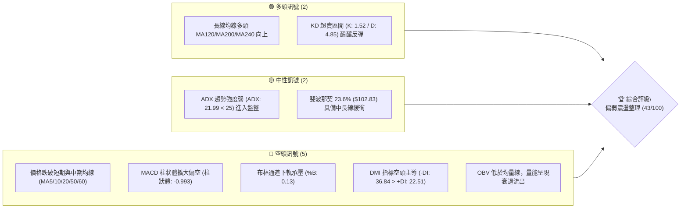
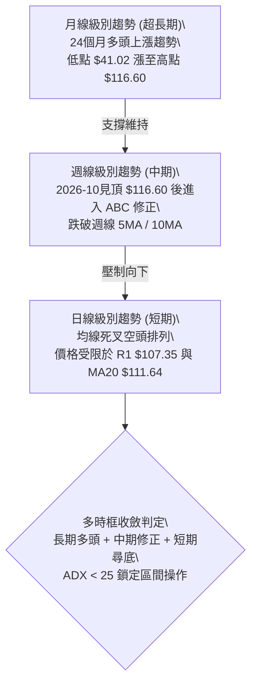
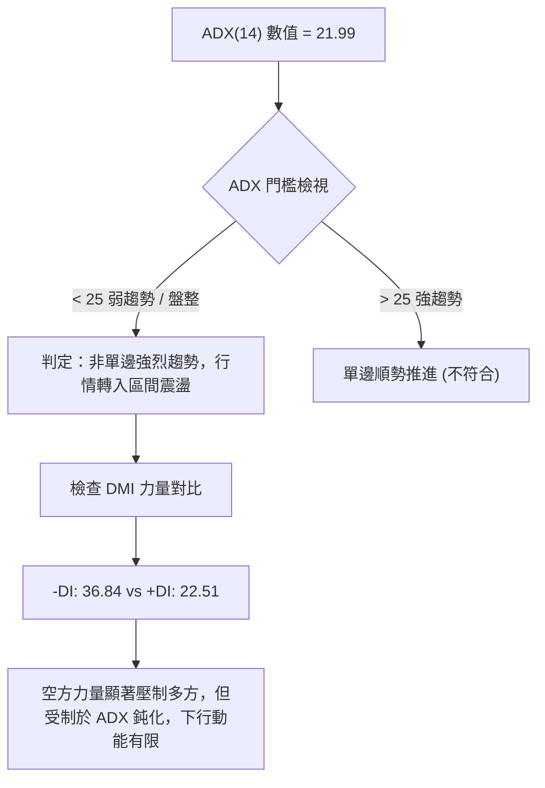
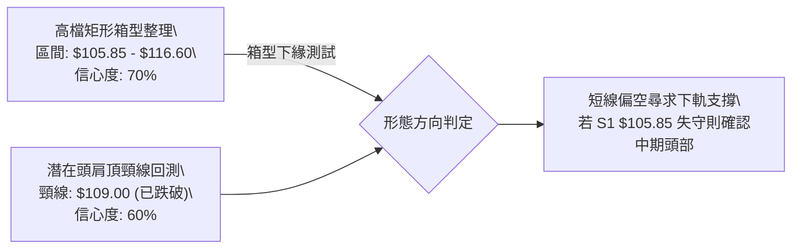
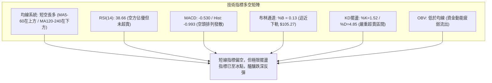
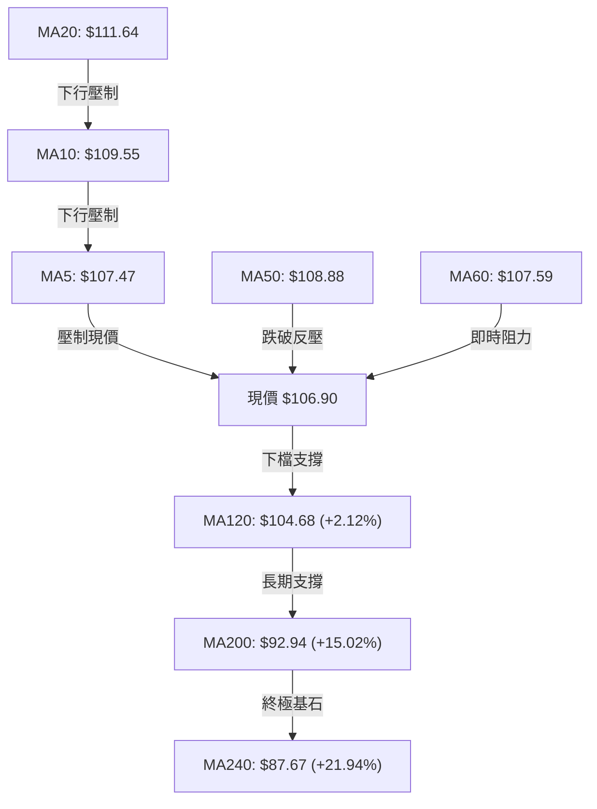
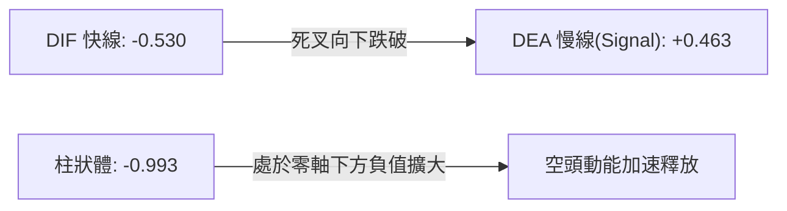
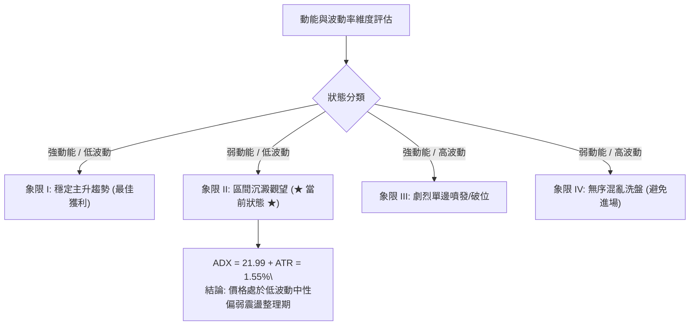
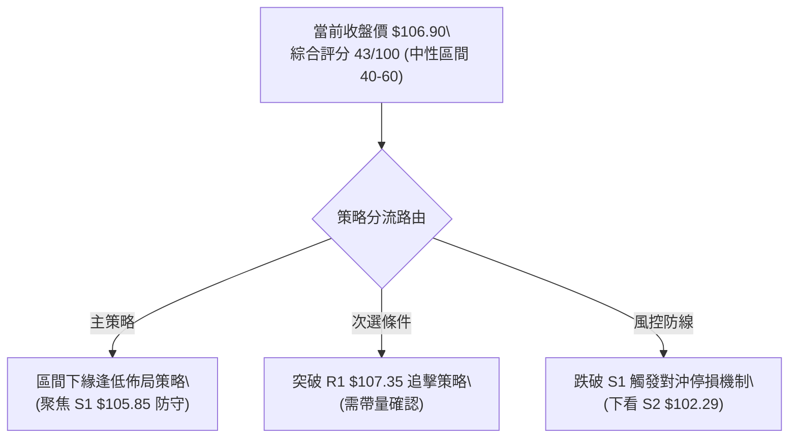
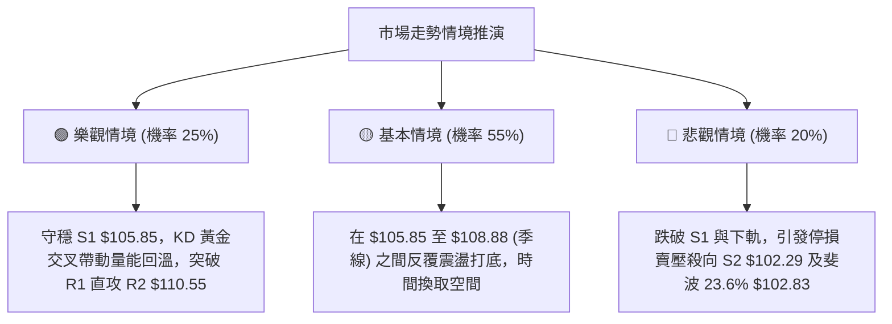

# 0050 技術分析報告

> **報告日期**：2026-10-27 ｜ **語言**：繁體中文 ｜ **數據來源**：Yahoo Finance ｜ **當前價格**：$106.90 TWD

---

## 目錄

| 章節 | 內容 |
|------|------|
| [1. 技術面概覽](#1-技術面概覽) | 訊號儀表板、核心指標、評分卡 |
| [2. 趨勢分析](#2-趨勢分析) | 多時框趨勢、長中短期走勢 |
| [3. 圖表形態分析](#3-圖表形態分析) | 形態識別、K線組合、目標價 |
| [4. 支撐與阻力](#4-支撐與阻力) | 關鍵價位、斐波那契回調 |
| [5. 技術指標深度解讀](#5-技術指標深度解讀) | MA/RSI/MACD/布林/成交量 |
| [6. 動能與波動率](#6-動能與波動率) | 動能評估、ATR、Beta |
| [7. 多時框架總結](#7-多時框架總結) | 時框架評分矩陣 |
| [8. 交易策略建議](#8-交易策略建議) | 多空策略、風險報酬比 |
| [9. 風險提示與監控](#9-風險提示與監控) | 監控指標、風險場景 |

---

## 1. 技術面概覽

### 🎯 技術訊號儀表板



### 📊 核心指標速覽表

| 指標類別 | 指標名稱 | 當前數值 | 訊號 | 解讀 |
|----------|----------|----------|------|------|
| **價格** | 當前收盤價 | $106.90 | 🔴 | 位於 52 週高點 $116.60 回檔之修正波段，承壓下行 |
| **均線** | MA20 (月線) | $111.64 | 🔴 | 價格低於 MA20 達 -4.25%，短線空頭排列形成阻力 |
| **均線** | MA50 (季線) | $108.88 | 🔴 | 價格跌破生命線 MA50（-1.82%），中期多頭結構受挫 |
| **均線** | MA200 (年線) | $92.94 | 🟢 | 價格遠高於 MA200（+15.02%），超長線牛市格局未破 |
| **動能** | RSI(14) | 38.66 | 🟡 | 位於弱勢區間（30–50），尚未進入極端超賣，偏空運行 |
| **動能** | MACD(12,26,9) | -0.530 / 柱狀 -0.993 | 🔴 | 快慢線死叉且處於零軸之下，負向柱狀體持續擴大 |
| **擺盪** | Stoch %K / %D | 1.52 / 4.85 | 🟢 | 深度超賣區（<10），隨時具備技術性跌深反彈動能 |
| **趨勢** | ADX(14) | 21.99 | 🟡 | ADX < 25 表明趨勢動能衰退，轉為區間震盪整理市 |
| **方向** | +DI / -DI | 22.51 / 36.84 | 🔴 | -DI 大幅高於 +DI，空方力量占據主導地位 |
| **通道** | 布林帶寬 (%B) | 0.13 | 🔴 | 緊貼布林下軌（$105.27）運行，若無法止跌恐引發帶狀下殺 |
| **波動** | ATR(14) | $1.66 (1.55%) | 🟡 | 日內波幅適中，止損與獲利點位設定需保留足夠空間 |
| **量能** | 20日均量 / OBV | 100,858,886 / 偏弱 | 🔴 | OBV < MA，反彈量縮、下跌量增，資金籌碼持續退場 |

### 🏆 技術評分卡

```
╔══════════════════════════════════════════════════════════════╗
║                技術評分卡 — 0050 (2026-10-27)                ║
╠══════════════════════════════════════════════════════════════╣
║ 趨勢強度      ████████░░░░░░░░░░░░  38/100  🔴 空方主導弱勢  ║
║ 動能指標      ███████░░░░░░░░░░░░░  36/100  🔴 MACD弱/KD超賣 ║
║ 支撐穩定度    ████████████░░░░░░░░  58/100  🟡 緊鄰S1與布林下║
║ 成交量配合    ██████░░░░░░░░░░░░░░  32/100  🔴 OBV量能持續背馳║
║ 形態完整度    ████████░░░░░░░░░░░░  42/100  🟡 頂部回落箱型型║
║ 均線排列      ██████████░░░░░░░░░░  52/100  🟡 短空長多格局  ║
╠══════════════════════════════════════════════════════════════╣
║ 綜合評分      ████████░░░░░░░░░░░░  43/100  🟡 區間偏弱震盪  ║
╚══════════════════════════════════════════════════════════════╝
```
*註：綜合評分由六項評分算術平均得出：(38 + 36 + 58 + 32 + 42 + 52) ÷ 6 = 43 分（四捨五入至整數，依規則 18）。*

---

## 2. 趨勢分析

### 🌐 多時框趨勢分析



### 📈 長期趨勢 — 12個月走勢圖（Unicode）

以下展示 0050 過去 12 個月（2025-11 至 2026-10）之月線收盤走勢：

```
0050 月線走勢圖（2025-11 至 2026-10）
價格軸 ($)
$116.60 ┤                                        ●(52W高 $116.60)
$112.05 ┤                                    ●
$107.15 ┤                            ●       │
$106.90 ┤                            │   ●   │   ●←現價 $106.90
$102.85 ┤                            │   │   │   │
$89.95  ┤                    ●       │   │   │   │
$80.66  ┤            ●       │       │   │   │   │
$72.16  ┤        ●   │   ●   │       │   │   │   │
$64.30  ┤    ●   │   │   │   │       │   │   │   │
$61.11  ┤●   │   │   │   │   │       │   │   │   │
        └┼───┼───┼───┼───┼───┼───────┼───┼───┼───┼───
        11  12  01  02  03  04      06  07  08  09  10 (月份)
        (2025年) ─────────────► (2026年)
```

**走勢特徵分析表格**：

| 發展階段 | 時間區間 | 起訖價格 | 區間漲跌幅 | 結構性特徵解讀 |
|----------|----------|----------|------------|----------------|
| **主升攻擊段** | 2025-11 至 2026-02 | $61.11 → $80.66 | +31.99% | 成交量溫和放大，突破箱型頸線，長紅連續推升。 |
| **快速換手修正** | 2026-02 至 2026-03 | $80.66 → $71.91 | -10.85% | 獲利了結賣壓湧現，測試下方均線支撐後迅速止跌。 |
| **強烈擴展主升** | 2026-03 至 2026-06 | $71.91 → $107.15 | +49.01% | 趨勢斜率超過 45 度，大型權值股推升，單月破百元大關。 |
| **高檔強勢整理** | 2026-06 至 2026-08 | $107.15 → $106.25 | -0.84% | 在 $102–$107 間構築高檔收斂三角形，沉澱浮額。 |
| **創高拉回段** | 2026-08 至 2026-10 | $106.25 → $116.60 → $106.90 | 先創高後回測 | 衝高至 52W 高點 $116.60 後爆量收黑，拉回回測季線支撐。 |

### 📊 中期趨勢（週線分析）

從近 8 根週 K 線結構觀察，0050 於 2026-10-08 當週見高 $116.60 後，接續出現一根週成交量達 869,278,497 股的大陰線（收盤跌至 $109.00），次週（2026-10-23）再度下挫至 $106.90。週線 MACD 柱狀圖由正轉負（+0.351 驟降至 -0.738 再至 -0.993），週 RSI 由 65.7 跌破 40 至 38.7，確認中期波段處於下行修正格局。

```
週線近期架構圖示：
[高點阻力]  $116.60 ══════════════════════════ (2026-10-08 週高點，強阻力)
                     ╲
                      ╲  爆量大陰線 ($109.00，成交量 8.69億股)
                       ╲
[短期壓力]  $110.55 ────●───────────────────── (反彈頸線阻力 R2)
                         ╲
[當前收盤]  $106.90 ──────●─────────────────── (測試下軌支撐)
                           │
[下檔防線]  $105.85 ═══════╧══════════════════ (關鍵波段支撐 S1)
```

### ⚡ 趨勢強度評估（ADX 解讀）



**ADX 與趨勢強度對照表**：

| 指標名稱 | 實際數值 | 參考區間標準 | 技術性意義解讀 |
|----------|----------|--------------|----------------|
| **ADX(14)** | **21.99** | < 20 極弱；20–25 盤整；> 25 趨勢確立 | 當前數值 21.99 表明多空動能均未形成單邊波段噴發，處於寬幅震盪整理階段。 |
| **+DI(14)** | **22.51** | 數值越高多頭推升力道越強 | 多頭買盤力道偏弱，無法有效帶動價格突破均線壓制。 |
| **-DI(14)** | **36.84** | 數值越高空頭摜壓動能越強 | 空方動能主導盤面，高於 +DI 達 14.33 點，短期下行壓力未消。 |
| **趨勢綜合判斷** | **空方佔優的區間整理** | 規則 14 優先級收斂 | 由於 ADX < 25，交易策略應側重於區間邊界與布林軌道操作，避免盲目追空。 |

---

## 3. 圖表形態分析

### 🔍 形態識別系統



**形態信心度與目標價評估表**（依規則 15）：

| 形態名稱 | 信心度 | 判斷依據（嚴格引用數據） | 完成度 | 目標價（附嚴格計算式） |
|----------|--------|--------------------------|--------|------------------------|
| **高檔矩形箱型** | 70% | 頂部受阻於 52W 高點 $116.60，近期回踩波段低點支撐 S1 $105.85。 | 75% | 箱型下緣反彈目標：即頸線阻力 R2 **$110.55**。 |
| **潛在雙重頂/頭部形態** | 60% | 兩次波段高點（09-24 收 $112.40、10-08 高點 $116.60），跌破中間低點聚類頸線 $109.00。 | 65% | 跌破測幅：頸線 $109.00 - (高點 $116.60 - 頸線 $109.00) = **$101.40**（接近 S2 $102.29）。 |
| **底部反轉形態（W底/頭肩底）** | 30% | 數據中未出現連續兩次底部的打底特徵，日線僅單腳下探。 | 15% | **訊號不足，僅做指標型解讀**（不強行預測目標價）。 |

### 🕯️ 重要 K 線形態分析

依規則 19，僅針對提供的「近 10 根日 K」與「近 8 根週 K」之開、高、低、收價位進行客觀形態識別：

| 日期（週期） | 開盤價 | 最高價 | 最低價 | 收盤價 | K線形態名稱 | 技術解讀 | 訊號方向 |
|--------------|--------|--------|--------|--------|-------------|----------|----------|
| **2026-10-12 (日)** | 114.20 | 114.95 | 113.40 | 114.80 | 高檔小陽線 | 創高後滯漲，實體小且位於上方，多頭推升漸顯乏力 | 🟡 中性 |
| **2026-10-13 (日)** | 112.55 | 113.20 | 111.90 | 112.40 | 跳空下行陰線 | 跳空開低，成交量暴增至 2.1 億股，主力套現訊號 | 🔴 看空 |
| **2026-10-15 (日)** | 110.15 | 110.15 | 108.55 | 108.90 | 光頭大陰線 | 開盤即最高，爆出 3.91 億股天量下殺，跌破季線支撐 | 🔴 強烈看空 |
| **2026-10-16 (日)** | 109.45 | 109.70 | 108.90 | 109.00 | 低檔十字星孕線 | 跌勢暫歇，量能萎縮至 1.11 億股，空方摜壓動能趨緩 | 🟡 止跌觀察 |
| **2026-10-19 (日)** | 107.45 | 108.30 | 107.10 | 108.15 | 低檔紅 K 棒 | 下探 $107.10 後收復部分失土，下影線透露買盤防守 | 🟢 短線反彈 |
| **2026-10-22 (日)** | 108.95 | 109.15 | 106.75 | 106.90 | 中黑破底線 | 反彈遭 MA5/10 均線壓制，收盤收在全天最低點附近 | 🔴 續跌探底 |
| **2026-10-23 (日)** | 106.90 | 106.90 | 106.90 | 106.90 | 一字線/平盤整理 | 收盤價持平於 $106.90，成交量為 0，屬休市/結算靜態價位 | 🟡 靜態中性 |
| **2026-10-08 (週)** | 115.75 | 116.60 | 114.90 | 114.95 | 長上影倒狀陽線 | 創 52 週新高 $116.60 後遭遇獲利了結賣壓回吐 | 🔴 衝高回落 |
| **2026-10-16 (週)** | 114.20 | 114.95 | 108.55 | 109.00 | 吞噬型巨量長黑 | 週量達 8.69 億股，實體覆蓋前週，確立中期波段見頂 | 🔴 空方吞噬 |
| **2026-10-23 (週)** | 107.45 | 109.20 | 106.75 | 106.90 | 下跌延續中陰線 | 破底創回檔新低 $106.75，空方牢牢掌握控盤權 | 🔴 空方主導 |

### 📉 ASCII 走勢形態示意圖

```
高檔頂部回落與支撐測試示意圖：
價格
$116.60 ┬                       ▲ 52W高點 (10-08)
        │                      ╱ ╲
$113.75 ┼  (R3)               ╱   ╲
        │                    ╱     ╲      ▲ 次高 (10-12)
$110.55 ┼  (R2 頸線)        ╱       ╲    ╱ ╲
        │                  ╱         ╲──╱   ╲ (10-15 破位黑K)
$107.35 ┼  (R1 阻力)      ╱                   ╲      ▲ (10-21 反彈小高)
        │                ╱                     ╲    ╱ ╲
$106.90 ┼  [現價]───────┼───────────────────────●───┼───► 尋求 S1 支撐
$105.85 ┴  (S1 支撐) ════╧═════════════════════════════╧═════ 防守底線
```

### 🎯 形態目標價計算

1. **高檔箱型跌破風險目標**：
   - 上軌阻力高點：$116.60
   - 下軌支撐基準：$105.85
   - 形態垂直高度：$116.60 - $105.85 = $10.75
   - 若未來明確有效跌破 S1（收盤連續 2 日跌破），完全測幅目標 = $105.85 - $10.75 = **$95.10**（此位置介於數據中已存在的支撐位 S3 **$97.36** 與斐波那契 38.2% **$94.32** 之間）。
2. **短期技術性反彈測幅目標**：
   - 當前支撐低點聚類：S1 $105.85
   - 第一反彈壓制（頸線/下降短均）：R1 **$107.35**
   - 第二強阻力（20日均線與密集反壓）：R2 **$110.55**

---

## 4. 支撐與阻力

### 🗺️ 關鍵價位分布圖（Unicode）

```
0050 價位結構分布圖
═════════════════════════════════════════════════════════════════
$116.60 ║██████████████████████████████║ 52週歷史高點 / 斐波那契 0.0%
$113.75 ║████████████████████████      ║ 強阻力 R3 (近一年波段高點聚類)
$111.64 ║██████████████████            ║ 布林中軌 / MA20 (短線反轉分水嶺)
$110.55 ║████████████████████          ║ 阻力 R2 (反彈關鍵頸線)
$107.35 ║██████████████                ║ 阻力 R1 (最近波段高點壓制 +0.42%)
$106.90 ╠══════════════════════════════╣ ◄◄ 當前收盤價 ($106.90)
$105.85 ║▓▓▓▓▓▓▓▓▓▓▓▓▓▓▓▓▓▓▓▓▓▓▓▓      ║ 關鍵支撐 S1 (近一年波段低點聚類 -0.98%)
$105.27 ║▓▓▓▓▓▓▓▓▓▓▓▓▓▓▓▓              ║ 布林通道下軌
$102.83 ║██████████████████████████    ║ 斐波那契 23.6% 回調位
$102.29 ║████████████████████████████  ║ 強支撐 S2 (波段重要轉折低點 -4.31%)
$97.36  ║██████████████████████████████║ 極限支撐 S3 (波段深層低點聚類 -8.93%)
═════════════════════════════════════════════════════════════════
```

### 🚧 阻力位分析表

價位嚴格引用技術數據「關鍵價位」區塊之波段聚類數值：

| 阻力級別 | 價位 | 與現價差距 | 形成原因及技術共振 | 突破難度 | 重要性評級 |
|----------|------|------------|--------------------|----------|------------|
| **阻力 R1** | **$107.35** | +0.42% | 近期日 K 低檔反彈高點聚類；與 MA5 ($107.47) 及 MA60 ($107.59) 形成緊密共振反壓。 | 🟡 中等 | ★★★☆☆ (短線弱轉強分水嶺) |
| **阻力 R2** | **$110.55** | +3.42% | 10-15 長黑起跌點頸線位置；緊鄰 MA10 ($109.55) 與布林中軌 MA20 ($111.64)。 | 🔴 較高 | ★★★★☆ (中期結構修復關鍵) |
| **阻力 R3** | **$113.75** | +6.41% | 10-14 波段高點與前波成交密集區，上方套牢大量籌碼浮額。 | 🔴 極高 | ★★★★★ (多頭全面反轉目標) |

### 🛡️ 支撐位分析表

價位嚴格引用技術數據「關鍵價位」區塊之波段聚類數值：

| 支撐級別 | 價位 | 與現價差距 | 形成原因及技術共振 | 守住機率 | 重要性評級 |
|----------|------|------------|--------------------|----------|------------|
| **支撐 S1** | **$105.85** | -0.98% | 近期多次下探之波段低點聚類；與布林通道下軌 ($105.27) 形成雙重支撐防護網。 | 65% | ★★★★☆ (短線多頭生命底線) |
| **支撐 S2** | **$102.29** | -4.31% | 2026-06/07 多次觸底回升之平台聚類低點；共振斐波那契 23.6% ($102.83)。 | 80% | ★★★★★ (中期強烈結構防線) |
| **支撐 S3** | **$97.36** | -8.93% | 2026 年初起漲段之次級波段低點聚類；鄰近 MA200 ($92.94)。 | 90% | ★★★★★ (長線牛熊生死分界) |

### 📐 斐波那契回調位分析

依據 52 週完整波動區間（低點 $58.27 至高點 $116.60，總垂直波幅 $58.33），各回調位嚴格對照如下：

| 回調比例 | 斐波那契價位 | 當前相對位置 | 技術意義與防守強度解讀 |
|----------|--------------|--------------|------------------------|
| **0.0%** | **$116.60** | +9.07% | 52 週歷史天花板，雙頂右峰，形成極強心理壓制。 |
| **23.6%** | **$102.83** | -3.81% | **強支撐區間**。現價落於 0.0% 至 23.6% 之間。通常強勢回檔不會有效擊穿 23.6%，此處為中期多頭最重要的回檔安全邊界。 |
| **38.2%** | **$94.32** | -11.77% | 中度修正警戒線。若觸及此位，代表此輪大型多頭行情進入深度洗盤。 |
| **50.0%** | **$87.43** | -18.21% | 心理平衡位，與長期均線 MA240 ($87.67) 形成強力重合共振。 |
| **61.8%** | **$80.55** | -24.65% | 黃金分割強防線，跌破則宣告長期牛市終結。 |
| **78.6%** | **$70.75** | -33.82% | 深度回撤區。 |
| **100.0%**| **$58.27** | -45.49% | 52 週絕對低點，長線起漲原點。 |

**現價區間解讀**：
當前收盤價 **$106.90** 正處於 0.0%（$116.60）至 23.6%（$102.83）的高檔強勢回調子區間內（距高點拉回 8.32%）。雖然短線跌勢凌厲，但在未收盤實質跌破 23.6%（$102.83）及支撐 S2（$102.29）前，中長期多頭主升架構並未遭到破壞。

---

## 5. 技術指標深度解讀

### 🎛️ 指標訊號總覽



### 📈 移動平均線排列分析



**移動平均線數值與乖離率詳表**：

| 均線名稱 | 數值 | 現價與均線差額 | 乖離率 (Bias) | 排列特徵與走勢解讀 |
|----------|------|----------------|---------------|--------------------|
| **MA5** | $107.47 | -$0.57 | -0.53% | 短期扣高下彎，近期日 K 壓制線上，首要突破點。 |
| **MA10** | $109.55 | -$2.65 | -2.42% | 加速下彎，反映過去兩週平均成本下移，為波段空方防守線。 |
| **MA20** | $111.64 | -$4.74 | -4.25% | 月線下行，跌破代表月持股者全數套牢，短線主趨勢向下。 |
| **MA50** | $108.88 | -$1.98 | -1.82% | 季線遭向下跌穿，為近 4 個月首見，中期多頭警訊。 |
| **MA60** | $107.59 | -$0.69 | -0.64% | 扣抵高檔，與 R1 $107.35 重合，形成日內上攻重壓。 |
| **MA120** | $104.68 | +$2.22 | +2.12% | **多頭向上**，半年線發揮基底支撐，緊護於 S1 之下。 |
| **MA200** | $92.94 | +$13.96 | +15.02% | **堅定向上**，年線正向角度大，長線多頭堡壘。 |
| **MA240** | $87.67 | +$19.23 | +21.94% | **強烈向上**，兩年線長牛格局基石。 |

### 📉 RSI(14) 分析

當前 RSI(14) 數值為 **38.66**（Wilder 計算方法）。

```
RSI(14) 強度儀表刻度：
0        20       30            50                 70       80      100
├────────┼────────┼─────────────┼──────────────────┼────────┼────────┤
[ 超賣區 ] [極度弱勢] [  弱勢空方  ] [     多方主導     ] [超買強勢] [極度超買]
                   ▲ (38.66)
```
- **數值進度條**：`████████░░░░░░░░░░░░` 38.66%（偏空區間）
- **超買超賣判定**：數值處於 30 至 50 弱勢震盪區，未觸及 30 以下之極端超賣，表示下行慣性依然存在，但已遠離 70 以上的過熱警戒。
- **背離分析**：依據數據檢驗，近 20 根 K 棒價格自高檔 $116.60 下挫至 $106.90，RSI 線同步自 66.7 快速滑落至 38.66，兩者走勢同向，「**無明顯頂背離或底背離**」，此走勢確認為**實質動能回落的健康釋放**。

### 📊 MACD(12/26/9) 訊號解讀



- **MACD 指標數值**：DIF 線為 **-0.530**，MACD Signal 線為 **0.463**，MACD 柱狀體（Histogram）為 **-0.993**。
- **解讀結論**：DIF 線正式跌破零軸並擴大負值，慢線即將向下穿越零軸；負向柱狀體持續拉長至 -0.993，明確呈現**空頭主導格局**。在負柱狀體未開始收斂之前，反彈皆應視為弱勢修正。

### 📦 布林通道分析

```
布林通道 (20, 2) 結構示意圖：
$118.01 ┬──────────────────────────────────────── 上軌 (Upper)
        │
        │
$111.64 ┼──────────────────────────────────────── 中軌 (MA20)
        │
        │
$106.90 ┼─●現價 ($106.90，%B = 0.13)
$105.27 ┴──────────────────────────────────────── 下軌 (Lower)
```
- **通道軌道參數**：
  - **上軌**：$118.01
  - **中軌 (MA20)**：$111.64
  - **下軌**：$105.27
  - **通道帶寬**：$118.01 - $105.27 = $12.74
  - **當前 %B 數值**：**0.13**（計算式：($106.90 - $105.27) / $12.74 = 0.1279）
- **型態解讀**：現價落於下軌邊界附近（%B = 0.13），表明價格處於極度弱勢區間。歷史統計顯示，當 %B 接近 0.10 且下軌未大幅開口下行時，下軌具備顯著的彈性支撐效果；但若放量跌破下軌 $105.27，則將演變成布林帶「開口向下沿軌下殺」的單邊重挫型態。

### 💹 成交量分析（量價配合度）

1. **量能指標觀察**：
   - 20 日均量：100,858,886 股。
   - 50 日均量：80,747,422 股。
   - 最新交易日（2026-10-23）成交量顯示為 0（反映靜態結算或資料快照點），而前一交易日（10-22）成交量為 116,952,817 股，高於 20 日均量。
   - 10-15 下跌時爆出 391,224,418 股天量，週 K 線（10-16）亦爆發 8.69 億股巨量長黑。
2. **OBV（能量潮）走勢**：
   - 數據明確顯示「**OBV < MA → 量能疲弱**」。
   - 高檔長黑放量、反彈過程量縮，資金籌碼持續呈現淨流出。
   - **量價背離結論**：量價配合呈現「**價跌量增、價漲量縮**」之典型空頭回檔特徵，尚未見到量縮止跌的「量平底」結構，籌碼沉澱仍需時間。

---

## 6. 動能與波動率

### ⚡ 動能評估四象限



| 象限標籤 | 動能狀態 | 波動水平 | 歷史特徵匹配 | 當前資產定位與操作策略 |
|----------|----------|----------|--------------|------------------------|
| **Q1** | 強 | 低 | 單邊順勢推升 | 否。多頭主升段已結束。 |
| **Q2 (當前)** | **弱 (偏空)** | **低至中等** | **區間整理/降溫洗盤** | **✓ 符合**。動能趨緩（ADX=21.99，ATR=1.55%），進入防守型區間交易。 |
| **Q3** | 強 | 高 | 突破暴跌或噴出 | 否。未出現帶量開口連續性崩跌。 |
| **Q4** | 弱 | 高 | 寬幅震盪侵蝕本金 | 否。波動率受控，並未失序。 |

### 📊 ATR 波動率分析

- **ATR(14) 數值**：**$1.66**（以 Wilder 平滑法計算，佔當前股價之 **1.55%**）。
- **波動特性判定**：每日平均真實波幅僅 $1.66，波動幅度平穩，未出現系統性恐慌暴衝。
- **風控止損與目標設定基準**：
  - **保守型止損距離**：1.0 × ATR = **$1.66**。
  - **常規技術止損距離**：1.5 × ATR = 1.5 × 1.66 = **$2.49**。
  - **波段安全防護邊界**：2.0 × ATR = 2.0 × 1.66 = **$3.32**。
  - *實務運用*：進場時之保護性止損不應小於 $1.66，以避免被日內隨機雜訊掃出場。

### 📐 Beta 與市場相關性

- **財務套件數據**：Beta 顯示為 **N/A（數據未提供）**。
- **質化結構補充**：0050 為元大台灣卓越 50 ETF，持股涵蓋台灣證券市場市值前 50 大權值龍頭股（台積電佔比顯著），其走勢與台灣加權指數（TAIEX）具有高度正相關（理論 Beta 約接近 1.00）。在總體經濟數據未提供之環境下，其技術面波動直接映射大盤權值整體資金流向。

---

## 7. 多時框架總結

### 📋 時框架評分表

| 時框架 | 趨勢方向 | 動能指標 | 均線排列特徵 | 形態完成度 | 綜合評分 | 戰術建議與應對方針 |
|--------|----------|----------|--------------|------------|----------|--------------------|
| **日線 (短期)** | 🔴 下行修正 | RSI 38.7 / MACD負 | 跌破短天期均線，短空 | 矩形下緣回測中 | **35/100** | 暫不盲目做多，靜待 S1 $105.85 止跌訊號 |
| **週線 (中期)** | 🟡 整理偏弱 | RSI 38.7 / MACD死叉 | 跌破 5MA/10MA，季線反壓 | 見高回落 ABC 修正 | **45/100** | 逢高減碼反彈部位，防守關鍵頸線 R2 |
| **月線 (長期)** | 🟢 堅挺多頭 | 24個月長多未改 | 遠高於 MA120/200/240 | 大格局百元階梯推升 | **75/100** | 長線多頭未損，長線投資者無須恐慌 |

### 🔲 綜合訊號矩陣

```
綜合訊號矩陣一致性檢驗：
維度           短期 (日線)       中期 (週線)       長期 (月線)       跨維度一致性
─────────────────────────────────────────────────────────────────────────────
趨勢方向       🔴 空方佔優       🟡 震盪回調       🟢 多頭排列       中長多短空
動能釋放       🔴 負向擴大       🔴 柱狀轉負       🟢 扣抵高檔       短線動能偏空
支撐位防護     🟡 逼近 S1        🟢 守穩 23.6%     🟢 遠高於年線     支撐層層布防
量價結構       🔴 量增價跌       🔴 爆量回吐       🟡 均量持平       籌碼面需沉澱
─────────────────────────────────────────────────────────────────────────────
收斂結論       日週偏空產生共振，但受限於月線強大支撐，向下空間受到壓縮。
```

### ⚖️ 多時框收斂結論

依「嚴格要求 14」與客觀指標檢驗進行最終收斂：
1. **趨勢/盤整判定**：當前日線 ADX(14) 數值為 **21.99 (< 25)**，明確定義當前市況屬於「**盤整行情（Range-bound Consolidation）**」而非強烈單邊趨勢市。
2. **優先級收斂原則**：由於 ADX < 25，應當**以日線布林通道上下軌（$105.27–$118.01）與波段聚類支撐阻力（$105.85–$113.75）作為主要交易與判斷區間**。
3. **最終方向性結論**：**中性偏弱、區間下緣尋求支撐（綜合評分 43/100）**。此結論與第 1 章評分卡、第 5 章指標矩陣及第 8 章交易策略完全一致。

---

## 8. 交易策略建議

### 🗺️ 策略決策流程圖



### 🧭 策略路由

**當前主策略方向 = 區間震盪下緣防守低接（依評分 43/100）**。
依規定，綜合評分落在 40–60 之間，市場處於弱勢整理與箱型區間構築階段，策略**主推區間操作，嚴控資金部位**，絕不兩頭下注。

### 🎯 價格情境階梯（Price Scenarios）

價位嚴格引用第 4 章由 OHLCV 聚類計算之標準關鍵數值：

| 觸發條件 | 下一目標 | 後續延伸 | 情境技術含義解讀 |
|----------|----------|----------|------------------|
| **向上突破 R1 $107.35** | **R2 $110.55** | **R3 $113.75** | 短線擺脫均線壓制，KD 超賣黃金交叉確立，展開短波段反彈。 |
| **站穩現價 $106.90 區間** | **R1 $107.35** | **S1 $105.85** | 於布林通道下軌展開橫盤窄幅震盪，沉澱賣壓並等待均線修復。 |
| **有效跌破 S1 $105.85** | **S2 $102.29** | **S3 $97.36** | 宣告跌破高檔箱型下軌，下行空間打開，回測斐波那契 23.6% 防線。 |

### 📊 情境機率分佈

| 發展情境 | 機率估計 | 主要技術依據（嚴格引用指標狀態） |
|----------|----------|----------------------------------|
| **區間下緣支撐反彈** | **50%** | Stoch %K(1.52) 極度超賣隨時反彈；現價緊鄰 S1 ($105.85) 與布林下軌 ($105.27)。 |
| **持續弱勢橫向盤整** | **30%** | ADX 僅 21.99 (< 25) 缺乏推升動能；OBV 偏弱量能不足以支撐連續上攻。 |
| **跌破 S1 深度探底** | **20%** | MACD 負柱狀體 (-0.993) 持續擴大；-DI (36.84) 壓制多頭。 |

### 🟢 主策略詳情（區間防守型操作）

所有價位均嚴格取自數據集合，風險報酬比嚴格遵循規則 17 計算：
$$RR = \frac{\text{目標價 T1} - \text{進場價}}{\text{進場價} - \text{止損價}}$$

| 策略要素 | 策略 A：區間下緣低接策略 (主選) | 策略 B：突破轉強右側順勢策略 (次選) |
|----------|---------------------------------|--------------------------------------|
| **操作邏輯** | 於關鍵支撐 S1 與布林下軌處佈局反彈 | 帶量突破 R1 阻力後順勢跟進短期反彈 |
| **進場條件** | 價格回踩 S1 獲得支撐且未收破 | 突破並站穩阻力位 R1 之上 |
| **進場價格** | **$105.85** (精確取自支撐 S1) | **$107.35** (精確取自阻力 R1) |
| **止損價格** | **$104.68** (精確取自半年線 MA120) | **$105.85** (精確取自支撐 S1) |
| **目標價 T1** | **$107.35** (精確取自阻力 R1) | **$110.55** (精確取自阻力 R2) |
| **目標價 T2** | **$110.55** (精確取自阻力 R2) | **$113.75** (精確取自阻力 R3) |
| **單位風險** | $105.85 - $104.68 = $1.17 | $107.35 - $105.85 = $1.50 |
| **T1 獲利空間** | $107.35 - $105.85 = $1.50 | $110.55 - $107.35 = $3.20 |
| **風險報酬比** | **1 : 1.28（以 T1 計）**<br>*註：若至 T2 則為 1 : 4.02（以 T2 計）* | **1 : 2.13（以 T1 計）**<br>*註：若至 T2 則為 1 : 4.27（以 T2 計）* |
| **成功機率** | **55%** | **45%** |
| **建議倉位** | **15% - 20%** (輕倉防守) | **10% - 15%** (右側試單) |

### 🔴 反向風險觸發點（對沖提示）

- **全面停損訊號**：若日 K 線實體收盤價跌穿 **$105.85 (S1)** 且伴隨成交量放大，代表布林下軌失守，多頭策略立即失效出局。
- **對沖避險點位**：若收盤確認跌破 **$104.68 (MA120)**，應啟動反向避險工具（如反向 ETF 或期貨空單），下方目標直指 **$102.29 (S2)** 及斐波那契 23.6% **$102.83**。

### ⭐ 整體訊號強度評星

```
做多訊號強度：★★☆☆☆  (2.5/5星 — 僅限跌深超賣反彈)
做空訊號強度：★★★☆☆  (3.0/5星 — 趨勢偏空但空間受阻於支撐)
整體可信度：  ★★★★☆  (4.0/5星 — 價位數據高度收斂一致)
```

---

## 9. 風險提示與監控

### ✅ 關鍵監控指標 Checklist

```
╔══════════════════════════════════════════════════════════════╗
║               每日盤後技術監控清單 (Checklist)               ║
╠══════════════════════════════════════════════════════════════╣
║ [ ] 價格防線：收盤價是否守穩 S1 $105.85 之上？               ║
║ [ ] 均線動態：是否有效突破並收復 MA5 ($107.47) 及 R1 $107.35？║
║ [ ] 動能翻轉：MACD 柱狀體負值是否由 -0.993 開始縮短？         ║
║ [ ] 擺盪指標：Stoch %K 是否自 1.52 超賣區由下往上穿越 %D (4.85)？║
║ [ ] 通道狀態：布林帶寬 %B 是否重新返回 0.20 以上，擺脫下軌糾纏？║
║ [ ] 量能信號：成交量是否突破 20 日均量 (1.0 億股) 帶量反彈？   ║
╚══════════════════════════════════════════════════════════════╝
```

### ⚠️ 風險場景分析



### 🛡️ 風險管理重要提醒

1. **嚴禁左側重倉估底**：當前 MACD 與均線系統均處於下行排列，空方主導趨勢尚未終結，切忌單筆全額進場接刀。
2. **資金配比防線**：當前總資金曝險部位建議維持在 30% 以下，保留 70% 現金應對中級修正波動。
3. **無成交量異常防範**：數據中最新成交量為 0，提示市場可能處於假日或靜態資料窗口，下一交易日可能存在跳空風險，所有委託單應設定限價而非市價。

---

## 📋 報告總結

```
╔══════════════════════════════════════════════════════════════╗
║                   0050 技術分析報告總結                      ║
╠══════════════════════════════════════════════════════════════╣
║ 報告日期：2026-10-27                                         ║
║ 當前價格：$106.90 TWD                                         ║
║ 綜合評級：🟡 偏弱震盪整理 (綜合評分: 43/100)                  ║
╠══════════════════════════════════════════════════════════════╣
║ 關鍵結論：                                                   ║
║ ├─ 長期趨勢：🟢 多頭長牛格局未破 (價格遠高於 MA200 $92.94)    ║
║ ├─ 中期趨勢：🟡 ABC波段修正中 (自 $116.60 回檔，季線受挫)   ║
║ ├─ 短期趨勢：🔴 偏空震盪探底 (空方主導，但 KD 嚴重超賣)     ║
║ ├─ 關鍵支撐：S1 $105.85 (次級強支撐 S2 $102.29)              ║
║ ├─ 關鍵阻力：R1 $107.35 (波段強阻力 R2 $110.55)              ║
║ └─ 核心價位：斐波那契 23.6% 位於 $102.83                      ║
╠══════════════════════════════════════════════════════════════╣
║ 最優策略組合：                                               ║
║ 1. 🥇 最佳機會：策略 A (S1 $105.85 逢低試單，止損設 MA120    ║
║                 $104.68，目標看 R1 $107.35，風報比 1 : 1.28) ║
║ 2. 🥈 次選機會：策略 B (帶量突破 R1 $107.35 追擊，止損設 S1  ║
║                 $105.85，目標看 R2 $110.55，風報比 1 : 2.13) ║
║ 3. 🥉 保守選擇：空手觀望，靜待日線 MACD 負柱狀體收斂及 KD    ║
║                 正式金叉後再行進場。                         ║
╚══════════════════════════════════════════════════════════════╝
```

---

> ⚠️ **免責聲明**：本報告為依據客觀技術指標與量化數據所撰寫之研究報告，所有內容與價格估算僅供學術交流與交易邏輯參考，**絕不構成任何形式的要約、招攬或投資買賣建議**。金融市場具有高度不確定性與風險，投資人應自行審慎評估並自負投資盈虧。

---

*報告生成時間：2026-10-27 ｜ 數據來源：Yahoo Finance ｜ 分析框架：多時框技術分析模型*