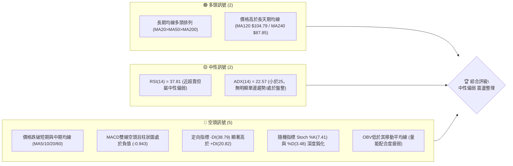
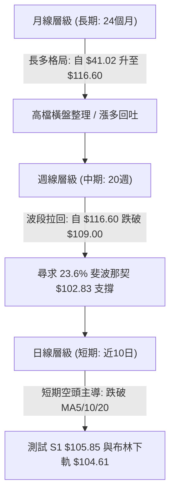
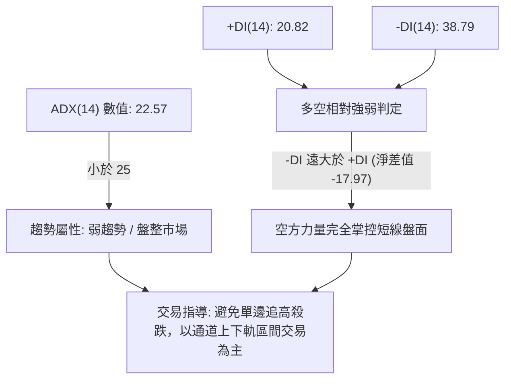
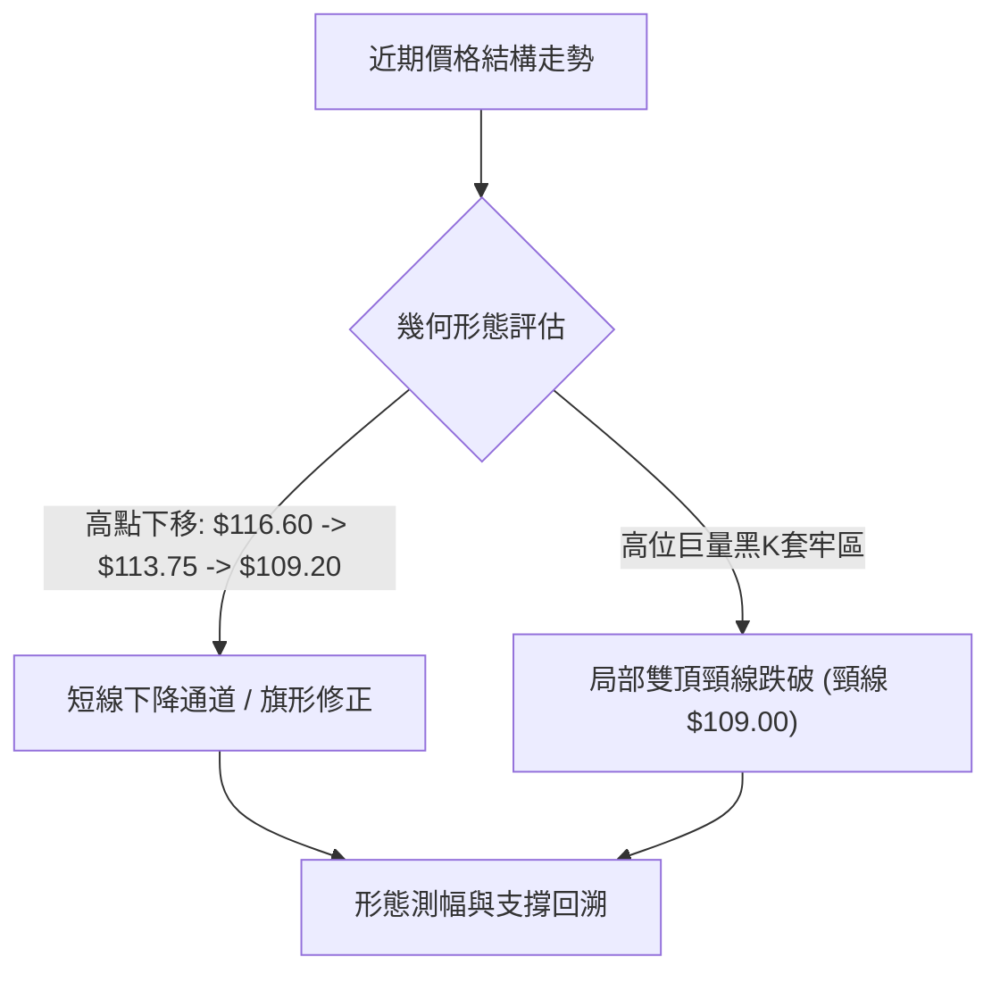
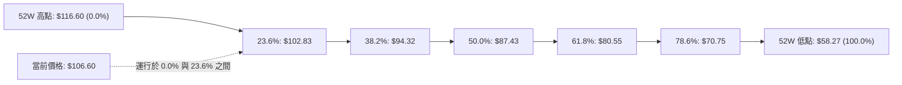
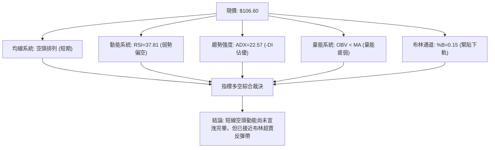
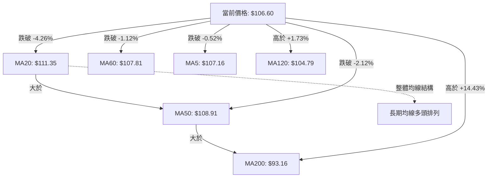
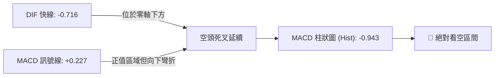
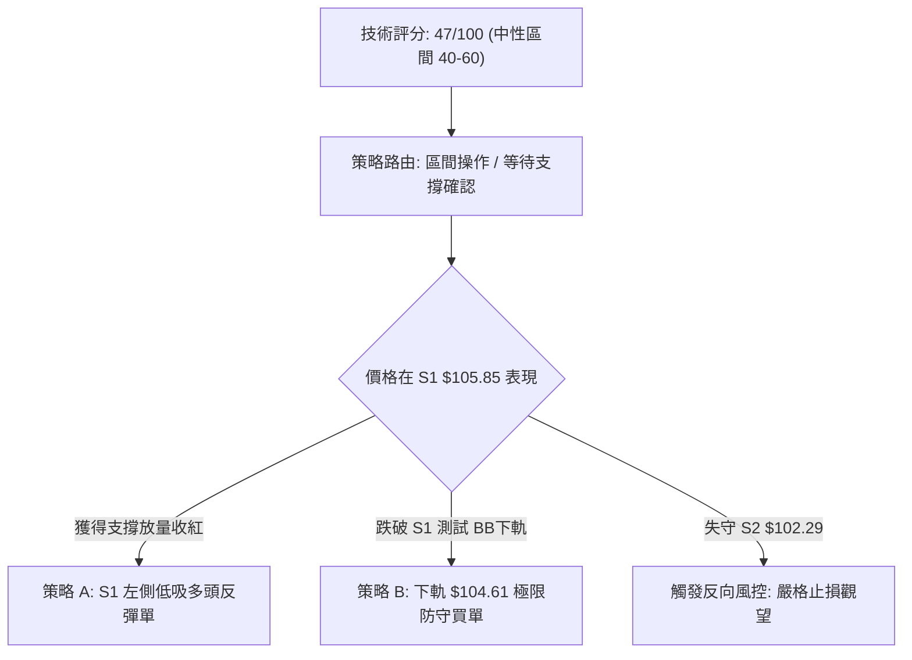
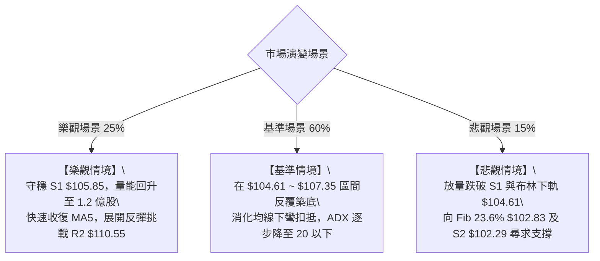

# 0050 技術分析報告

> **報告日期**：2026-10-28 ｜ **語言**：繁體中文 ｜ **數據來源**：Yahoo Finance ｜ **當前價格**：$106.60 TWD

---

## 目錄

| 章節 | 內容 |
|------|------|
| [1. 技術面概覽](#1-技術面概覽) | 訊號儀表板、核心指標、評分卡 |
| [2. 趨勢分析](#2-趨勢分析) | 多時框趨勢、長中短期走勢 |
| [3. 圖表形態分析](#3-圖表形態分析) | 形態識別、K線組合、目標價 |
| [4. 支撐與阻力](#4-支撐與阻力) | 關鍵價位、斐波那契回調 |
| [5. 技術指標深度解讀](#5-技術指標深度解讀) | MA/RSI/MACD/布林/成交量 |
| [6. 動能與波動率](#6-動能與波動率) | 動能評估、ATR、Beta |
| [7. 多時框架總結](#7-多時框架總結) | 時框架評分矩陣 |
| [8. 交易策略建議](#8-交易策略建議) | 多空策略、風險報酬比 |
| [9. 風險提示與監控](#9-風險提示與監控) | 監控指標、風險場景 |

---

## 1. 技術面概覽

### 🎯 技術訊號儀表板



### 📊 核心指標速覽表

| 指標類別 | 指標名稱 | 當前數值 | 訊號 | 解讀 |
|----------|----------|----------|------|------|
| **價格** | 當前價格 | $106.60 | 🟡 | 位於52週高低區間82.9%高位，短線自高點 $116.60 回檔調整中 |
| **均線** | MA20 | $111.35 | 🔴 | 現價低於MA20幅度達 -4.26%，月線下彎形成短期直接壓力 |
| **均線** | MA50 | $108.91 | 🔴 | 現價跌破中期生命線，顯示波段多頭動能受到顯著壓制 |
| **均線** | MA200 | $93.16 | 🟢 | 現價高於年線達 +14.43%，長線多頭架構完好無損 |
| **動能** | RSI(14) | 37.81 | 🟡 | 位於中性偏弱區域（接近30超賣區），尚未出現多頭背離訊號 |
| **動能** | MACD(12,26,9) | -0.716 / Hist -0.943 | 🔴 | 快慢線死叉且在零軸下方運行，柱狀圖持續處於綠柱負值區 |
| **波動** | ATR(14) | $1.67 | 🟡 | 佔現價1.56%，每日波動幅度溫和，市場處於非恐慌性收斂 |

### 🏆 技術評分卡

```
╔══════════════════════════════════════════════════════════════════╗
║                   技術評分卡 — 0050 (2026-10-28)                 ║
╠══════════════════════════════════════════════════════════════════╣
║ 趨勢強度 (ADX=22.57, -DI主導)   ████████░░░░░░░░░░░░  40/100 🔴 ║
║ 動能指標 (MACD死叉, RSI=37.81)  ██████░░░░░░░░░░░░░░  30/100 🔴 ║
║ 支撐穩定度 (S1=$105.85, BB下軌) ████████████░░░░░░░░  60/100 🟡 ║
║ 成交量配合 (OBV<MA, 量能疲弱)   ████████░░░░░░░░░░░░  40/100 🔴 ║
║ 形態完整度 (自高點回調形成通道) ██████████░░░░░░░░░░  50/100 🟡 ║
║ 均線排列 (長多短空, MA20>50>200)████████████░░░░░░░░  60/100 🟡 ║
╠══════════════════════════════════════════════════════════════════╣
║ 綜合評分 (六項算術平均: 280/6)  █████████░░░░░░░░░░░  47/100 🟡 ║
║ 評級結論：區間偏弱震盪整理，下檔尋求支撐，等待量價確認          ║
╚══════════════════════════════════════════════════════════════════╝
```

---

## 2. 趨勢分析

### 🌐 多時框趨勢分析



### 📈 長期趨勢 — 12個月走勢圖（Unicode）

```
0050 月線走勢圖（過去12個月：2025-11 至 2026-10）
價格軸 ($)
$115.00 ┤                                  ● 2026-09 ($112.05)
$110.00 ┤                            ●     │
$105.00 ┤                      ●     │     │  ● 2026-10 ($106.60) ◄ 現價
$100.00 ┤                      │     │     │  │
 $90.00 ┤                ●     │     │     │  │
 $80.00 ┤          ●     │     │     │     │  │
 $70.00 ┤    ●     │     │     │     │     │  │
 $60.00 ┤ ●  │     │     │     │     │     │  │
        └─┬──┬─────┬─────┬─────┬─────┬─────┬──┬──────────────────────
         N11 N12  J01   F02   A04   M05   A08 26-10
         (2025-11 → 2026-10)
```

**過去12個月走勢特徵分析表格**：

| 時間階段 | 月收盤區間 | 累積漲跌幅 | 趨勢特徵與結構解析 |
|----------|------------|------------|--------------------|
| **2025-11 至 2026-01** | $61.11 → $72.16 | +18.08% | **波段起漲期**：突破整理平台，長天期均線發散，成交量穩定擴增。 |
| **2026-02 至 2026-03** | $80.66 → $71.91 | -10.85% | **中途洗盤期**：短線獲利回吐，於 $71.91 見低點獲強力支撐並收長下影線。 |
| **2026-04 至 2026-06** | $89.95 → $107.15 | +19.12% | **主升加速段**：大陽線連續推升，突破百元心理關卡，創歷史新高。 |
| **2026-07 至 2026-09** | $102.85 → $112.05 | +8.94% | **高檔高頻震盪**：創下 52 週高點 $116.60，多空於 $102-$115 間劇烈換手。 |
| **2026-10（截至當前）** | $112.05 → $106.60 | -4.86% | **波段回吐防守**：連續跌破短期均線，目前正測試 $105.85 關鍵波段支撐。 |

### 📊 中期趨勢（週線分析）

從近 20 週收盤走勢觀察，0050 於 2026-10-08 當週見到 52 週最高價 $116.60 後，隨即於 2026-10-16 當週爆出 869,278,497 股巨量長黑收在 $109.00，週 RSI 從高檔 65.7 驟降至 43.1，週 MACD 柱狀圖由正轉負（-0.738）。隨後兩週（10-23 與 10-27）持續收陰，收盤價依序降至 $106.90 與 $106.60。中期結構已自「多頭攻擊」轉變為「向中軌與下檔支撐尋求平衡」的修正週期。

```
週線關鍵阻力與支撐位分布示意：
  $116.60 ──────────────────────── 52W 最高點 / 中期極限天花板
  $113.75 ──────────────────────── 近期波段次高密集區 (R3)
  $110.55 ──────────────────────── 反彈強阻力 (R2) / 週線套牢頸線
  $107.35 ──────────────────────── 弱阻力 (R1) / 近期反彈高點
  $106.60 ─── ◄ 當前價格
  $105.85 ──────────────────────── 第一道關鍵波段支撐 (S1)
  $102.83 ──────────────────────── 23.6% 斐波那契回調位
  $102.29 ──────────────────────── 強支撐區間 (S2)
```

### ⚡ 趨勢強度評估（ADX 解讀）



| 指標名稱 | 實際數值 | 門檻區間 | 當前狀態判定 | 交易意涵 |
|----------|----------|----------|--------------|----------|
| **ADX(14)** | 22.57 | < 25 | 弱趨勢 / 盤整震盪 | 趨勢缺乏延續性動能，不可採用激進突破追單。 |
| **+DI(14)** | 20.82 | — | 多方能量衰退 | 多頭買盤力道薄弱，難以發起連續性上攻。 |
| **-DI(14)** | 38.79 | > 30 | 空方壓制顯著 | 空頭主導日線盤面，逢反彈皆有賣壓出籠。 |

---

## 3. 圖表形態分析

### 🔍 形態識別系統



**形態信心度與識別依據表**（依規則 15）：

| 形態名稱 | 信心度 | 判斷依據（引用數據） | 完成度 | 目標價（附精確計算式） |
|----------|--------|----------------------|--------|------------------------|
| **局部雙頂形態** | 72% | 兩次高點見於 2026-10-08 週高 $116.60 與 2026-10-14 日高 $113.75；2026-10-16 跌破局部頸線 $109.00（收 $109.00，次日續跌）。 | 100%（已跌破頸線） | 頸線 $109.00 − 形態高度 ($113.75 − $109.00 = $4.75) = **$104.25**（接近 BB 下軌 $104.61） |
| **短線下降旗形** | 65% | 2026-10-15 旗桿長黑跌破後，10-19 至 10-27 形成高低點向下傾斜的窄幅旗面（$105.80 ~ $109.20）。 | 70%（旗面整理中） | 旗面下緣跌破測幅：突破點 $106.90 − 旗桿高度 ($113.00 − $108.90 = $4.10) = **$102.80**（精確對應斐波那契 $102.83） |

### 🕯️ 重要K線形態分析

依規則 19，完全基於提供的近 10 根日 K 與近 8 根週 K 實際開高低收進行客觀識別：

| 日期（週期） | 開盤價 | 最高價 | 最低價 | 收盤價 | K線形態名稱 | 技術解讀 | 訊號 |
|--------------|--------|--------|--------|--------|-------------|----------|------|
| **2026-10-14 (日K)** | $113.00 | $113.75 | $112.75 | $113.00 | 高檔十字星 (Doji) | 開收同價於 $113.00，上下影線顯現多空在 R3 ($113.75) 劇烈猶豫，動能枯竭。 | 🔴 |
| **2026-10-15 (日K)** | $110.15 | $110.15 | $108.55 | $108.90 | 跳空放量光頭大陰線 | 跳空開低於最高點 $110.15，量能爆出 391,224,418 股，實體長陰直接殺穿 MA20 與 MA50。 | 🔴 |
| **2026-10-21 (日K)** | $108.80 | $109.20 | $107.60 | $108.15 | 縮量倒錘子/上影小陰 | 反彈無力衝擊 $109.20 遇阻回落，成交量僅 76,295,858 股，確認多頭量能匱乏。 | 🔴 |
| **2026-10-22 (日K)** | $108.95 | $109.15 | $106.75 | $106.90 | 破底長陰線 | 收於當日低點附近，摜破前低 $107.05，開啟新一輪探底。 | 🔴 |
| **2026-10-27 (日K)** | $107.10 | $107.55 | $105.80 | $106.60 | 帶下影弱勢實體黑K | 盤中最低探至 S1 關鍵位 $105.80 獲得買盤承接拉回，留 0.80 元下影線，但收盤仍收陰。 | 🟡 |
| **2026-10-08 (週K)** | $115.75 | $116.60 | $114.90 | $114.95 | 高檔長上影避雷針陰線 | 週高衝至 $116.60 歷史極值後大幅回落，宣告長達半年的上升波段正式見頂。 | 🔴 |
| **2026-10-16 (週K)** | $114.20 | $114.95 | $108.55 | $109.00 | 天量實體大長黑 (巨陰) | 週成交量爆出 869,278,497 股巨量，完全吞噬前四週整理平台，主力資金出逃明確。 | 🔴 |
| **2026-10-27 (週K)** | $107.10 | $107.55 | $105.80 | $106.60 | 探底測試實體陰線 | 最低價 $105.80 精準觸碰 S1 支撐位，收於 $106.60，週線連三黑。 | 🔴 |

### 📉 ASCII 走勢形態示意圖

```
日K線局部雙頂與下降通道示意圖：
$114.00 ┤        [頂一: $113.75]
$112.00 ┤          ●─────●
$110.00 ┤         /       \   [跳空長陰 10-15]
$109.00 ┼────────/─────────\───[跌破頸線 $109.00]───────────
$108.00 ┤       /             \   ● [反彈高點 $109.20]
$107.00 ┤      /               \ / \
$106.00 ┼─────●                 ●   ●◄ 現價 $106.60
$105.85 ┴─────────────────────────────┴─ [當日低點 $105.80 / S1 支撐]
        ────────────────────────────────────────────────
        日期:   10-13  10-14  10-15  10-19  10-21  10-27
```

### 🎯 形態目標價計算

1. **雙頂形態量幅目標價**：
   - 第一頂高點：$116.60（2026-10-08 週高）
   - 次頂高點：$113.75（2026-10-14 日高）
   - 形態頸線位置：$109.00（2026-10-15 跌破點收盤）
   - 形態垂直高度 $H = \text{次頂 } \$113.75 - \text{頸線 } \$109.00 = \$4.75$
   - **目標價 $T = \text{頸線 } \$109.00 - \$4.75 = \$104.25$**（精準落在 BB 下軌 $104.61 附近）。

2. **下降旗形延續測幅目標價**：
   - 旗桿起跌點：2026-10-14 收盤 $113.00，旗桿底部為 2026-10-15 收盤 $108.90，垂直跌幅 $4.10。
   - 旗面反彈次高點：2026-10-21 高點 $109.20；破位點為 2026-10-22 收盤 $106.90。
   - **等長延伸目標價 $T2 = \$106.90 - \$4.10 = \$102.80$**（完全重合於斐波那契 23.6% 回調位 $102.83）。

---

## 4. 支撐與阻力

### 🗺️ 關鍵價位分布圖（Unicode）

```
0050 價位結構分布圖
═══════════════════════════════════════════════════════════════
$116.60 ║████████████████████████████████║ 52週歷史高點 (0.0% Fib)
$113.75 ║████████████████████████        ║ 強阻力 R3 (波段次高點聚類)
$110.55 ║████████████████                ║ 中期阻力 R2 (反彈解套賣壓帶)
$107.35 ║████████                        ║ 短期阻力 R1 (反彈初步遭遇點)
$106.60 ╠════════════════════════════════╣ ◄ 當前收盤價 ($106.60)
$105.85 ║▓▓▓▓▓▓▓▓▓▓▓▓▓▓▓▓                ║ 近期關鍵支撐 S1 (波段低點聚類)
$104.61 ║▓▓▓▓▓▓▓▓▓▓▓▓▓▓▓▓▓▓▓▓            ║ 布林下軌支撐位
$102.83 ║████████████████████████        ║ 斐波那契 23.6% 回調關鍵樞紐
$102.29 ║████████████████████████████    ║ 強支撐 S2 (波段低點聚類)
 $97.36 ║████████████████████████████████║ 極限強支撐 S3 (大波段防守點)
═══════════════════════════════════════════════════════════════
```

### 🚧 阻力位分析表

依規則 13，精確引用數據中「關鍵價位」區塊之數值：

| 阻力級別 | 阻力價位 | 距現價幅 | 形成原因與籌碼結構 | 突破難度 | 重要性權重 |
|----------|----------|----------|--------------------|----------|------------|
| **R1** | **$107.35** | +0.70% | 近期波段下行中的反彈遇阻點，貼近 5 日均線 ($107.16) 與 10-27 日高 ($107.55)。 | 🟡 中等 | 短線多頭重奪主控權的試金石。 |
| **R2** | **$110.55** | +3.71% | 2026-10-15 跳空長黑的上緣開盤價 ($110.15) 密集套牢區，上方臨近 MA20 ($111.35)。 | 🔴 極高 | 中期強弱分水嶺，無千億巨量難以逾越。 |
| **R3** | **$113.75** | +6.71% | 2026-10-14 高點與波段次高點聚類，此處為高檔籌碼派發重災區。 | 🔴 極難 | 多頭波段攻勢的極限天花板。 |

### 🛡️ 支撐位分析表

依規則 13，精確引用數據中「關鍵價位」區塊之數值：

| 支撐級別 | 支撐價位 | 距現價幅 | 形成原因與技術共振 | 守住機率 | 重要性權重 |
|----------|----------|----------|--------------------|----------|------------|
| **S1** | **$105.85** | -0.70% | 近一年波段低點聚類（2026-09-18 週低 $105.85、10-27 日低 $105.80 完美共振）。 | 🟡 65% | 日線短線多空攻防核心，跌破將引發向 BB 下軌下殺。 |
| **S2** | **$102.29** | -4.04% | 2026-06-26 週低 ($102.48)、2026-07-31 週低 ($102.85) 聚類強支撐，緊鄰 Fib 23.6% ($102.83)。 | 🟢 85% | 中期生命線核心防禦點，具有強烈價值買盤護盤。 |
| **S3** | **$97.36** | -8.67% | 近一年波段極端低點聚類（2026-07-17 週低 $99.54 下方延伸），長線牛熊分水嶺。 | 🟢 95% | 戰略級長線防守底線，不容有失。 |

### 📐 斐波那契回調位分析

依規則 13，以 52 週低點 **$58.27** 至 52 週高點 **$116.60** 進行標準黃金分割計算（波段全幅 $58.33）：



- **當前位置解讀**：現價 **$106.60** 目前正處於 **0.0% ($116.60)** 與 **23.6% ($102.83)** 之間，位處極高強度的強勢回調區間內。
- **回調深度判定**：從高點 $116.60 回跌至現價 $106.60，回吐幅度為 $10.00，僅佔整體上升浪 $58.33 的 **17.14%**，尚未跌破第一道黃金分割線 23.6% ($102.83)。這表明中長期多頭架構並未遭到實質性破壞，本質上仍屬於強勢牛市中的高檔籌碼清洗。
- **關鍵共振觀察**：若 S1 ($105.85) 失守，下檔多頭最強的防守陣線為 **斐波那契 23.6% ($102.83)** 與 **S2 ($102.29)** 所構成的 **$102.29 ~ $102.83 共振支撐帶**。

---

## 5. 技術指標深度解讀

### 🎛️ 指標訊號總覽



### 📈 移動平均線排列分析



均線體系呈現出鮮明的「**短空格局、長多護盤**」分歧特徵：
1. **短中期均線全面蓋頭**：價格自跌破 MA5 ($107.16) 與 MA10 ($108.73) 後，持續受制於向下彎折的 MA20 ($111.35)，且 MA5、MA10、MA20、MA60 均處於現價上方，形成密集的下行均線空頭排列壓力。
2. **長期均線提供強大下檔支撐**：半年線 MA120 ($104.79) 穩健走平向上，與年線 MA200 ($93.16)、兩年線 MA240 ($87.85) 維持絕對的多頭發散形態。MA120 正好守衛在布林下軌 ($104.61) 附近，構築了中長線價值投資者的護城河。

### 📉 RSI(14) 分析

- **當前數值**：**37.81**（Wilder 計算法）
- **強度指示條**：`███████░░░░░░░░░░░░░` 37.81%
- **超買超賣區間判定**：目前落於 30 至 70 的中性區間偏下緣，已逼近 30 超賣門檻，反映出近期遭受強烈拋售，但尚未進入恐慌性極端超賣。
- **背離分析判斷**：
  - 根據近 20 根 K 棒的首尾比對（2026-10-13 收 $112.40 對比 2026-10-27 收 $106.60，價格形成顯著低點下降；而日線 RSI 亦由高檔回落至 37.81）。
  - **結論**：**RSI 無明顯背離現象**。價格走弱與動能指標下行保持一致性，屬於健康的空頭動能釋放，尚未出現左側進場的底背離抄底訊號。

### 📊 MACD(12, 26, 9) 訊號解讀



- **指標讀數**：DIF 快線已下穿至零軸下方來到 **-0.716**，MACD Signal 訊號線降至 **+0.227**，MACD Histogram 柱狀圖為 **-0.943**。
- **動能評估**：柱狀圖自 2026-10-15 翻負以來，負值持續放大，表明空頭動能正在加速宣洩。DIF 線尚未出現走平或向上勾頭的跡象，意味著下行趨勢仍具動能，短期內直接V型反轉的機率極低。

### 📦 布林通道分析

```
布林通道 (20, 2) 結構示意圖：
$118.08 ┬────────────────────────────────────────── 上軌 (BB Upper)
        │
$111.35 ┼─── ─── ─── ─── ─── ─── ─── ─── ─── ─── ── 中軌 (MA20: $111.35)
        │
$106.60 ┼───────● ◄ 現價 ($106.60, %B = 0.15)
$104.61 ┴────────────────────────────────────────── 下軌 (BB Lower)
```

- **通道參數**：
  - BB 上軌：**$118.08**
  - BB 中軌 (MA20)：**$111.35**
  - BB 下軌：**$104.61**
  - 通道寬度 (Bandwidth)：$(118.08 - 104.61) / 111.35 = 12.10\%$
- **%B 指標深度解讀**：
  - 當前 **%B = 0.15**，表明現價距離下軌僅剩 15% 的通道空間，已進入極限超跌區。
  - 歷史經驗顯示，當 %B 降至 0.10 ~ 0.15 區間時，價格常伴隨技術性空頭回補而觸發向中軌收斂的反彈走勢。布林下軌 **$104.61** 將與 MA120 ($104.79) 形成強烈的共振支撐。

### 💹 成交量分析（量價配合度）

1. **量比指標剖析**：
   - 最新交易日 (2026-10-27) 成交量：**152,910,651 股**。
   - 20 日平均成交量：**105,733,889 股**。
   - **量比達 1.45 倍**（顯著高於 1.0），且超越 50 日均量 (82,641,694 股)。
2. **量價關係判定**：
   - 10-27 日 K 線留有下影線，成交量放大至 1.52 億股，顯示在跌破 $106.00 逼近 S1 ($105.85) 之際，市場出現顯著的主動性承接量。
   - 然而，**OBV 趨勢顯示 OBV < MA**，代表整體籌碼在過去兩週內呈現流出狀態，短期的單日放量承接尚未逆轉中期的籌碼疲態，屬於「**量能疲弱、有局部承接但未見反轉大單**」的過渡階段。

---

## 6. 動能與波動率

### ⚡ 動能評估四象限

```
動能與波動率四象限矩陣定位：

  高波動 (High Vol)
        │
   Q3   │   Q4
  強動能│  弱動能
  高波動│  高波動
────────┼────────
   Q1   │   Q2 ◄ [0050 所在位置]
  強動能│  弱動能 (ADX=22.57, RSI=37.81)
  低波動│  低波動 (ATR%=1.56%, 盤整偏弱)
        │
  低波動 (Low Vol)
```

| 象限 | 動能維度 | 波動維度 | 0050 狀態符合度 | 戰術應對邏輯 |
|------|----------|----------|-----------------|--------------|
| **Q1 爆發期** | 強動能 | 低波動 | 否 | — |
| **Q2 蓄勢/盤整期** | **弱動能** | **低波動** | **✓ 符合 (現狀)** | **謹慎觀望，不可追價。以箱體與布林下軌低吸為主，嚴設止損。** |
| **Q3 單邊狂潮** | 強動能 | 高波動 | 否 | — |
| **Q4 恐慌出逃** | 弱動能 | 高波動 | 否 | — |

### 📊 ATR 波動率分析

- **ATR(14) 讀數**：**$1.67**（佔現價之 **1.56%**，採 Wilder 平滑算法）。
- **波動特徵**：日均波幅僅 $1.67，反映 0050 作為權值 ETF 的防禦性特徵，並未出現恐慌性的多殺多崩跌。
- **止損與部位建議**：
  - **保守型止損距離**：$1.5 \times \text{ATR} = 1.5 \times \$1.67 = \mathbf{\$2.51}$。
  - **進取型止損距離**：$1.0 \times \text{ATR} = 1.0 \times \$1.67 = \mathbf{\$1.67}$。
  - 若在現價 $106.60 建立短多部位，合理技術止損應設於現價減去約 $1.67 下方，即防守 $105.85（S1）失守後之緩衝區。

### 📐 Beta 與市場相關性

- **Beta 數值**：**N/A（數據未提供）**。
- **量化特徵補充**：雖然原始數據未提供個股 Beta，但 0050 為追蹤臺灣 50 指數之龍頭 ETF，其成分股佔台股整體市值超過七成，在統計學上與加權指數之相關係數極高（近乎同向波動）。當前 0050 之弱勢下行完全反映了權值股近期遭受外資與法人籌碼調節的客觀實況。

---

## 7. 多時框架總結

### 📋 時框架評分表

| 時框架 | 趨勢方向 | 動能狀態 | 均線排列特徵 | 形態識別結論 | 綜合評分 | 操作建議方向 |
|--------|----------|----------|--------------|--------------|----------|--------------|
| **短期 (日線)** | 🔴 偏空 | 弱勢超賣 (RSI 37.8) | 短期空頭排列 (跌破MA20) | 下降通道運行中 | 35/100 | 等待下軌止跌確認 |
| **中期 (週線)** | 🟡 震盪整理 | 轉弱修正 (MACD翻綠) | 糾結向 MA20 靠攏 | 雙頂高檔回檔整理 | 48/100 | S1/S2 區間分批承接 |
| **長期 (月線)** | 🟢 多頭主導 | 長期強勢回吐 | 絕對多頭 (MA120/240昂揚) | 歷史大牛市良性回檔 | 70/100 | 長期定期定額續抱 |

### 🔲 綜合訊號矩陣

```
時框與維度矩陣分析：
┌───────────┬───────────┬───────────┬───────────┬───────────┐
│  時框架   │ 均線架構  │ 動能指標  │ 籌碼量能  │ 形態結構  │
├───────────┼───────────┼───────────┼───────────┼───────────┤
│ 日線 (短) │  🔴 空頭  │  🔴 偏空  │  🟡 震盪  │  🔴 偏空  │
│ 週線 (中) │  🟡 中性  │  🔴 偏弱  │  🔴 賣壓  │  🟡 整理  │
│ 月線 (長) │  🟢 多頭  │  🟢 多頭  │  🟢 健全  │  🟢 強勢  │
└───────────┴───────────┴───────────┴───────────┴───────────┘
```

### ⚖️ 多時框收斂結論

依「**嚴格要求 14 多時框收斂規則**」嚴謹推導收斂結論：
1. **行情屬性判定**：當前 ADX(14) 讀數為 **22.57**（**小於 25**），系統正式判定當前市場為「**盤整行情**」，而非單邊趨勢行情。
2. **主導時框與交易區間**：在盤整行情中，依收斂優先級規則，應以**日線布林通道上下軌 ($104.61 ~ $118.08)** 作為主要交易區間，而不宜依據長線趨勢盲目追漲。
3. **時框衝突裁決**：日線呈現明確的短期空頭修正，但週線與月線之長期上升架構（MA120 $104.79 與 MA200 $93.16）完好。因此，日線的下挫**不可視為長線翻熊**，而應定性為「**高檔大型箱體震盪中的下軌尋底階段**」。
4. **唯一方向性結論**：**中性偏弱觀望，聚焦布林下軌與關鍵支撐的區間防守交易**。此結論與第 1 章評分卡（47/100）完全一致。

---

## 8. 交易策略建議

### 🗺️ 策略決策流程圖



### 🧭 策略路由（依評分卡分流）

> **當前主策略方向 = 區間操作（依綜合評分 47/100，落於 40–60 中性震盪區間）**  
> 市場處於 ADX < 25 之盤整格局，短線空頭主導但逼近布林通道下軌與多重波段支撐。交易核心策略鎖定在「**回測下軌支撐區間低吸做反彈，反彈至均線壓力帶獲利了結**」，嚴禁在壓力位追價。

### 🎯 價格情境階梯（Price Scenarios）

依據規則 13，所有價位嚴格引用第四章與數據源中已計算之實際點位：

| 觸發條件 | 下一目標 | 後續延伸 | 情境技術含義與應對要點 |
|----------|----------|----------|------------------------|
| **突破 R1 $107.35** | **R2 $110.55** | **R3 $113.75** | 短線轉強，封閉下行缺口，可向上挑戰月線 MA20 壓力位。 |
| **守住 S1 $105.85** | **R1 $107.35** | **R2 $110.55** | 在近期波段低點形成雙底小結構，進入箱體築底修復走勢。 |
| **跌破 S1 $105.85** | **S2 $102.29** | **S3 $97.36** | 探底延伸至斐波那契 23.6% ($102.83) 與 S2 強支撐，測試長期多頭防線。 |

### 📊 情境機率分佈

| 預測情境 | 機率 | 主要技術指標依據 |
|----------|------|------------------|
| **情境一：下軌支撐回升 / 區間反彈** | **55%** | Stoch 超賣鈍化 (%K=7.41)，現價臨近布林下軌 (%B=0.15)，S1 獲量能承接。 |
| **情境二：窄幅橫盤震盪整理** | **30%** | ADX 僅 22.57 缺乏單邊推進力，OBV 疲軟導致多空在此陷入拉鋸消耗。 |
| **情境三：下破 S1 深度探底 S2** | **15%** | MACD 負柱狀圖持續放大 (-0.943)，-DI(38.79) 仍握有短期向下主導權。 |

### 🟢 主策略詳情（區間操作多頭反彈策略）

依規則 17 嚴格定義：$\text{風險報酬比} = (\text{目標價 T1} - \text{進場價}) \div (\text{進場價} - \text{止損價})$。

| 策略要素 | 策略 A（S1 支撐低吸反彈策略） | 策略 B（布林下軌極限右側承接策略） |
|----------|--------------------------------|-------------------------------------|
| **進場條件** | 盤中拉回回踩 S1 ($105.85) 不破，或收盤確認站穩。 | 跌破 S1 後於布林下軌 $104.61 ~ MA120 $104.79 企穩出量。 |
| **進場價格** | **$106.60**（以當前收盤價進場） | **$104.61**（以布林下軌價位進場） |
| **目標價 T1** | **$110.55**（波段阻力 R2，反彈首要壓力） | **$107.35**（短期阻力 R1） |
| **目標價 T2** | **$113.75**（強阻力 R3） | **$110.55**（中期阻力 R2） |
| **止損價格** | **$104.61**（嚴格以布林下軌跌破為止損點） | **$102.29**（以波段強支撐 S2 跌破為止損點） |
| **風險報酬比** | **1 : 1.98（以 T1 計）**  <br>*(計算式: $(110.55 - 106.60) / (106.60 - 104.61) = 3.95 / 1.99 = 1.98$)* <br>另列：1 : 3.59（以 T2 計） | **1 : 1.18（以 T1 計）**  <br>*(計算式: $(107.35 - 104.61) / (104.61 - 102.29) = 2.74 / 2.32 = 1.18$)* <br>另列：1 : 2.56（以 T2 計） |
| **成功機率** | **60%** | **70%** |
| **建議倉位** | **15% - 20%**（輕倉試單） | **25% - 30%**（價值防守加碼） |

### 🔴 反向風險觸發點（對沖提示）

- **多單失效風控點**：若日線收盤價帶量**有效跌破 $105.85 (S1)** 且隔日無法收復，必須無條件將短線反彈多單減碼；若進一步貫破 **$104.61 (布林下軌)**，宣告下行空間打開，多單應全數止損離場，下看 $102.83 ~ $102.29 尋求再進場機會。
- **融券/空頭避險觸發點**：若價格反彈至 **$110.55 (R2)** 遇阻出現量縮長上影線，可作為持有大量現貨部位者的短期避險鎖水點。

### ⭐ 整體訊號強度評星

```
做多訊號強度：★★☆☆☆  (2/5星 - 短線均線被動，但逼近布林下軌超賣區)
做空訊號強度：★★★☆☆  (3/5星 - 短期空頭排列，唯空間受限於長多支撐)
整體可信度：  ★★★★☆  (4/5星 - 指標共振與價位聚類完整，判斷可信度高)
```

---

## 9. 風險提示與監控

### ✅ 關鍵監控指標 Checklist

```
╔══════════════════════════════════════════════════════════════════╗
║                    每日盤面技術監控清單 (Checklist)              ║
╠══════════════════════════════════════════════════════════════════╣
║ [ ] 價位防守：S1 關鍵支撐 $105.85 收盤是否守穩？                 ║
║ [ ] 動能拐點：MACD Histogram (-0.943) 負值是否縮小並向零軸靠攏？ ║
║ [ ] 量能異動：日成交量是否回升至 20日均量 (1.05億股) 之上？     ║
║ [ ] 均線挑戰：5日均線 ($107.16) 是否帶量長紅突破？               ║
║ [ ] 震盪指標：Stoch 是否自低檔 20 以下形成黃金交叉？             ║
║ [ ] 波動異常：單日震幅是否超過 ATR ($1.67) 觸發極限風控？        ║
╚══════════════════════════════════════════════════════════════════╝
```

### ⚠️ 風險場景分析



### 🛡️ 風險管理重要提醒

1. **不可左側重倉豪賭**：雖然 RSI 與 Stoch 均處於超賣區間，但在 ADX 尚未降溫且 -DI(38.79) 絕對主導盤面的背景下，隨意加槓桿抄底極易遭遇鈍化下殺風險。
2. **嚴格執行紀律止損**：嚴禁將短期交易單轉化為長期套牢單。若以區間交易切入，跌破預設之技術止損價位（$104.61 或 $102.29）必須堅決執行離場。
3. **資金倉位配置限制**：在 ADX < 25 的盤整修正期，技術型交易部位不宜超過總投資資金之 **30%**，其餘資金應保持高機動性現金水位或維持定期定額長投部位。

---

## 📋 報告總結

```
╔══════════════════════════════════════════════════════════════════╗
║                     0050 技術分析報告總結                        ║
╠══════════════════════════════════════════════════════════════════╣
║ 報告日期：2026-10-28                                             ║
║ 當前價格：$106.60 TWD                                            ║
║ 分析評級：⚖️ 中性觀望 / 區間偏弱整理 (評分 47/100)               ║
╠══════════════════════════════════════════════════════════════════╣
║ 關鍵結論：                                                       ║
║ ├─ 長期趨勢：🟢 完好大牛市架構 (高於 MA200 $93.16 達 14.43%)     ║
║ ├─ 中期趨勢：🟡 週線級別高檔雙頂回調，消化獲利回吐賣壓           ║
║ ├─ 短期趨勢：🔴 弱勢修正中，價格受制於 MA20 ($111.35) 蓋頭       ║
║ ├─ 關鍵支撐：S1 $105.85 ｜ 布林下軌 $104.61 ｜ S2 $102.29        ║
║ ├─ 關鍵阻力：R1 $107.35 ｜ R2 $110.55 ｜ R3 $113.75              ║
║ └─ 技術目標：反彈初階目標 $110.55 ｜ 極端回調防守點 $102.83      ║
╠══════════════════════════════════════════════════════════════════╣
║ 最優策略組合：                                                   ║
║ 1. 🥇 最佳機會：在現價 $106.60 逢低承接，止損設 $104.61，        ║
║                 目標直指 R2 $110.55，博取 1:1.98 風險報酬比反彈。║
║ 2. 🥈 次選機會：耐心等待價格觸及布林下軌 $104.61 右側止跌時進場。║
║ 3. 🥉 保守選擇：多看少動，待放量長紅突破 R1 $107.35 後順勢跟進。║
╚══════════════════════════════════════════════════════════════════╝
```

---

> ⚠️ **免責聲明**：本報告為技術分析研究成果，所有引述之數據、圖表與價格均依據歷史公開交易資訊演算而得。本報告**僅供研究與學術參考**，**不構成任何形式的投資買賣建議或獲利保證**。金融市場瞬息萬變，投資人應獨立思考，審慎評估自身風險承受能力並自負盈虧。

---

*報告生成時間：2026-10-28 ｜ 數據來源：Yahoo Finance ｜ 分析框架：多時框技術分析模型*