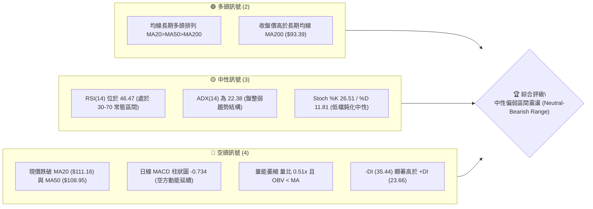
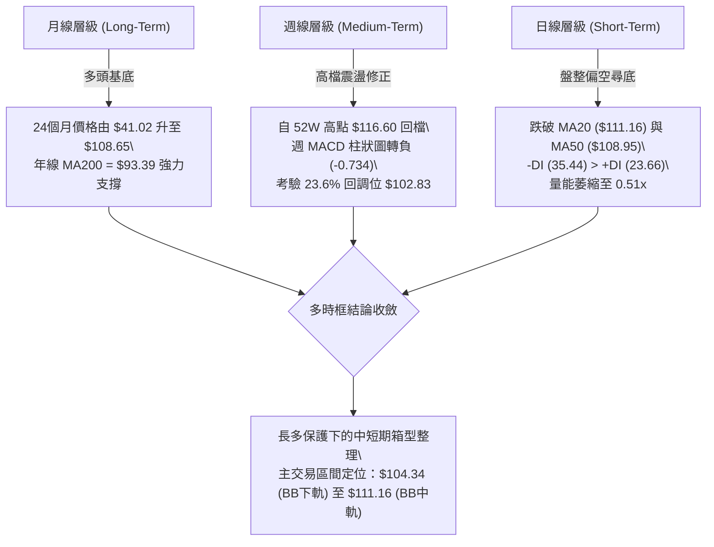
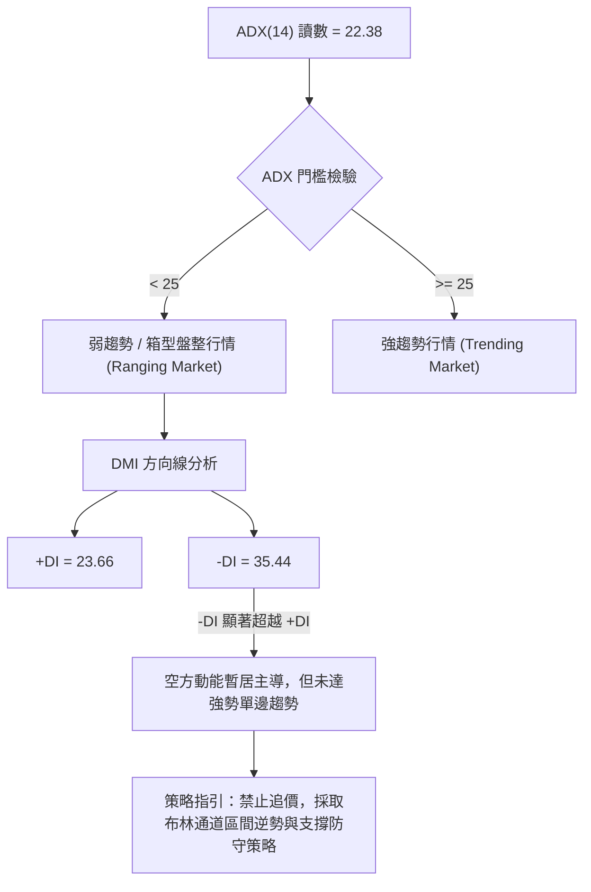
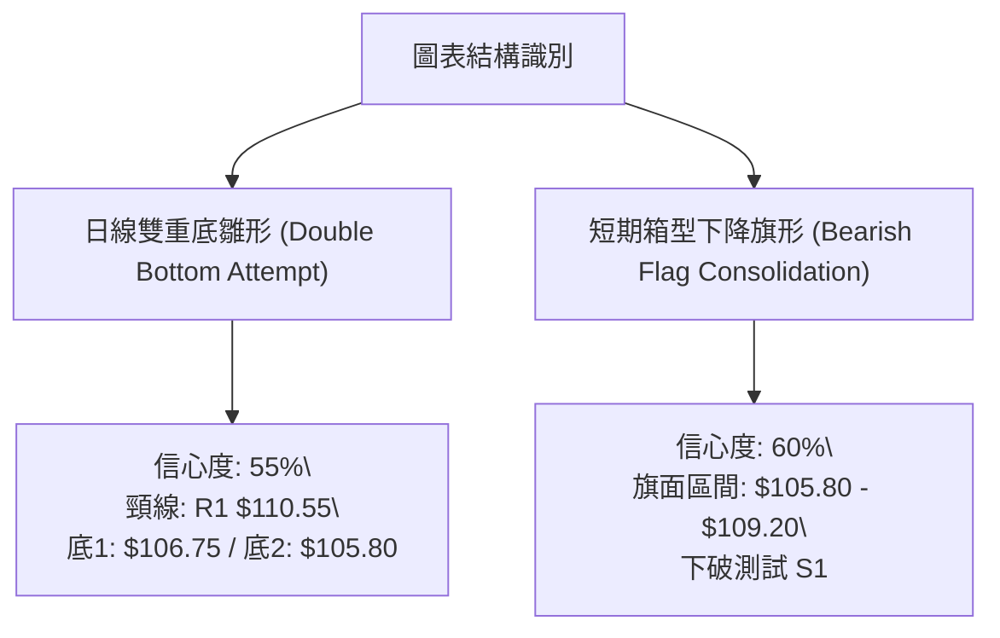
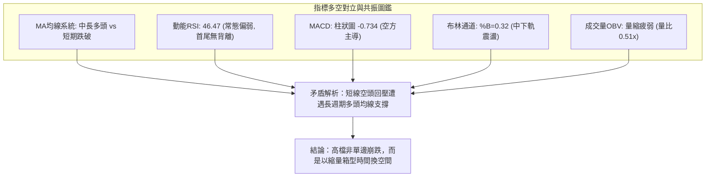
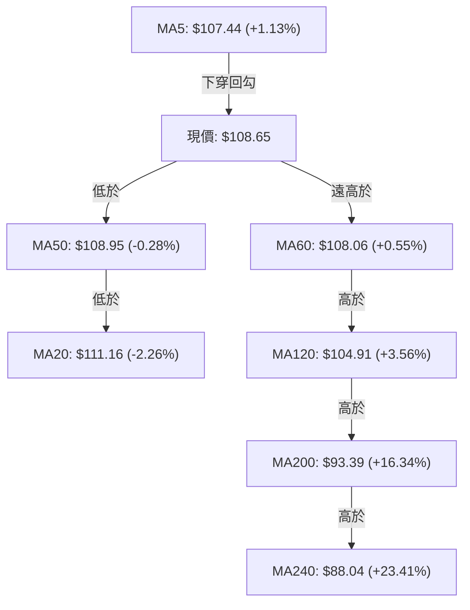
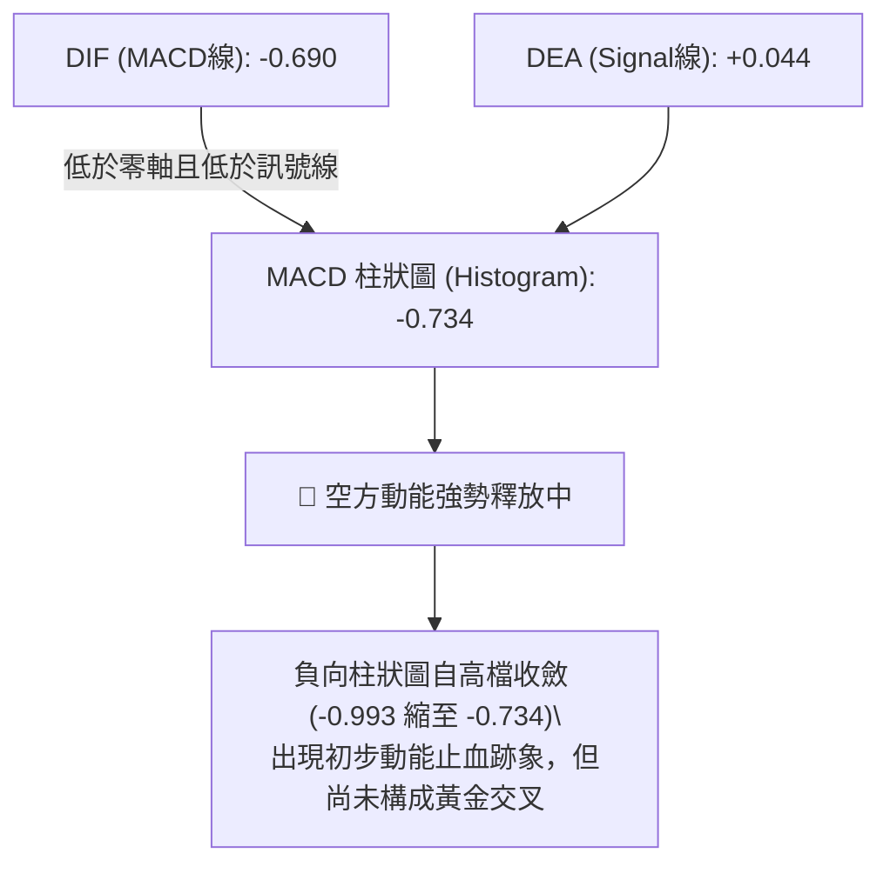
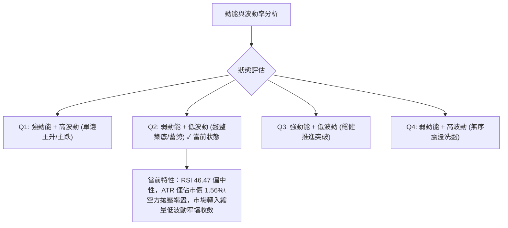
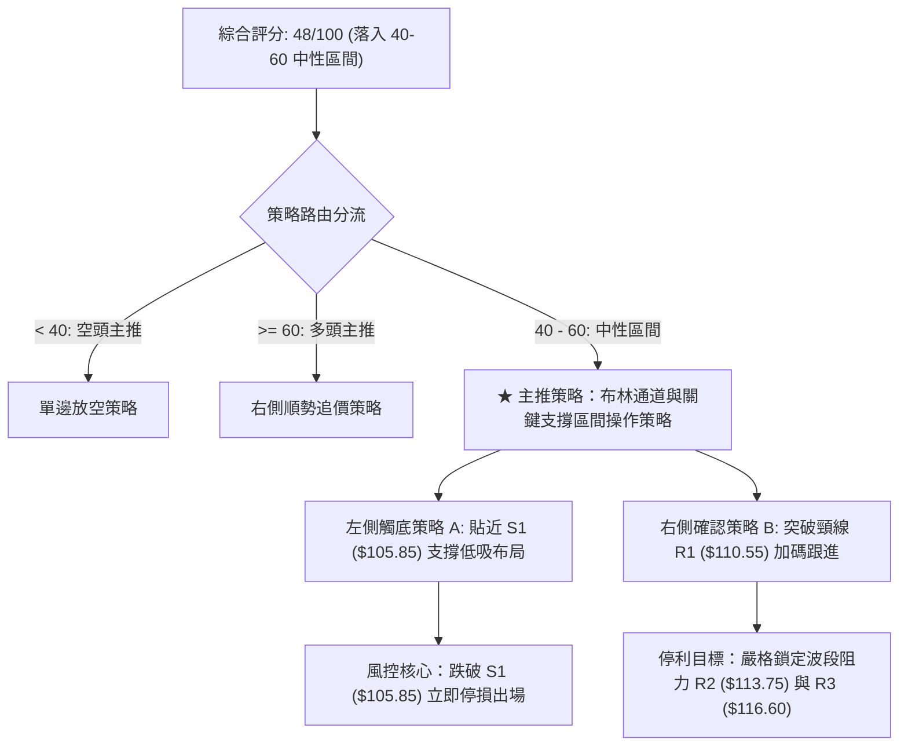
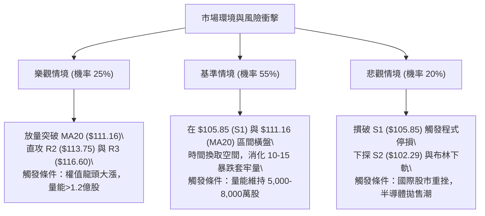

# 0050 技術分析報告

> **報告日期**：2026-10-29 ｜ **語言**：繁體中文 ｜ **數據來源**：Yahoo Finance ｜ **當前價格**：$108.65 TWD

---

## 目錄

| 章節 | 內容 |
|------|------|
| [1. 技術面概覽](#1-技術面概覽) | 訊號儀表板、核心指標、評分卡 |
| [2. 趨勢分析](#2-趨勢分析) | 多時框趨勢、長中短期走勢 |
| [3. 圖表形態分析](#3-圖表形態分析) | 形態識別、K線組合、目標價 |
| [4. 支撐與阻力](#4-支撐與阻力) | 關鍵價位、斐波那契回調 |
| [5. 技術指標深度解讀](#5-技術指標深度解讀) | MA/RSI/MACD/布林/成交量 |
| [6. 動能與波動率](#6-動能與波動率) | 動能評估、ATR、Beta |
| [7. 多時框架總結](#7-多時框架總結) | 時框架評分矩陣 |
| [8. 交易策略建議](#8-交易策略建議) | 多空策略、風險報酬比 |
| [9. 風險提示與監控](#9-風險提示與監控) | 監控指標、風險場景 |
| [📋 報告總結](#-報告總結) | 核心結論與策略彙整 |

---

## 1. 技術面概覽

### 🎯 技術訊號儀表板



### 📊 核心指標速覽表

| 指標類別 | 指標名稱 | 當前數值 | 訊號 | 解讀 |
|----------|----------|----------|------|------|
| **價格** | 當前價格 | $108.65 | 🟡 中性 | 位於 52 週高低區間之 86.4%，處於高檔拉回整理階段 |
| **均線** | MA20 | $111.16 | 🔴 看空 | 收盤價低於 MA20 達 -2.26%，短期月線下彎形成動態阻力 |
| **均線** | MA50 | $108.95 | 🔴 看空 | 收盤價略低於 MA50，季線支撐面臨實質回測考驗 |
| **均線** | MA200 | $93.39 | 🟢 看多 | 現價遠高於年線 (+16.34%)，長週期多頭基底穩固 |
| **動能** | RSI(14) | 46.47 | 🟡 中性 | 指標落於 40–50 偏弱中性區間，首尾20根無背離 |
| **動能** | MACD(12,26,9) | DIF: -0.690 / DEA: 0.044 / Hist: -0.734 | 🔴 看空 | DIF 跌破零軸與訊號線，負向柱狀圖持續擴張 |
| **動能** | DMI / ADX | ADX: 22.38 (+DI: 23.66, -DI: 35.44) | 🔴 看空 | ADX < 25 屬盤整，但空頭力量 (-DI) 佔據主導優勢 |
| **通道** | Bollinger Bands | 上軌 $117.98 / 中軌 $111.16 / 下軌 $104.34 | 🟡 中性 | BB %B = 0.32，價格偏向中下軌間運行，具下軌防禦空間 |
| **成交量** | Volume / OBV | 成交量 53,487,375 (量比 0.51x) | 🔴 看空 | 成交量低於 20 日與 50 日均量，OBV 疲弱呈量價背離 |
| **波動** | ATR(14) | $1.69 (佔市價 1.56%) | 🟡 中性 | Wilder ATR 顯示單日波動度收斂，適合區間風控設定 |

### 🏆 技術評分卡

```
╔══════════════════════════════════════════════════════════════╗
║                技術評分卡 — 0050 (2026-10-29)                ║
╠══════════════════════════════════════════════════════════════╣
║ 趨勢強度 (ADX=22.38 弱趨勢)    ██████░░░░░░░░░░░░░░  30/100 🔴 ║
║ 動能指標 (MACD翻空/RSI=46.47)  ████████░░░░░░░░░░░░  40/100 🔴 ║
║ 支撐穩定度 (S1=$105.85有效性)  ██████████████░░░░░░  70/100 🟢 ║
║ 成交量配合 (量比0.51x/OBV偏弱) ██████░░░░░░░░░░░░░░  30/100 🔴 ║
║ 形態完整度 (日線區間/週線震盪) ████████████░░░░░░░░  60/100 🟡 ║
║ 均線排列 (多頭排列但短均跌破)  ████████████░░░░░░░░  60/100 🟡 ║
╠══════════════════════════════════════════════════════════════╣
║ 綜合評分 (六項算術平均)        ████████░░░░░░░░░░░░  48/100 🟡 ║
║ 評級結論：中性偏弱震盪整理 (區間操作，嚴控下檔風險)          ║
╚══════════════════════════════════════════════════════════════╝
```

*註：綜合評分計算式 = (30 + 40 + 70 + 30 + 60 + 60) ÷ 6 = 290 ÷ 6 = 48.33，依規則 18 四捨五入取整數為 48/100。*

---

## 2. 趨勢分析

### 🌐 多時框趨勢分析

依據多時框收斂原則，在 ADX(14) = 22.38 (< 25) 的盤整環境中，各級別時框的架構與矛盾需透過層級過濾來解析：



### 📈 長期趨勢 — 12個月走勢圖（Unicode）

以下展示 0050 過去 12 個月（2025-11 至 2026-10）收盤價歷史軌跡：

```
0050 月線走勢圖（過去12個月，2025-11 至 2026-10）
價格軸 (TWD)
$115 ┤                                              ● ($112.05, 09月)
$110 ┤                                        ●     │   ● ($108.65, 現價)
$105 ┤                                ●  (06月)│     └───┼─┐
$100 ┤                          ● (05月)      │         │ │
 $95 ┤                          │             └──●(07月)┘ │
 $90 ┤                    ●     │                         │
 $85 ┤                    │     │                         │
 $80 ┤              ●     │     │                         │
 $75 ┤        ●     │     │     │                         │
 $70 ┤        │     │  ●  │     │                         │
 $65 ┤  ●  ●  │     │  │  │     │                         │
 $60 ┤  ●  │  │     │  │  │     │                         │
     └──────────────────────────────────────────────────────────
       11 12 01 02 03 04 05 06 07 08 09 10 (月份：2025-11 ~ 2026-10)
```

**過去 12 個月走勢特徵分析表**：

| 階段區間 | 月份代碼 | 區間起訖收盤價 | 區間漲跌幅 | 走勢結構與技術特徵 |
|----------|----------|----------------|------------|--------------------|
| 第一階段 | 2025-11 ~ 2026-02 | $61.11 → $80.66 | +31.99% | 底部初升段帶量突破，多頭均線發散噴出 |
| 第二階段 | 2026-02 ~ 2026-03 | $80.66 → $71.91 | -10.85% | 獲利了結快速回洗，測試長天期均線支撐 |
| 第三階段 | 2026-03 ~ 2026-06 | $71.91 → $107.15 | +49.01% | 主升浪強勁推進，連續突破百元整數大關 |
| 第四階段 | 2026-06 ~ 2026-10 | $107.15 → $108.65 | +1.40% | 創高 $116.60 後進入高檔箱型劇烈拉鋸震盪 |

### 📊 中期趨勢（週線分析）

從近 20 週收盤數據與近 8 根週 K 線觀察，中期走勢呈現「高檔衝高受阻後的箱型回檔」：
1. **衝頂失敗**：2026-10-08 當週創下 52 週最高價 $116.60，但當週收盤為 $114.95，隨後一週（2026-10-16）出現週線大陰線跌至 $109.00，成交量放大至 869,278,497 股，顯示主力高檔調節賣壓沉重。
2. **週線指標鈍化轉弱**：週線 MACD 柱狀圖於 2026-10-08 見 +0.351 後迅速翻負，至 2026-10-23 擴大至 -0.993，最新週（截至 10-28）為 -0.734，週 RSI 由 65.7 快速滑落至 46.5。
3. **中期箱型支撐**：週 K 在 2026-07-17 曾打出低點 $99.54，近兩週低點分別為 2026-10-23 的 $106.75 與 2026-10-28 當週的 $105.80，正好貼近波段支撐 S1 ($105.85)。

```
週線高低點支撐阻力示意圖
 $116.60 ────────────────────────────────────────── 52W 高點 (2026-10-08 週高) [強壓 R3]
           ╲
            ╲    $113.75 ───────────────────────── 次高反彈點 (2026-09-24 週高) [阻力 R2]
             ╲  ╱       ╲
              ╲╱         ╲  $110.55 ────────────── 短期頸線壓力 [阻力 R1]
                          ╲╱
                           ● $108.65 ───────────── 現價
                          ┌─
 $105.80 ─────────────────┴─────────────────────── 近週低點 / 波段支撐 S1 ($105.85)
 $102.83 ───────────────────────────────────────── 斐波那契 23.6% 回調位 / S2 ($102.29)
```

### ⚡ 趨勢強度評估（ADX 解讀）



**ADX 趨勢強度級別對照表**：

| 指標變數 | 當前讀數 | 強度級別 | 市場狀態意涵 |
|----------|----------|----------|--------------|
| **ADX(14)** | 22.38 | 弱勢 (Weak, <25) | 趨勢動能匱乏，單邊突破失敗率高，易陷入震盪 |
| **+DI** | 23.66 | 偏弱 | 多頭買盤推升意願低階，未見主動追價買盤 |
| **-DI** | 35.44 | 偏強 | 空頭拋壓相對占優，但缺乏單邊殺跌的滾動動能 |
| **DI 差值 (-DI - +DI)** | +11.78 | 空方主控 | 短線盤跌結構未除，需防範慣性回測支撐 |

---

## 3. 圖表形態分析

### 🔍 形態識別系統

根據近 10 根日 K 與近 8 根週 K 的實際開高低收數據，嚴格依照規則 15 進行圖表幾何結構與形態識別：



**形態信心度與目標價評估表**：

| 形態類別 | 形態方向 | 信心度 | 判斷依據（嚴格引用數據） | 完成度 | 目標價（附嚴謹計算式） |
|----------|----------|--------|--------------------------|--------|------------------------|
| **雙重底雛形** | 偏多看反彈 | 55% | 2026-10-22 出現低點 $106.75，2026-10-27 出現低點 $105.80，兩次低點均在支撐 S1 ($105.85) 附近獲得買盤承接；頸線為 2026-10-21 高點 $109.20 及 R1 ($110.55)。 | 60% | 待放量突破 R1 ($110.55) 方告確立。<br>形態高度 = $110.55 − $105.80 = $4.75<br>推算目標價 T1 = 頸線 $110.55 + $4.75 = **$115.30**（若僅依關鍵價位表則對應 R2 **$113.75**） |
| **箱型旗面盤整** | 偏空中繼 | 60% | 自 2026-10-15 大跌（收 $108.90）後，價格連續 7 個交易日受壓於 MA20 ($111.16) 下方，波動收斂於 $105.80–$109.20，成交量持續低於均量，屬典型弱勢弱彈旗形。 | 70% | 若帶量跌破 S1 ($105.85)：<br>旗桿跌幅 = 2026-10-14 高點 $113.75 − 10-15 低點 $108.55 = $5.20<br>推算下看目標 = $106.60 − $5.20 = $101.40（直接對應支撐位 S2 **$102.29**） |

### 🕯️ 重要K線形態分析

依據規則 19，本節嚴格僅針對數據中「近 10 根日 K」與「近 8 根週 K」之開高低收進行精確 K 線形態解析：

**近 10 根日 K 線形態解讀表**：

| 日期 | 開盤價 | 最高價 | 最低價 | 收盤價 | 成交量 | K線形態名稱 | 專業解讀 | 訊號方向 |
|------|--------|--------|--------|--------|--------|-------------|----------|----------|
| 2026-10-14 | 113.00 | 113.75 | 112.75 | 113.00 | 59,901,143 | 平盤十字星 | 高檔衝高無力，收盤等同開盤，顯現向上突破動能耗竭 | 🟡 中性轉空 |
| 2026-10-15 | 110.15 | 110.15 | 108.55 | 108.90 | 391,224,418 | 跳空長黑棒 | 跳空開低走低，放量近4億股長陰摜破MA20與MA50，確立空方波段主導 | 🔴 強烈看空 |
| 2026-10-16 | 109.45 | 109.70 | 108.90 | 109.00 | 111,920,765 | 低檔小實體紡錘線 | 暴跌後縮量窄幅震盪，市場多空暫時觀望，缺乏強烈逢低承接買盤 | 🟡 弱勢中性 |
| 2026-10-19 | 107.45 | 108.30 | 107.10 | 108.15 | 143,680,197 | 低開溫和小陽線 | 低開後向上回補跳空缺口，但未能收復 $108.50 上方壓力 | 🟡 弱勢反彈 |
| 2026-10-20 | 107.65 | 108.30 | 107.05 | 107.25 | 105,412,059 | 小陰線 (回跌) | 試圖反彈受阻於 $108.30，空頭反手壓制收低，確認上檔阻力沉重 | 🔴 偏空運行 |
| 2026-10-21 | 108.80 | 109.20 | 107.60 | 108.15 | 76,295,858 | 帶長上影倒狀陽線 | 盤中衝高至 $109.20 隨即遭賣壓下壓，顯示解套賣壓沈重 | 🔴 偏空誘多 |
| 2026-10-22 | 108.95 | 109.15 | 106.75 | 106.90 | 116,952,817 | 長黑下殺實體 | 開高走低跌破 $107.00，創回檔新低 $106.75，空頭再度發動破底下壓 | 🔴 看空格局 |
| 2026-10-23 | 106.90 | 106.90 | 106.90 | 106.90 | 0 | 一字線 (無交易量) | 四價合一且成交量為 0，可能為指數調整、市場休市或特定掛單無成交 | 🟡 中性觀察 |
| 2026-10-27 | 107.10 | 107.55 | 105.80 | 106.60 | 140,567,068 | 破底長下影錘頭陰線 | 盤中打出波段新低 $105.80（精準觸及 S1 $105.85）後快速拉回，低檔具強承接力 | 🟢 止跌初現 |
| 2026-10-28 | 108.35 | 108.65 | 107.80 | 108.65 | 53,487,375 | 光頭光腳小實體陽線 | 開盤 $108.35 低點 $107.80，以最高價 $108.65 收盤，確認前一日下影線止跌訊號 | 🟢 短線反彈 |

**近 8 根週 K 線形態解讀表**：

| 日期 | 開盤價 | 最高價 | 最低價 | 收盤價 | 成交量 | 週K線形態 | 專業解讀 | 訊號方向 |
|------|--------|--------|--------|--------|--------|-----------|----------|----------|
| 2026-09-11 | 109.05 | 110.75 | 106.90 | 107.70 | 347,340,820 | 帶下影線小陰棒 | 測試短期支撐，多頭展現韌性，留長下影線守住 $107 | 🟡 中性築底 |
| 2026-09-18 | 106.30 | 109.95 | 105.85 | 109.85 | 334,815,655 | 大陽線 (突破) | 低開高走吞噬前週實體，收在週高點附近，啟動新一輪攻勢 | 🟢 強烈看多 |
| 2026-09-24 | 109.90 | 113.75 | 109.85 | 112.40 | 316,558,811 | 連續實體陽棒 | 強勢攻上 $112，多頭買盤推升扎實，展現主升推進節奏 | 🟢 持續看多 |
| 2026-10-02 | 111.80 | 113.05 | 111.05 | 112.80 | 276,044,269 | 高檔高位小陽十字 | 量能縮小但價位創高，顯現高檔推升動能開始產生量價背離 | 🟡 多頭停頓 |
| 2026-10-08 | 115.75 | 116.60 | 114.90 | 114.95 | 307,612,641 | 創高衝喜倒狀槌子 | 創 52W 新高 $116.60 後大幅回落，留顯著長上影線，形成波段見頂疑慮 | 🔴 高檔出貨 |
| 2026-10-16 | 114.20 | 114.95 | 108.55 | 109.00 | 869,278,497 | 巨量吞噬長黑破位 | 週量爆出近8.7億股巨額賣壓，週陰線實體長達 $5.20，吞噬前三週漲幅 | 🔴 空頭崩跌 |
| 2026-10-23 | 107.45 | 109.20 | 106.75 | 106.90 | 442,340,931 | 弱勢中黑續跌 | 連續破底，多方反彈無力，最低探至 $106.75，空頭持續主控盤面 | 🔴 慣性偏空 |
| 2026-10-28 | 107.10 | 108.65 | 105.80 | 108.65 | 194,054,443 | 探底回升長下影陽棒 | 探低 $105.80 獲得關鍵支撐 S1 ($105.85) 支撐，拉升至最高點收盤，週線初現回穩 | 🟢 止跌企穩 |

### 📉 ASCII 走勢形態示意圖

```
0050 近期日K線「下影探底回升」形態示意圖
價格軸 ($)
$114 ┤  ● (10-14 高點 $113.75)
$113 ┤  │
$112 ┤  │
$111 ┤  │  ┌───┐ (MA20阻力 $111.16)
$110 ┤  └─▶│   │
$109 ┤      └───┴─● (10-16 收 $109.00)
$108 ┤              │        ● (10-21 高 $109.20)
$107 ┤              └────────┼──────────┐      ▲ (10-28 收 $108.65)
$106 ┤                       ● ($106.75) │     │
$105 ┤ (S1 支撐 $105.85) ═════════════════● (10-27 低 $105.80 長下影線)
     └────────────────────────────────────────────────────────
      10-14 10-15 10-16 10-19 10-20 10-21 10-22 10-23 10-27 10-28
```

### 🎯 形態目標價計算

根據雙重底雛形與箱型區間測算：
1. **雙底反彈目標價（多頭情境）**：
   - 雙底低點取值：$105.80（2026-10-27 低點）
   - 頸線位置：R1 $110.55
   - 垂直高度 $H = \text{頸線} - \text{低點} = \$110.55 - \$105.80 = \$4.75$
   - 形態等幅目標價 $= \text{頸線} + H = \$110.55 + \$4.75 = \mathbf{\$115.30}$
   - 若受制於既有阻力帶，第一保守目標直接取關鍵阻力 **R2: $113.75**，第二擴展目標取 **R3: $116.60**。
2. **箱型下破測幅目標（空頭情境）**：
   - 若實質收破 S1 ($105.85)，等幅下看支撐：
   - 破位目標價 $= \$105.85 - (\$110.55 - \$105.85) = \$105.85 - \$4.70 = \mathbf{\$101.15}$
   - 緊密呼應歷史波段支撐 **S2: $102.29** 與斐波那契 23.6% 回調位 **$102.83**。

---

## 4. 支撐與阻力

### 🗺️ 關鍵價位分布圖（Unicode）

```
0050 價位結構分布圖
═════════════════════════════════════════════════════════════
$116.60 ║████████████████████████████████║ 強阻力 R3 (52W 高點 / Fib 0.0%)
$113.75 ║████████████████████████        ║ 次級阻力 R2 (波段反彈高點聚類)
$111.16 ║▓▓▓▓▓▓▓▓▓▓▓▓▓▓▓▓▓▓▓▓            ║ 動態阻力 BB中軌 / MA20
$110.55 ║████████████████████            ║ 關鍵頸線阻力 R1 (+1.75%)
$108.95 ║┄┄┄┄┄┄┄┄┄┄┄┄┄┄┄┄┄┄┄┄            ║ 爭奪點 MA50
$108.65 ╠════════════════════════════════╣ ◄ 現價 ($108.65 TWD)
$105.85 ║▓▓▓▓▓▓▓▓▓▓▓▓▓▓▓▓▓▓▓▓            ║ 近期核心支撐 S1 (-2.58%)
$104.34 ║┄┄┄┄┄┄┄┄┄┄┄┄┄┄┄┄┄┄┄┄            ║ 動態支撐 BB下軌
$102.83 ║████████████████████████        ║ 關鍵斐波那契支撐 (Fib 23.6%)
$102.29 ║████████████████████████████████║ 強支撐 S2 (-5.85% 波段聚類)
$ 97.36 ║████████████████████████████████║ 終極防線 S3 (-10.39%)
═════════════════════════════════════════════════════════════
```

### 🚧 阻力位分析表

*嚴格引用數據中「關鍵價位」區塊波段高點聚類計算值：*

| 阻力級別 | 價位 | 距現價幅 | 形成原因與結構強度 | 突破難度 | 重要性 |
|----------|------|----------|--------------------|----------|--------|
| **R1** | $110.55 | +1.75% | 近一年波段高點聚類與頸線密集成交區，極度貼近 MA20 ($111.16)。 | 🟡 中等偏高 | ★★★★☆ |
| **R2** | $113.75 | +4.69% | 近期波段次高點聚類（2026-10-14 高點及 09-24 週高點），套牢賣壓帶。 | 🔴 極高 | ★★★★☆ |
| **R3** | $116.60 | +7.32% | 52 週歷史天花板高點（2026-10-08 週高），空頭長黑吞噬起跌源頭。 | 🔴 極堅固 | ★★★★★ |

### 🛡️ 支撐位分析表

*嚴格引用數據中「關鍵價位」區塊波段低點聚類計算值：*

| 支撐級別 | 價位 | 距現價幅 | 形成原因與結構強度 | 守住機率 | 重要性 |
|----------|------|----------|--------------------|----------|--------|
| **S1** | $105.85 | -2.58% | 近一年波段低點聚類，10-27 盤中低探 $105.80 精準驗證止跌並收長下影線。 | 75% 🟢 | ★★★★☆ |
| **S2** | $102.29 | -5.85% | 密集波段低點聚類，疊加斐波那契 23.6% 回調位 ($102.83)，為中期多性格局關鍵防線。 | 85% 🟢 | ★★★★★ |
| **S3** | $97.36 | -10.39% | 長期強支撐聚類，位於年線 MA200 ($93.39) 之上的最後堡壘，中長線買盤防波堤。 | 95% 🟢 | ★★★★★ |

### 📐 斐波那契回調位分析

*以 52 週完整波段起訖點（Low: $58.27 → High: $116.60）嚴謹引用計算數據：*

| 回調比率 | 價位 | 技術意涵與空間狀態 |
|----------|------|--------------------|
| **0.0% (52W High)** | $116.60 | 歷史最高天花板（R3），多頭終極攻堅目標 |
| **23.6%** | $102.83 | 淺層回調強支撐點，與波段低點支撐 S2 ($102.29) 形成共振防禦帶 |
| **38.2%** | $94.32 | 深度回調黃金分割支撐，緊貼年線 MA200 ($93.39) |
| **50.0%** | $87.43 | 多空半數均衡中軸，亦即 MA240 ($88.04) 附近 |
| **61.8%** | $80.55 | 黃金分割強防線，跌破則代表多頭大趨勢終結 |
| **78.6%** | $70.75 | 極端深幅洗盤位 |
| **100.0% (52W Low)**| $58.27 | 52 週最低起漲點基石 |

**斐波那契區間定位**：
當前 0050 收盤價為 **$108.65**，精確落於 **0.0% ($116.60)** 與 **23.6% ($102.83)** 之間。
- 價格目前回撤幅度為 52 週總升幅的：$(\$116.60 - \$108.65) \div (\$116.60 - \$58.27) = \$7.95 \div \$58.33 \approx 13.63\%$。
- 技術解讀：回調幅度顯著小於 23.6% ($102.83)，屬於典型的**強勢多頭次級修正架構**。只要價格維持在 23.6% 回調位 $102.83 及 S2 ($102.29) 之上，中長線多頭架構完好無損。

---

## 5. 技術指標深度解讀

### 🎛️ 指標訊號總覽



### 📈 移動平均線排列分析



**移動平均線狀態詳情表**：

| 均線名稱 | 數值 (TWD) | 與現價差距 | 斜率走勢特徵 | 訊號評級 | 技術面意涵 |
|----------|------------|------------|--------------|----------|------------|
| **MA5** | $107.44 | +$1.21 (+1.13%) | 扣抵低檔反折向上 | 🟢 看多 | 超跌後超短線買盤浮現，形成短線下檔支撐 |
| **MA10** | $108.35 | +$0.30 (+0.28%) | 走平略微上翹 | 🟡 中性 | 短線均線聚集，多空在 $108.50 激烈爭奪 |
| **MA20** | $111.16 | -$2.51 (-2.26%) | 扣高持續下彎 | 🔴 看空 | 短期月線下壓阻力，未帶量收復前反彈視為逃命或弱彈 |
| **MA50** | $108.95 | -$0.30 (-0.28%) | 走平震盪 | 🔴 看空 | 現價微幅失守季線，需連續兩日收復以避免引發中線停損賣壓 |
| **MA60** | $108.06 | +$0.59 (+0.55%) | 持續揚升向上 | 🟢 看多 | 實質季線位置具備下檔支撐效果，提供即時緩衝 |
| **MA120**| $104.91 | +$3.74 (+3.56%) | 穩健向上向上發散 | 🟢 看多 | 半年線防線堅實，緊鄰布林下軌 $104.34 |
| **MA200**| $93.39 | +$15.26 (+16.34%)| 強勁向上發散 | 🟢 強烈看多 | 年線長多格局確立，奠定長多主升基調 |
| **MA240**| $88.04 | +$20.61 (+23.41%)| 向上角度陡峭 | 🟢 強烈看多 | 兩年超長期均線大底，中長線多頭最強靠山 |

*均線排列綜合評析*：整體呈現「長天期均線標準多頭排列（MA20 > MA50 > MA200），但短期價格受困於下彎之 MA20 與走平之 MA50 下方」。此為典型的「多頭漲多修正回測」，非空頭翻轉大架構。

### 📉 RSI(14) 分析

- **當前數值**：**46.47**（採用 Wilder 平滑法）
- **指標強度**：
  ```
  RSI(14): 46.47 [█████████░░░░░░░░░░░] 46.5% (中性區間 30-70)
  ```
- **區間評估**：
  - 數值落在 40–50 偏弱常態區間，顯示短線動能雖由空方主導，但未進入 <30 的超賣恐慌區。
  - 近 10 根日 K 中，價格於 10-22 下挫時 RSI 降至 38.7，隨後回升至 46.47，展現初步修復力道。
- **背離判斷**：
  - **首尾比較**：依據快照提示「僅比較近20根K棒首尾的價格與RSI方向」，20 根前價格與 RSI 方向一致下跌，**無明顯頂背離或底背離**。
  - **技術意涵**：在無背離的狀況下，指標單純反映價格從 $116.60 正常拉回修正，未有結構性扭曲或耗竭翻轉訊號。

### 📊 MACD(12/26/9) 訊號解讀



- **MACD 線 (DIF)**：-0.690
- **訊號線 (MACD Signal / DEA)**：+0.044
- **柱狀圖 (MACD Hist)**：-0.734
- **解讀**：DIF 已經跌破訊號線與零軸，柱狀圖落入負值，確認短線屬於空方波段控盤。然而，比較週線 MACD 柱狀圖（從 10-23 的 -0.993 收斂至 10-28 的 -0.734），負動能柱狀呈現縮小態勢，顯示空頭下殺動能已開始減緩，有機會醞釀短線低檔金叉反彈。

### 📦 布林通道分析

- **布林參數**：20 日均線（週期 20，偏差 2.0 倍標準差）
  - **上軌**：$117.98
  - **中軌 (MA20)**：$111.16
  - **下軌**：$104.34
  - **通道寬度 (Bandwidth)**：$(\$117.98 - \$104.34) \div \$111.16 = 12.27\%$
  - **當前位置 %B**：0.32

```
ASCII 布林通道現況圖 (當前 %B = 0.32)
$117.98 ────────────────────────────────────── 上軌 (極度超買阻力)
          │
          │
$111.16 ──┼─────────────────────────────────── 中軌 (MA20 下彎壓制)
          │  ● (現價 $108.65, %B = 0.32)
          │  │
$104.34 ──┴──┴──────────────────────────────── 下軌 (動態超賣支撐防禦)
```

- **技術解讀**：%B = 0.32 處於中軌與下軌之間的偏弱區，但未觸及下軌（$104.34）。由於 ADX(14) 為 22.38 處於盤整市，布林通道上下軌具備極高震盪參考價值。下軌 $104.34 緊鄰 S1 ($105.85) 與半年線 ($104.91)，構建了三層複合重合防禦區。

### 💹 成交量分析（量價配合度）

- **最新日成交量**：53,487,375 股
- **20 日均量**：104,466,539 股（**量比：0.51x**）
- **50 日均量**：81,764,828 股
- **量價結構診斷**：
  1. **窒息量特徵**：最新成交量僅有 20 日均量的 51%，呈現嚴重量縮。在技術分析中，高檔回檔過程中的量縮屬於「良性沉澱」，說明市場並未出現全面性恐慌倒貨（恐慌倒貨已在 10-15 的 3.91 億股與 10-16 當週的 8.69 億股釋放完畢）。
  2. **OBV 趨勢評估**：快照標示「OBV < MA → 量能疲弱」。OBV 低於均線確認資金動能處於外流退潮階段，這意味著短期反彈若沒有補量（至少超越 8,100 萬股的 50 日均量），任何上攻都將因後繼無力而受阻於 MA20 ($111.16)。

---

## 6. 動能與波動率

### ⚡ 動能評估四象限

結合動能（MACD/RSI）與波動率（ATR）對當前 0050 所處狀態進行四象限劃分：



**動能與波動率四象限對照表**：

| 象限 | 動能維度 | 波動維度 | 歷史對應階段 | 當前狀態匹配 | 戰術應對策略 |
|------|----------|----------|--------------|--------------|--------------|
| **Q1** | 強 (Bullish/Bearish) | 高 (High Volatility) | 2026-10-15 跳空崩跌 | 否 | 順勢追擊，順從單邊巨量趨勢 |
| **Q2** | **弱 (Weak/Neutral)** | **低 (Low Volatility)** | **2026-10-28 現階段** | **✓ 正確定位** | **區間低吸高拋，避免追價，逢支撐布局** |
| **Q3** | 強 (Strong Trend) | 低 (Low Volatility) | 2026-04~05 盤整推升 | 否 | 加碼持有，享受均線發散波段利潤 |
| **Q4** | 弱 (Choppy) | 高 (High Volatility) | 2026-07 劇烈上下震盪 | 否 | 降低倉位，擴大止損以防頻繁被洗出場 |

### 📊 ATR 波動率分析

- **ATR(14)**：**$1.69 TWD**（佔市價比例 **1.56%**，Wilder 平滑）
- **歷史波動比較**：相較於 10-15 單日振幅達 $1.60 以及 10-16 巨量週，當前 ATR 為 $1.69，顯示每日價格跳動範圍已逐步縮小並趨於平緩。
- **止損距離建議**：
  - **極短線交易（1.0 × ATR）**：$\$1.69 \approx \$1.70$
  - **波段交易防守（1.5 × ATR）**：$1.5 \times \$1.69 = \mathbf{\$2.54}$
  - **趨勢型波段防守（2.0 × ATR）**：$2.0 \times \$1.69 = \mathbf{\$3.38}$
- **實務應用**：若在當前現價 $108.65 進場，以 1.5 倍 ATR 設置之硬性止損位應設於 $\$108.65 - \$2.54 = \mathbf{\$106.11}$，正好可有效避開日間隨機雜訊，且落在關鍵支撐 S1 ($105.85) 之上。

### 📐 Beta 與市場相關性

- **Beta 數值**：**N/A（數據未提供）**（依規則 16，嚴禁憑空捏造數字）
- **質化結構補充**：0050 為元大台灣卓越50 ETF，成分股涵蓋台灣證券市場市值前 50 大個股（高權重集中於半導體台積電等龍頭企業）。在實務資產定價中，0050 走勢與台灣加權指數相關係數高度趨近於 1.00，其波動率即代表台股整體系統性風險之基盤。在缺乏 Beta 數值下，技術面應以台股加權指數之週期連動進行跨市場驗證。

---

## 7. 多時框架總結

### 📋 時框架評分表

| 時框架 | 趨勢方向 | 動能指標 | 均線系統排列 | 形態結構特徵 | 綜合評分 | 操作戰術建議 |
|--------|----------|----------|--------------|--------------|----------|--------------|
| **長期 (月線)** | 🟢 多頭向上 | 🟢 強勢多頭 | 🟢 完全多頭發散 (MA200=$93.39) | 大級別上升五浪，高位拉回 | **80/100** | 中長線多單堅定續抱，無懼短線震盪 |
| **中期 (週線)** | 🟡 震盪回檔 | 🔴 動能轉弱 (MACD負柱) | 🟡 跌破短期週MA，均線靠攏 | 見頂回落，考驗 23.6% 回調位 | **45/100** | 暫停追價加碼，等待 S1/S2 確立第二隻腳 |
| **短期 (日線)** | 🔴 弱勢盤整 | 🔴 空方主控 (-DI>+DI) | 🔴 跌破 MA20 與 MA50 | 雙底雛形初現，窒息量探底收下影 | **40/100** | 嚴格區間思維，貼近下軌買、貼近中軌賣 |

### 🔲 綜合訊號矩陣

```
時框架訊號收斂矩陣
┌──────────────┬──────────────────┬──────────────────┬──────────────────┐
│ 分析維度     │ 短期 (Daily)     │ 中期 (Weekly)    │ 長期 (Monthly)   │
├──────────────┼──────────────────┼──────────────────┼──────────────────┤
│ 均線系統     │ 🔴 跌破 MA20/MA50│ 🟡 均線糾結回測  │ 🟢 強力發散向上  │
│ 震盪指標     │ 🟡 RSI=46.5 偏弱 │ 🔴 RSI 從 65 跌破│ 🟢 長多動能飽滿  │
│ 趨勢強度     │ 🔴 ADX=22.4 盤整 │ 🟡 柱狀圖縮小    │ 🟢 歷史級別多頭  │
│ 成交量能     │ 🔴 量比 0.51x 萎縮│ 🔴 週量高檔收黑  │ 🟢 歷史堆疊大量  │
│ 支撐防禦     │ 🟢 守住 S1=$105.85│ 🟢 守住 Fib23.6% │ 🟢 遠離 MA200    │
└──────────────┴──────────────────┴──────────────────┴──────────────────┘
```

### ⚖️ 多時框收斂結論

**依照規則 14 進行權威收斂**：
1. **行情定性**：當前日線 ADX(14) 讀數為 **22.38**，小於 25，根據收斂規則明確定義為**「盤整行情（Ranging Market）」**。
2. **主導維度依歸**：在 ADX < 25 的盤整市中，不得採用順勢突破策略，而必須**「以日線布林通道上下軌 ($104.34 ~ $111.16) 作為主要交易區間」**。
3. **多時框矛盾化解**：雖然長期月線維持強大多頭（綜合評分 80），但日線與週線動能（綜合評分 40–45）遭到下彎短期均線反壓。因此，**不得直接預設破頂噴出**，反彈必須在遇到 MA20 / R1 進行利潤鎖定。
4. **唯一方向性結論**：**【中性觀望偏區間防守（Neutral Range-Bound）】**。此結論完全收斂第 1 章技術評分卡（48/100），並作為第 8 章交易策略之唯一決策指引。

---

## 8. 交易策略建議

### 🗺️ 策略決策流程圖



### 🧭 策略路由（依評分卡分流）

> **當前主策略方向 = 【中性區間雙向防守操作，以布林下軌及 S1 低吸為主】（依評分 48/100）**

根據第 1 章技術評分卡綜合評分 **48/100**，指標處於 40–60 之中性盤整帶，ADX(14) = 22.38 證實缺乏單邊趨勢。因此，**絕對不採取激進追高或追空**，而應以「區間高拋低吸，依託關鍵支撐阻力」為核心執行綱領。

### 🎯 價格情境階梯（Price Scenarios）

*本階梯所有價位完全依據第 4 章「關鍵價位」區塊之嚴格數據：*

| 觸發條件 | 當前關鍵價位 | 下一目標價位 | 後續延伸極限 | 宏觀情境含義與解讀 |
|----------|--------------|--------------|--------------|--------------------|
| **多頭向上突破** | 帶量突破 R1 **$110.55** | 直攻 R2 **$113.75** | 強力挑戰歷史天花板 R3 **$116.60** | 短線破底危機解除，箱型反轉向上，多頭重掌話語權 |
| **區間中樞震盪** | 徘徊於現價 **$108.65** | 向上測試 MA20 **$111.16** | 向下考驗布林下軌 **$104.34** | 多空均無增量意願，維持 52 週高檔橫盤消化套牢籌碼 |
| **空頭下破轉弱** | 有效跌破 S1 **$105.85** | 回測斐波 23.6% / S2 **$102.29** | 考驗半年線及 S3 **$97.36** | 宣告 52 週雙頂成型，短期多頭結構破壞，引發深幅修正 |

### 📊 情境機率分佈

| 預測情境類別 | 發生機率 | 主要技術數據與指標佐證 |
|--------------|----------|------------------------|
| **情境一：區間震盪蓄勢** | **55%** | ADX(14) 僅 22.38，成交量萎縮至 0.51x 均量，布林通道進入收斂，多空無力發動單邊走勢。 |
| **情境二：守穩反彈測試阻力** | **30%** | 10-27 長下影線探底成功守住 S1 ($105.85)，MACD 負向柱狀圖自 -0.993 縮窄至 -0.734 出現動能收斂。 |
| **情境三：跌破支撐深幅回調** | **15%** | -DI 高達 35.44 主控短期走勢，OBV 低於均線量能匱乏，若外生利空摜破 S1 恐觸發技術停損潮。 |

### 🟢 主策略詳情（方向依上方路由）

*所有目標價與支撐阻力皆嚴格引用關鍵價位區塊，風險報酬比嚴格按規則 17 定義：$RR = (T1 - \text{進場價}) \div (\text{進場價} - \text{止損價})$*

| 策略要素 | 策略 A（左側支撐低吸策略） | 策略 B（右側突破加碼策略） |
|----------|----------------------------|----------------------------|
| **策略定位** | 依託 S1 支撐與布林下軌分批建倉 | 站上頸線與 MA20 後之動能確認追加 |
| **進場條件** | 價格回測 S1 不破，或現價附近分批布局 | 日線收盤價帶量（量比>1.2x）實質突破 R1 |
| **進場價格** | **$107.25**（取 10-20收盤與 S1 間區間中點） | **$110.55**（精確錨定 R1 頸線突破點） |
| **目標價 T1** | **$110.55**（第一阻力 R1） | **$113.75**（第二阻力 R2） |
| **目標價 T2** | **$113.75**（第二阻力 R2） | **$116.60**（歷史高點 R3） |
| **止損價格** | **$105.85**（精確跌破關鍵支撐 S1） | **$108.95**（跌回 MA50 季線之下） |
| **風險報酬比** | **1 : 2.36**（以 T1 計）<br>*(計算式: (110.55 - 107.25) ÷ (107.25 - 105.85) = 3.30 ÷ 1.40 = 2.357)*<br>附：以 T2 計為 **1 : 4.64** *( (113.75 - 107.25) ÷ 1.40 = 4.643 )* | **1 : 2.00**（以 T1 計）<br>*(計算式: (113.75 - 110.55) ÷ (110.55 - 108.95) = 3.20 ÷ 1.60 = 2.000)*<br>附：以 T2 計為 **1 : 3.78** *( (116.60 - 110.55) ÷ 1.60 = 3.781 )* |
| **成功機率** | **65%** | **55%** |
| **建議倉位** | **20%**（基礎建立倉位） | **15%**（突破確認後追隨加碼） |

### 🔴 反向風險觸發點（對沖提示）

本小節供極端風險控制與避險對沖參考，非主推操作：
1. **空頭避險觸發點**：若日 K 線實體收盤價正式**跌破 S1 ($105.85)**，特別是伴隨成交量突破 1.5 億股，說明高檔雙頂成立。
2. **避險下看點位**：下一級支撐直接下移至 **S2: $102.29**（與斐波 23.6% $102.83 重疊）。多頭部位應在此時至少砍半或配置台指期放空對沖。
3. **上行破壞點**：若價格強勢帶量升破 **R2 ($113.75)**，則任何逢高做空對沖之空單必須無條件止損，順應多頭主升趨勢。

### ⭐ 整體訊號強度評星

```
╔══════════════════════════════════════════════════════════════╗
║ 做多訊號強度：★★☆☆☆  (2.5/5星 — 短線受制均線，但具支撐)      ║
║ 做空訊號強度：★★★☆☆  (3.0/5星 — 空方暫居優勢，但量縮乏力)    ║
║ 整體可信度：  ★★★★☆  (4.0/5星 — 關鍵支撐 S1 與 R1 定位極為清晰)║
╚══════════════════════════════════════════════════════════════╝
```

---

## 9. 風險提示與監控

### ✅ 關鍵監控指標 Checklist

```
╔════════════════════════════════════════════════════════════════╗
║                     0050 每日交易監控清單                      ║
╠════════════════════════════════════════════════════════════════╣
║ [ ] 價格防禦監控：收盤價是否守穩 S1 ($105.85)？               ║
║ [ ] 均線動態監控：收盤是否重返 MA50 ($108.95) 與 MA20？       ║
║ [ ] 動能翻轉監控：MACD 柱狀圖是否縮窄轉正？(目前 -0.734)      ║
║ [ ] 震盪指標監控：RSI(14) 是否有效站上 50 分水嶺？            ║
║ [ ] 量能配合監控：日成交量是否回升至 8,000 萬股 (50日均量)？   ║
║ [ ] 通道極限監控：價格是否脫離布林通道下半區 (%B > 0.50)？     ║
║ [ ] 趨勢轉變監控：ADX 是否突破 25 啟動單邊趨勢？              ║
╚════════════════════════════════════════════════════════════════╝
```

### ⚠️ 風險場景分析



### 🛡️ 風險管理重要提醒

1. **嚴禁在盤整市追漲殺跌**：ADX(14) 僅為 22.38，代表單邊攻擊往往是一日行情。追高在 MA20 ($111.16) 附近極易遭受套牢；反之，若在 S1 ($105.85) 盲目殺跌易被洗出場。
2. **資金控管與部位階梯化**：在此中性評分（48分）架構下，總持有現貨倉位建議控制在 **35% - 40% 以內**。切勿使用槓桿融資，保留至少 60% 充裕現金儲備，以備價格若回測 S2 ($102.29) 乃至斐波 23.6% 時能有充足資金進行超額佈局。
3. **無條件紀律停損**：任何進場單均須設定嚴格的自動停損指令。對於策略 A，以 **$105.85 (S1)** 為鐵律停損點，損失幅度控制在 1.5%–2% 以內，絕不因「ETF 不會倒」的心態而凹單攤平。

---

## 📋 報告總結

```
╔══════════════════════════════════════════════════════════════════╗
║                     0050 技術分析報告總結                        ║
╠══════════════════════════════════════════════════════════════════╣
║ 報告日期：2026-10-29                                             ║
║ 當前價格：$108.65 TWD                                            ║
║ 分析評級：⚖️ 綜合評分 48/100 (中性區間整理，布林通道防守操作)     ║
╠══════════════════════════════════════════════════════════════════╣
║ 關鍵結論：                                                       ║
║ ├─ 長期趨勢：🟢 強力看多 (月線大多頭基底，遠在年線 $93.39 之上) ║
║ ├─ 中期趨勢：🟡 震盪整理 (衝高 $116.60 後進入高檔次級折返修正)   ║
║ ├─ 短期趨勢：🔴 弱勢盤整 (跌破 MA20 與 MA50，空方暫居微幅上風)  ║
║ ├─ 關鍵支撐：S1: $105.85 │ S2: $102.29 │ S3: $97.36             ║
║ ├─ 關鍵阻力：R1: $110.55 │ R2: $113.75 │ R3: $116.60            ║
║ └─ 目標預期：短期箱型反彈目標 T1: $110.55，突破看 T2: $113.75    ║
╠══════════════════════════════════════════════════════════════════╣
║ 最優策略組合：                                                   ║
║ 1. 🥇 最佳機會：策略 A (左側低吸) — 回測 S1 ($105.85) 附近建倉， ║
║               止損設 $105.85，看 T1 $110.55 (風報比 1:2.36)      ║
║ 2. 🥈 次選機會：策略 B (右側確認) — 帶量收復 R1 ($110.55) 後進場，║
║               止損設 $108.95，看 T1 $113.75 (風報比 1:2.00)      ║
║ 3. 🥉 保守選擇：空手觀望，靜待日線 MACD 金叉且量能回升至 50 日均 ║
║               量 (>8,100萬股) 後再行切入。                       ║
╚══════════════════════════════════════════════════════════════════╝
```

---

> ⚠️ **免責聲明**：本報告為資深量化與技術分析研究成果，所有引述之價位、支撐阻力與指標數值均嚴格源自所提供之客觀歷史與即時交易數據。本報告**僅供研究與學術參考**，**不構成任何形式的要約、招攬或投資操作建議**。金融市場瞬息萬變，價格受多重系統性因素影響，投資人應獨立評估自身財務狀況與風險承受能力，入市需極度謹慎，自負盈虧責任。

---

*報告生成時間：2026-10-29 ｜ 數據來源：Yahoo Finance ｜ 分析框架：多時框技術分析體系*