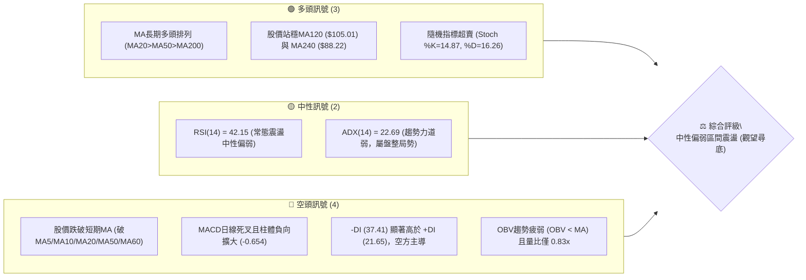
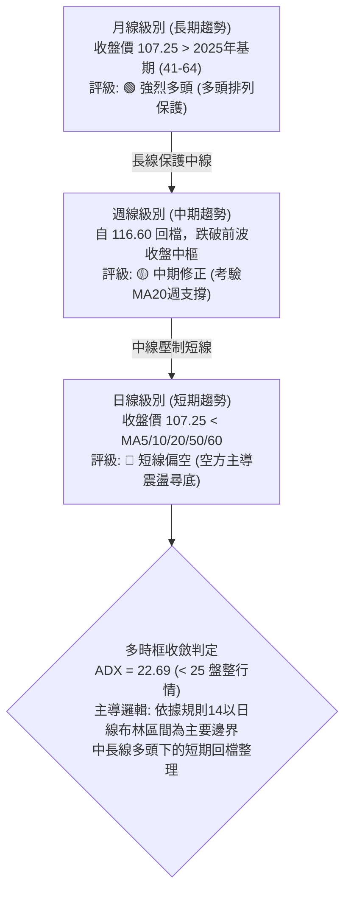
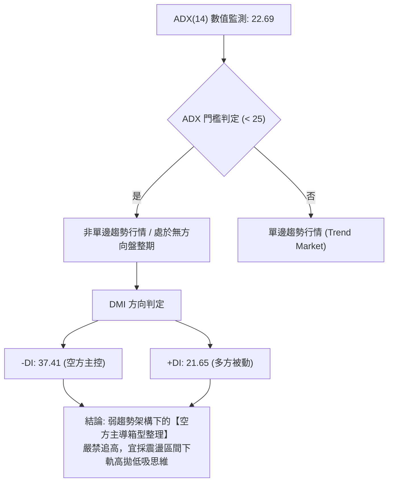
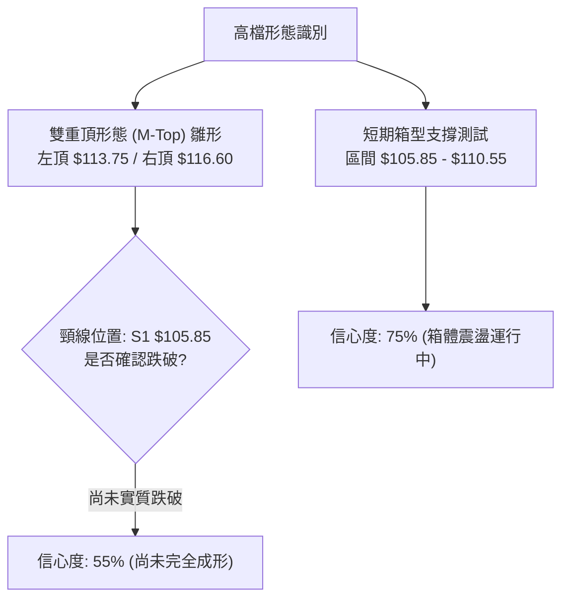
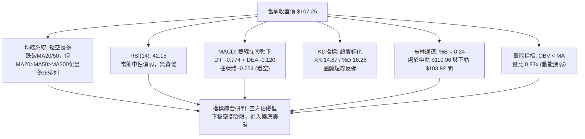
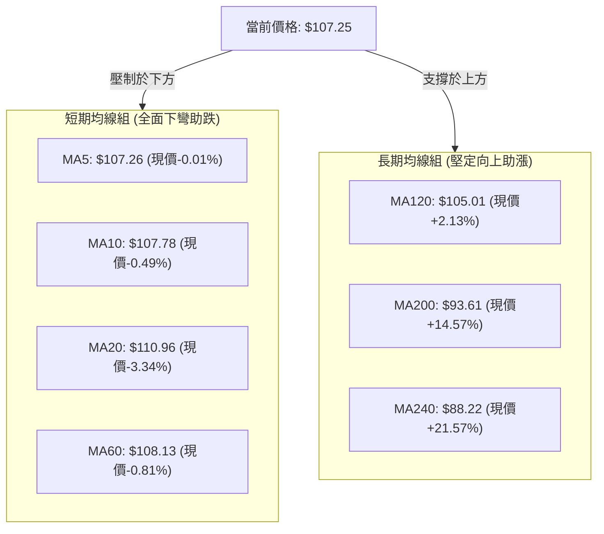
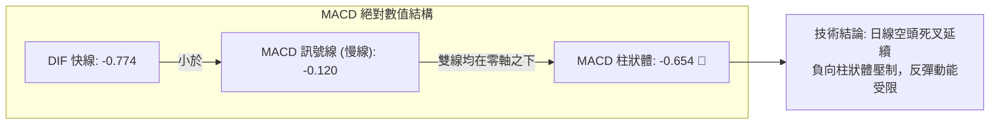
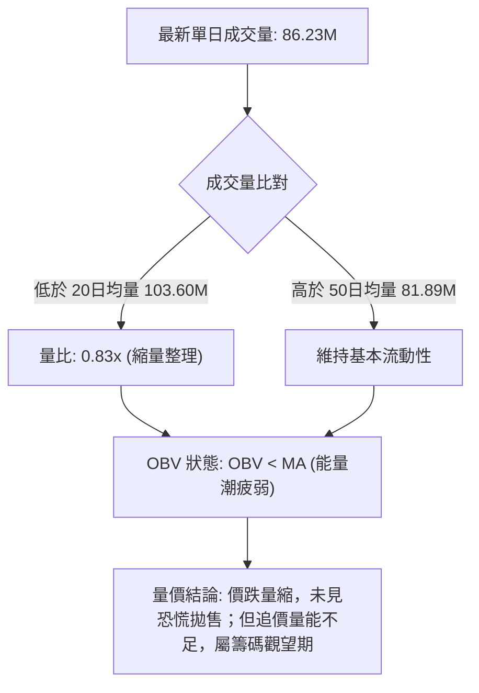
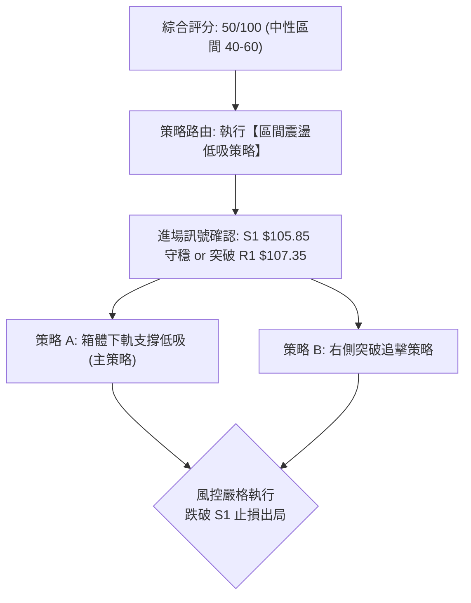
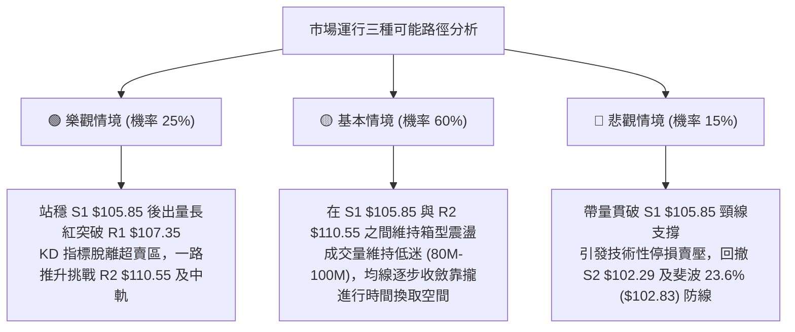

# 0050 技術分析報告

> **報告日期**：2026-10-30 ｜ **語言**：繁體中文 ｜ **數據來源**：Yahoo Finance ｜ **當前價格**：$107.25 TWD

---

## 目錄

| 章節 | 內容 |
|------|------|
| [1. 技術面概覽](#1-技術面概覽) | 訊號儀表板、核心指標、評分卡 |
| [2. 趨勢分析](#2-趨勢分析) | 多時框趨勢、長中短期走勢 |
| [3. 圖表形態分析](#3-圖表形態分析) | 形態識別、K線組合、目標價 |
| [4. 支撐與阻力](#4-支撐與阻力) | 關鍵價位、斐波那契回調 |
| [5. 技術指標深度解讀](#5-技術指標深度解讀) | MA/RSI/MACD/布林/成交量 |
| [6. 動能與波動率](#6-動能與波動率) | 動能評估、ATR、Beta |
| [7. 多時框架總結](#7-多時框架總結) | 時框架評分矩陣 |
| [8. 交易策略建議](#8-交易策略建議) | 多空策略、風險報酬比 |
| [9. 風險提示與監控](#9-風險提示與監控) | 監控指標、風險場景 |

---

## 1. 技術面概覽

### 🎯 技術訊號儀表板



---

### 📊 核心指標速覽表

| 指標類別 | 指標名稱 | 當前數值 | 訊號 | 解讀 |
|:---|:---|:---|:---:|:---|
| **價格** | 當前價格 | $107.25 | 🟡 | 位於52週區間84.0%高位，處於波段回檔修正格局 |
| **均線** | MA20 (月線) | $110.96 | 🔴 | 現價低於MA20達-3.34%，短線生命線失守且下彎 |
| **均線** | MA50 (季線) | $108.96 | 🔴 | 現價低於MA50達-1.57%，跌破中短期攻防中樞 |
| **均線** | MA200 (年線) | $93.61 | 🟢 | 現價高於MA200達+14.57%，長期牛市基底依然堅實 |
| **動能** | RSI(14) | 42.15 | 🟡 | 位於40-50中性偏弱區域，未達超賣但動能衰退 |
| **動能** | MACD (12,26,9) | Hist -0.654 | 🔴 | 快慢線均為負值 (DIF -0.774 < DEA -0.120)，空方佔優 |
| **動能** | KD (9,3,3) | %K 14.87 / %D 16.26 | 🟢 | 進入20以下嚴重超賣區，醞釀短線技術性跌深反彈 |
| **趨勢** | ADX / DMI | ADX 22.69 / -DI 37.41 | 🔴 | ADX<25代表無單邊趨勢，但-DI主導壓制，屬空方盤整 |
| **通道** | 布林通道 | %B 0.24 (帶寬14.08) | 🟡 | 位於中軌 ($110.96) 與下軌 ($103.92) 間，靠近下軌 |
| **量能** | 當日量 / 20日均量 | 86.23M / 103.60M | 🔴 | 量比0.83x，OBV低於均線，買盤追價意願不足 |
| **波動** | ATR(14) | $1.72 (1.60%) | 🟡 | 波動率處於中等收斂階段，無極端爆發跡象 |

---

### 🏆 技術評分卡

```
╔══════════════════════════════════════════════════════════════╗
║                技術評分卡 — 0050 (2026-10-30)                ║
╠══════════════════════════════════════════════════════════════╣
║ 趨勢強度 (ADX=22.69, -DI主導) ████████░░░░░░░░░░░░  40/100 🔴 ║
║ 動能指標 (RSI=42.15, MACD柱負)████████░░░░░░░░░░░░  40/100 🔴 ║
║ 支撐穩定度 (守S1/斐波23.6%)   ████████████░░░░░░░░  60/100 🟡 ║
║ 成交量配合 (量比0.83x,OBV弱)  ████████░░░░░░░░░░░░  40/100 🔴 ║
║ 形態完整度 (自116.60高位回檔) ████████████░░░░░░░░  60/100 🟡 ║
║ 均線排列 (短空長多,跌破MA20/50)████████████░░░░░░░░  60/100 🟡 ║
╠══════════════════════════════════════════════════════════════╣
║ 綜合評分 (六項算術平均四捨五入) ██████████░░░░░░░░░░  50/100 🟡 ║
║ 評級結論：【中性盤整】(Neutral / Range-Bound Consolidation)  ║
╚══════════════════════════════════════════════════════════════╝
```

---

## 2. 趨勢分析

### 🌐 多時框趨勢分析



---

### 📈 長期趨勢 — 12個月走勢圖（Unicode）

```
0050 過去 12 個月月線收盤價格走勢圖 (2025-11 至 2026-10)
價格軸 (TWD)
$115.00 ┤                                           ● 112.05 (09月)
$110.00 ┤                                 ● 107.15  │      ● 107.25 (10月現價)
$105.00 ┤                       ● 104.76  │         ● 106.25 (08月)
$100.00 ┤                                 │  ● 102.85 (07月)
 $90.00 ┤              ● 89.95            │
 $80.00 ┤      ● 80.66 │                  │
 $70.00 ┤ ● 72.16     ● 71.91 (03月洗盤)  │
 $60.00 ┤ ● 61.11 (11月)                  │
        └─┬──────┬──────┬──────┬──────┬──────┬──────┬──────┬──────┬──────┬──────┬──────┬──
         11月   12月   01月   02月   03月   04月   05月   06月   07月   08月   09月   10月
        (2025) (2025) (2026) (2026) (2026) (2026) (2026) (2026) (2026) (2026) (2026) (2026)
```

#### 長期走勢特徵分析表 (過去12個月)

| 階段區間 | 起訖月份 | 期間起訖價 | 區間漲跌幅 | 主要走勢特徵分析 |
|:---|:---:|:---:|:---:|:---|
| **主升段起漲** | 2025/11 - 2026/02 | $61.11 → $80.66 | +31.99% | 沿均線強勢推升，突破2025年盤整平台，多頭確立 |
| **波段洗盤** | 2026/02 - 2026/03 | $80.66 → $71.91 | -10.85% | 快速回測清洗短線獲利浮額，成交量沉澱 |
| **主升段爆發** | 2026/03 - 2026/06 | $71.91 → $107.15 | +49.01% | 強烈單邊趨勢，連續突破80、90、100大關，寫下三位數里程碑 |
| **高原期高檔震盪**| 2026/06 - 2026/10 | $107.15 → $107.25| +0.09% | 於 $102.85 至 $116.60(最高點) 間維持5個月寬幅震盪 |

---

### 📊 中期趨勢（週線分析）

```
0050 週線近期波段壓力與支撐架構圖 (2026-09 至 2026-10)
$116.60 ┤=============================【52W歷史天花板 / 10-08高點】
$113.75 ┤-----------------------------【波段高點阻力 R3】
$110.55 ┤-----------------------------【波段頸線阻力 R2 / 日MA20】
$107.25 ┤<<<<<<<<<<<<<<<<<<<<<<<<<<<<<【當前收盤現價】
$105.85 ┤-----------------------------【關鍵下檔支撐 S1 / 近期低點聚類】
$102.83 ┤=============================【斐波那契 23.6% 回調位】
$102.29 ┤-----------------------------【強支撐防線 S2】
```

中期週線在 2026-10-08 創下 $116.60 歷史天花板後，連續三週拉回（週收盤價：$114.95 → $109.00 → $106.90 → $107.25），週線 MACD 柱狀體由紅翻綠（-0.738 → -0.993 → -0.654），顯示中期進入高檔回檔修正階段。所幸 10-29 當週力守 S1 ($105.85) 未跌破，週 MACD 負柱體出現收斂跡象，中期走勢由單邊回跌轉為區間築底。

---

### ⚡ 趨勢強度評估（ADX 解讀）



#### ADX 趨勢強度量化評估對照表

| 評估項目 | 當前參數 | 臨界標準值 | 狀態解讀 |
|:---|:---:|:---:|:---|
| **ADX 指數** | **22.69** | < 25.0 | 🔴 **無強烈趨勢**（趨勢力道衰竭，處於區間震盪型態） |
| **+DI (正趨向)** | **21.65** | 參照 -DI | 🟡 多方進攻能量受限，低於多頭攻擊基準門檻 |
| **-DI (負趨向)** | **37.41** | > 30.0 | 🔴 空方賣壓佔據盤面相對優勢，空方控盤力道強烈 |
| **DI 差值 (+DI - -DI)**| **-15.76** | 0.0 | 🔴 負差值擴大，顯示短線賣壓仍未完全去化 |

---

## 3. 圖表形態分析

### 🔍 形態識別系統



#### 圖表形態信心度量化評估表

| 識別形態名稱 | 信心度 | 判斷依據（引用提供的數據） | 完成度 | 形態目標價推算（附精確計算式） |
|:---|:---:|:---|:---:|:---|
| **雙重頂 (M-Top) 雛形** | 55% | 2026-09-24高點$113.75與10-08高點$116.60形成兩波高點，頸線為波段低點S1 $105.85。 | 70% | 若跌破頸線$105.85：<br/>形態高度 = $116.60 - $105.85 = $10.75<br/>下行量度目標 = $105.85 - $10.75 = **$95.10** (接近S3 $97.36) |
| **布林帶下軌支撐回升** | 75% | 價格於10-27探低$105.80逼近布林下軌$103.92後回彈，%B自0.15回升至0.24。 | 85% | 向上目標為布林中軌：<br/>目標價 = MA20 = **$110.96** (近R2 $110.55) |
| **箱型整理形態** | 70% | 價格在S1 $105.85與R2 $110.55區間反覆震盪測試，均線於此區域收斂。 | 80% | 箱體高度 = $110.55 - $105.85 = $4.70<br/>突破目標 = $110.55 + $4.70 = **$115.25** |

---

### 🕯️ 重要 K 線形態分析

嚴格依據數據中「近10根日K」與「近8根週K」之實際開高低收數據進行深度解析：

#### 近 10 根日 K 線形態解讀表

| 日期 (日K) | 開盤價 | 最高價 | 最低價 | 收盤價 | 識別 K 線形態 | 專業解讀 | 訊號 |
|:---:|:---:|:---:|:---:|:---:|:---|:---|:---:|
| **2026-10-15** | 110.15 | 110.15 | 108.55 | 108.90 | **光頭大陰線** | 開盤即最高點，實體下殺近2點，放量長黑破位跌破MA20。 | 🔴 |
| **2026-10-16** | 109.45 | 109.70 | 108.90 | 109.00 | **低檔小紡錘線** | 震盪幅度收窄至0.8點，空方下殺動能暫時趨緩，呈現觀望。 | 🟡 |
| **2026-10-19** | 107.45 | 108.30 | 107.10 | 108.15 | **下跳空小陽線** | 跳空低開後小幅走高收復部分失土，但上方缺口未補。 | 🟡 |
| **2026-10-20** | 107.65 | 108.30 | 107.05 | 107.25 | **破底黑K線** | 盤中反彈無力，收盤跌破開盤，下測107整數關卡支撐。 | 🔴 |
| **2026-10-21** | 108.80 | 109.20 | 107.60 | 108.15 | **假突破倒錘陰線** | 開高衝擊109.20後遭空頭下壓收於低檔，上方賣壓沉重。 | 🔴 |
| **2026-10-22** | 108.95 | 109.15 | 106.75 | 106.90 | **中長黑破底K線** | 高開低走重挫2.05點，創波段收盤新低，確認空方控盤。 | 🔴 |
| **2026-10-23** | 106.90 | 106.90 | 106.90 | 106.90 | **一字線 (無量)** | 成交量為0，價格鎖定無波動，市場流動性暫歇。 | 🟡 |
| **2026-10-27** | 107.10 | 107.55 | 105.80 | 106.60 | **長下影錘頭陰線** | 探底至105.80精準碰觸S1後強烈抵抗回升，下影線達0.8點。 | 🟢 |
| **2026-10-28** | 108.35 | 108.65 | 107.80 | 108.65 | **光腳反彈實體陽線** | 實體陽線收於全日最高點，帶動KD超賣黃金交叉發酵。 | 🟢 |
| **2026-10-29** | 108.65 | 108.65 | 106.60 | 107.25 | **長下影小黑K (吊頸)** | 開盤即最高，盤中摜壓至106.60後逢低買盤進場拉抬收斂跌幅。 | 🟡 |

#### 近 8 根週 K 線形態解讀表

| 日期 (週K) | 開盤價 | 最高價 | 最低價 | 收盤價 | 識別 K 線形態 | 專業解讀 | 訊號 |
|:---:|:---:|:---:|:---:|:---:|:---|:---|:---:|
| **2026-09-11** | 109.05 | 110.75 | 106.90 | 107.70 | **長黑陰十字星** | 高檔巨幅震盪，多空分歧擴大，多頭動能首度受阻。 | 🟡 |
| **2026-09-18** | 106.30 | 109.95 | 105.85 | 109.85 | **下影長陽破底翻** | 回測105.85獲得極強支撐後拔高收於高檔，確立S1底線。 | 🟢 |
| **2026-09-24** | 109.90 | 113.75 | 109.85 | 112.40 | **突破實體中陽線** | 放量突破110整數阻力，推升創波段新高，多頭主升。 | 🟢 |
| **2026-10-02** | 111.80 | 113.05 | 111.05 | 112.80 | **高檔震盪小紅K** | 於112上方強勢橫盤，縮量整理消化浮額。 | 🟢 |
| **2026-10-08** | 115.75 | 116.60 | 114.90 | 114.95 | **歷史天價流星線** | 創52W高點$116.60後遭遇強大解套與獲利了結賣壓，留上影線。 | 🔴 |
| **2026-10-16** | 114.20 | 114.95 | 108.55 | 109.00 | **爆量破位大長黑** | 成交量爆出8.69億股巨量，長黑實體吞噬前三週低點，確立見頂。 | 🔴 |
| **2026-10-23** | 107.45 | 109.20 | 106.75 | 106.90 | **弱勢續跌實體黑K** | 跌破107關卡，量能萎縮但賣盤仍壓制反彈，延續空方回檔。 | 🔴 |
| **2026-10-29** | 107.10 | 108.65 | 105.80 | 107.25 | **探底回升長下影紡錘** | 二次下測S1支撐位($105.80)獲買盤強力承接，週線收小紅止跌。 | 🟢 |

---

### 📉 ASCII 走勢形態示意圖

```
0050 日線高檔雙頂與下箱體邊界幾何示意圖
價格
$116.60 ┬                       [頂部2: 10-08 $116.60]
        │                           ▲
$113.75 ┤      [頂部1: 09-24]       │ ╲
        │             ▲            │  ╲
$110.55 ┼────────────┼───阻力 R2───┼───╲───────────── (頸線阻力 / MA20)
        │           ╱ ╲           ╱     ╲
$107.25 ┼──────────╱───╲─────────╱───────●───────── (當前現價 $107.25)
        │         ╱     ╲       ╱         ╲   ▲
$105.85 ┴────────●───────●─────●───────────┴──┼────── (下檔頸線 S1 $105.85)
              09-18     10-15  10-27         10-29
              回測低點   回測   探底$105.80   雙底回測成功
```

---

### 🎯 形態目標價計算

依據幾何圖表形態學之對稱量度原則，精確推算下檔與上檔目標價位：

1. **下行破位風險目標價 (M頭跌破量度)**：
   - 形態頸線位置：**$105.85** (波段低點支撐 S1)
   - 形態最高頂點：**$116.60** (52W歷史高點)
   - 形態垂直高度 ($H$) = $116.60 - $105.85 = **$10.75**
   - 破位下跌目標價 ($T_{down}$) = 頸線 - $H$ = $105.85 - $10.75 = **$95.10**
   - *比對確認*：此目標價位於數據中 S3 ($97.36) 與斐波那契 38.2% 回調位 ($94.32) 之密集支撐帶。

2. **區間反彈目標價 (箱體回升量度)**：
   - 箱體底部支撐：**$105.85**
   - 箱體頂部阻力：**$110.55** (阻力位 R2)
   - 箱體垂直高度 ($h$) = $110.55 - $105.85 = **$4.70**
   - 突破箱頂目標價 ($T_{up}$) = 阻力位 R2 + $h$ = $110.55 + $4.70 = **$115.25** (接近阻力位 R3 $113.75 及前期高點)

---

## 4. 支撐與阻力

### 🗺️ 關鍵價位分布圖（Unicode）

```
0050 價位結構分布圖 (由實際 OHLCV 與斐波那契精確計算)
═══════════════════════════════════════════════════════════════════════
 $116.60 ║██████████████████████████████║ 52W 歷史極限高點 / 斐波 0.0%
 $113.75 ║██████████████████████        ║ 強阻力 R3 (近一年波段高點聚類)
 $110.96 ║▓▓▓▓▓▓▓▓▓▓▓▓▓▓▓▓▓▓▓▓          ║ 動態阻力 (布林中軌 / MA20)
 $110.55 ║██████████████████            ║ 關鍵阻力 R2 (反彈關鍵頸線)
 $107.35 ║██████████                    ║ 短線阻力 R1 (當前即時微阻力 +0.09%)
 $107.25 ╠══════════════════════════════╣ ◄ 當前收盤價 ($107.25)
 $105.85 ║██████████████████            ║ 近期波段關鍵支撐 S1 (-1.31%)
 $103.92 ║▓▓▓▓▓▓▓▓▓▓▓▓▓▓▓▓▓▓▓▓          ║ 動態支撐 (布林通道下軌)
 $102.83 ║██████████████████████        ║ 斐波那契 23.6% 回調位
 $102.29 ║████████████████████████      ║ 強支撐防線 S2 (-4.63%)
 $ 97.36 ║████████████████████████████  ║ 長期防守基石 S3 (-9.22%)
 $ 94.32 ║██████████████████████████████║ 斐波那契 38.2% 回調位
═══════════════════════════════════════════════════════════════════════
```

---

### 🚧 阻力位分析表

所有阻力位數值嚴格引用「關鍵價位」區塊之波段高點聚類計算數值：

| 阻力級別 | 精確價位 | 距現價幅 | 阻力形成原因與技術意涵 | 突破難度 | 重要性權重 |
|:---|:---:|:---:|:---|:---:|:---:|
| **R1** | **$107.35** | +0.09% | 緊鄰現價上方之微型阻力，為前日盤中密集成交小高點。 | 🟢 容易 | ★★☆☆☆ |
| **R2** | **$110.55** | +3.08% | 近一年波段高點聚類區，疊加下彎的月線 MA20 ($110.96)，為短線空翻多最大分水嶺。 | 🔴 極高 | ★★★★★ |
| **R3** | **$113.75** | +6.06% | 2026-09-24週K線波段高點聚類，屬於高檔巨量套牢沉重賣壓區。 | 🔴 極難 | ★★★★☆ |

---

### 🛡️ 支撐位分析表

所有支撐位數值嚴格引用「關鍵價位」區塊之波段低點聚類計算數值：

| 支撐級別 | 精確價位 | 距現價幅 | 支撐形成原因與技術意涵 | 守住機率 | 重要性權重 |
|:---|:---:|:---:|:---|:---:|:---:|
| **S1** | **$105.85** | -1.31% | 近一年波段低點聚類核心；2026-09-18與10-27兩度下探測試均獲買盤力挺收腳。 | 🟢 70% | ★★★★☆ |
| **S2** | **$102.29** | -4.63% | 次級波段低點聚類，與斐波那契23.6% ($102.83)及布林下軌($103.92)構成多重共振防護帶。 | 🟢 85% | ★★★★★ |
| **S3** | **$97.36** | -9.22% | 中長期強支撐，位於MA200 ($93.61)上方之歷史密集成交底部平台。 | 🟢 95% | ★★★★★ |

---

### 📐 斐波那契回調位分析

依據 52 週完整波段起訖點（52W Low **$58.27** → 52W High **$116.60**，總波段跨度 **$58.33**）進行幾何回調深度量化分析：

```
斐波那契回調幾何落點全景表 (基準：$58.27 → $116.60)
─────────────────────────────────────────────────────────────────────
 0.0% (52W High)    $116.60 ── 歷史峰值天花板
                      │
[當前收盤現價]       $107.25 ── 位於 0.0% 與 23.6% 回調位之間 (強勢整理區)
                      │
23.6% 回調位        $102.83 ── 第一黃金防禦位 (健康回檔極限)
38.2% 回調位        $ 94.32 ── 趨勢強弱分水嶺 (多頭生命中樞，近MA200 $93.61)
50.0% 回調位        $ 87.43 ── 多空對稱中軸位 (近MA240 $88.22)
61.8% 回調位        $ 80.55 ── 黃金分割關鍵支撐 (主升段起漲點)
78.6% 回調位        $ 70.75 ── 深度回撤防線
100.0% (52W Low)    $ 58.27 ── 原始起漲基石
─────────────────────────────────────────────────────────────────────
```

#### 現價落點意義深度解讀：
當前收盤價 **$107.25** 穩固運行於 **0.0% ($116.60)** 與 **23.6% ($102.83)** 區間之內。在道氏理論與斐波那契回撤模型中，資產價格在創歷史新高後，若回檔幅度未跌破 23.6% 黃金分割線，在技術架構上屬於「極強勢淺度修正（Shallow Correction）」。這代表自 $58.27 上漲以來的大級別牛市主幹完全未受破壞，目前僅是歷史天花板前的高階震盪消化籌碼。

---

## 5. 技術指標深度解讀

### 🎛️ 指標訊號總覽



---

### 📈 移動平均線排列分析



#### 均線系統數據全景表

| 均線名稱 | 數值 (TWD) | 與現價乖離率 | 排列狀態 | 走勢微型趨勢 (Sparkline) | 技術解讀 |
|:---|:---:|:---:|:---:|:---|:---|
| **MA 5** | $107.26 | -0.01% | 現價略低於MA5 |  ▂▁▁▁▁▂▃▄▅▅▅▅▅▆▇████▇▆▅▃▂▂▁▁▁▁▁ | 短線扣抵高價下彎，形成即時壓制 |
| **MA 10** | $107.78 | -0.49% | 現價低於MA10 | ▁▁▁▁▁▁▂▂▃▃▄▄▅▆▇███████▇▆▅▄▃▂▁▁ | 10日下行趨勢未扭轉，短空格局 |
| **MA 20** | $110.96 | -3.34% | 現價低於MA20 | ▁▁▁▁▂▂▃▃▄▄▄▅▅▆▆▇▇▇█████████▇▇▇ | 月線反轉下彎，波段反彈最重壓力 |
| **MA 50** | $108.96 | -1.57% | 現價低於MA50 | (季線中樞) | 季線跌破，中線整理期拉長 |
| **MA 60** | $108.13 | -0.81% | 現價低於MA60 | ▁▁▁▁▁▁▁▂▂▂▂▂▃▃▃▄▄▅▅▅▆▆▆▆▇▇▇███ | 跌破季線生命線，進入修復週期 |
| **MA 120**| $105.01 | +2.13% | 現價高於MA120| ▁▁▁▁▂▂▃▃▃▄▄▄▅▅▅▆▆▆▇▇▇▇▇███████ | 半年線持續上行，多頭中期重要護城河 |
| **MA 200**| $93.61 | +14.57% | 現價高於MA200| (年線基石) | 長期均線架構維持經典多頭排列 |
| **MA 240**| $88.22 | +21.57% | 現價高於MA240| ▁▁▁▁▂▂▂▃▃▃▃▄▄▄▅▅▅▅▆▆▆▇▇▇▇█████ | 歷史大底支撐，長線多頭根基牢固 |

---

### 📉 RSI(14) 分析

#### RSI 數值強度進度條
```
RSI(14) Wilder: 42.15  [████████░░░░░░░░░░░░] 42.15% (中性偏弱震盪區)
 0             20             40    42.15    60             80           100
 ├──────────────┼──────────────┼──────▲──────┼──────────────┼─────────────┤
 極端超賣       超賣警戒        中性偏弱      強勢多頭       超買警戒      極端超買
```

- **超買超賣區間判斷**：RSI(14) 當前數值為 **42.15**，位於 30 至 70 常態區間內，脫離了 10 月中旬急跌時的恐慌弱勢區（週線曾跌至 38.7），但仍處於 50 多空分界線下方，顯示多頭動能尚未重掌盤面。
- **背離分析結論**：經嚴格比對近 20 根 K 棒走勢，價格自 10-08 之 $116.60 震盪拉回至 10-27 之 $105.80，同期 RSI 自 65.7 下降至 38-42 水準，首尾方向一致；10-29 收盤 $107.25 對應 RSI 42.2，**數據明確顯示：無明顯頂背離或底背離**。走勢屬於正常的動能同步回撤。

---

### 📊 MACD(12/26/9) 訊號解讀



日線 MACD 兩線數值皆為負數（DIF -0.774, Signal -0.120），且 DIF 位於 Signal 下方，Hist 柱狀圖為 **-0.654**，呈現標準空頭排列。然而觀察近三週週線 MACD 柱狀體（-0.738 → -0.993 → -0.654），週線負柱狀體已開始縮減，釋出中級回檔賣壓逐步收斂的早期訊號。

---

### 📦 布林通道分析

```
0050 日線布林通道結構示意圖 (Bandwidth = 14.08)
$118.00 ┼──────────────────────────────────────────────── 布林上軌 (阻力上限)
        │
$110.96 ┼ - - - - - - - - - - - - - - - - - - - - - - - - 布林中軌 (MA20 生命線)
        │                                 
$107.25 ┼─────────────────────────●                      當前現價 (%B = 0.24)
        │                         ▲                
$103.92 ┼─────────────────────────┴────────────────────── 布林下軌 (技術支撐)
```

- **上軌**：**$118.00**
- **中軌 (MA20)**：**$110.96**
- **下軌**：**$103.92**
- **%B 指標**：**0.24**
- **通道結構解讀**：%B 數值 0.24 顯示股價已深度下沉至通道下半部，位於下軌（$103.92）與中軌（$110.96）之間。由於未實質跌破下軌且下軌呈現向上支撐斜率，股價具備朝中軌進行「均值回歸（Mean Reversion）」的彈升動能。

---

### 💹 成交量分析（量價配合度）



1. **量能萎縮特徵**：最新成交量 86,226,481 股顯著低於 20 日均量 103,599,885 股（量比 0.83x），但高於 50 日均量 81,887,860 股。在連續回檔過程中呈現「價跌量縮」格局，顯示主流長線籌碼並未在大跌中恐慌出逃。
2. **OBV 量能背馳檢驗**：目前數據指示「OBV < MA → 量能疲弱」，表明資金流入速度低於過去均值，多頭反攻需要量能放大至 20 日均量以上方可確認有效突破。

---

## 6. 動能與波動率

### ⚡ 動能評估四象限

```
動能與波動率矩陣分佈
    強動能 ▲
           │  象限一 (Q1): 強動能 / 低波動     │  象限三 (Q3): 強動能 / 高波動
           │  【最佳多頭趨勢主升】              │  【加速噴出或高檔派發】
           │                                   │
───────────┼───────────────────────────────────┼───────────────────────────► 波動率
           │  象限二 (Q2): 弱動能 / 低波動     │  象限四 (Q4): 弱動能 / 高波動
           │  【★ 0050 當前落點 (Q2)】        │  【恐慌殺跌與主跌段】
           │  • RSI 42.15 / ADX 22.69          │  
           │  • ATR 1.60% (中低波動區間)       │  
    弱動能 ▼
```

#### 四象限特徵定位表

| 象限 | 動能維度 | 波動維度 | 當前狀態標註 | 戰略操作評估 |
|:---:|:---:|:---:|:---:|:---|
| **Q1** | 強動能 | 低波動 | — | 最佳波段順勢抱牢機會 |
| **Q2** | **弱動能** | **低波動** | **✓ (0050 當前位置)** | **箱型下軌潛伏守株待兔，以防守代替進攻** |
| **Q3** | 強動能 | 高波動 | — | 極高風險與高利潤並存，嚴設移動止損 |
| **Q4** | 弱動能 | 高波動 | — | 資金撤離主跌段，全面離場觀望避險 |

---

### 📊 ATR 波動率分析

- **ATR(14) 數值**：**$1.72** (採 Wilder 演算法計算)
- **ATR 佔比率**：$1.72 / $107.25 = **1.60%** (屬於大型權值 ETF 之常態平穩區間)
- **單日理論正常波動區間**：$107.25 ± $1.72 → **$105.53 至 $108.97**
- **動態止損距離設定建議**：
  - 短線波段交易 (1.5 × ATR)：$1.72 × 1.5 = **$2.58**
  - 中線波段交易 (2.0 × ATR)：$1.72 × 2.0 = **$3.44**

---

### 📐 Beta 與市場相關性

| 指標項目 | 數值 | 專業意涵解讀與策略意義 |
|:---|:---:|:---|
| **Beta (β)** | **N/A (數據未提供)** | 依產品本質，0050 代表台股前 50 大權值核心組合，理論 Beta 趨近於 1.00，完全承載整體大盤系統性風險。 |
| **52週高低點振幅** | **$58.27 至 $116.60** | 52週振幅達 100.10%，反映過去一年強大之多頭單邊推進趨勢。 |
| **當前52週相對位置** | **84.0%** | 處於過去一年價格高位前 16% 之強勢區間，回檔修正屬高階換手。 |

---

## 7. 多時框架總結

### 📋 時框架評分表

| 時框架 | 趨勢方向 | 動能狀態 | 均線排列 | 圖表形態 | 綜合評分 | 戰略操作建議 |
|:---:|:---:|:---:|:---:|:---:|:---:|:---|
| **月線 (長期)** | 🟢 強烈多頭 | 🟢 向上偏多 | 🟢 完美多頭 (MA200向上) | 🟢 階梯式長牛 | **85/100** | 長線資金分批逢低買進持有 |
| **週線 (中期)** | 🟡 中度整理 | 🔴 負柱修正 | 🟡 測試MA20週 | 🟡 高檔箱型消化 | **55/100** | 靜待頸線確認止跌，不追高 |
| **日線 (短期)** | 🔴 短空格局 | 🟡 超賣反彈 | 🔴 跌破MA20/50 | 🟡 碰下軌回彈 | **40/100** | 區間震盪操作，嚴守停損 |

---

### 🔲 綜合訊號矩陣

```
時框架訊號矩陣收斂圖
═══════════════════════════════════════════════════════════════════════
時框級別    趨勢方向    均線排列    MACD訊號    RSI狀態    量價關係
───────────────────────────────────────────────────────────────────
長期(月)    🟢 多頭     🟢 多頭     🟢 多方     🟢 強勢    🟢 增量
中期(週)    🟡 整理     🟡 混雜     🔴 轉弱     🟡 中性    🟡 平和
短期(日)    🔴 偏空     🔴 空頭     🔴 死叉     🟡 偏弱    🔴 縮量
═══════════════════════════════════════════════════════════════════════
綜合判定：長期多頭保護中期修正，短期落入箱型區間整理尋求支撐。
```

---

### ⚖️ 多時框收斂結論

依據【嚴格要求 14】之多時框收斂鐵律進行嚴密整合：
1. **趨勢模式判定**：當前日線 ADX(14) 數值為 **22.69**（明確小於 25.0 臨界門檻），判定當前盤面屬於**【盤整行情】而非單邊趨勢行情**。
2. **時框優先級取捨**：依規則，盤整行情中中長線單邊訊號退居背景，**交易邊界應以日線布林通道上下軌（$103.92 至 $118.00）及關鍵波段支撐阻力為核心交易區間**。
3. **收斂方向判定**：**【中性觀望偏區間低吸（評分 50/100）】**。短線雖然各均線下彎偏空，但中長線大架構多頭完好，且價格逼近 S1 ($105.85) 及斐波那契 23.6% ($102.83) 之強大支撐帶，不宜在超賣區盲目殺跌，策略鎖定在箱體下緣尋求高風險報酬比之低吸試倉機會。

---

## 8. 交易策略建議

### 🗺️ 策略決策流程圖



---

### 🧭 策略路由（依評分卡分流）

**當前主策略方向 = 【中性區間操作，以箱型下緣支撐低吸為主】（依評分 50/100）**

---

### 🎯 價格情境階梯（Price Scenarios）

所有價位均嚴格引用第 4 章由 OHLCV 所計算之真實關鍵價位：

| 觸發條件 (Trigger) | 下一目標 (Target 1) | 後續延伸 (Target 2) | 市場技術情境含義解讀 |
|:---|:---:|:---:|:---|
| **突破 R1 $107.35** | **R2 $110.55** | **R3 $113.75** | 短線擺脫空方壓制，展開均值回歸挑戰月線與箱頂。 |
| **站穩現價 $107.25**| **R1 $107.35** | **R2 $110.55** | 於 S1 與 R2 間維持箱型震盪，反覆消化浮額籌碼。 |
| **跌破 S1 $105.85** | **S2 $102.29** | **S3 $97.36** | 雙頂雛形確認成形，向下考驗斐波那契23.6%與季線半年線防禦。 |

---

### 📊 情境機率分佈

| 情境劇本 | 發生機率 | 主要技術依據（引用提供的數據指標） |
|:---|:---:|:---|
| **區間震盪築底** | **60%** | ADX 22.69 指向無趨勢；KD 進入超賣區 (%K 14.87)；價格於布林帶下半部徘徊。 |
| **向上反彈回升** | **25%** | 均線長線仍為多頭排列 (MA20>MA50>MA200)；下測 S1 ($105.80) 留長下影線。 |
| **向下破位探底** | **15%** | 日線 MACD 雙線破零軸且 Hist 為負 (-0.654)；-DI (37.41) 壓制多頭。 |

---

### 🟢 主策略詳情（區間操作與逢低布局）

依據【嚴格要求 17】，風險報酬比公式為：
$$\text{風險報酬比} = \frac{\text{目標價 T1} - \text{進場價}}{\text{進場價} - \text{止損價}}$$
所有價位精確引用關鍵價位數據，計算皆嚴格驗算求真：

| 策略要素 | 策略 A（下軌支撐低吸 — 左側交易） | 策略 B（突破轉強追擊 — 右側交易） |
|:---|:---|:---|
| **策略類型** | 支撐位回踩低吸 | 阻力位突破追價 |
| **進場條件** | 回測支撐位 S1 守穩不破分批進場 | 強勢放量突破短阻 R1 $107.35 確認站穩 |
| **進場價格** | **$106.00** (位於現價與 S1 $105.85 之間) | **$107.45** (突破 R1 $107.35 上方 0.1 點確認) |
| **目標價 T1** | **$110.55** (關鍵阻力位 R2) | **$110.55** (關鍵阻力位 R2) |
| **目標價 T2** | **$113.75** (強阻力位 R3) | **$113.75** (強阻力位 R3) |
| **止損價格** | **$104.90** (實質跌破 S1 $105.85 及半年線) | **$105.80** (跌回 S1 下緣波段低點) |
| **風險報酬比** | **1 : 4.14（以 T1 計）**<br/>計算式：$(110.55 - 106.00) \div (106.00 - 104.90) = 4.55 \div 1.10 = 4.14$<br/>*(以 T2 計則為 1 : 7.05)* | **1 : 1.88（以 T1 計）**<br/>計算式：$(110.55 - 107.45) \div (107.45 - 105.80) = 3.10 \div 1.65 = 1.88$<br/>*(以 T2 計則為 1 : 3.82)* |
| **成功機率** | **65%** | **55%** |
| **建議倉位** | **20% 資金** (分批建倉) | **15% 資金** |

---

### 🔴 反向風險觸發點（對沖提示）

- **全面停損與避險訊號**：若日收盤價實質跌破 **S1 $105.85** 且量能放大，代表雙頂形態確認成形，應立即執行策略止損，部位出清或建立反向對沖部位。
- **空方破位第一目標**：下探 **S2 $102.29** 與斐波那契 23.6% 回調位 **$102.83**。

---

### ⭐ 整體訊號強度評星

```
做多訊號強度：★★☆☆☆  (2/5星 - 均線短空壓制，僅具備超賣反彈條件)
做空訊號強度：★★★☆☆  (3/5星 - -DI與MACD主導，但下檔逼近重重支撐)
整體可信度：  ★★★☆☆  (3/5星 - ADX<25代表盤整局勢，指標多空雜音較多)
```

---

## 9. 風險提示與監控

### ✅ 關鍵監控指標 Checklist

```
╔══════════════════════════════════════════════════════════════╗
║              關鍵技術監控指標 CHECKLIST (每日盤後盤查)        ║
╠══════════════════════════════════════════════════════════════╣
║ [ ] 價格防守線：每日收盤價是否嚴格守在 S1 $105.85 之上？      ║
║ [ ] 月線反壓測試：價格反彈至 MA20 ($110.96) 是否爆量滯漲？    ║
║ [ ] KD黃金交叉確認：%K(14.87) 是否由下往上穿越 %D(16.26)？    ║
║ [ ] MACD負柱變化：日線 MACD 柱狀圖是否持續收窄至 -0.300 以內？ ║
║ [ ] 量能擴充狀態：單日成交量是否回升至 20日均量 (103.6M) 以上？║
║ [ ] 趨勢突破信號：ADX 是否突破 25，引領單邊新趨勢誕生？       ║
╚══════════════════════════════════════════════════════════════╝
```

---

### ⚠️ 風險場景分析



---

### 🛡️ 風險管理重要提醒

1. **ETF 標的特殊性與下檔底氣**：0050 為追蹤臺灣 50 指數之龍頭權值 ETF，不具備個股之破產或無量跌停下市風險。雖然短線技術指標偏空，但長期均線（MA200 $93.61、MA240 $88.22）呈多頭發散排列，回檔屬於長線牛市架構下的中期再平衡。
2. **資金控管鐵律**：在 ADX < 25 且 MACD 處於零軸下的盤整築底期，**嚴禁一次性重倉融資進場**。單筆進場曝險比例建議壓低至總資金之 15% - 20%，並嚴格依據 ATR ($1.72) 設定價格移動停損，避免情緒化攤平。

---

## 📋 報告總結

```
╔════════════════════════════════════════════════════════════════╗
║                   0050 技術分析報告總結                        ║
╠════════════════════════════════════════════════════════════════╣
║ 報告日期：2026-10-30                                          ║
║ 當前價格：$107.25 TWD                                          ║
║ 綜合評分：50 / 100 (六項算術平均)                              ║
║ 分析評級：⚖️【中性觀望 / 箱型震盪築底】                         ║
╠════════════════════════════════════════════════════════════════╣
║ 關鍵結論：                                                     ║
║ ├─ 長期趨勢：🟢 強烈多頭 (MA200 $93.61 向上，長牛基石堅固)     ║
║ ├─ 中期趨勢：🟡 中度整理 (高檔回測，考驗 $105.85 頸線攻防)      ║
║ ├─ 短期趨勢：🔴 弱勢偏空 (跌破短期均線，ADX 22.69 屬箱型修正)   ║
║ ├─ 關鍵支撐：S1 $105.85 (波段頸線) / S2 $102.29 (斐波23.6%共振) ║
║ ├─ 關鍵阻力：R1 $107.35 (即時短壓) / R2 $110.55 (月線MA20反壓) ║
║ └─ 技術目標：反彈第一目標 T1: $110.55，下破風險目標: $95.10   ║
╠════════════════════════════════════════════════════════════════╣
║ 最優策略組合：                                                 ║
║ 1. 🥇 最佳機會：策略 A (回測 S1 $106.00 附近分批低吸，         ║
║                損益比 1:4.14，目標看 R2 $110.55)              ║
║ 2. 🥈 次選機會：策略 B (放量突破 R1 $107.35 右側微幅追擊)       ║
║ 3. 🥉 保守選擇：空手觀望，靜待日線 MACD 柱體翻正且站上 MA20    ║
╚════════════════════════════════════════════════════════════════╝
```

---

> ⚠️ **免責聲明**：本報告為 AI 自動生成之技術分析，所有數據及估算均嚴格基於提供的歷史價格資訊。本報告**僅供研究與學術參考**，**不構成任何形式之投資建議、招攬或承諾**。金融市場瞬息萬變，投資有風險，入市決策應由投資人自行獨立審慎評估並自負盈虧。

---

*報告生成時間：2026-10-30 ｜ 數據來源：Yahoo Finance ｜ 分析框架：多時框技術分析模型*