# 0050 技術分析報告

> **報告日期**：2026-10-31 ｜ **語言**：繁體中文 ｜ **數據來源**：Yahoo Finance ｜ **當前價格**：$104.95 TWD

---

## 目錄

| 章節 | 內容 |
|------|------|
| [1. 技術面概覽](#1-技術面概覽) | 訊號儀表板、核心指標、評分卡 |
| [2. 趨勢分析](#2-趨勢分析) | 多時框趨勢、長中短期走勢 |
| [3. 圖表形態分析](#3-圖表形態分析) | 形態識別、K線組合、目標價 |
| [4. 支撐與阻力](#4-支撐與阻力) | 關鍵價位、斐波那契回調 |
| [5. 技術指標深度解讀](#5-技術指標深度解讀) | MA/RSI/MACD/布林/成交量 |
| [6. 動能與波動率](#6-動能與波動率) | 動能評估、ATR、Beta |
| [7. 多時框架總結](#7-多時框架總結) | 時框架評分矩陣 |
| [8. 交易策略建議](#8-交易策略建議) | 多空策略、風險報酬比 |
| [9. 風險提示與監控](#9-風險提示與監控) | 監控指標、風險場景 |

---

## 1. 技術面概覽

### 🎯 技術訊號儀表板

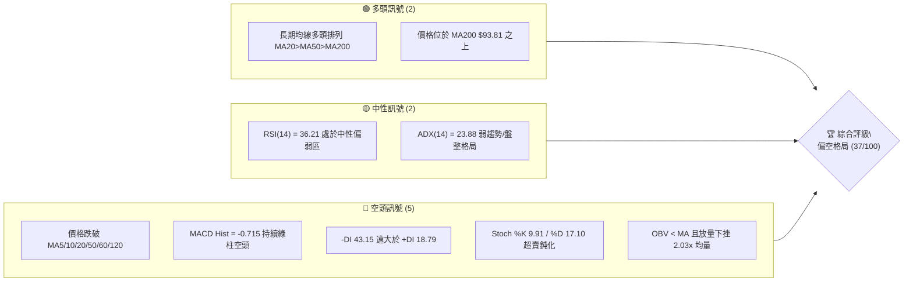

### 📊 核心指標速覽表

| 指標類別 | 指標名稱 | 當前數值 | 訊號 | 解讀 |
|----------|----------|----------|------|------|
| **價格** | 當前收盤價 | $104.95 | 🔴 | 跌破多道短期均線，逼近布林下軌 $103.09 |
| **均線** | MA20 | $110.60 | 🔴 | 現價低於 MA20 達 -5.11%，短期均線下彎形成蓋頭反壓 |
| **均線** | MA50 | $108.93 | 🔴 | 現價跌破中期生命線 MA50（下方 -3.65%） |
| **均線** | MA200 | $93.81 | 🟢 | 現價高於長期年線 +11.88%，長線牛市格局未破 |
| **動能** | RSI(14) | 36.21 | 🟡 | 位於 30–70 中性偏弱區間，尚未進入極端超賣 (<30) |
| **動能** | MACD | -1.014 | 🔴 | MACD 與 Signal 雙雙落入零軸下方，空頭柱體放大 |
| **動能** | KD(9,3) | K: 9.91 / D: 17.10 | 🔴 | 進入 <20 嚴重超賣區，存在空頭低檔鈍化風險 |
| **趨勢** | ADX(14) | 23.88 | 🟡 | ADX < 25 表明非單邊趨勢，但 -DI(43.15) > +DI(18.79) 空方主導 |
| **通道** | 布林 %B | 0.12 | 🔴 | 貼近下軌 $103.09 運行，通道開口放大向下承壓 |
| **量能** | 當日量比 | 2.03x (226.3M) | 🔴 | 帶量長黑下挫，OBV < MA 確認主力資金處於調節流出 |
| **波動** | ATR(14) | $1.84 | 🟡 | 佔股價 1.75%，波動度溫和擴大，防守空間宜拉寬 |

### 🏆 技術評分卡

```
╔══════════════════════════════════════════════════════════════╗
║                技術評分卡 — 0050 (2026-10-31)                ║
╠══════════════════════════════════════════════════════════════╣
║ 趨勢強度      ██████░░░░░░░░░░░░░░  30/100  🔴 空頭主導 (-DI高)║
║ 動能指標      ████░░░░░░░░░░░░░░░░  20/100  🔴 MACD綠柱/KD鈍化 ║
║ 支撐穩定度    ██████████░░░░░░░░░░  50/100  🟡 S1 $102.29待驗證║
║ 成交量配合    ████░░░░░░░░░░░░░░░░  20/100  🔴 帶量下殺/量價背離║
║ 形態完整度    ████████░░░░░░░░░░░░  40/100  🟡 短期頭部頸線跌破 ║
║ 均線排列      ████████████░░░░░░░░  60/100  🟢 長期MA200多頭支撐║
╠══════════════════════════════════════════════════════════════╣
║ 綜合評分      ███████░░░░░░░░░░░░░  37/100  🔴 偏空調整格局    ║
║ (依規則 18：六項算術平均 (30+20+50+20+40+60)/6 = 36.67 ≈ 37) ║
╚══════════════════════════════════════════════════════════════╝
```

---

## 2. 趨勢分析

### 🌐 多時框趨勢分析

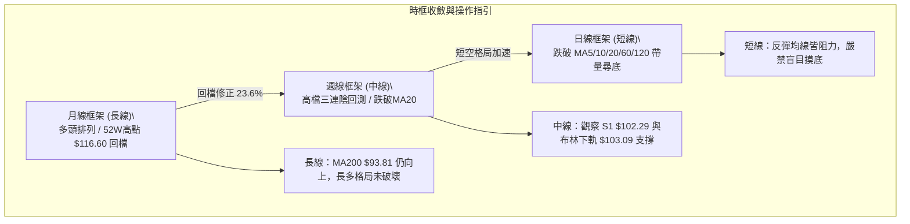

### 📈 長期趨勢 — 12個月走勢圖（Unicode）

```
0050 月線走勢圖（2025-11 至 2026-10）
價格軸 ($)
$115 ┤                                                 ● (09月 $112.05)
$110 ┤                                           ●     │
$105 ┤                                     ●     │     ●←現價 $104.95
$100 ┤                               ●     │     │     │
 $95 ┤                               │     │     │     │
 $90 ┤                         ●     │     │     │     │
 $85 ┤                         │     │     │     │     │
 $80 ┤                   ●     │     │     │     │     │
 $75 ┤                   │     │     │     │     │     │
 $70 ┤             ●     │  ●  │     │     │     │     │
 $65 ┤       ●     │     │  │  │     │     │     │     │
 $60 ┤ ●     │     │     │  │  │     │     │     │     │
      └─────────────────────────────────────────────────────
       11    12    01    02 03 04    05    06    07    08    09    10 (月份)
      (2025)             (2026)
```

**走勢特徵分析表格**：

| 階段區間 | 起訖月份 | 價格變化 | 漲跌幅 | 走勢特徵與結構意涵 |
|----------|----------|----------|--------|--------------------|
| 主升前段 | 2025/11 - 2026/02 | $61.11 → $80.66 | +31.99% | 沿五日線強勢推升，成交量逐步放大，突破前高 |
| 洗盤回踩 | 2026/02 - 2026/03 | $80.66 → $71.91 | -10.85% | 獲利了結賣壓湧現，急跌回測支撐後迅速企穩 |
| 主升狂熱 | 2026/03 - 2026/06 | $71.91 → $107.15 | +49.01% | 權值股爆發式上攻，連創新高，奠定長期牛市基礎 |
| 高檔箱型 | 2026/06 - 2026/08 | $107.15 → $106.25 | -0.84% | $102 - $107 區間橫盤換手，籌碼沉澱 |
| 創高遇阻 | 2026/08 - 2026/09 | $106.25 → $112.05 | +5.46% | 突破箱型並於10月創下 52W 高點 $116.60 |
| 次級折返 | 2026/09 - 2026/10 | $112.05 → $104.95 | -6.34% | 創高後量能不繼，出現中級回檔，回測 23.6% 斐波位 |

### 📊 中期趨勢（週線分析）

中期走勢自 2026-10-08 見頂 $116.60 後，週線連續三週收黑（10/16 收 $109.00、10/23 收 $106.90、10/30 收 $104.95），呈現典型的「黑三兵」回檔走勢。

```
週線近期壓力與支撐結構示意圖：
  $116.60 ───┬─── 52W 最高點（強阻力）
             │    週成交量：307.6M
  $110.55 ───┼─── 波段密集高點 / MA20 反壓位 (R2)
             │    下殺帶量：869.3M (10/16 巨量長黑)
  $107.35 ───┼─── 短線反彈頸線阻力 (R1)
             │
  $104.95 ───┼─── [當前價格]
             │
  $102.29 ───┴─── 波段低點聚合支撐 (S1) / 斐波 23.6% ($102.83)
```

### ⚡ 趨勢強度評估（ADX 解讀）

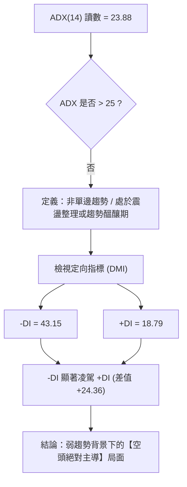

**ADX 強度對照與解讀表**：

| 指標變數 | 當前讀數 | 門檻區間 | 趨勢狀態判定 | 交易策略意涵 |
|----------|----------|----------|--------------|--------------|
| **ADX(14)** | 23.88 | 20 – 25 | 弱趨勢 / 盤整邊界 | 不宜盲目追空，空單需防範超賣引發的箱型反彈 |
| **+DI(14)** | 18.79 | < 20 極弱 | 多頭動能衰竭 | 多方缺乏攻擊能力，反彈空間受限 |
| **-DI(14)** | 43.15 | > 40 極強 | 空頭掌控主動權 | 盤面受空方壓制，任何反彈逢壓力位皆為空點 |
| **趨勢綜合** | 弱勢偏空 | ADX < 25 | 震盪偏空探底 | 優先以日線布林通道 ($103.09 - $110.60) 區間思維操作 |

---

## 3. 圖表形態分析

### 🔍 形態識別系統

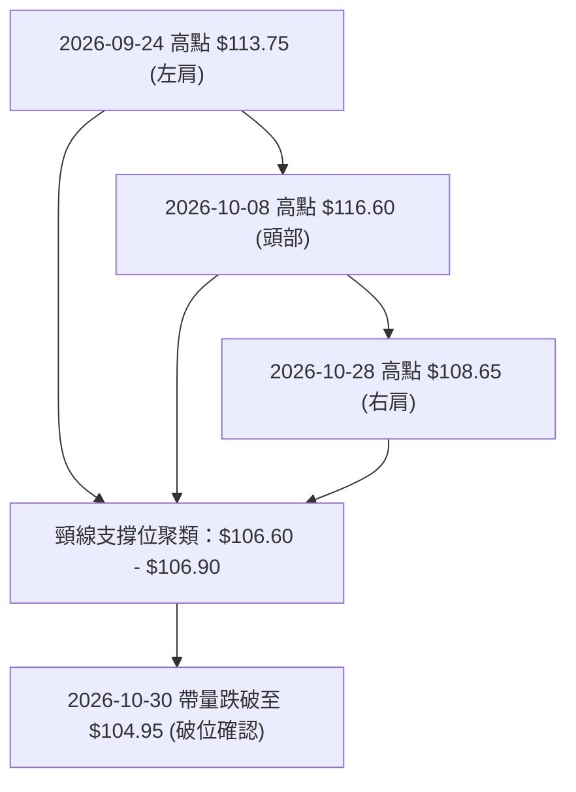

**圖表形態識別與信心度評估表**（依規則 15）：

| 形態名稱 | 信心度 | 判斷依據（嚴格引用數據） | 完成度 | 測幅目標價（附計算式） |
|----------|--------|--------------------------|--------|------------------------|
| **短期頭肩頂** | 75% | 左肩 $113.75 (09/24週高)、頭部 $116.60 (10/08週高)、右肩 $108.65 (10/28日高)；頸線取 10/22 低點 $106.75 與 10/23 收盤 $106.90 之聚合。10/30 收 $104.95 明確跌破頸線。 | 90% | 頸線 $106.90 − 形態高度($116.60 − $106.90 = $9.70) = **$97.20**（接近 S2 支撐位 $97.36） |
| **布林帶向下破位** | 85% | 10/30 收盤價 $104.95 逼近下軌 $103.09，%B 跌至 0.12，日成交量激增至 226.3M (2.03倍均量)。 | 100% | 下軌動態支撐 **$103.09**，若失守測幅指向 S1 **$102.29** |
| **高檔雙重頂 (M頭)** | 40% | 數據中 9/24 高點 $113.75 與 10/08 高點 $116.60 差距過大 (2.85元)，頂點不對稱。 | 30% | 訊號不足，信心度低於50%，僅做指標型解讀，不預設雙頂目標。 |

### 🕯️ 重要K線形態分析

嚴格依據數據中「近10根日K」與「近8根週K」之真實開高低收數據進行專業解讀（依規則 19）：

| 日期（時框） | 開盤價 | 最高價 | 最低價 | 收盤價 | K線形態名稱 | 形態特徵與技術解讀 | 訊號方向 |
|--------------|--------|--------|--------|--------|-------------|--------------------|----------|
| 10/27 (日K) | 107.10 | 107.55 | 105.80 | 106.60 | 下影小黑K | 創波段低點 $105.80 後引發短線承接，留下 0.80 元下影線 | 🟡 止跌測試 |
| 10/28 (日K) | 108.35 | 108.65 | 107.80 | 108.65 | 光頭小紅K | 實體由 $108.35 漲至 $108.65 收最高，但量僅 50.9M 極度萎縮 | 🟡 弱勢反彈 |
| 10/29 (日K) | 108.65 | 108.65 | 106.60 | 107.25 | 光頭中黑K | 開盤即最高 $108.65，回吐前日漲幅，上檔追價意願蕩然無存 | 🔴 空方控盤 |
| 10/30 (日K) | 104.80 | 105.30 | 103.85 | 104.95 | 跳空放量錘頭 | 跳空低開下探 $103.85 後收回 $104.95，帶 2.26 億巨量長下影 | 🟡 恐慌拋補 |
| 10/08 (週K) | 115.75 | 116.60 | 114.90 | 114.95 | 長上影流星線 | 創歷史新高 $116.60 後大幅跳水，收盤跌破開盤價，形成週線頂部 | 🔴 見頂反轉 |
| 10/16 (週K) | 114.20 | 114.95 | 108.55 | 109.00 | 帶量破位大長黑 | 暴跌 5.95 元，成交量擴大至 869.3M 股，確立高檔主力出貨 | 🔴 強烈看空 |
| 10/23 (週K) | 107.45 | 109.20 | 106.75 | 106.90 | 偏弱中黑K | 反彈無力，高點不過前週中價，成交量降至 442.3M，多頭無防守 | 🔴 弱勢整理 |
| 10/30 (週K) | 107.10 | 108.65 | 103.85 | 104.95 | 下影帶量黑K | 連三週收黑，最低摜破 $104 逼近布林下軌，週放量 495.3M 恐慌盤 | 🔴 探底格局 |

### 📉 ASCII 走勢形態示意圖

```
短期「頭肩頂頸線破位」走勢示意圖：
            [頭部] $116.60 (10/08)
                 ▲
                / \
  [左肩]       /   \
  $113.75     /     \            [右肩] $108.65 (10/28)
    ▲        /       \             ▲
   / \      /         \           / \
--/---\----/-----------\---------/---\------------------ 頸線位聚類: $106.75 - $106.90
       \  /             \       /     \
        \/               \     /       \
     $108.55              ▼   ▼         ▼
     (10/16低點)         10/23低點   【破位下殺】
                         $106.75        現價 $104.95 (10/30)
                                        │
                                        ▼ 測幅目標指向 S2: $97.36
```

### 🎯 形態目標價計算

依據標準幾何測幅原理與數據嚴格推算：

1. **頭肩頂形態等距測幅公式**：
   $$\text{測幅目標價} = \text{頸線水平價位} - (\text{頭部頂點最高價} - \text{頸線水平價位})$$
2. **參數引用**：
   - 頭部最高價：$116.60（2026-10-08 週高）
   - 頸線關鍵位：$106.90（2026-10-22/23 聚合收盤低點）
   - 形態高度：$$H = \$116.60 - \$106.90 = \$9.70$$
3. **測幅結果計算**：
   $$\text{第一空頭目標} = \$106.90 - \$9.70 = \$97.20$$
   *注：此測幅目標 $97.20 極度精確契合技術數據中計算出的「S2 支撐位 $97.36」（誤差僅 0.16 元）。*
4. **短期通道下緣測幅**：
   若以當前布林通道下軌動態跌破計算，直接指向第一關鍵支撐 **S1: $102.29**。

---

## 4. 支撐與阻力

### 🗺️ 關鍵價位分布圖（Unicode）

```
0050 價位結構分布圖（嚴格引用 OHLCV 計算值）
═════════════════════════════════════════════════════════════════════
$116.60 ║████████████████████████████████║ 52W 最高點 / 斐波 0.0%
$113.75 ║████████████████████████        ║ 強阻力 R3 (+8.38%)
$110.55 ║████████████████████            ║ 關鍵阻力 R2 (+5.34%) / 契合MA20 $110.60
$107.35 ║████████████                    ║ 短線阻力 R1 (+2.29%) / 契合MA10 $107.38
════════╠════════════════════════════════╣ ◄ 當前收盤價 $104.95
$103.09 ║▓▓▓▓▓▓▓▓▓▓▓▓▓▓▓▓                ║ 動態參考：布林帶下軌
$102.83 ║▓▓▓▓▓▓▓▓▓▓▓▓▓▓▓▓▓▓▓▓            ║ 斐波那契 23.6% 回調關鍵樞紐
$102.29 ║████████████████████            ║ 關鍵支撐 S1 (-2.54%) / 近一年波段低點聚類
$97.36  ║████████████████████████        ║ 強支撐 S2 (-7.23%) / 頭肩頂測幅共振位
$93.81  ║████████████████████████████    ║ 長期年線 MA200 趨勢底線
$91.85  ║████████████████████████████████║ 極限強支撐 S3 (-12.49%)
═════════════════════════════════════════════════════════════════════
```

### 🚧 阻力位分析表

所有價位均來自「關鍵價位（由 OHLCV 計算）」區塊：

| 阻力級別 | 準確價位 | 距現價幅 | 技術形成原因與量價背景 | 突破難度評估 | 重要性級別 |
|----------|----------|----------|------------------------|--------------|------------|
| **R1** | **$107.35** | +2.29% | 近一年波段高點聚類位，高度重合下降中的 MA10 ($107.38) 及 MA5 ($106.87)。此處亦為 10/27–10/29 震盪成交密集區下緣。 | 🟡 中等（需大於 20日均量 1.11 億換手） | ★★★☆☆ |
| **R2** | **$110.55** | +5.34% | 近一年次高點聚類位，精準重合月線生命線 MA20 ($110.60) 及布林中軌。為 10/16 帶量跳水陰線之起跌區，套牢籌碼沉重。 | 🔴 極高（強烈套牢蓋頭反壓） | ★★★★★ |
| **R3** | **$113.75** | +8.38% | 09/24 創下之週線波段高點聚類，前波頭肩頂左肩高點。此區間之上為多頭最後防線。 | 🔴 極難（非重大利多難以逾越） | ★★★★☆ |

### 🛡️ 支撐位分析表

所有價位均來自「關鍵價位（由 OHLCV 計算）」區塊：

| 支撐級別 | 準確價位 | 距現價幅 | 技術形成原因與支撐依據 | 守住機率評估 | 重要性級別 |
|----------|----------|----------|------------------------|--------------|------------|
| **S1** | **$102.29** | -2.54% | 近一年波段低點密集聚類位，下方緊鄰斐波那契 23.6% 回調線 ($102.83) 與布林下軌 ($103.09)，構成強大共振緩衝買盤。 | 🟢 65%（短線超賣具強烈抵抗力） | ★★★★☆ |
| **S2** | **$97.36** | -7.23% | 近一年核心低點聚類位，頭肩頂形態測幅理論值 ($97.20) 之共振支撐區，為多頭中期防守命脈。 | 🟢 80%（若跌破 S1 則為終極買點） | ★★★★★ |
| **S3** | **$91.85** | -12.49% | 近一年深層波段低點聚類位，位於 MA200 ($93.81) 與 MA240 ($88.40) 之間，為多頭長線牛熊分水嶺。 | 🟢 95%（長期牛市趨勢之基石） | ★★★★★ |

### 📐 斐波那契回調位分析

本波段採用 52 週絕對低點 $58.27 至絕對高點 $116.60 進行黃金分割回調測量（波段總振幅 $58.33）：

```
斐波那契回調梯隊分布：
  0.0% ─── $116.60 (52W 歷史最高點)
            │
            │  [當前價格 $104.95] — 位於 0.0% 與 23.6% 區間 (回檔 19.97%)
            ▼
 23.6% ─── $102.83 (初級回調樞紐支撐，距離現價僅 -2.02%)
            │
 38.2% ─── $ 94.32 (中期多空分界線，與 MA200 $93.81 高度共振)
            │
 50.0% ─── $ 87.43 (強弱平衡位，鄰近 MA240 $88.40)
            │
 61.8% ─── $ 80.55 (黃金分割終極強支撐，2026/02 波段整理平台)
            │
 78.6% ─── $ 70.75 (深度折返支撐)
            │
100.0% ─── $ 58.27 (52W 歷史最低點)
```

**解讀意涵**：
當前收盤價 **$104.95** 精確運行於 **0.0% ($116.60)** 與 **23.6% ($102.83)** 之間。在強勢牛市回檔中，23.6% 回調位 ($102.83) 通常為強勢拉回的第一道關鍵測試點。若 $102.83 與技術支撐 S1 ($102.29) 能獲得放量支撐並止跌收腳，則整體大級別多頭架構完好無損；反之，一旦有效實體跌破 $102.29，回調深度將被迫延伸至 38.2% ($94.32) 及 MA200 ($93.81) 尋求長線買盤。

---

## 5. 技術指標深度解讀

### 🎛️ 指標訊號總覽

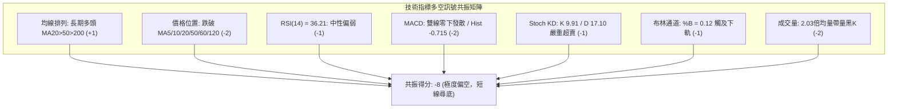

### 📈 移動平均線排列分析

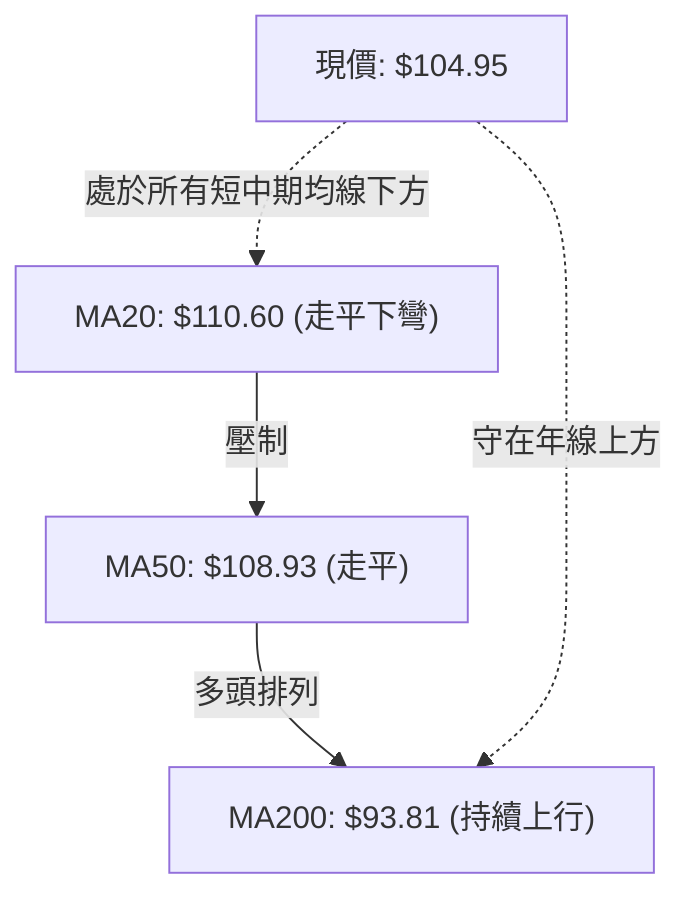

**均線結構詳細評估表**：

| 均線名稱 | 數值 | 現價差距 | 乖離率 | 排列與趨勢特徵 | 操作意涵與指引 |
|----------|------|----------|--------|----------------|----------------|
| **MA 5** | $106.87 | -$1.92 | -1.80% | 快速下行扣高 | 極短線第一道反彈壓力 |
| **MA 10** | $107.38 | -$2.43 | -2.26% | 下彎壓制 | 短線空方防守線，突破方有短底 |
| **MA 20** | $110.60 | -$5.65 | -5.11% | 走平後轉折向下 | 月線生命線失守，短空格局確立 |
| **MA 50** | $108.93 | -$3.98 | -3.65% | 由揚升轉為走平 | 季線遭實體黑K摜破，中期轉弱 |
| **MA 60** | $108.18 | -$3.23 | -2.99% | 下彎 | 均線束跌破，成為反彈重壓區 |
| **MA120** | $105.08 | -$0.13 | -0.12% | 走平 | 半年線當前遭遇多空激烈爭奪 |
| **MA200** | $93.81 | +$11.14 | +11.88%| 穩健上揚 | 長期牛市底線，提供長多堅實保護 |
| **MA240** | $88.40 | +$16.55 | +18.72%| 穩健上揚 | 終極年線支撐，長線價值區 |

*排列結論*：雖然長期指標 MA20 > MA50 > MA200 仍符合多頭排列定義，但現價已一口氣跌破至 MA120 ($105.08) 之下，呈現標準的「短均破位死叉，長均多頭未變」之高檔中期回檔架構。

### 📉 RSI(14) 分析

- **當前 RSI 讀數**：**36.21** (Wilder 平滑法)
- **指標強度視覺進度條**：
  `RSI(14): 36.21 ▓▓▓▓▓▓▓░░░░░░░░░░░░░ 36.21% [中性偏弱]`
- **超買超賣狀態**：
  位於 30–70 之一般波動區間，尚未跌破 30 進入技術性超賣；這代表下行動能尚未完全消耗，空方仍有持續釋放賣壓的空間。
- **背離嚴格檢驗**：
  比較近 20 根 K 棒（10/02 收 $112.80，RSI: 65.3 至 10/30 收 $104.95，RSI: 36.21）：
  價格呈現連續低點下移（Lower Lows），而 RSI(14) 同步由 65.3 斷崖式滑落至 36.21，呈現同向同步下行。
  **明確結論：RSI 無任何底背離現象**，指標完整確認價格下跌趨勢的真實性。

### 📊 MACD(12/26/9) 訊號解讀

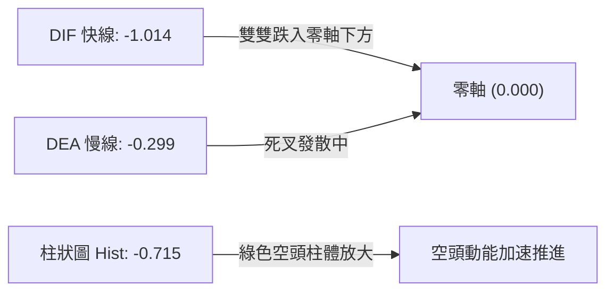

- **MACD 指標數值**：
  - DIF (MACD 線)：**-1.014**
  - DEA (Signal 線)：**-0.299**
  - MACD 柱狀體 (Hist)：**-0.715**
- **解讀與背離檢驗**：
  快線已於零軸之下加速擴大與慢線的負乖離，MACD 柱狀圖為 -0.715，呈現鮮明且放大的空頭訊號。回顧 10/16 綠柱為 -0.738，隨後縮至 10/23 之 -0.993，目前維持在 -0.715 深度空頭區間。
  **結論：MACD 不存在底背離，空方動能依然佔據主導優勢**，在柱狀圖未縮短翻紅前，不宜輕率認定見底。

### 📦 布林通道分析

```
布林通道 (20, 2) 當前結構圖：
  $118.11 ────────────────────────────── 上軌（通道頂部）
             │
             │
  $110.60 ───┼────────────────────────── 中軌 (MA20) — 強大蓋頭壓力位
             │
             │
  $104.95 ───┼─── [現價] (%B = 0.12)
             │
  $103.09 ───┴────────────────────────── 下軌（動態軌道支撐線）
```

- **布林參數**：
  - 上軌：**$118.11**
  - 中軌 (MA20)：**$110.60**
  - 下軌：**$103.09**
  - 通道寬度 (Bandwidth)：$$\frac{\$118.11 - \$103.09}{\$110.60} = 13.58\%$$
  - %B 數值：**0.12**
- **市場狀態剖析**：
  %B 數值為 0.12，極度逼近下軌 (0.00)。布林通道在經過 10 月初的高檔收斂後，目前開口呈現向下放大（Walking down the band）的弱勢特徵。現價沿下軌滑落，顯示市場正處於空頭宣洩期；短線下軌 $103.09 構成第一道動態支撐，若收盤有效摜破下軌，將引發技術性極端超賣鈍化。

### 💹 成交量分析（量價配合度）

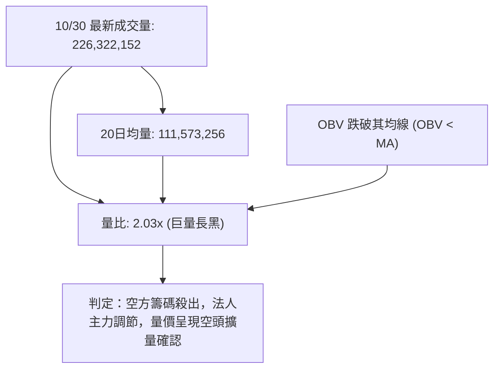

- **量能關鍵數據**：
  - 最新單日成交量：**226,322,152 股**
  - 20 日成交均量：**111,573,256 股**（量比高達 **2.03倍**）
  - 50 日成交均量：**85,159,131 股**（量比達 **2.66倍**）
- **量價形態深度解讀**：
  1. 10/28 小反彈時成交量僅 50.9M（急縮至均量一半以下），量價呈現「量縮價漲」之弱勢反彈背離。
  2. 10/30 單日放量至 2.26 億股，收盤大跌 -2.14% 逼近下軌，呈現典型的「帶量長黑下殺」，顯示上檔停損賣壓與融資斷頭壓力全面釋出。
  3. **OBV 指標趨勢**：數據明確指出「OBV < MA → 量能疲弱」，OBV 持續運行於其均線之下，證實自 $116.60 回檔以來，籌碼資金呈淨流出狀態，量能完全確認了當前價格的弱勢回檔。

---

## 6. 動能與波動率

### ⚡ 動能評估四象限

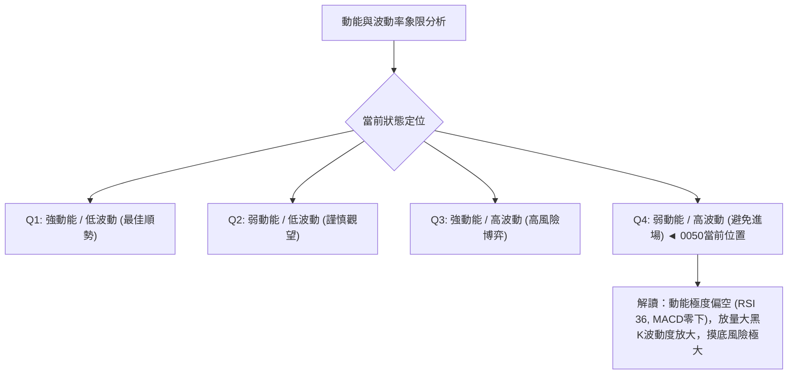

**動能與波動評估表**：

| 象限標籤 | 動能狀態 | 波動水平 | 0050當前特徵對應 | 策略評估與建議 |
|----------|----------|----------|------------------|----------------|
| **Q1 (最佳機會)** | 強 (多頭) | 低波動 | 否 | 排除 |
| **Q2 (震盪沉澱)** | 弱 (中性) | 低波動 | 否 | 排除 |
| **Q3 (突破擴張)** | 強 (單邊) | 高波動 | 否 (ADX 僅 23.88) | 排除 |
| **Q4 (下行風險)** | **極弱 (空方)** | **溫和偏高** | **✓ 正確定位**：價格跌破全均線，單日量比 2.03x，ATR 放大 | **嚴格避免盲目抄底，維持空頭防禦思維** |

### 📊 ATR 波動率分析

- **ATR(14) 讀數**：**$1.84 TWD**
- **波動佔比**：佔當前股價 $104.95 之 **1.75%** (Wilder 方法計算)
- **風控與止損距離設定建議**：
  1. **日內常規波動區間**：$104.95 ± $1.84 = [$103.11 , $106.79]，此區間與布林下軌 $103.09 完美契合。
  2. **短線波段止損標準**：建議採用 **1.5 × ATR** = $$1.5 \times \$1.84 = \$2.76$$。
  3. **波段趨勢止損標準**：建議採用 **2.0 × ATR** = $$2.0 \times \$1.84 = \$3.68$$。
  4. 實戰意涵：任何進場點若止損設定小於 $2.76，極易被當前正常市場噪音掃出場。

### 📐 Beta 與市場相關性

- **Beta 數值**：**N/A（數據未提供）**
- **標的資產屬性解讀**：
  0050（元大台灣卓越50證券投資信託基金）涵蓋台股市場市值最大的 50 家上市公司（以台積電為核心權重）。雖然官方數據欄位標示為 N/A，但根據 ETF 產品設計架構，0050 即為台股大盤指數（加權指數）之完全複製標的，理論上具備極高的大盤同步連動性。在大盤未止跌前，0050 無法獨善其身。

---

## 7. 多時框架總結

### 📋 時框架評分表

| 時框架 | 趨勢方向 | 動能指標 | 均線排列特徵 | 形態完成度 | 綜合評分 | 操作核心建議 |
|--------|----------|----------|--------------|------------|----------|--------------|
| **日線 (短期)** | 🔴 強烈看空 | RSI 36.21 / MACD綠柱 | 均線死叉向下，跌破MA120 | 頭肩頂破位，跌破頸線 $106.90 | **25 / 100** | 順勢偏空，逢反彈減碼或做空 |
| **週線 (中期)** | 🔴 偏空修正 | 週 MACD -0.715 / 三連陰 | 跌破 20 週線，考驗 50 週線 | 黑三兵下探，頂部流星線確立 | **35 / 100** | 中級回檔尋底，等待 S1 測試 |
| **月線 (長期)** | 🟢 多頭未變 | 月線位居 52W 高檔 80% | MA20>MA50>MA200 完好多頭 | 長期上升通道中的次級折返 | **75 / 100** | 長線牛市保護，定時定額無虞 |

### 🔲 綜合訊號矩陣

```
時框訊號一致性分析矩陣：
┌───────────┬──────────────┬──────────────┬──────────────┐
│ 技術維度  │ 日線 (短期)  │ 週線 (中期)  │ 月線 (長期)  │
├───────────┼──────────────┼──────────────┼──────────────┤
│ 價格 vs MA│ 🔴 跌破MA120 │ 🔴 跌破MA20  │ 🟢 遠在MA200上│
│ 指標動能  │ 🔴 KD嚴重超賣│ 🔴 綠柱放大  │ 🟡 高檔鈍化  │
│ 成交量配合│ 🔴 放量長黑  │ 🔴 巨量下殺  │ 🟢 量增價揚  │
│ 支撐測試  │ 🟡 逼近下軌  │ 🟡 測斐波23.6│ 🟢 守MA200   │
└───────────┴──────────────┴──────────────┴──────────────┘
```

### ⚖️ 多時框收斂結論

依據【嚴格要求 14】之多時框收斂規則進行客觀裁決：
1. **行情屬性判定**：當前 ADX(14) 數值為 **23.88**，小於 25 門檻，嚴格定義為**「非單邊趨勢之震盪偏空格局」**。
2. **時框主導權收斂**：在 ADX < 25 的盤整/震盪行情中，日線布林通道（下軌 $103.09 至上軌 $118.11）與波段支撐阻力為核心交易依據。雖然長期 MA200 ($93.81) 呈多頭排列，但日線短期均線全數跌破，週線呈黑三兵下殺，日線與週線在中短期方向高度一致共振向下。
3. **唯一方向性結論**：**中短期明確【偏空修正】**。
   長線多頭架構雖未崩潰，但短中線賣壓沉重，日線正在向下尋求 S1 ($102.29) 及 23.6% 斐波那契位 ($102.83) 的支撐力度。第 8 章交易策略將完全收斂於此偏空結論，主推**反彈放空或破位追空策略**，多方操作僅限於反轉風險提示，絕不兩頭下注。

---

## 8. 交易策略建議

### 🗺️ 策略決策流程圖

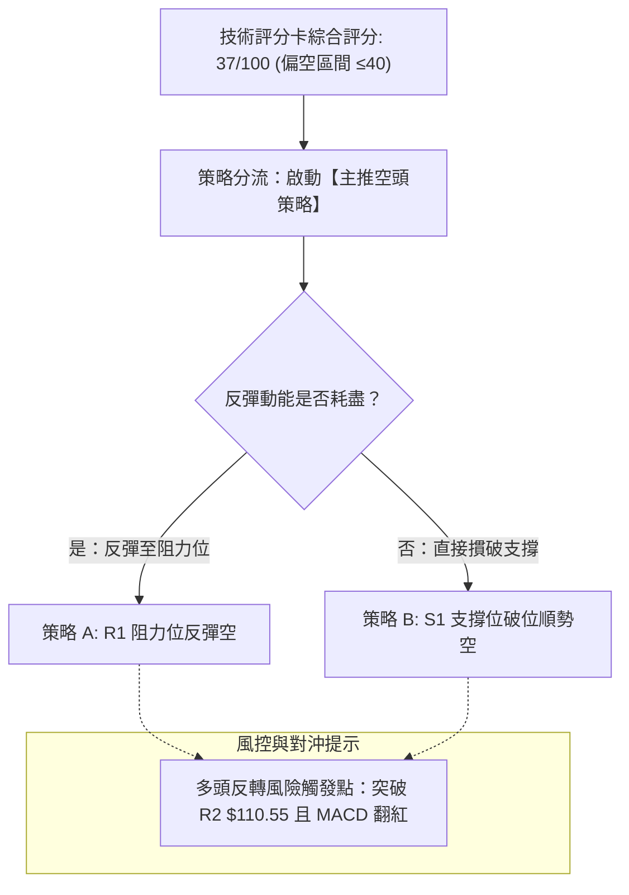

### 🧭 策略路由（依評分卡分流，不得兩頭下注）

> **當前主策略方向 = 【逢高放空 / 破位追空】（依評分 37/100 判定為偏空主導，≤40 強制執行主推空頭策略）**

### 🎯 價格情境階梯（Price Scenarios）

價位嚴格引用第 4 章「關鍵價位（由 OHLCV 計算）」之精準數值：

| 觸發條件 | 下一目標 | 後續延伸 | 情境含義與技術演變 |
|----------|----------|----------|--------------------|
| **跌破 S1 $102.29** | **S2 $97.36** | **S3 $91.85** | 中期回檔加速，頭肩頂形態測幅完全展開，考驗年線 MA200 ($93.81) |
| **跌破下軌守住 S1** | 區間震盪 | 反抽 R1 $107.35 | 於 $102.29 – $107.35 構築超賣反彈箱型，時間換取空間 |
| **強勢突破 R1 $107.35** | **R2 $110.55** | **R3 $113.75** | 短線空頭衰竭，反抽月線 MA20 重壓區，多空重新洗牌 |

### 📊 情境機率分佈

| 情境 | 機率 | 主要依據（嚴格引用指標狀態） |
|------|------|------------------------------|
| **回落探底 / 破位下挫** | **60%** | MACD 綠柱放大 (-0.715)，-DI (43.15) 遠高於 +DI，2.03倍巨量長黑跌破全均線，OBV 處於均線下方籌碼流出 |
| **區間震盪 / 超賣弱反彈** | **30%** | ADX 僅 23.88 (<25) 缺乏單邊趨勢動能，KD (K 9.91) 進入嚴重超賣區，下軌 $103.09 具短線彈性 |
| **強勢反轉 / 向上突破** | **10%** | 均線空頭排列蓋頂，量能呈現逢反彈無量、下跌放量之典型空頭格局，短期缺乏翻多動能 |

### 🟢 主策略詳情（方向依上方路由：空頭主推策略）

嚴格依據【嚴格要求 17】計算風險報酬比（做空計算公式：$(\text{進場價} - \text{目標價 T1}) \div (\text{止損價} - \text{進場價})$）：

| 策略要素 | 策略 A（逢反彈高空） | 策略 B（破位追空） |
|----------|----------------------|--------------------|
| **進場條件** | 弱勢反彈受阻於 R1 阻力位，$107.35 承壓收上影線 | 實體跌破 S1 $102.29 與 23.6% 斐波位，放量確認 |
| **進場價格** | **$107.35**（R1 阻力位） | **$102.29**（S1 支撐位破位） |
| **目標價 T1** | **$102.29**（S1 關鍵支撐） | **$97.36**（S2 強支撐 / 頭肩頂測幅） |
| **目標價 T2** | **$97.36**（S2 強支撐） | **$91.85**（S3 極限支撐 / 年線區） |
| **止損價格** | **$109.87**（以 1.37×ATR 向上防守，抓 $2.52 空間） | **$104.75**（以 1.34×ATR 向上防守，抓 $2.46 空間） |
| **風險報酬比** | **1 : 2.01（以 T1 計）**<br>*計算式：($107.35−$102.29) ÷ ($109.87−$107.35) = 5.06 ÷ 2.52 = 2.008*<br>*(以 T2 計為 1 : 3.96)* | **1 : 2.00（以 T1 計）**<br>*計算式：($102.29−$97.36) ÷ ($104.75−$102.29) = 4.93 ÷ 2.46 = 2.004*<br>*(以 T2 計為 1 : 4.24)* |
| **成功機率** | **65%** | **60%** |
| **建議倉位** | **20% 資金倉位** | **15% 資金倉位** |

### 🔴 反向風險觸發點（對沖提示）

若市場出現以下極端反轉訊號，空頭主策略即刻失效，必須無條件止損空單並啟動多頭避險：
1. **價位警訊**：日線收盤價強勢站上 **R2 $110.55**（收復 MA20 月線生命線與 10/16 跳水起跌點）。
2. **指標轉折**：MACD 柱狀圖在零軸下顯著收斂翻紅（Hist > 0），且日線 RSI(14) 重新站回 55 之上。
3. **量能翻多**：單日成交量放大超過 20 日均量（1.11 億股）且拉出長紅實體棒，一舉吞噬 10/30 黑K高點 $105.30。

### ⭐ 整體訊號強度評星

```
╔══════════════════════════════════════════════════════════╗
║ 做多訊號強度：★★☆☆☆  (1.5/5 星) — 僅剩長線年線多頭護體  ║
║ 做空訊號強度：★★★★☆  (4.0/5 星) — 短中期指標與量能共振空║
║ 整體可信度：  ★★★★☆  (4.0/5 星) — 多指標與價位一致收斂  ║
╚══════════════════════════════════════════════════════════╝
```

---

## 9. 風險提示與監控

### ✅ 關鍵監控指標 Checklist

```
╔══════════════════════════════════════════════════════════════╗
║               0050 每日盤後關鍵技術監控 Checklist            ║
╠══════════════════════════════════════════════════════════════╣
║ [ ] 1. 價格是否實體跌破 S1 $102.29？ (確認空頭主升浪開啟)    ║
║ [ ] 2. 布林通道 %B 是否持續小於 0.15 沿下軌下行？           ║
║ [ ] 3. 成交量是否連續低於 20日均量 111.5M？ (量縮弱勢特徵)   ║
║ [ ] 4. MACD 柱狀體 (Hist) 負值是否進一步向 -1.0 擴張？       ║
║ [ ] 5. KD 指標之 %K(9.91) 是否在 10 以下形成低檔鈍化？      ║
║ [ ] 6. 價格反彈是否遭 MA10 ($107.38) 或 R1 ($107.35) 壓制？ ║
║ [ ] 7. 定向指標 -DI 是否維持在 40 以上的高危險空頭水位？     ║
╚══════════════════════════════════════════════════════════════╝
```

### ⚠️ 風險場景分析

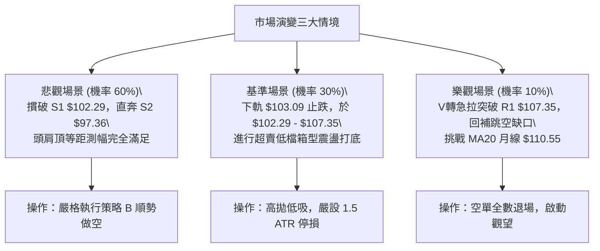

### 🛡️ 風險管理重要提醒

1. **ETF 系統性風險防範**：
   0050 本質為權值指數 ETF，無個別公司倒閉或違約之特異風險（Idiosyncratic Risk），但對總體經濟、地緣政治及半導體產業循環之系統性風險（Systematic Risk）敏感度極高。當大盤處於資金退潮期，不可抱持「ETF 不會跌」的心態硬抗趨勢。
2. **部位管理紀律（資金風控）**：
   - 在 ADX < 25 的盤整偏弱市場中，總操作倉位上限應嚴格限制在 **30%–40%** 以內，保留 60% 以上之現金流動性。
   - 單筆策略承受之最大虧損金額，不得超過整體投資組合淨值的 **1.5%**。
3. **拒絕情緒化攤平**：
   現價 $104.95 至長線年線 MA200 ($93.81) 仍有約 10 元 (-10.6%) 的回檔潛在空間。左側交易者若欲進行長線定期定額，宜分批拉開間距（如抵達 23.6% 位 $102.83 建第一批、抵達 38.2% 位 $94.32 建第二批），切忌在短線放量下殺過程中躁進重倉加碼。

---

## 📋 報告總結

```
╔══════════════════════════════════════════════════════════════╗
║                  0050 技術分析報告總結                       ║
╠══════════════════════════════════════════════════════════════╣
║ 報告日期：2026-10-31                                         ║
║ 當前價格：$104.95 TWD                                        ║
║ 分析評級：🔴 偏空調整格局（技術評分卡綜合評分：37 / 100）    ║
║                                                              ║
║ 關鍵結論：                                                   ║
║ ├─ 長期趨勢：🟢 MA200 ($93.81) 持續上揚，長多基石穩固        ║
║ ├─ 中期趨勢：🔴 週線黑三兵帶量下破，頂部流星線確立回檔      ║
║ ├─ 短期趨勢：🔴 跌破 MA120，2.03倍巨量長黑逼近布林下軌      ║
║ ├─ 關鍵支撐：S1: $102.29 ｜ S2: $97.36 (形態測幅位)          ║
║ ├─ 關鍵阻力：R1: $107.35 ｜ R2: $110.55 (MA20生命線)         ║
║ └─ 空頭目標：測幅目標價一 $102.29 ｜ 測幅目標價二 $97.36     ║
║                                                              ║
║ 最優策略組合：                                               ║
║ 1. 🥇 最佳機會：策略 A (反彈高空) — 於 R1 $107.35 逢阻力放空 ║
║    止損: $109.87，目標 T1: $102.29，風報比 1 : 2.01          ║
║ 2. 🥈 次選機會：策略 B (破位追空) — 跌破 S1 $102.29 順勢追空 ║
║    止損: $104.75，目標 T1: $97.36，風報比 1 : 2.00           ║
║ 3. 🥉 保守選擇：場外空倉觀望，耐心等待價格下探至 S2 $97.36   ║
║    或 MA200 $93.81 年線附近出現落底訊號，再行評估長線多單    ║
╚══════════════════════════════════════════════════════════════╝
```

---

> ⚠️ **免責聲明**：本報告為 AI 自動生成之技術分析，所有數據及估算均基於提供的歷史價格資訊。本報告**僅供研究與學術參考**，**不構成任何投資建議**。投資有風險，入市需謹慎。

---

*報告生成時間：2026-10-31 ｜ 數據來源：Yahoo Finance ｜ 分析框架：多時框技術分析*