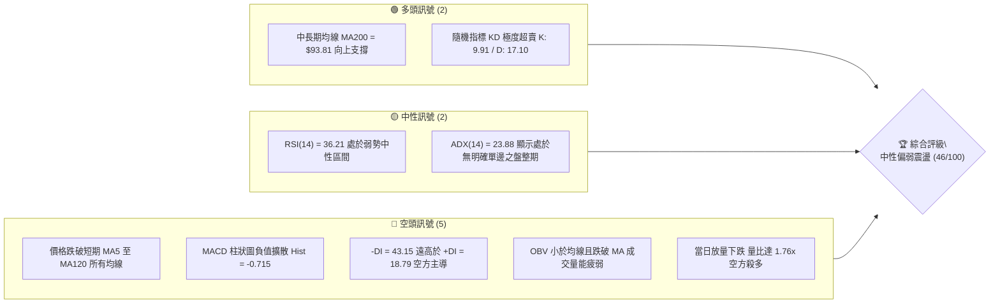
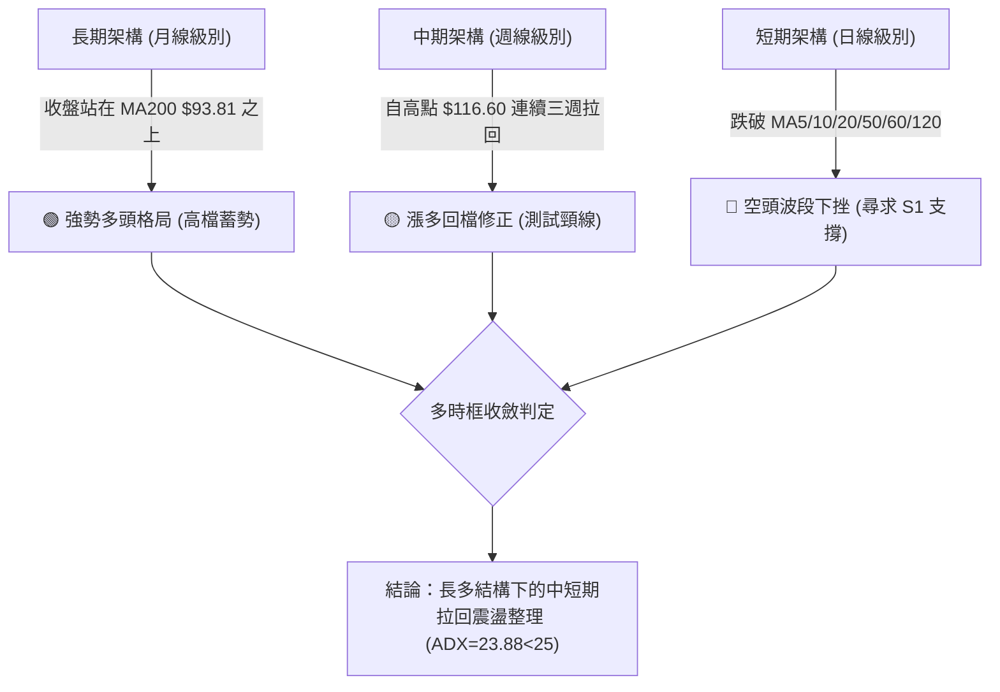
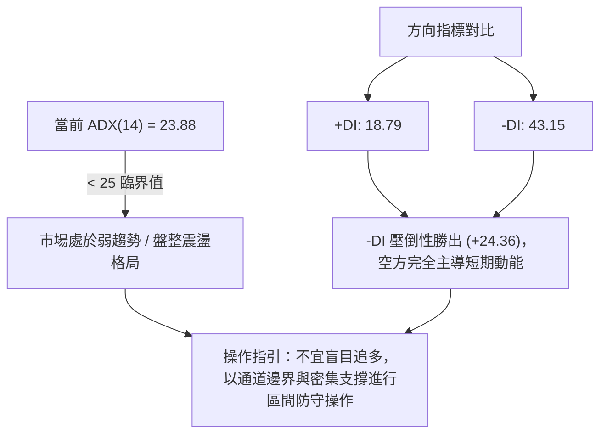
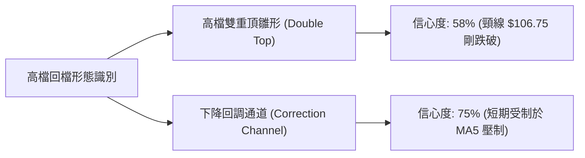
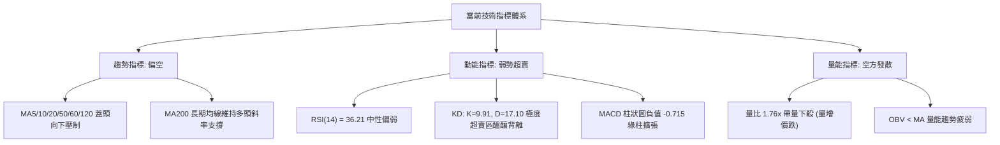
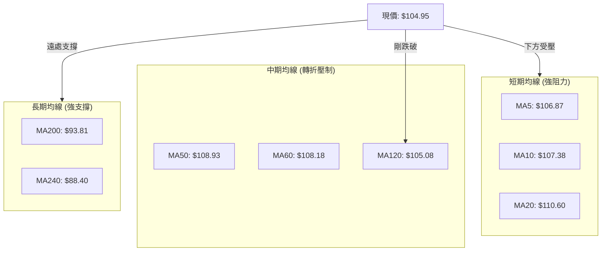
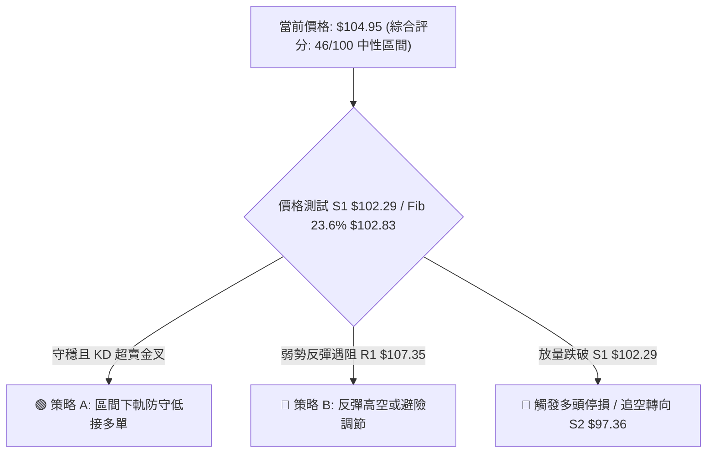
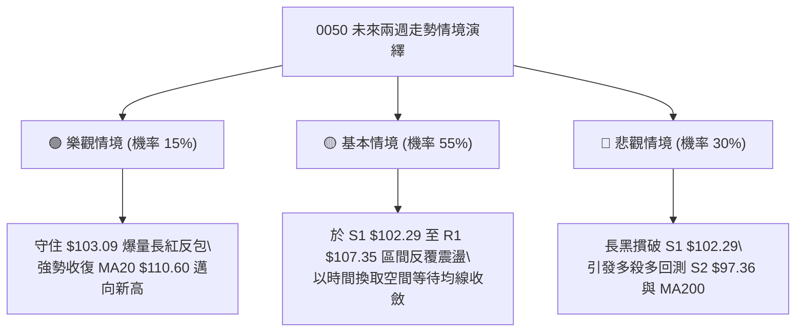

# 0050 技術分析報告

> **報告日期**：2026-11-01 ｜ **語言**：繁體中文 ｜ **數據來源**：Yahoo Finance ｜ **當前價格**：$104.95 TWD

---

## 目錄

| 章節 | 內容 |
|------|------|
| [1. 技術面概覽](#1-技術面概覽) | 訊號儀表板、核心指標、評分卡 |
| [2. 趨勢分析](#2-趨勢分析) | 多時框趨勢、長中短期走勢、ADX 解讀 |
| [3. 圖表形態分析](#3-圖表形態分析) | 形態識別、K線組合、目標價計算 |
| [4. 支撐與阻力](#4-支撐與阻力) | 關鍵價位、斐波那契回調結構 |
| [5. 技術指標深度解讀](#5-技術指標深度解讀) | MA/RSI/MACD/布林通道/成交量 |
| [6. 動能與波動率](#6-動能與波動率) | 動能四象限、ATR、Beta 與市場關聯 |
| [7. 多時框架總結](#7-多時框架總結) | 時框架評分表、訊號矩陣、收斂結論 |
| [8. 交易策略建議](#8-交易策略建議) | 策略路由、情境階梯、主策略與對沖提示 |
| [9. 風險提示與監控](#9-風險提示與監控) | 關鍵監控清單、風險場景、倉位管理 |
| [10. 報告總結](#10-報告總結) | 關鍵結論與最優策略組合 |

---

## 1. 技術面概覽

### 🎯 技術訊號儀表板



### 📊 核心指標速覽表

| 指標類別 | 指標名稱 | 當前數值 | 訊號 | 解讀 |
|----------|----------|----------|:----:|------|
| **價格** | 當前收盤價 | $104.95 | 🔴 | 跌破 MA120 ($105.08)，短線偏空下行尋求支撐 |
| **均線** | MA20 (月線) | $110.60 | 🔴 | 現價在 MA20 下方 -5.11%，短線下行趨勢成型 |
| **均線** | MA50 (季線) | $108.93 | 🔴 | 現價在 MA50 下方 -3.65%，中期上攻動能受阻 |
| **均線** | MA200 (年線) | $93.81 | 🟢 | 現價高於 MA200 +11.88%，長期牛市架構未被破壞 |
| **動能** | RSI(14) | 36.21 | 🟡 | 進入弱勢中性區間，未破 30 超賣線，仍具下探慣性 |
| **動能** | MACD (12,26,9) | DIF: -1.014 / MACD: -0.299 | 🔴 | 雙線位於零軸下方死叉且綠柱達 -0.715，空方動能增強 |
| **波動** | ATR(14) | $1.84 (1.75%) | 🟡 | 波動率處於常態偏高水位，單日振幅約 1.75% |
| **趨勢** | ADX(14) / DMI | ADX: 23.88 / -DI: 43.15 | 🔴 | ADX<25 屬區間震盪，但 -DI 佔據絕對主導，空頭壓制明顯 |
| **通道** | 布林通道 %B | %B = 0.12 (下軌 $103.09) | 🟡 | 逼近布林通道下軌，乖離過大醞釀技術性修正反彈 |
| **量能** | 成交量 / OBV | 193,796,708 (量比 1.76x) | 🔴 | 爆量長黑，OBV 低於均線，量能呈現空頭主控放量殺跌 |

### 🏆 技術評分卡

```
╔══════════════════════════════════════════════════════════════╗
║               技術評分卡 — 0050 (2026-11-01)                  ║
╠══════════════════════════════════════════════════════════════╣
║ 趨勢強度 (ADX/DMI)   ████████░░░░░░░░░░░░  40/100   🔴 弱勢空方主導 ║
║ 動能指標 (RSI/MACD)  ███████░░░░░░░░░░░░░  35/100   🔴 空頭動能發散 ║
║ 支撐穩定度 (S1/Fib)  █████████████░░░░░░░  65/100   🟢 下軌密集支撐 ║
║ 成交量配合 (OBV/VOL) ███████░░░░░░░░░░░░░  35/100   🔴 帶量長黑破位 ║
║ 形態完整度 (K線/幾何) █████████░░░░░░░░░░░  45/100   🟡 高檔回檔修正 ║
║ 均線排列 (MA架構)    ███████████░░░░░░░░░  55/100   🟡 中長多短線空 ║
╠══════════════════════════════════════════════════════════════╣
║ 綜合評分             █████████░░░░░░░░░░░  46/100   🟡 中性偏弱區間 ║
╚══════════════════════════════════════════════════════════════╝
```
> *註：綜合評分由六項子指標算術平均計算：(40 + 35 + 65 + 35 + 45 + 55) ÷ 6 = 45.83 ≈ 46/100。*

---

## 2. 趨勢分析

### 🌐 多時框趨勢分析



### 📈 長期趨勢 — 12個月走勢圖（Unicode）

依據 2025-11 至 2026-10 之月線收盤數據繪製：

```
0050 月線走勢圖（過去12個月，2025-11 至 2026-10）
價格軸 ($)
$115 ┤                                                 ● (2026-09: 112.05)
$110 ┤                                     ●      ●    │
$105 ┤                             ●       │      │    ●←現價 (2026-10: 104.95)
$100 ┤                             │       │      │
 $95 ┤                             │       │      │
 $90 ┤                     ●       │       │      │
 $85 ┤             ●       │       │       │      │
 $80 ┤             │       │       │       │      │
 $75 ┤     ●       │   ●   │       │       │      │
 $70 ┤     │       │   │   │       │       │      │
 $65 ┤ ●   │   ●   │   │   │       │       │      │
 $60 ┤ │   │   │   │   │   │       │       │      │
     └─┬───┬───┬───┬───┬───┬───────┬───────┬──────┬──────┬───────┬───────►
      11  12  01  02  03  04      05      06     07     08      09      10 (月份)
      25  25  26  26  26  26      26      26     26     26      26      26 (年份)
```

#### 走勢特徵分析表格

| 階段區間 | 起訖月份 | 起訖收盤價 | 漲跌幅 | 趨勢特徵與結構意涵 |
|----------|----------|------------|:------:|--------------------|
| 第一階段：築底突破 | 2025-11 ~ 2026-02 | $61.11 → $80.66 | +31.99% | 帶量突破平台，均線多頭排列確立 |
| 第二階段：洗盤換手 | 2026-02 ~ 2026-03 | $80.66 → $71.91 | -10.85% | 快速回測 MA50 尋求支撐，成功構築次級買點 |
| 第三階段：主升推升 | 2026-03 ~ 2026-06 | $71.91 → $107.15 | +49.01% | 主升浪推進，月線連續收紅，創波段歷史新高 |
| 第四階段：高檔震盪 | 2026-06 ~ 2026-09 | $107.15 → $112.05| +4.57%  | 進入高檔百元關卡震盪洗盤，動能初顯放緩 |
| 第五階段：高檔回檔 | 2026-09 ~ 2026-10 | $112.05 → $104.95| -6.34%  | 月線收黑，短線獲利盤湧現，測試高檔支撐區 |

### 📊 中期趨勢（週線分析）

週線架構近八週自 2026-10-08 創下 52 週高點 $116.60 後，連續收出三根週黑 K 棒（收盤分別為 $109.00、$106.90、$104.95），呈現典型的短期高檔獲利了結回檔走勢。

```
週線高檔拉回結構示意：
$116.60 ──────┐ (52W High，2026-10-08)
              │
              ├──► 10-16 收黑: $109.00 (量 8.69億，爆量長黑)
              │
              ├──► 10-23 收黑: $106.90 (跌勢趨緩，縮量至 4.42億)
              │
$104.95 ──────┴──► 10-30 收黑: $104.95 (測試 Fib 23.6% $102.83 支撐帶)
```

### ⚡ 趨勢強度評估（ADX 解讀）



#### ADX 趨勢強度對照表

| 指標名稱 | 當前數值 | 門檻標準 | 狀態評定 | 交易意涵 |
|----------|:--------:|:--------:|:--------:|----------|
| **ADX(14)** | 23.88 | 25.00 | 🟡 弱趨勢/區間震盪 | 趨勢動能不足，不可採用順勢突破追價策略 |
| **+DI(14)** | 18.79 | 20.00 | 🔴 多頭力量潰散 | 多方無力推動波段攻擊 |
| **-DI(14)** | 43.15 | 40.00 | 🔴 空方高度主導 | 賣壓強勁，短線慣性持續向下修正 |
| **ADX 與 DI 關係** | -DI 遠大於 +DI | 差值 > 20 | 🔴 空頭壓制強烈 | 須防範短線慣性探底，直至 -DI 出現轉折向下 |

---

## 3. 圖表形態分析

### 🔍 形態識別系統



#### 圖表形態信心度評估表

| 形態名稱 | 信心度 | 判斷依據（引用數據） | 完成度 | 目標價（附計算式） |
|----------|:------:|----------------------|:------:|--------------------|
| **高檔雙頂雛形** | 58% | 第一頂 09-24 高點 $113.75，第二頂 10-08 高點 $116.60；近期低點頸線為 10-22 低點 $106.75，現價 $104.95 已跌破頸線。 | 70% | 依形態高度推算：<br>頸線 $106.75 − (最高 $116.60 − 頸線 $106.75) = $96.90（接近支撐位 S2 $97.36） |
| **短期下降走廊** | 75% | 近 10 日高點持續下移（109.70 → 109.20 → 108.65），收盤價跌破所有短期均線。 | 85% | 依支撐位 S1 推算：<br>下軌延伸支撐目標為波段低點聚類 **S1 $102.29** |

### 🕯️ 重要K線形態分析

依據提供的近 10 根日 K 與近 8 根週 K 進行精確 K 線形態判讀：

#### 近 10 根日 K 棒分析

| 日期（日K） | 開盤價 | 最高價 | 最低價 | 收盤價 | K線形態 | 解讀 | 訊號 |
|-------------|:------:|:------:|:------:|:------:|---------|------|:----:|
| **2026-10-16** | 109.45 | 109.70 | 108.90 | 109.00 | 小黑實體棒 | 高檔跳空回落，上方賣壓沉重 | 🔴 |
| **2026-10-19** | 107.45 | 108.30 | 107.10 | 108.15 | 帶下影紅K | 低檔見買盤承接，企圖回補缺口 | 🟡 |
| **2026-10-20** | 107.65 | 108.30 | 107.05 | 107.25 | 小黑收低棒 | 反彈無力，多頭上攻動能不足 | 🔴 |
| **2026-10-21** | 108.80 | 109.20 | 107.60 | 108.15 | 倒狀小紅K | 衝高受阻於 109.20，留下影線與上影線 | 🟡 |
| **2026-10-22** | 108.95 | 109.15 | 106.75 | 106.90 | 中長黑K破底 | 跌破前低 107.05，空方表態破位 | 🔴 |
| **2026-10-23** | 106.90 | 106.90 | 106.90 | 106.90 | 一字線 (量0) | 暫停交易或價格平移，市場陷入觀望 | 🟡 |
| **2026-10-27** | 107.10 | 107.55 | 105.80 | 106.60 | 探底小黑K | 創波段新低 105.80，長下影線顯現微弱買盤 | 🟡 |
| **2026-10-28** | 108.35 | 108.65 | 107.80 | 108.65 | 帶量光頭紅K | 縮量強彈，但受制於 R1 阻力帶下緣 | 🟢 |
| **2026-10-29** | 108.65 | 108.65 | 106.60 | 107.25 | 高開低走中黑K | 空方吞噬前一日漲幅，確認反彈結束 | 🔴 |
| **2026-10-30** | 104.80 | 105.30 | 103.85 | 104.95 | 爆量長黑附下影 | 帶量 1.93 億股急殺，低見 103.85 逼近下軌後微幅收斂 | 🔴 |

#### 近 8 根週 K 棒分析

| 日期（週K最後日）| 開盤價 | 最高價 | 最低價 | 收盤價 | 週K形態 | 解讀 | 訊號 |
|------------------|:------:|:------:|:------:|:------:|---------|------|:----:|
| **2026-09-11** | 109.05 | 110.75 | 106.90 | 107.70 | 帶長上影黑K | 挑戰百一關卡受阻，進入蓄勢 | 🟡 |
| **2026-09-18** | 106.30 | 109.95 | 105.85 | 109.85 | 下影中長紅K | 低檔承接有力，週線多頭重啟 | 🟢 |
| **2026-09-24** | 109.90 | 113.75 | 109.85 | 112.40 | 突破實體紅K | 強勢突破百一，創波段收盤新高 | 🟢 |
| **2026-10-02** | 111.80 | 113.05 | 111.05 | 112.80 | 高檔十字小紅K | 漲勢放緩，多空於高檔陷入僵持 | 🟡 |
| **2026-10-08** | 115.75 | 116.60 | 114.90 | 114.95 | 創高流星黑K | 創 52 週高點 $116.60 後長上影大幅回吐 | 🔴 |
| **2026-10-16** | 114.20 | 114.95 | 108.55 | 109.00 | 爆量巨幅長黑K | 成交 8.69 億股放量破位，週線反轉確立 | 🔴 |
| **2026-10-23** | 107.45 | 109.20 | 106.75 | 106.90 | 弱勢下挫黑K | 延續跌勢，反彈無力突破 109.20 | 🔴 |
| **2026-10-30** | 107.10 | 108.65 | 103.85 | 104.95 | 下影長黑K棒 | 探低 $103.85 測試布林下軌，空方波段釋放 | 🔴 |

### 📉 ASCII 走勢形態示意圖

```
0050 近期走勢與高檔回調示意圖
價格 ($)
$116.60 ┼─────────────────────────● (52W High, 10-08)
        │                        ╱ ╲
$113.75 ┼───────● (09-24)       ╱   ╲     [頸線阻力區間 R2: $110.55]
        │      ╱ ╲             ╱     ╲   ───────────────
$110.60 ┼─────╱───╲───────────╱───────╲─────● (MA20 中軌)
        │    ╱     ╲         ╱         ╲   ╱
$107.35 ┼───╱───────╲───────╱───────────●─╱─── (阻力 R1)
        │  ╱         ╲     ╱             ╲
$104.95 ┼─╱───────────●───╱───────────────●◄─── [現價 $104.95]
        │            (10-22)               ╲
$102.29 ┼───────────────────────────────────●─── [波段支撐 S1 / Fib 23.6%]
        └─────────────────────────────────────────────► 時間 (日線進程)
```

### 🎯 形態目標價計算

根據跌破近期頸線（10-22 低點 $106.75）之測量目標推導：
1. **頸線價位**：$106.75
2. **形態頂部高點**：$116.60 (2026-10-08 最高價)
3. **形態垂直高度**：$116.60 − $106.75 = $9.85
4. **理論最小下跌滿足點**：
   $$\text{目標價} = \text{頸線} - \text{形態高度} = 106.75 - 9.85 = \$96.90$$
   *分析師註：此理論推算值 $96.90 與數據中之波段支撐位 **S2 $97.36** 極度密合，確認 S2 為極重要的波段防守目標價。*

---

## 4. 支撐與阻力

### 🗺️ 關鍵價位分布圖（Unicode）

```
╔══════════════════════════════════════════════════════════════════════════╗
║                    0050 關鍵價位結構分布圖                               ║
╠══════════════════════════════════════════════════════════════════════════╣
║ $116.60 ║████████████████████████████████████████║ 52W 最高點 / 斐波 0.0%  ║
║ $113.75 ║████████████████████████████            ║ 強阻力 R3 (前高密集區)    ║
║ $110.55 ║████████████████████                    ║ 阻力 R2 (MA20中軌聚類)   ║
║ $107.35 ║██████████████                          ║ 關鍵阻力 R1 (短期均線解套)║
║ $104.95 ╠════════════════════════════════════════╣ ◄ 現價 $104.95           ║
║ $103.09 ║░░░░░░░░░░░░░░░░░░░░░░░░░░              ║ 布林通道下軌動態支撐     ║
║ $102.83 ║▓▓▓▓▓▓▓▓▓▓▓▓▓▓▓▓▓▓▓▓▓▓▓▓▓▓▓▓            ║ 斐波那契 23.6% 回調位    ║
║ $102.29 ║████████████████████████████████        ║ 關鍵支撐 S1 (波段低點聚類)║
║ $97.36  ║████████████████████████████████████    ║ 強支撐 S2 (雙頂滿足點)   ║
║ $93.81  ║██████████████████████████████████████  ║ 長期生命線 MA200 年線    ║
║ $91.85  ║████████████████████████████████████████║ 終極防守 S3 (波段低點聚類)║
╚══════════════════════════════════════════════════════════════════════════╝
```

### 🚧 阻力位分析表

價位精確引用關鍵價位區塊波段高點聚類數值：

| 阻力級別 | 價位 | 距離現價 | 形成原因與技術共振 | 突破難度 | 重要性 |
|:--------:|:----:|:--------:|--------------------|:--------:|:------:|
| **R1** | **$107.35** | +2.29% | 近期波段高點聚類，與 MA10 ($107.38) 及 MA5 ($106.87) 重合 | 🟡 中等 | ★★★★☆ |
| **R2** | **$110.55** | +5.34% | 近期波段高點聚類，與 MA20 ($110.60) 及布林中軌精確共振 | 🔴 極高 | ★★★★★ |
| **R3** | **$113.75** | +8.38% | 2026-09-24 週線高點與前波成交密集套牢平台頂部 | 🔴 極高 | ★★★★☆ |

### 🛡️ 支撐位分析表

價位精確引用關鍵價位區塊波段低點聚類數值：

| 支撐級別 | 價位 | 距離現價 | 形成原因與技術共振 | 守住機率 | 重要性 |
|:--------:|:----:|:--------:|--------------------|:--------:|:------:|
| **S1** | **$102.29** | -2.54% | 近一年波段低點聚類，與斐波那契 23.6% ($102.83) 及布林下軌 ($103.09) 構成密集緩衝帶 | 70% | ★★★★★ |
| **S2** | **$97.36** | -7.23% | 近一年波段低點聚類，與頭部形態量度跌幅目標 $96.90 相呼應 | 85% | ★★★★★ |
| **S3** | **$91.85** | -12.49% | 近一年波段低點聚類，接近 MA200 ($93.81) 長期多頭護城河 | 95% | ★★★★☆ |

### 📐 斐波那契回調位分析

依據 52 週完整波段區間（最低 $58.27 → 最高 $116.60，總波幅 $58.33）分析：

| 回調比例 | 價位 | 當前相對位置 | 技術解讀與防守意涵 |
|:--------:|:----:|:------------:|--------------------|
| **0.0%** | **$116.60** | +11.10% | 52 週歷史高點，高檔反轉起跌點 |
| **23.6%** | **$102.83** | -2.02% | **強勢回調臨界點**；現價 $104.95 緊貼於此線上，回調未深，仍屬強勢整理 |
| **38.2%** | **$94.32** | -10.13% | 正常回調支撐位，與 MA200 ($93.81) 長期均線高度重疊 |
| **50.0%** | **$87.43** | -16.69% | 多空強弱平衡中軸線，接近 MA240 ($88.40) |
| **61.8%** | **$80.55** | -23.25% | 黃金分割強防守位，2026 年初起漲平台 |
| **78.6%** | **$70.75** | -32.59% | 深幅回檔極限位 |
| **100.0%** | **$58.27** | -44.48% | 52 週最低點，多頭結構完全破壞臨界點 |

> **回調位解讀**：現價 $104.95 嚴格運行於 **0.0% ($116.60)** 與 **23.6% ($102.83)** 之間。在技術分析定義中，回調未跌破 23.6% 前，整個中長期多頭主升架構未受根本傷害。$102.83 搭配 S1 ($102.29) 為多方絕不可失守的第一道關鍵防線。

---

## 5. 技術指標深度解讀

### 🎛️ 指標訊號總覽



### 📈 移動平均線排列分析



#### 均線數據深度解讀表

| 均線名稱 | 數值 | 現價差距 | 乖離率 | 排列狀態與趨勢意涵 |
|:--------:|:----:|:--------:|:------:|--------------------|
| **MA5** | $106.87 | -$1.92 | -1.80% | 扣高快速下壓，短線第一道動態壓制線 |
| **MA10** | $107.38 | -$2.43 | -2.26% | 下行斜率陡峭，與 R1 ($107.35) 構成強阻力 |
| **MA20** | $110.60 | -$5.65 | -5.11% | 月線下彎，短線走勢轉入空方回檔 |
| **MA50** | $108.93 | -$3.98 | -3.65% | 季線下破，多方中期波段攻擊節奏遭到破壞 |
| **MA60** | $108.18 | -$3.23 | -2.99% | 下跌跌破半年線關鍵位置 |
| **MA120** | $105.08 | -$0.13 | -0.12% | **半年線保衛戰**；當前微幅跌破，若連續三日未收復則轉弱 |
| **MA200** | $93.81 | +$11.14 | +11.88%| 長期年線穩步上行，MA20>MA50>MA200 長期多頭骨架未散 |
| **MA240** | $88.40 | +$16.55 | +18.72%| 終極牛熊分界線，長期趨勢多頭防線牢固 |

### 📉 RSI(14) 分析

當前 RSI(14) 數值為 **36.21**。

```
RSI(14) 數值進度條：
[0] ─────────────── [30] ───────●─────── [70] ─────────────── [100]
超賣區              36.21 (弱勢中性)      超買區
██████████████░░░░░░░░░░░░░░░░░░░░░░░░░░  36.21%
```

- **區間評估**：RSI 位於 30~50 的偏弱空方區間，尚未進入低於 30 的極度超賣區，顯示空頭拋壓仍有釋放空間，但下行動能已逐步收斂。
- **背離判斷**：
  - 檢視近 20 根 K 棒走勢（自 2026-10-08 高點 $116.60 回落至當前 $104.95），價格低點不斷刷新，RSI 亦從 65.7 同步下滑至 36.21。
  - **結論：目前無明顯頂背離或底背離**。指標與價格同向，屬於標準的「量價同向下跌」弱勢走勢。

### 📊 MACD(12,26,9) 訊號解讀


- **絕對數值**：DIF (-1.014) < Signal (-0.299)，雙線已滑落至零軸之下，且開口持續擴大。
- **柱狀體解讀**：MACD Hist 為 **-0.715**，負值呈現擴散狀態，表示空頭發球權依然穩固。目前尚未出現紅柱轉折或底背離雛形，左側交易者需提防空頭慣性下殺。

### 📦 布林通道分析

當前布林參數（20, 2）：
- **上軌**：$118.11
- **中軌 (MA20)**：$110.60
- **下軌**：$103.09
- **%B 指標**：0.12

```
ASCII 布林通道位置示意圖：
$118.11 ┼──────────────────────────────── 上軌 (Upper Band)
        │
$110.60 ┼──────────────────────────────── 中軌 MA20 (Middle Band)
        │
$104.95 ┼─────────────────────●─────────── 現價 ($104.95, %B = 0.12)
$103.09 ┼──────────────────────────────── 下軌 (Lower Band)
```

- **%B 解讀**：%B 僅為 **0.12**，代表價格已緊貼布林通道下軌（0 代表下軌，1 代表上軌）。
- **通道特徵**：通道開口呈現向外擴張跡象，價格連續多日沿下軌向下尋求支撐。若價格在下軌 $103.09 附近收出帶長下影線的止跌 K 棒，配合極度超賣的 KD，將具備回抽中軌 $110.60 的均值回歸契機。

### 💹 成交量分析（量價配合度）

- **最新成交量**：193,796,708 股（約 1.94 億股）。
- **基準比較**：相較於 20 日均量（109,946,984 股），**量比高達 1.76 倍**；相較於 50 日均量（84,508,623 股）更達 2.29 倍。
- **OBV 走勢**：數據確認「OBV < MA → 量能疲弱」。OBV 跌破均線，且在下跌過程中放出近兩週大量，顯示市場高檔停損賣壓與融資浮額湧現，籌碼尚未完全沉澱。

---

## 6. 動能與波動率

### ⚡ 動能評估四象限

```
動能與波動率象限分析：
       強動能 (High Momentum)
         │
    Q3   │   Q1
 (高波強動)│ (低波強動)
─────────┼─────────► 波動率 (Volatility)
    Q4   │   Q2  
 (高波弱動)│ (低波弱動)
         │   ● 0050 當前位置 (Q2 偏向 Q4 邊緣)
       弱動能 (Low Momentum)
```

| 象限 | 動能維度 | 波動維度 | 0050 當前落點 | 戰略解讀與行動方針 |
|:----:|:--------:|:--------:|:-------------:|--------------------|
| **Q1** | 強 | 低 | — | 最佳波段推進期（如 2026 年 5 月主升段） |
| **Q2** | **弱** | **低** | **✓ 主落點** | **震盪築底觀察期**：ADX=23.88 屬弱趨勢，ATR 佔比僅 1.75%，宜觀望等待右側轉強 |
| **Q3** | 強 | 高 | — | 高風險高收益噴出段 |
| **Q4** | **弱** | **高** | 邊緣靠近 | 爆量下殺放量恐慌期：若放量跌破 S1，將滑入此高風險警戒區 |

### 📊 ATR 波動率分析

- **ATR(14)**：**$1.84**（佔當前股價之 **1.75%**，Wilder 平滑法）。
- **單日期望波幅**：當前 0050 每日合理理論波動區間為 $\pm \$1.84$。
- **風控止損依據**：
  - **保守型保護止損 (1.0 × ATR)**：進場點下方 $\$1.84$。
  - **標準型波段止損 (1.5 × ATR)**：進場點下方 $\$2.76$。
  - **寬鬆型結構止損 (2.0 × ATR)**：進場點下方 $\$3.68$。

### 📐 Beta 與市場相關性

- **Beta 數值**：**N/A（數據未提供）**
- **市場代表性質化說明**：
  - 0050 作為追蹤台灣 50 指數之旗艦 ETF，成分股涵蓋台股市場前五十大權值龍頭企業，長期在結構上與加權指數高度共振（實務 Beta 常態錨定於 1.00 附近）。
  - 當前 0050 的快速修正，實質反映出大盤龍頭權值股的高檔集體估值修正壓力。

---

## 7. 多時框架總結

### 📋 時框架評分表

| 時框架 | 趨勢方向 | 動能狀態 | 均線排列 | 圖表形態 | 綜合評分 | 建議方向 |
|:------:|:--------:|:--------:|:--------:|:--------:|:--------:|:--------:|
| **月線級別 (長期)** | 🟢 強勢偏多 | 🟡 高檔鈍化 | 🟢 MA200之上長多 | 🟢 大多頭主升回測 | **78/100** | 長期投資維持續抱 |
| **週線級別 (中期)** | 🟡 漲多回檔 | 🔴 動能收縮 | 🟡 測試季線支撐 | 🟡 連三黑高檔修正 | **50/100** | 中期部位減碼防守 |
| **日線級別 (短期)** | 🔴 空方下殺 | 🔴 超賣未反彈 | 🔴 跌破短均線 | 🔴 雙頂雛形破頸線 | **35/100** | 嚴禁逆勢盲目追多 |

### 🔲 綜合訊號矩陣

```
時框訊號一致性矩陣：
╔══════════╦══════════════╦══════════════╦══════════════╗
║ 分析維度 ║  短期 (日線) ║  中期 (週線) ║  長期 (月線) ║
╠══════════╬══════════════╬══════════════╬══════════════╣
║ 趨勢方向 ║   🔴 空頭    ║   🟡 整理    ║   🟢 多頭    ║
║ 均線架構 ║   🔴 空頭    ║   🟡 中性    ║   🟢 多頭    ║
║ 動能指標 ║   🔴 弱勢    ║   🔴 轉弱    ║   🟡 鈍化    ║
║ 量能結構 ║   🔴 殺多    ║   🔴 爆量    ║   🟢 溫和    ║
║ 形態位置 ║   🔴 破位    ║   🟡 測頸線  ║   🟢 創高回測║
╠══════════╩══════════════╩══════════════╩══════════════╣
║ 矩陣收斂判定：短線下挫帶動中線回檔，長期多頭基石仍存  ║
╚════════════════════════════════════════════════════════╝
```

### ⚖️ 多時框收斂結論

依據多時框收斂優先級規則：
1. **趨勢/盤整判定**：當前日線 ADX(14) 為 **23.88 (< 25)**，嚴格界定為**「無單邊強烈趨勢之盤整/震盪行情」**。
2. **操作核心依據**：盤整行情下，順勢突破策略容易頻繁遭遇假突破，**交易應以日線布林通道上下軌及密集支撐阻力為核心交易邊界**。
3. **時框矛盾取捨**：雖然月線級別多頭強勁（現價遠在 MA200 $93.81 之上），但日線與週線連袂走弱，短線空方動能強烈（-DI=43.15）。日線跌破所有短期均線，表明短線調整尚未完結。
4. **唯一方向性結論**：**中性偏弱觀望，等待區間下軌測試確認**。短線絕不追多，耐心等待價格觸及下軌 $103.09 及 S1 $102.29 出現量縮止跌訊號後，方可啟動區間反彈多頭操作。

---

## 8. 交易策略建議

### 🗺️ 策略決策流程圖



### 🧭 策略路由

> **當前主策略方向 = 區間操作（防守型低接為主，輔以反彈高空），等待關鍵支撐確認（依技術評分卡綜合評分 46/100）**

因綜合評分落在 **40–60 區間**，市場處於布林帶寬震盪與多空換手期，嚴禁單向盲目押注，以「下軌支撐逢低承接」與「反彈遇阻順勢調節」為雙向應對原則。

### 🎯 價格情境階梯（Price Scenarios）

價位嚴格引用關鍵價位區塊波段高低點聚類數值：

| 觸發條件 | 下一目標 | 後續延伸 | 情境含義與操作指引 |
|:--------:|:--------:|:--------:|--------------------|
| **突破 R1 $107.35** | **R2 $110.55** | **R3 $113.75** | 短線轉強，封閉下行缺口，挑戰布林中軌阻力 |
| **站穩現價區間 ($103.09~$105.00)** | **R1 $107.35** | — | 於布林下軌構築雙底震盪，籌碼進行沉澱換手 |
| **跌破 S1 $102.29** | **S2 $97.36** | **S3 $91.85** | 中期技術破位，向下尋求雙頂形態滿足點及 MA200 支撐 |

### 📊 情境機率分佈

| 情境類別 | 機率預估 | 主要技術依據 |
|:--------:|:--------:|--------------|
| **下軌企穩區間震盪** | **55%** | ADX=23.88 顯示盤整格局；KD 極度超賣 (K=9.91)；S1 ($102.29) 具備 Fib 23.6% 強支撐 |
| **延續回落探底 (破 S1)** | **30%** | 爆量下殺 (量比 1.76x)；MACD 綠柱擴張 (-0.715)；-DI=43.15 賣壓尚未釋放完畢 |
| **強勢反轉直接上行** | **15%** | 短期均線全數蓋頭向下，OBV 疲弱，短線缺乏立即 V 轉向上之催化動能 |

### 🟢 主策略詳情

價位嚴格引用關鍵價位，風險報酬比嚴格按公式 $(T1 - \text{進場價}) \div (\text{進場價} - \text{止損價})$ 計算：

| 策略要素 | 策略 A（下軌支撐逢低承接） | 策略 B（反彈受阻高空/對沖） |
|----------|----------------------------|----------------------------|
| **策略定位** | 偏多區間逆勢反彈單 | 偏空順應日線下行走勢單 |
| **進場條件** | 價格回測 S1 獲得支撐，日K收下影線且 KD 出現金叉 | 價格弱勢反彈逼近 R1 阻力位受阻滯漲 |
| **進場價格** | **$102.50** (位於 S1 $102.29 與 Fib 23.6% $102.83 區間中點) | **$107.35** (精確錨定 R1 阻力位) |
| **目標價 T1** | **$107.35** (關鍵阻力 R1) | **$102.29** (關鍵支撐 S1) |
| **目標價 T2** | **$110.55** (布林中軌 / 阻力 R2) | **$97.36** (雙頂滿足點 / 支撐 S2) |
| **止損價格** | **$100.80** (跌破 S1 下方約 1×ATR，即 $102.29 - $1.49) | **$109.20** (突破 10-21 反彈高點，向上容忍 $1.85 ≈ 1×ATR) |
| **風險報酬比** | **1 : 2.85（以 T1 計）**<br>*計算：(107.35 - 102.50) ÷ (102.50 - 100.80) = 4.85 ÷ 1.70 = 2.85* | **1 : 2.74（以 T1 計）**<br>*計算：(107.35 - 102.29) ÷ (109.20 - 107.35) = 5.06 ÷ 1.85 = 2.74* |
| **次要風報比** | **1 : 4.74（以 T2 計）**<br>*計算：(110.55 - 102.50) ÷ 1.70 = 8.05 ÷ 1.70 = 4.74* | **1 : 5.40（以 T2 計）**<br>*計算：(107.35 - 97.36) ÷ 1.85 = 9.99 ÷ 1.85 = 5.40* |
| **成功機率** | 60% | 55% |
| **建議倉位** | 15% ~ 20% (輕倉試單) | 10% ~ 15% (避險對沖) |

### 🔴 反向風險觸發點（對沖提示）

若已建構多頭部位，出現以下訊號時必須立即啟動停損或反手對沖：
1. **收盤價放量跌破 S1 ($102.29)**：意味著斐波那契 23.6% 強勢防線崩潰，下跌空間打開至 S2 $97.36。
2. **MACD 負值柱狀圖擴散至 -1.00 以下**：空頭動能進一步失控，引發融資停損骨牌效應。
3. **帶量反彈卻被 R1 ($107.35) 壓制且收長上影線**：確認短線「弱勢反抽」，應立即出脫反彈多單。

### ⭐ 整體訊號強度評星

```
做多訊號強度：★★☆☆☆  (2/5星)  — 僅具備超賣反彈契機，均線嚴重壓制
做空訊號強度：★★★☆☆  (3/5星)  — 短期空方動能充沛，但面臨 S1 強支撐
整體可信度：  ★★★★☆  (4/5星)  — 指標與價位共振性高，點位依據紮實
```

---

## 9. 風險提示與監控

### ✅ 關鍵監控指標 Checklist

```
╔══════════════════════════════════════════════════════════════════╗
║                    每日盤後關鍵監控清單 (Checklist)              ║
╠══════════════════════════════════════════════════════════════════╣
║ [ ] 1. 價格防線：收盤價是否力守 S1 $102.29 與布林下軌 $103.09   ║
║ [ ] 2. 均線動態：現價能否於三日內重新收復 MA120 ($105.08)       ║
║ [ ] 3. 動能轉折：Stoch KD 是否在 20 以下形成低檔黃金交叉        ║
║ [ ] 4. 趨勢強度：-DI (43.15) 是否出現高檔鈍化或拐頭向下回落     ║
║ [ ] 5. 籌碼量能：成交量是否由近 2 億股大幅萎縮至 1 億股以下沉澱  ║
║ [ ] 6. 均線壓制：反彈是否能有效帶量越過 MA5 ($106.87) 與 R1     ║
╚══════════════════════════════════════════════════════════════════╝
```

### ⚠️ 風險場景分析



### 🛡️ 風險管理重要提醒

1. **嚴禁左側無依據猜底**：雖然 KD 處於極端超賣區（K=9.91），但日線布林通道呈喇叭口向下擴張狀態，在未出現日 K 線「長下影線」或「晨星」等明確止跌訊號前，切勿過早重倉進場。
2. **嚴格執行資金控管**：
   - 總部位暴露不得超過總投資資本的 **30%**。
   - 單筆區間試單風險承擔金額（止損金額）嚴格限制在總資產的 **1.0%** 以內。
3. **ETF 追蹤特性防護**：0050 受台股半導體與電子權值股連動極大，美股科技股財報與大盤動向為重要外部變數，需隨時防範系統性跳空開低風險。

---

## 10. 報告總結

```
╔══════════════════════════════════════════════════════════════════╗
║                     0050 技術分析報告總結                        ║
╠══════════════════════════════════════════════════════════════════╣
║ 報告日期：2026-11-01                                             ║
║ 當前價格：$104.95 TWD                                            ║
║ 分析評級：⚖️ 綜合評分 46/100 (中性偏弱震盪，進入區間防守)         ║
╠══════════════════════════════════════════════════════════════════╣
║ 關鍵結論：                                                       ║
║ ├─ 長期趨勢：🟢 強勢多頭 (現價穩居 MA200 $93.81 年線上方 +11.88%) ║
║ ├─ 中期趨勢：🟡 漲多修正 (週線高檔三連黑，考驗高檔頸線密集防守) ║
║ ├─ 短期趨勢：🔴 帶量破位 (短線均線全破，-DI=43.15 空方動能主導)  ║
║ ├─ 關鍵支撐：S1: $102.29 ｜ S2: $97.36 ｜ S3: $91.85             ║
║ ├─ 關鍵阻力：R1: $107.35 ｜ R2: $110.55 ｜ R3: $113.75           ║
║ └─ 理論量度目標：頭部破頸線等幅滿足點指向 S2 $97.36               ║
╠══════════════════════════════════════════════════════════════════╣
║ 最優策略組合：                                                   ║
║ 1. 🥇 最佳機會：等待回踩 S1 $102.29 / 斐波 23.6% $102.83 輕倉承接║
║    (進場: $102.50，目標: $107.35，止損: $100.80，風報比 1:2.85) ║
║ 2. 🥈 次選機會：弱勢反抽至 R1 $107.35 阻力遇阻時佈局避險空單     ║
║    (進場: $107.35，目標: $102.29，止損: $109.20，風報比 1:2.74) ║
║ 3. 🥉 保守選擇：完全空倉觀望，靜待日線 ADX 收斂且站回 MA20 再行介入║
╚══════════════════════════════════════════════════════════════════╝
```

---

> ⚠️ **免責聲明**：本報告為依據定量技術分析模型與歷史交易數據自動生成之研究報告，所有內容均基於客觀數據推算。本報告**僅供學術研究與投資決策參考**，**不構成任何要約、招攬或投資買賣建議**。投資人應獨立審慎評估風險，並自負盈虧。

---

*報告生成時間：2026-11-01 ｜ 數據來源：Yahoo Finance ｜ 分析框架：多時框技術分析模型*