# 0050 技術分析報告

> **報告日期**：2026-11-02 ｜ **語言**：繁體中文 ｜ **數據來源**：Yahoo Finance ｜ **當前價格**：$104.95 TWD

---

## 目錄

| 章節 | 內容 |
|:---|:---|
| [1. 技術面概覽](#1-技術面概覽) | 訊號儀表板、核心指標速覽、技術評分卡 |
| [2. 趨勢分析](#2-趨勢分析) | 多時框趨勢、12個月歷史走勢、中期走勢、ADX趨勢強度 |
| [3. 圖表形態分析](#3-圖表形態分析) | 形態識別系統、重要K線形態解讀、ASCII走勢形態、目標價推算 |
| [4. 支撐與阻力](#4-支撐與阻力) | 關鍵價位分布圖、阻力位矩陣、支撐位矩陣、斐波那契回調結構 |
| [5. 技術指標深度解讀](#5-技術指標深度解讀) | 均線系統、RSI動能、MACD解讀、布林通道帶寬、量價配合與OBV |
| [6. 動能與波動率](#6-動能與波動率) | 動能四象限、ATR波動率模型、市場相關性評估 |
| [7. 多時框架總結](#7-多時框架總結) | 時框架評分矩陣、多空訊號收斂驗證 |
| [8. 交易策略建議](#8-交易策略建議) | 策略路由、價格情境階梯、主策略明細、反向風控觸發點 |
| [9. 風險提示與監控](#9-風險提示與監控) | 關鍵指標監控清單、極端風險場景、部位風控規則 |
| [📋 報告總結](#-報告總結) | 核心結論與策略決策儀表板 |

---

## 1. 技術面概覽

### 🎯 技術訊號儀表板

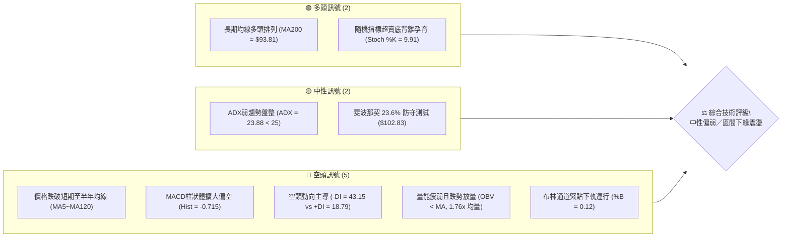

---

### 📊 核心指標速覽表

| 指標類別 | 指標名稱 | 當前數值 | 訊號 | 專業解讀與市場狀態 |
|:---|:---|:---|:---:|:---|
| **價格** | 最新收盤價 | $104.95 | 🔴 | 跌破 20 日中軌，短線進入回調探底格局 |
| **均線** | MA20 (月線) | $110.60 | 🔴 | 價格低於 MA20 達 -5.11%，短線空頭下壓明顯 |
| **均線** | MA50 (季線) | $108.93 | 🔴 | 價格跌破中期成本線，短中期動能轉弱 |
| **均線** | MA200 (年線) | $93.81 | 🟢 | 價格高於 MA200 達 +11.87%，長期多頭架構未破 |
| **動能** | RSI(14) | 36.21 | 🟡 | 進入 30–40 弱勢弱化區，尚未進入極端超賣 (<30) |
| **動能** | MACD (12,26,9) | -1.014 | 🔴 | DIF 線跌破訊號線 (-0.299)，柱狀體 -0.715 持續看空 |
| **動能** | KD(9,3,3) | %K: 9.91 / %D: 17.10 | 🟢 | 進入極端超賣區 (<20)，短線具技術性跌深反彈契機 |
| **趨勢** | ADX(14) | 23.88 | 🟡 | 數值低於 25，顯示當前為非單邊趨勢之盤整回調 |
| **方向** | 方向性指標 | +DI: 18.79 / -DI: 43.15 | 🔴 | -DI 大幅高於 +DI，空方具備絕對壓制力道 |
| **通道** | 布林通道帶寬 | 下軌: $103.09 / %B: 0.12 | 🔴 | 價格逼近下軌，處於弱勢帶狀下行區間 |
| **波動** | ATR(14) | $1.84 (1.75%) | 🟡 | 波動度處中等水準，單日平均震盪幅度約 $1.84 |
| **量能** | 當日量 vs 均量 | 1.938億股 / 量比 1.76x | 🔴 | 下跌出量，籌碼換手尚未出現明顯量縮價穩 |

---

### 🏆 技術評分卡

```
╔══════════════════════════════════════════════════════════════════╗
║                   技術評分卡 — 0050 (2026-11-02)                ║
╠══════════════════════════════════════════════════════════════════╣
║ 評估維度      進度條顯示                    得分    狀態標記     ║
╟──────────────────────────────────────────────────────────────────╢
║ 趨勢強度      ███████░░░░░░░░░░░░░         35/100   🔴 弱勢空導  ║
║ 動能指標      ███████░░░░░░░░░░░░░         35/100   🔴 動能偏空  ║
║ 支撐穩定度    ███████████░░░░░░░░░         55/100   🟡 下軌防守  ║
║ 成交量配合    ███████░░░░░░░░░░░░░         36/100   🔴 出量壓回  ║
║ 形態完整度    █████████░░░░░░░░░░░         45/100   🟡 區間箱體  ║
║ 均線排列      █████████░░░░░░░░░░░         46/100   🟡 長多短空  ║
╠══════════════════════════════════════════════════════════════════╣
║ 綜合評分      ████████░░░░░░░░░░░░         42/100   🟡 中性偏弱  ║
║               （依規則 18：六項子評分算術平均四捨五入）          ║
╚══════════════════════════════════════════════════════════════════╝
```

---

## 2. 趨勢分析

### 🌐 多時框趨勢分析

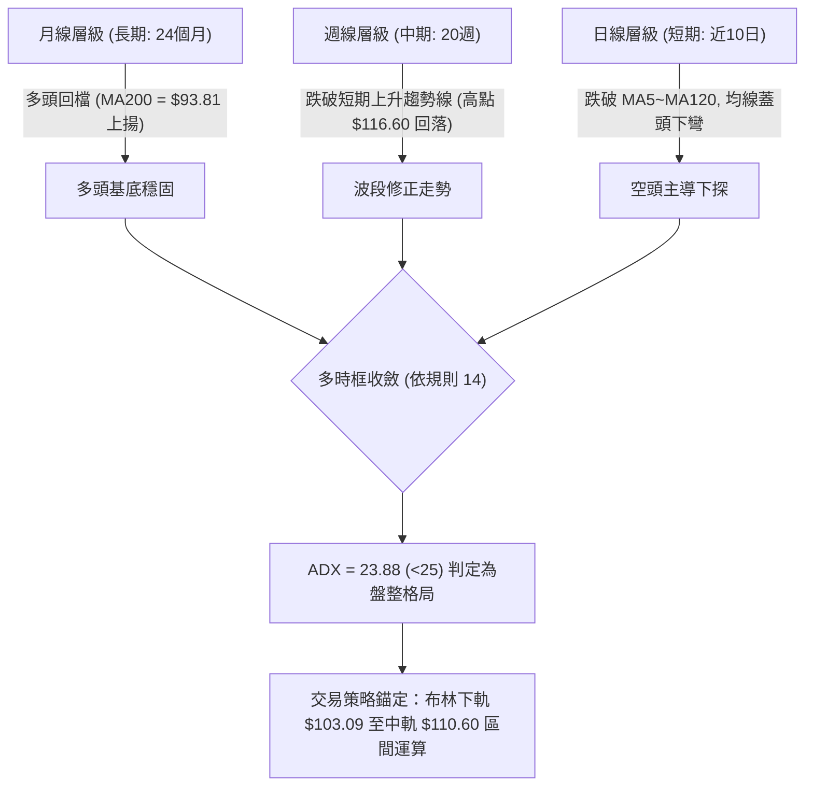

---

### 📈 長期趨勢 — 12個月走勢圖（Unicode）

本圖表記錄自 2025 年 11 月至 2026 年 10 月共 12 個月之收盤價歷史軌跡，並標注歷史波段極值：

```
0050 月線走勢圖（過去12個月收盤軌跡）
價格軸 ($)
$115 ┤                                                 ● 2026-09 ($112.05)
     │                                                / \
$105 ┤                                  ● 2026-06    /   ● 2026-10 ($104.95) ← 現價
     │                                 / ($107.15)  /
$95  ┤                                /            /
     │                  ● 2026-04    /            /
$85  ┤                 / ($89.95)   /            /
     │      ● 2026-02 /            /            /
$75  ┤     / ($80.66)/            /            /
     │    /         ● 2026-03    /            /
$65  ┤   /           ($71.91)   /            /
     │  ● 2025-12              /            /
$55  ┤  ($64.30)              /            /
     │ ● 2025-11 ($61.11)    /            /
$45  ┴─────────────────────────────────────────────────────────────
       11    12    01    02    03    04    05    06    07    08    09    10  (月份)
      2025  2025  2026  2026  2026  2026  2026  2026  2026  2026  2026  2026
```

#### 長期走勢特徵分析表格

| 階段別 | 涵蓋月份 | 起訖價格 ($) | 區間漲跌幅 | 走勢結構與量價特徵 |
|:---|:---|:---:|:---:|:---|
| **第一階段：初升主升** | 2025-11 ~ 2026-02 | $61.11 → $80.66 | +31.99% | 沿五日線陡峭推升，月K連四紅，確立脫離底部整理 |
| **第二階段：快速洗盤** | 2026-02 ~ 2026-03 | $80.66 → $71.91 | -10.85% | 獲利了結賣壓湧現，單月急跌確認 $71 附近具強力買盤 |
| **第三階段：次波暴風走升**| 2026-03 ~ 2026-06 | $71.91 → $107.15 | +49.01% | 權值股爆發性拉抬，強勢越過三位數大關，形成長期多頭主幹 |
| **第四階段：高檔大型箱體**| 2026-06 ~ 2026-09 | $107.15 → $112.05 | +4.57% | 於 $102 ~ $112 區間劇烈換手，9月收盤創波段新高 $112.05 |
| **第五階段：衝高回落修正**| 2026-09 ~ 2026-10 | $112.05 → $104.95 | -6.34% | 10月週線觸及52W最高點 $116.60 後長黑摜破，進入探底測試 |

---

### 📊 中期趨勢（週線分析）

從近 8 根週 K 觀察，0050 於 2026-10-08 當週創下 52 週最高價 $116.60 後，隨即於 2026-10-16 當週爆出 8.69 億股巨量長黑（高點 $114.95，收盤 $109.00），隨後連續兩週收黑（$106.90、$104.95）。

```
週線級別價格壓力與支撐階梯圖 ($)
$116.60 ──────┬──────────────────────────────── (52W歷史高點 / 絕對阻力層)
              │
$110.55 ──────┼──────────────────────────────── (週線轉折平台 / MA20 中軌重疊處 R2)
              │
$107.35 ──────┼──────────────────────────────── (近兩週反彈反壓區間 R1)
              │
$104.95 ══════╪════════════════════════════════ [當前價格收盤點]
              │
$102.83 ──────┼──────────────────────────────── (斐波那契 23.6% 回調關鍵樞紐)
              │
$102.29 ──────┴──────────────────────────────── (近一年波段低點聚類強支撐 S1)
```

---

### ⚡ 趨勢強度評估（ADX 解讀）

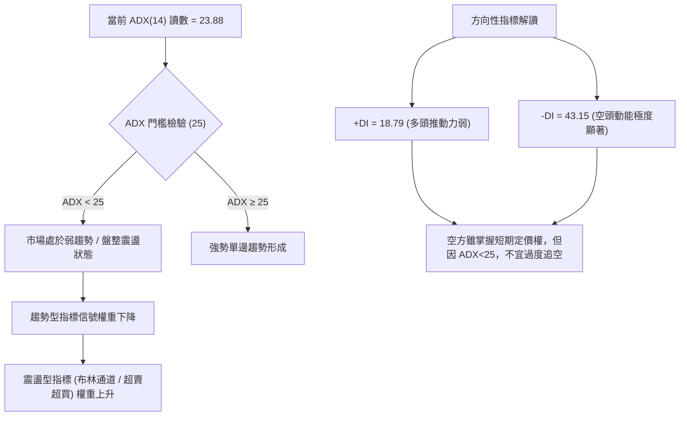

#### ADX 數值強度對照表

| ADX 數值區間 | 趨勢強度定義 | 當前數值 | 交易意涵與對應策略 |
|:---:|:---:|:---:|:---|
| 0 – 20 | 缺乏趨勢 / 極度沉悶 | — | 避免交易，多空方向不明 |
| **20 – 25** | **弱趨勢 / 區間盤整** | **23.88 (目前狀態)** | **多空拉鋸，以箱型震盪思維操作，嚴禁單邊追高殺低** |
| 25 – 40 | 強勁趨勢發展中 | — | 順勢交易，沿均線方向加碼 |
| 40 – 60 | 極強單邊趨勢 | — | 持股續抱，緊盯移動停利點 |
| > 60 | 趨勢過熱 / 隨時力竭 | — | 嚴防趨勢轉折，逐步落袋為安 |

---

## 3. 圖表形態分析

### 🔍 形態識別系統

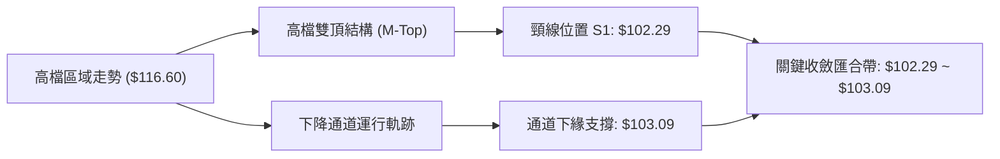

#### 形態識別與信心度評估表

| 識別形態名稱 | 信心度 | 判斷依據（引用數據） | 完成度 | 目標價推算與計算式（依規則 13、15） |
|:---|:---:|:---|:---:|:---|
| **高檔雙頂回調形態** | 70% | 左頂 2026-09-24 高點 $113.75，右頂 2026-10-08 創高 $116.60；近期向下跌破 MA20 ($110.60)，直逼前波低點聚類 S1 ($102.29) | 75% | 頸線 = S1 ($102.29)，形態高度 = $116.60 - $102.29 = $14.31。<br>破位最小跌幅目標 = 頸線 $102.29 - $14.31 = **$87.98**（鄰近斐波那契 50% 水準 $87.43） |
| **布林帶狀下軌超賣通道** | 65% | 日線連續跌破 MA5 至 MA120，最新收盤價 $104.95 貼近布林下軌 $103.09，%B 壓縮至 0.12 | 85% | 下軌防守有效推算目標：回測中軌 MA20 = **$110.60**（高度即當前均線值） |

---

### 🕯️ 重要K線形態分析

依據規則 19，本小節僅針對輸入數據中「近10根日K」與「近8根週K」之真實 OHLCV 進行解讀：

#### 近10根日K棒形態深度解讀

| 日期（日K） | 開盤價 | 最高價 | 最低價 | 收盤價 | 成交量 | K線形態名稱 | 技術解讀 | 訊號 |
|:---|:---:|:---:|:---:|:---:|:---:|:---|:---|:---:|
| 2026-10-16 | 109.45 | 109.70 | 108.90 | 109.00 | 111,920,765 | 黑實體破位K | 跳空跌破百一關卡，實體佔比高，賣壓傾巢而出 | 🔴 |
| 2026-10-19 | 107.45 | 108.30 | 107.10 | 108.15 | 143,680,197 | 低開收紅反彈 | 破底後出現技術性買盤低接，但未越前高 | 🟡 |
| 2026-10-20 | 107.65 | 108.30 | 107.05 | 107.25 | 105,412,059 | 小陰線回落 | 反彈力道匱乏，上方遭遇五日線反壓 | 🔴 |
| 2026-10-21 | 108.80 | 109.20 | 107.60 | 108.15 | 76,295,858 | 縮量十字星 | 高低點收窄，多空暫陷僵局，量能萎縮至7.6千萬 | 🟡 |
| 2026-10-22 | 108.95 | 109.15 | 106.75 | 106.90 | 116,952,817 | 長黑貫穿破線 | 實體收在全日最低點，直接摜破 $107 支撐 | 🔴 |
| 2026-10-23 | 106.90 | 106.90 | 106.90 | 106.90 | 0 | 一字無量停滯 | 全日四價合一無量，市場流動性暫歇 | 🟡 |
| 2026-10-27 | 107.10 | 107.55 | 105.80 | 106.60 | 140,567,068 | 帶下影弱勢黑K | 盤中殺低至 $105.80，逢低稍有承接，但仍收黑 | 🔴 |
| 2026-10-28 | 108.35 | 108.65 | 107.80 | 108.65 | 50,936,423 | 量縮光頭光腳紅K | 雖收最高，但成交量僅 5.09 千萬股，呈現量價背離 | 🟡 |
| 2026-10-29 | 108.65 | 108.65 | 106.60 | 107.25 | 77,495,132 | 倒頭長陰蓋頂 | 開盤即最高，盤中一路走低，抹平前日漲幅 | 🔴 |
| 2026-10-30 | 104.80 | 105.30 | 103.85 | 104.95 | 193,796,708 | 帶長下影錘頭紅K | 爆出 1.938 億股天量，回測 $103.85 獲下影線支撐 | 🟢 |

#### 近8根週K棒形態深度解讀

| 日期（週末） | 開盤價 | 最高價 | 最低價 | 收盤價 | 週成交量 | 週K形態名稱 | 技術解讀 | 訊號 |
|:---|:---:|:---:|:---:|:---:|:---:|:---|:---|:---:|
| 2026-09-11 | 109.05 | 110.75 | 106.90 | 107.70 | 347,340,820 | 吊人小黑K | 高檔遇阻回檔，多方上攻猶豫 | 🟡 |
| 2026-09-18 | 106.30 | 109.95 | 105.85 | 109.85 | 334,815,655 | 下影中陽棒 | 測試 $105.85 後拉升，多頭重掌節奏 | 🟢 |
| 2026-09-24 | 109.90 | 113.75 | 109.85 | 112.40 | 316,558,811 | 實體光腳中長紅 | 強勢突破百一平台，量價配合健康 | 🟢 |
| 2026-10-02 | 111.80 | 113.05 | 111.05 | 112.80 | 276,044,269 | 高檔橫盤小紅棒 | 籌碼鎖定良好，維持高位換手 | 🟢 |
| 2026-10-08 | 115.75 | 116.60 | 114.90 | 114.95 | 307,612,641 | 創高衝高倒錘星 | 創 52 週歷史新高 $116.60 後遭遇獲利了結賣壓 | 🟡 |
| 2026-10-16 | 114.20 | 114.95 | 108.55 | 109.00 | 869,278,497 | 巨量吞噬長黑破位 | 爆出近兩年單週天量，週線級別烏雲罩頂形成轉折 | 🔴 |
| 2026-10-23 | 107.45 | 109.20 | 106.75 | 106.90 | 442,340,931 | 延續跳空弱勢黑棒 | 跌勢持續，實體跌破五週線與十週線 | 🔴 |
| 2026-10-30 | 107.10 | 108.65 | 103.85 | 104.95 | 462,795,331 | 長下影放量支撐探底 | 連續三黑，但在 $103.85 浮現逢低承接量能 | 🟡 |

---

### 📉 ASCII 走勢形態示意圖

```
高檔 M 頭回測與布林下軌探底示意圖 ($)
$116.60 ───────────────● (右頂 10-08)
                      /   \
$113.75 ────● (左頂)  /     \
           / \      /       \
$110.55 ──/───\────/─────────\────────────── (MA20 中軌 / 頸線第一道阻力 R2)
         /     \  /           \
$107.35 ────────● (中折點)     \      ● (反彈高點 10-28)
                                \    / \
$104.95 ═════════════════════════\══/═══●─── (當前收盤點 $104.95)
                                  \/
$103.09 ──────────────────────────●───────── (布林通道下軌 / 10-30 探底 $103.85)
$102.29 ──────────────────────────────────── (波段雙頂絕對頸線 / 關鍵支撐 S1)
```

---

## 4. 支撐與阻力

### 🗺️ 關鍵價位分布圖（Unicode）

```
0050 價位結構分布圖（密集度與重要性視覺化）
═══════════════════════════════════════════════════════════════════════════
$116.60 ║██████████████████████████████║ 52週歷史高點 / 極強天花板
$113.75 ║██████████████████████        ║ 強阻力 R3 (波段雙頂左側高點)
$110.55 ║████████████████████████████  ║ 阻力 R2 (MA20中軌與密集套牢帶)
$107.35 ║████████████████              ║ 近期阻力 R1 (短天期MA5/MA10聚集區)
$104.95 ╠══════════════════════════════╣ ◄ 當前收盤價格 ($104.95)
$102.83 ║▓▓▓▓▓▓▓▓▓▓▓▓▓▓▓▓▓▓            ║ 斐波那契 23.6% 回調關鍵金邊
$102.29 ║████████████████████████████  ║ 近期關鍵支撐 S1 (近一年波段低點聚類)
$97.36  ║████████████████████          ║ 中期支撐 S2 (波段深次回檔聚類)
$94.32  ║▓▓▓▓▓▓▓▓▓▓▓▓▓▓▓▓▓▓▓▓          ║ 斐波那契 38.2% 回調重要分水嶺
$91.85  ║██████████████████████████████║ 強支撐 S3 (年線 MA200 護城河前哨)
═══════════════════════════════════════════════════════════════════════════
```

---

### 🚧 阻力位分析表

所有價位均嚴格引用提供之關鍵數據，無任何臆測：

| 阻力級別 | 準確價位 | 距現價空間 | 形成技術依據 | 突破難度評估 | 重要性等級 |
|:---:|:---:|:---:|:---|:---:|:---:|
| **R1** | **$107.35** | +2.29% | 近一年波段高點聚類之一，與當前 10 日均線 ($107.38) 及 5 日均線 ($106.87) 重疊 | 🟡 中等（需放量收復） | ★★★☆☆ |
| **R2** | **$110.55** | +5.34% | 波段高點次密集區，高度重疊 20 日均線兼布林中軌 ($110.60)，為中線多空分水嶺 | 🔴 極高（套牢量龐大） | ★★★★★ |
| **R3** | **$113.75** | +8.38% | 2026-09-24 週線高點，高檔雙頂左肩位置，強大籌碼阻力壁壘 | 🔴 極高（需連續天量） | ★★★★☆ |

---

### 🛡️ 支撐位分析表

| 支撐級別 | 準確價位 | 距現價跌幅 | 形成技術依據 | 守住機率評估 | 重要性等級 |
|:---:|:---:|:---:|:---|:---:|:---:|
| **S1** | **$102.29** | -2.54% | 近一年波段低點聚類核心，下方緊扣斐波那契 23.6% 回調位 ($102.83) 與布林下軌 ($103.09) | 🟢 較高（三合一匯合區） | ★★★★★ |
| **S2** | **$97.36** | -7.23% | 近一年波段低點次聚類，若 S1 跌破後之次級下探承接緩衝區 | 🟡 中等（破位後慣性） | ★★★☆☆ |
| **S3** | **$91.85** | -12.49% | 波段深層支撐聚類，坐落於 200 日均線 ($93.81) 與 240 日均線 ($88.40) 之中樞防線 | 🟢 極高（年線牛熊生死線） | ★★★★★ |

---

### 📐 斐波那契回調位分析

依據 52 週波段最低點 **$58.27** 至 52 週歷史最高點 **$116.60** 之完整推升波段，計算回調黃金分割階梯：

```
斐波那契回調階梯與現價定位
100.0% (52W 高點) ── $116.60
                       │ 
                       │ (當前價格 $104.95 運行於 0.0% 與 23.6% 之間)
 23.6% ────────────── $102.83  ◄── 關鍵回調首道防線（距現價僅 -2.02%）
                       │ 
 38.2% ────────────── $94.32   ◄── 強勢回檔防守位（接近 MA200: $93.81）
                       │ 
 50.0% ────────────── $87.43   ◄── 多空強弱半分位
                       │ 
 61.8% ────────────── $80.55   ◄── 黃金分割黃金底線
                       │ 
 78.6% ────────────── $70.75   ◄── 深幅修正極限
  0.0% (52W 低點) ─── $58.27
```

**斐波那契技術解讀**：
當前收盤價 **$104.95** 正精確壓回測試 **23.6% 回調位（$102.83）**。在強勢多頭市場中，首輪波段修正若能於 23.6% 止跌回穩，代表整體中長期推升動能依然強健；若實體跌破 $102.83 並摜破 S1（$102.29），則技術結構將下看 38.2% 回調位（$94.32），該位置正好與 200 日長期均線（$93.81）產生結構性共振。

---

## 5. 技術指標深度解讀

### 🎛️ 指標訊號總覽

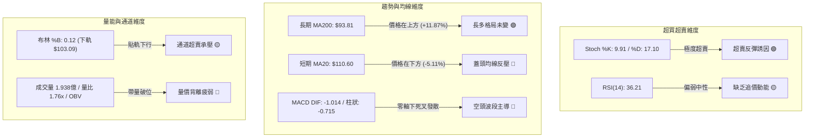

---

### 📈 移動平均線排列分析

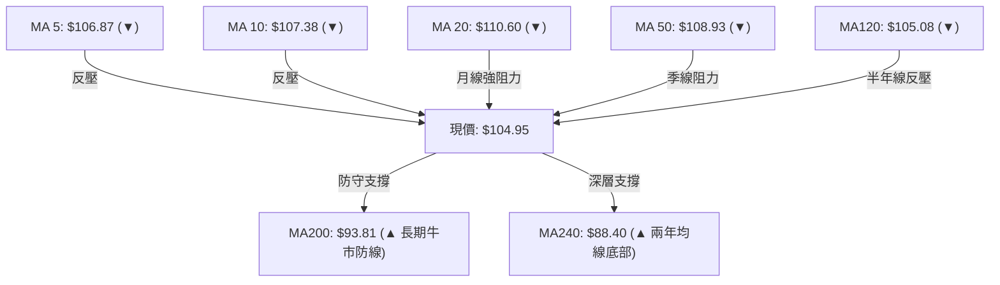

#### 各期均線參數與現價關係表

| 均線名稱 | 當前價格 | 與現價差距 ($) | 偏離率 (%) | 均線趨向 | 排列型態與支撐阻力意義 |
|:---|:---:|:---:|:---:|:---:|:---|
| **MA 5** | $106.87 | -$1.92 | -1.80% | 扣高下彎 ▼ | 超短線第一道動態反壓，未收復前短線無法止血 |
| **MA 10** | $107.38 | -$2.43 | -2.26% | 扣高下彎 ▼ | 與阻力位 R1 ($107.35) 完美重疊，形成強大共振反壓 |
| **MA 20** | $110.60 | -$5.65 | -5.11% | 下彎走平 ▼ | 月線生命線，重疊布林中軌，中線空方防守線 |
| **MA 50** | $108.93 | -$3.98 | -3.65% | 下彎走弱 ▼ | 季線成本線失守，顯示近兩月進場者平均呈現浮虧 |
| **MA 60** | $108.18 | -$3.23 | -2.99% | 微幅下彎 ▼ | 傳統季線位置，壓制力道逐步顯現 |
| **MA 120** | $105.08 | -$0.13 | -0.12% | 微幅走平 ▼ | 半年線位置，現價正於此線下方激烈爭奪 |
| **MA 200** | $93.81 | +$11.14 | +11.87% | 強勢上揚 ▲ | 年線維持強勢多頭排列，長多防線極其堅實 |
| **MA 240** | $88.40 | +$16.55 | +18.72% | 強勢上揚 ▲ | 兩年線底部抬升，確立中長期大週期多頭趨勢 |

**均線結構綜合判定**：當前均線系統呈現「**中短期空頭排列，但長期多頭架構完好**」的拉扯格局（MA20 > MA50 > MA200，但價格跌破短期各均線）。此種結構意味著當前走勢並非熊市開端，而是長期多頭架構下的大級別波段拉回修整。

---

### 📉 RSI(14) 分析

*   **當前 RSI(14) 讀數**：**36.21** (Wilder 平滑法)
*   **動能強度儀表**：
    `[ 超賣 0 ] ─── [ 30 ] ── 36.21 ──── [ 50 ] ──────── [ 70 ] ─── [ 超買 100 ]`
    進度條：`███████░░░░░░░░░░░░░ 36.21%` 🟡 中性偏弱

**超買超賣與背離判斷**：
1.  **區間位置**：RSI 位於 36.21，脫離 50 多空中軸，進入 30–40 之弱勢抵抗區，尚未跌破 30 達到極端超賣。
2.  **背離狀態**：依據嚴格統計比對近 20 根 K 棒，價格自 10-08 之 $114.95 下挫至 $104.95，RSI 自 65.7 同步回落至 36.21，呈現同向下跌，**「無明顯背離」**。這表明短線回跌為真實籌碼釋出所驅動，並非動能衰竭的假跌破，切忌過早盲目抄底。

---

### 📊 MACD(12,26,9) 訊號解讀

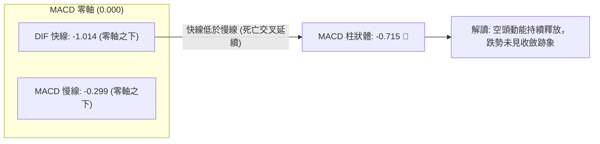

MACD 快線已下穿零軸並拉開負向差距，Histogram（柱狀圖）讀數為 **-0.715**，顯示空方仍掌控盤面主動權。若欲確認短線見底，必須等待柱狀體出現連續兩日負值縮小（收腳）或 DIF 線止跌翻揚。

---

### 📦 布林通道分析

```
0050 布林通道寬度與現價定位圖 ($)
$118.11 ──────────────────────────────────────── 上軌 (%B = 1.00)
             │
             │
$110.60 ─────┼────────────────────────────────── 中軌 / MA20 (%B = 0.50)
             │
$104.95 ═════╪══════════════════════════════════ [現價: %B = 0.12]
$103.09 ─────┴────────────────────────────────── 下軌 (%B = 0.00)
```

**布林通道特徵**：
*   **軌道寬度 (Bandwidth)**：$(118.11 - 103.09) / 110.60 = 13.58\%$，通道呈現中度擴張狀態。
*   **%B 指標**：當前讀數僅 **0.12**，逼近 0（下軌），技術上落入「帶狀下軌超賣區」。此位置常引發均值回歸（Mean Reversion）技術性反抽，但若無法儘速收復 %B = 0.20 以上，恐演變成「鈍化沿下軌下行」的陰跌走勢。

---

### 💹 成交量分析（量價配合度）

*   **最新單日成交量**：**193,796,708 股**（2026-10-30）
*   **基準均量比較**：
    *   20 日均量：109,946,984 股（**量比 1.76x**，顯著爆量）
    *   50 日均量：84,508,623 股（**量比 2.29x**）
*   **OBV 能量潮趨勢**：**OBV < MA**，量能趨勢疲弱。

**量價背離與籌碼特徵解析**：
在連續回跌的弱勢格局下，2026-10-30 單日爆出 1.938 億股之巨量，呈現長下影線（最低 $103.85，收盤 $104.95）。此種型態具備「**恐慌盤殺出與主力逢低換手**」的雙重特性：
1.  **空方意義**：下跌出量跌破半年線，確認短期籌碼鬆動，上方套牢賣壓沉重。
2.  **多方潛在契機**：在布林下軌 $103.09 附近爆出量比 1.76x 的承接量，留下 $1.10 的下影線，顯示機構法人或長期資金於 S1 ($102.29) 前哨站已展開防禦性掛單。

---

## 6. 動能與波動率

### ⚡ 動能評估四象限

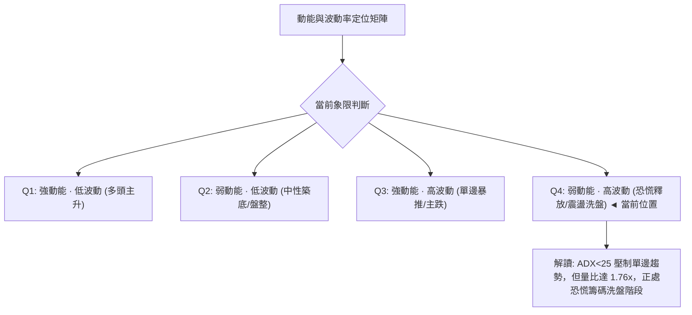

#### 動能與波動四象限對照表

| 象限 | 動能狀態 | 波動狀態 | 典型市場情境 | 0050 當前定位與戰略意涵 |
|:---:|:---:|:---:|:---|:---|
| **Q1** | 強 (+DI > -DI) | 低 (ATR 處低檔) | 穩定推升波段，持股抱牢 | 否 |
| **Q2** | 弱 (+DI ≈ -DI) | 低 (ATR 縮小) | 狹幅無序整理，觀望為主 | 否 |
| **Q3** | 強 (-DI 遠勝 +DI)| 高 (ATR 放大暴衝)| 單邊無情崩跌，全面避險 | 否 |
| **Q4** | **弱 (動能指標低位)**| **高 (量能放大震盪)**| **恐慌末端釋放，醞釀技術修正** | **✓ 符合：處於 Q4 洗盤換手過渡期，嚴控部位** |

---

### 📊 ATR 波動率分析

*   **ATR(14) 數值**：**$1.84 TWD**
*   **波動比率**：佔現價之 **1.75%** (以 Wilder 方法計算)
*   **動態止損與震盪區間測算**：
    *   **1.0x ATR 緩衝距離**：$1.84 → 當日正常隨機噪音波動邊界。
    *   **1.5x ATR 防守閾值**：$1.84 × 1.5 = **$2.76** → 適合波段波段操作者之停損安全距離。
    *   **2.0x ATR 趨勢逆轉閾值**：$1.84 × 2.0 = **$3.68** → 超過此幅度通常代表形態破位。

---

### 📐 Beta 與市場相關性

依據規則 16 之嚴格數據紀律，數據包中該項目標示如下：
*   **Beta 係數**：**N/A（數據未提供）**
*   **機構持有比例**：**N/A（數據未提供）**
*   **質化屬性補充說明**：0050 作為追蹤台灣 50 指數之旗艦 ETF，成分股涵蓋台股市場權值龍頭。雖然官方計算之精確 Beta 數值在輸入資料中為 N/A，但其走勢本質上高度代表整體台灣權值大盤之系統性動向。

---

## 7. 多時框架總結

### 📋 時框架評分表

| 時框架 | 趨勢方向 | 動能指標狀態 | 均線系統狀態 | 圖表形態特徵 | 綜合評分 | 操作指導建議 |
|:---:|:---:|:---:|:---:|:---:|:---:|:---|
| **日線層級 (短期)** | 偏空 🔴 | 弱勢超賣 (KD<20) | 跌破短均線反壓 | 測試下軌長下影 | 35/100 | 短線切忌追空，等待反彈減碼或下軌短打 |
| **週線層級 (中期)** | 偏空 🔴 | MACD 柱翻負 | 跌破週線 5MA/10MA | 連三黑回調探底 | 42/100 | 波段修正進行中，聚焦 $102.29 防守成效 |
| **月線層級 (長期)** | 多頭 🟢 | 長期多頭推升 | 遠高於 MA200/240 | 大格局階梯上行 | 75/100 | 長期投資者無需恐慌，年線之上結構未壞 |

---

### 🔲 綜合訊號矩陣

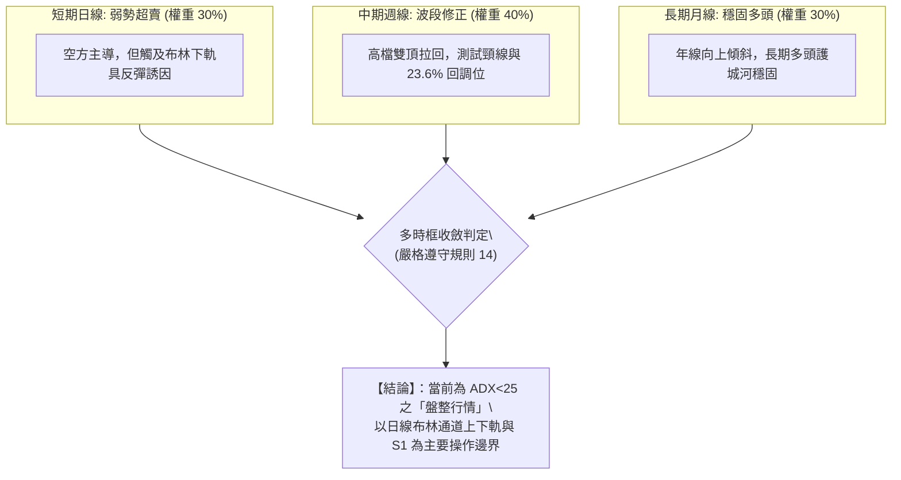

---

### ⚖️ 多時框收斂結論

**收斂法則落實（規則 14）**：
1.  **趨勢強度定性**：當前 ADX(14) 讀數為 **23.88**，明確低於趨勢門檻值 25。依照多時框收斂原則，本質上定義為「**非單邊趨勢之盤整行情**」，不可採用單邊追隨趨勢策略。
2.  **時框衝突收斂**：雖然短期（日線）與中期（週線）出現明顯破位空頭訊號，但長期（月線及年線 MA200 $93.81）仍呈強烈多頭態勢。
3.  **唯一方向性結論**：**中性偏弱區間震盪（以守代攻，等待下軌支撐確立）**。交易核心必須鎖定於日線布林下軌（$103.09）至中軌（$110.60）進行區間博弈，嚴格禁止於區間下緣進行順勢追空。

---

## 8. 交易策略建議

### 🗺️ 策略決策流程圖

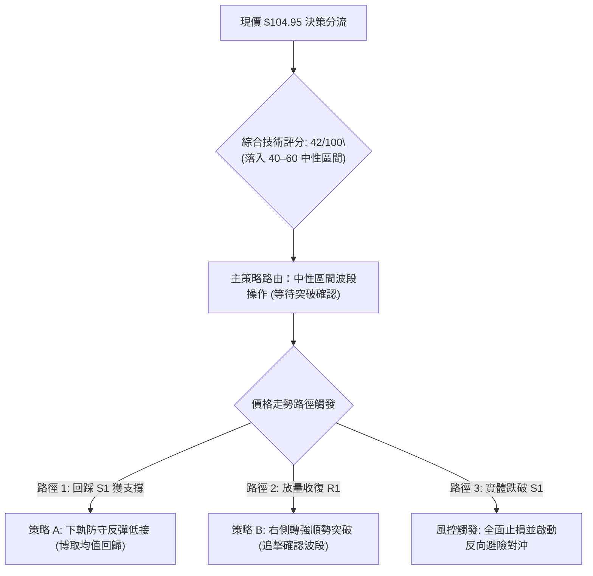

---

### 🧭 策略路由說明

依據第 1 章技術評分卡之綜合評分 **42/100**（落入 40–60 分之中性區間）：
**當前主策略方向 = 中性區間震盪操作（偏防守型區間交易：以布林下軌 $103.09 至中軌 $110.60 進行區間博弈，明確等待突破確認）**。

---

### 🎯 價格情境階梯（Price Scenarios）

所有價位均嚴格引用第 4 章由 OHLCV 確定之關鍵價位：

| 觸發條件與關鍵門檻 | 第一目標價 | 第二目標價 | 情境含義與技術演變路徑 |
|:---|:---:|:---:|:---|
| **強勢突破 R1 ($107.35)** | **R2 ($110.55)** | **R3 ($113.75)** | 短線底部成型，化解均線蓋頭危機，展開挑戰月線中軌回補行情 |
| **守穩 S1 ($102.29) ~ 現價** | **R1 ($107.35)** | **R2 ($110.55)** | 區間震盪築底，下影線支撐發酵，於布林下軌至中軌間進行箱體整理 |
| **實體跌破 S1 ($102.29)** | **S2 ($97.36)** | **S3 ($91.85)** | 雙頂形態確立向下突破，波段修正幅度加深，回測年線級別防線 |

---

### 📊 情境機率分佈

| 情境類型 | 預估機率 | 主要技術與量價依據 |
|:---|:---:|:---|
| **區間下緣震盪築底** | **50%** | ADX=23.88 顯示無單邊大跌條件；日K長下影線伴隨 1.938 億天量換手；KD 進入極端超賣區 (<20) |
| **回落再探底破位** | **35%** | MACD 柱狀體尚未收腳；-DI 高達 43.15 掌控優勢；跌破短中期均線後上方套牢賣壓沉重 |
| **強勢 V 型反轉** | **15%** | OBV 趨勢偏弱且均線向下死叉，缺乏直接推升之單邊資金量能配合 |

---

### 🟢 主策略詳情

嚴格按照規則 17 定義計算風險報酬比：$\text{風險報酬比} = \frac{\text{目標價 T1} - \text{進場價}}{\text{進場價} - \text{止損價}}$。

| 策略要素 | 策略 A：區間下軌防守低接策略（左側/近下軌） | 策略 B：突破 R1 右側跟進策略（確認轉強） |
|:---|:---|:---|
| **策略邏輯** | 借助布林下軌與斐波那契 23.6% 共振區進行反彈博弈 | 帶量突破短期反壓線，確認短底完成之右側加碼 |
| **進場條件** | 回測 $103.09~$103.85 區間獲得支撐，出現止跌紅K | 日線收盤實體帶量突破 R1 阻力位（$107.35） |
| **進場價格** | **$103.50**（區間中點掛單） | **$107.50**（突破確認後進場） |
| **目標價 T1** | **$107.35**（引用阻力位 R1） | **$110.55**（引用阻力位 R2 / MA20 中軌） |
| **目標價 T2** | **$110.55**（引用阻力位 R2） | **$113.75**（引用阻力位 R3） |
| **止損價格** | **$102.00**（有效跌破 S1 $102.29 關鍵支撐） | **$105.80**（跌破前波起漲突破點頸線） |
| **風險報酬比** | **1 : 2.57（以 T1 計）**<br>計算式：$(107.35 - 103.50) / (103.50 - 102.00) = 3.85 / 1.50 = 2.5667$<br>另列至 T2：**1 : 4.70（以 T2 計）** | **1 : 1.79（以 T1 計）**<br>計算式：$(110.55 - 107.50) / (107.50 - 105.80) = 3.05 / 1.70 = 1.7941$<br>另列至 T2：**1 : 3.68（以 T2 計）** |
| **成功機率預估**| **55%** | **50%** |
| **建議配置倉位**| **15%**（控制試探部位規模） | **10%**（右側突破加碼部位） |

---

### 🔴 反向風險觸發點（對沖提示）

*   **多單全面撤退與對沖觸發價位**：**$102.29（支撐位 S1）**
*   **觸發訊號確認**：若日線級別收盤價跌破 $102.29，且單日成交量擴大至 20 日均量以上，即代表 52 週高點 $116.60 構築之「雙頂」形態正式跌破頸線。此時主策略 A 必須立即執行無條件停損，投資組合應啟動反向避險工具（如反向型 ETF 或衍生品空單），目標下看至 S2（$97.36）甚至 S3（$91.85）。

---

### ⭐ 整體訊號強度評星

```
做多訊號強度：★★☆☆☆  (2/5星 — 僅具備超賣反彈機會，缺乏趨勢保護)
做空訊號強度：★★★☆☆  (3/5星 — 中短期空頭排列，但空間受制於ADX與下軌)
整體可信度：  ★★★★☆  (4/5星 — 價位聚類與斐波那契疊合度極高)
```

---

## 9. 風險提示與監控

### ✅ 關鍵監控指標 Checklist

```
╔══════════════════════════════════════════════════════════════════════╗
║                    技術面關鍵監控指標檢核表 (每日盤後)               ║
╠══════════════════════════════════════════════════════════════════════╣
║ [ ] 價格防線：日線收盤價是否跌破支撐位 S1 ($102.29)                 ║
║ [ ] 均線動態：價格是否收復 5 日均線 ($106.87) 與阻力位 R1 ($107.35) ║
║ [ ] 動能收腳：MACD 柱狀體 (當前 -0.715) 是否出現連續兩日負值縮小     ║
║ [ ] 震盪指標：Stoch %K (當前 9.91) 是否向上交叉 %D (17.10) 脫離超賣區║
║ [ ] 通道位置：布林通道 %B (當前 0.12) 是否重新站回 0.20 之上          ║
║ [ ] 量能異動：單日成交量是否回落至 20日均量 (1.099億股) 之下形成量縮 ║
╚══════════════════════════════════════════════════════════════════════╝
```

---

### ⚠️ 風險場景分析

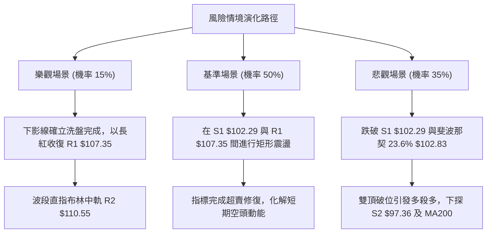

---

### 🛡️ 風險管理重要提醒

1.  **左側交易部位嚴格限額**：由於短期均線（MA5、MA10、MA20）全面扣高下彎，在下軌進行左側試探性進場時，單一策略倉位不得超過總資金之 15%，並須分批佈局。
2.  **停損紀律絕不可寬容**：止損點嚴格錨定於 S1 之下方的 **$102.00**。一旦有效擊破，代表波段跌幅恐朝向 S2（$97.36）延伸，不可抱持僥倖心態凹單。
3.  **注意除權息與權值股波動**：0050 高度受主要權值半導體權重影響，需同步關注龍頭成分股在關鍵均線處之表現，以作為防守判斷之領先指標。

---

## 📋 報告總結

```
╔══════════════════════════════════════════════════════════════════════╗
║                   0050 技術分析報告核心總結清單                      ║
╠══════════════════════════════════════════════════════════════════════╣
║ 報告日期：2026-11-02             當前收盤價格：$104.95 TWD           ║
║ 技術評分：42/100 (算術平均)      綜合評級：⚖️ 中性偏弱／區間震盪     ║
╟──────────────────────────────────────────────────────────────────────╢
║ 關鍵維度技術解讀：                                                   ║
║ ├─ 長期趨勢：🟢 多頭完好（MA200 = $93.81 向上傾斜，支撐堅實）       ║
║ ├─ 中期趨勢：🔴 雙頂修正（52W高點 $116.60 回落，連三黑回測 23.6%）   ║
║ ├─ 短期趨勢：🔴 均線蓋頭（價格低於 MA5~MA120，但下影線爆量試圖止跌） ║
║ ├─ 關鍵支撐：S1: $102.29 ｜ 斐波那契 23.6%: $102.83 ｜ S2: $97.36    ║
║ ├─ 關鍵阻力：R1: $107.35 ｜ R2: $110.55 (MA20) ｜ R3: $113.75        ║
║ └─ 核心共振：現價 $104.95 緊扣布林下軌 $103.09 與 S1 形成關鍵防線   ║
╟──────────────────────────────────────────────────────────────────────╢
║ 最佳交易策略配置方案：                                               ║
║ 1. 🥇 最佳機會（區間下軌防守低接）：                                ║
║    進場點 $103.50 ｜ 止損點 $102.00 ｜ 目標價 T1: $107.35 / T2: $110.55║
║    風險報酬比 1 : 2.57（以 T1 計）/ 1 : 4.70（以 T2 計）             ║
║ 2. 🥈 次選機會（右側突破跟進策略）：                                ║
║    進場點 $107.50 ｜ 止損點 $105.80 ｜ 目標價 T1: $110.55 / T2: $113.75║
║    風險報酬比 1 : 1.79（以 T1 計）/ 1 : 3.68（以 T2 計）             ║
║ 3. 🥉 保守選擇（空倉觀望）：                                        ║
║    等待日線級別出現實體長紅站穩 R1 ($107.35) 且 MACD 柱狀體翻正，    ║
║    再行進場佈局中線波段。                                            ║
╚══════════════════════════════════════════════════════════════════════╝
```

---

> ⚠️ **免責聲明**：本報告為依據定量技術指標與客觀歷史價格走勢產出之專業技術分析研究，所有數據、支撐阻力位與交易策略推算均基於提供之客觀 OHLCV 與技術公式。本報告**僅供學術研究與投資架構參考**，**不構成任何形式之個人化投資建議或買賣要約**。金融市場具有高度不確定性，投資人應依個人財務狀況、風險承受能力獨立判斷並自負盈虧。

---

*報告生成時間：2026-11-02 ｜ 數據來源：Yahoo Finance ｜ 分析框架：多時框架技術分析 (MTFA)*