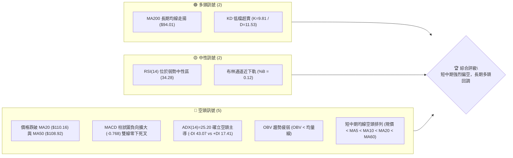
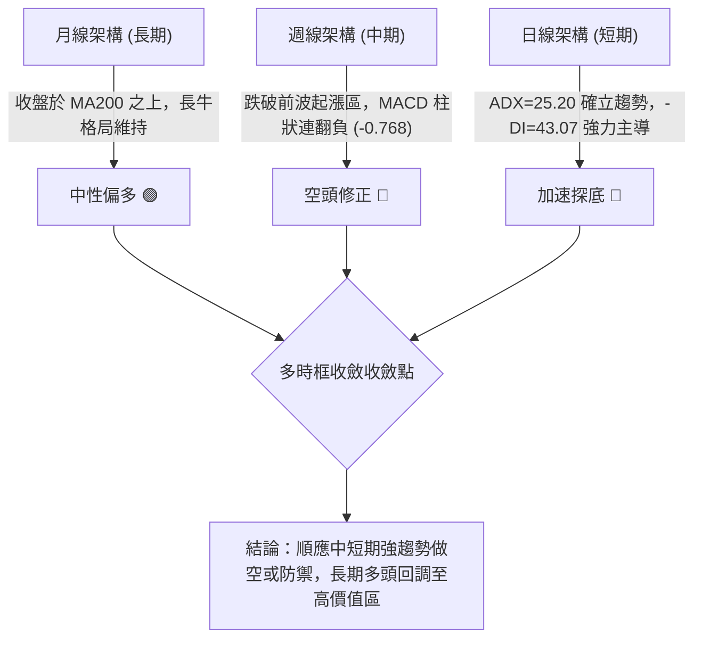
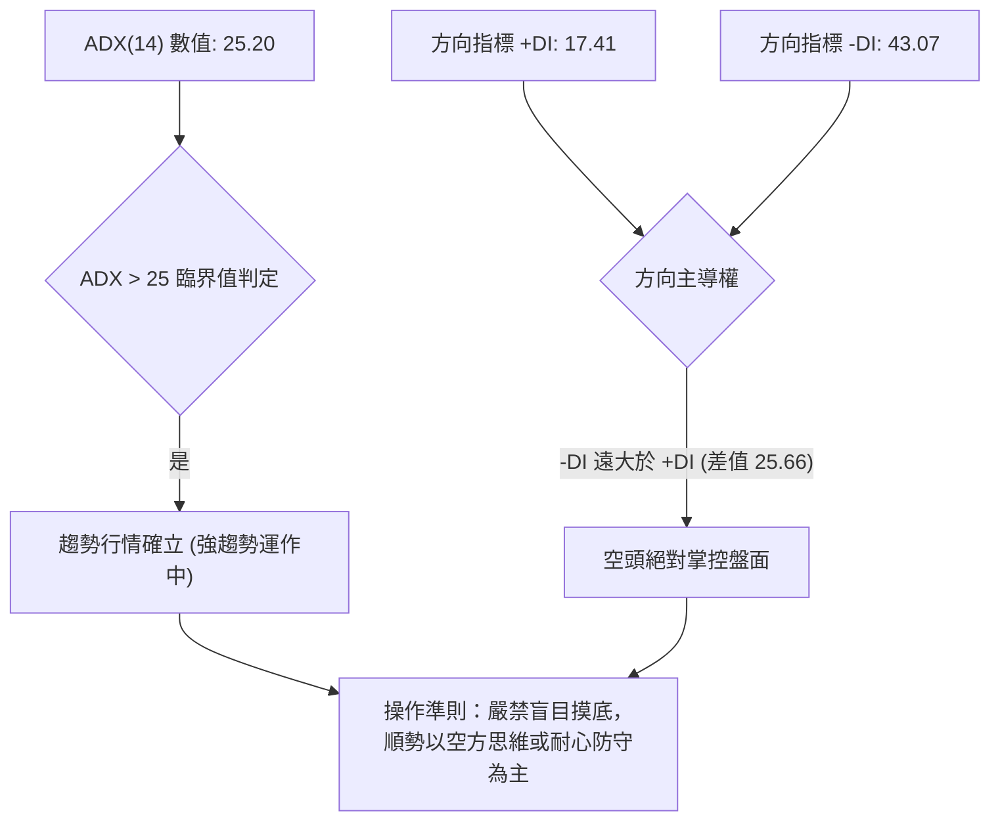
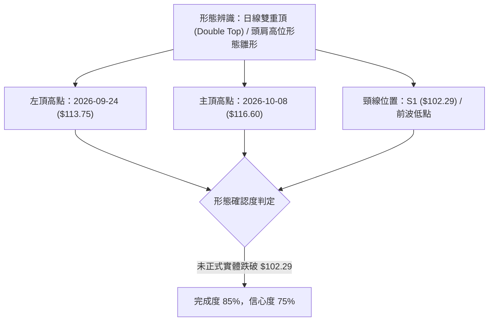
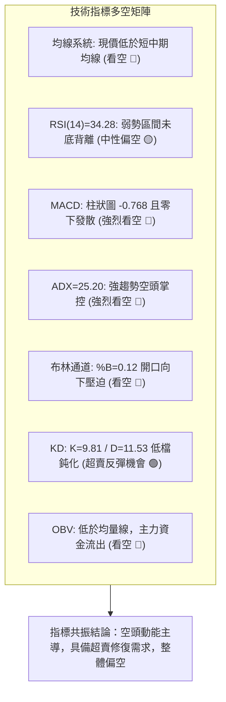
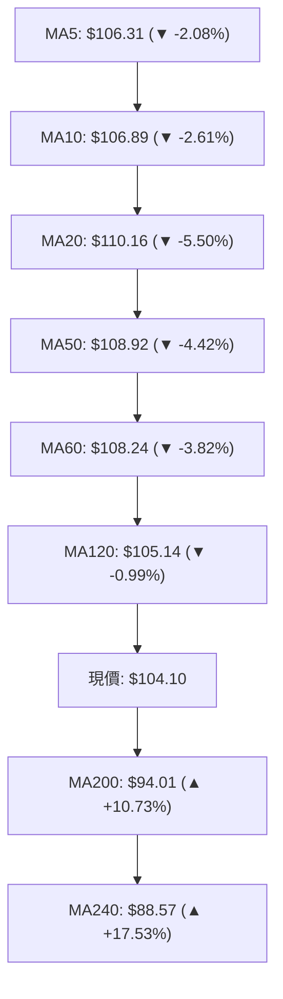
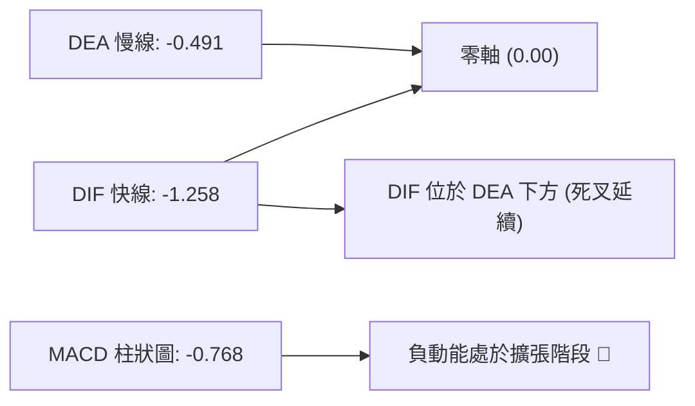
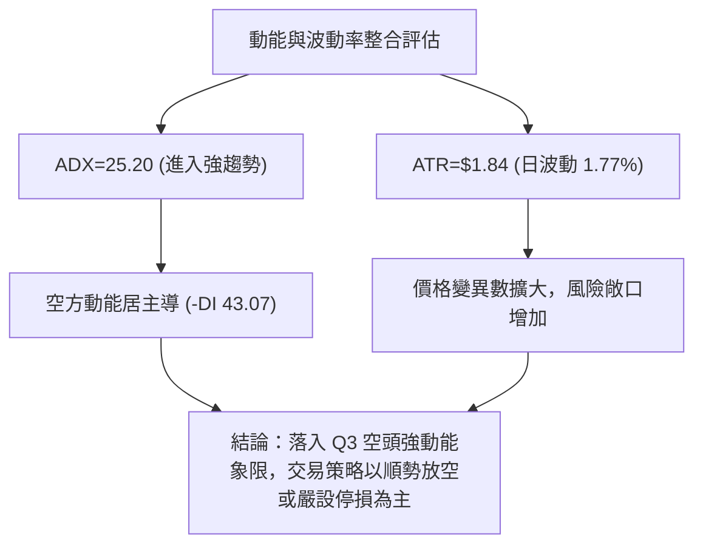
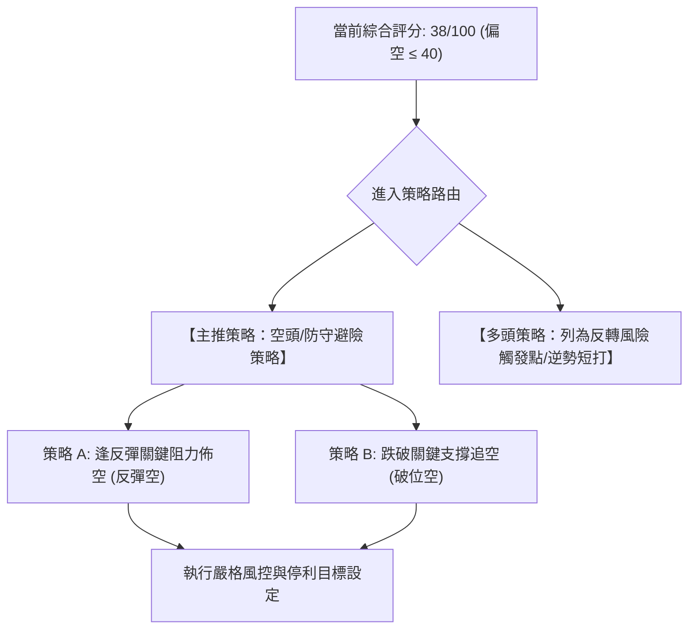
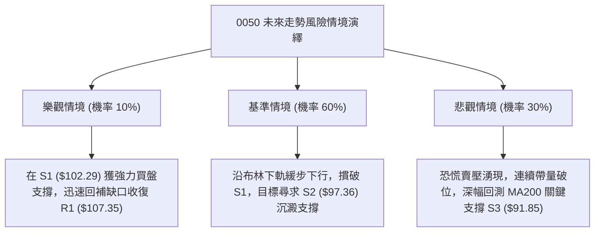

# 0050 技術分析報告

> **報告日期**：2026-11-03 ｜ **語言**：繁體中文 ｜ **數據來源**：Yahoo Finance ｜ **當前價格**：$104.10 TWD

---

## 目錄

| 章節 | 內容 |
|------|------|
| [1. 技術面概覽](#1-技術面概覽) | 訊號儀表板、核心指標、評分卡 |
| [2. 趨勢分析](#2-趨勢分析) | 多時框趨勢、長中短期走勢 |
| [3. 圖表形態分析](#3-圖表形態分析) | 形態識別、K線組合、目標價 |
| [4. 支撐與阻力](#4-支撐與阻力) | 關鍵價位、斐波那契回調 |
| [5. 技術指標深度解讀](#5-技術指標深度解讀) | MA/RSI/MACD/布林/成交量 |
| [6. 動能與波動率](#6-動能與波動率) | 動能評估、ATR、Beta |
| [7. 多時框架總結](#7-多時框架總結) | 時框架評分矩陣 |
| [8. 交易策略建議](#8-交易策略建議) | 多空策略、風險報酬比 |
| [9. 風險提示與監控](#9-風險提示與監控) | 監控指標、風險場景 |

---

## 1. 技術面概覽

### 🎯 技術訊號儀表板



### 📊 核心指標速覽表

| 指標類別 | 指標名稱 | 當前數值 | 訊號 | 解讀 |
|----------|----------|----------|------|------|
| **價格** | 當前價格 | $104.10 | 🔴 | 位於 52 週高點 ($116.60) 回檔修正格局中 |
| **均線** | MA20 | $110.16 | 🔴 | 現價低於 MA20 達 -5.50%，短線空頭下行壓力沉重 |
| **均線** | MA50 | $108.92 | 🔴 | 現價跌破中期生命線，中期結構轉弱 |
| **均線** | MA200 | $94.01 | 🟢 | 現價高於 MA200 達 +10.73%，長期牛市基底尚未破壞 |
| **動能** | RSI(14) | 34.28 | 🟡 | 位於弱勢區間（30–70），逼近超賣但尚未形成底背離 |
| **動能** | MACD | -1.258 | 🔴 | DIF 線 (-1.258) 低於 DEA 線 (-0.491)，MACD 柱為 -0.768 看空 |
| **動能** | KD(9,3,3) | K: 9.81 / D: 11.53 | 🟢 | 進入極度超賣區間（<20），醞釀短線技術性抽頭 |
| **趨勢** | ADX(14) | 25.20 | 🔴 | ADX > 25 進入強趨勢，-DI (43.07) 遠高於 +DI (17.41) 確立空頭掌控 |
| **通道** | 布林通道 | %B: 0.12 | 🟡 | 壓迫布林下軌 ($102.20)，通道呈開口擴張走勢 |
| **量能** | 最新量/20日量 | 1.25x | 🔴 | 帶量下跌（最新量 142.8M > 20日均量 114.5M），空頭持續釋放賣壓 |
| **波動** | ATR(14) | $1.84 | 🟡 | 佔現價 1.77%，每日波動溫和但呈現波段擴大走勢 |

### 🏆 技術評分卡

```
╔════════════════════════════════════════════════════════════════╗
║                技術評分卡 — 0050 (2026-11-03)                  ║
╠════════════════════════════════════════════════════════════════╣
║ 趨勢強度 (Trend)      ████████░░░░░░░░░░░░  40/100  🔴 空頭強勢║
║ 動能指標 (Momentum)   ██████░░░░░░░░░░░░░░  30/100  🔴 動能疲軟║
║ 支撐穩定度 (Support)  ██████████░░░░░░░░░░  50/100  🟡 面臨測試║
║ 成交量配合 (Volume)   ██████░░░░░░░░░░░░░░  30/100  🔴 出量下殺║
║ 形態完整度 (Pattern)  ████████░░░░░░░░░░░░  40/100  🔴 頭部成形║
║ 均線排列 (Moving Avg) ████████░░░░░░░░░░░░  40/100  🔴 短均破位║
╠════════════════════════════════════════════════════════════════╣
║ 綜合評分 (Overall)    ████████░░░░░░░░░░░░  38/100  🔴 明顯偏空║
╚════════════════════════════════════════════════════════════════╝
*註：綜合評分 = (40 + 30 + 50 + 30 + 40 + 40) / 6 = 38.33，四捨五入為 38/100。
```

---

## 2. 趨勢分析

### 🌐 多時框趨勢分析



### 📈 長期趨勢 — 12個月走勢圖（Unicode）

```
0050 月線走勢圖（過去12個月：2025-12 至 2026-11）
價格軸 ($)
$116.60 ┤                                      ● (52W高點 $116.60, 2026-10)
$112.05 ┤                                  ●
$107.15 ┤                          ●               
$104.10 ┤                                      ●←現價 $104.10
$102.85 ┤                              ●
 $89.95 ┤                  ●
 $80.66 ┤          ●
 $71.91 ┤              ● (回踩)
 $64.30 ┤  ●
        └──────────────────────────────────────────────────────────
         12月  01月  02月  03月  04月  05月  06月  07月  08月  09月  10月  11月
        (2025) (----------------------- 2026 -----------------------)
```

**走勢特徵分析表格**：

| 階段時間 | 起始/結束收盤價 | 區間漲跌幅 | 主要走勢特徵與結構 |
|----------|-----------------|------------|--------------------|
| 2025-12 ~ 2026-02 | $64.30 → $80.66 | +25.44% | 初段主升浪，成交量平穩放大，均線呈標準多頭排列 |
| 2026-02 ~ 2026-03 | $80.66 → $71.91 | -10.85% | 次級折返洗盤，回測季線獲得強勁支撐，迅速完成換手 |
| 2026-03 ~ 2026-06 | $71.91 → $107.15 | +49.01% | 主升爆發段，連續突破多道心理整數關卡，創波段歷史新高 |
| 2026-06 ~ 2026-08 | $107.15 → $106.25 | -0.84% | 高位箱型震盪，多空在 $102–$107 激烈爭奪，量能略見萎縮 |
| 2026-08 ~ 2026-10 | $106.25 → $114.95 | +8.19% | 創下 52 週新高 $116.60（週K），隨後高檔出量黑K吞噬 |
| 2026-10 ~ 2026-11 | $114.95 → $104.10 | -9.44% | 假突破後展開急跌，連失短期均線與布林中軌，直逼關鍵支撐 |

### 📊 中期趨勢（週線分析）

近期週線結構顯示，自 2026-10-08 創下 52 週高點 $116.60 以來，連續 4 週收黑（109.00 → 106.90 → 104.95 → 104.10）。特別是 2026-10-16 當週爆出 869,278,497 股的巨量長陰，確立主力出貨籌碼潰散。

```
週線級別阻力與支撐示意圖
$116.60 ──────────────────────────────────────── 52週高點 / 歷史阻力
          \
$110.55 ───\──────────────────────────────────── 頸線 / 波段阻力 R2 (反彈重壓)
            \      
$107.35 ─────\────────────────────────────────── 反彈第一阻力 R1 (前波低點互換)
              \
$104.10 ───────●──────────────────────────────── 當前價格 ($104.10)
                \
$102.29 ─────────\────────────────────────────── 關鍵波段支撐 S1 / 斐波 23.6% ($102.83)
                  \
$97.36  ──────────────────────────────────────── 深度修正支撐 S2 (強支撐)
```

### ⚡ 趨勢強度評估（ADX 解讀）



**ADX 強度對照解析**：
- **當前讀數**：ADX(14) = 25.20，越過 25 強弱分水嶺，表明市場已經結束 6 至 8 月的高檔橫盤盤整，正式展開單邊趨勢行情。
- **正負方向線判讀**：`-DI` 高達 43.07，而 `+DI` 萎縮至 17.41。`-DI` 佔據壓倒性優勢，顯示下行動能強勁，此時任何單日的技術性反彈均視為空頭趨勢中的修正波，而非反轉。

---

## 3. 圖表形態分析

### 🔍 形態識別系統



**圖表形態評估表**：

| 形態名稱 | 信心度 | 判斷依據（引用數據） | 完成度 | 目標價（附計算式） |
|----------|--------|----------------------|--------|--------------------|
| 高檔雙重頂 (M頭) | 75% | 兩次波段高點分別為 2026-09-24 之 $113.75 與 2026-10-08 之 $116.60；近期低點直指 S1 ($102.29) | 85% | 頸線 S1 ($102.29) − 形態高度 ($116.60 − $102.29 = $14.31) = **$87.98**（落於 50% 斐波位 $87.43 附近） |
| 布林通道下軌破位走勢 | 85% | 現價 $104.10 直逼 BB 下軌 $102.20，%B 為 0.12，通道開口向下擴張 | 90% | 沿通道下軌推進，指標型目標直指支撐位 S1 ($102.29)，跌破則延伸至 S2 ($97.36) |

### 🕯️ 重要K線形態分析

根據近 10 根日 K 與近 8 根週 K 之實際 OHLCV 數據進行精確解讀：

| 日期（週期） | 開盤 | 最高 | 最低 | 收盤 | 成交量 | K線形態名稱 | 技術解讀 | 訊號 |
|--------------|------|------|------|------|--------|------------|----------|------|
| 2026-10-08 (週K) | 115.75 | 116.60 | 114.90 | 114.95 | 307,612,641 | 高檔墓碑十字/倒錘 | 衝高 $116.60 後長上影線收黑，買盤竭盡 | 🔴 |
| 2026-10-16 (週K) | 114.20 | 114.95 | 108.55 | 109.00 | 869,278,497 | 巨量吞噬長黑 | 創近月天量長陰破位，主力出貨確立 | 🔴 |
| 2026-10-23 (日K) | 106.90 | 106.90 | 106.90 | 106.90 | 0 | 一字線/流動性停滯 | 單日成交量為 0，市場流動性暫歇，觀望極濃 | 🟡 |
| 2026-10-28 (日K) | 108.35 | 108.65 | 107.80 | 108.65 | 50,936,423 | 縮量小陽反彈 | 量能僅 50.9M，弱勢弱反彈無力挑戰短均 | 🟡 |
| 2026-10-29 (日K) | 108.65 | 108.65 | 106.60 | 107.25 | 77,495,132 | 轉折下影中黑 | 逢高遭空頭壓制，確立反彈結束 | 🔴 |
| 2026-10-30 (日K) | 104.80 | 105.30 | 103.85 | 104.95 | 193,796,708 | 帶量跳空破位黑K | 爆出 193.8M 大量摜破 $105 關卡，恐慌盤湧現 | 🔴 |
| 2026-11-02 (日K) | 103.40 | 104.45 | 103.05 | 104.10 | 142,806,486 | 低檔反彈小陽線 | 探底 $103.05 後獲得短支撐，但收盤仍受壓 | 🟡 |

### 📉 ASCII 走勢形態示意圖

```
0050 雙頂 (M頭) 結構與跳空缺口示意圖
價格 ($)
$116.60 ┬                       Top 2 ($116.60, 2026-10-08)
        │                       /\
$113.75 ┤        Top 1 ($113.75) /  \
        │        /\             /    \
$110.55 ┼───────/──\───────────/──────\─────── 阻力 R2 / 波段反彈重壓
        │      /    \  谷底   /        \
$107.35 ┼─────/──────\/──────/──────────\───── 阻力 R1 / 跳空缺口下緣
        │    /       $109.85            \   ← 2026-10-30 跳空向下
$104.10 ┼───/────────────────────────────●── 現價 $104.10
        │  /                               \
$102.29 ┴─/─────────────────────────────────\── 頸線關鍵支撐 S1
```

### 🎯 形態目標價計算

1. **頭部形態量度跌幅**：
   - 形態頂點：$116.60 (2026-10-08)
   - 形態頸線：S1 ($102.29)
   - 形態垂直接度高度 $H = \$116.60 - \$102.29 = \$14.31$
   - 跌破頸線後等幅測量目標價 $T = \text{頸線} - H = \$102.29 - \$14.31 =$ **$87.98**
2. **第一階段滿足點**：
   - 若短線在 S1 ($102.29) 出現假跌破或回抽，次級支撐將由下方波段低點聚類 S2 (**$97.36**) 接棒防守。

---

## 4. 支撐與阻力

### 🗺️ 關鍵價位分布圖（Unicode）

```
0050 價位結構分布圖
═══════════════════════════════════════════════════════════════════
$116.60 ║████████████████████████████████║ 52週歷史高點 / 斐波 0.0%
$113.75 ║████████████████████████        ║ 強阻力 R3 (波段高點聚類)
$110.55 ║████████████████████            ║ 阻力 R2 (MA20 匯合點 $110.16)
$107.35 ║████████████████                ║ 關鍵阻力 R1 (短期缺口上緣)
$104.10 ╠════════════════════════════════╣ ◄ 當前價格 $104.10
$102.83 ║▓▓▓▓▓▓▓▓▓▓▓▓▓▓▓▓▓▓▓▓▓▓▓▓        ║ 斐波那契 23.6% 回調位
$102.29 ║████████████████████████        ║ 關鍵支撐 S1 (布林下軌 $102.20 匯合)
$97.36  ║████████████████████████████    ║ 強支撐 S2 (密集換手成交區)
$94.32  ║▓▓▓▓▓▓▓▓▓▓▓▓▓▓▓▓▓▓▓▓▓▓▓▓▓▓▓▓▓▓║ 斐波那契 38.2% (MA200 匯合點 $94.01)
$91.85  ║████████████████████████████████║ 深度支撐 S3 (波段低點聚類)
═══════════════════════════════════════════════════════════════════
```

### 🚧 阻力位分析表

所有價位均嚴格引用波段高點聚類數據：

| 阻力級別 | 價位 | 形成原因 | 突破難度 | 重要性 |
|----------|------|----------|----------|--------|
| **R1** | $107.35 | 近一年波段高點聚類，與 2026-10-29 轉折低點及短均 MA5 ($106.31)、MA10 ($106.89) 形成緊密壓制區 | 🟡 中等偏高 | 極高（短線多空分水嶺） |
| **R2** | $110.55 | 近一年波段高點聚類，精準重疊日線布林中軌 MA20 ($110.16) 與 MA50 ($108.92) 死叉重壓帶 | 🔴 極高 | 極高（中期趨勢轉折點） |
| **R3** | $113.75 | 近一年波段高點聚類，為 2026-09-24 之波段收盤高點，套牢大量籌碼 | 🔴 極難 | 中等（多頭反轉終極目標） |

### 🛡️ 支撐位分析表

所有價位均嚴格引用波段低點聚類數據：

| 支撐級別 | 價位 | 形成原因 | 守住機率 | 重要性 |
|----------|------|----------|----------|--------|
| **S1** | $102.29 | 近一年波段低點聚類，下方共振斐波那契 23.6% ($102.83) 及日線布林通道下軌 ($102.20) | 🟡 45% | 極高（頭部頸線防守哨） |
| **S2** | $97.36 | 近一年波段低點聚類，2026 年 7 月橫盤整理下邊界，具備強大籌碼沉澱 | 🟢 65% | 高（中期修正回撤堡壘） |
| **S3** | $91.85 | 近一年波段低點聚類，緊鄰 MA200 牛熊分界線 ($94.01) 與 38.2% 斐波位 ($94.32) | 🟢 85% | 極高（長期牛市生命線） |

### 📐 斐波那契回調位分析

依據 52 週完整波動區間（低點 $58.27 → 高點 $116.60，垂直總振幅 $58.33）計算之標準回調位：

- **0.0% (52W High)**：$116.60
- **23.6% 回調位**：**$102.83**
- **38.2% 回調位**：**$94.32**
- **50.0% 回調位**：**$87.43**
- **61.8% 回調位**：**$80.55**
- **78.6% 回調位**：**$70.75**
- **100.0% (52W Low)**：$58.27

**斐波那契結構深度解讀**：
當前收盤價 **$104.10** 精準懸浮於 **23.6% ($102.83)** 與 **0.0% ($116.60)** 之間，且極度逼近 23.6% 第一回撤關卡。
- 技術意義上，23.6% 回撤位是強勢多頭行情中最淺層的修正幅度。若 $102.83 宣告失守，根據道氏趨勢理論，此波由 $58.27 展開的單邊主升行情將正式轉入深度次級折返，下一道具有極強數學匯合意義的支撐帶為 **38.2% ($94.32)**，該處恰好與 **MA200 ($94.01)** 形成嚴密的多頭防禦雙重共振點。

---

## 5. 技術指標深度解讀

### 🎛️ 指標訊號總覽



### 📈 移動平均線排列分析



**均線架構細節剖析**：
- **短中期均線全面倒戈**：現價 $104.10 已經連續跌破 MA5 ($106.31)、MA10 ($106.89)、MA120 ($105.14)、MA60 ($108.24)、MA50 ($108.92) 與 MA20 ($110.16)。呈現 `現價 < 短均 < 中均` 的極空空頭排列。
- **死亡交叉壓力**：短線 MA20 快速下彎，與 MA50 形成高檔死叉。長週期均線 MA200 ($94.01) 與 MA240 ($88.57) 雖維持向上傾斜，但距離現價乖離仍大，顯示當前正進行對長期多頭均線的大級別乖離率收斂修正。

### 📉 RSI(14) 分析

- **RSI(14) 數值進度條**：
  `RSI(14) = 34.28` ▓▓▓▓▓▓▓░░░░░░░░░░░░░ 34.28%（弱勢空頭區）
- **區間評估**：數值跌入 30–40 的弱勢尋底區，尚未進入 <30 極端超賣區，表示空方仍有持續下壓取量空間。
- **背離嚴格檢驗**：依據近 20 根 K 棒的首尾比對（2026-10-08 高點 $116.60 至 2026-11-02 低點 $103.05），價格持續下移創低，RSI(14) 亦由 65.7 順向滑落至 34.28，**明確無底背離現象**，指標真實反映跌勢，空方動能尚未衰竭。

### 📊 MACD(12/26/9) 訊號解讀



- **MACD 指標狀態**：DIF (-1.258) 與 DEA (-0.491) 皆已跌破零軸進入空頭領域。
- **柱狀體解讀**：柱狀圖（Histogram）數值為 **-0.768**，相較前波持續維持深長負值，未見收斂翻紅跡象，確認空方正在加速釋放動能。

### 📦 布林通道分析

```
0050 日線布林通道位置示意圖 ($)
$118.12 ┬────────────────────────────────────────── 布林上軌 (BB Upper)
        │
$110.16 ┼────────────────────────────────────────── 布林中軌 (MA20)
        │
$104.10 ┼───────────────────────●────────────────── 現價 $104.10 (%B = 0.12)
        │
$102.20 ┴────────────────────────────────────────── 布林下軌 (BB Lower)
```

- **通道幾何特徵**：布林帶寬度展開，中軌 MA20 陡峭向下延伸至 $110.16，形成強力動態天花板。
- **%B 讀數分析**：%B 為 **0.12**，價格貼著下軌運行，屬於標準的「空頭沿軌下跌」強勢推動形態，下軌 $102.20 面臨極大動態下壓測試。

### 💹 成交量分析（量價配合度）

- **量價關係**：最新日交易量達 142,806,486 股，相比 20 日均量 114,498,535 股放大 1.25 倍（量比 1.25x），呈現顯著的**帶量下挫**特徵。
- **OBV 能量潮解讀**：數據明確標示 `OBV < MA`，OBV 能量潮跌破其均線，代表大額籌碼持續淨流出，資金撤離訊號明確，成交量並未在現價展現逢低鎖碼的止跌特質。

---

## 6. 動能與波動率

### ⚡ 動能評估四象限

動能評估矩陣分析（基於趨勢動能指標與 ATR 波動率）：

| 象限 | 動能強度 | 波動率水準 | 當前狀態標定 | 技術特徵與應對策略 |
|------|----------|------------|--------------|--------------------|
| **Q1 (高動能·低波動)** | 強 (多頭) | 低 | — | 穩定多頭趨勢通道，適合持股推升 |
| **Q2 (弱動能·低波動)** | 弱 (空頭/無方向) | 低 | — | 橫盤窄幅震盪，等待突破方向確認 |
| **Q3 (強動能·高波動)** | 強 (空頭) | 漸擴大 (高) | **✓ 當前狀態** | **ADX=25.20 確立單邊下行，伴隨下殺放量，避開盲目搶反彈** |
| **Q4 (弱動能·高波動)** | 弱 (無秩序) | 高 | — | 震盪洗盤行情，容易出現假突破侵蝕本金 |



### 📊 ATR 波動率分析

- **當前讀數**：ATR(14) 為 **$1.84**（佔當前市價之 1.77%，採 Wilder 平滑算法）。
- **日內安全邊際**：當前每日價格波動的常態隨機噪音約為 ±$1.84。
- **止損距離建議**：
  - **超短線/當沖止損**：以 1.0 倍 ATR 計算，止損緩衝距離應為 **$1.84**。
  - **波段交易止損**：為防止被下影線與開盤跳空噪音洗出場，建議設定為 1.5 倍至 2.0 倍 ATR，即 **$2.76 至 $3.68** 的緩衝區間。

### 📐 Beta 與市場相關性

- **Beta 數值**：**N/A（數據未提供）**
- **相關性質化分析**：0050 為元大台灣卓越50證券投資信託基金，本質為緊密追蹤臺灣50指數（FTSE TWSE Taiwan 50 Index）之被動型 ETF。成分股由台股權值前 50 大企業構成（其中半導體龍頭佔比極高）。因此，在技術實務上其系統性風險與加權指數連動性接近 1.00，其價格下跌本質即反映整體大盤權值股的集體籌碼退潮。

---

## 7. 多時框架總結

### 📋 時框架評分表

| 時框架 | 趨勢方向 | 動能狀態 | 均線排列狀況 | 形態結構 | 綜合評分 | 操作建議 |
|--------|----------|----------|--------------|----------|----------|----------|
| **月線 (長期)** | 偏多 🟢 | 高檔修正中 | 多頭排列 (現價遠高於 MA200) | 巨型上升通道回測前高 | 70/100 | 長期分批逢低承接，回踩關鍵支撐佈局 |
| **週線 (中期)** | 偏空 🔴 | 負向擴大 (MACD週柱負) | MA20 中軌受阻跌破 | 高檔墓碑線引發雙頂回調 | 35/100 | 波段空頭持有，反彈逢高減碼 |
| **日線 (短期)** | 強烈看空 🔴 | 超賣鈍化 (KD<12, -DI高) | 全面空頭排列 (跌破MA5-MA120)| 跳空帶量摜破布林中軌 | 25/100 | 嚴禁盲目摸底，以反彈佈空或空手觀望為主 |

### 🔲 綜合訊號矩陣

| 維度 | 短期 (日線) | 中期 (週線) | 長期 (月線) | 訊號一致性解讀 |
|------|-------------|-------------|-------------|----------------|
| **主導趨勢** | 下跌 🔴 | 下跌 🔴 | 上漲 🟢 | 中短期共振下行，正在修正長期上漲過大乖離 |
| **動能方向** | 空方加速 🔴 | 空方主導 🔴 | 多方衰退 🟡 | 中短期賣壓沉重，長期指標自超買區理性回歸 |
| **量價結構** | 出量下殺 🔴 | 高檔放量長黑 🔴 | 長期量能溫和 🟢 | 籌碼自法人向散戶流動，結構明顯惡化 |
| **關鍵位交互** | 壓迫 S1 ($102.29) | 考驗 23.6% 斐波位 | 遠高於 MA200 ($94.01) | 短期關鍵防線一旦擊穿，中期回調深度將擴大 |

### ⚖️ 多時框收斂結論

依據多時框收斂準則：當前技術數據顯示 **ADX(14) = 25.20**，正式跨越 25 臨界線，判定為**趨勢行情**。
- **優先級確立**：在趨勢行情下，交易應順應中期（週線走空、MACD 連 4 週負柱）與短期強烈趨勢（日線 -DI=43.07 壓倒性掌控）。日線層級的所有訊號應用於找尋逢高做空或退出防守的轉折點，而非逆勢摸底。
- **收斂方向判定**：**唯一結論為【偏空（防守/順勢放空）】**。雖然長期月線多頭基底尚存，但在中短期下行單邊趨勢釋放完畢前，不具備左側進場條件。綜合技術評分 **38/100** 完全支持偏空方向性收斂。

---

## 8. 交易策略建議

### 🗺️ 策略決策流程圖



### 🧭 策略路由

**當前主策略方向 = 空頭策略 / 避險防守（依技術評分卡 38/100 評定）**

### 🎯 價格情境階梯（Price Scenarios）

所有價位均精確引用第 4 章關鍵價位區塊之數值：

| 觸發條件 | 下一目標 | 後續延伸 | 情境含義 |
|----------|----------|----------|----------|
| **強勢突破 R1 ($107.35)** | R2 ($110.55) | R3 ($113.75) | 短線空頭衰竭，技術性抽頭修復超賣，回測均線重壓 |
| **弱勢跌破 S1 ($102.29)** | S2 ($97.36) | S3 ($91.85) | 雙頂頭部頸線失守，開啟新一波量度跌幅，加速探底 |
| **受阻於現價區間 ($104.10)** | 測試 S1 ($102.29) | 區間沉澱 | 空方壓迫下軌，多頭買盤棄守，緩步陰跌破底 |

### 📊 情境機率分佈

| 情境劇本 | 發生機率 | 主要技術依據 |
|----------|----------|--------------|
| **下行探底 / 破位下跌** | **60%** | ADX=25.20 確立空頭趨勢；-DI 高達 43.07；MACD 柱狀 -0.768 發散；出量跌破短均線 |
| **超賣弱反彈 / 區間震盪** | **30%** | Stoch %K=9.81、%D=11.53 進入嚴重超賣；現價逼近 23.6% 斐波位 ($102.83) 具技術支撐 |
| **強勢反轉 / 向上回升** | **10%** | 上方短期均線與跳空缺口重壓密佈；OBV 持續疲軟缺乏大資金回補跡象 |

### 🟢 主策略詳情（空頭主推）

> 註：做空風險報酬比 = (進場價 − 目標價 T1) ÷ (止損價 − 進場價)。

| 策略要素 | 策略 A：反彈受阻佈空 (逢高空) | 策略 B：跌破頸線順勢追空 (破位空) |
|----------|--------------------------------|-----------------------------------|
| **進場條件** | 反彈至 R1 遇壓不破，出現日K上影線回落 | 日K實體收盤跌破關鍵頸線支撐 S1 |
| **進場價格** | **$107.35** (引用阻力位 R1) | **$102.29** (引用支撐位 S1) |
| **目標價 T1** | **$102.29** (引用支撐位 S1) | **$97.36** (引用支撐位 S2) |
| **目標價 T2** | **$97.36** (引用支撐位 S2) | **$91.85** (引用支撐位 S3) |
| **止損價格** | **$109.19** ($107.35 + 1.0×ATR $1.84) | **$104.13** ($102.29 + 1.0×ATR $1.84) |
| **風險報酬比** | **1 : 2.75**（以 T1 計）<br>計算式: (107.35−102.29)÷(109.19−107.35) = 5.06÷1.84 = 2.75 | **1 : 2.68**（以 T1 計）<br>計算式: (102.29−97.36)÷(104.13−102.29) = 4.93÷1.84 = 2.68 |
| **成功機率** | 65% | 60% |
| **建議倉位** | 15% - 20% (避險空單) | 10% - 15% (突破追空) |

### 🔴 反向風險觸發點（對沖提示）

若出現以下訊號，主推之空頭策略立即失效，應全數停損平倉並轉入防守觀望：
1. **實體K線收復 R1 ($107.35)**：代表 2026-10-30 之跳空破位黑K被完全吞噬，短線超賣引發暴力軋空。
2. **MACD 日線柱狀圖由負轉正，且零軸下形成黃金交叉**：宣告短期下跌動能徹底熄火。

### ⭐ 整體訊號強度評星

```
做多訊號強度：★☆☆☆☆  (1/5星 - 僅存超賣指標支撐，風險極高)
做空訊號強度：★★★★☆  (4/5星 - 均線、動能、趨勢指標強烈共振)
整體可信度：  ★★★★☆  (4/5星 - 價量配合度高，形態趨勢明朗)
```

---

## 9. 風險提示與監控

### ✅ 關鍵監控指標 Checklist

```
╔══════════════════════════════════════════════════════════════════╗
║                   關鍵技術監控指標 CHECKLIST                     ║
╠══════════════════════════════════════════════════════════════════╣
║ [ ] 監控點 1：支撐位 S1 ($102.29) 是否於收盤實體跌破 (確認頭部)║
║ [ ] 監控點 2：ADX(14) 是否持續上升突破 30 (代表單邊跌勢加速)     ║
║ [ ] 監控點 3：Stoch KD 是否在 20 以下低檔形成有效金叉 (短多反撲)║
║ [ ] 監控點 4：單日成交量是否爆出 2 億股以上不跌 (潛在承接買盤)  ║
║ [ ] 監控點 5：阻力位 R1 ($107.35) 處之短均 MA5/MA10 反壓強度   ║
╚══════════════════════════════════════════════════════════════════╝
```

### ⚠️ 風險場景分析



### 🛡️ 風險管理重要提醒

1. **嚴禁逆勢摸底**：在 ADX > 25 且 -DI 高達 43.07 的強烈空頭單邊環境下，指標超賣（如 KD < 12）常會出現「低檔鈍化」現象，盲目抄底極易遭遇斷崖式滑落。
2. **防範流動性與開盤跳空風險**：如歷史數據 2026-10-23 曾出現單日成交量為 0 之異常流動性冰凍情況，遇跳空開低時應嚴格執行停損，切勿存有僥倖心理。
3. **資金部位管控**：當前技術評分僅 38/100，整體投資組合多頭曝險部位應降至 30% 以下，多單嚴設止損於 $102.29，耐心等待中期底部結構完成。

---

## 📋 報告總結

```
╔════════════════════════════════════════════════════════════════════════╗
║                      0050 技術分析報告總結                             ║
╠════════════════════════════════════════════════════════════════════════╣
║ 報告日期：2026-11-03                                                   ║
║ 當前價格：$104.10 TWD                                                  ║
║ 分析評級：🔴 強烈偏空 / 逢高避險 (技術綜合評分: 38/100)               ║
║                                                                        ║
║ 關鍵結論：                                                             ║
║ ├─ 長期趨勢：🟢 偏多但面臨修正 (現價仍高於 MA200 $94.01 達 +10.73%)   ║
║ ├─ 中期趨勢：🔴 空頭主導 (高檔雙頂形成，週線連續出量收長黑)           ║
║ ├─ 短期趨勢：🔴 加速尋底 (ADX=25.20 確立空頭，-DI=43.07，均線全線破位)║
║ ├─ 關鍵支撐：S1: $102.29  /  S2: $97.36  /  S3: $91.85               ║
║ ├─ 關鍵阻力：R1: $107.35  /  R2: $110.55  /  R3: $113.75              ║
║ └─ 形態量度目標：雙頂頸線失守之量度目標為 $87.98 (逼近 50% 斐波位)     ║
║                                                                        ║
║ 最優策略組合：                                                         ║
║ 1. 🥇 最佳機會：逢反彈至 R1 ($107.35) 佈局空單，停損 $109.19，目標 $102.29║
║ 2. 🥈 次選機會：實體黑K跌破 S1 ($102.29) 順勢追空，目標 S2 ($97.36)   ║
║ 3. 🥉 保守選擇：多單全面離場觀望，耐心等待價格回測 S2/S3 築底訊號     ║
╚════════════════════════════════════════════════════════════════════════╝
```

---

> ⚠️ **免責聲明**：本報告為 AI 自動生成之技術分析，所有數據及估算均嚴格基於所提供的歷史價格與指標資訊。本報告**僅供研究與學術參考**，**不構成任何投資建議與買賣依據**。金融市場瞬息萬變，投資有風險，操作需審慎評估並自負盈虧。

---

*報告生成時間：2026-11-03 ｜ 數據來源：Yahoo Finance ｜ 分析框架：多時框技術分析模型*