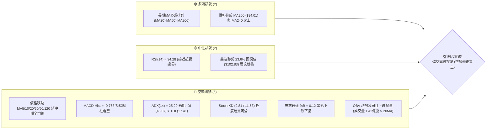
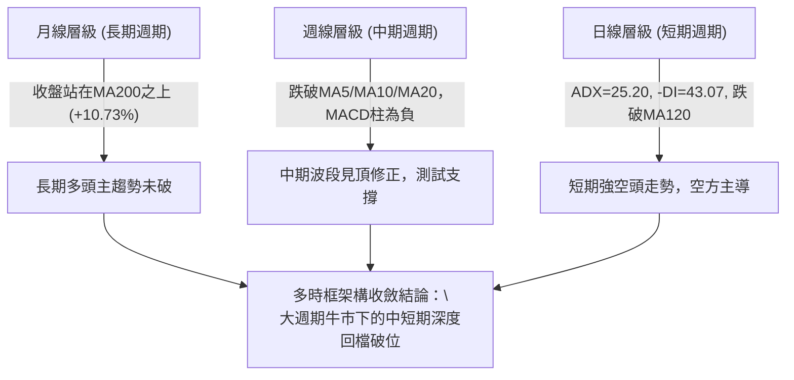
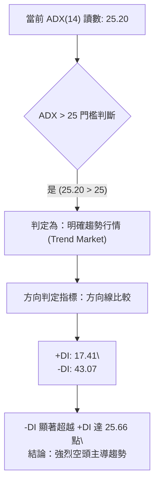
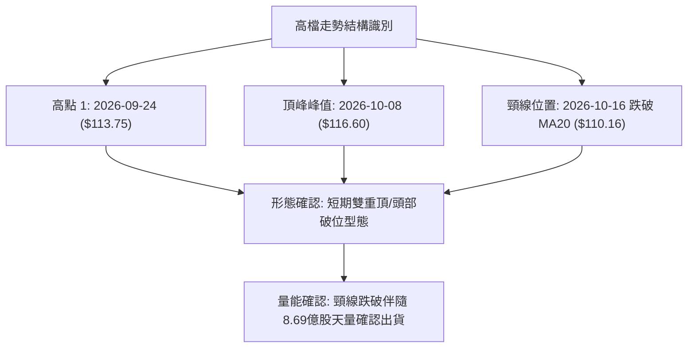
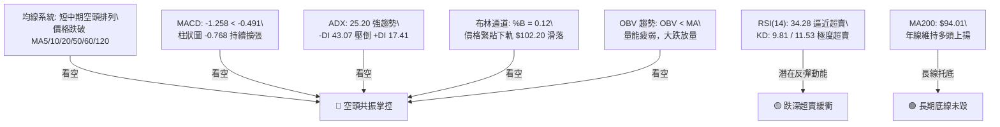
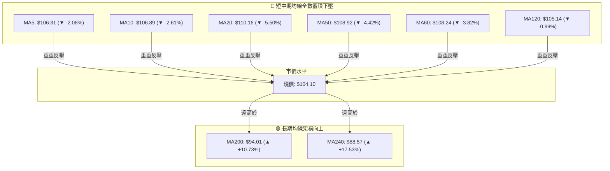
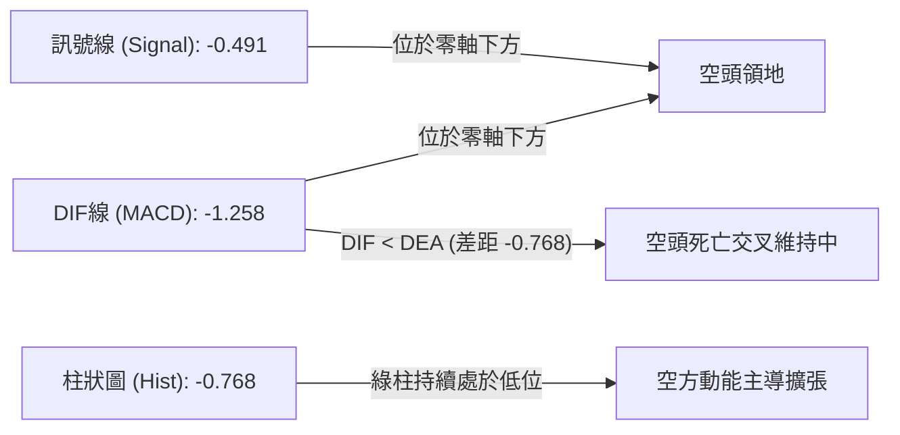
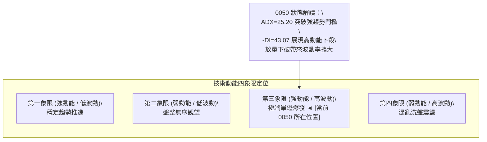
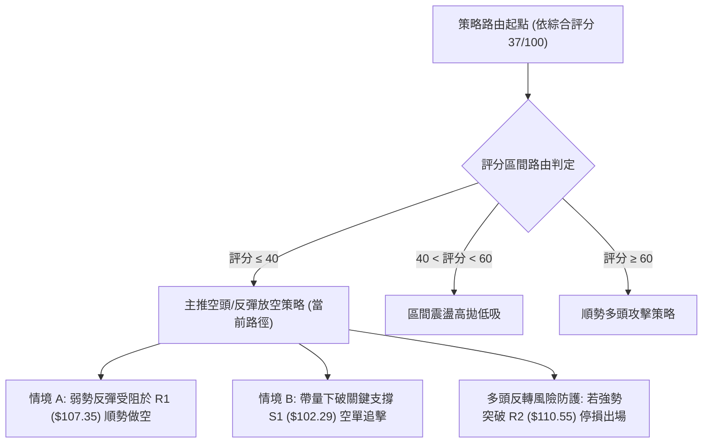
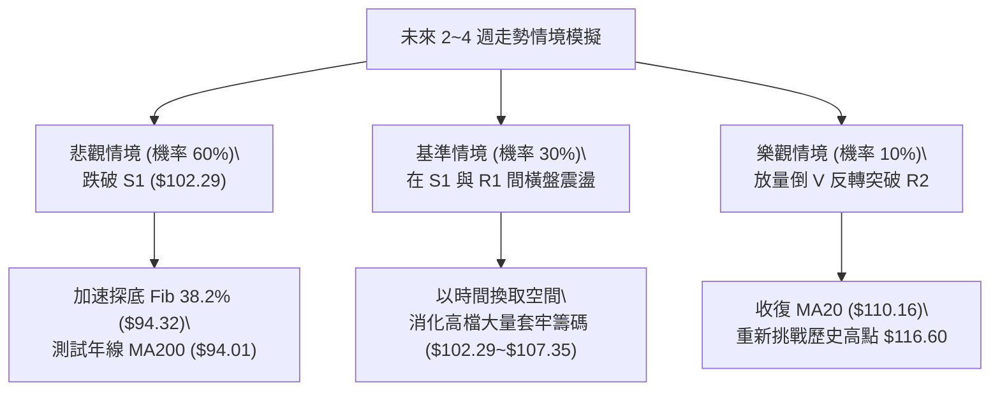

# 0050 技術分析報告

> **報告日期**：2026-11-04 ｜ **語言**：繁體中文 ｜ **數據來源**：Yahoo Finance ｜ **當前價格**：$104.10 TWD

---

## 目錄

| 章節 | 內容 |
|------|------|
| [1. 技術面概覽](#1-技術面概覽) | 訊號儀表板、核心指標、評分卡 |
| [2. 趨勢分析](#2-趨勢分析) | 多時框趨勢、長中短期走勢、ADX解讀 |
| [3. 圖表形態分析](#3-圖表形態分析) | 形態識別、K線組合、目標價計算 |
| [4. 支撐與阻力](#4-支撐與阻力) | 關鍵價位分布、阻力支撐表、斐波那契回調 |
| [5. 技術指標深度解讀](#5-技術指標深度解讀) | MA/RSI/MACD/布林通道/成交量與OBV |
| [6. 動能與波動率](#6-動能與波動率) | 動能四象限、ATR分析、Beta與相關性 |
| [7. 多時框架總結](#7-多時框架總結) | 時框架矩陣、多時框收斂結論 |
| [8. 交易策略建議](#8-交易策略建議) | 策略路由、主策略、情境階梯與風報比 |
| [9. 風險提示與監控](#9-風險提示與監控) | 監控Checklist、三情境路徑、風控規則 |
| [10. 報告總結](#-報告總結) | 儀表總結、最優策略組合 |

---

## 1. 技術面概覽

### 🎯 技術訊號儀表板



### 📊 核心指標速覽表

| 指標類別 | 指標名稱 | 當前數值 | 訊號 | 解讀 |
|:---|:---|:---|:---:|:---|
| **價格** | 當前收盤價 | $104.10 | 🔴 | 跌破所有短中期均線，短線受制於下降慣性 |
| **均線** | MA20 (月線) | $110.16 | 🔴 | 現價低於 MA20 達 -5.50%，短期趨勢向下乖離 |
| **均線** | MA50 (季線) | $108.92 | 🔴 | 現價跌破中線生命線，中期動能轉弱 |
| **均線** | MA200 (年線) | $94.01 | 🟢 | 現價高於 MA200 達 +10.73%，長期多頭底蘊仍在 |
| **動能** | RSI(14) | 34.28 | 🟡 | 中性偏弱（接近30超賣區），尚未出現多頭反轉勾角 |
| **動能** | MACD | -1.258 / Hist -0.768 | 🔴 | DIF在訊號線下方且柱狀圖維持負值擴張，空頭掌控 |
| **動能** | KD(9,3,3) | %K: 9.81 / %D: 11.53 | 🔴 | 進入低檔鈍化區，顯示極度弱勢尚未黃金交叉 |
| **趨勢** | ADX(14) | 25.20 (-DI: 43.07) | 🔴 | 越過強趨勢門檻(>25)，-DI大幅壓制+DI，空頭強趨勢 |
| **波動** | ATR(14) | $1.84 (1.77%) | 🟡 | 波動度處於中等水平，單日安全停損需拉開至少1.5 ATR |
| **通道** | 布林帶 (%B) | 0.12 (下軌 $102.20) | 🔴 | 緊貼通道下軌滑落，屬於空頭單邊推升/壓制階段 |
| **量能** | 20日量比 | 1.25x (1.428億股) | 🔴 | 下跌帶量（高於20日均量1.14億），OBV低於均線顯示資金撤出 |

### 🏆 技術評分卡

```
╔══════════════════════════════════════════════════════════════╗
║                 技術評分卡 — 0050 (2026-11-04)               ║
╠══════════════════════════════════════════════════════════════╣
║ 趨勢強度 (ADX=25.2, -DI主導)   ██████░░░░░░░░░░░░░░  30/100 🔴 ║
║ 動能指標 (RSI=34.3, MACD綠柱)  ██████░░░░░░░░░░░░░░  30/100 🔴 ║
║ 支撐穩定度 (逼近S1與Fib 23.6%) ██████████░░░░░░░░░░  50/100 🟡 ║
║ 成交量配合 (下跌放量, OBV疲弱) ██████░░░░░░░░░░░░░░  30/100 🔴 ║
║ 形態完整度 (日K破位, 旗形回調) ████████░░░░░░░░░░░░  40/100 🔴 ║
║ 均線排列 (短空長多, MA20死叉)  ████████░░░░░░░░░░░░  40/100 🔴 ║
╠══════════════════════════════════════════════════════════════╣
║ 綜合評分 (六項算術平均)        ████████░░░░░░░░░░░░  37/100 🔴 ║
║ 綜合評級：偏空 (SELL ON REBOUND / 順勢做空或防守減碼)          ║
╚══════════════════════════════════════════════════════════════╝
```
*計算說明：(30 + 30 + 50 + 30 + 40 + 40) ÷ 6 = 36.67，依規則四捨五入為 37 分。*

---

## 2. 趨勢分析

### 🌐 多時框趨勢分析



### 📈 長期趨勢 — 12個月走勢圖（Unicode）

依據月度收盤價數據（2025-12 至 2026-11），0050 經歷了大幅主升段後於 2026-09 抵達高峰，隨後出現月線連二黑回檔：

```
0050 月線走勢圖（過去12個月收盤價）
價格軸 ($ TWD)
$115 ┤                                                 ● (2026-09: 112.05)
$110 ┤                                           ●           ● (2026-10: 104.95)
$105 ┤                                     ●           ●     ▲ 當前: 104.10
$100 ┤                                 ●
$95  ┤
$90  ┤                             ● (2026-04: 89.95)
$85  ┤
$80  ┤                     ● (2026-02: 80.66)
$75  ┤                 ● (2026-01: 72.16)
$70  ┤             ●
$65  ┤     ● (2025-12: 64.30)
$60  ┤ ●
     └─────┬─────┬─────┬─────┬─────┬─────┬─────┬─────┬─────┬─────┬─────┬─────
         12月   01月  02月  03月  04月  05月  06月  07月  08月  09月  10月  11月
        (2025) ---------------------------- (2026) ----------------------------
```

#### 走勢特徵分析表格

| 階段區間 | 起訖月份 | 價格變化 ($) | 漲跌幅 (%) | 量價走勢特徵 |
|:---|:---|:---:|:---:|:---|
| **主升段初期** | 2025-12 → 2026-02 | $64.30 → $80.66 | +25.44% | 連續大陽線強勢突破，長天期均線發散向上 |
| **中途洗盤洗震** | 2026-02 → 2026-03 | $80.66 → $71.91 | -10.85% | 快速回測確認支撐，月線收長下影線 |
| **主升段噴出** | 2026-03 → 2026-06 | $71.91 → $107.15 | +49.01% | 權值股領軍爆量大漲，突破百元歷史大關 |
| **高檔高頻震盪** | 2026-06 → 2026-09 | $107.15 → $112.05 | +4.57% | 於 $102～$112 構築高檔震盪箱型，動能開始減緩 |
| **次頂回落修正** | 2026-09 → 2026-11 | $112.05 → $104.10 | -7.10% | 創高 $116.60 後連續破線，成交量放大形成空頭反轉格局 |

### 📊 中期趨勢（週線分析）

從近 8 週週 K 線觀察，0050 在 2026-10-08 當週創下 52 週新高 $116.60 後，接續出現爆量長陰線。特別是 2026-10-16 當週成交量放大至 869,278,497 股（約為前週的 2.8 倍），收在 $109.00，形成了標準的高檔放量下破。隨後連續三週下跌（$106.90 → $104.95 → $104.10），週線級別的 MACD 柱狀圖由正轉負（從 10-08 週的 +0.351 驟降至當前的 -0.768），週 RSI 亦由 65.7 崩落至 34.3，確認中期上升趨勢已經遭到破壞，轉入中期 ABC 浪回調格局。

```
週線走勢結構示意圖：
$116.60 ────┐ (2026-10-08 創高見頂)
            │
            ▼ 爆量長黑 ($109.00，成交量 8.69億股)
            ├─────────────── 阻力區 R2 ($110.55) / R1 ($107.35)
            │
            ▼ 連續收陰破線
當前價位 ───► $104.10 (考驗 S1 $102.29 與 Fib 23.6% $102.83 支撐防線)
```

### ⚡ 趨勢強度評估（ADX 解讀）



#### ADX 強度指標對照表

| 指標變數 | 當前數值 | 參考區間標準 | 技術狀態評定 | 交易涵義 |
|:---|:---:|:---:|:---:|:---|
| **ADX(14)** | **25.20** | <20: 盤整震盪<br>20-25: 趨勢醞釀<br>>25: 強勢趨勢 | 🟢 剛進入強趨勢門檻 | 當前市場脫離無趨勢盤整，不可採用震盪高拋低吸策略 |
| **+DI(14)** | **17.41** | 數值越高多方越強 | 🔴 多頭極度微弱 | 多頭買盤力道潰散，無力發動有效攻擊 |
| **-DI(14)** | **43.07** | 數值越高空方越強 | 🔴 空方力量極盛 | 空方全面掌握定價主導權，反彈極易遭遇空頭狙擊 |
| **趨勢綜合** | **空頭趨勢確立** | -DI 遠大於 +DI 且 ADX 抬頭 | 🔴 空頭強趨勢 | 嚴禁逆勢盲目摸底，操作應以反彈做空或保護性避險為主 |

---

## 3. 圖表形態分析

### 🔍 形態識別系統

根據近一年與近期的走勢結構，0050 於 52 週高點 $116.60 形成次級雙重頂／不規則頂部後快速回調，跌破中樞頸線。



#### 圖表形態判斷與信心度表格（依規則 15）

| 形態名稱 | 信心度 | 判斷依據（嚴格引用數據） | 完成度 | 目標價計算式與點位 |
|:---|:---:|:---|:---:|:---|
| **短期雙重頂 (M頭破位)** | **75%** | 兩處波段高點（2026-09-24 高 $113.75、2026-10-08 創 52W 高 $116.60），隨後跌破頸線 $110.55 (R2)，並以長黑跌穿。 | **90%** | 由頸線高度推算：頸線 R2 ($110.55) − 頂部差額 ($116.60 − $110.55 = $6.05) = **$104.50**（已滿足第一波目標），次級波目標為測試 S1 **$102.29**。 |
| **高檔下降旗形 / 下跌通道** | **65%** | 2026-10-08 連跌四週，週 K 連續跌破 MA5/10/20，日 K 沿布林下軌呈鋸齒下跌，反彈均受制於短天期均線。 | **70%** | 由旗形旗桿推算：高點 $116.60 下落至 $109.00（旗桿長度 $7.60），若自反彈次高 $109.20 展開對稱跌幅，目標 = $109.20 − $7.60 = **$101.60**（接近 S1 $102.29）。 |
| **頭肩頂形態** | 30% | 數據中左肩與頭部尚可辨識，但右肩反彈過於短促，缺乏清晰幾何架構。 | 20% | *訊號不足，依規則 15 不予強制推算複雜目標價。* |

### 🕯️ 重要 K 線形態分析

嚴格依據數據中提供的實際 OHLCV 進行解讀（依規則 19）：

#### 近 10 根日 K 線形態解讀

| 日期 | 開盤 | 最高 | 最低 | 收盤 | 成交量 | K 線形態 | 技術解讀 | 訊號 |
|:---:|:---:|:---:|:---:|:---:|:---:|:---|:---|:---:|
| **2026-10-19** | 107.45 | 108.30 | 107.10 | 108.15 | 143,680,197 | 實體中陽線 | 自低檔回升，但量能未達主力回補標準 | 🟡 |
| **2026-10-20** | 107.65 | 108.30 | 107.05 | 107.25 | 105,412,059 | 衝高回落小黑K | 上攻遇阻，受制於 MA10 下壓 | 🔴 |
| **2026-10-21** | 108.80 | 109.20 | 107.60 | 108.15 | 76,295,858 | 帶長上影小黑K | 量縮上攻乏力，高檔賣壓沉重 | 🔴 |
| **2026-10-22** | 108.95 | 109.15 | 106.75 | 106.90 | 116,952,817 | 長黑陰線吞噬 | 回跌吞噬前日低點，空方重新控盤 | 🔴 |
| **2026-10-23** | 106.90 | 106.90 | 106.90 | 106.90 | 0 | 一字線 (無量) | 暫停交易或流動性受限，維持弱勢基調 | 🟡 |
| **2026-10-27** | 107.10 | 107.55 | 105.80 | 106.60 | 140,567,068 | 破底長下影陰K | 放量跌破 $106，空頭向下測壓 | 🔴 |
| **2026-10-28** | 108.35 | 108.65 | 107.80 | 108.65 | 50,936,423 | 縮量中陽線 | 極度縮量（僅5千萬股）反彈，屬於虛漲誘多 | 🟡 |
| **2026-10-29** | 108.65 | 108.65 | 106.60 | 107.25 | 77,495,132 | 帶下影中黑K | 高開低走，確認 $108.65 成為短線重壓力 | 🔴 |
| **2026-10-30** | 104.80 | 105.30 | 103.85 | 104.95 | 193,796,708 | 破位跳空巨量陰K | 放量 1.93億股跳空大跌，摜破 MA120 ($105.14) | 🔴 |
| **2026-11-02** | 103.40 | 104.45 | 103.05 | 104.10 | 142,806,486 | 低檔反抽假陽線 | 開低反彈但收盤未站上昨高，量大滯漲，空方續航 | 🔴 |

#### 近 8 根週 K 線形態解讀

| 日期 | 開盤 | 最高 | 最低 | 收盤 | 成交量 | K 線形態 | 技術解讀 | 訊號 |
|:---:|:---:|:---:|:---:|:---:|:---:|:---|:---|:---:|
| **2026-09-18** | 106.30 | 109.95 | 105.85 | 109.85 | 334,815,655 | 實體大陽週K | 突破整理區間，發動攻擊 | 🟢 |
| **2026-09-24** | 109.90 | 113.75 | 109.85 | 112.40 | 316,558,811 | 震盪續揚週K | 站上 $112，多頭氣勢旺盛 | 🟢 |
| **2026-10-02** | 111.80 | 113.05 | 111.05 | 112.80 | 276,044,269 | 高檔縮量十字星 | 高檔猶豫，多頭上攻動能受阻 | 🟡 |
| **2026-10-08** | 115.75 | 116.60 | 114.90 | 114.95 | 307,612,641 | 創高衝高倒錘黑K | 創 52 週新高 $116.60 後長上影，見頂信號 | 🔴 |
| **2026-10-16** | 114.20 | 114.95 | 108.55 | 109.00 | 869,278,497 | 巨量吞噬長黑破位K | 爆 8.69億天量長黑，確立中期頭部成形 | 🔴 |
| **2026-10-23** | 107.45 | 109.20 | 106.75 | 106.90 | 442,340,931 | 弱勢黑K續跌 | 跌破多頭防守點，反彈無力 | 🔴 |
| **2026-10-30** | 107.10 | 108.65 | 103.85 | 104.95 | 462,795,331 | 下破長黑K | 摜破百元關卡上方平台，賣壓湧現 | 🔴 |
| **2026-11-02** | 103.40 | 104.45 | 103.05 | 104.10 | 142,806,486 | 低檔猶豫小實體K | 探低至 $103.05，尚未形成止跌錘頭 | 🔴 |

### 📉 ASCII 走勢形態示意圖

```
                    [頂部 A: $116.60] (2026-10-08)
                         /\
      [左肩/峰1: $113.75]/  \
             /\         /    \   爆量破位陰線 ($109.00)
            /  \       /      \  (成交量 8.69億股)
           /    \_____/        \______
          /                    [頸線位置 R2: $110.55]
         /                            \
        /                              \   下跌中繼整理 ($106.90～$108.65)
       /                                ╲┌───┐
      /                                  ▼   │
     /                                       └──► 跳空破位大黑K ($104.95)
    /                                              \
   /                                                ▼ 現價: $104.10
  /                                                 ├─── 測試支撐 S1 ($102.29)
                                                    └─── Fib 23.6% ($102.83)
```

### 🎯 形態目標價計算

1. **雙重頂等幅測距目標**：
   - 頂部最高峰：$116.60
   - 頸線轉折位：$110.55（R2）
   - 形態垂直高度：$116.60 − $110.55 = $6.05
   - 第一目標價 = 頸線 $110.55 − 形態高度 $6.05 = **$104.50**（當前價格 $104.10 已精準跌破並抵達此目標區間）。
2. **延伸測幅目標（波段 S1 測試）**：
   - 跌破第一目標後，根據近一年波段低點聚類，下一重度支撐直指 **S1: $102.29**。
   - 若空頭動能受 ADX=25.20 持續推動，則進一步尋求黃金分割 38.2% 回調位與 **S2: $97.36** 支撐。

---

## 4. 支撐與阻力

### 🗺️ 關鍵價位分布圖（Unicode）

```
0050 價位結構分布圖
═══════════════════════════════════════════════════════════════
$116.60 ║                                      ║ 52W 歷史最高點
$113.75 ║██████████████████████████████████████║ 強阻力 R3 (波段高點密集區)
$110.55 ║██████████████████████████            ║ 關鍵阻力 R2 (BB中軌/MA20密集區)
$107.35 ║████████████████                      ║ 近端阻力 R1 (反彈頸線壓制)
────────╫──────────────────────────────────────╫─────────────────────────────
$104.10 ╠══════════════════════════════════════╣ ◄ 當前市價收盤
────────╫──────────────────────────────────────╫─────────────────────────────
$102.83 ║▓▓▓▓▓▓▓▓▓▓▓▓▓▓▓▓▓▓▓▓▓▓                ║ 斐波那契 23.6% 回調關鍵位
$102.29 ║████████████████████████              ║ 核心支撐 S1 (近一年波段低點聚類)
$ 97.36 ║██████████████████████████████        ║ 強支撐 S2 (中期多頭防守底線)
$ 94.32 ║▓▓▓▓▓▓▓▓▓▓▓▓▓▓▓▓▓▓▓▓▓▓▓▓▓▓▓▓▓▓        ║ 斐波那契 38.2% / MA200 ($94.01)
$ 91.85 ║██████████████████████████████████████║ 深層支撐 S3 (年線下方多頭防線)
═══════════════════════════════════════════════════════════════
```

### 🚧 阻力位分析表

價位嚴格引用自關鍵價位數據聚類：

| 阻力級別 | 價位 ($) | 距現價幅差 | 形成技術依據 | 突破難度評級 | 戰略重要性 |
|:---|:---:|:---:|:---|:---:|:---|
| **R1** | **$107.35** | +3.12% | 近一年波段高點聚類、10-27反彈高點 $107.55 處賣壓 | 🟡 中等偏高 | **短線多空分水嶺**：若無法突破，弱勢反彈格局不變。 |
| **R2** | **$110.55** | +6.20% | MA20 ($110.16) 下降軌道壓制、布林中軌、M頭頸線破位點 | 🔴 極高 | **波段反轉防線**：聚集鉅額套牢籌碼，重返其上才能扭轉空勢。 |
| **R3** | **$113.75** | +9.27% | 2026-09-24 密集換手高點聚類、接近歷史次高峰 | 🔴 堅不可摧 | **中期多頭極限**：唯有大盤發動全新牛市行情方能挑戰。 |

### 🛡️ 支撐位分析表

價位嚴格引用自關鍵價位數據聚類：

| 支撐級別 | 價位 ($) | 距現價幅差 | 形成技術依據 | 守住機率評級 | 戰略重要性 |
|:---|:---:|:---:|:---|:---:|:---|
| **S1** | **$102.29** | -1.74% | 近一年波段低點聚類、極度接近斐波那契 23.6% ($102.83) 與布林下軌 ($102.20) | 🟡 55% | **短線關鍵防護欄**：三合一技術共振支撐區，短線多頭最後堡壘。 |
| **S2** | **$97.36** | -6.48% | 中期重要起漲平台聚類、多頭回調深水區 | 🟢 70% | **中期趨勢保衛戰**：失守將導致長期上升結構受到實質傷害。 |
| **S3** | **$91.85** | -11.77% | 長期強支撐聚類、位於 MA200 ($94.01) 下方之牛熊緩衝墊 | 🟢 85% | **極端行情鐵底**：牛市架構下的極限折價買點。 |

### 📐 斐波那契回調位分析

依據 52 週完整波動區間（低點 $58.27 至 高點 $116.60，總垂直落差 $58.33），各級回調點位嚴格引用如下：

```
回調級別比率      精準價位 ($)        技術解讀與目前市價相對位置
 0.0% (52W High)    $116.60  ════════ 多頭頂部，歷史峰值
23.6% 回調          $102.83  ════════ 現價 ($104.10) 緊貼其上方 (+1.23%)，正進行測試
─────────────────────────────────── ▲ 現價: $104.10 處於 0.0% 與 23.6% 回調區間下沿
38.2% 回調          $ 94.32  ════════ 黃金分割一級回檔，與 MA200 ($94.01) 高度重疊共振
50.0% 回調          $ 87.43  ════════ 關鍵中軸回檔，接近 MA240 ($88.57) 兩年線
61.8% 回調          $ 80.55  ════════ 黃金分割防線，2026-02 起漲突破高點
78.6% 回調          $ 70.75  ════════ 深度修正位，接近 2026-03 震盪低點
100.0% (52W Low)    $ 58.27  ════════ 52 週最低點
```

**斐波那契位置深度解讀**：
當前收盤價 $104.10 跌破所有短中期均線後，正直接考驗 **23.6% 回調位 ($102.83)**。在健康的牛市回檔中，23.6% 是首要防禦陣地；若日 K 線帶量收破 $102.83，技術結構將宣告第一級回檔失敗，空頭目標將直接下看 **38.2% 回調位 ($94.32)**，該處與年線 **MA200 ($94.01)** 形成強大的雙重共振支撐。

---

## 5. 技術指標深度解讀

### 🎛️ 指標訊號總覽



### 📈 移動平均線排列分析



#### 均線數據明細解讀

1. **短期均線空頭排列**：MA5 ($106.31) < MA10 ($106.89) < MA20 ($110.16)。現價距 MA20 乖離達 -5.50%，短線呈現陡峭下墜。
2. **中期趨勢轉折死亡交叉**：MA20 已於高檔下穿 MA50 與 MA60，且現價於 2026-10-30 摜破 MA120 半年線 ($105.14)，中期架構由多轉空。
3. **長期多頭防線尚存**：長天期均線 MA200 ($94.01) 與 MA240 ($88.57) 仍維持上升斜率，現價高於年線達 +10.73%，確認當前屬牛市週期中的次級深度折返，尚未步入長期熊市。

### 📉 RSI(14) 分析

```
RSI(14) 動能強度進度條：
34.28 █ ▓▓▓▓▓▓▓░░░░░░░░░░░░░ [34.28 / 100]  🟡 中性偏弱 (逼近超賣)
0─────────────30(超賣門檻)───────50(多空中軸)───────70(超買門檻)────────────100
              ▲
          [當前位置]
```

- **超買超賣判定**：RSI 處於 34.28，尚未跌破 30 絕對超賣臨界，顯示空方摜壓動能雖已宣洩大半，但技術性超賣買盤尚未全面觸發。
- **背離判斷**：
  - *日線背離檢驗*：檢視近 20 根 K 棒，價格首尾自高點回落跌破前低，RSI 指標亦同步自 60 水平下滑至 34.28，**無明顯背離**（指標與價格同向破底）。
  - *結論*：動能真實反映實質賣盤，不存在指標底背離護體，勿因單純指標偏低而貿然逆勢接刀。

### 📊 MACD(12/26/9) 訊號解讀



- **數值狀態**：DIF (-1.258) < Signal (-0.491)，MACD 柱狀圖為 **-0.768**，顯示短期快線持續向下跌離慢線。
- **背離分析**：週線級別 MACD 柱自 2026-10-08 的 +0.351 直墜至 -0.768，日線與週線出現雙重共振翻綠，無任何牛市背離跡象，空頭壓迫感強烈。

### 📦 布林通道分析

```
0050 布林通道 (20, 2) 走勢示意圖：
$118.12 ────────────────────────────────── 上軌 (Upper Band)
        │
        │
$110.16 ────────────────────────────────── 中軌 / MA20 (Middle Band)
        │
        │  空頭通道擠壓區 (%B = 0.12)
        │  ▼
$104.10 ───●◄─────── 現價緊貼下軌滑落
$102.20 ────────────────────────────────── 下軌 (Lower Band)
```

- **通道帶寬與位置**：帶寬 (Bandwidth) = ($118.12 − $102.20) ÷ $110.16 = **14.45%**，通道開口向下擴張。
- **%B 震盪指標**：現價落於 **0.12**，即價格已沉落至布林通道底部 12% 的極低位置。
- **通道走勢意義**：依據布林通道破軌法則，當價格沿著下軌「抱軌下跌」（Walking the lower band）且 %B 持續小於 0.20，屬於標準的強勢空頭推動浪，下軌並非絕對支撐，而是動態下移的下行導軌。

### 💹 成交量分析（量價配合度）

```
近 5 日量價變化分佈：
10-27: 成交量 1.40 億股 ─── 下跌 0.30 
10-28: 成交量 0.50 億股 ─── 縮量反彈 +2.05 (量縮價漲，動能虛浮)
10-29: 成交量 0.77 億股 ─── 帶量回跌 -1.40
10-30: 成交量 1.93 億股 ─── 爆量長黑 -2.30 (主力出貨，跌破半年線)
11-02: 成交量 1.42 億股 ─── 帶量低檔拉鋸 -0.85
```

- **量比分析**：最新成交量為 142,806,486 股，相較於 20 日均量 (114,498,535 股) **量比達 1.25 倍**，高於 50 日均量 (86,190,216 股) 達 1.65 倍，下跌伴隨顯著量能釋放。
- **OBV (能量潮指標) 研判**：
  - 數據明確顯示：「**OBV < MA → 量能疲弱**」。
  - 在過去 10 個交易日內，上漲交易日（如 10-28）成交量大幅萎縮至僅 5,093 萬股，而下跌交易日（如 10-30）則暴增至 1.93 億股，呈現典型的「**量增價跌、量縮價漲**」空頭籌碼發散結構，量價關係確認空頭走勢有效。

---

## 6. 動能與波動率

### ⚡ 動能評估四象限

動能評估在「動能強度（Directional Momentum）」與「波動率（Volatility）」維度之分佈評估：



#### 動能狀態評估矩陣

| 象限標籤 | 動能特徵 | 波動特徵 | 當前狀態判定 | 操盤指導方針 |
|:---:|:---:|:---:|:---:|:---|
| **Q1** | 強多頭動能 | 低波動率 | — | 最佳波段持股續抱環境 |
| **Q2** | 弱方向動能 | 低波動率 | — | 縮量築底期，適合區間網格操作 |
| **Q3** | **強空頭動能** | **中高波動率** | **✓ (符合現況)** | **高風險單邊下行環境，應避險、減碼或順勢空單跟進** |
| **Q4** | 弱方向動能 | 高波動率 | — | 寬幅洗盤，停損易遭雙巴，避免進場 |

### 📊 ATR 波動率分析

- **ATR(14) 核心讀數**：$1.84 TWD（佔當前市價 1.77%，Wilder 平滑法）。
- **波動率含義**：在常態交易日中，0050 每日平均震盪幅度約為 $1.84。若單日波動超過此數值（如 10-30 日振幅達 $105.30 − $103.85 = $1.45，單日下挫 $2.30），意味市場正遭受突發性賣壓驅動。
- **停損距離設定指引**：
  - *日內激進交易*：1.0 倍 ATR = **$1.84**。
  - *波段防守操作*：1.5 ～ 2.0 倍 ATR = **$2.76 ～ $3.68**。
  - *停損應用*：若以現價 $104.10 建立多頭博弈部位，停損不得小於 $104.10 − 1.5 ATR ($2.76) = **$101.34**（須覆蓋下方 S1 $102.29 關鍵防線）。

### 📐 Beta 與市場相關性

- **Beta 係數**：N/A（數據未提供）。
- **大盤相關性技術特質**：
  - 0050 作為追蹤台灣 50 指數之權值旗艦 ETF，成分股高達 50% 以上由台積電等核心電子權值構成。其價格走勢實質等同於台股加權指數的實體映射。
  - 當前 0050 破線帶量下殺，反映整體大盤權值股面臨全球宏觀資金撤出或科技股週期性獲利了結壓力，缺乏個別防禦題材掩護，系統性風險處於高位。

---

## 7. 多時框架總結

### 📋 時框架評分表

| 時框架 | 趨勢方向 | 核心動能指標 | 均線系統狀態 | 圖表形態特徵 | 綜合評分 | 戰略建議 |
|:---|:---:|:---|:---:|:---|:---:|:---|
| **月線 (長期)** | 🟢 偏多 | RSI維持50之上，長線資金未撤 | MA200/240 強勢向上向上多頭排列 | 歷史天量後高檔修正，長多基底堅挺 | **70/100** | 長線定期定額者可逢極度折價（S2/S3）分批金字塔佈局 |
| **週線 (中期)** | 🔴 偏空 | 週 MACD 翻綠 (-0.768)，週 RSI 挫至 34.3 | 跌破週線 MA5/10/20，轉為阻力 | 高檔巨量吞噬長黑形成次級 M 頭 | **35/100** | 波段多頭嚴格減碼避險，耐心等待底背離確認 |
| **日線 (短期)** | 🔴 極弱 | ADX=25.20 (-DI=43.07)，KD 極度鈍化 | 跌破日線 MA5～MA120 短中期全均線 | 跳空下破半年線，下軌抱軌尋底 | **30/100** | 順應日線下行趨勢反彈偏空，嚴禁貿然左側接刀 |

### 🔲 綜合訊號矩陣

```
時框與維度交叉驗證矩陣：
┌─────────────┬─────────────┬─────────────┬─────────────┬─────────────┐
│ 時框 / 維度 │ 趨勢 Direction │ 動能 Momentum │ 量價 Volume │ 形態 Pattern│
├─────────────┼─────────────┼─────────────┼─────────────┼─────────────┤
│ 日線 (短期) │    🔴 空頭   │    🔴 空頭   │    🔴 空頭   │    🔴 破位   │
│ 週線 (中期) │    🔴 轉空   │    🔴 轉空   │    🔴 空頭   │    🔴 頭部   │
│ 月線 (長期) │    🟢 多頭   │    🟡 中性   │    🟡 平衡   │    🟢 多頭   │
└─────────────┴─────────────┴─────────────┴─────────────┴─────────────┘
結論一致性檢驗：短期與中期高度共振偏空（6項🔴），長期牛市僅提供深水區安全托底。
```

### ⚖️ 多時框收斂結論

**嚴格依據規則 14 執行多時框收斂**：
1. **趨勢/盤整行情判定**：當前 ADX(14) 讀數為 **25.20**，正式越過 25 強趨勢門檻；且 -DI 高達 43.07，壓倒性主導盤面。因此市場**非無趨勢盤整**，而是處於**明確的強空頭波段趨勢**。
2. **多時框權重取捨**：依規則 14，在強趨勢中以中長期方向為主，日線作為精細進出場依據。目前日線與週線在中短期層級完全同向破位看空（週線 MACD 綠柱擴散、日線破半年線），長期月線之多頭（MA200 $94.01）距離市價過遠，無法抵消中短期的立即下行壓力。
3. **最終唯一收斂結論**：**偏空（防守減碼 / 反彈順勢做空）**。短期任何回抽均視為空頭抵抗與逃命波，操作重心全面傾向防守與空方策略。

---

## 8. 交易策略建議

### 🗺️ 策略決策流程圖



### 🧭 策略路由（依評分卡分流）

> **當前主策略方向 = 主推空頭／反彈逢高放空策略（依評分 37/100，落於 ≤40 偏空區間）**

依規則 18 評分卡之綜合評分為 **37 分**，多頭策略依規則不得作為主力推薦，僅於深層極限價位保留保護性買盤提示；交易核心以順應 ADX 趨勢的空方操作為主。

### 🎯 價格情境階梯（Price Scenarios）

價位嚴格引用第 4 章及數據中已計算之數值：

| 觸發條件 | 下一目標 | 後續延伸 | 情境含義 | 操盤應對 |
|:---|:---:|:---:|:---|:---|
| **反彈受阻於 R1 ($107.35)** | S1 ($102.29) | S2 ($97.36) | 均線反壓有效，空頭二波摜壓 | 建立中線順勢空單的最佳進場點 |
| **強勢突破 R2 ($110.55)** | R3 ($113.75) | 52W高 ($116.60) | 空頭結構瓦解，假跌破真反轉 | 嚴格停損所有空單，空翻多觀望 |
| **帶量摜破 S1 ($102.29)** | Fib 38.2% ($94.32) | S2 ($97.36) | 跌破 23.6% 緩衝位，崩跌加速 | 空單加碼或破位順勢短空跟進 |
| **守穩 S1 ($102.29) 獲利了結** | R1 ($107.35) | MA20 ($110.16) | 抵達下軌出現技術性超賣反抽 | 空單分批停利，不追空 |

### 📊 情境機率分佈

| 價格情境 | 發生機率 | 主要技術與量價依據 |
|:---|:---:|:---|
| **回落探底 / 再破 S1** | **60%** | ADX=25.20 趨勢成形，-DI=43.07，MACD 負向柱擴散，10-30 放量下殺確立下行慣性 |
| **弱勢區間震盪 ($102.29～$107.35)** | **30%** | KD 極度鈍化有技術修復需求，布林下軌 $102.20 與 Fib 23.6% ($102.83) 提供短暫緩衝 |
| **強勢逆轉回升 (突破 R2)** | **10%** | OBV 全面疲弱，現價上方覆蓋 6 條下垂均線重重套牢籌碼，缺乏量能支持難以逆轉 |

### 🔴 主策略詳情（空頭交易策略）

所有價位均嚴格引用第 4 章聚類數值與計算，風報比嚴格依規則 17 計算：

| 策略要素 | 策略 A（反彈高空 — 逢反抽遇阻放空） | 策略 B（破位追空 — 跌破 S1 順勢加擊） |
|:---|:---|:---|
| **進場條件** | 價格反彈至 R1 附近出現長上影線或黑K轉折 | 日 K 實體帶量跌破核心支撐 S1 |
| **進場價格** | **$107.35** (引用 R1 關鍵價位) | **$102.29** (引用 S1 關鍵價位) |
| **目標價 T1** | **$102.29** (引用 S1 支撐位) | **$97.36** (引用 S2 支撐位) |
| **目標價 T2** | **$97.36** (引用 S2 支撐位) | **$94.32** (引用 Fib 38.2% 回調位) |
| **止損價格** | **$110.55** (引用 R2 關鍵阻力位) | **$105.14** (引用 MA120 半年線反壓) |
| **風險報酬比** | **1 : 1.58（以 T1 計）**<br>*(計算式見下方註解)* | **1 : 1.73（以 T1 計）**<br>*(計算式見下方註解)* |
| **T2 風報比** | 1 : 3.12（以 T2 計） | 1 : 2.79（以 T2 計） |
| **成功機率** | 65% | 60% |
| **建議倉位** | 15% 總資金 | 10% 總資金 |

*風險報酬比精準驗算（依規則 17 做空公式：(進場價 − 目標價) ÷ (止損價 − 進場價)）：*
- **策略 A (以 T1 計)**：($107.35 − $102.29) ÷ ($110.55 − $107.35) = $5.06 ÷ $3.20 = **1 : 1.58**。
- **策略 A (以 T2 計)**：($107.35 − $97.36) ÷ ($110.55 − $107.35) = $9.99 ÷ $3.20 = **1 : 3.12**。
- **策略 B (以 T1 計)**：($102.29 − $97.36) ÷ ($105.14 − $102.29) = $4.93 ÷ $2.85 = **1 : 1.73**。
- **策略 B (以 T2 計)**：($102.29 − $94.32) ÷ ($105.14 − $102.29) = $7.97 ÷ $2.85 = **1 : 2.79**。

### 🟢 反向風險觸發點（多頭對沖防護）

若持有多頭現貨部位或欲進行逆勢反彈操作，必須嚴格遵守以下風控節點：
1. **反轉確立點**：若日線強勢帶量（大於 1.5 億股）收盤站穩 **R2 ($110.55)** 之上，證明高檔 M 頭頸線跌破為假破位，所有做空策略立即失效，空單嚴格止損。
2. **多頭左側試單點**：唯有當價格回落至 **S2 ($97.36)** 至 **MA200 ($94.01)** 強力共振區間，方可依長期多頭邏輯進行金字塔式小額試單，且停損必須設於 **S3 ($91.85)** 之下。

### ⭐ 整體訊號強度評星

```
做多訊號強度：★☆☆☆☆  (1/5星 — 短中期均線全數覆頂，無底背離，左側接刀風險極高)
做空訊號強度：★★★★☆  (4/5星 — ADX>25 強空頭趨勢成形，量價配合下跌，逢高放空勝率高)
整體可信度：  ★★★★☆  (4/5星 — 日週線空頭共振確認，關鍵價位結構嚴密)
```

---

## 9. 風險提示與監控

### ✅ 關鍵監控指標 Checklist

```
╔══════════════════════════════════════════════════════════════╗
║               0050 每日盤後關鍵技術監控清單                  ║
╠══════════════════════════════════════════════════════════════╣
║ [ ] 價位維度：收盤價是否跌破支撐 S1 ($102.29) 或 Fib 23.6% ║
║ [ ] 均線維度：反彈能否重返 MA120 ($105.14) 與 MA5 ($106.31) ║
║ [ ] 動能維度：RSI(14) 是否跌破 30 進入超賣鈍化，或勾角突破 40 ║
║ [ ] 趨勢維度：ADX(14) 讀數是否持續放大 (>28 表示空頭加速)   ║
║ [ ] 量能維度：單日成交量是否異常超越 1.8 億股（停損或洗盤訊號）║
║ [ ] 籌碼維度：OBV 指標線何時向上穿越其均線完成築底止血       ║
╚══════════════════════════════════════════════════════════════╝
```

### ⚠️ 風險場景分析



### 🛡️ 風險管理重要提醒

1. **嚴禁逆勢加碼平攤**：在 ADX = 25.20 且 -DI = 43.07 的強烈空頭行情中，逢低摸底是資金毀滅的主要原因。嚴格禁止在破位下跌過程中向下溝平攤成本。
2. **波動率保險原則**：0050 當前 ATR 為 $1.84，盤中正常雜訊即可達 $2.00 左右。短線操作之停損空間必須留出至少 1.5 倍 ATR，避免因開盤跳空或瞬間撮合雜訊遭到無謂洗出場。
3. **總體倉位控管準則**：在多時框架未全面翻多前，多頭整體現貨總持倉上限建議降至 30% 以下，其餘以現金或短天期無風險資產配置為宜。

---

## 📋 報告總結

```
╔══════════════════════════════════════════════════════════════╗
║                    0050 技術分析報告總結                     ║
╠══════════════════════════════════════════════════════════════╣
║ 報告日期：2026-11-04                                         ║
║ 當前價格：$104.10 TWD                                         ║
║ 綜合評分：37 / 100 🔴                                        ║
║ 分析評級：偏空 (SELL ON REBOUND / 反彈放空或防守避險)         ║
╠══════════════════════════════════════════════════════════════╣
║ 關鍵結論：                                                   ║
║ ├─ 長期趨勢：🟢 偏多 (現價仍高於 MA200 年線 $94.01 達 +10.7%) ║
║ ├─ 中期趨勢：🔴 偏空 (週線長黑巨量破位，週 MACD 負向放大)   ║
║ ├─ 短期趨勢：🔴 極弱 (日線跌破半年線，ADX=25.20 空方主導)    ║
║ ├─ 核心支撐：$102.29 (S1) / $97.36 (S2)                      ║
║ ├─ 核心阻力：$107.35 (R1) / $110.55 (R2)                     ║
║ └─ 測幅目標：第一下行目標 $102.29，深層回檔目標 $97.36       ║
╠══════════════════════════════════════════════════════════════╣
║ 最優策略組合：                                               ║
║ 1. 🥇 最佳機會：反彈逢高於 R1 ($107.35) 佈局空單，停損 R2   ║
║ 2. 🥈 次選機會：摜破 S1 ($102.29) 順勢做空，下看 S2 ($97.36) ║
║ 3. 🥉 保守選擇：多頭資金空倉觀望，待落入 S2/MA200 再行評估   ║
╚══════════════════════════════════════════════════════════════╝
```

---

> ⚠️ **免責聲明**：本報告為技術分析專用文檔，所有數據、指標解讀與策略推算均嚴格基於所提供之歷史價格與量能資訊。本報告**僅供研究、教學與學術參考**，**不構成任何形式的投資招攬、買賣邀約或資產配置建議**。金融市場瞬息萬變，投資人應獨立評估自身財務狀況與風險承受能力，自行承擔交易盈虧。

---
*報告生成時間：2026-11-04 ｜ 數據來源：Yahoo Finance ｜ 分析框架：多時框量化技術分析*