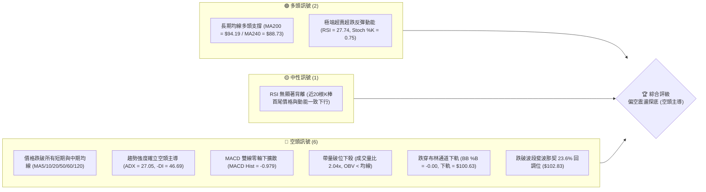
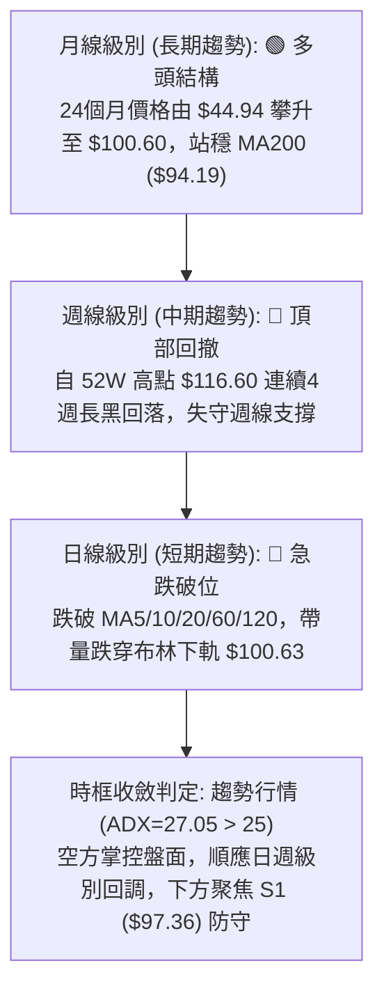
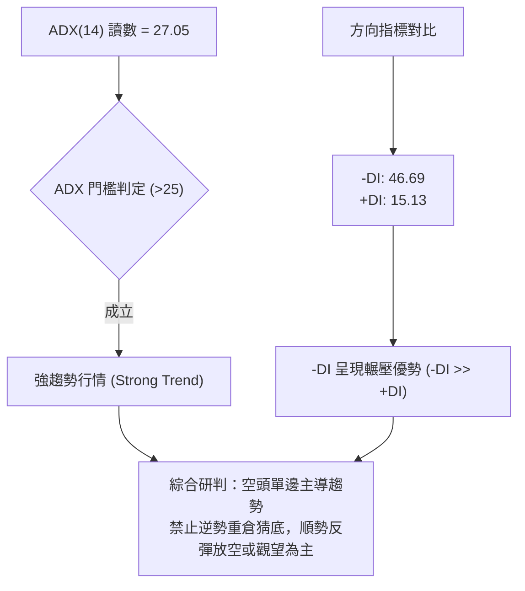
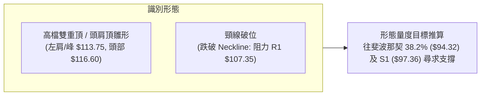
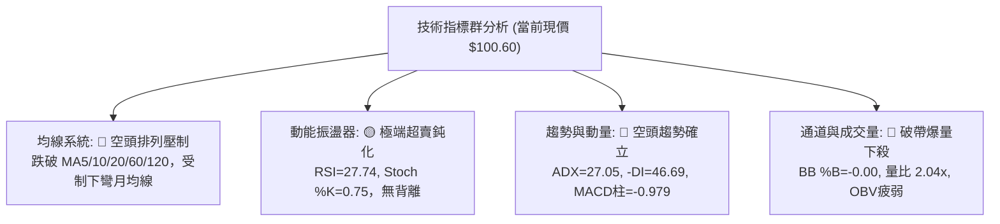
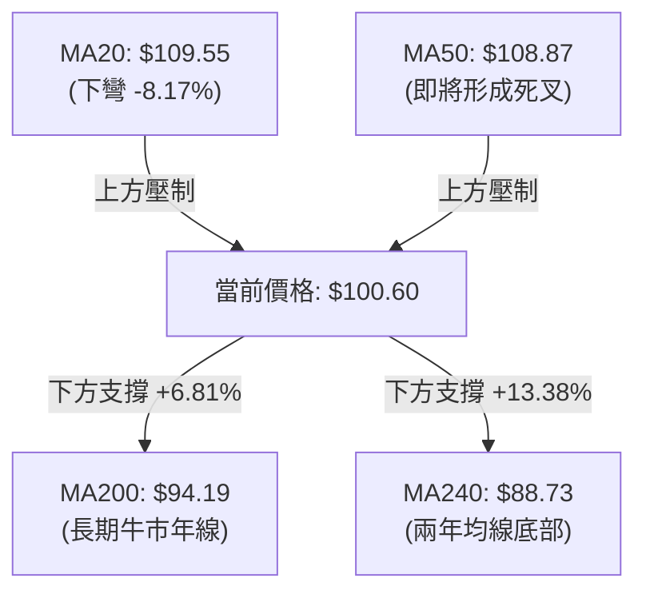
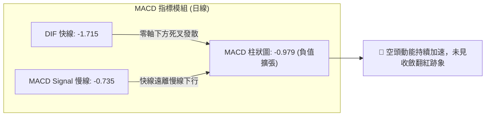
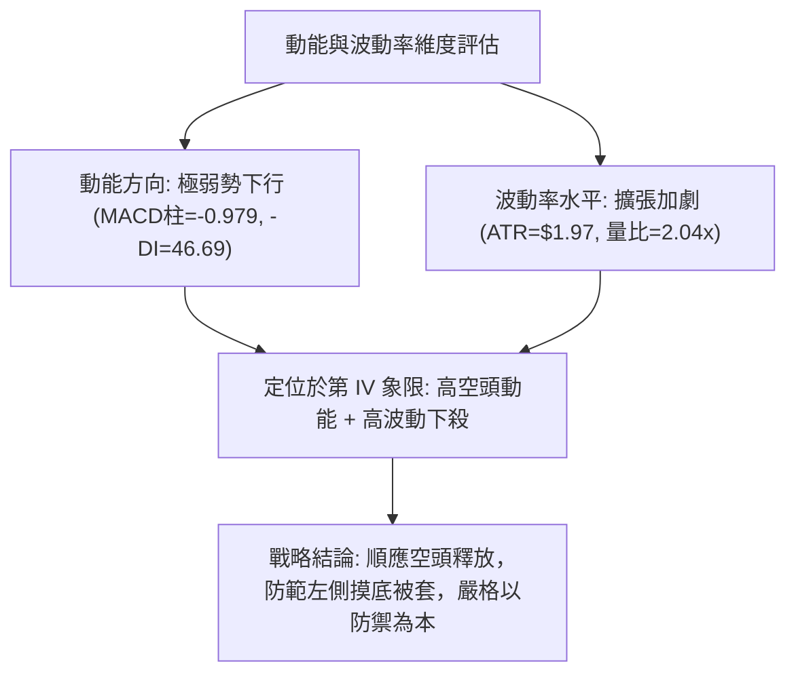
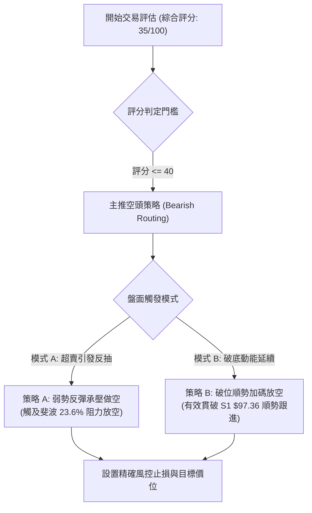
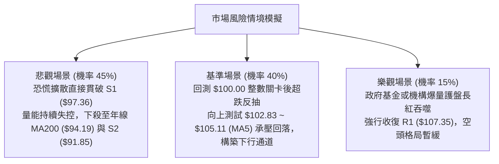

# 0050 技術分析報告

> **報告日期**：2026-11-05 ｜ **語言**：繁體中文 ｜ **數據來源**：Yahoo Finance ｜ **當前價格**：$100.60 TWD

---

## 目錄

| 章節 | 內容 |
|------|------|
| [1. 技術面概覽](#1-技術面概覽) | 訊號儀表板、核心指標、評分卡 |
| [2. 趨勢分析](#2-趨勢分析) | 多時框趨勢、長中短期走勢 |
| [3. 圖表形態分析](#3-圖表形態分析) | 形態識別、K線組合、目標價 |
| [4. 支撐與阻力](#4-支撐與阻力) | 關鍵價位、斐波那契回調 |
| [5. 技術指標深度解讀](#5-技術指標深度解讀) | MA/RSI/MACD/布林/成交量 |
| [6. 動能與波動率](#6-動能與波動率) | 動能評估、ATR、Beta |
| [7. 多時框架總結](#7-多時框架總結) | 時框架評分矩陣 |
| [8. 交易策略建議](#8-交易策略建議) | 多空策略、風險報酬比 |
| [9. 風險提示與監控](#9-風險提示與監控) | 監控指標、風險場景 |

---

## 1. 技術面概覽

### 🎯 技術訊號儀表板



### 📊 核心指標速覽表

| 指標類別 | 指標名稱 | 當前數值 | 訊號 | 解讀 |
|:---|:---|:---|:---:|:---|
| **價格** | 當前收盤價 | $100.60 | 🔴 | 跌破布林下軌 $100.63，位於52週區間 72.6% 分位 |
| **均線** | MA20 (月線) | $109.55 | 🔴 | 價格位於下方 -8.17%，月線下彎形成沉重反壓 |
| **均線** | MA50 (季線) | $108.87 | 🔴 | 價格位於下方，MA20即將與MA50形成死亡交叉 |
| **均線** | MA200 (年線)| $94.19 | 🟢 | 價格位於年線上方 +6.81%，長線多頭架構尚未破壞 |
| **動能** | RSI(14) | 27.74 | 🟢 | 進入極端超賣區 (<30)，技術性修復反彈機率升高 |
| **動能** | MACD | -1.715 | 🔴 | 快慢線死叉下行，柱狀圖 -0.979 顯示空頭動能加速 |
| **趨勢** | ADX(14) / -DI | 27.05 / 46.69 | 🔴 | ADX>25 且 -DI 遠高於 +DI (15.13)，空頭強趨勢成立 |
| **通道** | 布林通道 | %B = -0.00 | 🔴 | 觸及並微幅跌破下軌 ($100.63)，處於破帶下行狀態 |
| **成交量** | 量比 (vs MA20)| 2.04x | 🔴 | 下跌爆量 (252.92M)，OBV 低於均線，量先價跌 |
| **波動** | ATR(14) | $1.97 | 🟡 | 佔現價 1.96%，近期單日波幅擴大，洗盤劇烈 |

### 🏆 技術評分卡

```
╔══════════════════════════════════════════════════════════════╗
║               技術評分卡 — 0050 (2026-11-05)                 ║
╠══════════════════════════════════════════════════════════════╣
║ 趨勢強度 (空頭壓制)   ██████░░░░░░░░░░░░░░  30/100   🔴 弱勢 ║
║ 動能指標 (極度超賣)   █████░░░░░░░░░░░░░░░  25/100   🔴 疲弱 ║
║ 支撐穩定度 (考驗S1)   ████████░░░░░░░░░░░░  40/100   🟡 中性 ║
║ 成交量配合 (帶量下殺) ███████░░░░░░░░░░░░░  35/100   🔴 偏空 ║
║ 形態完整度 (頭部構築) ███████░░░░░░░░░░░░░  35/100   🔴 偏空 ║
║ 均線排列 (長多短空)   █████████░░░░░░░░░░░  45/100   🟡 中性 ║
╠══════════════════════════════════════════════════════════════╣
║ 綜合評分             ███████░░░░░░░░░░░░░  35/100   🔴 偏空 ║
║ 評級結論：短中期空頭主導，綜合評分 35/100，主推逢高反彈空或防守  ║
╚══════════════════════════════════════════════════════════════╝
```
*(註：綜合評分由六項子評分算術平均：(30 + 25 + 40 + 35 + 35 + 45) / 6 = 35.00，四捨五入為 35/100。)*

---

## 2. 趨勢分析

### 🌐 多時框趨勢分析



### 📈 長期趨勢 — 12個月走勢圖（Unicode）

```
0050 月線收盤走勢圖（過去12個月：2025-11 至 2026-11）
價格 ($)
$115 ┤                                      ● $112.05 (2026-09)
$110 ┤                            ● $107.15  │
$105 ┤                  ● $104.76  │         │  ● $104.95
$100 ┤                  │          │         │  │   ● $100.60 (當前)
 $95 ┤                  │          │         │  │   │
 $90 ┤            ● $89.95         │         │  │   │
 $85 ┤            │                │         │  │   │
 $80 ┤      ● $80.66               │         │  │   │
 $75 ┤      │                      │         │  │   │
 $70 ┤● $72.16    ● $71.91         │         │  │   │
 $65 ┤│           │                │         │  │   │
 $60 ┤● $61.11    │                │         │  │   │
     └┴─────┴─────┴─────┴────┴─────┴────┴────┴──┴───┴───────
      11月  01月  03月  04月 05月  06月 07月 09月 10月 11月
     (2025)                     (2026)
```

**12個月價格走勢特徵分析**：

| 階段時間 | 起迄價位 | 期間漲跌幅 | 趨勢特徵描述 |
|:---|:---|:---:|:---|
| **2025-11 ~ 2026-02** | $61.11 → $80.66 | +31.99% | 多頭主升段啟動，價量齊揚突破前高阻力 |
| **2026-02 ~ 2026-03** | $80.66 → $71.91 | -10.85% | 快速中繼洗盤回檔，回測長期均線支撐 |
| **2026-03 ~ 2026-06** | $71.91 → $107.15 | +49.01% | 史詩級強勢單邊噴出行情，突破百元歷史大關 |
| **2026-06 ~ 2026-08** | $107.15 → $106.25 | -0.84% | 高檔橫盤消化獲利賣壓，多空於百元關卡上方換手 |
| **2026-08 ~ 2026-09** | $106.25 → $112.05 | +5.46% | 創下月收盤新高 $112.05，波段摸頂至 $116.60 |
| **2026-09 ~ 2026-11** | $112.05 → $100.60 | -10.22% | 頂部動能衰退，連續兩個月回調，重回百元保衛戰 |

### 📊 中期趨勢（週線分析）

中期走勢呈現「長黑灌破、重心下移」的弱勢空方形態。自 2026-10-08 當週見到 52 週波段高點 $116.60 以來，週線連續收出 4 根黑K棒（收盤分別為 $109.00、$106.90、$104.95、$100.60）。

```
週線關鍵阻力與支撐分佈示意圖：
[阻力 R3] ── $113.75 ════════════════════ (前波次高震盪區)
[阻力 R2] ── $110.55 ════════════════════ (密集換手套牢區)
[阻力 R1] ── $107.35 ════════════════════ (近一年高點聚類下緣)
              ▲
              │   跌破斐波那契 23.6% 回調位 ($102.83)
              ▼
[現  價] ── $100.60 ──── 目前測試整數關卡與布林通道下軌
              ▼
[支撐 S1] ── $97.36  ──────────────────── (近一年波段低點聚類一)
[支撐 S2] ── $91.85  ──────────────────── (近一年波段低點聚類二 / MA200 緩衝區)
```

### ⚡ 趨勢強度評估（ADX 解讀）



**ADX 趨勢強度對照表**：

| 指標名稱 | 當前數值 | 狀態評定 | 交易涵義與操作指引 |
|:---|:---:|:---:|:---|
| **ADX (14)** | 27.05 | 🟢 強趨勢區間 (>25) | 行情擺脫無方向盤整，進入趨勢推動波段 |
| **+DI (14)** | 15.13 | 🔴 極度衰弱 | 多頭買盤力道潰退，無法組織有效反攻 |
| **-DI (14)** | 46.69 | 🔴 強勢空頭掌控 | 空方動能處於極高水平，賣壓釋放尚未竭盡 |
| **趨勢性質** | 空頭趨勢 | 🔴 順勢偏空 | 依據多時框收斂規則，禁止將震盪指標超賣視為做多唯一理由 |

---

## 3. 圖表形態分析

### 🔍 形態識別系統



**形態信心度與目標價評估表**：

| 識別形態名稱 | 信心度 | 判斷依據（嚴格引用數據） | 完成度 | 形態量度目標價（附精確計算式） |
|:---|:---:|:---|:---:|:---|
| **雙頂破位 (M頭)** | 75% | 高點為 2026-10-08 之 $116.60，反彈次高為 $113.75 (R3)，跌破頸線 $107.35 (R1) | 90% | 依形態高度推算：<br/>形態高度 H = 頂部 $116.60 − 頸線 $107.35 = $9.25<br/>跌破量度目標 = 頸線 $107.35 − $9.25 = **$98.10**<br/>*(直逼支撐位 S1 $97.36)* |
| **布林帶跌破破位** | 85% | 最新日K跌破下軌 ($100.63)，BB %B = -0.00 | 100% | 指標型形態：目標指向下方第一客觀波段支撐位 **$97.36 (S1)** |

### 🕯️ 重要K線形態分析

嚴格依據數據中「近10根日K」與「近8根週K」之開高低收進行量化識別：

**近 10 根日K線形態分析表**：

| 日期 | 開盤價 | 最高價 | 最低價 | 收盤價 | 成交量 | K線形態特徵 | 市場心理與多空解讀 | 訊號 |
|:---|:---:|:---:|:---:|:---:|:---:|:---|:---|:---:|
| 2026-10-20 | 107.65 | 108.30 | 107.05 | 107.25 | 105,412,059 | 小黑實體K線 | 承接力不足，受制於日線均線壓力 | 🔴 |
| 2026-10-21 | 108.80 | 109.20 | 107.60 | 108.15 | 76,295,858 | 帶上影小黑K | 向上試探 MA20 ($109.55) 失敗，縮量反彈無力 | 🟡 |
| 2026-10-22 | 108.95 | 109.15 | 106.75 | 106.90 | 116,952,817 | 中長黑K破底 | 空頭發力，收盤收在最低點附近，破壞整理 | 🔴 |
| 2026-10-23 | 106.90 | 106.90 | 106.90 | 106.90 | 0 | 一字平盤線 | 市場流動性受限或休市結算，無方向變更 | 🟡 |
| 2026-10-27 | 107.10 | 107.55 | 105.80 | 106.60 | 140,567,068 | 帶長下影小黑K | 盤中下探 $105.80 獲低接買盤拉回，空方稍歇 | 🟡 |
| 2026-10-28 | 108.35 | 108.65 | 107.80 | 108.65 | 50,936,423 | 縮量光腳紅K | 縮量假反彈，成交量僅 50.9M，多頭動能虛弱 | 🟡 |
| 2026-10-29 | 108.65 | 108.65 | 106.60 | 107.25 | 77,495,132 | 倒轉鎚頭黑K | 開盤即最高點，多頭拉抬再度潰敗 | 🔴 |
| 2026-10-30 | 104.80 | 105.30 | 103.85 | 104.95 | 193,796,708 | 跳空放量中黑K | 跳空向下跌破前低，放量 193.8M 恐慌盤湧出 | 🔴 |
| 2026-11-02 | 103.40 | 104.45 | 103.05 | 104.10 | 142,806,486 | 弱勢反彈黑K | 實體重心持續下移，高點受制於前一日收盤價 | 🔴 |
| 2026-11-03 | 102.50 | 103.35 | 100.50 | 100.60 | 252,920,897 | 爆量長黑大陰線 | 爆量 252.9M 下殺，光腳收在當日最低點附近 ($100.60) | 🔴 |

**近 8 根週K線形態分析表**：

| 週末交易日 | 開盤價 | 最高價 | 最低價 | 收盤價 | 成交量 | 週K線形態特徵 | 訊號 |
|:---|:---:|:---:|:---:|:---:|:---:|:---|:---:|
| 2026-09-18 | 106.30 | 109.95 | 105.85 | 109.85 | 334,815,655 | 中長紅推進K線，站上 $109 | 🟢 |
| 2026-09-24 | 109.90 | 113.75 | 109.85 | 112.40 | 316,558,811 | 帶上影大陽線，上探 R3 ($113.75) | 🟢 |
| 2026-10-02 | 111.80 | 113.05 | 111.05 | 112.80 | 276,044,269 | 高檔窄幅吊人星，動能停滯 | 🟡 |
| 2026-10-08 | 115.75 | 116.60 | 114.90 | 114.95 | 307,612,641 | 創歷史新高後長上影十字黑星（終極頂部） | 🔴 |
| 2026-10-16 | 114.20 | 114.95 | 108.55 | 109.00 | 869,278,497 | 巨量吞噬長黑破位K（爆量 869M 出貨） | 🔴 |
| 2026-10-23 | 107.45 | 109.20 | 106.75 | 106.90 | 442,340,931 | 空頭延續中黑K，失守 $107 | 🔴 |
| 2026-10-30 | 107.10 | 108.65 | 103.85 | 104.95 | 462,795,331 | 實體長黑K，回調破位加速 | 🔴 |
| 2026-11-03 | 103.40 | 104.45 | 100.50 | 100.60 | 395,727,383 | 大陰線逼近百元大關，空頭完全主導 | 🔴 |

### 📉 ASCII 走勢形態示意圖

```
0050 高檔雙重頂 (M頭) 破位結構示意圖
價格 ($)
$116.60 ┤                [頭部峰值 2026-10-08]
$113.75 ┤    [左肩/次高]          ●
$110.55 ┤        ●              ╱ ╲
$107.35 ┤═══════╱══╲═══════════╱═══╲═══════ [頸線位置 Neckline = R1]
$104.95 ┤      ╱    ╲        ╱     ╲
$102.83 ┤     ╱      ╲      ╱       ╲      [斐波那契 23.6% 失守]
$100.60 ┤    ╱        ╲    ╱         ● ◄── [現價破位，爆量急跌]
 $97.36 ┤   ╱          ╲  ╱            ╲
 $94.32 ┤  ╱            ●                ▼  [量度跌幅目標區 / S1 支撐]
```

### 🎯 形態目標價計算

1. **頸線確認**：取近一年密集高點聚類下緣 **$107.35 (R1)** 作為頭部頸線基準。
2. **形態高度**：$H = 52\text{W High } (\$116.60) - \text{頸線 } (\$107.35) = \$9.25$。
3. **第一量度目標價**：$\text{頸線 } (\$107.35) - H (\$9.25) = \mathbf{\$98.10}$。
   - 該價位與波段低點聚類支撐 **S1 ($97.36)** 形成強共振區間（$97.36 ~ $98.10）。
4. **極限延伸目標價**：若 S1 失守，依斐波那契 38.2% 回調位推算，將下探 **$94.32**（與年線 MA200 $94.19 高度重合）。

---

## 4. 支撐與阻力

### 🗺️ 關鍵價位分布圖（Unicode）

```
0050 價位結構分佈圖（嚴格引用系統計算點位）
══════════════════════════════════════════════════════════════════
 $116.60 ║████████████████████████████████║ 52週歷史高點 (0.0% Fib)
 $113.75 ║██████████████████████████      ║ 強阻力 R3 (波段次高點聚類)
 $110.55 ║████████████████████            ║ 阻力 R2 (反彈高點聚類 / 密集成交)
 $107.35 ║████████████████████████████    ║ 關鍵頸線阻力 R1 (前波低點轉阻力)
 $102.83 ║────────────────────────────────║ 斐波那契 23.6% 回調分水嶺
╠════════╬════════════════════════════════╬══════════════════════╣
 $100.60 ║ ◄ 當前收盤價 ($100.60)         ║ 逼近百元整數大關 / 布林下軌
╠════════╬════════════════════════════════╬══════════════════════╣
  $97.36 ║▓▓▓▓▓▓▓▓▓▓▓▓▓▓▓▓▓▓▓▓▓▓▓▓        ║ 近期核心支撐 S1 (近一年波段低點)
  $94.32 ║▓▓▓▓▓▓▓▓▓▓▓▓▓▓▓▓▓▓▓▓            ║ 斐波那契 38.2% / MA200 ($94.19)
  $91.85 ║▓▓▓▓▓▓▓▓▓▓▓▓▓▓▓▓▓▓▓▓▓▓▓▓▓▓      ║ 強支撐 S2 (波段結構性平台低點)
  $71.10 ║▓▓▓▓▓▓▓▓▓▓▓▓▓▓▓▓▓▓▓▓▓▓▓▓▓▓▓▓▓▓  ║ 終極長期防守 S3 (長期起漲低點)
══════════════════════════════════════════════════════════════════
```

### 🚧 阻力位分析表

*(嚴格引用 OHLCV 計算之 R1/R2/R3 數值)*

| 阻力級別 | 價位 | 距現價空間 | 形成技術原因 | 突破難度 | 重要性權重 |
|:---|:---:|:---:|:---|:---:|:---:|
| **R1 (近距阻力)** | $107.35 | +6.71% | 近一年波段高點聚類下緣、M頭頸線破位點，與 MA60 ($108.18) 形成死叉反壓帶 | 極高 | ★★★★★ |
| **R2 (中距阻力)** | $110.55 | +9.89% | 前期高檔換手盤整平台中軸，與下彎之 MA20 ($109.55) 重疊構成雙重蓋頂 | 高 | ★★★★☆ |
| **R3 (遠距阻力)** | $113.75 | +13.07% | 2026-09-24 波段上攻極限高點聚類，歷史次高籌碼解套重壓區 | 極難突破 | ★★★☆☆ |

### 🛡️ 支撐位分析表

*(嚴格引用 OHLCV 計算之 S1/S2/S3 數值)*

| 支撐級別 | 價位 | 距現價空間 | 形成技術原因 | 守住機率 | 重要性權重 |
|:---|:---:|:---:|:---|:---:|:---:|
| **S1 (首要支撐)** | $97.36 | -3.22% | 近一年波段低點聚類一，M頭形態量度跌幅目標區 ($98.10) 之第一道底線 | 60% | ★★★★☆ |
| **S2 (強級支撐)** | $91.85 | -8.70% | 近一年波段深幅修正低點聚類，接近上升年線 MA200 ($94.19) 與 38.2% 斐波位 | 75% | ★★★★★ |
| **S3 (終極支撐)** | $71.10 | -29.32% | 2026年3月深幅回調低點聚類 ($71.91)，長期多頭循環的生命線 | 95% | ★★★☆☆ |

### 📐 斐波那契回調位分析

依據 52 週絕對極值區間：起點 Low **$58.27** → 終點 High **$116.60**（波幅總計 $58.33）：

| 斐波那契比例 | 精確對應價位 | 與現價 ($100.60) 相對位置 | 技術涵義解讀 |
|:---|:---:|:---:|:---|
| **0.0% (高點)** | $116.60 | +15.90% | 52 週最高峰值，長期牛市主升段頂部 |
| **23.6% 回調** | $102.83 | +2.22% | **已跌破**。由原先淺幅修正支撐轉變為短線第一道反彈強阻力 |
| **38.2% 回調** | $94.32 | -6.24% | **關鍵回調位**。標準牛市回撤極限位，與年線 MA200 ($94.19) 完美共振 |
| **50.0% 中樞** | $87.43 | -13.09% | 多空長期分水嶺，接近 MA240 ($88.73) |
| **61.8% 黃金分割** | $80.55 | -19.93% | 深度防禦位，回調至此將引發長線機構資金防禦性買盤 |
| **78.6% 深幅回撤** | $70.75 | -29.67% | 接近 S3 支撐 ($71.10) |
| **100.0% (低點)** | $58.27 | -42.08% | 52 週最低點，原始起漲基準底點 |

**位置判定**：當前收盤價 **$100.60** 處於 **23.6% ($102.83)** 與 **38.2% ($94.32)** 之間。在跌破 23.6% 分水嶺後，技術面宣告淺幅整理破局，正式邁向 38.2% 回調測試波段。

---

## 5. 技術指標深度解讀

### 🎛️ 指標訊號總覽



### 📈 移動平均線排列分析



**移動平均線狀態詳解**：
- **短中期均線全面翻空**：MA5 ($105.11) < MA10 ($106.13) < MA60 ($108.18) < MA50 ($108.87) < MA20 ($109.55)。短期與中期均線呈現標準「空頭發散排列」，形成層層下壓的密集套牢賣壓。
- **長期均線保持多頭防守**：MA200 ($94.19) 與 MA240 ($88.73) 維持上揚趨勢，證明超長期大結構尚未轉為熊市，但短中期回撤修正壓力極其巨大。

### 📉 RSI(14) 分析

```
RSI(14) 指標儀表：
0                20       30                         70             100
├────────────────┼────────┼──────────────────────────┼───────────────┤
█████████████████░░░░░░░░░░░░░░░░░░░░░░░░░░░░░░░░░░░░░░░░░░░░░░░░░░░░
▲ 27.74 (極度超賣區間 <30)
```

- **超買超賣判定**：RSI(14) 讀數為 **27.74**，進入嚴重超賣區間。Stochastic %K 亦降至 **0.75**，%D 降至 **6.83**。
- **背離檢驗結論**：**無明顯背離**。比對近 20 根日K線首尾，價格自 $108.15 一路破底至 $100.60，RSI 同步自 40 以上下挫至 27.74，呈現「價跌指針跌」的標準同步下行走勢，未出現「價格破底、RSI抬高」之底背離跡象，顯示下殺動能尚未耗盡，屬於指標鈍化現象。

### 📊 MACD(12/26/9) 訊號解讀



- **訊號解析**：DIF (-1.715) 與 Signal (-0.735) 均位於零軸下方，且兩者差距擴大，帶動柱狀圖擴張至 **-0.979**。此形態為典型「空頭主導下的加速下挫」，空方力道極為強勁。

### 📦 布林通道分析

```
0050 布林通道 (20, 2) 結構示意圖：
$118.47 ┤───────────────────────────────────── 布林上軌 (帶寬發散中)
        │
$109.55 ┤───────────────────●───────────────── 布林中軌 (MA20 下彎反壓)
        │                  ╱ ╲
$100.63 ┤─────────────────╱───●─────────────── 布林下軌
$100.60 ┤═══════════════════════●═════════════ 當前價格 (BB %B = -0.00，跌破下軌)
```

- **通道動態**：上軌 $118.47，中軌 $109.55，下軌 $100.63。通道帶寬正在劇烈擴張，現價 **$100.60** 跌穿下軌，指標數值 **%B = -0.00**。此狀態代表「開口擴大、沿下軌運行的極弱勢破帶走勢」，非強烈買進訊號，反而提示可能進入單邊加速崩跌模式。

### 💹 成交量分析（量價配合度）

- **量價關係解讀**：最新單日成交量為 **252,920,897**，對比 20 日均量 **123,887,739**，量比高達 **2.04 倍**（相較 50 日均量更高達 2.83 倍）。
- **籌碼與 OBV 評估**：下殺過程伴隨「爆量長黑」，且技術數據顯示 **OBV < MA**，確認資金呈現淨流出。大額恐慌盤與融資斷頭停損盤湧出，量能完全確認了價格下跌的真實性，並非「量縮洗盤」，而是實質性主力籌碼拋售。

---

## 6. 動能與波動率

### ⚡ 動能評估四象限

| 象限分佈 | 動能維度 (Momentum) | 波動率維度 (Volatility) | 當前標的狀態 | 交易策略意涵與風險特徵 |
|:---:|:---:|:---:|:---:|:---|
| **第 I 象限** | 強勢多頭動能 | 低波動率穩定 | — | 最佳順勢持股環境，單邊平穩上漲 |
| **第 II 象限** | 弱勢/中性動能 | 低波動率收斂 | — | 觀望等待變盤，狹幅箱型盤整 |
| **第 III 象限**| 強勢多頭動能 | 高波動率劇烈 | — | 爆發性追價或主升段末端噴出 |
| **第 IV 象限**| **空頭下行動能強** | **高波動率擴散** | **✓ (0050 當前處於此象限)** | **高風險下跌擴散期：ADX=27.05，成交量暴增2.04倍，伴隨價格沿布林下軌破位，應嚴禁隨意逆勢摸底** |



### 📊 ATR 波動率分析

- **ATR(14) 讀數**：**$1.97 TWD**（佔當前價格比例為 **1.96%**）。
- **日內波動特徵**：在經歷數週的窄幅震盪後，近期波幅隨著跳空與爆量長黑急劇擴增，單日極限波幅（如 2026-11-03 之最高 $103.35 至最低 $100.50，振幅達 $2.85）已遠超平均 ATR。
- **風控止損距離建議**：
  - **極短線交易**：建議止損空間設定為 $1.0 \times \text{ATR} \approx \mathbf{\$1.97}$。
  - **波段交易**：建議止損空間設定為 $1.5 \sim 2.0 \times \text{ATR} \approx \mathbf{\$2.96 \sim \$3.94}$。

### 📐 Beta 與市場相關性

- **Beta 數值**：**N/A（數據未提供）**。
- **質化結構補充**：0050 作為元大台灣卓越50 ETF，成分股覆蓋台股權值前 50 大企業（台積電佔比權重極高）。在無特定外部個股事件下，其 Beta 係數在實務上緊密貼合台股加權指數（接近 1.00）。當前其爆量下殺直接折射整體權值股遭外資調節提款，系統性風險釋放尚未告終。

---

## 7. 多時框架總結

### 📋 時框架評分表

| 時框架 | 趨勢方向 | 動能狀態 | 均線排列特徵 | 形態判定 | 綜合評分 | 操作指導建議 |
|:---|:---:|:---:|:---|:---|:---:|:---|
| **日線 (短期)** | 🔴 極弱勢空頭 | RSI 27.74 (極超賣)<br/>MACD柱擴張 | 跌破所有短中期均線 (MA5~MA120) | 跌穿布林下軌破帶急跌 | 25/100 | 禁止搶多，反彈逢高尋求空點 |
| **週線 (中期)** | 🔴 頂部確立回調 | RSI 27.7 (週線轉弱)<br/>連4黑帶量下挫 | 跌破多根短期週均，考驗季均 | 高檔 M頭/頭肩頂破位 | 35/100 | 中期頭部確立，尋找支撐減碼 |
| **月線 (長期)** | 🟢 宏觀牛市回撤 | 24個月長多週期<br/>自 $44.94 大幅走揚 | 遠高於 MA200 ($94.19) 與 MA240 | 長期上升趨勢中的中級回檔 | 65/100 | 長期投資者靜待 S1/S2 價值浮現 |

### 🔲 綜合訊號矩陣

```
時框訊號一致性交叉檢驗矩陣：
╔══════════════╦══════════════╦══════════════╦══════════════╗
║ 指標類別     ║ 日線級別     ║ 週線級別     ║ 長期月線     ║
╠══════════════╬══════════════╬══════════════╬══════════════╣
║ 均線系統     ║ 🔴 強烈空頭  ║ 🔴 偏空修正  ║ 🟢 穩固多頭  ║
║ 動能指標     ║ 🟡 鈍化超賣  ║ 🔴 空方加速  ║ 🟢 偏多格局  ║
║ 趨勢指標ADX  ║ 🔴 空頭強勢  ║ 🔴 空方掌控  ║ 🟢 多頭趨勢  ║
║ 形態結構     ║ 🔴 破底殺多  ║ 🔴 頸線跌破  ║ 🟢 多頭結構  ║
║ 籌碼量能     ║ 🔴 爆量下殺  ║ 🔴 出貨巨量  ║ 🟡 換手累積  ║
╠══════════════╬══════════════╬══════════════╬══════════════╣
║ 訊號收斂方向 ║ 🔴 短線逢高空║ 🔴 中線防禦  ║ 🟢 長期觀察  ║
╚══════════════╩══════════════╩══════════════╩══════════════╝
```

### ⚖️ 多時框收斂結論

依據多時框收斂規則：
1. **趨勢/盤整定性**：當前日線 ADX(14) 讀數為 **27.05 (>25)**，且 -DI 高達 **46.69**，明確宣告目前處於**強烈的單邊空頭趨勢行情**，而非區間盤整行情。
2. **時框優先級收斂**：在趨勢行情中，雖然超長期年線（MA200 $94.19）結構向上，但中期（週線連四週黑K、爆量出貨跌破 $107.35 頸線）與短期（日線帶量跌穿下軌、均線全面翻空）方向高度共振偏空。中短期趨勢對當前操作具備壓倒性的主導權。
3. **唯一方向性結論**：**【偏空主導，嚴禁逆勢猜底】**。日線的極度超賣僅能作為「空單不盲目追殺於最低點、尋求反彈壓力位再行放空」的擇時輔助，交易策略全面轉向**空方策略主導**。

---

## 8. 交易策略建議

### 🗺️ 策略決策流程圖



### 🧭 策略路由（依評分卡分流，不得兩頭下注）

> **當前主策略方向 = 【空頭主導 / 反彈承壓做空】（依綜合評分 35/100，低於 40 門檻，嚴格主推空頭策略，多頭僅列為反轉風險對沖提示）。**

### 🎯 價格情境階梯（Price Scenarios）

*(嚴格引用第 4 章及數據庫真實價位)*

| 觸發條件 | 下一目標 | 後續延伸目標 | 情境技術涵義 |
|:---|:---:|:---:|:---|
| **強勢反彈突破 R1 ($107.35)** | R2 ($110.55) | R3 ($113.75) | 短線底部反轉，完全封閉下殺缺口，空單必須全數撤離止損 |
| **弱勢反彈承壓 ($102.83 ~ $105.11)** | 現價 ($100.60) | S1 ($97.36) | 超賣引發的技術性抽腳，遭遇下彎 MA5 與斐波 23.6% 反壓，逢高放空最佳機會 |
| **跌破關鍵支撐 S1 ($97.36)** | S2 ($91.85) | S3 ($71.10) | 中期多頭防線瓦解，觸發 M頭量度跌幅，回測年線 MA200 ($94.19) 與 S2 |

### 📊 情境機率分佈

| 情境劇本 | 發生機率 | 主要技術指標依據 |
|:---|:---:|:---|
| **弱勢反抽後回落再破底** | **60%** | ADX=27.05 趨勢偏空，MACD 負向擴大 (-0.979)，爆量下殺籌碼受損，反彈遇 MA5 ($105.11) 承壓 |
| **直接貫破 S1 ($97.36) 探底** | **25%** | 最新日K收於最低點 ($100.60)，布林通道 %B=-0.00 開口向下擴大，恐慌性賣盤未絕 |
| **V型反轉站回 R1 ($107.35)** | **15%** | 僅憑 RSI=27.74 之超賣技術性反彈，缺乏右側打底與籌碼換手結構，直接反轉機率極低 |

### 🟢 主策略詳情（方向依上方路由：空頭主策略）

*(注：風險報酬比嚴格按規則 17 計算：做空 $R/R = (\text{進場價} - T1) \div (\text{止損價} - \text{進場價})$)*

| 策略要素 | 策略 A：反彈承壓放空（波段優選） | 策略 B：破位順勢跟進做空（突破型） |
|:---|:---|:---|
| **進場條件** | 超賣抽腳遇阻，反彈至斐波 23.6% 回調位承壓滯漲 | 價格放量有效摜破波段低點支撐 S1 |
| **進場價格** | **$102.83** (斐波 23.6% 阻力位) | **$97.36** (跌破支撐位 S1 確認) |
| **目標價 T1** | **$97.36** (支撐位 S1) | **$91.85** (強支撐位 S2) |
| **目標價 T2** | **$94.32** (斐波 38.2% 回調位 / 年線區間) | **$87.43** (斐波 50.0% 回調位) |
| **止損價格** | **$105.11** (MA5 下彎阻力上方) | **$100.60** (前波破位點，即當前收盤價) |
| **風險報酬比** | **1 : 2.40（以 T1 計）**<br/>*(計算式: $(102.83 - 97.36) \div (105.11 - 102.83) = 5.47 \div 2.28 = 2.40$)*<br/>**1 : 3.73（以 T2 計）**<br/>*(計算式: $(102.83 - 94.32) \div (105.11 - 102.83) = 8.51 \div 2.28 = 3.73$)* | **1 : 1.70（以 T1 計）**<br/>*(計算式: $(97.36 - 91.85) \div (100.60 - 97.36) = 5.51 \div 3.24 = 1.70$)*<br/>**1 : 3.06（以 T2 計）**<br/>*(計算式: $(97.36 - 87.43) \div (100.60 - 97.36) = 9.93 \div 3.24 = 3.06$)* |
| **成功機率** | 65% | 55% |
| **建議倉位** | 15% 總投資資金 | 10% 總投資資金 |

### 🔴 反向風險觸發點（對沖提示）

若出現以下情境，宣告空頭主策略失效，空單必須立即平倉：
1. **價位警訊**：日線收盤價帶量突破並站穩 **$107.35 (R1)** 頸線上方，代表 M頭形態被破壞，假跌破確立。
2. **指標轉折**：日線 MACD 柱狀圖翻紅，且日線形成 RSI 底背離，成交量萎縮至 20 日均量之下隨後長紅突破 MA20 ($109.55)。
3. **多頭避險/套保策略**：若持有大量現貨之長期投資人，跌破 $100.60 應於期貨或衍生品建立 20%~30% 之放空對沖倉位，待價格回落至 **$94.32 ~ $91.85 (S2/MA200)** 再行解避險。

### ⭐ 整體訊號強度評星

```
做多訊號強度：★☆☆☆☆  (1/5星) ── 僅存超賣指標，左側抄底風險極大
做空訊號強度：★★★★☆  (4/5星) ── 均線空頭排列，趨勢強度ADX確立空方掌控
整體可信度：  ★★★★☆  (4/5星) ── 價跌量增，多時框共振偏空，指標無矛盾
```

---

## 9. 風險提示與監控

### ✅ 關鍵監控指標 Checklist

```
╔══════════════════════════════════════════════════════════════════╗
║                 0050 關鍵動態監控檢核清單 (Daily Checklist)      ║
╠══════════════════════════════════════════════════════════════════╣
║ [ ] 價格防守檢驗：收盤價是否跌破支撐位 S1 ($97.36)               ║
║ [ ] 反彈承壓檢驗：反彈是否在 23.6% 斐波位 ($102.83) 遇阻收上影線 ║
║ [ ] 動能衰竭監控：RSI(14) 是否自超賣區回升至 30 以上形成假突破  ║
║ [ ] MACD 柱狀監控：MACD 柱狀圖負值是否開始由 -0.979 收斂         ║
║ [ ] 量能異動跟蹤：單日成交量是否回落至 20日均量 (123.88M) 之下   ║
║ [ ] 布林通道跟蹤：價格是否重新收回布林下軌 ($100.63) 之內        ║
║ [ ] 均線交叉預警：MA20 ($109.55) 是否向下跌穿 MA50 ($108.87) 死叉║
╚══════════════════════════════════════════════════════════════════╝
```

### ⚠️ 風險場景分析



### 🛡️ 風險管理重要提醒

1. **嚴禁於爆量下殺當日盲目左側撈底**：當前日成交量暴增至 2.52 億股（2.04 倍量），顯示主力籌碼劇烈換手釋出，且日線收盤逼近最低點。在未見到「量縮打底」或「長下影線確認支撐」前，任何過早進場做多之行為均面臨巨大流動性衝擊風險。
2. **嚴格執行波動率倉位管理**：當前 ATR 為 $1.97，單日極限波動劇烈。波段操作單一方向總部位不應超過總投資資本的 15%，單筆交易最大虧損額度必須嚴格鎖定於總淨值的 1.0% 以內。

---

## 📋 報告總結

```
╔══════════════════════════════════════════════════════════════════╗
║                    0050 技術分析報告總結                         ║
╠══════════════════════════════════════════════════════════════════╣
║ 報告日期：2026-11-05                                             ║
║ 當前價格：$100.60 TWD                                            ║
║ 分析評級：🔴 偏空（綜合技術評分: 35/100）                         ║
║                                                                  ║
║ 核心結構結論：                                                   ║
║ ├─ 長期趨勢：🟢 宏觀多頭未破，守於上升年線 MA200 ($94.19) 之上   ║
║ ├─ 中期趨勢：🔴 頭部確立回調，週線連4黑，跌破頸線 $107.35        ║
║ ├─ 短期趨勢：🔴 單邊下殺破位，跌穿布林下軌 $100.63，ADX=27.05    ║
║ ├─ 關鍵支撐：S1: $97.36 ｜ S2: $91.85 ｜ 年線防禦: $94.19        ║
║ ├─ 關鍵阻力：R1: $107.35 ｜ R2: $110.55 ｜ 斐波23.6%: $102.83    ║
║ └─ 技術目標：空方第一回調目標 $98.10 ~ $97.36 (S1)               ║
║                                                                  ║
║ 最優策略組合建議：                                               ║
║ 1. 🥇 最佳機會 (波段優選)：策略 A (弱勢反彈至 $102.83 承壓放空)   ║
║    進場 $102.83 ｜ 止損 $105.11 ｜ 目標 $97.36 ｜ 風報比 1:2.40  ║
║ 2. 🥈 次選機會 (順勢破位)：策略 B (放量跌破 S1 $97.36 追空)      ║
║    進場 $97.36 ｜ 止損 $100.60 ｜ 目標 $91.85 ｜ 風報比 1:1.70  ║
║ 3. 🥉 保守選擇 (左側防守)：全面空倉觀望，耐心等待價格回測 S2     ║
║    ($91.85) 或年線 ($94.19) 企穩出現右側止跌訊號再行評估。     ║
╚══════════════════════════════════════════════════════════════════╝
```

---

> ⚠️ **免責聲明**：本報告為依據量化技術指標與歷史行情數據生成之專業技術分析報告，所有數值均嚴格按照既定數據計算。本報告**僅供學術研究與投資分析參考**，**不構成任何形式的個人化投資建議或買賣邀約**。金融市場瞬息萬變，技術指標存在滯後性與鈍化風險，投資人應獨立思考，審慎評估自身風險承受能力並自負盈虧。

---

*報告生成時間：2026-11-05 ｜ 數據來源：Yahoo Finance ｜ 分析框架：多時框架量化技術分析*