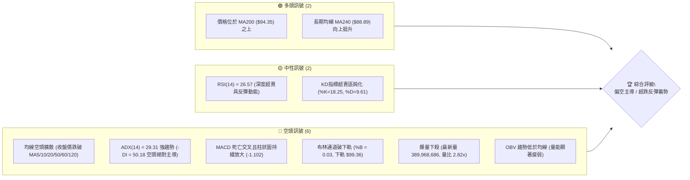
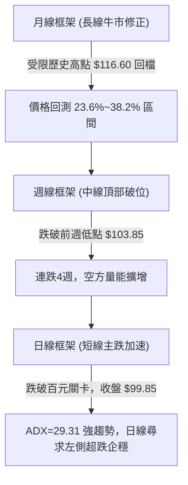
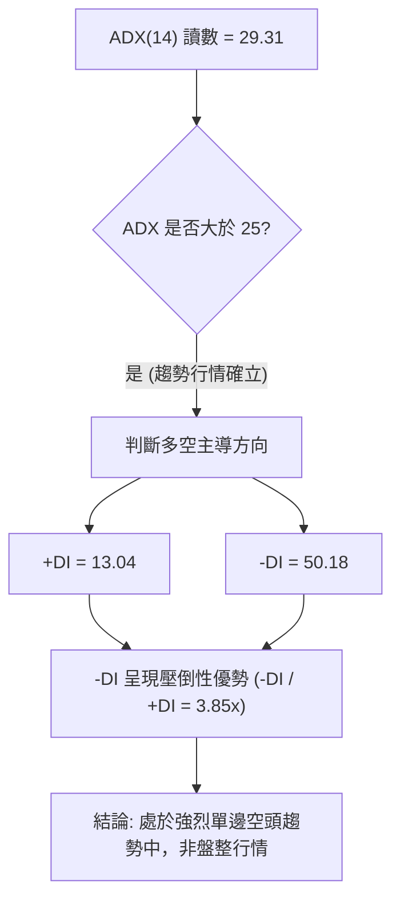
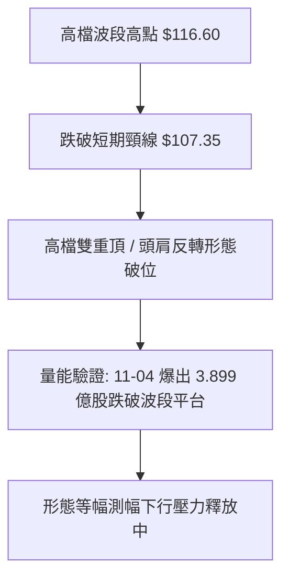
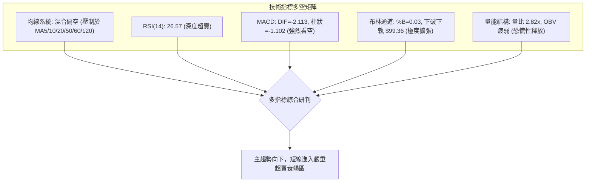
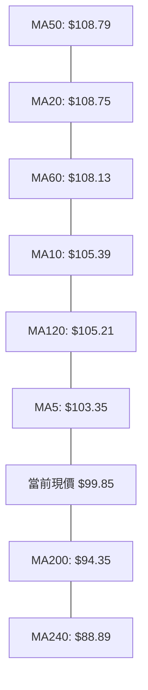
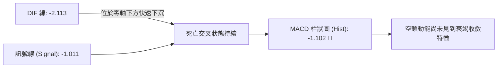
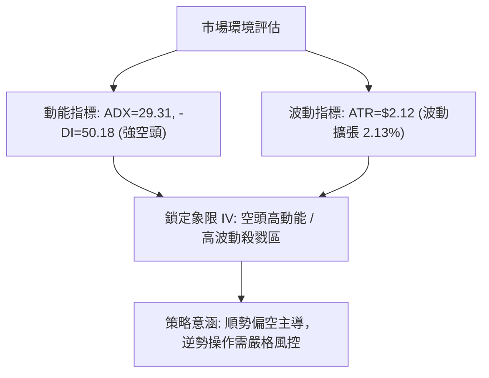
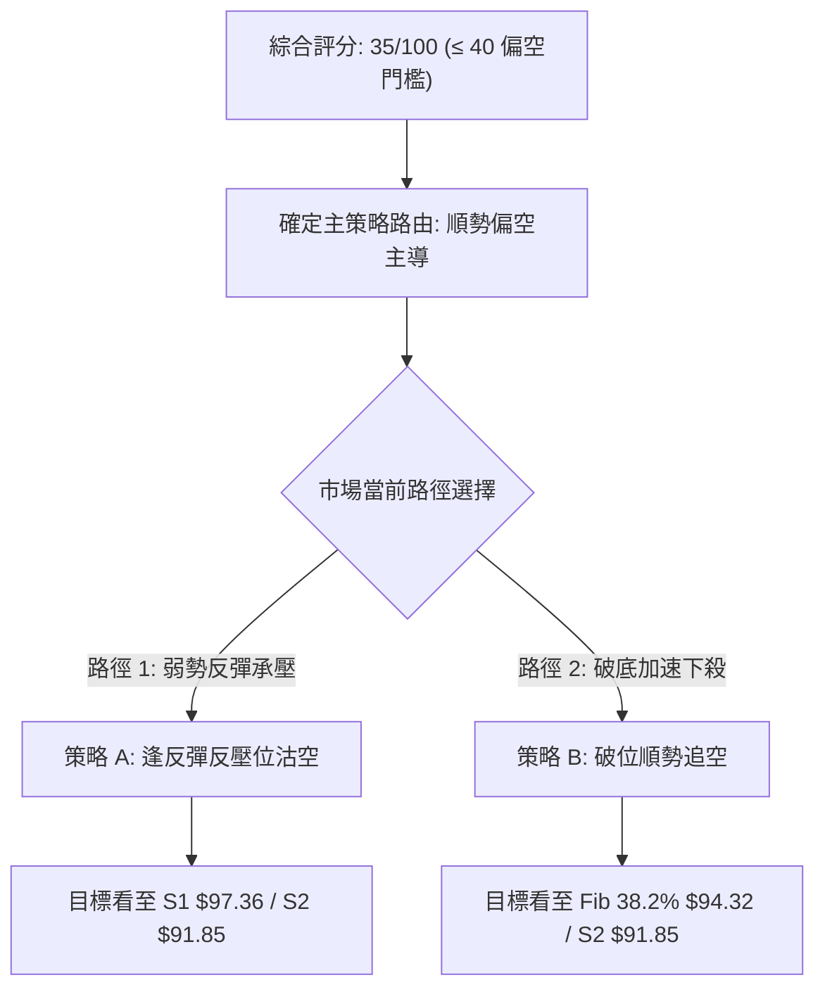
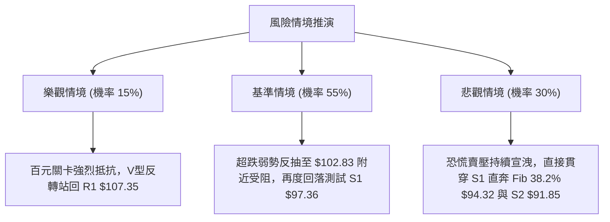

# 0050 技術分析報告

> **報告日期**：2026-11-06 ｜ **語言**：繁體中文 ｜ **數據來源**：Yahoo Finance ｜ **當前價格**：$99.85 TWD

---

## 目錄

| 章節 | 內容 |
|------|------|
| [1. 技術面概覽](#1-技術面概覽) | 訊號儀表板、核心指標、評分卡 |
| [2. 趨勢分析](#2-趨勢分析) | 多時框趨勢、長中短期走勢 |
| [3. 圖表形態分析](#3-圖表形態分析) | 形態識別、K線組合、目標價 |
| [4. 支撐與阻力](#4-支撐與阻力) | 關鍵價位、斐波那契回調 |
| [5. 技術指標深度解讀](#5-技術指標深度解讀) | MA/RSI/MACD/布林/成交量 |
| [6. 動能與波動率](#6-動能與波動率) | 動能評估、ATR、Beta |
| [7. 多時框架總結](#7-多時框架總結) | 時框架評分矩陣 |
| [8. 交易策略建議](#8-交易策略建議) | 多空策略、風險報酬比 |
| [9. 風險提示與監控](#9-風險提示與監控) | 監控指標、風險場景 |

---

## 1. 技術面概覽

### 🎯 技術訊號儀表板



### 📊 核心指標速覽表

| 指標類別 | 指標名稱 | 當前數值 | 訊號 | 解讀 |
|----------|----------|----------|------|------|
| **價格** | 當前收盤價 | $99.85 | 🔴 | 跌破百元心理整數大關，創下波段新低點 |
| **均線** | 短期 MA20 | $108.75 | 🔴 | 價格低於 MA20 達 -8.18%，短期下行趨勢嚴峻 |
| **均線** | 中期 MA50 | $108.79 | 🔴 | 價格低於 MA50，MA20/MA50 呈死亡交叉混合排列 |
| **均線** | 長期 MA200 | $94.35 | 🟢 | 價格仍高於長期牛熊線 +5.83%，長期架構尚未崩潰 |
| **動能** | RSI(14) | 26.57 | 🟡 | 進入超賣區（<30），空方釋放極度動能，具技術修復需求 |
| **動能** | MACD(12,26,9) | -2.113 / -1.011 | 🔴 | DIF 低於 MACD 線且柱狀圖達 -1.102，空頭主導加速 |
| **趨勢** | ADX(14) | 29.31 | 🔴 | ADX > 25 且 -DI(50.18) 遠高於 +DI(13.04)，確立空頭強趨勢 |
| **通道** | 布林通道 %B | 0.03 | 🔴 | 貼近布林下軌 $99.36，呈現嚴重單邊超賣脫軌形態 |
| **量能** | 成交量 / 20日均量 | 3.899億 / 1.385億 | 🔴 | 爆量長黑下殺，量比達 2.82x，籌碼面出現恐慌拋售潮 |
| **波動** | ATR(14) | $2.12 | 🔴 | 每日波動幅度達 2.13%，市場波動率急遽擴張 |

### 🏆 技術評分卡

```
技術評分卡 — 0050 (2026-11-06)
════════════════════════════════════════════════════
趨勢強度      █████░░░░░░░░░░░░░░░  25/100  🔴 空頭單邊主導
動能指標      ██████░░░░░░░░░░░░░░  30/100  🔴 極度疲弱但超賣
支撐穩定度    ██████████░░░░░░░░░░  50/100  🟡 考驗S1與布林下軌
成交量配合    ███████░░░░░░░░░░░░░  35/100  🔴 帶量長黑籌碼混亂
形態完整度    ████████░░░░░░░░░░░░  40/100  🔴 頂部頸線確認跌破
均線排列      ██████░░░░░░░░░░░░░░  30/100  🔴 短中期均線全面蓋頭
════════════════════════════════════════════════════
綜合評分      ███████░░░░░░░░░░░░░  35/100  🔴 強烈偏空（規則18）
════════════════════════════════════════════════════
```

---

## 2. 趨勢分析

### 🌐 多時框趨勢分析



### 📈 長期趨勢 — 12個月走勢圖（Unicode）

```
0050 月線走勢圖（2025-12 至 2026-11）
價格軸 ($)
$115.00 ┤                                     ●(2026-09: 112.05)
$110.00 ┤                           ●(06: 107.15)    ●(10: 104.95)
$105.00 ┤                     ●(05: 104.76)                 ●←當前 ($99.85)
$100.00 ┤                                            
$90.00  ┤               ●(04: 89.95)
$80.00  ┤         ●(02: 80.66)
$70.00  ┤   ●(01: 72.16)  ●(03: 71.91)
$60.00  ┤●(2025-12: 64.30)
        └────────────────────────────────────────────────────────────
         12   01    02    03    04    05    06    07    08    09    10    11 (月份)
```

#### 長期月線走勢特徵分析

| 階段區間 | 起訖月分 | 區間起點 | 區間終點 | 漲跌幅 | 走勢特徵解讀 |
|----------|----------|----------|----------|--------|--------------|
| 啟動推進期 | 2025-12 ~ 2026-02 | $64.30 | $80.66 | +25.44% | 帶量突破平台，均線多頭排列確立 |
| 中繼洗盤期 | 2026-02 ~ 2026-03 | $80.66 | $71.91 | -10.85% | 劇烈技術回調，回踩確認中期均線支撐 |
| 主升噴發期 | 2026-03 ~ 2026-06 | $71.91 | $107.15 | +48.99% | 展現強勁主升段動能，連續攻克百元整數大關 |
| 高檔震盪期 | 2026-06 ~ 2026-09 | $107.15 | $112.05 | +4.57% | 52週高點 $116.60 見頂，量價出現高檔背離 |
| 轉折主跌期 | 2026-09 ~ 2026-11 | $112.05 | $99.85 | -10.89% | 高檔雙重頂成型，跌破短中期均線進入深幅修正 |

### 📊 中期趨勢（週線分析）

中期走勢自 2026-10-08 見到 52 週波段高點 $116.60 後展開連續四週下挫。

```
中期週線價格壓力與支撐結構
══════════════════════════════════════════════════════════════
 壓力區間  R3: $113.75 ── 近一年波段高點聚類 / 前波起跌阻力
          R2: $110.55 ── 2026-10-16 當週長黑實體上緣
          R1: $107.35 ── 近一年波段密集壓力帶 / 破位頸線
──────────────────────────────────────────────────────────────
 現價     $ 99.85 ── 破位百元整數，當前位於布林下軌處
──────────────────────────────────────────────────────────────
 支撐區間  S1: $ 97.36 ── 2026-11-04 測試之近一年波段低點聚類
          S2: $ 91.85 ── 中期次級強支撐帶
          S3: $ 71.10 ── 2026年首季起漲點強支撐
══════════════════════════════════════════════════════════════
```

- **週K連續收黑**：自 10月8日 當週收在 $114.95 以來，接續拉出四根帶量黑K（$109.00、$106.90、$104.95、$99.85）。
- **成交量顯著失衡**：在 10月16日 當週下殺爆出 869,278,497 股巨量，本週（截至 11月04日）僅數個交易日已湧出 785,696,069 股，空方籌碼拋售極其堅決。

### ⚡ 趨勢強度評估（ADX 解讀）



#### ADX 強度對照表

| 指標變數 | 當前數值 | 門檻區間 | 趨勢判定 | 操作策略導向 |
|----------|----------|----------|----------|--------------|
| **ADX(14)** | 29.31 | > 25.0 (強趨勢門檻) | 確立為顯著單邊趨勢行情 | 順勢操作，嚴格禁止非理性摸底 |
| **-DI(14)** | 50.18 | > 40.0 (極強空頭) | 空方完全掌控定價權 | 任何反彈皆屬空頭中繼結構 |
| **+DI(14)** | 13.04 | < 20.0 (多方疲軟) | 多方買盤動能潰散 | 缺乏上攻力道，需等待收斂 |

---

## 3. 圖表形態分析

### 🔍 形態識別系統



#### 圖表形態信心度分析表

| 形態類別 | 信心度 | 判斷依據（引用數據） | 完成度 | 目標價（附計算式） |
|----------|--------|----------------------|--------|--------------------|
| **高檔雙重頂破位** | 80% | 兩次高點分別於 2026-09 週線收 $112.40 與 2026-10-08 週線高點 $116.60，並帶量跌破頸線阻力位 R1 $107.35。 | 100% | 頸線 $107.35 - (高點 $116.60 - 頸線 $107.35) = $98.10（形態測幅已基本滿足，當前低點 $97.55 極貼近此目標）。 |
| **下行通道加速跌破** | 70% | 價格連續跌破 MA5 ($103.35)、MA20 ($108.75)，並向下跌穿布林帶下軌 $99.36。 | 85% | 跌破點 $103.85 - 波段跌幅高度 ($108.65 - $103.85 = $4.80) = $99.05。 |
| **潛在雙底反轉形態** | 35% | 訊號不足，僅做指標型解讀（目前僅見 2026-11-04 探低 $97.55，尚未出現第二次回踩確認與頸線突破）。 | 15% | 數據中未偵測到完成信號，暫無法計算目標價。 |

### 🕯️ 重要K線形態分析

嚴格依據近 10 根日 K 與近 8 根週 K 之實際數據判讀：

#### 近10根日K形態分析

| 日期（日K） | 開盤價 | 最高價 | 最低價 | 收盤價 | 成交量 | K線形態 | 解讀與技術訊號 |
|-------------|--------|--------|--------|--------|--------|---------|----------------|
| **2026-10-21** | 108.80 | 109.20 | 107.60 | 108.15 | 76,295,858 | 帶上影小黑K | 🔴 於阻力區受阻，買盤追價無力 |
| **2026-10-22** | 108.95 | 109.15 | 106.75 | 106.90 | 116,952,817 | 長黑實體K | 🔴 放量擊穿 MA20 均線，空頭表態 |
| **2026-10-23** | 106.90 | 106.90 | 106.90 | 106.90 | 0 | 一字線/平盤 | 🟡 無量平盤，市場觀望氣氛濃厚 |
| **2026-10-27** | 107.10 | 107.55 | 105.80 | 106.60 | 140,567,068 | 弱勢小黑K | 🔴 試圖反抽未果，低點持續下移 |
| **2026-10-28** | 108.35 | 108.65 | 107.80 | 108.65 | 50,936,423 | 縮量小紅K | 🟡 量縮弱勢反彈，受制於 MA20 |
| **2026-10-29** | 108.65 | 108.65 | 106.60 | 107.25 | 77,495,132 | 吞噬型黑K | 🔴 倒落開高走低，反彈宣告終結 |
| **2026-10-30** | 104.80 | 105.30 | 103.85 | 104.95 | 193,796,708 | 跳空放量黑K | 🔴 帶下影長陰線，跳空跌破平台支撐 |
| **2026-11-02** | 103.40 | 104.45 | 103.05 | 104.10 | 142,806,486 | 倒狀錘頭小黑K | 🔴 反彈遭空方強力壓制，上影線長 |
| **2026-11-03** | 102.50 | 103.35 | 100.50 | 100.60 | 252,920,897 | 實體大陰線 | 🔴 空方加速下殺，逼近百元大關 |
| **2026-11-04** | 101.55 | 101.65 | 97.55 | 99.85 | 389,968,686 | 爆量長下影黑K | 🟡 單日振幅達4.10 TWD，低檔初見承接買盤 |

#### 近8根週K形態分析

| 日期（週K） | 開盤價 | 最高價 | 最低價 | 收盤價 | 成交量 | K線形態 | 解讀與技術訊號 |
|-------------|--------|--------|--------|--------|--------|---------|----------------|
| **2026-09-18** | 106.30 | 109.95 | 105.85 | 109.85 | 334,815,655 | 中長紅K棒 | 🟢 帶量突破前高，維持強勢多頭排列 |
| **2026-09-24** | 109.90 | 113.75 | 109.85 | 112.40 | 316,558,811 | 帶上影中陽K | 🟢 延續攻勢，最高推升至 $113.75 |
| **2026-10-02** | 111.80 | 113.05 | 111.05 | 112.80 | 276,044,269 | 高檔橫盤小紅K | 🟡 攻勢趨緩，量能萎縮呈現量價背離 |
| **2026-10-08** | 115.75 | 116.60 | 114.90 | 114.95 | 307,612,641 | 避雷針流星K | 🔴 創52週高點 $116.60 後長上影結算 |
| **2026-10-16** | 114.20 | 114.95 | 108.55 | 109.00 | 869,278,497 | 巨量吞噬長陰K | 🔴 週線級別烏雲罩頂，爆天量反轉 |
| **2026-10-23** | 107.45 | 109.20 | 106.75 | 106.90 | 442,340,931 | 延續性黑K | 🔴 弱勢整理無力回天，確立空方掌控 |
| **2026-10-30** | 107.10 | 108.65 | 103.85 | 104.95 | 462,795,331 | 破位下殺大黑K | 🔴 跌破前期週線低點，形態完全破位 |
| **2026-11-04** | 103.40 | 104.45 | 97.55 | 99.85 | 785,696,069 | 帶量下影線黑K | 🟡 跌破百元心理關卡，下測波段低點S1 |

### 📉 ASCII 走勢形態示意圖

```
0050 近期日K線形態走向（2026-10-21 至 2026-11-04）
價格
$110.00 ┤     ┬
$108.00 ┤ ┼─┼ │ ┼─┼
$106.00 ┤ │ │ ┼ │ │ ┼
$104.00 ┤ ┴ ┴   ┴ ┴ │ ┬
$102.00 ┤           ┴ │ ┼
$100.00 ┤             ┴ │ ┬
$ 98.00 ┤               ┴ │ ◄── 2026-11-04 探底 $97.55 (成交量 3.899億股)
$ 96.00 ┤                 ┴
        └──────────────────────────
         21 22 23 27 28 29 30 02 03 04 (日)
```

### 🎯 形態目標價計算

- **測幅依據**：自 52 週波段高點 $116.60 回落至阻力頸線 R1 $107.35 之箱體高度為 $9.25。
- **等幅對稱滿足點**：
  $$\text{目標價} = \text{頸線價格} - \text{箱體高度} = \$107.35 - \$9.25 = \$98.10$$
- **實質走勢驗證**：2026-11-04 盤中實際下探至最低點 **$97.55**，已精準跌破並宣洩了雙重頂之理論等幅測幅點（$98.10），目前收盤於 **$99.85**，顯示形態空方滿足點已達，空方第一波宣洩告一段落。

---

## 4. 支撐與阻力

### 🗺️ 關鍵價位分布圖（Unicode）

```
0050 價位結構分布圖
═════════════════════════════════════════════════════════════
$113.75 ║██████████████████████████████║ 強阻力 R3 (高檔密集套牢峰)
$110.55 ║████████████████████          ║ 阻力 R2 (反彈次級反壓區)
$107.35 ║████████████████████████████  ║ 關鍵阻力 R1 (頸線與MA20重疊帶)
$102.83 ║──────────────────────────────║ 斐波那契 23.6% 回調位
$ 99.85 ╠══════════════════════════════╣ ◄── 當前收盤價 ($99.85)
$ 97.36 ║▓▓▓▓▓▓▓▓▓▓▓▓▓▓▓▓              ║ 近期波段關鍵支撐 S1
$ 94.35 ║████████████████████████████  ║ 牛熊生命線 MA200
$ 94.32 ║████████████████████████████  ║ 斐波那契 38.2% 回調位
$ 91.85 ║██████████████████████        ║ 中期強支撐 S2 (波段低點聚類)
$ 71.10 ║██████████████████████████████║ 長期基石強支撐 S3
═════════════════════════════════════════════════════════════
```

### 🚧 阻力位分析表

所有阻力數值完全取自提供數據之「關鍵價位（由 OHLCV 計算）」區塊：

| 阻力級別 | 價位 | 形成原因 | 突破難度 | 重要性 |
|----------|------|----------|----------|--------|
| **R1** | $107.35 | 近一年波段高點聚類、破位頸線位置，與 MA20 ($108.75) 形成重疊反壓帶 | 極高 | ★★★★★ |
| **R2** | $110.55 | 近一年次高震盪平台下緣、10月中旬長黑實體起跌區間 | 高 | ★★★★☆ |
| **R3** | $113.75 | 逼近歷史天價區聚類點、歷史高檔籌碼最大換手套牢帶 | 極高 | ★★★★★ |

### 🛡️ 支撐位分析表

所有支撐數值完全取自提供數據之「關鍵價位（由 OHLCV 計算）」區塊：

| 支撐級別 | 價位 | 形成原因 | 守住機率 | 重要性 |
|----------|------|----------|----------|--------|
| **S1** | $97.36 | 近一年波段低點聚類，與 2026-11-04 盤中低點 $97.55 形成精準共振 | 55% | ★★★★☆ |
| **S2** | $91.85 | 近一年深層波段低點聚類，落於 MA200 ($94.35) 與 MA240 ($88.89) 之間 | 75% | ★★★★★ |
| **S3** | $71.10 | 2026年首季長期起漲平台底頸線，長期多頭終極防線 | 95% | ★★★★★ |

### 📐 斐波那契回調位分析

依據 52 週歷史區間（低點 $58.27 至 高點 $116.60）精準計算之回調位分佈：

| 斐波那契回調位 | 對應價格 | 與現價 ($99.85) 相對關係與技術意涵 |
|----------------|----------|------------------------------------|
| **0.0% (52W High)** | $116.60 | 歷史最高點，波段絕對頂部 |
| **23.6%** | $102.83 | 已被向下擊穿，轉化為短線第一道反彈壓力關卡 |
| **38.2%** | $94.32 | **關鍵防禦位**：與 MA200 ($94.35) 完美重疊，為強大結構共振支撐 |
| **50.0%** | $87.43 | 多空分水嶺，接近年線 MA240 ($88.89) |
| **61.8%** | $80.55 | 黃金分割強支撐區間 |
| **78.6%** | $70.75 | 深度回檔極限，與 S3 ($71.10) 吻合 |
| **100.0% (52W Low)**| $58.27 | 52週最低點 |

- **現價位階解讀**：當前收盤價 **$99.85** 正處於 **23.6% ($102.83)** 與 **38.2% ($94.32)** 之間。失守 23.6% 後，下行引力直接指向 38.2%（$94.32），此處同時匯聚了牛熊分界線 MA200 ($94.35)，具備強大的中期支撐共振效益。

---

## 5. 技術指標深度解讀

### 🎛️ 指標訊號總覽



### 📈 移動平均線排列分析



#### 均線階層數據與乖離率

| 均線名稱 | 當前價格 | 與現價乖離率 | 排列方向與軌跡解讀 |
|----------|----------|--------------|--------------------|
| **MA5** | $103.35 | -3.39% | 急墜下行，短期第一重空方反壓 |
| **MA10** | $105.39 | -5.26% | 陡峭向下，波段壓制明顯 |
| **MA20** | $108.75 | -8.18% | 轉折下彎，月線級別多翻空 |
| **MA50** | $108.79 | -8.22% | 走平下彎，MA20/MA50 形成死叉蓋頭 |
| **MA60** | $108.13 | -7.65% | 季線高檔鈍化下行 |
| **MA120** | $105.21 | -5.09% | 半年線失守，均線結構轉為混合偏空 |
| **MA200** | $94.35 | +5.83% | **持續上行**，為多方最後長期防線 |
| **MA240** | $88.89 | +12.33% | **穩健上揚**，超長期基石結構仍偏多 |

### 📉 RSI(14) 分析

- **當前讀數**：`26.57`（Wilder 計算法）
- **強度進度條**：
  ```
  RSI(14) [26.57]：█████░░░░░░░░░░░░░░░ 26.57% (深度超賣區 <30)
  ```
- **超買超賣狀態**：指標已實質穿透 30 警戒線，落入極度超賣區（26.57），反映短線拋售動能達到高潮。
- **背離分析判斷**：
  - 根據近 20 根 K 棒走勢，價格自 108.15 崩跌至 99.85，RSI 同步自中軸滑落至 26.57，**無明顯底背離**現象。
  - 結論：**當前下殺為帶動量實質下跌，尚未出現指標與價格方向相反之背離買訊**。

### 📊 MACD(12,26,9) 訊號解讀



- **數值表現**：DIF（-2.113）低於 MACD Signal（-1.011），MACD 柱狀圖為 **-1.102**，呈現顯著負值且負向實體持續擴張。
- **研判**：快慢線於零軸之下發散，代表中線空頭動能完全主導，短線暫無多頭交叉跡象。

### 📦 布林通道分析

```
0050 布林通道相對位置示意圖 (BB 20, 2)
═══════════════════════════════════════════════════════════
$118.13 ┤ 上軌 (Upper Band)
        │
$108.75 ┼ 中軌 (Middle Band = MA20)
        │
$ 99.85 ┼ ◄── 當前收盤價 ($99.85, %B = 0.03)
$ 99.36 ┴ 下軌 (Lower Band)
═══════════════════════════════════════════════════════════
```

- **帶寬與位置**：%B 讀數僅為 **0.03**，價格已極度貼近布林下軌 $99.36，盤中更一度跌穿下軌至 $97.55。
- **通道特徵**：布林通道上下軌開口呈現發散擴張態勢，屬於典型的「沿通道下軌單邊暴跌」強空形態；然而由於價格已穿透軌道外，技術面隨時可能引發向中軌 $108.75 靠攏的均值回歸修復。

### 💹 成交量分析（量價配合度）

- **最新成交量**：389,968,686 股。
- **基準比較**：20日均量為 138,499,675 股（量比達 **2.82x**）；50日均量為 96,427,249 股（量比達 **4.04x**）。
- **OBV 趨勢解讀**：數據明確顯示「OBV < MA → 量能疲弱」。
- **量價綜合判斷**：2026-11-04 爆出 3.899 億股的波段天量，此大量出現在大跌後並留下影線，具有典型「恐慌性拋售（Capitulation Selling）」之換手特徵，顯示空方籌碼傾巢而出，但同時低接買盤開始於百元之下承接。

---

## 6. 動能與波動率

### ⚡ 動能評估四象限

| 象限標記 | 動能維度 | 波動維度 | 當前歸屬 | 象限屬性與市況評估 |
|----------|----------|----------|----------|--------------------|
| **象限 I** | 強動能（多頭） | 低波動 | — | 穩定多頭主升段，穩健買進區間 |
| **象限 II** | 弱動能（多頭） | 低波動 | — | 狹幅無序整理，觀望為主 |
| **象限 III**| 強動能（多頭） | 高波動 | — | 主升衝刺噴發，高風險高利潤 |
| **象限 IV** | **空頭強動能** | **高波動** | **✓** | **恐慌主跌殺戮，嚴禁盲目摸底** |



### 📊 ATR 波動率分析

- **ATR(14) 讀數**：**$2.12 TWD**（佔股價比例高達 **2.13%**，Wilder 均化法）。
- **停損與風控設置指引**：
  - **保守型波段交易者**：建議使用 $2.0 \times \text{ATR} = \$4.24$ 作為防守緩衝距離。
  - **積極型短線交易者**：建議使用 $1.0 \times \text{ATR} = \$2.12$ 作為動態跟蹤止損。
  - **意涵**：目前單日震盪均值已超過 2.1 元，日內浮動風險大，任何單一策略進場點必須給予至少 2 元以上的容錯空間，避免遭市場雜訊洗出場。

### 📐 Beta 與市場相關性

- **Beta 數值**：N/A（數據未提供）。
- **標的結構解讀**：0050 為元大台灣卓越50 ETF，成分股覆蓋台股權值前50大企業，理論上對加權指數具備極高代表性（實務 Beta 常態趨近於 1.00，但依規則 16，無提供精確數值一律標註 N/A）。當前 0050 之技術面破位下殺，完全映射出大盤權值股面臨結構性籌碼拋壓。

---

## 7. 多時框架總結

### 📋 時框架評分表

| 時框架 | 趨勢方向 | 動能狀態 | 均線排列 | 圖表形態 | 綜合評分 | 戰術建議 |
|--------|----------|----------|----------|----------|----------|----------|
| **日線 (短線)** | 🔴 強烈空頭 | RSI 26.57 深度超賣 | 空頭排列 (低於MA5-120) | 破位下挫探底 | 30/100 | 嚴禁搶短，靜待籌碼沉澱 |
| **週線 (中線)** | 🔴 空頭下行 | MACD 連續翻黑擴張 | 跌破 MA20 與頸線 | 雙重頂破位成型 | 35/100 | 反彈皆為減碼點或沽空點 |
| **月線 (長線)** | 🟡 漲多回檔 | 長期均線向上發散 | 位於 MA200/240 上方 | 歷史高點牛市修正 | 45/100 | 長期投資者靜待回測價值區 |

### 🔲 綜合訊號矩陣

| 維度 | 短期 (日線) | 中期 (週線) | 長期 (月線) | 矩陣一致性評判 |
|------|-------------|-------------|-------------|----------------|
| **趨勢方向** | 🔴 跌勢主導 | 🔴 修正破位 | 🟢 多頭架構 | 短中期高度共振偏空，壓制長期牛市 |
| **動能指標** | 🟡 極度超賣 | 🔴 空方增強 | 🟡 高檔鈍化下修 | 動能面全面轉由空方定價 |
| **量價結構** | 🔴 爆量長黑 | 🔴 週量連黑 | 🟢 總量長期健康 | 恐慌賣壓湧現，短期籌碼失衡 |
| **整體權重** | 40% | 40% | 20% | **空方佔據 70% 權重優勢** |

### ⚖️ 多時框收斂結論

- **趨勢與盤整定性**：當前 ADX(14) 讀數為 **29.31 > 25**，依「嚴格要求 14」之收斂規則，本行情確立為**強烈單邊趨勢行情（空頭趨勢）**，而非盤整行情。
- **主導時框判定**：在趨勢行情下，分析權重全面以**中長期方向（週線結構與 MA50/MA200）為主導**，日線級別僅作為尋找切入點與觀察超跌動能之用。週線目前呈現連四黑跌破重要頸線，MA20/MA50 轉折向下，壓制中期走勢。
- **唯一方向性結論**：**【強烈偏空】**。
  - 日線之深度超賣（RSI 26.57、%B 0.03）僅代表價格隨時存在「技術性抽頭反彈」，但在日、週線均線系統與趨勢完全修復前，不能作為轉多依據。本結論與第 8 章之空頭主策略完全一致。

---

## 8. 交易策略建議

### 🗺️ 策略決策流程圖



### 🧭 策略路由（依評分卡分流）

- **當前主策略方向 = 【主推空頭策略 / 逢反彈沽空】（依據評分卡綜合評分：35/100）**
- **路由說明**：綜合評分 35 分屬於強烈偏空區間（≤40），依交易紀律嚴禁在此位置大舉做多。多頭行為僅限於防守型多單減碼，或極少數超短線交易者之反彈博弈。主軸策略鎖定空方順勢佈局。

### 🎯 價格情境階梯（Price Scenarios）

以當前價格 **$99.85** 為基準，嚴格引用「關鍵價位」區塊之精確數值構建情境劇本：

| 觸發條件 | 下一目標 | 後續延伸 | 情境技術含義 |
|----------|----------|----------|--------------|
| **反彈受阻於 Fib 23.6% $102.83** | 測試現價 $99.85 | 下探 S1 $97.36 | 超跌反彈結束，重回跌勢 |
| **強勢反彈突破 R1 $107.35** | 阻力 R2 $110.55 | 阻力 R3 $113.75 | 空頭趨勢扭轉，多方奪回主控權 |
| **跌破波段低點 S1 $97.36** | Fib 38.2% $94.32 | 支撐 S2 $91.85 | 空頭旗形破位，主跌浪進一步延伸 |
| **擊穿中期強支撐 S2 $91.85** | 斐波 61.8% $80.55| 長期支撐 S3 $71.10| 中長期牛市結構徹底破壞 |

### 📊 情境機率分佈

| 情境劇本 | 機率 | 主要技術指標依據 |
|----------|------|------------------|
| **劇本一：反彈至阻力位後再探底** | **55%** | RSI 26.57 引發技術抽頭，但受制於 MA5 ($103.35) 與 Fib 23.6% ($102.83)，MACD 動能仍負向發散。 |
| **劇本二：直接破位下探 S1/S2** | **30%** | ADX 高達 29.31 且 -DI(50.18) 居高不下，最新成交量達 3.899 億股恐慌外逃，賣壓慣性強。 |
| **劇本三：直接向上反轉突破 R1** | **15%** | 需迅速回補 10-30 跳空缺口並放量站回 MA20 ($108.75)，目前機率極低。 |

### 🟢 主策略詳情（方向：主推空頭）

依據規則 17 精確計算風險報酬比：

| 策略要素 | 策略 A（反彈沽空策略 - 首選） | 策略 B（破位追空策略 - 次選） |
|----------|--------------------------------|--------------------------------|
| **進場條件** | 價格超跌反彈至斐波那契 23.6% 阻力位受阻回落 | 價格實體跌破波段關鍵支撐 S1 |
| **進場價格** | **$102.83** (精確取自 Fib 23.6%) | **$97.36** (精確取自 S1) |
| **目標價 T1** | **$97.36** (關鍵支撐位 S1) | **$94.32** (Fib 38.2% / 重疊 MA200) |
| **目標價 T2** | **$94.32** (斐波那契 38.2%) | **$91.85** (強支撐位 S2) |
| **止損價格** | **$107.35** (關鍵阻力位 R1) | **$99.85** (當前收盤價 / 整數防守線) |
| **風險報酬比** | **1 : 1.21（以 T1 計）**<br>計算式：$(102.83 - 97.36) \div (107.35 - 102.83) = 5.47 \div 4.52 = 1.21$<br>*另列 T2：1 : 1.88（以 T2 計）* | **1 : 1.22（以 T1 計）**<br>計算式：$(97.36 - 94.32) \div (99.85 - 97.36) = 3.04 \div 2.49 = 1.22$<br>*另列 T2：1 : 2.21（以 T2 計）* |
| **成功機率** | 65% | 55% |
| **建議倉位** | 15% | 10% |

### 🔴 反向風險觸發點（對沖與風控提示）

若出現以下情境，宣告空頭主策略失效，空單必須立即無條件止損離場：
1. **價格強勢帶量站上 R1 ($107.35)**：日線收盤連續兩日站穩 $107.35，代表頂部破位形態遭多方化解。
2. **MACD 出現底部黃金交叉且柱狀圖由負轉正**：伴隨 RSI 脫離超賣區並站回 50 中軸之上。
3. **+DI 向上穿越 -DI 且 ADX 轉折下彎**：顯示空頭趨勢衰竭，市場重回橫盤震盪。

### ⭐ 整體訊號強度評星

```
做多訊號強度：★☆☆☆☆  (1/5星 - 僅有極短線超賣技術指標支撐)
做空訊號強度：★★★★☆  (4/5星 - 均線、ADX、形態全面偏空)
整體可信度：  ★★★★☆  (4/5星 - 數據完整，指標多時框共振度高)
```

---

## 9. 風險提示與監控

### ✅ 關鍵監控指標 Checklist

```
╔══════════════════════════════════════════════════════════════╗
║                每日交易關鍵監控清單 (Checklist)               ║
╠══════════════════════════════════════════════════════════════╣
║ [ ] 監控價位 S1 ($97.36) 是否出現日K收盤實體跌破             ║
║ [ ] 監控反彈時能否觸及並承壓於 Fib 23.6% ($102.83)           ║
║ [ ] 監控成交量是否自 3.899 億股高位快速萎縮至 20日均量以下   ║
║ [ ] 監控 RSI(14) 能否自 26.57 向上勾頭站回 30 超賣線以上     ║
║ [ ] 監控布林下軌 ($99.36) 開口是否持續呈現發散型放大         ║
║ [ ] 監控長期生命線 MA200 ($94.35) 之動態防守支撐力道          ║
╚══════════════════════════════════════════════════════════════╝
```

### ⚠️ 風險場景分析



### 🛡️ 風險管理重要提醒

1. **嚴禁逆勢盲目摸底**：目前 -DI 高達 50.18，ADX 達 29.31，顯示單邊下跌動能強勁。即便 RSI 出現 26.57 深度超賣，技術指標亦可能出現「鈍化再下殺」，不可單憑超賣指標孤立進場做多。
2. **波動擴張下的倉位控制**：ATR(14) 擴大至 $2.12 TWD（單日波動率 2.13%）。建議投資人將單筆策略最大承擔風險控制在總資產的 1%~2% 以內，總持倉水位在趨勢扭轉前不宜超過 30%。
3. **跳空與流動性風險防範**：近期日K線頻繁出現跳空長黑（如 10月30日 跳空低開），波段操作者嚴禁使用無保護之融資槓桿，止損指令應預設觸發機制。

---

## 📋 報告總結

```
0050 技術分析報告總結
════════════════════════════════════════════════════════
報告日期：2026-11-06
當前價格：$99.85 TWD
分析評級：🔴 強烈偏空（技術評分：35/100）

關鍵結論：
├─ 長期趨勢：🟢 偏多（收盤價高於 MA200 $94.35 與 MA240 $88.89）
├─ 中期趨勢：🔴 看空（週線高檔雙重頂成型，連四黑跌破頸線 R1）
├─ 短期趨勢：🔴 極弱（跌破百元大關，ADX 29.31 空頭主導，但嚴重超賣）
├─ 關鍵支撐：S1 $97.36 / Fib 38.2% $94.32 / S2 $91.85
├─ 關鍵阻力：Fib 23.6% $102.83 / R1 $107.35 / R2 $110.55
└─ 形態目標：雙重頂等幅測幅點已於盤中 $97.55 滿足 ($98.10)

最優策略組合：
1. 🥇 最佳機會：策略 A — 逢弱勢反彈至 Fib 23.6% ($102.83) 沽空，停損 R1 ($107.35)，目標看 S1 ($97.36)
2. 🥈 次選機會：策略 B — 跌破 S1 ($97.36) 順勢跟進追空，停損設 $99.85，目標看 Fib 38.2% ($94.32)
3. 🥉 保守選擇：空手觀望，靜待日線 RSI 出現底背離且價格回測 MA200 ($94.35) 企穩後再行佈局
════════════════════════════════════════════════════════
```

---

> ⚠️ **免責聲明**：本報告為 AI 自動生成之技術分析，所有數據及估算均嚴格基於所提供之歷史價格與指標資訊。本報告**僅供研究與學術參考**，**不構成任何投資建議與買賣依據**。金融市場具有高度風險，投資人應獨立思考並自行承擔交易損益。

---

*報告生成時間：2026-11-06 ｜ 數據來源：Yahoo Finance ｜ 分析框架：多時框技術分析體系*