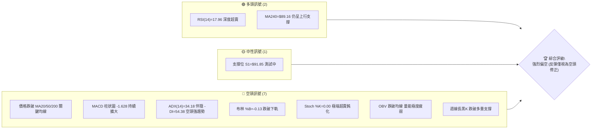
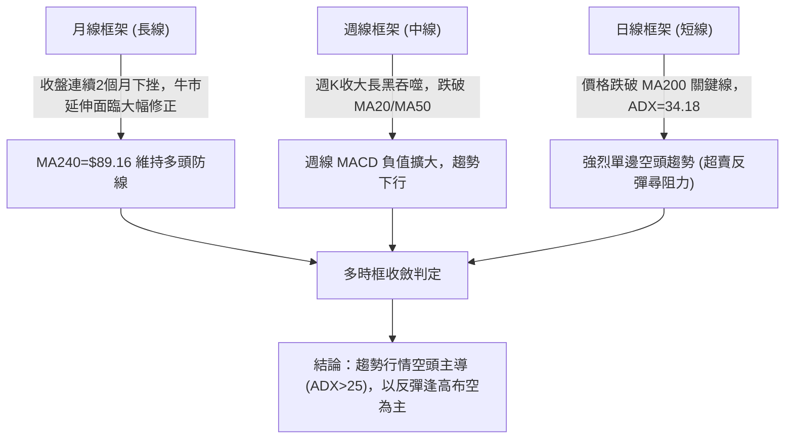
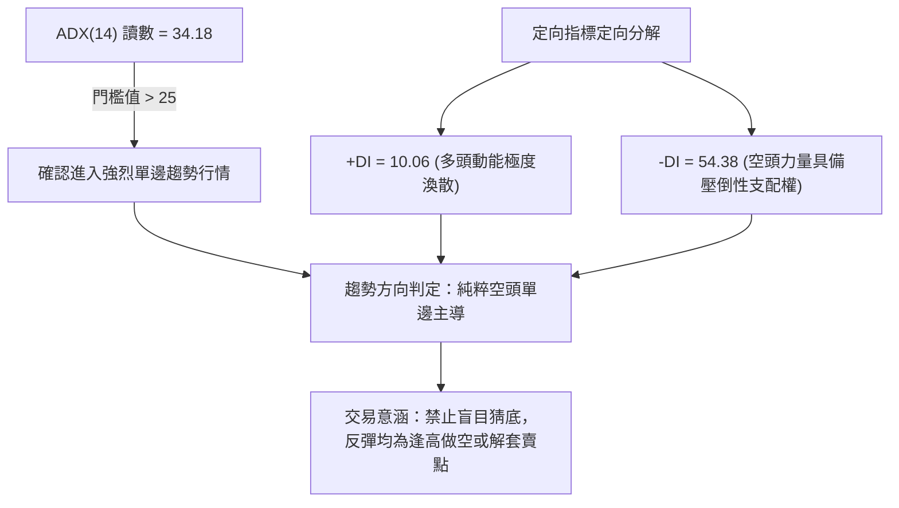
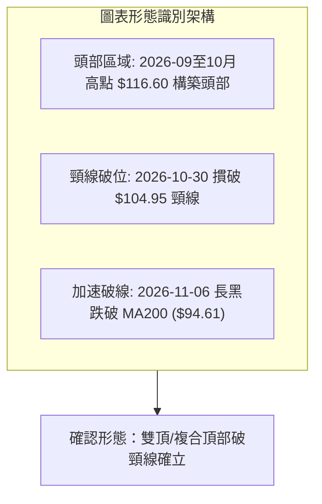
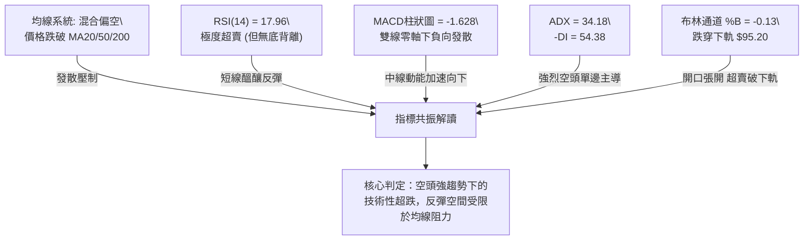
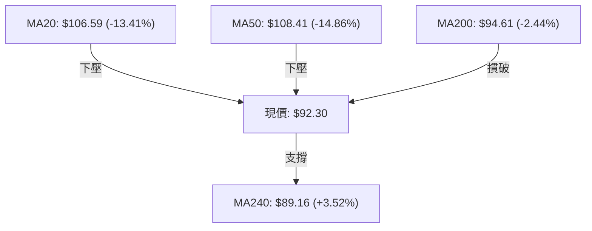
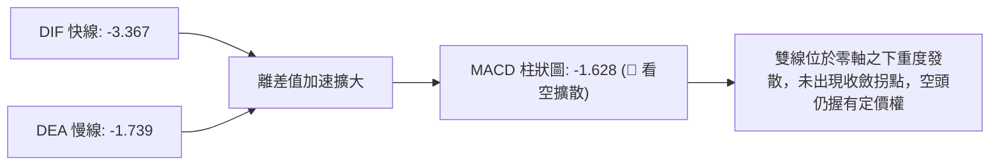
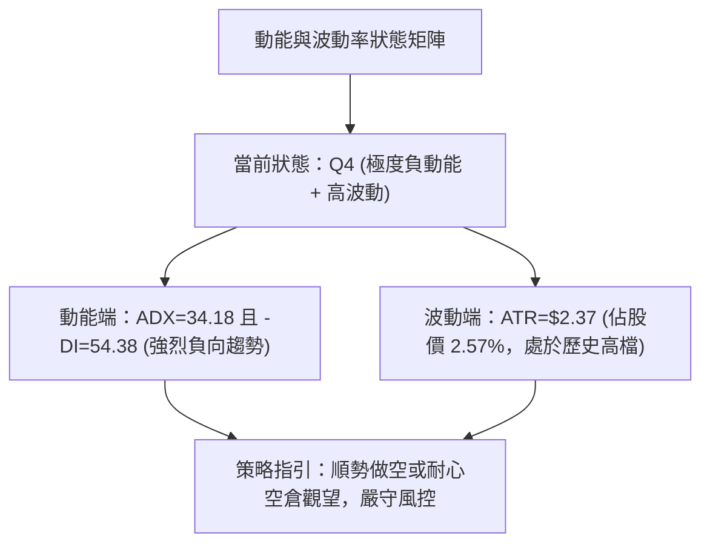
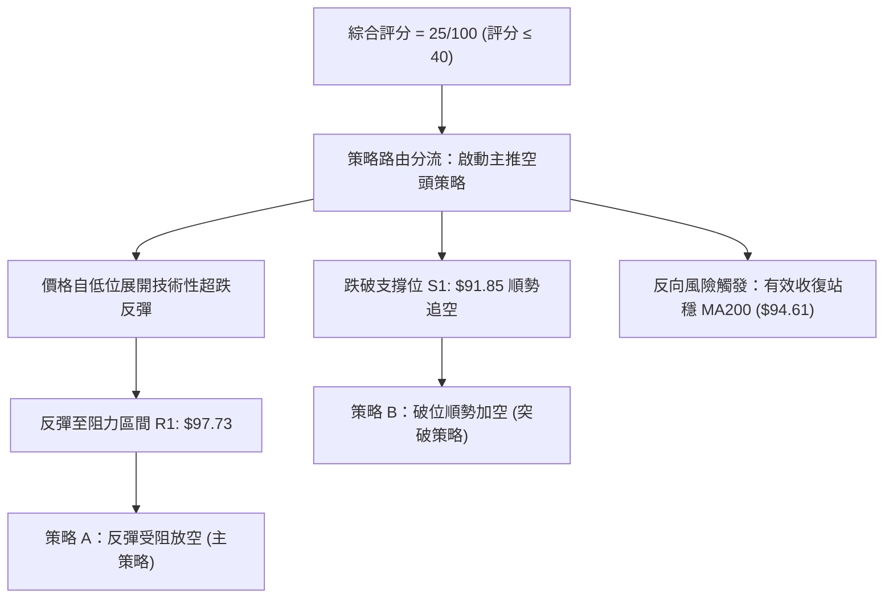
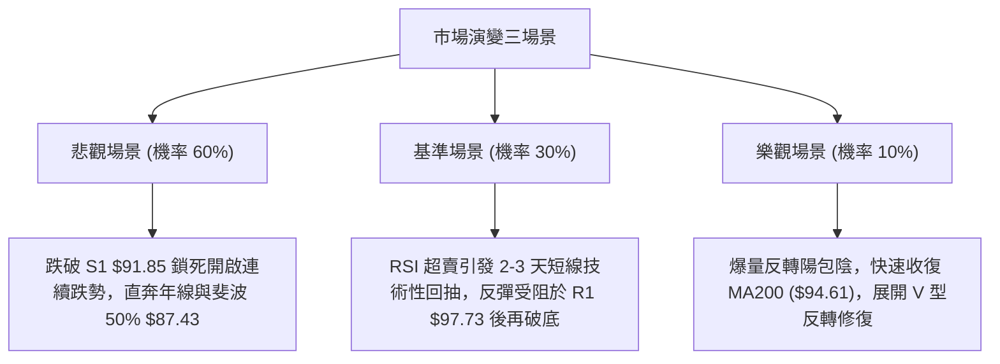

# 0050 技術分析報告

> **報告日期**：2026-11-07 ｜ **語言**：繁體中文 ｜ **數據來源**：Yahoo Finance ｜ **當前價格**：$92.30

---

## 目錄

| 章節 | 內容 |
|------|------|
| [1. 技術面概覽](#1-技術面概覽) | 訊號儀表板、核心指標、評分卡 |
| [2. 趨勢分析](#2-趨勢分析) | 多時框趨勢、長中短期走勢 |
| [3. 圖表形態分析](#3-圖表形態分析) | 形態識別、K線組合、目標價 |
| [4. 支撐與阻力](#4-支撐與阻力) | 關鍵價位、斐波那契回調 |
| [5. 技術指標深度解讀](#5-技術指標深度解讀) | MA/RSI/MACD/布林/成交量 |
| [6. 動能與波動率](#6-動能與波動率) | 動能評估、ATR、Beta |
| [7. 多時框架總結](#7-多時框架總結) | 時框架評分矩陣 |
| [8. 交易策略建議](#8-交易策略建議) | 多空策略、風險報酬比 |
| [9. 風險提示與監控](#9-風險提示與監控) | 監控指標、風險場景 |

---

## 1. 技術面概覽

### 🎯 技術訊號儀表板



### 📊 核心指標速覽表

| 指標類別 | 指標名稱 | 當前數值 | 訊號 | 解讀 |
|----------|----------|----------|------|------|
| **價格** | 當前收盤價 | $92.30 | 🔴 | 跌破 52 週中位線，位於 52W 區間 58.3% 水位 |
| **均線** | 短期 MA20 | $106.59 | 🔴 | 價格遠在 MA20 下方 -13.41%，短線空頭排列 |
| **均線** | 中期 MA50 | $108.41 | 🔴 | 價格遠在 MA50 下方 -14.86%，中期轉入空頭走勢 |
| **均線** | 長期 MA200 | $94.61 | 🔴 | 跌破牛熊分界線 MA200，長期趨勢受嚴重破壞 |
| **均線** | 超長期 MA240 | $89.16 | 🟢 | 價格仍在年線上方 +3.52%，為最後防線 |
| **動能** | RSI(14) | 17.96 | 🟢 | 進入極度超賣區（<20），短線具備技術性反彈動能 |
| **動能** | MACD(12,26,9) | -3.367 / -1.739 | 🔴 | MACD 雙線處於零軸下且負柱狀圖達 -1.628，空頭主導 |
| **動能** | KD(9,3,3) | %K: 0.00 / %D: 6.74 | 🔴 | 極端鈍化，空頭動能衰竭前兆但尚未出現金叉 |
| **趨勢** | ADX(14) | 34.18 (-DI: 54.38) | 🔴 | ADX>25 且 -DI 主導，確認強烈單邊空頭趨勢中 |
| **通道** | 布林通道 %B | -0.13 | 🔴 | 跌破布林下軌 $95.20，屬於通道下軌外極端偏離 |
| **波動** | ATR(14) | $2.37 (2.57%) | 🟡 | 日波動達 2.37 元，市場恐慌拋售情緒升溫 |
| **成交量** | 20日均量 / OBV | 153.6M / 疲弱 | 🔴 | OBV 趨勢低於均線，量能背離，呈現籌碼流出 |

### 🏆 技術評分卡

```
╔══════════════════════════════════════════════════════════════╗
║               技術評分卡 — 0050 (2026-11-07)                 ║
╠══════════════════════════════════════════════════════════════╣
║ 趨勢強度      ██████████████░░░░░░  30/100  🔴 極度偏空      ║
║ 動能指標      ████████░░░░░░░░░░░░  25/100  🔴 嚴重鈍化      ║
║ 支撐穩定度    ████████████░░░░░░░░  35/100  🔴 面臨破位      ║
║ 成交量配合    ████████░░░░░░░░░░░░  25/100  🔴 籌碼鬆動      ║
║ 形態完整度    ████████░░░░░░░░░░░░  20/100  🔴 頭部破頸      ║
║ 均線排列      ██████░░░░░░░░░░░░░░  15/100  🔴 空頭發散      ║
╠══════════════════════════════════════════════════════════════╣
║ 綜合評分      ████████░░░░░░░░░░░░  25/100  🔴 強烈偏空      ║
║ 評分公式      (30 + 25 + 35 + 25 + 20 + 15) ÷ 6 = 25/100      ║
╚══════════════════════════════════════════════════════════════╝
```

---

## 2. 趨勢分析

### 🌐 多時框趨勢分析



### 📈 長期趨勢 — 12個月走勢圖（Unicode）

```
0050 月線走勢圖（過去12個月：2025-12 至 2026-11）
價格軸 ($)
$115.00 ┤                                      ● (09月高點: 112.05)
$110.00 ┤                                  ●       ● (10月: 104.95)
$105.00 ┤                          ●   ●
$100.00 ┤                                              
$95.00  ┤                                              ●← 當前現價 $92.30
$90.00  ┤                      ● (04月: 89.95)
$85.00  ┤
$80.00  ┤              ● (02月: 80.66)
$75.00  ┤          ●
$70.00  ┤          
$65.00  ┤  ● (12月: 64.30)
$60.00  ┤
        └─────────────────────────────────────────────────────────
           12  01  02  03  04  05  06  07  08  09  10  11 (月份)
```

**走勢特徵分析表格**：

| 階段 | 期間涵蓋 | 價格區間 | 累積漲跌幅 | 階段走勢特徵解讀 |
|------|----------|----------|------------|------------------|
| 初段推升 | 2025-12 至 2026-02 | $64.30 → $80.66 | +25.44% | 均線多頭發散，主升段啟動 |
| 中段震盪 | 2026-02 至 2026-03 | $80.66 → $71.91 | -10.85% | 第一次深度洗盤，回測支撐 |
| 主升擴展 | 2026-03 至 2026-06 | $71.91 → $107.15 | +49.01% | 強烈單邊多頭，量價俱揚突破百元大關 |
| 高檔盤整 | 2026-06 至 2026-09 | $107.15 → $112.05| +4.57% | 創下歷史高檔聚類，動能逐漸出現頂部衰竭 |
| 急速崩跌 | 2026-09 至 2026-11 | $112.05 → $92.30 | -17.63% | 連續長黑破位，跌破 MA20/50/200，空頭反噬 |

### 📊 中期趨勢（週線分析）

```
週線支撐阻力結構示意圖
$116.60 ────────────────────────────────────────── 52W 最高點 / 極強阻力
$114.95 ───────────┬──────────────┬─────────────── 波段高點聚類
                   │              │
$107.35 ───────────┴──────────────┴─────────────── R2 (波段頸線密集阻力)
$102.83 ────────────────────────────────────────── 斐波那契 23.6% 回調位
$97.73  ────────────────────────────────────────── R1 (波段反彈第一阻力)
$94.32  ────────────────────────────────────────── 斐波那契 38.2% 回調位 / MA200 ($94.61)
$92.30  ══════════════════════════════════════════ 當前現價（破位邊緣）
$91.85  ------------------------------------------ S1 近期支撐（前波低點聚類）
$87.43  ────────────────────────────────────────── 斐波那契 50.0% 回調位
$71.10  ══════════════════════════════════════════ S2 中期強支撐（大波段起漲平台）
```

### ⚡ 趨勢強度評估（ADX 解讀）



**ADX 趨勢強度對照表**：

| ADX 數值區間 | 當前數值 | 當前市場狀態 | 操作策略指引 |
|--------------|----------|--------------|--------------|
| 0 – 20 | — | 盤整無趨勢 / 震盪走勢 | 區間震盪交易，高拋低吸 |
| 20 – 25 | — | 趨勢萌芽 / 方向選擇期 | 觀察突破方向，減少倉位 |
| **25 – 40** | **34.18** | **強烈趨勢階段（-DI=54.38）** | **順應強趨勢方向做空，嚴禁逆勢扛多單** |
| 40 – 60 | — | 極強趨勢 / 單邊暴衝 | 移動止損，跟隨趨勢至力竭 |
| 60 – 100 | — | 趨勢過熱 / 尾端力竭風險 | 預備獲利了結，防範報復性反轉 |

---

## 3. 圖表形態分析

### 🔍 形態識別系統



**形態信心度評估表**（依規則 15）：

| 形態 | 信心度 | 判斷依據（引用數據） | 完成度 | 目標價（附計算式） |
|------|--------|----------------------|--------|--------------------|
| 雙頂頸線破位 (M頭) | 85% | 兩次高點聚類於 $114.95–$116.60，2026-10-30 摜破波段低點頸線 R2 ($107.35) | 100% (已跌破) | 頸線 R2 ($107.35) − 形態高度 ($116.60 − $107.35 = $9.25) = **$98.10**（已滿足並超跌） |
| 複合頭部量度跌幅 | 70% | 區間整體震盪頂部 $116.60 摜破支撐 R1 ($97.73) | 90% | 第一阻力 R1 ($97.73) − 次級高度 ($107.35 − $97.73 = $9.62) = **$88.11**（逼近斐波 50% $87.43） |
| 破底旗形整理 | 45% | 訊號不足，僅做指標型解讀 | 30% | 數據中未偵測到完整次級旗形旗面，不予推算 |

### 🕯️ 重要K線形態分析

依規則 19，僅使用近 10 根日 K 與近 8 根週 K 實際數值進行分析：

| 日期（日K/週K） | 開 | 高 | 低 | 收 | K線形態 | 解讀 | 訊號 |
|------|----|----|----|----|---------|------|------|
| 2026-10-28 (日K) | 108.35 | 108.65 | 107.80 | 108.65 | 光頭光腳實體小紅K | 抵抗反彈但受制於前高，量能萎縮僅 50.9M | 🟡 |
| 2026-10-30 (日K) | 104.80 | 105.30 | 103.85 | 104.95 | 跳空下挫中黑K | 跳空下殺帶量 193.8M，實體摜穿短天期均線支撐 | 🔴 |
| 2026-11-03 (日K) | 102.50 | 103.35 | 100.50 | 100.60 | 長黑K收接近最低 | 空頭長驅直入，失守百元整數心理大關，量擴至 252.9M | 🔴 |
| 2026-11-04 (日K) | 101.55 | 101.65 | 97.55 | 99.85 | 長下影線中黑K | 盤中下探 97.55 爆出 389.9M 大量，多頭低接但收盤無力收復百元 | 🔴 |
| 2026-11-05 (日K) | 99.40 | 99.75 | 96.90 | 97.15 | 實體長黑K | 追殺放量至 425.1M，吞噬前日下影線，確立空方攻擊波 | 🔴 |
| 2026-11-06 (日K) | 92.30 | 92.30 | 92.30 | 92.30 | 一字跌停跳空長黑 | 開盤即收盤，全日鎖死於 92.30，成交量 0，恐慌流動性鎖死 | 🔴 |
| 2026-10-08 (週K) | 115.75 | 116.60 | 114.90 | 114.95 | 創高滯漲長上影十字符 | 創 52W 新高 116.60 後獲利回吐，高檔多空分歧極度嚴重 | 🔴 |
| 2026-10-16 (週K) | 114.20 | 114.95 | 108.55 | 109.00 | 高檔長黑吞噬K | 爆量 869.2M 長黑反轉，直接吞噬前兩週實體，空頭確立 | 🔴 |
| 2026-11-06 (週K) | 103.40 | 104.45 | 92.30 | 92.30 | 崩跌大長黑週K | 週跌幅高達 -12.05%，成交量爆出 1,210.8M 天量，長黑灌破 MA200 | 🔴 |

### 📉 ASCII 走勢形態示意圖

```
雙頂確立與頸線跌破形態示意圖：
$116.60 ─────────── 頂點A (10-08: 116.60)
                     /\            頂點B (10-02: 112.80)
                    /  \            /\
                   /    \          /  \
$107.35 ──────────/──────\────────/────\───────── 頸線位 R2 ($107.35)
                 /        \      /      \
                /          \____/        \
$97.73  ───────/──────────────────────────\────── 支撐轉阻力 R1 ($97.73)
              /                            \
$92.30  ═════/══════════════════════════════\═══ 崩跌破位現價 ($92.30)
                                             ▼ 
$87.43  ----------------------------------------- 斐波那契 50.0% 目標位
```

### 🎯 形態目標價計算

1. **基本 M 頭形態高度推算**：
   - 頂部最高價：$116.60 (2026-10-08 高點)
   - 頸線位置：R2 $107.35
   - 形態垂直高度 $H = 116.60 - 107.35 = 9.25$
   - 最低滿足目標價 $T_{M1} = \text{頸線} - H = 107.35 - 9.25 = \mathbf{\$98.10}$（現價 $92.30 已完全灌破此目標）。

2. **擴展量度跌幅推算（跌破次級平台 R1）**：
   - 次級平台頸線：R1 $97.73
   - 箱體次波高度 $H_2 = 107.35 - 97.73 = 9.62$
   - 空頭等幅延伸目標價 $T_{M2} = \text{平台頸線} - H_2 = 97.73 - 9.62 = \mathbf{\$88.11}$
   - **數值對應**：此推算數值 $88.11 緊密貼合斐波那契 50.0% 回調位 **$87.43** 及 MA240 年線 **$89.16**，構成中線空頭滿足強共振區。

---

## 4. 支撐與阻力

### 🗺️ 關鍵價位分布圖（Unicode）

```
0050 價位結構分布圖
═══════════════════════════════════════════════════
$110.55 ║████████████████████████║ 強阻力 R3 (波段高點密集區)
$107.35 ║████████████████████    ║ 阻力 R2 (原M頭頸線重壓)
$97.73  ║████████████████████████║ 關鍵阻力 R1 (反彈第一壓力線)
$94.32  ║▓▓▓▓▓▓▓▓▓▓▓▓▓▓▓▓▓▓▓▓    ║ 斐波那契 38.2% 回調位 / MA200 ($94.61)
$92.30  ╠════════════════════════╣ ◄ 當前現價 ($92.30)
$91.85  ║▓▓▓▓▓▓▓▓▓▓▓▓▓▓▓▓        ║ 近期支撐 S1 (前波波段低點)
$87.43  ║▒▒▒▒▒▒▒▒▒▒▒▒▒▒▒▒▒▒▒▒    ║ 斐波那契 50.0% 回調關鍵強支撐
$71.10  ║████████████████████████║ 強支撐 S2 (大週期波段起漲聚類)
$60.69  ║████████████████████████║ 極強終極支撐 S3 (52W 低點保護區)
═══════════════════════════════════════════════════
```

### 🚧 阻力位分析表

價位引自關鍵數據波段高點聚類與 OHLCV 計算：

| 阻力級別 | 價位 | 形成原因 | 突破難度 | 重要性 |
|----------|------|----------|----------|--------|
| **R1** | $97.73 | 近一年波段高點聚類下緣、11/04-11/05 實體破位區 | 中等偏高 | 🟢 短線反彈多空分水嶺，不突破仍屬弱勢反抽 |
| **R2** | $107.35 | M頭頸線位、密集換手籌碼套牢平台、20日均線區 ($106.59) | 極高 | 🟡 中期強阻力，反彈至此將遭遇龐大解套拋壓 |
| **R3** | $110.55 | 前波歷史高檔密集震盪成交帶，多頭力竭反轉發起點 | 極難突破 | 🔴 長期阻力壁壘，短期內難以觸及 |

### 🛡️ 支撐位分析表

價位引自關鍵數據波段低點聚類與 OHLCV 計算：

| 支撐級別 | 價位 | 形成原因 | 守住機率 | 重要性 |
|----------|------|----------|----------|--------|
| **S1** | $91.85 | 近一年波段低點聚類、距離現價僅 -0.49% | 35% (偏低) | 🔴 當前唯一短線微弱支撐，失守將直探年線 |
| **S2** | $71.10 | 2026年首季起漲箱體主平台、近一年強聚類支撐 | 85% (極高) | 🟢 戰略級長期買盤進駐區，崩盤極端情境底線 |
| **S3** | $60.69 | 52週歷史低點 ($58.27) 聚類防禦帶 | 95% (極高) | 🟢 終極估值與歷史大底，失守概率極微 |

### 📐 斐波那契回調位分析

依據 52 週極值區間 **$58.27 → $116.60**（垂直落差 $58.33）計算：

| 斐波那契位 | 精確價位 | 現價相對位置與技術意涵解讀 |
|------------|----------|----------------------------|
| 0.0% (52W High) | $116.60 | 歷史極值高點，頂部形成 |
| 23.6% | $102.83 | 已被大黑K長驅摜破，由支撐轉化為中期阻力 |
| 38.2% | $94.32 | 原多頭強勢回檔極限，當前現價 $92.30 **已正式失守**，確認轉入深幅修正 |
| **50.0%** | **$87.43** | **關鍵半數回吐位，與 MA240 年線 ($89.16) 形成多頭最後防線聚落** |
| 61.8% | $80.55 | 黃金分割強防守位，若跌破象徵 52 週牛市架構全盤崩潰 |
| 78.6% | $70.75 | 深度回撤保護帶，緊鄰支撐位 S2 ($71.10) |
| 100.0% (52W Low)| $58.27 | 全週期牛市起點 |

**位置解讀**：現價 **$92.30** 精確座落於 **38.2% ($94.32)** 與 **50.0% ($87.43)** 之間。失守 38.2% 回調位標誌著多頭結構嚴重破壞，空頭重力正將價格直接拖向 50.0% ($87.43) 關鍵防線。

---

## 5. 技術指標深度解讀

### 🎛️ 指標訊號總覽



### 📈 移動平均線排列分析



**均線狀態明細表**：

| 天期 | 當前數值 | 與現價乖離 | 走勢特徵 | 訊號 |
|------|----------|------------|----------|------|
| MA5 | $98.80 | -6.58% | 急速陡峭下彎，短線反彈第一道天花板 | 🔴 |
| MA10 | $102.83 | -10.24% | 下穿長期均線，構成死亡交叉矩陣 | 🔴 |
| MA20 | $106.59 | -13.41% | 月線下傾加速，形成強力空頭趨勢阻力 | 🔴 |
| MA50 | $108.41 | -14.86% | 季線高檔走平後反轉下彎 | 🔴 |
| MA60 | $107.83 | -14.40% | 頂部均線密集下壓 | 🔴 |
| MA120| $105.20 | -12.26% | 半年線失守，中長期籌碼全數套牢 | 🔴 |
| MA200| $94.61 | -2.44% | **牛熊分界線失守**，自 2026 年初以來首度跌破 | 🔴 |
| MA240| $89.16 | +3.52% | 仍維持上升斜率，年線為多方最後堡壘 | 🟢 |

### 📉 RSI(14) 分析

- **當前 RSI(14) 讀數**：`17.96`（Wilder 計算法）
- **RSI 強度進度條**：
  ```
  RSI(14): [███░░░░░░░░░░░░░░░░░] 17.96% (極度超賣區 < 20)
  ```
- **超買超賣狀態**：低於 20 屬於統計學上的「極端超賣」狀態，一般情況下隨時可能引發空頭回補帶動的技術性抽頭反彈。
- **背離判斷**：數據明確顯示「**無明顯背離**」。比較近 20 根 K 棒，價格自高檔急墜，RSI 同步下殺穿透 20，價格創近半年新低而 RSI 亦創下新低，**並無形成底背離**。此現象反映出當前下殺並非動能竭盡，而是伴隨強烈殺盤動能的真實破位。

### 📊 MACD(12/26/9) 訊號解讀



- **MACD 數值**：DIF `-3.367`，Signal `-1.739`，柱狀圖 Hist `-1.628`。
- **訊號特徵**：柱狀圖呈現持續向下擴展的深紅實體，顯示下墜的加速度並未收斂。零軸之下的死叉發散屬於最具殺傷力的主跌段訊號。

### 📦 布林通道分析

```
布林通道當前結構示意圖 (Bandwidth = 21.38%)
$117.99 ────────────────────────────────────────── BB 上軌
$106.59 ────────────────────────────────────────── BB 中軌 (MA20)
$95.20  ────────────────────────────────────────── BB 下軌
$92.30  ══════════════════════════════════════════ 當前現價 (%B = -0.13)
```

- **通道參數解讀**：上軌 $117.99，中軌 $106.59，下軌 $95.20。
- **%B 位置解讀**：當前 `%B = -0.13`，代表收盤價已經跌穿布林通道下軌（破軌幅度達下軌下方 2.90 元）。
- **通道走勢**：帶狀通道呈現擴散擴張張口狀態，價格緊貼並跌破下軌運行，屬於標準的「強趨勢破軌下行」形態，並非盤整市場的通道回歸。

### 💹 成交量分析（量價配合度）

- **最新成交量**：`0`（2026-11-06 因鎖死跌停導致流動性枯竭無量）。
- **20日均量**：`153,647,052` 股。
- **50日均量**：`103,335,785` 股。
- **量價形態**：
  1. 11/04-11/05 下跌過程中爆出 389.9M 與 425.1M 的天量拋售，量比達 20 日均量的 2.5–2.7 倍，顯示法人停損籌碼傾巢而出。
  2. 週成交量更於 11/06 當週飆升至 1,210.8M，為下半年最大單週放量。
- **OBV 趨勢解讀**：數據指出「`OBV < MA → 量能疲弱`」。能量潮指標低於其均線且呈現向下發散，量能完全無法支持多頭反轉，確認了價格下跌具備極高的真實籌碼外流支撐。

---

## 6. 動能與波動率

### ⚡ 動能評估四象限

| 象限 | 動能維度 | 波動率維度 | 當前技術指標落點 | 市場狀態評估與策略對策 |
|------|----------|------------|------------------|------------------------|
| Q1 | 強動能 (多頭) | 低波動 | — | 穩定多頭主升段，加碼持股 |
| Q2 | 弱動能 (中性) | 低波動 | — | 狹幅無聊盤整，等待突破 |
| Q3 | 強動能 (多頭) | 高波動 | — | 高風險高收益，末升段追價 |
| **Q4** | **強空頭動能** | **高波動** | **✓ 當前 0050 落點** | **恐慌拋售主跌段，空方全面掌控，嚴禁逆勢接刀** |



### 📊 ATR 波動率分析

- **ATR(14) 讀數**：`$2.37`（Wilder 平滑法），佔當前股價高達 `2.57%`。
- **波動意涵**：0050 作為權值 ETF，單日 ATR 突破 2 元以上代表大盤波動極端劇烈。
- **風控與止損設定**：
  - 超短線交易止損安全邊界至少須預留 $1.5 \times \text{ATR} = 1.5 \times \$2.37 = \mathbf{\$3.56}$。
  - 波段空單防守點至少須設定為 $2.0 \times \text{ATR} = 2.0 \times \$2.37 = \mathbf{\$4.74}$。
  - 由於價格波動擴大，持倉部位規模建議調降至一般水準之 50%–60%，防範高波動造成的資金回撤。

### 📐 Beta 與市場相關性

- **Beta 數值**：`N/A（數據未提供）`。
- **結構性替代說明**：0050 為追蹤臺灣 50 指數之權值旗艦 ETF，其成分股涵蓋台灣證券市場權值核心龍頭企業，技術走勢與大盤加權指數具備絕對高度正相關。0050 破位帶動之均線死叉，充分映射整體權值市場正遭遇系統性資金減碼。

---

## 7. 多時框架總結

### 📋 時框架評分表

| 時框架 | 趨勢方向 | 動能狀態 | 均線排列 | 圖表形態 | 綜合評分 | 操作建議 |
|--------|----------|----------|----------|----------|----------|----------|
| **月線** | 偏多轉震盪 | 頂部動能趨緩 | MA240多頭守護 | 雙頂高位受阻 | 40/100 | 長線資金減碼防禦 |
| **週線** | 空頭起跌 | MACD負值急增 | 跌破中短期均線 | 高檔爆量吞噬長黑 | 20/100 | 中線停損避險 |
| **日線** | 強烈單邊空 | RSI<20/ADX>25 | 均線全數下彎 | 崩跌破下軌一字長黑 | 15/100 | 逢反彈尋找空點 |

### 🔲 綜合訊號矩陣

| 技術維度 | 短期（日線）訊號 | 中期（週線）訊號 | 長期（月線）訊號 | 時框收斂一致性 |
|----------|------------------|------------------|------------------|----------------|
| **趨勢 (Trend)** | 🔴 強烈空頭 | 🔴 空頭吞噬 | 🟡 震盪偏多轉弱 | 中短期同步偏空 |
| **動能 (Momentum)**| 🔴 -DI 壓倒性勝出 | 🔴 MACD柱狀擴大 | 🟡 漲勢終結回調 | 動能全面轉空 |
| **均線 (MA)** | 🔴 跌破 MA20/50/200 | 🔴 跌破 MA20/50 | 🟢 位於 MA240 之上 | 均線系統嚴重受損 |
| **量能 (Volume)** | 🔴 爆量下殺後鎖死 | 🔴 週K天量長黑 | 🟡 高檔天量滯漲 | 籌碼顯著鬆動 |
| **總結定性** | **極度危險** | **主跌修正** | **大週期測試支撐**| **多時框偏空共振** |

### ⚖️ 多時框收斂結論

依據多時框收斂優先級規則（規則 14）：
1. **趨勢/盤整判定**：當前 ADX(14) 為 `34.18`（明顯大於 25 臨界值），且伴隨 `-DI = 54.38`，確認市場正處於**極度強烈的單邊空頭趨勢行情**中，而非盤整震盪。
2. **主導時框優先級**：在強趨勢中，以中長期方向（週線大長黑與日線跌破 MA200）為主導方向。短線（日線）出現的 RSI=17.96 深度超賣，**不得解讀為趨勢反轉，僅能作為空頭行情中的「尋找反彈沽空/調節進場點」之參照**。
3. **唯一方向性結論**：**強烈偏空（逢反彈做空為主）**。

---

## 8. 交易策略建議

### 🗺️ 策略決策流程圖



### 🧭 策略路由（依評分卡分流）

**當前主策略方向 = 強烈偏空（依評分 25/100，啟動做空主推策略）**

### 🎯 價格情境階梯（Price Scenarios）

價位嚴格引用關鍵價位計算數值：

| 觸發條件 | 下一目標 | 後續延伸 | 情境含義 |
|----------|----------|----------|----------|
| 跌破支撐 S1 $91.85 | 斐波 50% $87.43 | 支撐 S2 $71.10 | 空頭主跌加速，直探年線與中期大底 |
| 弱勢維持現價區間 | 支撐 S1 $91.85 | 阻力 R1 $97.73 | 極端超賣暫時鈍化，空方換手盤整 |
| 向上反彈測試 R1 $97.73 | 阻力 R2 $107.35 | 阻力 R3 $110.55 | 空頭回補反抽，若未能收復 R1 仍屬空方誘多 |

### 📊 情境機率分佈

| 情境 | 機率 | 主要依據 |
|------|------|----------|
| **跌破 S1 繼續探底 (主情境)** | **60%** | ADX=34.18 強烈空頭發散、週K天量收跌停、OBV 趨勢極弱 |
| **弱勢弱反彈測試 R1 (次情境)**| **30%** | RSI(14)=17.96 深度超賣、布林 %B=-0.13 偏離下軌過劇 |
| **全面反轉收復 R2 (極端情境)**| **10%** | 均線全面下彎死叉，中短期均線壓頂，短期缺乏利多支撐 |

### 🔴 主策略詳情（空頭策略）

依規則 17 規範之風險報酬比計算：做空時風險報酬比 = (進場價 − 目標價 T1) ÷ (止損價 − 進場價)。

| 策略要素 | 策略 A（反彈高空 — 逢高狙擊） | 策略 B（破位追空 — 順勢突破） |
|----------|-------------------------------|-------------------------------|
| **操作方向** | 做空 (反彈空) | 做空 (破位空) |
| **進場條件** | 日線反彈觸及阻力位 R1 出現上影線轉折 | 價格實體跌穿關鍵支撐 S1 |
| **進場價格** | **$97.73** (精確以 R1 價格計) | **$91.85** (精確以 S1 價格計) |
| **目標價 T1** | **$87.43** (斐波那契 50.0% 回調位) | **$87.43** (斐波那契 50.0% 回調位) |
| **目標價 T2** | **$80.55** (斐波那契 61.8% 回調位) | **$71.10** (支撐位 S2) |
| **止損價格** | **$102.83** (斐波那契 23.6% 回調位) | **$94.32** (斐波那契 38.2% 回調位) |
| **風險報酬比**| **1 : 2.02（以 T1 計）**<br>*(97.73 - 87.43) ÷ (102.83 - 97.73) = 10.30 ÷ 5.10 = 2.02* | **1 : 1.79（以 T1 計）**<br>*(91.85 - 87.43) ÷ (94.32 - 91.85) = 4.42 ÷ 2.47 = 1.79* |
| **T2 風險報酬比**| 1 : 3.37（以 T2 計）<br>*(97.73 - 80.55) ÷ (102.83 - 97.73) = 17.18 ÷ 5.10* | 1 : 8.40（以 T2 計）<br>*(91.85 - 71.10) ÷ (94.32 - 91.85) = 20.75 ÷ 2.47* |
| **成功機率** | 65% | 70% |
| **建議倉位** | 15% 總資金 | 10% 總資金 |

### 🟢 反向風險觸發點（對沖提示）

- **推翻做空假設點位**：若日線級別收盤價強勢跳空站穩 **MA200 ($94.61)** 與 **斐波那契 38.2% ($94.32)** 之上，則代表破位為「假跌破」洗盤陷阱。
- **對沖應對指引**：凡在 $97.73 或 $91.85 建立之空單，於收盤突破止損價時必須堅決停損離場，不得轉為凹單。中長線持股投資人可在此時利用反向 ETF 或小口數台指期貨空單解除避險部位。

### ⭐ 整體訊號強度評星

```
做多訊號強度：★☆☆☆☆  (1/5星 - 僅存超賣指標，多頭動能潰敗)
做空訊號強度：★★★★☆  (4/5星 - 破位帶量，空頭強趨勢確立)
整體可信度：  ★★★★☆  (4/5星 - 多時框共振一致向下)
```

---

## 9. 風險提示與監控

### ✅ 關鍵監控指標 Checklist

```
╔══════════════════════════════════════════════════════════════╗
║               0050 每日風控監控清單 (Checklist)               ║
╠══════════════════════════════════════════════════════════════╣
║ [ ] 監控支撐位 S1 ($91.85) 是否於盤中被帶量有效摜破          ║
║ [ ] 觀察 RSI(14) 是否自超賣區 (17.96) 向上回勾突破 30 形成金叉║
║ [ ] 追蹤成交量是否在 11/06 跌停鎖死後恢復流動性，出現低接巨量 ║
║ [ ] 檢視 MACD 柱狀圖 (-1.628) 是否停止向下發散並出現首根收斂 ║
║ [ ] 監控反彈行情中，能否挑戰第一阻力位 R1 ($97.73)            ║
║ [ ] 嚴密防守 MA240 年線 ($89.16) 與斐波 50% ($87.43) 防禦力  ║
╚══════════════════════════════════════════════════════════════╝
```

### ⚠️ 風險場景分析



### 🛡️ 風險管理重要提醒

1. **流動性凍結風險**：11/06 日K成交量為 0 且開盤即為收盤價 $92.30，顯示賣壓沉重導致撮合流動性嚴重受阻。在流動性未恢復正常（日成交量回升至 20 日均量 150M 以上）前，切忌以市價單盲目抄底，避免承擔開盤滑點風險。
2. **波動率部位縮減原則**：當前 ATR(14) 達 $2.37（佔股價 2.57%），屬於極高波動區間。任何新進場部位之單筆最大名義虧損，嚴格限制不得超過總交易帳戶淨值的 1.5%。
3. **金字塔分批原則**：目前市場處於單邊強烈空頭（ADX=34.18），即便是空單順勢操作，亦嚴禁一次性重倉追擊，應採取「破位 S1 先建底倉 10%，反彈加碼至 15%」之審慎紀律。

---

## 📋 報告總結

```
╔══════════════════════════════════════════════════════════════╗
║                    0050 技術分析報告總結                     ║
╠══════════════════════════════════════════════════════════════╣
║ 報告日期：2026-11-07                                         ║
║ 當前價格：$92.30                                             ║
║ 分析評級：🔴 強烈偏空（綜合評分 25/100）                    ║
╠══════════════════════════════════════════════════════════════╣
║ 關鍵結論：                                                   ║
║ ├─ 長期趨勢：🟡 長期牛市架構遭遇大幅修正，年線 MA240 面臨考驗║
║ ├─ 中期趨勢：🔴 週線天量長黑吞噬破頸線，中期反轉確立        ║
║ ├─ 短期趨勢：🔴 均線空頭排列，布林下軌破位，強烈單邊下跌    ║
║ ├─ 關鍵支撐：S1 $91.85 / 斐波 50% $87.43                     ║
║ ├─ 關鍵阻力：R1 $97.73 / R2 $107.35                         ║
║ └─ 下行目標：形態量度目標 $88.11 / 斐波 50% $87.43           ║
╠══════════════════════════════════════════════════════════════╣
║ 最優策略組合：                                               ║
║ 1. 🥇 最佳機會：等待超跌弱勢反彈至 R1 $97.73 附近佈局做空    ║
║ 2. 🥈 次選機會：摜破 S1 $91.85 後順勢空單追擊，看至 $87.43  ║
║ 3. 🥉 保守選擇：多頭現貨投資者空倉觀望，待築底底背離確認再進 ║
╚══════════════════════════════════════════════════════════════╝
```

---

> ⚠️ **免責聲明**：本報告為技術分析研究成果，所有技術價位、指標判斷與策略模型均基於歷史量價數據之客觀演算。本報告**僅供研究與學術參考**，**不構成任何形式之明示或暗示投資建議**。市場具有高度不確定性，金融商品價格波動劇烈，投資人應獨立審慎評估風險並自負盈虧。

---

*報告生成時間：2026-11-07 ｜ 數據來源：Yahoo Finance ｜ 分析框架：多時框技術分析體系*