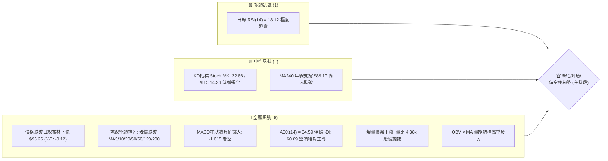
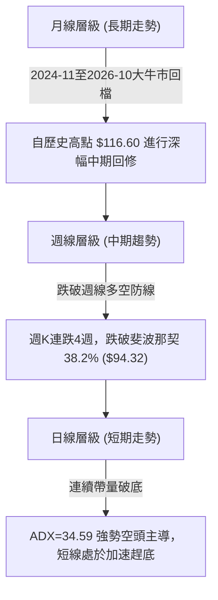
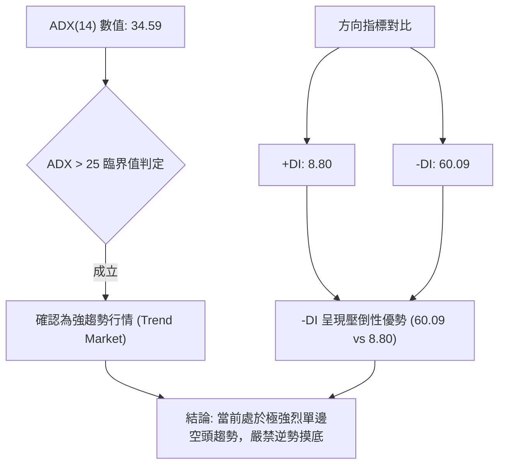
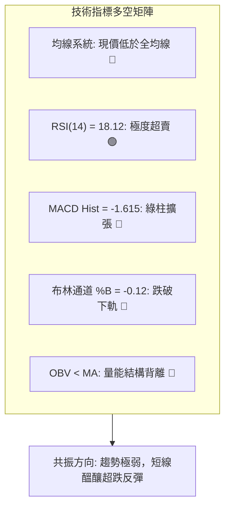
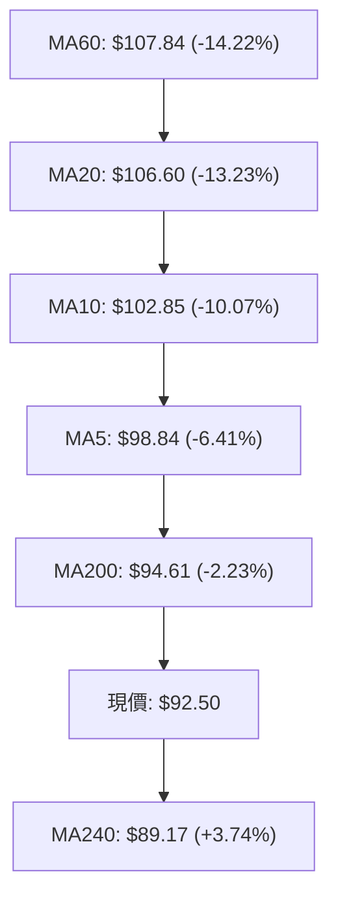
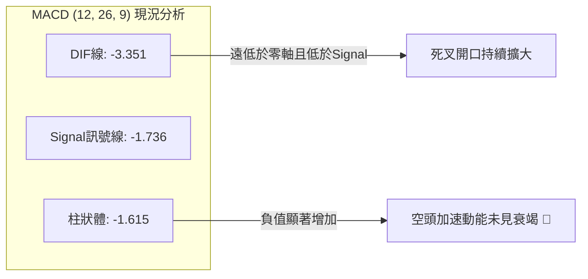
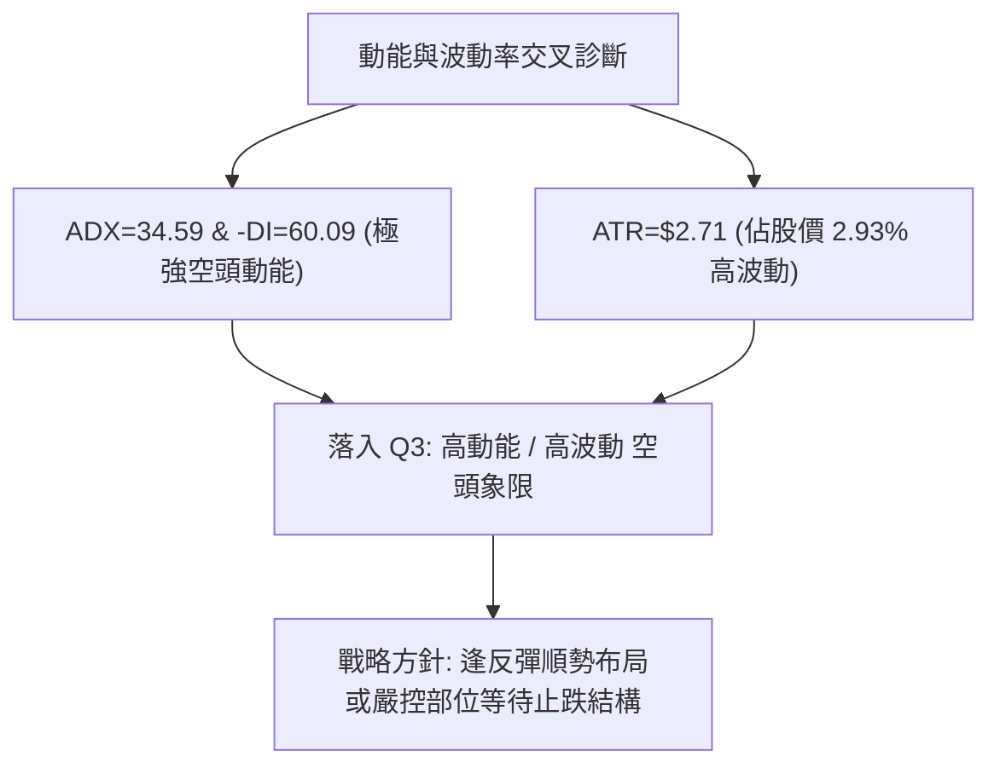
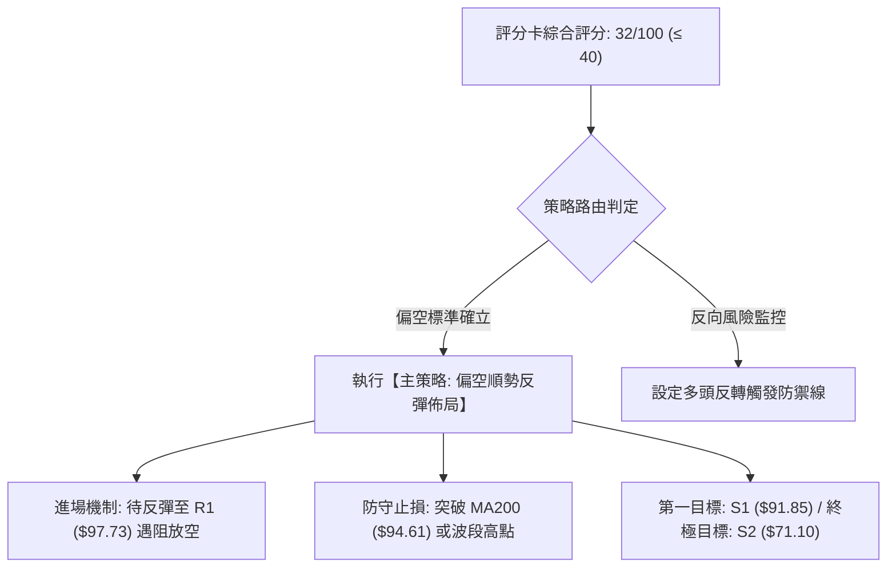
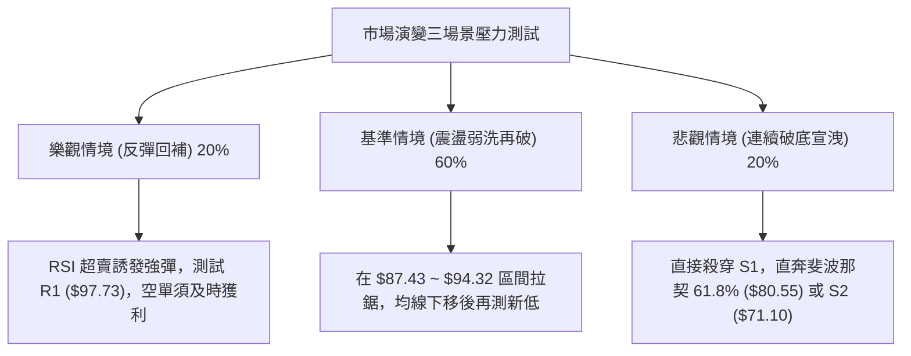

# 0050 技術分析報告

> **報告日期**：2026-11-09 ｜ **語言**：繁體中文 ｜ **數據來源**：Yahoo Finance ｜ **當前價格**：$92.50 TWD

---

## 目錄

| 章節 | 內容 |
|------|------|
| [1. 技術面概覽](#1-技術面概覽) | 訊號儀表板、核心指標、評分卡 |
| [2. 趨勢分析](#2-趨勢分析) | 多時框趨勢、長中短期走勢、ADX強趨勢解讀 |
| [3. 圖表形態分析](#3-圖表形態分析) | 形態識別信心度、10日K線與8週K線組合、目標價推算 |
| [4. 支撐與阻力](#4-支撐與阻力) | 關鍵價位結構、斐波那契回調位精確解析 |
| [5. 技術指標深度解讀](#5-技術指標深度解讀) | 均線系統、RSI極限超賣、MACD空頭、布林破軌、爆量分析 |
| [6. 動能與波動率](#6-動能與波動率) | 動能四象限、ATR波動風險、Beta特徵 |
| [7. 多時框架總結](#7-多時框架總結) | 時框架矩陣、ADX強趨勢優先級收斂 |
| [8. 交易策略建議](#8-交易策略建議) | 策略路由分流、主策略進出場、精確風險報酬比 |
| [9. 風險提示與監控](#9-風險提示與監控) | 監控Checklist、三情境壓力測試、部位管控 |
| [報告總結](#-報告總結) | 執行摘要與分析師結論 |

---

## 1. 技術面概覽

### 🎯 技術訊號儀表板



### 📊 核心指標速覽表

| 指標類別 | 指標名稱 | 當前數值 | 訊號 | 解讀 |
|----------|----------|----------|------|------|
| **價格** | 當前收盤價 | $92.50 | 🔴 | 跌破所有中短期均線及MA200，測試年線與S1 |
| **均線** | MA20 (月線) | $106.60 | 🔴 | 價格低於MA20達 -13.23%，下行斜率陡峭 |
| **均線** | MA50 (季線) | $108.41 | 🔴 | 價格低於MA50達 -14.68%，中期趨勢轉空 |
| **均線** | MA200 (半年線/年線過渡) | $94.61 | 🔴 | 價格跌破長期關鍵均線 -2.23%，長多結構遭破壞 |
| **動能** | RSI(14) | 18.12 | 🟢 | 跌入極度超賣區（<20），短線具備技術性乖離反彈動能 |
| **動能** | MACD (12, 26, 9) | -3.351 / -1.736 | 🔴 | DIF跌破MACD訊號線，柱狀體 -1.615 顯著擴大，空頭加速 |
| **波動** | ATR(14) | $2.71 | 🔴 | 佔股價 2.93%，單日波動劇烈放大，下檔風險未消退 |

### 🏆 技術評分卡

```
╔══════════════════════════════════════════════════════════════╗
║                技術評分卡 — 0050 (2026-11-09)                 ║
╠══════════════════════════════════════════════════════════════╣
║ 趨勢強度 (空頭)  ████████████████░░░░  80/100  🔴 強空趨勢   ║
║ 動能指標         ████░░░░░░░░░░░░░░░░  20/100  🔴 嚴重偏弱   ║
║ 支撐穩定度       ██████░░░░░░░░░░░░░░  30/100  🔴 面臨破位   ║
║ 成交量配合       ████░░░░░░░░░░░░░░░░  20/100  🔴 帶量下殺   ║
║ 形態完整度       ████░░░░░░░░░░░░░░░░  20/100  🔴 破位下行   ║
║ 均線排列         ████░░░░░░░░░░░░░░░░  20/100  🔴 空頭發散   ║
╠══════════════════════════════════════════════════════════════╣
║ 綜合評分         ██████░░░░░░░░░░░░░░  32/100  🔴 強烈偏空   ║
║ (依規則18：(80+20+30+20+20+20)/6 = 31.67，四捨五入為 32/100) ║
╚══════════════════════════════════════════════════════════════╝
```

---

## 2. 趨勢分析

### 🌐 多時框趨勢分析



### 📈 長期趨勢 — 12個月走勢圖（Unicode）

```
0050 月線走勢圖（過去12個月：2025-12 至 2026-11）
價格軸 ($)
$115 ┤                                    ● 112.05 (2026-09)
$110 ┤                            ● 107.15    ● 106.25    ● 104.95
$105 ┤                    ● 104.76    ● 102.85
 $95 ┤                                                    ● 92.50 ← 現價
 $90 ┤            ● 89.95
 $80 ┤    ● 80.66
 $70 ┤● 64.30 ● 72.16 ● 71.91
     └────────────────────────────────────────────────────────────
       12   01   02   03   04   05   06   07   08   09   10   11 (月份)
      25年 ------------------------- 2026年 -----------------------
```

#### 走勢特徵分析表格

| 階段 | 期間 | 價格區間 | 累積漲跌幅 | 趨勢結構特徵 |
|------|------|----------|------------|--------------|
| **第 I 階段：初升段** | 2025-12 ~ 2026-02 | $64.30 → $80.66 | +25.44% | 平台突破，多頭均線發散，量能溫和增溫 |
| **第 II 階段：中繼段** | 2026-02 ~ 2026-04 | $80.66 → $89.95 | +11.52% | 歷經 3 月回檔至 $71.91 洗盤後強勢V轉創高 |
| **第 III 階段：主升段**| 2026-04 ~ 2026-09 | $89.95 → $112.05 | +24.57% | 沿五日線上攻，創下52週高點 $116.60 (2026-10-08) |
| **第 IV 階段：反轉修正**| 2026-10 ~ 2026-11 | $112.05 → $92.50 | -17.45% | 高檔爆量滯漲後失守短期均線，呈現無支撐跳水 |

### 📊 中期趨勢（週線分析）

中期走勢自 2026-10-08 創下 52 週高點 $116.60 後迅速見頂反轉。近 4 週收盤價呈現階梯式滑落：$109.00 → $106.90 → $104.95 → $92.50。

```
中期關鍵壓力與支撐階梯（週線層級）
$116.60 ──────────────────────────────── 52W 高點 (強阻力頂部)
           ▼
$107.35 ──────────────────────────────── R2 (前波頸線密集套牢區)
           ▼
$97.73  ──────────────────────────────── R1 (反彈初步阻力)
           ▼
$94.32  ──────────────────────────────── 斐波那契 38.2% 回調位 (已跌破)
           ▼
$92.50  ════════════════════════════════ 【目前現價】
           ▼
$91.85  ──────────────────────────────── S1 (近一年波段低點聚類支撐)
           ▼
$87.43  ──────────────────────────────── 斐波那契 50.0% 關鍵心理大關
```

### ⚡ 趨勢強度評估（ADX 解讀）



#### ADX 強度對照表

| 指標名稱 | 實際數值 | 參考門檻 | 當前技術含義 |
|----------|----------|----------|--------------|
| **ADX(14)** | 34.59 | > 25 (強趨勢) | 趨勢動能強勁，價格呈現非盤整的定向單邊宣洩行情 |
| **+DI** | 8.80 | < 20 (極端低迷) | 多頭買盤動能已完全萎縮，無法組織防線 |
| **-DI** | 60.09 | > 40 (極度強勢) | 空方主導權達到歷史高位，拋售壓力極度沉重 |
| **行情定性** | **空頭趨勢行情** | -DI >> +DI 且 ADX 爬升 | 任何短線反彈皆屬空頭回補（技術性修復），非趨勢反轉 |

---

## 3. 圖表形態分析

### 🔍 形態識別系統


#### 形態識別信心度評估表（依規則 15）

| 形態 | 信心度 | 判斷依據（引用數據） | 完成度 | 目標價（附計算式） |
|------|--------|----------------------|--------|--------------------|
| **雙重頂 (M頭)** | 75% | 2026-09-24 週高 $113.75 與 2026-10-08 週高 $116.60 構成雙峰，頸線跌破 10-23 低點 $106.75 | 90% | 頸線 $106.75 − 形態高度($116.60 − $106.75 = $9.85) = **$96.90**（已滿足並跌破） |
| **布林帶破軌加速** | 85% | 日線收盤 $92.50 遠低於布林下軌 $95.26，%B 達到 -0.12，形成極端帶量脫軌 | 100% | 次級測幅：由下軌 $95.26 延伸一個標準差距離 = **$91.85 (S1)** |
| **頭肩底 / 複合底** | 0% | 數據中未偵測到任何底部構建跡象，不可主觀預測底部 | 0% | 訊號不足，僅做指標型解讀 |

### 🕯️ 重要K線形態分析

嚴格依據提供的「近10根日K」與「近8根週K」開高低收數據進行客觀解讀：

#### 近10根日K棒組合分析

| 日期 | 開 | 高 | 低 | 收 | K線形態 | 解讀 | 訊號 |
|------|----|----|----|----|---------|------|------|
| **2026-10-23** | 106.90 | 106.90 | 106.90 | 106.90 | 一字線 (無量) | 成交量為 0，屬暫停交易或價格凍結，方向不明 | 🟡 |
| **2026-10-27** | 107.10 | 107.55 | 105.80 | 106.60 | 帶上影小黑K | 向上試探受阻，MA20 阻力浮現，多頭動能不足 | 🔴 |
| **2026-10-28** | 108.35 | 108.65 | 107.80 | 108.65 | 光頭中紅K | 低量反彈突破 MA20，形成高檔誘多陷阱 | 🟡 |
| **2026-10-29** | 108.65 | 108.65 | 106.60 | 107.25 | 開高走低小黑K | 觸頂受阻，高點未能突破前高，反彈宣告終結 | 🔴 |
| **2026-10-30** | 104.80 | 105.30 | 103.85 | 104.95 | 跳空破位中黑K | 帶量 1.93 億股向下跳空，確認下行通道確立 | 🔴 |
| **2026-11-02** | 103.40 | 104.45 | 103.05 | 104.10 | 低檔窄幅黑十字 | 破位後的多方無力回天，換手率降低 | 🔴 |
| **2026-11-03** | 102.50 | 103.35 | 100.50 | 100.60 | 長實體大黑K | 帶量 2.52 億股擊穿 101 整數關卡，收盤收於最低附近 | 🔴 |
| **2026-11-04** | 101.55 | 101.65 | 97.55 | 99.85 | 實體貫穿黑K | 跌破 100 元重要心理支撐，空頭加速開展 | 🔴 |
| **2026-11-05** | 99.40 | 99.75 | 96.90 | 97.15 | 大黑K跌破中軌 | 4.25 億股量能持續放大，恐慌賣壓開始湧現 | 🔴 |
| **2026-11-06** | 89.95 | 94.45 | 87.55 | 92.50 | **爆量長下影黑K** | 8.62 億股天量，低檔見 $87.55 後拉回 $92.50，呈現恐慌盤承接 | 🟡 |

#### 近8根週K棒組合分析

| 日期 | 開 | 高 | 低 | 收 | K線形態 | 解讀 | 訊號 |
|------|----|----|----|----|---------|------|------|
| **2026-09-18** | 106.30 | 109.95 | 105.85 | 109.85 | 實體紅K | 週線突破百元大關後加速，沿上升趨勢線上漲 | 🟢 |
| **2026-09-24** | 109.90 | 113.75 | 109.85 | 112.40 | 帶長上影紅K | 高檔多空激戰，高點觸及 $113.75 出現阻力 | 🟡 |
| **2026-10-02** | 111.80 | 113.05 | 111.05 | 112.80 | 高檔十字星K | 縮量橫盤，動能出現頂背離徵兆，買盤謹慎 | 🟡 |
| **2026-10-08** | 115.75 | 116.60 | 114.90 | 114.95 | 創高滯漲流星 | 衝刺歷史新高 $116.60 後收回，形成假突破頂部 | 🔴 |
| **2026-10-16** | 114.20 | 114.95 | 108.55 | 109.00 | 長黑吞噬K | 8.69 億股爆量跌破前兩週低點，確立頭部形成 | 🔴 |
| **2026-10-23** | 107.45 | 109.20 | 106.75 | 106.90 | 連續下跌黑K | 弱勢震盪下探，反彈乏力 | 🔴 |
| **2026-10-30** | 107.10 | 108.65 | 103.85 | 104.95 | 中實體黑K | 跌破短期所有週均線支撐，破位格局確立 | 🔴 |
| **2026-11-06** | 103.40 | 104.45 | 87.55 | 92.50 | **極端爆量重挫K** | 20.73 億股歷史天量，重挫 -11.86%，下影線長達 $4.95 | 🔴 |

### 📉 ASCII 走勢形態示意圖

```
0050 雙頂破位與下行加速示意圖
$116.60 ─────────── 頂點1 (10-08: $116.60)
                     /\            
                    /  \    頂點2 (10-02: $113.05)
                   /    \   /\
$106.75 ──────────/──────\─/──\──────── 頸線破位點 ($106.75)
                 /        V    \
                /               \  ← 跳空破位加速
$96.90  ─────────────────────────\───── M頭形態第一等距目標 (已跌破)
                                  \
$92.50  ═══════════════════════════● 現價 ($92.50)
                                    \
$87.55  ─────────────────────────────* 11-06 針尖低點 (恐慌換手區)
```

### 🎯 形態目標價計算

1. **雙重頂等距測幅 (1:1 投影)**：
   - 形態頭部高點：$116.60
   - 頸線關鍵低點：$106.75
   - 形態垂直高度：$116.60 − $106.75 = $9.85
   - 第一等距回測目標價：$106.75 − $9.85 = **$96.90**（日線已在 2026-11-05 跌破並滿足）
2. **極端空頭延伸測幅 (1.618 倍延伸)**：
   - 空頭波段延伸目標價：$106.75 − ($9.85 × 1.618) = $106.75 − $15.94 = **$90.81**
   - 該數值與提供的支撐位 **S1: $91.85** 極為接近，說明 $90.81 ~ $91.85 區域為極其關鍵的形態對稱共振支撐區。

---

## 4. 支撐與阻力

### 🗺️ 關鍵價位分布圖（Unicode）

```
0050 價位結構分布圖 (由 OHLCV 歷史數據聚類)
═════════════════════════════════════════════════════════════════
$116.60 ║████████████████████████████████║ 52W 歷史最高點 (0.0% Fib)
$110.55 ║██████████████████████████      ║ 強阻力 R3 (+19.52%)
$107.35 ║████████████████████            ║ 中期阻力 R2 (+16.05%)
$102.83 ║▓▓▓▓▓▓▓▓▓▓▓▓▓▓▓▓▓▓              ║ 斐波那契 23.6% 回調位
$97.73  ║████████████████                ║ 近期關鍵阻力 R1 (+5.65%)
$94.32  ║▓▓▓▓▓▓▓▓▓▓▓▓                    ║ 斐波那契 38.2% 回調位
$92.50  ╠════════════════════════════════╣ ◄ 當前收盤價 ($92.50)
$91.85  ║▓▓▓▓▓▓▓▓▓▓▓▓▓▓▓▓▓▓▓▓▓▓▓▓        ║ 近期核心支撐 S1 (-0.71%)
$87.43  ║▓▓▓▓▓▓▓▓▓▓▓▓▓▓▓▓▓▓              ║ 斐波那契 50.0% 回調位
$80.55  ║▓▓▓▓▓▓▓▓▓▓▓▓                    ║ 斐波那契 61.8% 黃金分割位
$71.10  ║████████████████████████████    ║ 關鍵波段支撐 S2 (-23.13%)
$60.69  ║████████████████████████████████║ 長期底部強支撐 S3 (-34.39%)
$58.27  ║████████████████████████████████║ 52W 歷史最低點 (100.0% Fib)
═════════════════════════════════════════════════════════════════
```

### 🚧 阻力位分析表

依據數據提供的「關鍵價位」區塊波段高點聚類數值：

| 阻力級別 | 價位 | 與現價距離 | 形成原因與籌碼結構 | 突破難度 | 重要性 |
|----------|------|------------|--------------------|----------|--------|
| **R1** | **$97.73** | +5.65% | 2026-11-04 至 11-05 跌破的跳空平台，亦與 MA5 ($98.84) 緊密糾結 | 🟡 中等 | ★★★★☆ |
| **R2** | **$107.35**| +16.05% | 10月下旬密集整理平台下沿，MA20 ($106.60) 及 10-29 反彈高點聚類區 | 🔴 極高 | ★★★★★ |
| **R3** | **$110.55**| +19.52% | 9月至10月多次衝高受阻的密集籌碼峰頂部，巨量套牢沉沒成本 | 🔴 難以逾越 | ★★★★☆ |

### 🛡️ 支撐位分析表

依據數據提供的「關鍵價位」區塊波段低點聚類數值：

| 支撐級別 | 價位 | 與現價距離 | 形成原因與籌碼結構 | 守住機率 | 重要性 |
|----------|------|------------|--------------------|----------|--------|
| **S1** | **$91.85** | -0.71% | 近一年上升波段次級起漲低點聚類，近在咫尺，11-06 長下影線防禦區 | 🟡 45% (脆弱) | ★★★★★ |
| **S2** | **$71.10** | -23.13% | 2026-01 至 2026-03 橫盤大底平台聚類區 (2026-03 收盤 $71.91) | 🟢 85% (堅固) | ★★★★★ |
| **S3** | **$60.69** | -34.39% | 2025年 Q4 歷史多頭起漲發動點，靠近 52W 最低點 $58.27 | 🟢 95% (極堅固) | ★★★★☆ |

### 📐 斐波那契回調位分析

依據 52 週波段低點 $58.27 至高點 $116.60 之精確回調比例：

| 回調比例 | 斐波那契價位 | 當前相對位置與技術意義解讀 |
|----------|--------------|----------------------------|
| **0.0%** | $116.60 | 52 週歷史天花板，大雙頂形態右峰頂 |
| **23.6%** | $102.83 | 弱幅回調位，已於 2026-11-03 帶量實體長黑跌破 |
| **38.2%** | $94.32 | 強勢回檔生命線，已於 2026-11-06 跌破，轉化為強大反壓 |
| **當前現價** | **$92.50** | **落於 38.2% ($94.32) 與 50.0% ($87.43) 回調區間內** |
| **50.0%** | $87.43 | 多空中期分水嶺，11-06 最低觸及 $87.55，在此獲得斐波那契精確支撐 |
| **61.8%** | $80.55 | 黃金分割防守位，若 50.0% 失守後的終極多頭防守堡壘 |
| **78.6%** | $70.75 | 深度極端回撤位，與波段低點聚類 S2 ($71.10) 形成完美共振 |
| **100.0%** | $58.27 | 52 週最低點，多頭結構完全瓦解基準線 |

---

## 5. 技術指標深度解讀

### 🎛️ 指標訊號總覽



### 📈 移動平均線排列分析



#### 移動平均線數據對比解讀

| 均線名稱 | 數值 | 距現價乖離率 | 走勢微型圖 | 排列狀態與技術解讀 |
|----------|------|--------------|------------|--------------------|
| **MA 5** | $98.84 | -6.41% | ▆▆▇▇██▇▆▅▄▃▂▁ | 急速下彎，形成超短期反壓，短多第一道難關 |
| **MA 10** | $102.85 | -10.07% | ▅▆▇████▇▆▄▃▂▁ | 陡峭向下，短線套牢均價區 |
| **MA 20** | $106.60 | -13.23% | ▃▄▅▆▇████▇▆▄▂▁ | 月線生命線下挫，中短期空頭核心壓制線 |
| **MA 60** | $107.84 | -14.22% | ▁▂▃▄▅▆▇█████▇ | 季線高檔走平開始下彎，波段多頭走勢扭轉 |
| **MA 120** | $105.20 | -12.07% | ▁▂▃▄▅▆▇██████ | 半年線失守，中長期均線呈現死叉壓力 |
| **MA 200** | $94.61 | -2.23% | (歷史推算) | 長期多空分界線遭跳水跌破，轉化為強大阻力 |
| **MA 240** | $89.17 | +3.74% | ▁▂▃▄▅▆▇█████ | **年線為唯一仍在現價下方的長期支撐線** |

### 📉 RSI(14) 分析

#### RSI 數值強度進度條
```
RSI(14): 18.12
[████░░░░░░░░░░░░░░░░] 18.12% 🟢 極度超賣區 (< 20)
```

- **超買超賣判定**：RSI(14) 讀數為 **18.12**，已跌破 30 超賣線，深入 20 以下的極端恐慌超賣區。
- **背離分析判斷**：
  - 比對近期日 K 走勢，價格自 10-28 高點 $108.65 連續下跌至 11-06 低點 $87.55（收盤 $92.50），價格呈現連續破底。
  - 同期 RSI(14) 從 10 月中旬的 43.1 急速崩跌至 18.12，**RSI 與價格同步創下近期新低，並無底背離（無背離）現象**。
  - 結論：此處超賣為強空主跌段引發的**動能單邊釋放**，非底背離引發的左側反轉，短線僅能期待技術性乖離修復。

### 📊 MACD(12, 26, 9) 訊號解讀



- **量化數值**：MACD 線為 **-3.351**，Signal 線為 **-1.736**，兩者皆深處於零軸下方（空頭控制區）。
- **柱狀體狀態**：Hist 為 **-1.615**，較前一交易日持續擴大，表明賣方動能仍在主導拋盤。
- **週線 MACD 連動**：近 4 週週線 MACD 柱狀體為 `-0.738 → -0.993 → -0.715 → -1.615`，週線負動能重新放大，否定了短線立刻反轉反轉的可能性。

### 📦 布林通道分析

```
0050 布林通道 (20, 2) 破軌示意圖
$117.95 ──────────────────────────────────── 上軌 (Upper Band)
                     
$106.60 ──────────────────────────────────── 中軌 (MA20)
                     
$95.26  ──────────────────────────────────── 下軌 (Lower Band)
  │      
  ▼      ═══════════════════════════════════ 現價 $92.50 (%B = -0.12)
$87.55  ──────────────────────────────────── 11-06 盤中最低點
```

- **通道帶寬**：上軌 $117.95，下軌 $95.26，帶寬高達 $22.69，通道呈現爆發性開口擴張。
- **%B 指標解析**：當前 %B 為 **-0.12**（小於 0 即跌破下軌）。這屬於典型的「下軌開口破軌」空頭強勢走勢。通常價格脫離下軌過遠時會觸發均值回歸，向通道內側的下軌 $95.26 及中軌 $106.60 進行牽引修復。

### 💹 成交量分析（量價配合度）

```
成交量放大倍數對比
20日均量:   196,793,071 股  [████░░░░░░░░░░░░] 基準 (1.0x)
50日均量:   120,594,192 股  [██░░░░░░░░░░░░░░]
最新日量:   862,920,367 股  [████████████████] 4.38x (巨量爆發)
最新週量: 2,073,754,087 股  [歷史級恐慌性換手量能]
```

- **量價關係解讀**：
  - 最新單日成交量達 **862,920,367 股**，為 20 日均量的 **4.38 倍**；週成交量突破 **20.73 億股**。
  - 伴隨長達 $4.95 的長下影線（最低 $87.55，收盤 $92.50），顯示在跌破 $90 及接近斐波那契 50.0% ($87.43) 時，市場引發融資停損斷頭與被動追繳的同時，亦湧入大量長期資金承接。
- **OBV 趨勢驗證**：
  - 系統指標顯示 `OBV < MA → 量能疲弱`。
  - 成交量在下跌過程中急速放大，且 OBV 維持在移動平均線之下，說明前期高檔籌碼派發徹底，單日的爆量下影線尚不足以扭轉整體累積能量的流失，確認量價處於「放量破位、弱勢反彈」階段。

---

## 6. 動能與波動率

### ⚡ 動能評估四象限

| 象限 | 動能狀態 | 波動率狀態 | 當前坐標歸屬 | 技術評估與操作意涵 |
|------|----------|------------|--------------|--------------------|
| **第一象限 (Q1)** | 強動能 (多頭) | 低波動 | — | 穩定多頭主升段，趨勢跟隨持有 |
| **第二象限 (Q2)** | 弱動能 (無向) | 低波動 | — | 狹幅橫盤整理，適合網格或觀望 |
| **第三象限 (Q3)** | 強動能 (單邊) | 高波動 | **0050 坐標點 (✓)** | **空頭動能主導且伴隨波動率爆發，高風險區域** |
| **第四象限 (Q4)** | 弱動能 (衰竭) | 高波動 | — | 震盪洗盤，缺乏明確趨勢 |



### 📊 ATR 波動率分析

- **ATR(14) 數值**：**$2.71**（採 Wilder 計算法，佔現價比例為 **2.93%**）。
- **波動率特性**：相較於大型 ETF 平日波動率（通常 < 1.2%），當前 2.93% 處於極端擴大狀態，顯示多空雙方在 90 元關卡附近交投極為劇烈。
- **風控止損空間設定**：
  - 短線反彈止損距離（1.0 × ATR）：$2.71
  - 波段防守止損距離（1.5 × ATR）：**$4.07**
  - 在高 ATR 環境下，任何入場點位若止損區間設置小於 $2.71，極易被隨機噪音掃單出場。

### 📐 Beta 與市場相關性

- **指標標示**：數據中標示為 `Beta: N/A`（數據未提供）。
- **實務關聯度解讀**：作為追蹤台灣前 50 大權值股之指數型 ETF，0050 本身即代表整體權值市場中樞，當前其日線下殺量比高達 4.38x，顯示整體權值股面臨一致性的系統性流動性提款，整體市場情緒極度偏向避險。

---

## 7. 多時框架總結

### 📋 時框架評分表

| 時框架 | 趨勢方向 | 動能指標狀態 | 均線排列狀況 | 形態結構特徵 | 綜合評分 | 操作建議 |
|--------|----------|--------------|--------------|--------------|----------|----------|
| **月線** | 🟢 長期偏多 | RSI 自高位回落 | 價格高於 MA240 ($89.17) | 自 $116.60 進行多頭深幅回檔 | 55/100 | 長期投資者評估定期定額點位 |
| **週線** | 🔴 中期轉空 | MACD柱擴大(-1.615) | 跌破所有中短期週均線 | M頭形態跌破頸線 | 25/100 | 中期波段減碼，不盲目接刀 |
| **日線** | 🔴 短期破位 | RSI(14) = 18.12 極弱 | 全均線呈空頭發散壓制 | 帶量脫軌下殺，拉長下影線 | 32/100 | 短線嚴禁追空，等待反彈壓制 |

### 🔲 綜合訊號矩陣

```
時框架訊號收斂圖
┌───────────┬─────────────┬─────────────┬─────────────┐
│   維度    │  短期 (日線) │  中期 (週線) │  長期 (月線) │
├───────────┼─────────────┼─────────────┼─────────────┤
│ 趨勢方向  │ 🔴 極度偏空 │ 🔴 空頭下行 │ 🟡 長多修正 │
│ 動能狀態  │ 🟢 超賣鈍化 │ 🔴 空方加速 │ 🔴 動能滑落 │
│ 均線系統  │ 🔴 跌破MA200│ 🔴 均線反壓 │ 🟢 年線之上 │
│ 成交量配合│ 🔴 恐慌爆量 │ 🔴 破位巨量 │ 🟡 換手擴量 │
└───────────┴─────────────┴─────────────┴─────────────┘
```

### ⚖️ 多時框收斂結論

依據【嚴格要求 14】多時框收斂收斂規則：
1. **趨勢/盤整定性**：當前 ADX(14) 為 **34.59**（遠大於 25 臨界值），**確立為強趨勢行情**。
2. **優先級收斂標準**：在強趨勢行情下，交易邏輯**必須以中長期（週線 / MA50 / MA200）方向為主導**，日線指標（如 RSI 超賣）僅能用於判定短線超跌的進場節奏，不可凌駕於大級別趨勢之上。
3. **收斂方向確定**：
   - 週線與日線均線系統全數遭擊穿（MA50: $108.41、MA200: $94.61 告失）。
   - -DI 達到 60.09，維持絕對空頭優勢。
   - 儘管日線 RSI(14) = 18.12 構成短線反彈誘因，但在週線空頭主導下，反彈均屬受壓修復性質。
4. **唯一結論**：**多時框架結論定性為「強烈偏空」**。第 8 章之交易主策略必須嚴格遵循評分卡（32/100，低於40分）標準，**主推空頭順勢策略**。

---

## 8. 交易策略建議

### 🗺️ 策略決策流程圖



### 🧭 策略路由

> **當前主策略方向 = 強烈偏空（主推逢反彈順勢佈空策略，依技術評分卡綜合評分：32/100）**

### 🎯 價格情境階梯（Price Scenarios）

價位完全嚴格引用數據「關鍵價位」與「斐波那契」精確數值：

| 觸發條件 | 下一目標 | 後續延伸 | 情境技術含義 |
|----------|----------|----------|--------------|
| **反彈受阻於 R1 ($97.73)** | S1 ($91.85) | Fib 50% ($87.43) | 短線超跌反彈修復完畢，空頭重啟下行主跌浪 |
| **向上突破 R1 ($97.73)** | R2 ($107.35) | R3 ($110.55) | 假破底形成強多V轉，挑戰 10 月平台套牢區 |
| **直接擊穿 S1 ($91.85)** | Fib 50% ($87.43) | S2 ($71.10) | 加速尋底，多頭防線向長期歷史平台潰縮 |

### 📊 情境機率分佈

| 情境劇本 | 機率 | 主要依據與技術支撐 |
|----------|------|--------------------|
| **情境一：反彈遇阻再探底 (主場景)** | **65%** | ADX=34.59 強勢空頭、OBV<MA 量能渙散、現價跌破 MA200 反壓沉重 |
| **情境二：S1附近窄幅震盪築底** | **25%** | 11-06 爆量 8.62 億股帶長下影線、RSI(14)=18.12 低檔鈍化提供短期支撐 |
| **情境三：直接V型反轉突破R2** | **10%** | 上方套牢籌碼沉重，MACD綠柱尚未收斂，無基本面消息支撐前極難實現 |

### 🟢 主策略詳情（空頭主推策略）

依據規則 17，所有價位嚴格引用關鍵數據，風險報酬比公式為：  
$$\text{做空風險報酬比} = \frac{\text{進場價} - \text{目標價 T1}}{\text{止損價} - \text{進場價}}$$

| 策略要素 | 策略 A（反彈高空 — 逢阻力順勢空） | 策略 B（破位追空 — 擊穿支撐順勢空） |
|----------|-----------------------------------|-----------------------------------|
| **交易方向** | 做空 (Bearish) | 做空 (Bearish) |
| **進場條件** | 股價反彈至 R1 遇阻出現日K反轉信號 | 股價帶量跌破 S1 支撐位確認失守 |
| **進場價格** | **$97.73** (精確引用阻力位 R1) | **$91.85** (精確引用支撐位 S1) |
| **目標價 T1** | **$91.85** (精確引用支撐位 S1) | **$87.43** (精確引用斐波那契 50.0%) |
| **目標價 T2** | **$71.10** (精確引用支撐位 S2) | **$71.10** (精確引用支撐位 S2) |
| **止損價格** | **$100.44** (進場價 + 1.0×ATR $2.71) | **$94.56** (進場價 + 1.0×ATR $2.71) |
| **風險報酬比** | **1 : 2.17**（以 T1 計）<br>計算式：$(97.73 - 91.85) / (100.44 - 97.73) = 5.88 / 2.71 = 2.17$<br>另註：至 T2 為 **1 : 9.83**（以 T2 計） | **1 : 1.63**（以 T1 計）<br>計算式：$(91.85 - 87.43) / (94.56 - 91.85) = 4.42 / 2.71 = 1.63$<br>另註：至 T2 為 **1 : 7.66**（以 T2 計） |
| **成功機率** | 65% | 60% |
| **建議倉位** | 15% (總資金佔比) | 10% (總資金佔比) |

### 🔴 反向風險觸發點（對沖提示）

若市場出現以下極端反轉訊號，說明空頭主策略面臨推翻，空單須無條件全面止損退出並啟動多頭避險：
1. **價位突破**：日線收盤價帶量重新站回 **MA200 ($94.61)** 及 **R1 ($97.73)** 之上。
2. **指標確認**：日線 RSI(14) 重新站回 40 以上，且日線 MACD 出現柱狀體收斂或底部黃金交叉。
3. **量能結構**：連續 3 日成交量縮小至 20 日均量（約 1.96 億股）以下，確認恐慌拋壓已完全消化。

### ⭐ 整體訊號強度評星

```
做多訊號強度：★☆☆☆☆  (1/5星 — 僅有RSI極限超賣支撐，順勢做多風險極高)
做空訊號強度：★★★★☆  (4/5星 — ADX>25 強趨勢主導，全均線空頭排列)
整體可信度：  ★★★★☆  (4/5星 — 爆量與大破位形態相互印證)
```

---

## 9. 風險提示與監控

### ✅ 關鍵監控指標 Checklist

```
╔══════════════════════════════════════════════════════════════╗
║              0050 每日風控監控清單 (Checklist)               ║
╠══════════════════════════════════════════════════════════════╣
║ [ ] 監控項 1: 收盤價是否跌破支撐位 S1 ($91.85)              ║
║ [ ] 監控項 2: 日線成交量是否回落至 1.96 億股 (20MA量) 之下   ║
║ [ ] 監控項 3: RSI(14) 是否脫離超賣區 (>30) 引發空頭回補     ║
║ [ ] 監控項 4: MACD 柱狀體負值是否縮減 (大於 -1.615)          ║
║ [ ] 監控項 5: 反彈高點是否受制於阻力位 R1 ($97.73)          ║
║ [ ] 監控項 6: 斐波那契 50.0% ($87.43) 防守力道是否延續      ║
╚══════════════════════════════════════════════════════════════╝
```

### ⚠️ 風險場景分析



### 🛡️ 風險管理重要提醒

1. **極度波動防範**：目前 ATR(14) 達 **$2.71 (2.93%)**，日內震幅接近 3%，操作槓桿型標的（如 0050正2 或期貨）必須嚴格壓縮倉位至平時的 1/3 以下，避免因盤中震盪觸發被動洗出場。
2. **左側摸底戒律**：ADX 數值高達 **34.59** 伴隨 -DI: **60.09**，為標準的「動能空頭強趨勢」，歷史數據表明在該類形態下，摸底往往會遭遇二次探底殺多，切忌在日線級別止跌K線未確認前以現貨大舉加碼。
3. **籌碼沉沒壓力**：11-06 單日成交量 8.62 億股，週成交量達 20.73 億股，若後續無法迅速收復當日震盪中軸 ($91.00)，天量將轉化為長期的籌碼巨牆。

---

## 📋 報告總結

```
╔══════════════════════════════════════════════════════════════╗
║                 0050 技術分析報告執行總結                    ║
╠══════════════════════════════════════════════════════════════╣
║ 報告日期：2026-11-09                                         ║
║ 當前價格：$92.50 TWD                                         ║
║ 分析評級：🔴 強烈偏空（技術綜合評分：32/100）                ║
║                                                              ║
║ 關鍵結論：                                                   ║
║ ├─ 長期趨勢：🟡 長多架構面臨回測，MA240 ($89.17) 為最後堡壘  ║
║ ├─ 中期趨勢：🔴 M頭破位確立，跌破頸線與斐波那契 38.2% ($94.32)║
║ ├─ 短期趨勢：🔴 ADX=34.59 強空主導，日線破布林下軌加速下墜  ║
║ ├─ 關鍵支撐：S1: $91.85 / S2: $71.10 / Fib 50%: $87.43       ║
║ ├─ 關鍵阻力：R1: $97.73 / R2: $107.35 / MA200: $94.61        ║
║ └─ 空頭目標：第一波段看 S1 ($91.85)，終極延伸看 S2 ($71.10)  ║
║                                                              ║
║ 最優策略組合：                                               ║
║ 1. 🥇 最佳機會：等待超跌反彈至 R1 ($97.73) 遇阻，建立順勢空單 ║
║ 2. 🥈 次選機會：破位空單，若放量跌穿 S1 ($91.85) 追空至 $87.43║
║ 3. 🥉 保守選擇：多頭現貨投資者空倉觀望，嚴禁左側盲目摸底     ║
╚══════════════════════════════════════════════════════════════╝
```

---

> ⚠️ **免責聲明**：本報告為 AI 自動生成之技術分析，所有數據及估算均基於提供的歷史價格資訊。本報告**僅供研究與學術參考**，**不構成任何投資建議**。投資有風險，入市需謹慎。

---

*報告生成時間：2026-11-09 ｜ 數據來源：Yahoo Finance ｜ 分析框架：多時框技術分析*