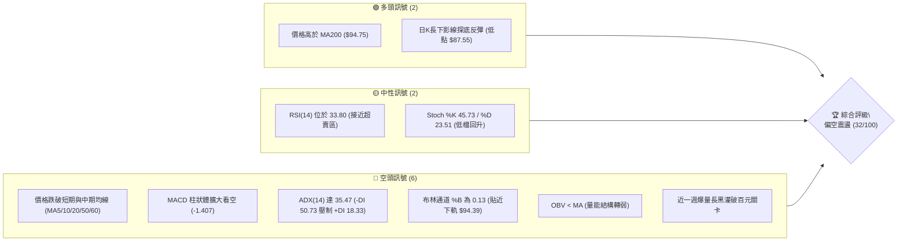
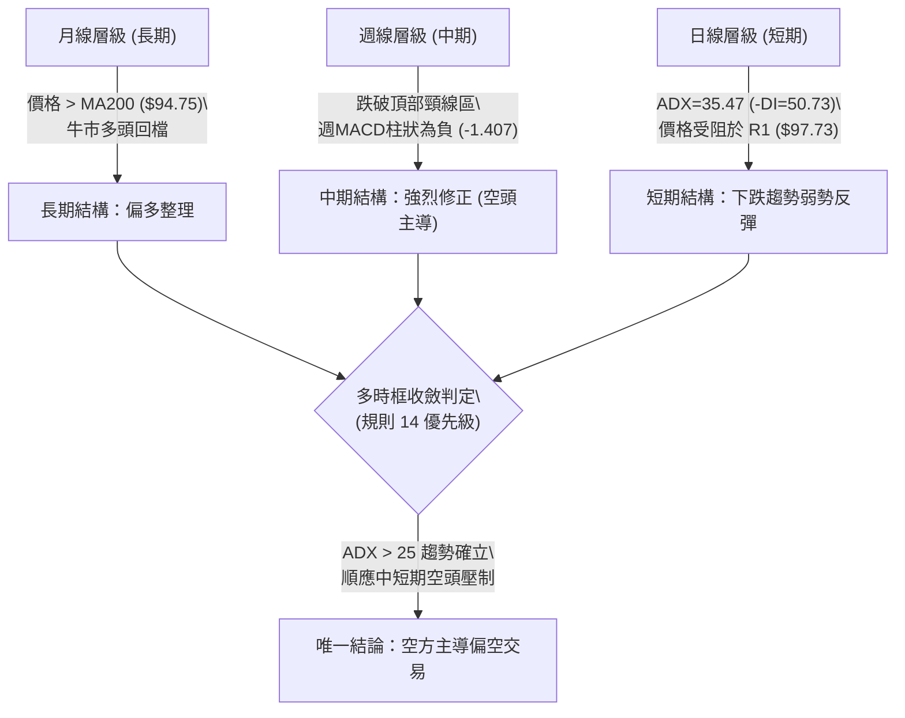
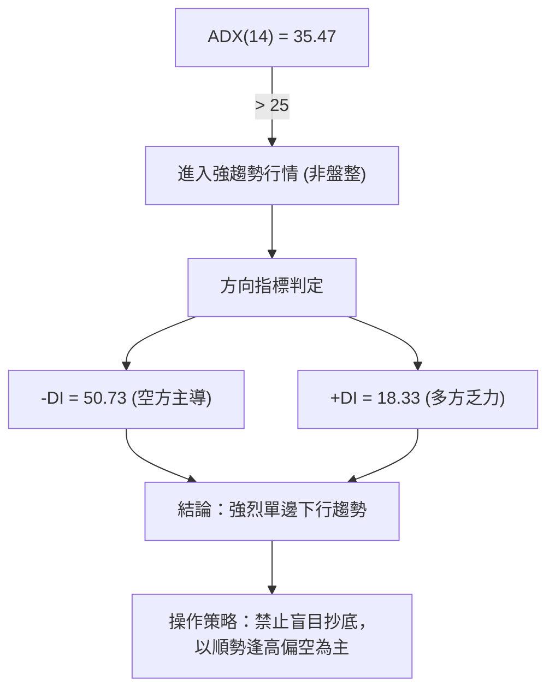
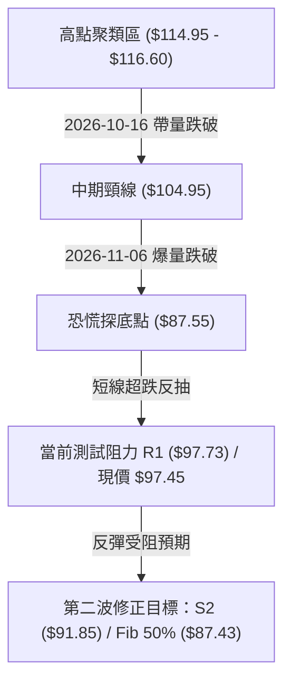
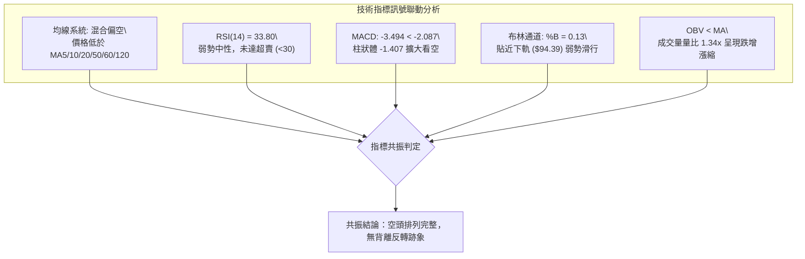
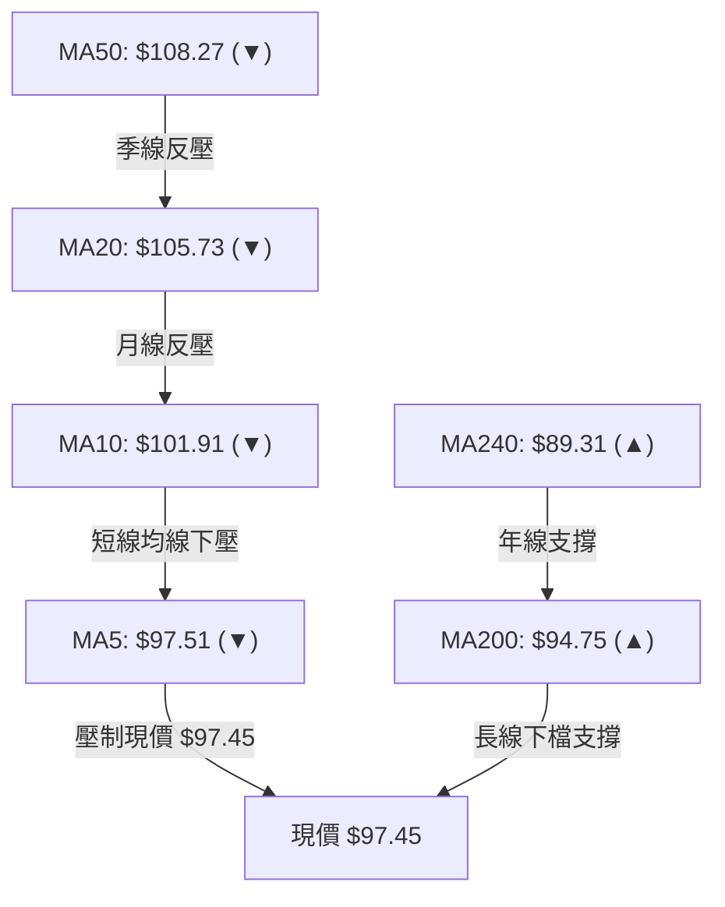
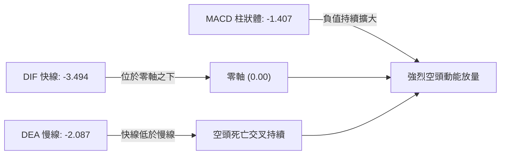
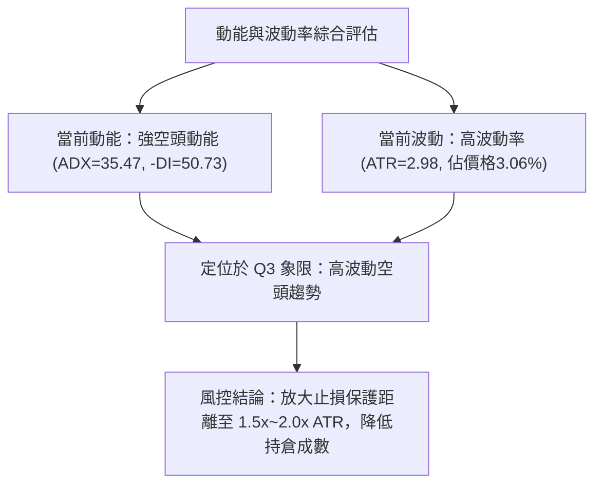
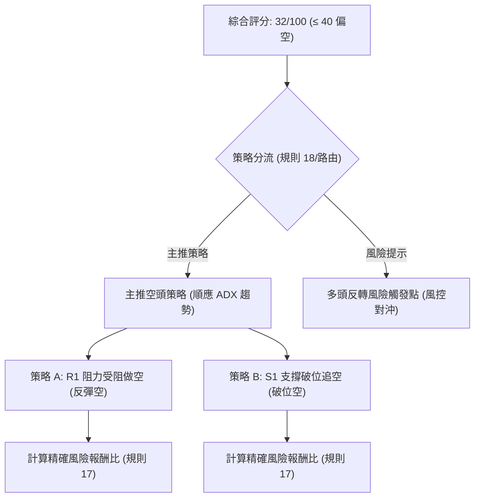
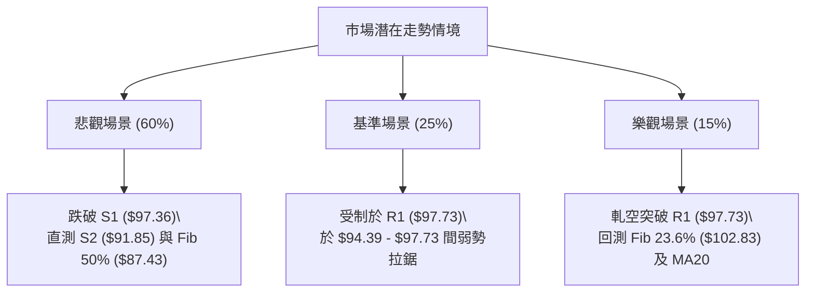

# 0050 技術分析報告

> **報告日期**：2026-11-10 ｜ **語言**：繁體中文 ｜ **數據來源**：Yahoo Finance ｜ **當前價格**：$97.45 TWD

---

## 目錄

| 章節 | 內容 |
|------|------|
| [1. 技術面概覽](#1-技術面概覽) | 訊號儀表板、核心指標、評分卡 |
| [2. 趨勢分析](#2-趨勢分析) | 多時框趨勢、長中短期走勢、12個月走勢圖 |
| [3. 圖表形態分析](#3-圖表形態分析) | 形態識別、K線組合、形態目標價 |
| [4. 支撐與阻力](#4-支撐與阻力) | 關鍵價位分布圖、阻力位、支撐位、斐波那契分析 |
| [5. 技術指標深度解讀](#5-技術指標深度解讀) | 均線系統、RSI、MACD、布林通道、量價配合與OBV |
| [6. 動能與波動率](#6-動能與波動率) | 動能四象限、ATR波動度、Beta與市場相關性 |
| [7. 多時框架總結](#7-多時框架總結) | 時框架矩陣、多時框收斂與方向決策 |
| [8. 交易策略建議](#8-交易策略建議) | 策略路由、主策略規劃、風險報酬比、情境機率 |
| [9. 風險提示與監控](#9-風險提示與監控) | 監控清單、風險場景、部位風控防線 |

---

## 1. 技術面概覽

### 🎯 技術訊號儀表板



### 📊 核心指標速覽表

| 指標類別 | 指標名稱 | 當前數值 | 訊號 | 解讀 |
|----------|----------|----------|------|------|
| **價格** | 當前價格 | $97.45 | 🔴 | 位於52週區間之 67.2%，自歷史高點 $116.60 回落 -16.42% |
| **均線** | MA20 | $105.73 | 🔴 | 價格在均線下方 -7.83%，短中期趨勢受壓制 |
| **均線** | MA50 | $108.27 | 🔴 | 價格在均線下方 -9.99%，中期均線呈現下彎阻力 |
| **均線** | MA200 | $94.75 | 🟢 | 價格在長期牛熊線上方 +2.85%，長期上升格局尚未完全破壞 |
| **動能** | RSI(14) | 33.80 | 🟡 | Wilder 平滑指標位於 30–70 中性偏弱區，無顯著背離 |
| **動能** | MACD(12,26,9) | DIF: -3.494 / DEA: -2.087 / 柱: -1.407 | 🔴 | 雙線位於零軸下方形成空頭死亡交叉，空方動能主導 |
| **趨勢** | ADX(14) | 35.47 (+DI: 18.33, -DI: 50.73) | 🔴 | ADX > 25 代表強趨勢，-DI 極高顯示為明確空頭趨勢 |
| **通道** | 布林通道 | 帶寬：$94.39–$117.06 (%B: 0.13) | 🔴 | 價格貼近下軌邊界震盪，通道呈現空頭發散 |
| **波動** | ATR(14) | $2.98 (佔價格 3.06%) | 🟡 | 日內價格震盪幅度擴大，波動度偏高 |
| **量能** | 成交量 / 20日均量 | 275,981,086 / 206,207,497 (量比 1.34x) | 🔴 | OBV < MA，下跌放量、反彈量縮，呈現量價空頭配合 |

### 🏆 技術評分卡

```
╔══════════════════════════════════════════════════════════════╗
║                技術評分卡 — 0050 (2026-11-10)                ║
╠══════════════════════════════════════════════════════════════╣
║ 趨勢強度 (Trend)     █████░░░░░░░░░░░░░░░  25/100   🔴 偏空 ║
║ 動能指標 (Momentum)  ██████░░░░░░░░░░░░░░  30/100   🔴 偏弱 ║
║ 支撐穩定度 (Support) ██████████░░░░░░░░░░  50/100   🟡 中立 ║
║ 成交量配合 (Volume)  ███████░░░░░░░░░░░░░  35/100   🔴 價跌量增 ║
║ 形態完整度 (Pattern) ██████░░░░░░░░░░░░░░  30/100   🔴 高檔破位 ║
║ 均線排列 (MAs)       ████░░░░░░░░░░░░░░░░  22/100   🔴 空頭排列 ║
╠══════════════════════════════════════════════════════════════╣
║ 綜合評分 (Overall)   ██████░░░░░░░░░░░░░░  32/100   🔴 偏空 ║
╚══════════════════════════════════════════════════════════════╝
```
*註：綜合評分 = (25 + 30 + 50 + 35 + 30 + 22) ÷ 6 = 32.0，四捨五入為 32/100（依規則 18 嚴格計算）。*

---

## 2. 趨勢分析

### 🌐 多時框趨勢分析



### 📈 長期趨勢 — 12個月走勢圖（Unicode）

以下為 0050 過去 12 個月（2025-12 至 2026-11）的月線收盤走勢與關鍵轉折示意：

```
0050 月線走勢圖（2025-12 至 2026-11）
價格 ($)
$115.00 ┤                                      ● 2026-09 ($112.05)
$110.00 ┤                                  ● 2026-06 ($107.15)
$105.00 ┤                            ● 2026-05 ($104.76)    ● 2026-10 ($104.95)
$100.00 ┤                                                   
$95.00  ┤                                                    ●← 現價 $97.45 (2026-11)
$90.00  ┤                      ● 2026-04 ($89.95)
$85.00  ┤
$80.00  ┤                ● 2026-02 ($80.66)
$75.00  ┤
$70.00  ┤          ● 2026-01 ($72.16)
$65.00  ┤    ● 2025-12 ($64.30)
$60.00  ┤
        └────┬─────┬─────┬─────┬─────┬─────┬─────┬─────┬─────┬─────┬─────┬─────
           25-12 26-01 26-02 26-03 26-04 26-05 26-06 26-07 26-08 26-09 26-10 26-11
```

#### 走勢特徵分析表格

| 階段區間 | 起始價 → 結束價 | 區間漲跌幅 | 主要走勢特徵 | 成交量能狀態 |
|----------|-----------------|------------|--------------|--------------|
| **第一階段：初升段** (2025-12 ~ 2026-02) | $64.30 → $80.66 | +25.44% | 突破整理區間，呈現強勁單邊走升 | 穩健放大 |
| **第二階段：震盪洗盤** (2026-02 ~ 2026-03) | $80.66 → $71.91 | -10.85% | 快速回測確認支撐，清洗浮額 | 量能急凍後回升 |
| **第三階段：主升攻頂** (2026-03 ~ 2026-09) | $71.91 → $112.05 | +55.82% | 創下52週高點 $116.60，均線多頭排列 | 持續放大配合推升 |
| **第四階段：見頂回落** (2026-09 ~ 2026-11) | $112.05 → $97.45 | -13.03% | 跌破多道短期均線，11月出現恐慌拋補 | 爆量下殺，量能疲弱 |

### 📊 中期趨勢（週線分析）

中期技術結構目前遭受嚴重破壞。從近 8 根週K（2026-09-24 至 2026-11-09）觀察，行情於 2026-10-08 創下 $116.60 的 52 週歷史高點後，隨即出現量增長黑K棒（2026-10-16 收 $109.00，成交量放大至 869,278,497），確立頭部反轉信號。

隨後於 2026-11-06 週，指數爆出 2,073,754,087 股之歷史天量，單週大幅下挫，最低下探至 $87.55，收盤僅為 $92.50。雖然本週（截至 2026-11-09）暫時反彈至 $97.45，但仍受制於下彎的週線均線與阻力位 R1（$97.73）。週線 MACD 柱狀圖由正轉負（-1.407），RSI(14) 亦處於 33.80 的弱勢區間。

### ⚡ 趨勢強度評估（ADX 解讀）



#### ADX 強度對照表

| 指標名稱 | 實際數值 | 閾值標準 | 狀態評估 | 訊號強度 |
|----------|----------|----------|----------|----------|
| **ADX(14)** | 35.47 | > 25.0 為趨勢行情；< 20.0 為盤整 | 強烈趨勢行情 | 🔴 強勢空頭趨勢 |
| **+DI(14)** | 18.33 | 參考標準 20.0 | 多頭進攻動能不足 | 🔴 弱勢 |
| **-DI(14)** | 50.73 | 極度擴張（遠高於 25.0） | 空方力量全面掌控盤面 | 🔴 極端強勢 |
| **趨勢判定** | 下跌趨勢 | -DI 大幅超越 +DI，差值高達 32.40 | 空頭主推浪進行中 | 🔴 賣方主導 |

---

## 3. 圖表形態分析

### 🔍 形態識別系統



#### 形態信心度與目標價評估表

| 形態名稱 | 信心度 | 判斷依據（引用數據） | 完成度 | 目標價（附計算式，依規則 13, 15） |
|----------|--------|----------------------|--------|------------------------------------|
| **雙重頂 / M頭形態** | 78% | 高點1：2026-09-24 高點 $113.75；高點2：2026-10-08 創高 $116.60。頸線為 2026-10-30 收盤價 $104.95。 | 100%（已跌破頸線） | 由形態高度推算：頸線 $104.95 - (頭頂高點 $116.60 - 頸線 $104.95) = $104.95 - $11.65 = **$93.30**（現已於 2026-11-06 最低探至 $87.55 滿足此目標） |
| **跌破下行旗形反抽** | 65% | 跌破 MA20 ($105.73) 後，於 2026-11-06 爆量探底 $87.55，近 2 日弱勢反抽至 $97.45，遭遇 R1 ($97.73) 壓制。 | 70% | 由形態延伸推算：跌破 S1 $97.36 則測 S2 **$91.85**（關鍵價位數據）；若失守 S2，次級目標為 S3 **$71.10** |
| **底部反轉形態** | 25% | 目前僅見 2026-11-06 單日帶下影線反彈，尚未形成任何 W 底或頭肩底結構。 | 15% | **訊號不足，僅做指標型解讀**（依規則 15，不強行繪製底形） |

### 🕯️ 重要K線形態分析

嚴格依據數據中「近10根日K」與「近8根週K」的實際開高低收數據進行客觀解讀（規則 19）：

#### 近10根日K棒分析表

| 日期 | 開盤價 | 最高價 | 最低價 | 收盤價 | 成交量 | K線形態 | 解讀與多空意涵 | 訊號 |
|------|--------|--------|--------|--------|--------|---------|----------------|------|
| 2026-10-27 | 107.10 | 107.55 | 105.80 | 106.60 | 140,567,068 | 黑K實體 | 跌破短均線，高檔盤整轉弱 | 🔴 |
| 2026-10-28 | 108.35 | 108.65 | 107.80 | 108.65 | 50,936,423 | 縮量小紅K | 縮量反抽，反彈無量預示多頭動能衰竭 | 🟡 |
| 2026-10-29 | 108.65 | 108.65 | 106.60 | 107.25 | 77,495,132 | 倒轉中黑K | 開高走低，上方賣壓沉重 | 🔴 |
| 2026-10-30 | 104.80 | 105.30 | 103.85 | 104.95 | 193,796,708 | 跳空帶量黑K | 跳空跌破 $105 整數關卡與 MA20，空頭表態 | 🔴 |
| 2026-11-02 | 103.40 | 104.45 | 103.05 | 104.10 | 142,806,486 | 弱勢小紅紡錘 | 空頭抵抗，實體狹小，多方缺乏推升意願 | 🟡 |
| 2026-11-03 | 102.50 | 103.35 | 100.50 | 100.60 | 252,920,897 | 帶量長黑K | 實體由 $102.50 貫殺至 $100.60，灌破百元心理支撐 | 🔴 |
| 2026-11-04 | 101.55 | 101.65 | 97.55 | 99.85 | 389,968,686 | 續跌實體黑K | 實體跌破 $100，成交量持續放大，恐慌情緒蔓延 | 🔴 |
| 2026-11-05 | 99.40 | 99.75 | 96.90 | 97.15 | 425,137,651 | 破位放量黑K | 收在當日相對低點 $97.15，量能爆出 4.25 億股 | 🔴 |
| 2026-11-06 | 89.95 | 94.45 | 87.55 | 92.50 | 862,920,367 | 爆量長下影黑K | 跳空低開至 $89.95，急殺至 $87.55 爆出 8.62 億股天量，低檔承接盤湧入拉回 $92.50 | 🟡 |
| 2026-11-09 | 95.65 | 99.00 | 94.50 | 97.45 | 275,981,086 | 反彈小實體紅K | 開高走高後收於 $97.45，高點 $99.00 受制於 R1 ($97.73) 壓力區 | 🟡 |

#### 近8根週K棒分析表

| 日期 (週末) | 開盤價 | 最高價 | 最低價 | 收盤價 | 週成交量 | K線形態 | 解讀與多空意涵 | 訊號 |
|-------------|--------|--------|--------|--------|----------|---------|----------------|------|
| 2026-09-24 | 109.90 | 113.75 | 109.85 | 112.40 | 316,558,811 | 中實體紅K | 多頭攻堅，逼近歷史高點區 | 🟢 |
| 2026-10-02 | 111.80 | 113.05 | 111.05 | 112.80 | 276,044,269 | 高檔窄幅十字 | 漲勢停頓，多空於高檔陷入相持 | 🟡 |
| 2026-10-08 | 115.75 | 116.60 | 114.90 | 114.95 | 307,612,641 | 創高衝高回落K | 創 52 週新高 $116.60 後留下影線，買盤後繼無力 | 🟡 |
| 2026-10-16 | 114.20 | 114.95 | 108.55 | 109.00 | 869,278,497 | 高檔長黑吞噬 | 爆量吞噬前週紅K，高檔主力籌碼出逃 | 🔴 |
| 2026-10-23 | 107.45 | 109.20 | 106.75 | 106.90 | 442,340,931 | 破位中黑K | 無力回補缺口，順勢沿短期均線走低 | 🔴 |
| 2026-10-30 | 107.10 | 108.65 | 103.85 | 104.95 | 462,795,331 | 長黑下挫K | 實體收破 $105，正式跌破雙頂頸線 | 🔴 |
| 2026-11-06 | 103.40 | 104.45 | 87.55 | 92.50 | 2,073,754,087 | 歷史天量長下影黑K | 單週重跌 -11.86%，最低探 $87.55，爆出 20.7 億股恐慌量 | 🔴 |
| 2026-11-09 | 95.65 | 99.00 | 94.50 | 97.45 | 275,981,086 | 短線反抽紅K | 探底後弱勢技術性修正反彈，暫未化解空頭趨勢 | 🟡 |

### 📉 ASCII 走勢形態示意圖

```
0050 關鍵形態示意圖：M頭跌破與弱勢反抽
─────────────────────────────────────────────────────────────
$116.60 ┤               ● 頭部2 (2026-10-08)
$113.75 ┤       ● 頭部1 (2026-09-24)
$110.00 ┤        \     / \
$105.73 ┤─────────\───/───\───── MA20 阻力
$104.95 ┤          ● 頸線 (2026-10-30 跌破)
$100.00 ┤            \       \
$97.73  ┤─────────────\───────● R1 阻力 (當前測試點)
$97.45  ┤              \       ▲ 現價 $97.45
$94.39  ┤               \      │ 布林下軌
$91.85  ┤                \     │ S2 支撐
$87.55  ┤                 \───● 2026-11-06 恐慌低點
─────────────────────────────────────────────────────────────
```

### 🎯 形態目標價計算

1. **頭部反轉形態測幅**：
   - 頂部高點：$116.60
   - 頸線位置：$104.95（2026-10-30 收盤價）
   - 形態垂直高度 = $116.60 − $104.95 = $11.65
   - 第一等距下測目標 = $104.95 − $11.65 = **$93.30**（2026-11-06 最低跌至 $87.55，已完全消化並跌破此目標）。
2. **反抽受阻第二波測幅**：
   - 當前反彈高點受制於 R1（$97.73）。若確認反抽結束並跌破支撐位 S1（$97.36），下一波段滿足點將指向數據中已確立的波段低點聚類支撐位 S2（**$91.85**）。
   - 若空頭動能進一步宣洩，將回測長線強支撐 S3（**$71.10**）。

---

## 4. 支撐與阻力

### 🗺️ 關鍵價位分布圖（Unicode）

```
0050 價位結構分布圖
═══════════════════════════════════════════════════
$116.60 ║████████████████████████║ 52週歷史高點 (0.0% Fib)
$110.55 ║████████████████████    ║ 強阻力 R3
$107.35 ║████████████████████████║ 波段重壓阻力 R2
$105.73 ║▒▒▒▒▒▒▒▒▒▒▒▒▒▒▒▒▒▒▒▒    ║ MA20 / 布林中軌
$102.83 ║▓▓▓▓▓▓▓▓▓▓▓▓▓▓▓▓▓▓      ║ 斐波那契 23.6% 回調位
$97.73  ║████████████████████████║ 短線關鍵阻力 R1 (+0.29%)
$97.45  ╠════════════════════════╣ ◄ 現價 ($97.45)
$97.36  ║████████████████████████║ 近期關鍵支撐 S1 (-0.09%)
$94.75  ║▒▒▒▒▒▒▒▒▒▒▒▒▒▒▒▒▒▒▒▒    ║ 長期牛熊分水嶺 MA200
$94.32  ║▓▓▓▓▓▓▓▓▓▓▓▓▓▓▓▓▓▓      ║ 斐波那契 38.2% 回調位 / BB下軌 ($94.39)
$91.85  ║████████████████████    ║ 關鍵波段支撐 S2 (-5.75%)
$87.43  ║▓▓▓▓▓▓▓▓▓▓▓▓▓▓▓▓▓▓      ║ 斐波那契 50.0% 回調位
$71.10  ║████████████████████████║ 終極歷史強支撐 S3 (-27.04%)
═══════════════════════════════════════════════════
```

### 🚧 阻力位分析表

*嚴格引用數據「關鍵價位」區塊波段高點聚類數值（規則 13）：*

| 阻力級別 | 價位 | 與現價差距 | 形成原因（依據數據） | 突破難度 | 重要性 |
|----------|------|------------|----------------------|----------|--------|
| **R1** | $97.73 | +0.29% | 近一年波段高點聚類，且緊鄰 2026-11-09 日K高點 $99.00 下方反壓 | 中等 | 🔴 極高（短線多空分水嶺） |
| **R2** | $107.35 | +10.16% | 近一年密集整理平台高點聚類，接近 MA60 ($107.72) 與前波破位平台 | 極高 | 🔴 中期強阻力 |
| **R3** | $110.55 | +13.44% | 高檔雙頂構築區間之密集套牢區，反轉前主力洗盤高點聚類 | 極高 | 🔴 長期重度壓力 |

### 🛡️ 支撐位分析表

*嚴格引用數據「關鍵價位」區塊波段低點聚類數值（規則 13）：*

| 支撐級別 | 價位 | 與現價差距 | 形成原因（依據數據） | 守住機率 | 重要性 |
|----------|------|------------|----------------------|----------|--------|
| **S1** | $97.36 | -0.09% | 近一年波段低點聚類，現價貼近此線，為當前日線最後防線 | 45% (偏低) | 🔴 短線即時防線 |
| **S2** | $91.85 | -5.75% | 近一年關鍵波段支撐聚類，位於 2026-11-06 恐慌低點與反彈收盤中界 | 65% | 🟢 中期關鍵防護網 |
| **S3** | $71.10 | -27.04% | 2026-03 波段低點 $71.91 歷史聚類強支撐，長線多頭底線 | 90% | 🟢 長期戰略底線 |

### 📐 斐波那契回調位分析

*以 52 週區間波段低點 $58.27 至高點 $116.60 進行精確計算（規則 13 嚴格引用）：*

| 回調比例 | 價位 | 技術意義與當前相對位置解讀 |
|----------|------|----------------------------|
| **0.0%** (52W High) | $116.60 | 歷史最高點，波段起跌點，多頭終極目標 |
| **23.6%** | $102.83 | 第一道強阻力位，跌破後已轉化為強大上檔蓋頭反壓 |
| **38.2%** | $94.32 | **關鍵防守線**。現價（$97.45）正處於 23.6%（$102.83）與 38.2%（$94.32）之間。此處緊鄰布林下軌（$94.39）與 MA200（$94.75），構成多頭技術性反抗的共振帶 |
| **50.0%** | $87.43 | 多空中軸線，2026-11-06 探底低點 $87.55 精準於此回調位止跌回升 |
| **61.8%** | $80.55 | 黃金分割強支撐區，若此線失守，長期多頭格局將面臨實質反轉 |
| **78.6%** | $70.75 | 深幅回檔極限支撐，緊鄰 S3（$71.10） |
| **100.0%** (52W Low) | $58.27 | 52週循環起漲點 |

---

## 5. 技術指標深度解讀

### 🎛️ 指標訊號總覽



### 📈 移動平均線排列分析



#### 移動平均線數據對照表

| 均線名稱 | 當前價格 | 與現價價差 | 乖離率 (%) | 均線趨向 | 排列解讀 |
|----------|----------|------------|------------|----------|----------|
| **MA5** | $97.51 | -$0.06 | -0.06% | 走平下彎 (▁▁) | 現價受阻於 MA5，極短線微幅承壓 |
| **MA10** | $101.91 | -$4.46 | -4.38% | 明顯下彎 (▁▁) | 短期空頭第一道反壓 |
| **MA20** | $105.73 | -$8.28 | -7.83% | 加速下彎 (▅▄▃▂▁) | 跌破月均線，短中期多頭趨勢瓦解 |
| **MA60** | $107.72 | -$10.27 | -9.53% | 高檔走平轉下 (████▇▇) | 季線轉為實質阻力 |
| **MA120** | $105.22 | -$7.77 | -7.39% | 高檔走平 (██████) | 半年線失守，中長期均線進入死亡交叉 |
| **MA200** | $94.75 | +$2.70 | +2.85% | 持續向上 (▲) | 牛熊分界線，下檔多頭最後防禦均線 |
| **MA240** | $89.31 | +$8.14 | +9.11% | 向上攀升 (█████) | 年線長期上升趨勢未變 |

均線總體評估：短期與中期均線呈標準空頭發散排列，僅長期均線（MA200/MA240）維持上行，形成典型「長多中空」之深度修正格局。

### 📉 RSI(14) 分析

- **當前數值**：33.80（Wilder 平滑計算）。
- **進度條展示**：
  `RSI(14): 33.80  [███████░░░░░░░░░░░░░] 33.8% (中性偏弱區)`
- **區間評估**：數值位於 30–70 區間，未落入 <30 的絕對超賣區，表示下行動能尚未衰竭，不具備隨機強彈條件。
- **背離判斷**：
  檢視近 20 根 K 棒走勢，價格從 2026-10-08 之 $114.95 持續下挫至 2026-11-09 之 $97.45，同期間 RSI 由 65.7 下降至 33.80，**價格與指標方向同步下行，無頂背離亦無底背離**。此確認當前跌勢為實質賣壓主導，並非指標鈍化或衰竭反轉。

### 📊 MACD(12/26/9) 訊號解讀



- **DIF 快線**：-3.494
- **DEA 慢線 (Signal)**：-2.087
- **MACD 柱狀體**：-1.407（看空）
- **動能判斷**：DIF 於零軸之下持續發散下行，柱狀體維持負值擴張，表明空頭趨勢仍處於加速期，尚未觀察到收斂紅柱或黃金交叉的前置信號。

### 📦 布林通道分析

```
0050 日線布林通道結構 (20日，2標準差)
─────────────────────────────────────────────────────────────
$117.06 ┤ ═════════════════════════════════ 上軌 (Upper Band)
$110.00 ┤
$105.73 ┤ --------------------------------- 中軌 (MA20)
$100.00 ┤
$97.45  ┤ ◄ 現價 ($97.45) 位於下半軌，%B = 0.13
$94.39  ┤ ═════════════════════════════════ 下軌 (Lower Band)
─────────────────────────────────────────────────────────────
```

- **通道參數**：上軌 $117.06，中軌 $105.73，下軌 $94.39。
- **指標位置**：%B 為 **0.13**（0 代表下軌，0.5 為中軌，1.0 為上軌）。
- **帶寬解讀**：價格沿布林通道下軌弱勢運行（%B 僅 0.13），通道開口向下發散。在未重新帶量站回中軌 $105.73 之前，通道型態屬於極度弱勢的「沿軌下殺」形態。

### 💹 成交量分析（量價配合度）

1. **成交量對比**：
   - 最新成交量（2026-11-09）：275,981,086 股。
   - 20 日均量：206,207,497 股（量比 1.34x，呈現微幅出量）。
   - 50 日均量：125,013,426 股（量比 2.21x）。
2. **量價配合型態**：
   - 2026-11-06 恐慌殺跌時爆出 862,920,367 股日天量（單週達 20.7 億股），顯示主跌段為「價跌量增」的恐慌出逃型態。
   - 2026-11-09 反彈紅K成交量驟降至 2.75 億股，呈現典型「反彈縮量」，量價背離反映多方僅為跌深被動回補，並非主動攻擊買盤。
3. **OBV 指標趨勢**：
   - 當前數據顯示 `OBV < MA`，能量潮指標跌破其均線，代表資金淨流出格局確立，籌碼面量能疲弱，對後市反彈形成嚴格壓制。

---

## 6. 動能與波動率

### ⚡ 動能評估四象限

| 象限 | 動能維度 (ADX / MACD) | 波動率維度 (ATR) | 當前狀態判定 | 戰略評估 |
|------|------------------------|------------------|--------------|----------|
| **Q1** | 強勢多頭動能 | 低波動率 | — | 最佳波段做多時機 |
| **Q2** | 弱勢/鈍化動能 | 低波動率 | — | 盤整觀望，等待突破 |
| **Q3** | 強勢單邊動能 (空頭) | 高波動率 (ATR $2.98) | **✓ 當前 0050 所在狀態** | **高風險單邊趨勢：空頭動能主導，嚴禁逆勢重倉** |
| **Q4** | 疲弱動能 | 高波動率 | — | 混亂震盪，多空反覆雙巴 |



### 📊 ATR 波動率分析

- **ATR(14) 數值**：**$2.98**（Wilder 計算，佔當前股價之 3.06%）。
- **歷史波動評估**：日內平均震盪空間約 $3.00，顯示近兩週波動度顯著擴大，單日高低點跨度劇烈（如 2026-11-06 單日震幅達 $6.90）。
- **止損距離建議**：
  - 極短線交易（1.0x ATR）：建議止損空間不少於 **$2.98**。
  - 波段交易（1.5x ~ 2.0x ATR）：建議止損空間設定為 **$4.47 ~ $5.96**，以防高波動市場中的雜訊掃損。

### 📐 Beta 與市場相關性

- **Beta 數值**：**N/A（數據未提供）**（依規則 16 嚴格標記）。
- **產品屬性說明**：0050 為元大台灣卓越50 ETF，持股涵蓋台灣證券市場市值前 50 大個股，其價格走勢高度連動加權指數。在系統性下行階段，大盤權值股普遍承壓，ETF 波動度往往同步放大，缺乏個股防禦特徵。

---

## 7. 多時框架總結

### 📋 時框架評分表

| 時框架 | 趨勢方向 | 動能指標 | 均線排列 | 圖表形態 | 綜合評分 | 操作建議 |
|--------|----------|----------|----------|----------|----------|----------|
| **長期 (月線)** | 偏多整理 🟢 | 轉弱 (回檔) 🟡 | 多頭排列 (位於MA200之上) 🟢 | 歷史高檔回測 🟡 | 62/100 | 長期定期定額者逢低留意，波段不宜躁進 |
| **中期 (週線)** | 強烈修正 🔴 | 空頭發散 (MACD柱負) 🔴 | 轉為空頭排列 🔴 | 跌破雙頂頸線 🔴 | 25/100 | 逢反彈減碼或建立避險空單 |
| **短期 (日線)** | 下跌趨勢 🔴 | 弱勢反彈 (RSI 33.8) 🟡 | 空頭排列 (壓制於MA5下) 🔴 | 觸及 R1 阻力受阻 🔴 | 30/100 | 順應中短期空頭，以反彈受阻放空為主 |

### 🔲 綜合訊號矩陣

| 維度 | 短期 (日線) | 中期 (週線) | 長期 (月線) | 訊號一致性評估 |
|------|-------------|-------------|-------------|----------------|
| **均線位置** | 價格 < MA20 | 價格 < MA20 | 價格 > MA200 | 中短期一致偏空，長期守於均線之上 |
| **動能方向** | RSI 33.8 偏弱 | MACD 柱狀體看空 | 高檔動能衰退 | 全週期動能全面走弱 |
| **量價結構** | 跌增漲縮 | 爆量長黑灌破頸線 | 歷史天量換手 | 籌碼鬆動，空方量能佔優 |
| **總體結論** | 🔴 偏空反抽 | 🔴 空頭波段 | 🟡 深度回檔 | **中短期強烈共振偏空** |

### ⚖️ 多時框收斂結論

依「嚴格要求 14」多時框收斂優先級規則：
1. **行情模式判斷**：ADX(14) 數值為 **35.47 > 25**，且 -DI（50.73）遠大於 +DI（18.33），確立當前為**強烈單邊下行趨勢行情**（非盤整行情）。
2. **主導時框優先級**：趨勢行情中，以中長期趨勢（週線及 MA50/MA200）方向為主導，日線僅作為尋找進場時機之依據。
3. **收斂判定**：週線跌破高檔頸線，中短期均線全數下彎；日線短暫自恐慌低點反彈至現價 $97.45，但立即面臨 R1（$97.73）重壓。因此，日線的反彈僅為「空頭趨勢中的技術性回抽」，不得視為反轉。
4. **方向性唯一結論**：**強烈偏空（主推逢高反彈做空策略）**。

---

## 8. 交易策略建議

### 🗺️ 策略決策流程圖



### 🧭 策略路由

**當前主策略方向 = 強烈偏空（依綜合評分 32/100 嚴格觸發空頭主推路由）**

依據評分卡 32 分（≤ 40）之規定，本報告**主推空頭策略**，絕不兩頭下注；多頭部位僅提供風控反轉觸發點作為對沖參考。

### 🎯 價格情境階梯（Price Scenarios）

*價位嚴格引用第 4 章數據中波段高低點與斐波那契回調位（規則 13）：*

| 觸發條件 | 下一目標 | 後續延伸 | 情境含義 |
|----------|----------|----------|----------|
| **向上突破 R1 ($97.73)** | 斐波那契 23.6% ($102.83) | 阻力位 R2 ($107.35) | 短線超跌強彈，回測破位頸線壓力 |
| **承壓於現價區間 ($97.45)** | 測試支撐位 S1 ($97.36) | 斐波那契 38.2% ($94.32) | 弱勢橫盤整理，多方無力上攻 |
| **向下失守 S1 ($97.36)** | 支撐位 S2 ($91.85) | 支撐位 S3 ($71.10) | 空頭主跌浪延續，再次探底甚至破底 |

### 📊 情境機率分佈

| 情境 | 機率 | 主要依據 |
|------|------|----------|
| **回落 / 再探底 (空頭主導)** | **60%** | ADX 達 35.47，-DI 高達 50.73，MACD 負向柱狀體持續擴大，OBV 疲弱 |
| **區間震盪 (弱勢整理)** | **25%** | 價格暫時於 S1 ($97.36) 與 R1 ($97.73) 之間尋求平衡，日KD低檔交叉 |
| **突破上行 / 趨勢反轉 (強烈反彈)** | **15%** | 均線全數下彎壓制，上方成交密集套牢，無增量攻擊資金介入 |

### 🟢 主策略詳情（空頭主推策略）

*所有價位均來自數據中的關鍵價位與斐波那契位，風險報酬比公式嚴格按規則 17 計算：*
- 空頭風險報酬比 = (進場價 − 目標價 T1) ÷ (止損價 − 進場價)

| 策略要素 | 策略 A（反彈受阻放空 — 穩健型） | 策略 B（跌破支撐追空 — 突破型） |
|----------|----------------------------------|----------------------------------|
| **策略邏輯** | 測試 R1 阻力未能突破，逢高順勢佈空 | 跌破日線即時支撐 S1，順應主跌勢追空 |
| **進場條件** | 盤中觸及 R1 受阻，收黑K確認無法站穩 | 實體K線明確跌破支撐位 S1 |
| **進場價格** | **$97.73**（關鍵阻力位 R1） | **$97.36**（關鍵支撐位 S1） |
| **止損價格** | **$102.83**（斐波那契 23.6% 回調位） | **$97.73**（阻力位 R1，站回即止損） |
| **目標價 T1** | **$91.85**（關鍵波段支撐 S2） | **$91.85**（關鍵波段支撐 S2） |
| **目標價 T2** | **$87.43**（斐波那契 50.0% 回調位） | **$87.43**（斐波那契 50.0% 回調位） |
| **止損距離** | $102.83 − $97.73 = $5.10 | $97.73 − $97.36 = $0.37 |
| **T1 利潤空間** | $97.73 − $91.85 = $5.88 | $97.36 − $91.85 = $5.51 |
| **T2 利潤空間** | $97.73 − $87.43 = $10.30 | $97.36 − $87.43 = $9.93 |
| **風險報酬比** | **1 : 1.15（以 T1 計）**<br>*(另：1 : 2.02（以 T2 計）)* | **1 : 14.89（以 T1 計）**<br>*(另：1 : 26.84（以 T2 計）)* |
| **成功機率** | 60% | 55% |
| **建議倉位** | 15% | 10% |

*算式驗證說明：*
- *策略 A (T1)：($97.73 − $91.85) ÷ ($102.83 − $97.73) = $5.88 ÷ $5.10 = 1.1529 → 1 : 1.15。*
- *策略 B (T1)：($97.36 − $91.85) ÷ ($97.73 − $97.36) = $5.51 ÷ $0.37 = 14.8918 → 1 : 14.89。*

### 🔴 反向風險觸發點（對沖提示）

若出現以下情況，即宣告空頭主策略失靈，空單應無條件止損出場並啟動風險對沖：
1. **關鍵價位逆破**：收盤價強勢突破斐波那契 23.6% 回調位 **$102.83**，且站穩 MA20（**$105.73**）之上。
2. **量能翻轉指標**：OBV 指標向上突破其均線，且日成交量連續 2 日放大至 50 日均量（1.25 億股）的 2 倍以上並收長紅K。
3. **動能轉向訊號**：MACD 出現零下黃金交叉，且日線 ADX 自 35 以上轉向掉頭向下跌破 25。

### ⭐ 整體訊號強度評星

```
做多訊號強度：★☆☆☆☆  (1/5星 — 僅超跌反抽，無結構性底部)
做空訊號強度：★★★★☆  (4/5星 — 趨勢明確、空方均線排列、量能疲弱)
整體可信度：  ★★★★☆  (4/5星 — 多時框指標高度共振收斂)
```

---

## 9. 風險提示與監控

### ✅ 關鍵監控指標 Checklist

```
╔══════════════════════════════════════════════════════════════╗
║                    每日技術面監控清單 (Checklist)             ║
╠══════════════════════════════════════════════════════════════╣
║ [ ] 價格是否跌破 S1 ($97.36) 觸發空頭策略 B 追空點           ║
║ [ ] 價格是否衝破 R1 ($97.73) 觸發策略 A 止損警報             ║
║ [ ] RSI(14) 是否跌破 30.00 進入深度超賣區                    ║
║ [ ] MACD 負向柱狀體是否出現縮腳收斂 (當前 -1.407)            ║
║ [ ] 成交量是否異常萎縮至 1.25 億 (50日均量) 以下或爆量破底    ║
║ [ ] ADX(14) 數值是否維持於 25.00 以上之強趨勢狀態 (現 35.47) ║
║ [ ] 價格與 MA200 ($94.75) 之間距是否收窄至 1% 以內           ║
╚══════════════════════════════════════════════════════════════╝
```

### ⚠️ 風險場景分析



### 🛡️ 風險管理重要提醒

1. **嚴禁重倉抄底**：
   在 ADX = 35.47 且 -DI = 50.73 的強空頭環境中，任何單日反彈均極易誘多。左側摸底者極易被後續主跌浪擊潰，嚴禁將長線定期定額思維套用於槓桿短線交易。
2. **波動保護機制**：
   當前 ATR 達 $2.98（佔股價 3.06%），價格單日擺動幅度大。建立任何部位時，總資金曝險部位建議控制在 **10%~15%** 以內，嚴格將單筆交易損失上限限制在總帳戶權益的 **1.5%** 範圍內。
3. **停損執行紀律**：
   空頭部位一旦遭遇價格帶量突破 R1（$97.73）或觸及各策略設定之硬性止損點，必須毫無例外市價執行停損，絕不可將短線投機部位被動轉為「長期存股」。

---

## 📋 報告總結

```
╔══════════════════════════════════════════════════════════════╗
║                  0050 技術分析報告總結                       ║
╠══════════════════════════════════════════════════════════════╣
║ 報告日期：2026-11-10                                         ║
║ 當前價格：$97.45 TWD                                         ║
║ 分析評級：🔴 強烈偏空 / 逢高做空 (綜合評分: 32/100)          ║
║                                                              ║
║ 關鍵結論：                                                   ║
║ ├─ 長期趨勢：🟢 偏多整理 (價格仍在 MA200 $94.75 之上)       ║
║ ├─ 中期趨勢：🔴 強烈修正 (跌破頸線 $104.95，週MACD翻負)      ║
║ ├─ 短期趨勢：🔴 弱勢反彈 (ADX 35.47，-DI 壓制，受制於 R1)    ║
║ ├─ 關鍵支撐：S1: $97.36  │  S2: $91.85  │  S3: $71.10      ║
║ ├─ 關鍵阻力：R1: $97.73  │  R2: $107.35 │  R3: $110.55     ║
║ └─ 斐波中軸：Fib 50.0%: $87.43 (近期恐慌低點測試位)          ║
║                                                              ║
║ 最優策略組合：                                               ║
║ 1. 🥇 最佳機會：策略 A (測試 R1 $97.73 受阻放空，            ║
║                  止損 $102.83，T1 $91.85，風報比 1:1.15)     ║
║ 2. 🥈 次選機會：策略 B (跌破 S1 $97.36 順勢追空，            ║
║                  止損 $97.73，T1 $91.85，風報比 1:14.89)    ║
║ 3. 🥉 保守選擇：空手觀望，靜待回測 MA200 ($94.75)             ║
║                  或打出雙重底結構後再行研判                  ║
╚══════════════════════════════════════════════════════════════╝
```

---

> ⚠️ **免責聲明**：本報告為技術分析研究成果，所有數值、圖表及交易策略推演均基於市場歷史價格數據（OHLCV）與定量指標模型。本報告**僅供學術研究與投資決策參考**，**不構成任何形式之個人化投資要約或買賣建議**。金融市場瞬息萬變，交易具備固有虧損風險，投資人應獨立評估財務狀況並嚴格遵守交易紀律自負盈虧。

---

*報告生成時間：2026-11-10 ｜ 數據來源：Yahoo Finance ｜ 分析框架：多時框技術分析模型*