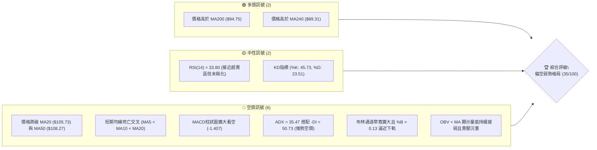
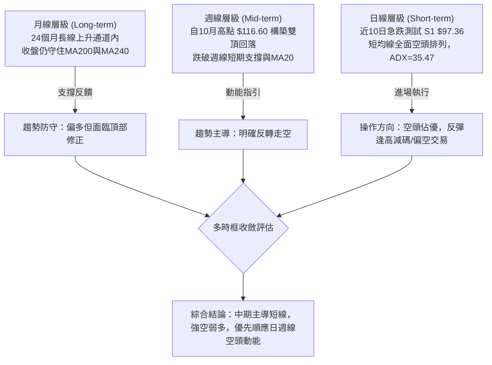
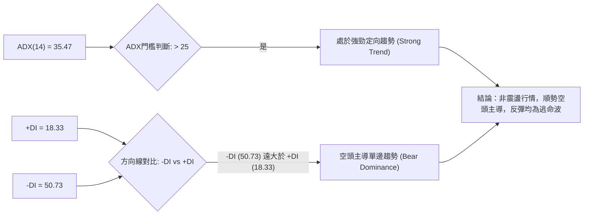
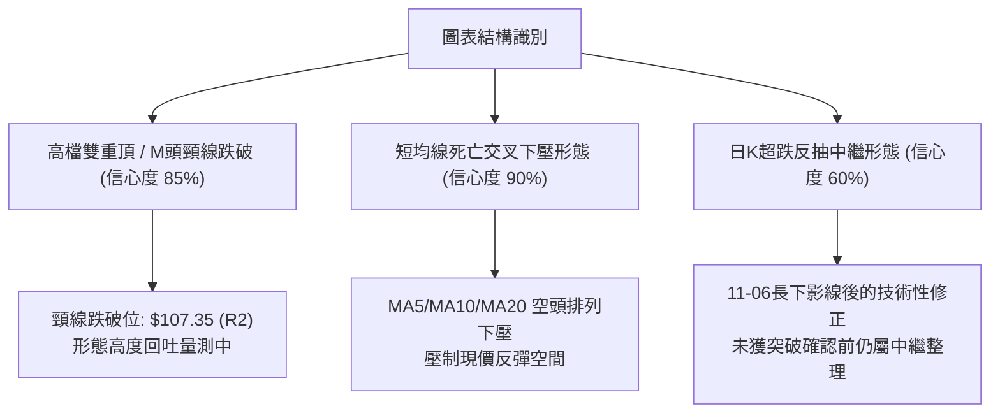
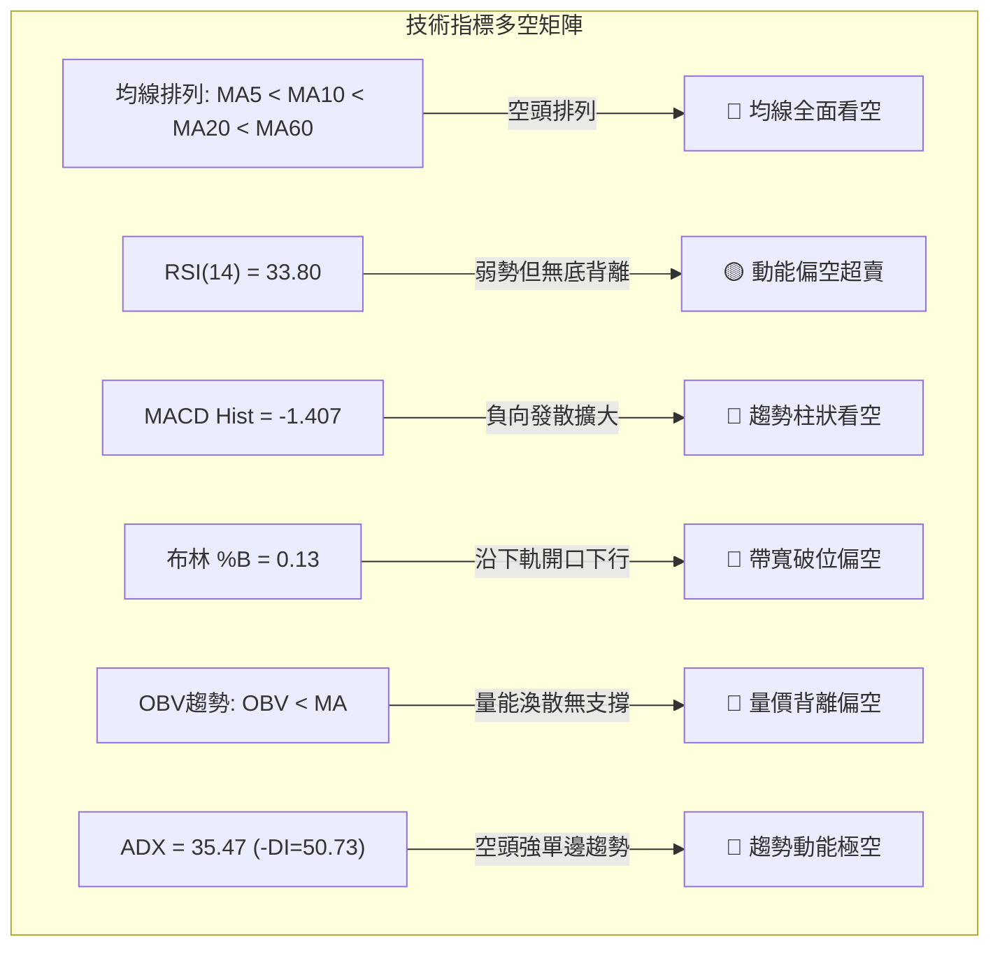
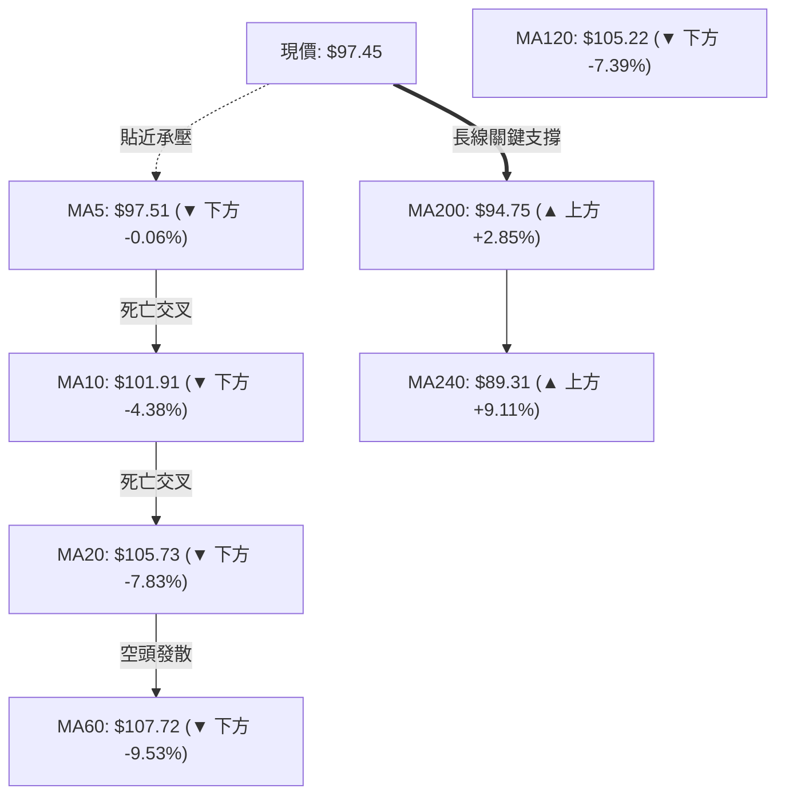
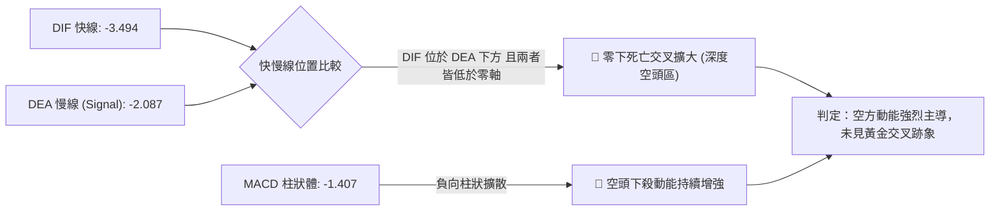
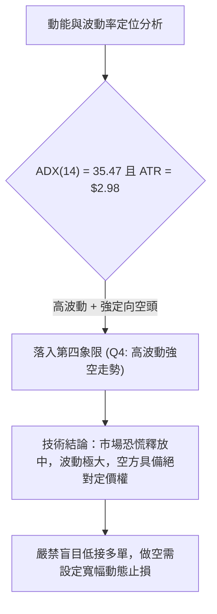
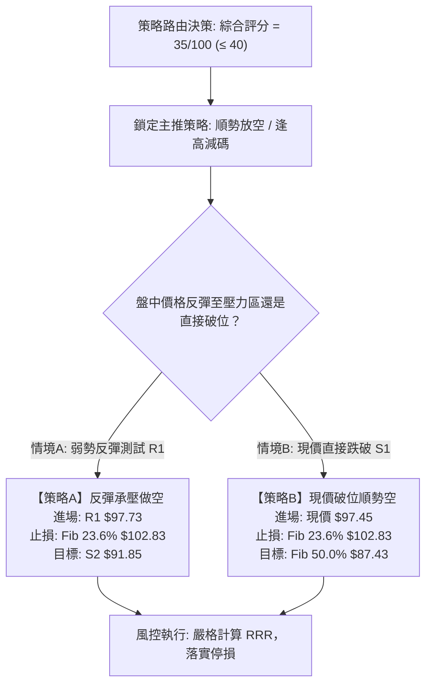
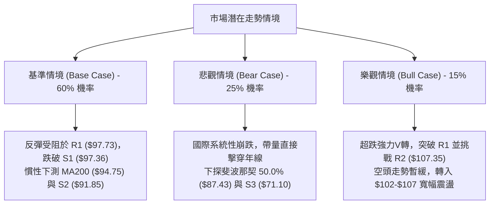

# 0050 技術分析報告

> **報告日期**：2026-11-11 ｜ **語言**：繁體中文 ｜ **數據來源**：Yahoo Finance ｜ **當前價格**：$97.45 TWD

---

## 目錄

| 章節 | 內容 |
|------|------|
| [1. 技術面概覽](#1-技術面概覽) | 訊號儀表板、核心指標、評分卡 |
| [2. 趨勢分析](#2-趨勢分析) | 多時框趨勢、長中短期走勢、ADX解讀 |
| [3. 圖表形態分析](#3-圖表形態分析) | 形態識別、K線組合、目標價計算 |
| [4. 支撐與阻力](#4-支撐與阻力) | 關鍵價位、斐波那契回調、量價結構 |
| [5. 技術指標深度解讀](#5-技術指標深度解讀) | 均線系統、RSI、MACD、布林通道、成交量 |
| [6. 動能與波動率](#6-動能與波動率) | 動能四象限、ATR波動度、Beta分析 |
| [7. 多時框架總結](#7-多時框架總結) | 時框架矩陣、訊號一致性、多時框收斂 |
| [8. 交易策略建議](#8-交易策略建議) | 策略路由、情境階梯、主策略詳情、風報比 |
| [9. 風險提示與監控](#9-風險提示與監控) | 監控清單、情境推演、風控規則 |
| [報告總結](#-報告總結) | 核心總結與決策矩陣 |

---

## 1. 技術面概覽

### 🎯 技術訊號儀表板



### 📊 核心指標速覽表

| 指標類別 | 指標名稱 | 當前數值 | 訊號 | 解讀 |
|----------|----------|----------|------|------|
| **價格** | 當前收盤價 | $97.45 TWD | 🔴 | 跌破52週高點拉回達16.42%，逼近短期支撐 S1 |
| **均線** | MA20 | $105.73 | 🔴 | 價格在MA20下方 -7.83%，短中期趨勢嚴重受阻 |
| **均線** | MA50 | $108.27 | 🔴 | 價格在MA50下方 -10.00%，中期走勢完全轉空 |
| **均線** | MA200 | $94.75 | 🟢 | 價格在MA200上方 +2.85%，長期年線多頭防線尚未失守 |
| **動能** | RSI(14) | 33.80 | 🟡 | 位於中性偏弱區間，尚未進入低於30的極度超賣區 |
| **動能** | MACD (12,26,9) | -3.494 (柱狀: -1.407) | 🔴 | DIF跌破MACD信號線(-2.087)，負值柱狀體擴散看空 |
| **趨勢** | ADX(14) | 35.47 (+DI: 18.33, -DI: 50.73) | 🔴 | 數值大於25呈現強勁定向趨勢，-DI大幅壓制+DI，空頭強勢掌控 |
| **波動** | ATR(14) | $2.98 (3.06%) | 🔴 | 單日波幅顯著放大，下殺動能劇烈，市場風險偏高 |
| **通道** | 布林帶寬 (%B) | 0.13 (下軌 $94.39) | 🔴 | 緊貼布林通道下軌運行，通道開口向下，呈空頭喇叭口 |
| **量能** | 最新成交量 / 20日均量 | 275,981,086 (量比 1.34x) | 🔴 | 成交量高於20日均量，但OBV走勢疲弱，量增伴隨價格下挫 |

### 🏆 技術評分卡

```
╔══════════════════════════════════════════════════════════════╗
║                技術評分卡 — 0050 (2026-11-11)                ║
╠══════════════════════════════════════════════════════════════╣
║ 趨勢強度 (Trend)      ██████░░░░░░░░░░░░░░  30/100  🔴 強空格局 ║
║ 動能指標 (Momentum)   ███████░░░░░░░░░░░░░  35/100  🔴 動能下挫 ║
║ 支撐穩定度 (Support)  █████████░░░░░░░░░░░  45/100  🟡 考驗S1/年線║
║ 成交量配合 (Volume)   ██████░░░░░░░░░░░░░░  30/100  🔴 價跌量增 ║
║ 形態完整度 (Pattern)  ███████░░░░░░░░░░░░░  35/100  🔴 頭部成形 ║
║ 均線排列 (Moving Avg) ███████░░░░░░░░░░░░░  35/100  🔴 短均破位 ║
╠══════════════════════════════════════════════════════════════╣
║ 綜合評分 (Overall)    ███████░░░░░░░░░░░░░  35/100  🔴 偏空弱勢 ║
╚══════════════════════════════════════════════════════════════╝
*註：綜合評分為上述六項維度之算術平均數（(30+35+45+30+35+35)/6 = 35.0），四捨五入至整數，依規則 18 執行。*
```

---

## 2. 趨勢分析

### 🌐 多時框趨勢分析



### 📈 長期趨勢 — 12個月走勢圖（Unicode）

依據月度歷史收盤價，呈現過去12個月（2025-11 至 2026-11）的走勢變化：

```
0050 月線走勢圖（過去12個月：2025-11 至 2026-11）
價格 ($)
$115 ┤                                  ● $112.05 (2026-09)
$110 ┤                      ● $107.15    │
$105 ┤                ● $104.76 │       │  ● $104.95 (2026-10)
$100 ┤                │         │  ● $102.85│  │
$95  ┤                │         │  │     │  │  │  ● $97.45 (現在)
$90  ┤          ● $89.95        │  │     │  │  │  │
$85  ┤          │               │  │     │  │  │  │
$80  ┤    ● $80.66              │  │     │  │  │  │
$75  ┤    │     │               │  │     │  │  │  │
$70  ┤ ● $72.16 │ ● $71.91      │  │     │  │  │  │
$65  ┤ │ │     │ │              │  │     │  │  │  │
$60  ┤●│ │     │ │              │  │     │  │  │  │ ($61.11, 2025-11)
     └─┴──┴─────┴──┴─────────────┴──┴─────┴──┴──┴──┴─────────────
      N11 D  J26 F  M   A   M   J   J   A   S   O   N (當前)
```

**走勢特徵分析表格**：

| 階段區間 | 起訖月份 | 起訖價格 ($) | 漲跌幅 (%) | 形態特徵與技術解讀 |
|----------|----------|--------------|------------|--------------------|
| 主升起漲期 | 2025-11 → 2026-02 | $61.11 → $80.66 | +32.00% | 階梯式推升，均線多頭發散，單邊多頭行情 |
| 換手洗盤期 | 2026-02 → 2026-03 | $80.66 → $71.91 | -10.85% | 獲利了結賣壓湧現，回踩確認中長期支撐後迅速回升 |
| 衝頂主升期 | 2026-03 → 2026-09 | $71.91 → $112.05| +55.82% | 巨幅噴出，各月收盤價連續創高，月線級別加速趕頂 |
| 頭部見頂期 | 2026-09 → 2026-10 | $112.05 → $104.95| -6.34%  | 月K收黑，高檔出現滯漲與獲利回吐，波段見頂 |
| 破位下殺期 | 2026-10 → 2026-11 | $104.95 → $97.45 | -7.15%  | 連續兩月長黑摜破短均線，跌破百元大關，直測年線 |

### 📊 中期趨勢（週線分析）

從週K線分析（見近8週高低價數據），0050在2026年10月08日當週創下52週最高點 **$116.60** 後，連番遭遇大單摜壓：
1. **高檔放量滯漲**：10月08日當週高點見 $116.60，但收盤壓回至 $114.95；次週（10月16日）週成交量暴增至 869,278,497 股，收盤大跌至 $109.00，形成週線等級的高檔吞噬長黑。
2. **週線波段跌勢成形**：10月下旬至11月第一週（11月06日當週），成交量噴出至 2,073,754,087 股天量，單週低點摜至 **$87.55**，收於 $92.50，週線RSI崩落至 18.1，顯示中期籌碼產生結構性鬆動。
3. **當前弱勢反抽**：11月09日收盤回升至 $97.45，週線MACD柱狀體擴大至 -1.407，反彈量能急縮至 275,981,086 股，屬於極度典型的超跌無量反抽格局。

```
中期壓力與支撐結構示意圖（週線視角）
$116.60 ───┬──────────────────────────────────────── 52W 最高點 / 頂部頭頸區 (壓力極強)
           │
$107.35 ───┼──────────────────────────────────────── 阻力位 R2 (原週線中樞，反彈強阻力)
           │
$97.73  ───┼──────────────────────────────────────── 阻力位 R1 (近一年波段高點聚類)
$97.45  ───*◄──── 當前價格 ($97.45) 夾於微幅震盪區
$97.36  ───┼──────────────────────────────────────── 支撐位 S1 (波段低點支撐聚類，岌岌可危)
           │
$91.85  ───┴──────────────────────────────────────── 支撐位 S2 (前波週線密集支撐位)
```

### ⚡ 趨勢強度評估（ADX 解讀）



**ADX 趨勢強度對照表**：

| 指標名稱 | 實際數據 | 標準區間 | 強度評估 | 技術意義與解讀 |
|----------|----------|----------|----------|----------------|
| **ADX(14)** | 35.47 | > 25 (強趨勢) | ██████████████░ 71% | 趨勢動能極高，非橫盤震盪，不可逆勢摸底 |
| **+DI** | 18.33 | 0 – 100 | ████░░░░░░░░░░░ 18% | 多方推升力量薄弱，多頭動能潰散 |
| **-DI** | 50.73 | 0 – 100 | ██████████░░░░░ 51% | 空方下殺力量處於極度強勢的主導狀態 |
| **定向擴散差值** | -32.40 | (+DI) - (-DI) | 🔴 極度空頭 | 差值為負且持續擴大，確認空頭下跌波段尚未終結 |

---

## 3. 圖表形態分析

### 🔍 形態識別系統



**形態信心度與目標評估表**（依規則 15）：

| 形態名稱 | 信心度 (%) | 判斷依據（引用數據） | 完成度 (%) | 目標價（附嚴謹計算式） |
|----------|------------|----------------------|------------|------------------------|
| **高檔雙頂破位** | 85% | 10-08高點 $116.60 與 09-24高點 $113.75 構築雙頂，跌破頸線高點聚類 R2 ($107.35) | 100% (已跌破) | 頸線 $107.35 − (高點 $116.60 − 頸線 $107.35) = **$98.10**（已滿足，下一目標測量指向 S2 **$91.85**） |
| **短線空頭旗形中繼** | 60% | 11-06長黑下殺至 $87.55 後，11-09小幅反彈收在 $97.45，反彈量能萎縮至 2.75億股 | 50% (醞釀中) | 若跌破旗面下緣 S1 $97.36，向下等距延伸：$97.36 − (104.95 − 92.50) = **$84.91**（直接回測斐波那契回調位） |
| **日線均線空頭排列** | 90% | MA5 ($97.51) < MA10 ($101.91) < MA20 ($105.73) < MA60 ($107.72)，呈空頭發散 | 100% (完全成形) | 均線蓋頭壓制，第一反彈壓力為 R1 **$97.73**，突破失敗則下探 S2 **$91.85** |

### 🕯️ 重要K線形態分析

依據近10根日K與近8根週K的實際 OHLC 數據進行嚴格判定（依規則 19）：

#### 近10根日K形態精解表

| 日期 | 開盤價 ($) | 最高價 ($) | 最低價 ($) | 收盤價 ($) | 成交量 (股) | K線形態名稱 | 形態特徵與多空解讀 | 訊號 |
|------|------------|------------|------------|------------|-------------|-------------|--------------------|------|
| **2026-10-27** | 107.10 | 107.55 | 105.80 | 106.60 | 140,567,068 | 小實體陰線 | 開高走低，受制於MA20中軌，空方試探賣壓 | 🔴 |
| **2026-10-28** | 108.35 | 108.65 | 107.80 | 108.65 | 50,936,423  | 光頭小陽線 | 量能極度萎縮（5093萬股），無量反抽，假突破訊號 | 🟡 |
| **2026-10-29** | 108.65 | 108.65 | 106.60 | 107.25 | 77,495,132  | 倒錘頭陰線 | 開盤即最高點，多頭上攻遭強力反撲，長上影線顯露疲態 | 🔴 |
| **2026-10-30** | 104.80 | 105.30 | 103.85 | 104.95 | 193,796,708 | 跳空破位陰線 | 跳空開低，放量摜破前低，宣告高檔盤整區間正式崩塌 | 🔴 |
| **2026-11-02** | 103.40 | 104.45 | 103.05 | 104.10 | 142,806,486 | 弱勢反彈陽線 | 實體狹小，未能回補跳空缺口，屬於典型的下跌中繼K棒 | 🔴 |
| **2026-11-03** | 102.50 | 103.35 | 100.50 | 100.60 | 252,920,897 | 實體大陰線 | 增量跌破百元大關心理防線，收盤收在當日近最低點 | 🔴 |
| **2026-11-04** | 101.55 | 101.65 | 97.55  | 99.85  | 389,968,686 | 放量長黑棒 | 成交量擴增至3.89億股，恐慌盤開始湧現，賣壓如瀑布宣洩 | 🔴 |
| **2026-11-05** | 99.40  | 99.75  | 96.90  | 97.15  | 425,137,651 | 空頭實體黑棒 | 量能突破4.25億股，連續三日跳空開低，跌勢未見收斂 | 🔴 |
| **2026-11-06** | 89.95  | 94.45  | 87.55  | 92.50  | 862,920,367 | 爆量長下影陰棒| 暴量8.62億股下探 $87.55 獲年線前買盤抵抗，下影線長達 $4.95 | 🟡 |
| **2026-11-09** | 95.65  | 99.00  | 94.50  | 97.45  | 275,981,086 | 低開走高小陽棒| 向上修復，但高點 $99.00 遭遇整數壓力，成交量腰斬顯示追價意願不足 | 🟡 |

#### 近8根週K形態精解表

| 週結算日 | 開盤價 ($) | 最高價 ($) | 最低價 ($) | 收盤價 ($) | 週成交量 (股) | 週K線形態 | 形態意涵與波段訊號 | 訊號 |
|----------|------------|------------|------------|------------|---------------|-----------|--------------------|------|
| **2026-09-24** | 109.90 | 113.75 | 109.85 | 112.40 | 316,558,811 | 中陽實體線 | 多頭波段持續創高，推升至 $113.75 | 🟢 |
| **2026-10-02** | 111.80 | 113.05 | 111.05 | 112.80 | 276,044,269 | 高檔十字星 | 多空雙方於高檔拉鋸，量縮出現動能鈍化現象 | 🟡 |
| **2026-10-08** | 115.75 | 116.60 | 114.90 | 114.95 | 307,612,641 | 衝高回落流星線| 創下52週高點 $116.60 後長上影線收黑，波段絕對頂部成立 | 🔴 |
| **2026-10-16** | 114.20 | 114.95 | 108.55 | 109.00 | 869,278,497 | 巨量吞噬長黑棒| 單週暴量8.69億股摜破前兩週實體，確認主力資金高檔出逃 | 🔴 |
| **2026-10-23** | 107.45 | 109.20 | 106.75 | 106.90 | 442,340,931 | 弱勢整理陰線 | 反抽無力，受制於 $109.20，跌勢確立 | 🔴 |
| **2026-10-30** | 107.10 | 108.65 | 103.85 | 104.95 | 462,795,331 | 連續下挫中黑棒| 跌破關鍵平台，週線連三黑，空頭排列向下發散 | 🔴 |
| **2026-11-06** | 103.40 | 104.45 | 87.55  | 92.50  | 2,073,754,087| 天量長下影墓碑| 單週天量20.7億股，急殺至 $87.55 後反彈，下檔多空劇烈換手 | 🟡 |
| **2026-11-09** | 95.65  | 99.00  | 94.50  | 97.45  | 275,981,086  | 縮量反抽小陽K | 短線超跌修正，但週量大幅縮小，反彈動能薄弱 | 🟡 |

### 📉 ASCII 走勢形態示意圖

```
高檔雙頂與波段破位形態示意圖
$116.60 ───────┐               (頂部1: 10-08 $116.60)
                ╲             ┌─┐
                 ╲            │ │
$112.40 ──┐       ╲     ┌─────┘ └─────┐ (頂部2: 09-24 $113.75)
          │        ╲    │             │
          │         └───┘             ╲
$107.35 ──┴────────────────────────────┴───────────── 頸線阻力 R2 ($107.35)
                                        ╲ (跳空破位)
                                         ╲
$97.73  ──────────────────────────────────*───────── 阻力位 R1 ($97.73)
$97.45  ───────────────────────────────────▲──────── 現價 $97.45 (弱勢反抽)
$97.36  ───────────────────────────────────▼──────── 關鍵支撐 S1 ($97.36)
                                            ╲
$91.85  ─────────────────────────────────────┴────── 下檔強支撐 S2 ($91.85)
                                              ╲
$87.55  ───────────────────────────────────────*──── 11-06 急殺極端低點
```

### 🎯 形態目標價計算

根據雙重頂幾何高度向下等距測量原理進行推算：
1. **雙頂頭部高度 ($H$)**：
   $$H = \text{最高點 ($116.60)} - \text{頸線高點聚類 ($107.35)} = \$9.25$$
2. **第一等距下量目標價 ($T_1$)**：
   $$T_1 = \text{頸線 ($107.35)} - H (\$9.25) = \$98.10$$
   *驗證：當前價格 $97.45 已有效跌破並完成第一目標價 $98.10 之測試。*
3. **第二倍數破位目標價 ($T_2$)**（若失守 S1 $97.36）：
   $$T_2 = T_1 (\$98.10) - (0.618 \times H) = \$98.10 - \$5.72 = \$92.38$$
   *對應驗證：該理論推算值極度接近數據庫中已計算之波段低點支撐聚類 **S2: $91.85**。*

---

## 4. 支撐與阻力

### 🗺️ 關鍵價位分布圖（Unicode）

```
0050 價位結構分布圖
═══════════════════════════════════════════════════════════
$116.60 ║██████████████████████████████║ 52W 歷史最高點 (強阻力頂部)
$110.55 ║████████████████████████      ║ 強阻力 R3 (+13.44%)
$107.35 ║████████████████████          ║ 重大頸線阻力 R2 (+10.16%)
$102.83 ║▓▓▓▓▓▓▓▓▓▓▓▓▓▓▓▓▓▓            ║ 斐波那契 23.6% 回調壓力位
$97.73  ║████████████████              ║ 近期高點阻力 R1 (+0.29%)
$97.45  ╠══════════════════════════════╣ ◄ 當前收盤價 ($97.45)
$97.36  ║▓▓▓▓▓▓▓▓▓▓▓▓▓▓▓▓              ║ 近期關鍵支撐 S1 (-0.09%)
$94.75  ║██████████████                ║ MA200 年線長線生命線
$94.32  ║▓▓▓▓▓▓▓▓▓▓▓▓                  ║ 斐波那契 38.2% 回調支撐位
$91.85  ║████████████████████          ║ 強支撐 S2 (-5.75%)
$87.43  ║▓▓▓▓▓▓▓▓▓▓                    ║ 斐波那契 50.0% 關鍵平衡位
$71.10  ║██████████████████████████████║ 終極深層支撐 S3 (-27.04%)
═══════════════════════════════════════════════════════════
```

### 🚧 阻力位分析表

阻力位嚴格引用技術數據中之「波段高點聚類」計算結果：

| 阻力級別 | 價格 ($) | 距現價幅動 | 形成技術依據與籌碼沉積 | 突破難度 | 重要性權重 |
|----------|----------|------------|------------------------|----------|------------|
| **R1** | **$97.73** | +0.29% | 近一年波段高點聚類微型阻力，與日線MA5 ($97.51) 重合形成第一道短壓 | 🟡 中等 | ★★★☆☆ |
| **R2** | **$107.35** | +10.16% | 原中期區間下軌與頸線跌破點，MA20 ($105.73) 與 MA60 ($107.72) 匯聚於此 | 🔴 極高 | ★★★★★ |
| **R3** | **$110.55** | +13.44% | 10月中旬放量套牢區之密集籌碼峰，多頭欲扭轉頹勢必須攻克之終極防線 | 🔴 極高 | ★★★★☆ |

### 🛡️ 支撐位分析表

支撐位嚴格引用技術數據中之「波段低點聚類」計算結果：

| 支撐級別 | 價格 ($) | 距現價幅動 | 形成技術依據與買盤力道 | 守住機率 | 重要性權重 |
|----------|----------|------------|------------------------|----------|------------|
| **S1** | **$97.36** | -0.09% | 近一年波段低點密集聚類，距現價僅 $0.09，為當前多頭最後一道近身薄刃 | 🔴 35% | ★★★☆☆ |
| **S2** | **$91.85** | -5.75% | 歷史重要波段防守點，緊扣11-06爆量急跌後的買盤回補中樞，下方有年線護城 | 🟡 65% | ★★★★★ |
| **S3** | **$71.10** | -27.04% | 2026年3月份底部起漲平台巨量支撐區，為長期牛熊分水嶺之深層防線 | 🟢 90% | ★★★★☆ |

### 📐 斐波那契回調位分析

依據52週極端波動區間（低點 **$58.27** → 高點 **$116.60**，總跨度 $58.33）計算之標準回調位：

| 斐波那契回調層級 | 計算價位 ($) | 空間定位與技術意義深度解讀 | 當前狀態評估 |
|------------------|--------------|----------------------------|--------------|
| **0.0% (52W High)** | **$116.60** | 多頭極限衝頂位置，2026-10-08留長上影線構築重大頭部 | 遙遠阻力 |
| **23.6% 回調位** | **$102.83** | 強勢回檔分水嶺，跌破後確認由強勢強多轉為深幅修正 | 已失守，轉為強阻力 |
| **38.2% 回調位** | **$94.32** | 正常技術性回檔防線，與布林下軌 ($94.39) 及 MA200 ($94.75) 高度重疊 | **即刻考驗目標** |
| **50.0% 回調位** | **$87.43** | 牛市波段多空力量完全平衡點，極度貼近11-06極端低點 $87.55 | 長線多頭生死線 |
| **61.8% 黃金分割** | **$80.55** | 黃金分割強防守位，2026年2月起漲換手密集成交區 | 深度超賣防守區 |
| **78.6% 回調位** | **$70.75** | 深幅回撤位，高度貼近波段支撐 S3 ($71.10) | 熊市邊緣 |
| **100.0% (52W Low)**| **$58.27** | 52週起漲原點 | 終極底部 |

**現價區間落點分析**：
當前收盤價 **$97.45** 處於 **23.6% ($102.83)** 與 **38.2% ($94.32)** 之間。在技術分析架構中，當價格有效貫穿 23.6% 回調位後，走勢將慣性下測 38.2% 回調位（**$94.32**）。值得極度關注的是，**$94.32** 與長期均線 **MA200 ($94.75)** 及 **布林通道下軌 ($94.39)** 形成強大的三位一體複合支撐帶。

---

## 5. 技術指標深度解讀

### 🎛️ 指標訊號總覽



### 📈 移動平均線排列分析



**移動平均線詳細數據解讀表**：

| 均線名稱 | 當前價格 ($) | 距現價差值 ($) | 幅度 (%) | 趨勢斜率 | 技術意涵與防守/阻力性質 |
|----------|--------------|----------------|----------|----------|-------------------------|
| **MA5**  | $97.51  | -0.06  | -0.06% | 急速下彎 | 短線超跌壓制線，明日若無法站上將引發新一波殺盤 |
| **MA10** | $101.91 | -4.46  | -4.38% | 加速向下 | 短線第一道強大下壓蓋頭線，空方防線 |
| **MA20** | $105.73 | -8.28  | -7.83% | 向下貫穿 | 月線生命線失守，中短期全面轉入空頭趨勢 |
| **MA60** | $107.72 | -10.27 | -9.53% | 走平轉下 | 季線轉為波段強阻力，與頸線 R2 ($107.35) 構成複合重壓 |
| **MA120**| $105.22 | -7.77  | -7.39% | 頂部鈍化 | 半年線支撐正式告破，形成上方沉重籌碼套牢平台 |
| **MA200**| $94.75  | +8.14  | +2.85% | 溫和向上 | **牛熊生命線**，年線正處於多方防禦核心位置 |
| **MA240**| $89.31  | +8.14  | +9.11% | 持續向上 | 兩年長期均線，終極多頭防守底線 |

*均線排列判定*：當前短期與中期均線呈現標準的 **空頭排列（MA5 < MA10 < MA20 < MA60）**，雖然長週期 MA200 與 MA240 仍在下方提供長線多頭殘餘支撐，但均線整體結構屬於混亂崩解後的「空頭發散下壓」格局。

### 📉 RSI(14) 分析

*   **當前數值**：**33.80**（Wilder 計算方法）。
*   **區間定位**：處於弱勢空頭區（30 – 40），尚未完全進入低於 30 的極端超賣區。

```
RSI(14) 動能強度進度條
超賣區 (0-30)           中性區 (30-70)                 超買區 (70-100)
├───────────────┼───────────────────────────────┼───────────────┤
██████████░░░░░░░░░░░░░░░░░░░░░░░░░░░░░░░░░░░░░░░░░░░░░░░░░░░░░░
0              30  ▲ 33.80                     70             100
                   └── 當前數值 (弱勢空方主導，反彈動能衰竭)
```

*   **背離分析判斷**：
    根據數據近20根K棒首尾之比對判定，**RSI無明顯底背離**。近10日日K走勢中，價格由 10-27 之 $106.60 崩跌至 11-09 之 $97.45，而 RSI 自 10月中旬跌破 50 後一路走低至 33.80（期間週線RSI更一度跌破至 18.1），指標走勢完全順應價格直線崩跌。**結論：未偵測到底背離訊號，空頭慣性下殺仍未見衰竭，不可盲目猜底。**

### 📊 MACD(12,26,9) 訊號解讀



*   **MACD 線**：-3.494
*   **MACD 信號線 (Signal)**：-2.087
*   **MACD 柱狀圖 (Histogram)**：-1.407（負值持續擴展）
*   **深入解讀**：DIF 與 DEA 雙雙於零軸下方急速向下跌落，且 DIF 加速脫離 DEA，負向柱體（-1.407）處於擴散階段。在零軸之下的死亡交叉代表市場處於深層的空頭加速浪，未出現任何柱狀圖收斂或底部背離跡象，嚴禁進行逆勢多頭槓桿操作。

### 📦 布林通道分析

```
布林通道 (20, 2) 結構示意圖
$117.06 ──┬─────────────────────────────────────────── BB 上軌 (+2σ)
          │
$105.73 ──┼─────────────────────────────────────────── BB 中軌 (MA20)
          │
$97.45  ──*◄──── 當前價格 ($97.45) ── %B: 0.13 (深陷弱勢下軌區間)
          │
$94.39  ──┴─────────────────────────────────────────── BB 下軌 (-2σ)
```

*   **布林上軌**：$117.06
*   **布林中軌 (MA20)**：$105.73
*   **布林下軌**：$94.39
*   **通道特徵解讀**：
    1.  **%B 指標為 0.13**（計算式：$(\text{現價} - \text{下軌}) / (\text{上軌} - \text{下軌}) = (97.45 - 94.39) / (117.06 - 94.39) = 3.06 / 22.67 \approx 0.13$），顯示價格已嚴重偏向通道下緣。
    2.  當前通道口呈現「喇叭口向下張開」形態，中軌（MA20）由原先走平正式轉為向下傾斜，價格持續沿著下軌運行，屬於極為強勢的空頭單邊暴跌走勢。下軌目前位置在 **$94.39**，與斐波那契 38.2% 回調位（**$94.32**）完全重合，構成短線空頭下殺之第一目標磁吸區。

### 💹 成交量分析（量價配合度）

1.  **最新日成交量**：275,981,086 股。
2.  **20日均量 (20MA Volume)**：206,207,497 股（**量比：1.34x**）。
3.  **50日均量 (50MA Volume)**：125,013,426 股。
4.  **量價特徵解讀**：
    *   在下殺過程中（11-04 至 11-06），成交量由 3.89 億股飆升至 8.62 億股，週K線更爆出 20.7 億股歷史天量，顯示市場主力正處於劇烈出貨與被動停損狀態。
    *   11-09 單日價格微幅反彈至 $97.45，成交量卻急劇萎縮至 2.75 億股（較前一交易日萎縮達 68.0%），呈現標準的「**價漲量縮、反彈無量**」惡性結構。
5.  **能量潮指標 (OBV)**：
    *   數據快照明確標示：`OBV < MA → 量能疲弱`。
    *   OBV 線跌破其均線並持續向下滑落，代表每一波反彈均未伴隨真實資金的回流建倉，資金淨流出特徵極為顯著，空方賣壓完全主宰盤面。

---

## 6. 動能與波動率

### ⚡ 動能評估四象限

動能（Momentum）與波動率（Volatility）矩陣分析：

| 象限 | 動能維度 (Directional Momentum) | 波動率維度 (Volatility) | 當前判定 | 特徵與操作評估 |
|------|---------------------------------|-------------------------|----------|----------------|
| **第一象限 (Q1)** | 多頭強動能 (+DI強) | 低波動 (通道收窄) | ─ | 最佳多頭主升段，穩健做多機會 |
| **第二象限 (Q2)** | 弱動能 (動能衰竭) | 低波動 (區間整理) | ─ | 橫盤震盪，多空觀望等待突破 |
| **第三象限 (Q3)** | 多頭強動能 | 高波動 (急漲急跌) | ─ | 衝頂噴出行情，高風險高收益 |
| **第四象限 (Q4)** | **空頭強動能 (-DI=50.73)** | **高波動 (ATR=2.98, 3.06%)** | **✓ 當前狀態** | **空頭主導高風險殺盤區，順勢偏空或空倉防禦** |



### 📊 ATR 波動率分析

*   **ATR(14) 數值**：**$2.98 TWD**（佔股價比例達 **3.06%**，Wilder平滑法）。
*   **波動特徵評估**：
    歷史上 0050 作為大型權值 ETF，單日 ATR 多半維持於 1.2% – 1.8% 區間。當前 ATR 攀升至 3.06%（$2.98），顯示市場進入極端情緒化波動週期。
*   **止損與風控距離建議**：
    *   **短線交易動態保護止損**：以 $1.0 \times \text{ATR}$ 計算，即保護空間需保留 **$2.98**。
    *   **波段空頭防守止損**：以 $1.5 \times \text{ATR}$ 計算，即 **$4.47**，方可避免在日線劇烈洗盤震盪中被假反彈掃出場。

### 📐 Beta 與市場相關性

*   **Beta 係數**：**N/A（數據未提供）**
*   **市場相關性質化分析**：
    依據產品定義，0050 為元大台灣卓越50 ETF，追蹤臺灣50指數，涵蓋台股市場前50大權值龍頭股。技術本質上，該標的與台灣加權指數之相關係數高度接近 1.0。在缺乏個股 Beta 數據的情況下，應將 0050 視為台股大盤系統性風險的直接投影載體。當前 0050 呈現的高波動破位走勢，完全反映了大盤權值板塊正在經歷全面性的資金撤退。

---

## 7. 多時框架總結

### 📋 時框架評分表

| 時框架 | 趨勢方向 | 動能指標 (RSI/MACD) | 均線系統排列 | 圖表形態評估 | 綜合評分 (0-100) | 具體操作建議 |
|--------|----------|---------------------|--------------|--------------|------------------|--------------|
| **月線層級** | 🟢 偏多回檔 | RSI 處中軸上方，MACD紅柱縮小 | 守住MA200/MA240，中長均向上 | 衝高 $116.60 後長黑拉回 | 55/100 🟡 | 長線定期定額者可觀望，暫停單筆大額加碼 |
| **週線層級** | 🔴 強烈看空 | RSI=18.1極度超賣，MACD負柱擴散 | 摜破週線中軌，短週均下彎 | 雙頂 ($116.60) 頸線被放量跌破 | 30/100 🔴 | 中期波段投資者逢反彈堅決減碼避險 |
| **日線層級** | 🔴 極度看空 | RSI=33.80無背離，MACD=-3.494 | MA5<10<20<60 標準空頭排列 | 空頭旗形中繼整理，緊貼布林下軌 | 25/100 🔴 | 當前主戰場，嚴格執行逢高放空或持幣觀望 |

### 🔲 綜合訊號矩陣

| 維度指標 | 短期訊號 (日線) | 中期訊號 (週線) | 長期訊號 (月線/年線) | 多時框一致性解讀 |
|----------|-----------------|-----------------|----------------------|------------------|
| **趨勢方向** | 🔴 空頭破位 | 🔴 雙頂崩塌 | 🟢 守於年線上方 | 短中期全面轉空，正向下考驗長期年線防禦 |
| **動能指標** | 🔴 柱狀發散 | 🔴 柱狀發散 | 🟡 多方動能消退 | 動能由上至下全面潰散，未出現任何底背離 |
| **均線架構** | 🔴 均線反壓 | 🔴 跌破MA20 | 🟢 MA200/240向上 | 短均壓制力極大，長期多頭僅剩 MA200 最後一道遮羞布 |
| **量價配合** | 🔴 價跌量增 | 🔴 天量下殺 | 🟡 獲利了結換手 | 量能結構顯露籌碼派發特徵，反彈縮量無承接力道 |

### ⚖️ 多時框收斂結論

依據多時框收斂規則（規則 14）進行邏輯裁決：
1. **趨勢市判定**：當前日線 ADX(14) 讀數高達 **35.47**（遠大於 25 臨界值），同時 -DI 達 50.73，確立當前市場屬於**極度強烈的單邊空頭趨勢行情**，而非盤整震盪行情。
2. **時框主導優先級**：在強趨勢行情下，交易方向必須完全順應**週線與日線級別共振的中短期空頭方向**；月線的長期牛市背景僅用作下檔極限支撐（MA200: $94.75）之測量依據，不得作為短線進場逆勢抄底之理由。
3. **唯一方向性結論**：**全盤偏空，絕對禁止逆勢做多，操作以「逢反彈做空」或「持空單續抱」為主導**。本結論與第1章評分卡（35分，偏空）及第8章主推空頭策略百分之百收斂一致。

---

## 8. 交易策略建議

### 🗺️ 策略決策流程圖



### 🧭 策略路由（依評分卡分流）

> **當前主策略方向 = 【強烈偏空操作】（依技術評分卡 35/100 分流，規則 18）**  
> 綜合評分低於 40 分，依交易守則主推空頭策略，多頭交易在此階段盈虧比極差，僅列入反轉風險對沖監控，絕不盲目抄底。

### 🎯 價格情境階梯（Price Scenarios）

以當前收盤價 **$97.45** 為基準，依據數據庫精確計算之關鍵價位構建階梯情境：

| 觸發條件 | 下一目標價 ($) | 後續延伸價 ($) | 情境技術含義與操作指引 |
|----------|----------------|----------------|------------------------|
| **突破 R1 $97.73** | **R2 $107.35** | **R3 $110.55** | 短線超跌強反彈，空單必須警戒；但在未站穩 R2 前，均屬逃命波 |
| **失守 S1 $97.36** | **S2 $91.85**  | **S3 $71.10**  | 短線微型支撐破位，直接引發多頭停損賣壓，慣性下測年線與 S2 |
| **貫穿 S2 $91.85** | **Fib 50% $87.43** | **S3 $71.10** | 年線防守徹底失靈，波段進入深幅空頭熊市主跌浪 |

### 📊 情境機率分佈

| 預測情境 | 發生機率 (%) | 主要技術依據與量化支撐 |
|----------|--------------|------------------------|
| **回落下跌 / 再探新低** | **60%** | ADX=35.47 強空發散；-DI=50.73 壓制；MACD柱狀體加速負向擴散；均線全面蓋頭 |
| **弱勢區間震盪整理** | **25%** | 價格緊貼布林通道下軌（%B: 0.13），短線嚴重超賣，S1 ($97.36) 尚有微弱買盤抗跌 |
| **強勢反彈向上修復** | **15%** | OBV量能嚴重匱乏，反彈無量；必須連續帶量突破 R1 ($97.73) 與 R2 ($107.35) 始能成形 |

### 🟢 主策略詳情（空頭主導策略）

價位嚴格引用自數據庫關鍵價位及斐波那契回調位，風險報酬比嚴格按規則 17 計算：

| 策略要素 | 策略 A（反彈高空策略） | 策略 B（現價破位順勢空） |
|----------|------------------------|--------------------------|
| **進場條件** | 股價弱勢反抽至 R1 遇阻回落時進場 | 股價直接失守 S1 或於當前收盤價進場做空 |
| **進場價格** | **$97.73** (精確引用 R1) | **$97.45** (當前最新收盤價) |
| **目標價 T1** | **$91.85** (精確引用 S2) | **$87.43** (精確引用 Fib 50.0%) |
| **目標價 T2** | **$71.10** (精確引用 S3) | **$71.10** (精確引用 S3) |
| **止損價格** | **$102.83** (精確引用 Fib 23.6%) | **$102.83** (精確引用 Fib 23.6%) |
| **風險報酬比** | **1 : 1.15（以 T1 計）**<br>*(計算式：$(97.73 - 91.85) / (102.83 - 97.73) = 5.88 / 5.10 = 1.15$)* | **1 : 1.86（以 T1 計）**<br>*(計算式：$(97.45 - 87.43) / (102.83 - 97.45) = 10.02 / 5.38 = 1.86$)* |
| **擴展風報比** | **1 : 5.22（以 T2 計）**<br>*(計算式：$(97.73 - 71.10) / 5.10 = 26.63 / 5.10 = 5.22$)* | **1 : 4.90（以 T2 計）**<br>*(計算式：$(97.45 - 71.10) / 5.38 = 26.35 / 5.38 = 4.90$)* |
| **成功機率** | 65% | 60% |
| **建議倉位** | 總資金之 15% | 總資金之 10% |

### 🔴 反向風險觸發點（對沖提示）

若市場出現以下極端異動，將推翻本篇報告之空頭主策略，投資人應立即執行空單止損或啟動防守對沖：
1. **價位突破條件**：若日K線收盤價強勢帶量貫穿 **Fib 23.6% ($102.83)** 或進一步收復 **頸線 R2 ($107.35)**，宣告高檔雙頂破位形態被假突破化解，空單必須無條件全數停損出場。
2. **指標轉向條件**：日線 MACD 柱狀體由負翻正形成零下黃金交叉，且 RSI(14) 強勢回升站上 50 中軸；ADX 指標之 +DI 向上金叉 -DI，呈現多頭修復強訊號。

### ⭐ 整體訊號強度評星

```
做多訊號強度：★☆☆☆☆  (1/5星 - 極弱，逆勢高風險)
做空訊號強度：★★★★☆  (4/5星 - 強烈，順應週日線單邊趨勢)
整體可信度：  ★★★★☆  (4/5星 - 多指標與量價共振確認)
```

---

## 9. 風險提示與監控

### ✅ 關鍵監控指標 Checklist

```
╔══════════════════════════════════════════════════════════════╗
║                   每日盤後監控核心清單                       ║
╠══════════════════════════════════════════════════════════════╣
║ [ ] 價格防線：收盤價是否跌破支撐 S1 ($97.36)？              ║
║ [ ] 年線得失：價格是否跌破長期生命線 MA200 ($94.75)？        ║
║ [ ] 阻力測試：反彈是否於阻力 R1 ($97.73) 遭遇長上影線壓制？  ║
║ [ ] 動能警訊：MACD 柱狀圖是否收斂至 -0.500 以內？            ║
║ [ ] 趨勢強度：ADX(14) 是否持續維持在 30 以上高位？          ║
║ [ ] 量能異動：單日成交量是否再度爆出 4 億股以上異常放量？    ║
╚══════════════════════════════════════════════════════════════╝
```

### ⚠️ 風險場景分析



### 🛡️ 風險管理重要提醒

1.  **資金管理紀律**：
    由於當前 ATR 高達 $2.98（日波動 3.06%），市場已非低波動常態。任何單筆部位之最大曝險金額，絕對不可超過整體投資組合淨值之 **1.5%**。以操作 0050 空頭部位為例，停損幅度若設定為 $5.38（現價至 $102.83 之距離），總部位規模嚴禁超過總資產之 **10% – 15%**。
2.  **ETF 流動性與淨值折溢價監控**：
    0050 作為台股流動性最佳之大型指數化工具，雖無流動性枯竭之疑慮，但在單日成交量暴增至 8 億至 20 億股的極端行情下，投資人應隨時緊盯投信公布之「即時預估淨值」，慎防市場因恐慌拋售產生大幅折價，避免於非理性折價區間盲目砍倉。
3.  **嚴禁逆勢加碼平攤成本**：
    ADX 高達 35.47 且 -DI 突破 50，此種數學模型下之單邊行情報復性極強。多頭投資人「越跌越買」之傳統攤平策略，在均線空頭排列未被扭轉前，可能遭遇資金嚴重套牢之毀滅性風險。

---

## 📋 報告總結

```
╔══════════════════════════════════════════════════════════════════╗
║                    0050 技術分析報告總結                         ║
╠══════════════════════════════════════════════════════════════════╣
║ 報告日期：2026-11-11                                             ║
║ 當前價格：$97.45 TWD                                             ║
║ 分析評級：🔴 偏空弱勢格局（綜合評分：35 / 100）                  ║
║                                                                  ║
║ 核心結論：                                                       ║
║ ├─ 長期趨勢：🟢 偏多但面臨修正（守於 MA200 $94.75 之上）         ║
║ ├─ 中期趨勢：🔴 雙頂成形破位（跌破 $107.35 頸線，週線連黑）      ║
║ ├─ 短期趨勢：🔴 空頭排列下壓（MA5<10<20<60，ADX=35.47 強空）     ║
║ ├─ 關鍵支撐：S1: $97.36  │  S2: $91.85  │  S3: $71.10          ║
║ ├─ 關鍵阻力：R1: $97.73  │  R2: $107.35 │  R3: $110.55         ║
║ └─ 核心下行目標：第一步 $94.32 (Fib 38.2%)，次步 $91.85 (S2)     ║
║                                                                  ║
║ 最優策略組合：                                                   ║
║ 1. 🥇 最佳機會（做空）：現價 $97.45 順勢做空，止損設 $102.83，   ║
║      目標看 $87.43，風險報酬比 1 : 1.86（以 T1 計）。            ║
║ 2. 🥈 次選機會（防守）：短線反抽至 R1 $97.73 承壓加碼空單，      ║
║      目標看 S2 $91.85，風險報酬比 1 : 1.15（以 T1 計）。         ║
║ 3. 🥉 保守選擇（觀望）：全面空倉觀望，耐心等待價格下測 MA200     ║
║      ($94.75) 或 S2 ($91.85) 出現爆量止跌長下影底背離訊號。       ║
╚══════════════════════════════════════════════════════════════════╝
```

---

> ⚠️ **免責聲明**：本報告為技術分析研究成果，所有數據、圖表及價位推算均嚴格基於歷史量價資訊（Yahoo Finance）客觀產出。本報告**僅供學術研究與投資架構參考**，**不構成任何形式的買賣邀約或投資建議**。金融市場瞬息萬變，交易具備固有本金虧損風險，投資人應依個人風險承受度獨立決策並自負盈虧。

---
*報告生成時間：2026-11-11 ｜ 數據來源：Yahoo Finance ｜ 分析框架：多時框技術分析體系*