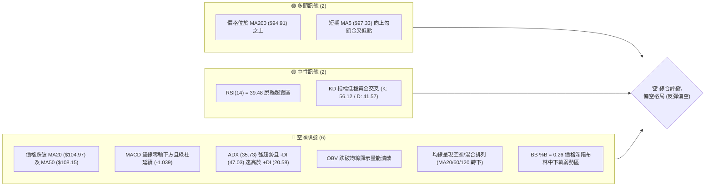
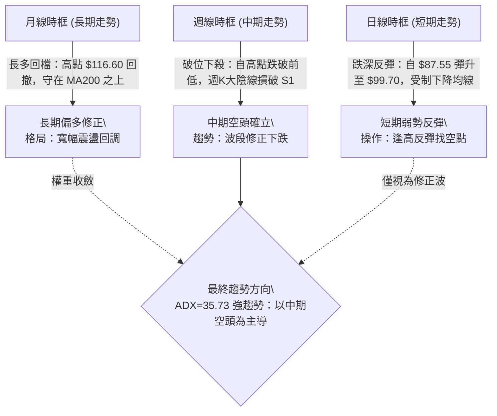
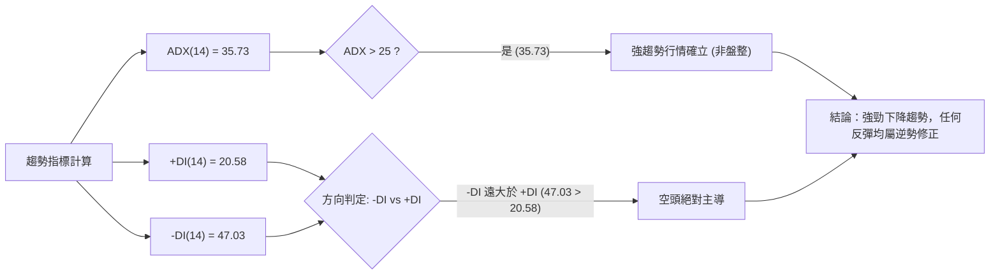
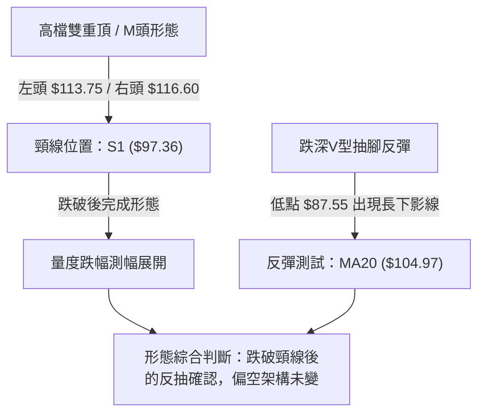
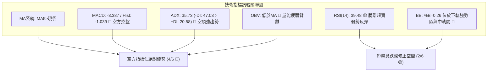
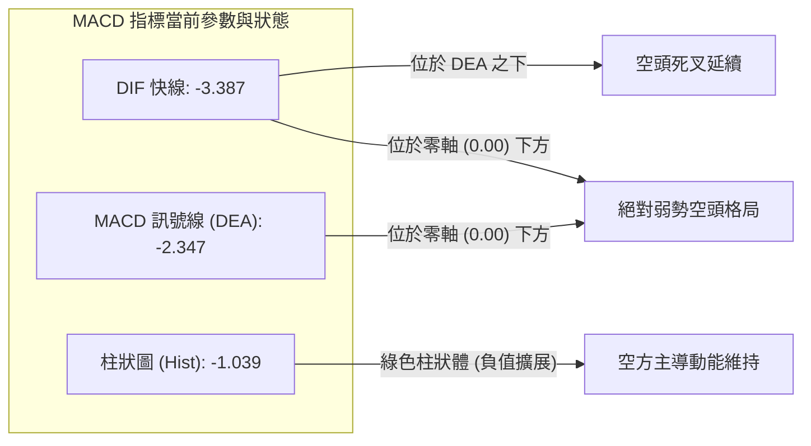
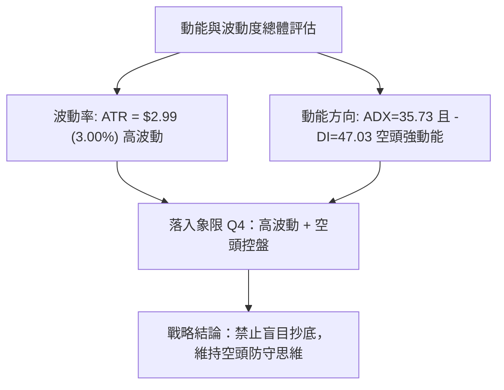
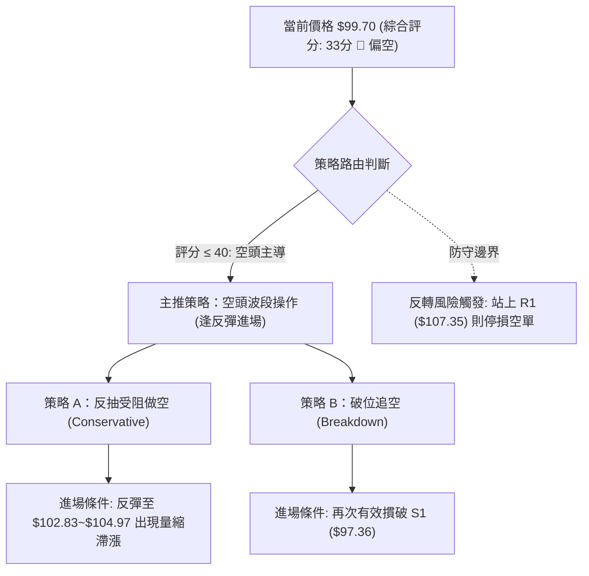
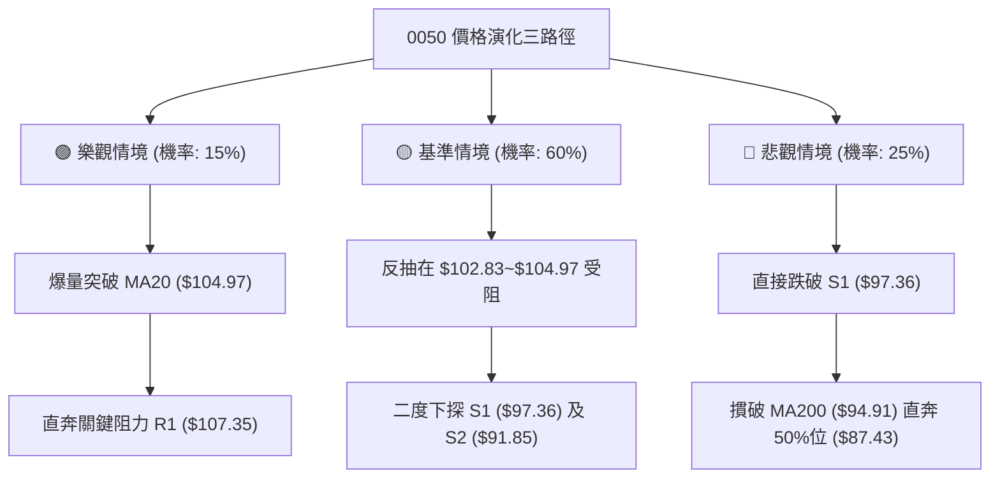

# 0050 技術分析報告

> **報告日期**：2026-11-12 ｜ **語言**：繁體中文 ｜ **數據來源**：Yahoo Finance ｜ **當前價格**：$99.70

---

## 目錄

| 章節 | 內容 |
|------|------|
| [1. 技術面概覽](#1-技術面概覽) | 訊號儀表板、核心指標、評分卡 |
| [2. 趨勢分析](#2-趨勢分析) | 多時框趨勢、長中短期走勢 |
| [3. 圖表形態分析](#3-圖表形態分析) | 形態識別、K線組合、目標價 |
| [4. 支撐與阻力](#4-支撐與阻力) | 關鍵價位、斐波那契回調 |
| [5. 技術指標深度解讀](#5-技術指標深度解讀) | MA/RSI/MACD/布林/成交量 |
| [6. 動能與波動率](#6-動能與波動率) | 動能評估、ATR、Beta |
| [7. 多時框架總結](#7-多時框架總結) | 時框架評分矩陣 |
| [8. 交易策略建議](#8-交易策略建議) | 多空策略、風險報酬比 |
| [9. 風險提示與監控](#9-風險提示與監控) | 監控指標、風險場景 |

---

## 1. 技術面概覽

### 🎯 技術訊號儀表板



### 📊 核心指標速覽表

| 指標類別 | 指標名稱 | 當前數值 | 訊號 | 解讀 |
|----------|----------|----------|:----:|------|
| **價格** | 當前收盤價 | $99.70 | 🔴 | 跌破百元大關，位於 52 週區間之 71.0%，短線破位 |
| **均線** | MA20 | $104.97 | 🔴 | 現價在 MA20 之下 -5.02%，中期下彎形成反壓 |
| **均線** | MA50 | $108.15 | 🔴 | 現價在 MA50 之下 -7.81%，波段多空分水嶺失守 |
| **均線** | MA200 | $94.91 | 🟢 | 現價高於長期均線 +5.05%，長期多頭底線尚未跌破 |
| **動能** | RSI(14) | 39.48 | 🟡 | 脫離超賣區（週K曾達18.1極度超賣），目前處於弱勢反彈 |
| **動能** | MACD(12,26,9) | -3.387 / -2.347 | 🔴 | 雙線位於零軸下，柱狀體為 -1.039，空頭動能仍佔優勢 |
| **趨勢** | ADX(14) / ±DI | ADX: 35.73 | 🔴 | ADX > 25 且 -DI(47.03) 壓制 +DI(20.58)，空頭強趨勢 |
| **通道** | 布林通道 | %B: 0.26 | 🔴 | 運行於中軌 ($104.97) 與下軌 ($94.19) 間，結構偏弱 |
| **量能** | 成交量 / OBV | 183,053,886 | 🔴 | 量比 0.87x，OBV < OBV_MA，反彈量能不足，缺乏主力推升 |
| **波動** | ATR(14) | $2.99 (3.00%) | 🟡 | 單日震盪幅度擴大至 3%，波動顯著加劇，需嚴控風險 |

### 🏆 技術評分卡

```
╔════════════════════════════════════════════════════════════════╗
║             技術評分卡 — 0050 (2026-11-12)                     ║
╠════════════════════════════════════════════════════════════════╣
║ 趨勢強度 (Trend)       ██████░░░░░░░░░░░░░░  30/100  🔴 空頭強勢  ║
║ 動能指標 (Momentum)    ████████░░░░░░░░░░░░  40/100  🟡 弱勢反彈  ║
║ 支撐穩定度 (Support)   ██████████░░░░░░░░░░  50/100  🟡 考驗S1    ║
║ 成交量配合 (Volume)    ██████░░░░░░░░░░░░░░  30/100  🔴 量縮背馳  ║
║ 形態完整度 (Pattern)   ██████░░░░░░░░░░░░░░  30/100  🔴 頭部破位  ║
║ 均線排列 (MA Align)    ████░░░░░░░░░░░░░░░░  20/100  🔴 蓋頭下壓  ║
╠════════════════════════════════════════════════════════════════╣
║ 綜合評分               ███████░░░░░░░░░░░░░  33/100  🔴 偏空操作  ║
╚════════════════════════════════════════════════════════════════╝
註：綜合評分由六項子評分算術平均得出：(30 + 40 + 50 + 30 + 30 + 20) ÷ 6 = 33.33，四捨五入為 33。
```

---

## 2. 趨勢分析

### 🌐 多時框趨勢分析



### 📈 長期趨勢 — 12個月走勢圖（Unicode）

```
0050 月線收盤走勢圖（2025-12 至 2026-11）
價格 ($)
$115 ┤                                                 ● (2026-09 $112.05)
$110 ┤                                      ●      ●   │
$105 ┤                               ●      │      │   │      ● (2026-10 $104.95)
$100 ┤                               │      │      │   │      │
 $95 ┤                               │      │      │   │      │      ●←現價 $99.70
 $90 ┤                        ●      │      │      │   │      │      │
 $85 ┤                        │      │      │      │   │      │      │
 $80 ┤                 ●      │      │      │      │   │      │      │
 $75 ┤                 │      │      │      │      │   │      │      │
 $70 ┤          ●      │   ●  │      │      │      │   │      │      │
 $65 ┤   ●      │      │   │  │      │      │      │   │      │      │
 $60 ┤───┴──────┴──────┴───┴──┴──────┴──────┴──────┴───┴──────┴──────┴──────
       12月    01月   02月 03月 04月  05月   06月   07月 08月  09月   10月   11月
       2025   ---------------------- 2026 -----------------------------
```

#### 長期走勢特徵分析表

| 階段 | 時間區間 | 起訖價格 | 累積漲跌幅 | 量價與趨勢特徵 |
|:---:|:---:|:---:|:---:|:---|
| 初始推升段 | 2024-11 ~ 2025-04 | $44.94 → $41.02 | -8.72% | 長期底部打底築底，2025-04 觸及 $41.02 波段底部 |
| 主升起跑段 | 2025-05 ~ 2025-12 | $43.74 → $64.30 | +47.01% | 突破長期阻力，成交量溫和放大，走勢階梯式墊高 |
| 快速噴出段 | 2026-01 ~ 2026-06 | $72.16 → $107.15| +48.49% | 主升浪急拉，連續突破整數關卡，各期均線全面多頭排列 |
| 高檔震盪段 | 2026-07 ~ 2026-09 | $102.85 → $112.05| +8.94% | 於 $102~$116 區間高檔換手，動能出現背離現象 |
| 頭部崩落段 | 2026-10 ~ 2026-11 | $104.95 → $99.70 | -5.00% | 創高 $116.60 後快速回挫，單月急殺破百，長黑摜壓 |

### 📊 中期趨勢（週線分析）

```
中期週線結構示意圖（2026-09 至 2026-11）
阻力區 R2: $110.55 ──────────────────────┬── 高檔套牢頭部區
阻力區 R1: $107.35 ─────────────┬────────┴── 頸線反壓聚類
                                │
現價水平:  $99.70  ─────────────┼─────────── 當前弱勢震盪反彈
                                │
支撐區 S1: $97.36  ─────────────┴─────────── 波段低點聚類支撐（日線已反覆測試）
支撐區 S2: $91.85  ───────────────────────── 前波急殺測試之強支撐
```

週線數據顯示，0050 在 2026-10-08 當週見到歷史天價 $116.60 後，連續拉出長黑 K 棒回落。在 2026-11-06 當週創下 $87.55 的單週極端低點，當週爆出 2,073,754,087 股的天量，週 RSI 一度跌至 18.1 之超賣區，隨後引發技術性跌深反彈收在 $92.50。截至 2026-11-10 週線收於 $99.70，反彈正逐步逼近百元心理關卡與日線下彎均線反壓。

### ⚡ 趨勢強度評估（ADX 解讀）



#### ADX 趨勢強度對照表

| 指標變數 | 當前讀數 | 門檻區間 | 技術意義 | 交易指導方針 |
|----------|:--------:|:--------:|----------|--------------|
| **ADX(14)** | **35.73** | > 25.00 | **強勁趨勢 (Strong Trend)** | 順應主趨勢方向操作，嚴禁逆勢長期持有多單 |
| **+DI(14)** | **20.58** | 參考線 | 多頭動能匱乏 | 多方買盤不足以發動波段反轉 |
| **-DI(14)** | **47.03** | 參考線 | 空頭動能極度亢奮 | 下跌動能充沛，市場賣壓沉重 |
| **DI差值** | **-26.45**| < 0 | 空方壓制擴大 | 差距顯著拉開，空頭波段未完 |

---

## 3. 圖表形態分析

### 🔍 形態識別系統



#### 形態識別與信心度評估表

| 形態名稱 | 信心度 | 判斷依據（引用數據） | 完成度 | 目標價（附計算式） |
|:---|:---:|:---|:---:|:---|
| **雙重頂 (M-Top)** | **75%** | 2026-09-24 週高點 $113.75 與 2026-10-08 週高點 $116.60 形成雙峰，頸線落在 2026-10-30 週收盤前之波段低點聚類 S1 ($97.36)。 | **90%** | 依形態高度推算：頸線 $97.36 - (形態頂部 $116.60 - 頸線 $97.36) = $97.36 - $19.24 = **$78.12**（數據中波段支撐參考 S3 為 $71.10） |
| **跌深反彈旗形** | **45%** | 2026-11-06 急跌至 $87.55 後連續兩日反彈至 $99.70，但量能持續萎縮（從 8.62億股縮至 1.83億股），形態尚未完整成形。 | **40%** | 訊號不足，依規則 15 僅做指標型解讀（布林下軌反彈向上測試中軌 $104.97） |

### 🕯️ 重要K線形態分析

嚴格依據近 10 根日 K 與近 8 根週 K 之開、高、低、收數據，解讀關鍵 K 棒形態：

#### 近10根日K形態精解

| 日期 | 開 | 高 | 低 | 收 | 成交量 | K線形態 | 技術解讀與訊號 |
|:---:|:---:|:---:|:---:|:---:|:---:|:---:|:---|
| **2026-10-28** | 108.35 | 108.65 | 107.80 | 108.65 | 50,936,423 | **小紅K** | 🟡 高檔量縮盤整，多空觀望，受制於上方壓力 |
| **2026-10-29** | 108.65 | 108.65 | 106.60 | 107.25 | 77,495,132 | **光頭陰線** | 🔴 開盤即最高點，空方下壓，跌破前日低點 |
| **2026-10-30** | 104.80 | 105.30 | 103.85 | 104.95 | 193,796,708 | **跳空低開紅十字**| 🔴 跳空低開近 2.5 元，爆量換手，收盤仍失守 MA20 |
| **2026-11-02** | 103.40 | 104.45 | 103.05 | 104.10 | 142,806,486 | **反彈小紅K** | 🟡 試圖回補跳空缺口失敗，高點未過 $105.00 |
| **2026-11-03** | 102.50 | 103.35 | 100.50 | 100.60 | 252,920,897 | **大陰線** | 🔴 實體長陰下殺，收盤逼近當日最低點，空方發力 |
| **2026-11-04** | 101.55 | 101.65 | 97.55 | 99.85 | 389,968,686 | **帶下影陰線** | 🔴 跌破百元關卡，盤中初探支撐 S1 ($97.36) 獲買盤支撐 |
| **2026-11-05** | 99.40 | 99.75 | 96.90 | 97.15 | 425,137,651 | **實體陰線** | 🔴 跌破 S1 ($97.36)，空頭加速摜壓，成交量急增 |
| **2026-11-06** | 89.95 | 94.45 | 87.55 | 92.50 | 862,920,367 | **天量長下影紅K**| 🟢 極端恐慌性拋補，觸及 $87.55 後暴力拉回近 5 元 |
| **2026-11-09** | 95.65 | 99.00 | 94.50 | 97.45 | 275,981,086 | **中紅K** | 🟢 低檔確立反彈，收復 11-06 開盤價，短線多頭抵抗 |
| **2026-11-10** | 99.55 | 100.50 | 97.80 | 99.70 | 183,053,886 | **帶上影小紅K** | 🟡 衝擊百元大關遇阻，高點 $100.50 回落，量能縮小至 1.83億 |

#### 近8根週K關鍵形態

| 週末日期 | 開 | 高 | 低 | 收 | 週成交量 | K線形態 | 技術解讀與訊號 |
|:---:|:---:|:---:|:---:|:---:|:---:|:---:|:---|
| **2026-10-08** | 115.75 | 116.60 | 114.90 | 114.95 | 307,612,641 | **高檔墓碑十字** | 🔴 創 52 週天價 $116.60 後長上影回落，主力出貨見頂 |
| **2026-10-16** | 114.20 | 114.95 | 108.55 | 109.00 | 869,278,497 | **爆量長陰吞噬** | 🔴 週跌幅達 5.18%，爆出近 8.7 億股巨量摜破 5 週均線 |
| **2026-11-06** | 103.40 | 104.45 | 87.55 | 92.50 | 2,073,754,087| **極端爆量鎚頭線**| 🟡 單週 20 億股歷史天量，探底 $87.55 後下影線達 4.95 元 |
| **2026-11-10** | 95.65 | 100.50 | 94.50 | 99.70 | 459,034,972 | **週線反彈陽線** | 🟡 延續下影線反彈，收盤於 $99.70，尚未扭轉週級別跌勢 |

### 📉 ASCII 走勢形態示意圖

```
                    雙頂頸線破位與反抽示意圖
價位 ($)
$116.60 ───────────────● (右頭 10-08)
                       /\
$113.75 ─────● (左頭) /  \
             / \     /    \
$107.35 ────/───\───/──────\─────── 關鍵阻力聚類 R1
           /     \ /        \
$104.97 ──/───────V──────────\───── MA20 / 布林中軌反壓
         /   (頸線反彈)        \
$97.36  /───────────────────────\─●─ 破位頸線 S1 (當前反抽至 $99.70)
       /                         \ /
$91.85/                           ● 強支撐 S2 (11-06 恐慌低點反彈區間)
     /                           /
$87.55                          ● 52週回調 50% 附近 ($87.43)
```

### 🎯 形態目標價計算

1. **雙重頂形態測幅目標**：
   - 頂部基準價：$116.60（2026-10-08 最高點）
   - 頸線破位基準價：$97.36（近一年波段低點聚類 S1）
   - 形態垂直高度 $H = \$116.60 - \$97.36 = \$19.24$
   - 由形態高度推算之第一波量度跌幅目標：$\text{頸線} - H = \$97.36 - \$19.24 =$ **$78.12**
   - 數據對照：數據中提供之長期支撐 S3 為 **$71.10**，斐波那契 61.8% 為 **$80.55**。

2. **短線反彈目標計算**：
   - 低檔反彈起點：$87.55（2026-11-06 最低點）
   - 反抽目標壓力點位：BB 中軌 **$104.97**（亦即 MA20 反壓）以及 R1 **$107.35**。

---

## 4. 支撐與阻力

### 🗺️ 關鍵價位分布圖（Unicode）

```
0050 價位結構分布圖（OHLCV 精確計算）
═══════════════════════════════════════════════════════════════
$116.60 ║████████████████████████║ 52週歷史最高點 (52W High)
$113.75 ║████████████████████    ║ 強阻力 R3 (+14.09%) / 左頭高點
$110.55 ║██████████████████████  ║ 阻力 R2 (+10.88%)
$107.35 ║████████████████████████║ 關鍵阻力 R1 (+7.67%) / 密集套牢區
$104.97 ║▒▒▒▒▒▒▒▒▒▒▒▒▒▒▒▒▒▒▒▒▒▒▒▒║ BB中軌 / MA20 下降反壓
$102.83 ║░░░░░░░░░░░░░░░░░░░░░░░░║ 斐波那契 23.6% 回調位
════════╬════════════════════════╬═════════════════════════════
$ 99.70 ╠════════════════════════╣ ◄◄ 當前收盤價 (Last Close)
════════╬════════════════════════╬═════════════════════════════
$ 97.36 ║▓▓▓▓▓▓▓▓▓▓▓▓▓▓▓▓▓▓▓▓▓▓▓▓║ 近期支撐 S1 (-2.35%) / 短線防守線
$ 94.91 ║▒▒▒▒▒▒▒▒▒▒▒▒▒▒▒▒▒▒▒▒▒▒▒▒║ 長期生命線 MA200
$ 94.32 ║░░░░░░░░░░░░░░░░░░░░░░░░║ 斐波那契 38.2% 回調位
$ 94.19 ║░░░░░░░░░░░░░░░░░░░░░░░░║ 布林下軌支撐
$ 91.85 ║████████████████████████║ 強支撐 S2 (-7.88%) / 波段低點聚類
$ 87.43 ║░░░░░░░░░░░░░░░░░░░░░░░░║ 斐波那契 50.0% 回調位
$ 71.10 ║████████████████████████║ 遠端極限支撐 S3 (-28.69%)
═══════════════════════════════════════════════════════════════
```

### 🚧 阻力位分析表

價位嚴格引用系統由 OHLCV 聚類計算之數值：

| 阻力級別 | 價位 | 形成原因 | 突破難度 | 重要性 |
|:---:|:---:|:---|:---:|:---:|
| **R1** | **$107.35** | 近一年波段高點密集聚類，同時與 MA60 ($107.63) 下壓線重疊，解套賣壓沉重 | 極高 | ★★★★★ |
| **R2** | **$110.55** | 波段反彈次高點聚類區，上方累積超過 10 億股之套牢籌碼籌碼峰 | 偏高 | ★★★★☆ |
| **R3** | **$113.75** | 2026-09-24 當週波段高點，為 M 頭型態左肩頂峰，極強結構性反壓 | 極高 | ★★★★★ |

### 🛡️ 支撐位分析表

價位嚴格引用系統由 OHLCV 聚類計算之數值：

| 支撐級別 | 價位 | 形成原因 | 守住機率 | 重要性 |
|:---:|:---:|:---|:---:|:---:|
| **S1** | **$97.36** | 近一年波段低點聚類，近 10 日內多次在此點位獲得支撐抵抗（如 11-05、11-09） | 55% | ★★★★☆ |
| **S2** | **$91.85** | 近一年次級波段低點聚類，涵蓋 11-06 爆量 8.6 億長下影線之實體收盤支撐區 | 75% | ★★★★★ |
| **S3** | **$71.10** | 歷史深層底部平台聚類（接近 2026-03 收盤價 $71.91），為終極多頭防線 | 90% | ★★★★★ |

### 📐 斐波那契回調位分析

依據 52 週波動區間 **$58.27（52W Low）至 $116.60（52W High）** 精確展開分析：

```
斐波那契回調結構位分布
0.0%  ($116.60) ────────────────────────── 52週歷史最高點
23.6% ($102.83) ────────────────────────── 初級回撤阻力位 (反彈首要考驗)
                     ▲ 現價 $99.70 運行於 23.6% 與 38.2% 區間
38.2% ($ 94.32) ────────────────────────── 強弱分水嶺 (與 MA200 $94.91 形成共振支撐)
50.0% ($ 87.43) ────────────────────────── 半數回撤位 (11-06 低點 $87.55 完美測壓點)
61.8% ($ 80.55) ────────────────────────── 黃金分割關鍵支撐
78.6% ($ 70.75) ────────────────────────── 深層防守位 (緊鄰 S3 $71.10)
100.0%($ 58.27) ────────────────────────── 52週歷史最低點
```

- **位置解讀**：現價 **$99.70** 介於 **23.6%（$102.83）** 與 **38.2%（$94.32）** 之間。
- **技術意義**：
  1. 跌破 23.6%（$102.83）後，代表強勢多頭結構已被打破，轉為弱勢回檔。
  2. 2026-11-06 出現的最低點 $87.55，幾乎分毫不差精準打在 50.0% 回調位 **$87.43**，引發爆量報復性反彈，確立了 $87.43~$91.85 是當前中期極為強韌的防禦帶。
  3. 目前股價回抽向 23.6%（$102.83）測試，該價位將與 BB 中軌（$104.97）構成雙重天花板。

---

## 5. 技術指標深度解讀

### 🎛️ 指標訊號總覽



### 📈 移動平均線排列分析

| 均線名稱 | 當前價格 | 與現價差距 | 走勢狀態 | 微觀趨勢特徵（引用數據） | 多空解讀 |
|:---:|:---:|:---:|:---:|:---|:---:|
| **MA 5** | $97.33 | +$2.37 (+2.44%) | ▲ 向上 | 走勢值呈現由底部抬升 (▇▇▇...▁▁▁) | 🟢 短線反彈支撐 |
| **MA 10** | $101.22 | -$1.52 (-1.50%) | ▼ 向下 | 短期均線快速下墜，現價反抽第一道阻力 | 🔴 短線蓋頭反壓 |
| **MA 20** | $104.97 | -$5.27 (-5.02%) | ▼ 向下 | 月線下彎幅度擴大，波段空方主防線 | 🔴 中期反轉確認 |
| **MA 60** | $107.63 | -$7.93 (-7.36%) | ▼ 向下 | 季線高檔下彎反轉，中長期趨勢轉弱 | 🔴 季線結構破位 |
| **MA120** | $105.27 | -$5.57 (-5.29%) | ▼ 向下 | 半年線走平翻黑，扣抵高檔區間 | 🔴 籌碼全面套牢 |
| **MA200** | $94.91 | +$4.79 (+5.05%) | ▲ 向上 | 長期年線穩步上行，長多核心屏障 | 🟢 長期牛熊分水嶺 |
| **MA240** | $89.47 | +$10.23 (+11.43%)| ▲ 向上 | 超長期底線支撐，上行斜率穩健 | 🟢 深度價值防線 |

- **均線排列架構**：目前呈現典型的「混合排列（中短期空頭排列，長期均線仍在上行）」。MA20、MA60、MA120 均在現價上方且同步向下發散，形成「三道蓋頭重壓」，價格每次向上反抽均將遭受均線下壓所帶來的沉重解套拋壓。

### 📉 RSI(14) 分析

```
RSI(14) 讀數儀表板
0       20       30                50                      70       100
├───────┼────────┼─────────────────┼───────────────────────┼────────┤
│ 極端  │ 超賣區 │      弱勢區     │        強勢區         │ 超買區 │
│ 超賣  │        │                 │                       │        │
└───────┴────────┴─────────────────┴───────────────────────┴────────┘
當前讀數: 39.48   [████████░░░░░░░░░░░░] 39.5% (弱勢修正區)
```

- **區間評估**：RSI(14) 目前數值為 **39.48**，脫離 30 以下之超賣區，進入弱勢反彈區。在週線層級，前週 RSI 曾暴跌至極端低點 **18.1**，本週回升至 39.5，確認了短線出現「技術性技術抽腳」，但距離突破 50 多空中軸仍有相當距離。
- **背離判斷**：
  - **日線背離判定**：檢視數據快照「RSI 背離：無明顯背離（僅比較近20根K棒首尾的價格與RSI方向）」。價格創下 $87.55 低點時，RSI 亦同步下探極端值，並未出現價格創新低而 RSI 抬高之標準日線底背離形態。
  - **結論**：目前僅為跌深引發之技術指標修正，未獲底背離確認的反轉訊號。

### 📊 MACD(12/26/9) 訊號解讀



- **數據詳解**：MACD 快線為 **-3.387**，訊號線為 **-2.347**，兩者均在零軸深處下行，柱狀體數值為 **-1.039**。
- **空頭特徵**：快線在零軸下方持續低於慢線，且柱狀體雖自極端值 -1.615（11-06 週線讀數）微幅收斂至 -1.039，但仍呈現強烈空方擴散型態，代表市場並未脫離空方波段控盤範疇。任何反彈在 MACD 未金叉翻揚前，不可視為波段反轉。

### 📦 布林通道分析

```
0050 布林通道 (20, 2) 結構示意圖
價格 ($)
$115.76 ┬────────────────────────────────────────── 上軌 (BB Upper)
        │
$104.97 ┼────────────────────────────────────────── 中軌 (BB Middle / MA20)
        │                       
$ 99.70 ┼───────────────────────● (現價, %B = 0.26)
        │                       │
$ 94.19 ┴───────────────────────┴────────────────── 下軌 (BB Lower)
```

- **通道帶寬與位置**：BB 上軌為 **$115.76**，中軌為 **$104.97**，下軌為 **$94.19**，帶寬高達 $21.57。
- **%B 指標解讀**：目前 **%B = 0.26**。%B 位於 0.20~0.30 區間，顯示價格雖脫離緊貼下軌之跌破態勢，但依然被困在中下軌弱勢通道內。中軌 **$104.97**（即下彎的 MA20）是上方直接且強烈的動態天花板。

### 💹 成交量分析（量價配合度）

- **量比與均量變化**：
  - 最新單日成交量：**183,053,886** 股
  - 20 日均量：**210,579,377** 股（當前量比僅 **0.87x**）
  - 50 日均量：**126,974,669** 股
- **量能萎縮特徵**：在 2026-11-06 爆出 862,920,367 股的大量探底後，連續兩日的反彈成交量分別驟降至 2.75 億股與 1.83 億股。量能呈現「急劇量縮」態勢，顯示市場追價意願低落，多頭買盤純屬空單回補與被動防守。
- **OBV 能量潮解讀**：系統快照指出「OBV < MA → 量能疲弱」。OBV 跌破其自身移動平均線，資金持續呈現淨流出狀態，未能對近兩日之價格回升提供量能背書，呈現標準的「量價背離（價漲量縮）」弱勢反彈格局。

---

## 6. 動能與波動率

### ⚡ 動能評估四象限

| 象限 | 動能維度 | 波動維度 | 0050 當前定位 | 策略指導與評估 |
|:---:|:---:|:---:|:---:|:---|
| **Q1 (最佳機會)** | 強 (多頭) | 低 (穩定) | — | 穩定多頭推升浪（非當前狀態） |
| **Q2 (謹慎觀望)** | 弱 (空頭/無動能) | 低 (盤整) | — | 窄幅盤整待變（非當前狀態） |
| **Q3 (高風險投機)**| 強 (多頭) | 高 (劇烈) | — | 噴出拉升行情（非當前狀態） |
| **Q4 (避免進場/逢高空)**| **弱 (空頭強動能)** | **高 (劇烈波動)** | **✓ (當前狀態)** | **空方動能充沛且波動放大，易出現假突破與急殺，嚴控多單風險** |



### 📊 ATR 波動率分析

- **ATR(14) 數值**：當前數值為 **$2.99**（佔現價比率為 **3.00%**，採用 Wilder 平滑法）。
- **日內波動意涵**：在 2026-09 至 2026-10 上半月，股價單日波動多在 1.0~1.5 元左右，而目前 ATR 擴大至近 3.00 元，顯示市場恐慌情緒發酵引發籌碼劇烈換手。
- **止損與部位控管指導**：
  - **做多保護性止損建議**：進場點下方至少需保留 $1.5 \times \text{ATR} \approx \$4.49$ 之緩衝空間，否則極易被日內噪訊掃出場。
  - **做空保護性止損建議**：進場點上方至少需保留 $1.0 \times \text{ATR} \approx \$2.99$ 至 $1.5 \times \text{ATR}$ 之距離。

### 📐 Beta 與市場相關性

- **Beta 數值**：數據顯示為 **N/A（數據未提供）**。
- **質化與產品特性解析**：0050（元大台灣卓越50證券投資信託基金）成分股囊括台股權值前 50 大企業，市值涵蓋率超過台股七成。在實務上其價格波動與加權指數（TAIEX）呈現近乎 1:1 之強烈正相關（理論 Beta 緊貼 1.0）。當前 0050 的破位大跌直接反映了大盤權值股遭遇外資與機構籌碼的大規模去槓桿撤離。

---

## 7. 多時框架總結

### 📋 時框架評分表

| 時框架 | 趨勢方向 | 動能狀態 | 均線排列 | 形態特徵 | 綜合評分 | 戰略建議 |
|:---:|:---:|:---:|:---:|:---:|:---:|:---|
| **長期 (月線)** | 🟢 偏多回檔 | 🟡 漲勢趨緩 | 🟢 MA200/240 向上 | 長期大多頭上升通道中回撤 | **60/100** | 長線定期定額者可留意低檔價值區 |
| **中期 (週線)** | 🔴 明確空頭 | 🔴 -DI 壓制 | 🔴 跌破週 MA20 | 高檔爆量雙頂 (M頭) 破位 | **30/100** | 波段操作者堅決不逆勢作多 |
| **短期 (日線)** | 🟡 弱勢反彈 | 🟡 RSI 超賣反抽 | 🔴 MA5/10/20 蓋頭 | 跌破 S1 後的縮量回抽確認 | **35/100** | 逢高反彈至均線壓力處建立空單 |

### 🔲 綜合訊號矩陣

| 技術分析維度 | 短期 (日線) 訊號 | 中期 (週線) 訊號 | 長期 (月線) 訊號 | 多時框一致性解讀 |
|:---|:---:|:---:|:---:|:---|
| **趨勢方向** | 🟡 弱勢回抽 | 🔴 波段下殺 | 🟢 長期牛市防線 | 長多中的中期大修正 |
| **動能強度 (MACD/RSI)**| 🟡 短線向上勾頭 | 🔴 綠柱擴張中 | 🟡 漲多回調 | 中期賣壓尚未出清 |
| **關鍵均線位階** | 🔴 壓制於 MA20 下 | 🔴 跌破 20 週均線 | 🟢 守在 MA200 上方 | 均線系統全面中空 |
| **成交量配合度** | 🔴 價漲量縮背馳 | 🔴 下跌爆量換手 | 🟡 均量維持 | 反彈缺乏實質資金買盤推升 |

### ⚖️ 多時框收斂結論

依嚴格要求第 14 條規章收斂：
1. **行情性質判定**：當前 **ADX(14) = 35.73 > 25**，市場處於**強烈的趨勢行情**（非布林盤整行情）。
2. **時框優先級**：趨勢行情中，必須以中長期（週線、MA50、MA200）方向為主要主導方向，日線僅用來尋找進場之時機點。
3. **收斂方向確定**：
   - 中期週線架構已確立為波段空頭（跌破高檔 M 頭頸線 S1 $97.36，週 MACD 持續擴散）。
   - 日線的反彈受阻於 $100.50，量能快速萎縮（量比 0.87x），完全契合「主趨勢下跌中的次級弱勢反彈」。
   - **唯一方向性結論**：**偏空（主策略：逢反彈做空／防守觀望）**。此結論與技術評分卡之 33 分評級高度一致。

---

## 8. 交易策略建議

### 🗺️ 策略決策流程圖



### 🧭 策略路由（依評分卡分流）

> **當前主策略方向 = 空頭策略為主（依技術評分卡綜合評分：33 / 100）**
> 
> 因綜合評分 ≤ 40，技術面明確呈現破位空頭格局，本報告**主推空頭交易策略**。多頭僅列為反轉風險觸發點與風控提示，不進行激進多單推薦。

### 🎯 價格情境階梯（Price Scenarios）

價位完全嚴格引用第 4 章及關鍵價位模組數值：

| 觸發條件 | 下一目標 | 後續延伸 | 情境含義 |
|:---|:---:|:---:|:---|
| **強勢突破 R1 ($107.35)** | R2 ($110.55) | R3 ($113.75) | 多頭超跌強反轉，需全面停損空單並觀望 |
| **反彈受阻 BB中軌 ($104.97)** | S1 ($97.36) | S2 ($91.85) | 反彈力竭，空單極佳進場防守點位 |
| **跌破 S1 ($97.36)** | S2 ($91.85) | S3 ($71.10) | 空頭第二波主跌浪啟動，測試長期 MA200 |
| **有效跌破 S2 ($91.85)** | 斐波那契50% ($87.43) | S3 ($71.10) | 恐慌性崩跌，波段目標直指長期深層支撐 |

### 📊 情境機率分佈

| 情境劇本 | 機率 | 主要依據 |
|:---|:---:|:---|
| **情境一：反彈力竭，重啟跌勢 (回落探底)** | **60%** | ADX 高達 35.73 且 -DI 主導；成交量持續萎縮無法支撐反彈；MA20 ($104.97) 蓋頭下壓。 |
| **情境二：在 S1 與 MA20 間區間震盪** | **25%** | 跌深至 $87.55 獲天量承接，短線 RSI 自超賣區修復，多空在百元大關展開爭奪拉鋸。 |
| **情境三：強勢 V 型反轉，站上 R1** | **15%** | 除非有極大系統性利多刺激，否則在 MACD 柱狀體為負、均線空頭排列下，機率極低。 |

### 🟢 主策略詳情（空頭主導策略）

嚴格依據規則 17 計算風險報酬比：做空風險報酬比 = $(\text{進場價} - \text{目標價 T1}) \div (\text{止損價} - \text{進場價})$。進場價若為區間，以**區間中點**計算並註明。

| 策略要素 | 策略 A（反彈高空策略 — 逢反抽布林中軌建立） | 策略 B（破位順勢加空策略 — 跌破 S1 確認） |
|:---|:---|:---|
| **交易方向** | **做空 (Short)** | **做空 (Short)** |
| **進場條件** | 價格反彈至斐波 23.6% 與 MA20 之間滯漲回落 | 日 K 收盤價確認跌破波段低點聚類 S1 |
| **進場價格** | **$103.90**（進場區間 $102.83~$104.97 之區間中點） | **$97.36**（精準 S1 破位進場點） |
| **目標價 T1** | **$97.36**（波段低點支撐聚類 S1） | **$91.85**（強支撐 S2 聚類） |
| **目標價 T2** | **$91.85**（強支撐 S2 聚類） | **$87.43**（斐波那契 50.0% 回調位） |
| **止損價格** | **$107.35**（關鍵阻力 R1，突破即止損） | **$100.50**（2026-11-10 日K當日最高點） |
| **風險報酬比** | **1 : 1.90（以 T1 計）**<br>計算式：$(103.90 - 97.36) \div (107.35 - 103.90) = 6.54 \div 3.45 = 1.8956$<br>*(以 T2 計則為 1 : 3.49)* | **1 : 1.75（以 T1 計）**<br>計算式：$(97.36 - 91.85) \div (100.50 - 97.36) = 5.51 \div 3.14 = 1.7547$<br>*(以 T2 計則為 1 : 3.16)* |
| **成功機率** | **65%** | **60%** |
| **建議倉位** | **15% - 20% 總資金** | **10% - 15% 總資金** |

### 🔴 反向風險觸發點（對沖與風控提示）

若市場出現異常強勢拉抬，以下價位與訊號為推翻空頭邏輯之核心依據：
1. **多頭反轉翻多臨界點**：日線收盤價強勢站上 **$107.35（R1）**，代表月線 MA20 與季線 MA60 壓力被實質化解，空單必須無條件全數停損出場。
2. **動能轉向訊號**：日線 MACD 出現零軸下之「黃金交叉」，且日成交量放大突破 20 日均量（> 2.1 億股）。
3. **對沖建議**：持有大量 0050 現貨之長線投資人，現階段可於 $102.83~$104.97 區間，利用台指期貨或相關避險工具進行 1:1 Beta 避險對沖。

### ⭐ 整體訊號強度評星

```
做多訊號強度：★☆☆☆☆  (1/5星 - 僅屬跌深超賣反抽，缺乏量能支持)
做空訊號強度：★★★★☆  (4/5星 - 形態破位、均線蓋頭、ADX強趨勢主導)
整體可信度：  ★★★★☆  (4/5星 - 價量指標與多時框架分析高度共振)
```

---

## 9. 風險提示與監控

### ✅ 關鍵監控指標 Checklist

```
╔══════════════════════════════════════════════════════════════════╗
║              0050 每日盤後關鍵技術監控清單 (Checklist)           ║
╠══════════════════════════════════════════════════════════════════╣
║ [ ] 價格能否守穩近一年支撐位 S1 ($97.36)？跌破則空頭加速        ║
║ [ ] 反彈成交量是否放大至 20日均量 (210,579,377 股) 之上？        ║
║ [ ] RSI(14) 能否進一步突破 50.0 多空中軸分水嶺？                ║
║ [ ] MACD 柱狀體 (-1.039) 是否顯著收斂並出現 DIF 金叉向上？      ║
║ [ ] 反抽是否受阻於 MA20 ($104.97) 及斐波 23.6% ($102.83)？       ║
║ [ ] ADX(14) 讀數是否由 35.73 轉折下彎至 25 以下進入盤整？       ║
║ [ ] 長期生命線 MA200 ($94.91) 是否面臨直接回踩測試？            ║
╚══════════════════════════════════════════════════════════════════╝
```

### ⚠️ 風險場景分析



### 🛡️ 風險管理重要提醒

1. **ETF 系統性風險防範**：
   - 0050 屬權值龍頭 ETF，無單一公司違約風險，但受全球宏觀資金流向、匯率波動及半導體產業景氣循環高度牽動。
   - 目前處於全球流動性收緊與高檔套牢盤調節期，技術指標空頭發散時，切忌「愈跌愈攤平」式的主觀加碼。
2. **部位規模控制與資金管理**：
   - 空單單筆操作承擔風險金額不得超過總投資部位之 **1.5% - 2.0%**。
   - 波動率擴大（ATR = $2.99），部位持倉比例應從原本的正常水平下調 30%~50%，以適應寬幅震盪。
3. **無條件停損紀律**：
   - 操作策略 A 以 $107.35（R1）為鋼鐵止損線，觸及無條件執行平倉，嚴防主力假突破後的軋空風險。
   - 操作策略 B 追空者，若收盤重新站回 $100.50 之上，應立刻平倉撤離。

---

## 📋 報告總結

```
╔══════════════════════════════════════════════════════════════════╗
║                    0050 技術分析報告總結                         ║
╠══════════════════════════════════════════════════════════════════╣
║ 報告日期：2026-11-12                                            ║
║ 當前價格：$99.70 TWD                                             ║
║ 分析評級：🔴 偏空格局 (技術評分卡綜合評分: 33 / 100)             ║
║ 趨勢環境：ADX = 35.73 (空頭強趨勢，-DI: 47.03 絕對主導)          ║
╠══════════════════════════════════════════════════════════════════╣
║ 關鍵結構結論：                                                   ║
║ ├─ 長期趨勢 (月線)：🟢 偏多回檔 (MA200 $94.91 支撐未失守)       ║
║ ├─ 中期趨勢 (週線)：🔴 空頭確立 (高檔雙頂頸線破位，綠柱延續)     ║
║ ├─ 短期趨勢 (日線)：🟡 弱勢反彈 (縮量回抽，百元整數關卡遭遇賣壓) ║
║ ├─ 核心阻力位：R1: $107.35 ｜ R2: $110.55 ｜ MA20: $104.97       ║
║ ├─ 核心支撐位：S1: $97.36  ｜ S2: $91.85  ｜ MA200: $94.91       ║
║ └─ 形態量度目標：雙頂頸線量度目標 $78.12 (波段參考 S3 $71.10)   ║
╠══════════════════════════════════════════════════════════════════╣
║ 最優策略組合：                                                   ║
║ 1. 🥇 最佳機會：策略 A (反彈高空)                                ║
║    進場 $103.90 ｜ 止損 $107.35 ｜ T1 $97.36 (風報比 1:1.90)    ║
║ 2. 🥈 次選機會：策略 B (破位順勢加空)                            ║
║    進場 $97.36  ｜ 止損 $100.50 ｜ T1 $91.85 (風報比 1:1.75)    ║
║ 3. 🥉 保守選擇：空手觀望，靜待回踩長期 MA200 ($94.91) 觀察承接力 ║
╚══════════════════════════════════════════════════════════════════╝
```

---

> ⚠️ **免責聲明**：本報告為 AI 自動生成之技術分析，所有數據及估算均基於提供的歷史價格資訊。本報告**僅供研究與學術參考**，**不構成任何投資建議**。投資有風險，入市需謹慎。

---

*報告生成時間：2026-11-12 ｜ 數據來源：Yahoo Finance ｜ 分析框架：多時框技術分析*