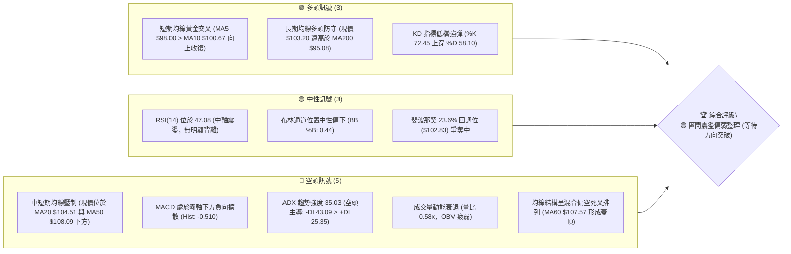
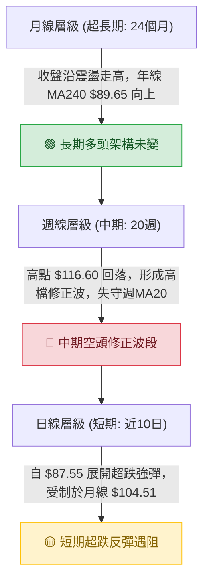
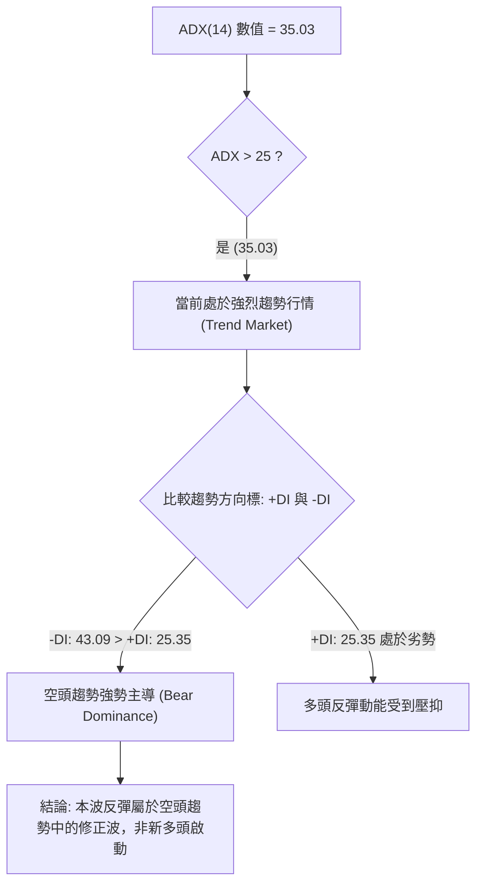
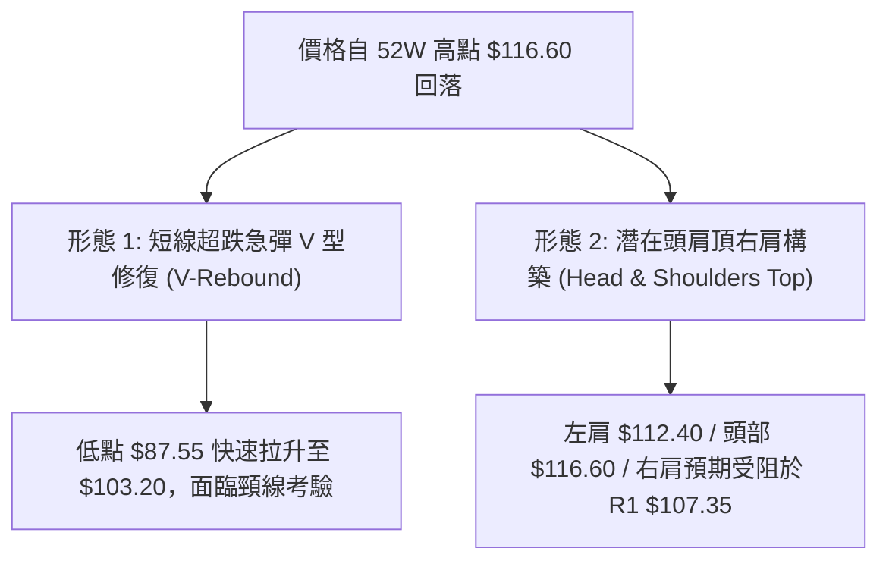
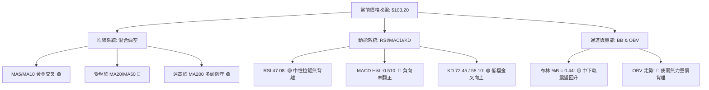
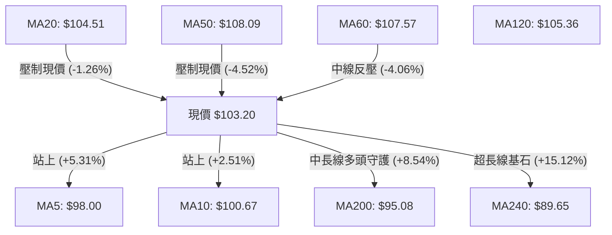
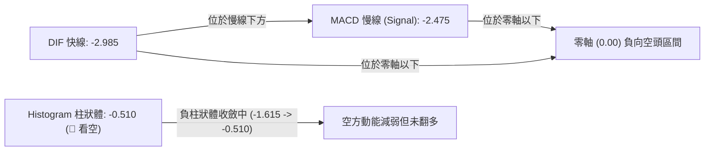
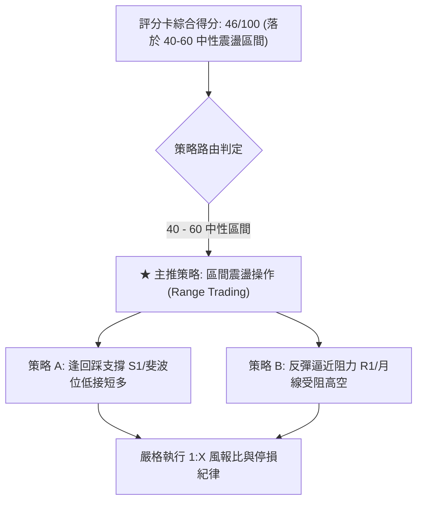
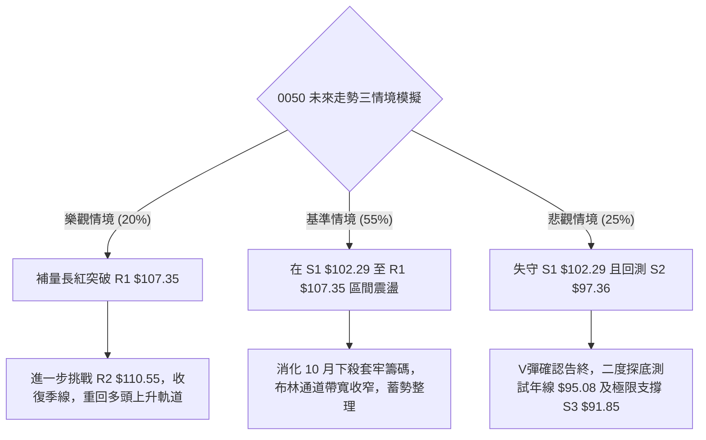

# 0050 技術分析報告

> **報告日期**：2026-11-13 ｜ **語言**：繁體中文 ｜ **數據來源**：Yahoo Finance ｜ **當前價格**：$103.20 TWD

---

## 目錄

| 章節 | 內容 |
|------|------|
| [1. 技術面概覽](#1-技術面概覽) | 訊號儀表板、核心指標、評分卡 |
| [2. 趨勢分析](#2-趨勢分析) | 多時框趨勢、長中短期走勢、ADX強度 |
| [3. 圖表形態分析](#3-圖表形態分析) | 形態識別、K線組合、目標價推算 |
| [4. 支撐與阻力](#4-支撐與阻力) | 關鍵價位、斐波那契回調層級 |
| [5. 技術指標深度解讀](#5-技術指標深度解讀) | 均線系統、RSI、MACD、布林通道、量價OBV |
| [6. 動能與波動率](#6-動能與波動率) | 動能四象限、ATR波幅、Beta相關性 |
| [7. 多時框架總結](#7-多時框架總結) | 時框評分矩陣、多時框收斂結論 |
| [8. 交易策略建議](#8-交易策略建議) | 策略路由、價格情境階梯、風報比精算 |
| [9. 風險提示與監控](#9-風險提示與監控) | 監控指標Checklist、情境路徑、風控規範 |

---

## 1. 技術面概覽

### 🎯 技術訊號儀表板



---

### 📊 核心指標速覽表

| 指標類別 | 指標名稱 | 當前數值 | 訊號 | 解讀 |
|:---|:---|:---|:---:|:---|
| **價格** | 當前收盤價 | $103.20 | 🟡 | 位於52週區間77.0%處，自近週低點$87.55強勁反彈後遭遇月線反壓 |
| **均線** | MA20 (月線) | $104.51 | 🔴 | 價格低於MA20 (-1.26%)，短線反彈面臨第一道動態均線阻力 |
| **均線** | MA50 (季線) | $108.09 | 🔴 | 價格低於MA50 (-4.52%)，中期趨勢受到壓制 |
| **均線** | MA200 (年線)| $95.08 | 🟢 | 價格高於MA200 (+8.54%)，超長期多頭多空分水嶺未被有效跌破 |
| **動能** | RSI(14) | 47.08 | 🟡 | 處於40-50中性偏弱區間，多空力量暫呈拉鋸狀態 |
| **動能** | MACD (12,26,9) | -2.985 / -2.475 | 🔴 | DIF位於信號線下方，柱狀體為 -0.510，空方動能尚未完全消退 |
| **趨勢** | ADX(14) / ±DI | 35.03 | 🔴 | ADX > 25 表示強趨勢，-DI (43.09) 大幅領先 +DI (25.35)，空頭握有主控權 |
| **通道** | 布林通道 | 94.29 - 114.74 | 🟡 | %B 為 0.44，自下軌彈升至中軌下方，震盪空間收窄 |
| **量能** | 20日成交量比 | 0.58x | 🔴 | 最新量 118,729,026 遠低於 20日均量 205,985,034，量價呈背離反彈 |
| **波動** | ATR(14) | $3.03 | 🟡 | 佔股價 2.93%，單日波幅適中，為合理設定風控止損依據 |

---

### 🏆 技術評分卡

```
╔══════════════════════════════════════════════════════════════════╗
║                 技術評分卡 — 0050 (2026-11-13)                   ║
╠══════════════════════════════════════════════════════════════════╣
║ 趨勢強度 (ADX/DI)   ████████░░░░░░░░░░░░  42/100  🔴 空頭趨勢掌控  ║
║ 動能指標 (RSI/MACD) █████████░░░░░░░░░░░  46/100  🟡 中性反彈偏弱  ║
║ 支撐穩定度 (S1/Fib) ████████████░░░░░░░░  58/100  🟢 斐波防守顯現  ║
║ 成交量配合 (OBV/VOL)███████░░░░░░░░░░░░░  36/100  🔴 量能萎縮背離  ║
║ 形態完整度 (K線結構)██████████░░░░░░░░░░  48/100  🟡 探底反彈格局  ║
║ 均線排列 (MA系統)   █████████░░░░░░░░░░░  46/100  🔴 均線上方蓋頭  ║
╠══════════════════════════════════════════════════════════════════╣
║ 綜合評分            █████████░░░░░░░░░░░  46/100  🟡 區間震盪整理  ║
╚══════════════════════════════════════════════════════════════════╝
```

> **綜合評分計算說明**：(42 + 46 + 58 + 36 + 48 + 46) ÷ 6 = 46.0，四捨五入取整為 **46/100**。評級落於 40–60 分之中性區間，策略應定調為**區間震盪／弱勢反彈承壓操作**，等待關鍵阻力突破或回踩確認。

---

## 2. 趨勢分析

### 🌐 多時框趨勢分析



---

### 📈 長期趨勢 — 12個月走勢圖（Unicode）

以下為 0050 自 2025-12 至 2026-11 過去 12 個月之收盤價位移軌跡：

```
0050 月線走勢圖（過去12個月：2025-12 至 2026-11）
價格 ($)
$115 ┤                                                 
$110 ┤                                           ● 112.05
$105 ┤                               ● 107.15       ● 104.95
$100 ┤                         ● 104.76     ● 102.85 ● 106.25  ● 103.20 (現價)
$95  ┤                                                 
$90  ┤                   ● 89.95                       
$85  ┤                                                 
$80  ┤             ● 80.66                             
$75  ┤       ● 72.16     ● 71.91                       
$70  ┤                                                 
$65  ┤ ● 64.30                                         
$60  ┤                                                 
     └─┬─────┬─────┬─────┬─────┬─────┬─────┬─────┬─────┬─────┬─────┬─────
     25-12 26-01 26-02 26-03 26-04 26-05 26-06 26-07 26-08 26-09 26-10 26-11
```

#### 走勢特徵分析表格

| 階段區間 | 時間跨度 | 起訖收盤價 | 漲跌幅 | 走勢特徵與結構意涵 |
|:---|:---:|:---:|:---:|:---|
| **第1階段：主升推升期** | 2025-12 ~ 2026-02 | $64.30 → $80.66 | +25.44% | 均線多頭發散，月K連續長紅，成交量顯著增溫。 |
| **第2階段：強勢洗盤期** | 2026-02 ~ 2026-03 | $80.66 → $71.91 | -10.85% | 獲利了結賣壓湧現，急跌回測支撐後迅速獲得承接。 |
| **第3階段：二次噴出期** | 2026-03 ~ 2026-06 | $71.91 → $107.15| +49.01% | 結構性強大多頭主升浪，突破百元整數大關。 |
| **第4階段：高檔震盪作頂**| 2026-06 ~ 2026-09 | $107.15 → $112.05| +4.57% | 創下 52週新高 $116.60，動能開始減緩，高檔籌碼換手。 |
| **第5階段：波段回檔修正**| 2026-09 ~ 2026-11 | $112.05 → $103.20| -7.90% | 跌破短期均線，11月初更一度下探 $87.55，進入修正循環。 |

---

### 📊 中期趨勢（週線分析）

從近 20 週收盤走勢可見，價格於 2026-10-08 見頂（收盤 $114.95，當週最高 $116.60）後展開急遽拉回。

```
0050 近期週線壓力與支撐示意圖
$116.60 ┬────────────────────── 52W 高點 (波段頂部阻力)
        │       ╭──╮
$110.00 ┤      ╭╯  ╰╮         R2: $110.55
$107.35 ┤  ╭──╯    ╰╮        R1: $107.35 (波段壓力密集區)
$104.51 ┤──┼────────┼───╭─── MA20 / 布林中軌 ($104.51)
$103.20 ┼──┼────────┼───●─── 現價 ($103.20)
$102.29 ┤  │        │   ╰── S1: $102.29 / 斐波 23.6% ($102.83)
$97.36  ┤  │        │        S2: $97.36
$91.85  ┤  │        ╰╮       S3: $91.85
$87.55  ┴──╯─────────╰────── 2026-11-06 閃崩低點 / 50% 斐波 ($87.43)
```

2026-11-06 當週爆出 2,073,754,087 股之歷史天量，最低觸及 $87.55，收盤收於 $92.50，形成超長下影線；次週（2026-11-11）強拉至 $103.20。此結構顯示低檔具備恐慌盤竭盡性賣壓釋放後的強勁買盤，但隨之而來的是面臨 10 月套牢籌碼的重重阻力。

---

### ⚡ 趨勢強度評估（ADX 解讀）



#### ADX 趨勢強度對照表

| 指標名稱 | 實際數值 | 參考標準區間 | 趨勢狀態判定 |
|:---|:---:|:---:|:---|
| **ADX (14)** | **35.03** | 0-20: 無趨勢盤整<br>20-25: 弱趨勢萌芽<br>**25-40: 強烈趨勢**<br>40+: 極強趨勢 | **明確強趨勢**。表示市場並非無序橫盤，而是具備明顯的方向性動能。 |
| **+DI (14)** | **25.35** | 數值越高多方越強 | 多方力道低於空方，處於弱勢反抗防守。 |
| **-DI (14)** | **43.09** | 數值越高空方越強 | **空方實質控盤**。空頭慣性強大，反彈需提防隨時遭遇壓回。 |

---

## 3. 圖表形態分析

### 🔍 形態識別系統



#### 圖表形態信心度評估表

| 識別形態名稱 | 信心度 (%) | 判斷依據（引用數據） | 完成度 (%) | 目標價（附嚴謹計算式） |
|:---|:---:|:---|:---:|:---|
| **超跌急彈波 (V型修復)** | **70%** | 2026-11-06 日K急挫至低點 $87.55 後爆出 8.62億天量，隨後3個交易日連續收紅站上 $103.20。 | 85% | 突破點 $97.45 + (形態高度: $97.45 - $87.55 = $9.90) = **$107.35** (恰為阻力位 R1)。 |
| **潛在頭肩頂右肩反彈** | **55%** | 左肩高點 $112.40 (09-24當週)，頭部高點 $116.60 (10-08當週)，跌破頸線 $106.90 後下探 $87.55；當前反彈至 $103.20 屬右肩測試。 | 60% | 右肩高點若受阻於 R1 $107.35 承壓回落，跌破頸線低點測幅目標：$106.90 - ($116.60 - $106.90) = **$97.20** (近支撐 S2 $97.36)。 |
| **雙底形態 (W底)** | **25%** | 目前僅出現單一低點 $87.55，尚未進行二次回踩測試打出第二隻腳。 | 15% | **訊號不足，僅做指標型解讀**（未滿足雙底幾何結構）。 |

---

### 🕯️ 重要K線形態分析

根據提供之近 10 根日K線與近 8 根週K線之精確 OHLC 數據分析：

| 日期（時框） | 開盤價 | 最高價 | 最低價 | 收盤價 | 成交量 | K線形態名稱 | 解讀與技術意涵 | 多空訊號 |
|:---|:---:|:---:|:---:|:---:|:---:|:---|:---|:---:|
| **2026-11-04 (日)** | 101.55 | 101.65 | 97.55 | 99.85 | 389,968,686 | **光頭中黑K線** | 開盤即最高，摜破百元關卡，空方加速傾瀉賣壓。 | 🔴 |
| **2026-11-05 (日)** | 99.40 | 99.75 | 96.90 | 97.15 | 425,137,651 | **跳空下跌中黑** | 連續下殺帶量，空方動能全面爆發，引發恐慌性停損。 | 🔴 |
| **2026-11-06 (日)** | 89.95 | 94.45 | 87.55 | 92.50 | 862,920,367 | **爆量長下影錘頭棒** | 跳空重挫探底 $87.55 後逢低買盤巨量湧入，下影線長達 $4.95，屬典型竭盡賣壓出清。 | 🟢 |
| **2026-11-09 (日)** | 95.65 | 99.00 | 94.50 | 97.45 | 275,981,086 | **跳空高開實體中紅** | 確認 11-06 之低檔反轉，開高走高收復短期失土，形成晨星前置組合。 | 🟢 |
| **2026-11-10 (日)** | 99.55 | 100.50 | 97.80 | 99.70 | 183,053,886 | **高檔震盪十字紡錘線**| 上衝百元大關後震盪，低點不破前日低，籌碼多空換手消化浮額。 | 🟡 |
| **2026-11-11 (日)** | 101.00 | 103.25 | 99.80 | 103.20 | 118,729,026 | **光腳長實體大紅棒** | 實體收在當日近最高點 $103.20，但量能縮至 1.18億股，出現量價背離。 | 🟡 |
| **2026-11-06 (週)** | 103.40 | 104.45 | 87.55 | 92.50 | 2,073,754,087| **極致天量長下影黑K**| 單週下探 87.55 爆出 20.7億超天量，下影線達 $4.95，顯示長線主力資金在百元以下大舉護盤進場。 | 🟢 |
| **2026-11-11 (週)** | 95.65 | 103.25 | 94.50 | 103.20 | 577,763,998 | **長陽反包多頭吞噬棒**| 當週低開高走，以大陽線一舉吞噬前週實體高點，展現強勁報復性反彈。 | 🟢 |

---

### 📉 ASCII 走勢形態示意圖

```
0050 近日日K線 V 型急彈形態示意圖
 價格 ($)
$108.00 ┬─ [2026-10-29: 107.25]
        │    │
$105.00 ┤    ├─── [10-30: 104.95]
        │    │     │
$103.20 ┼────┼─────┼───────────────────────────────────● [11-11: 103.20 現價]
$102.00 ┤    │     ├─── [11-02: 104.10]                │
$100.00 ┤    │     │     │                             │
$98.00  ┤    │     │     ├── [11-03: 100.60]          ├── [11-10: 99.70]
$96.00  ┤    │     │     │    │                       │
$94.00  ┤    │     │     │    ├── [11-04: 99.85]      ├── [11-09: 97.45]
$92.00  ┤    │     │     │    │    │                 │
$90.00  ┤    │     │     │    │    ├── [11-05: 97.15]│
$88.00  ┤    │     │     │    │    │    │            │
$87.55  ┴────┴─────┴─────┴────┴────┴────┴────● [11-06 探底低點: 87.55 (成交量 8.62億股)]
```

---

### 🎯 形態目標價計算

1. **反彈測幅推算（V型修復測幅）**：
   - 形態底部低點：$87.55（2026-11-06）
   - 頸線/破位平台：$97.45（2026-11-09 收盤確認之頸線破位平台）
   - 形態高度：$97.45 - $87.55 = $9.90
   - 等幅向上推算目標價：$97.45 + $9.90 = **$107.35**（精準對應波段阻力 R1）
2. **第二目標測幅（回補跳空缺口）**：
   - 參照波段高點聚類與頸線回抽，若突破 R1 $107.35，下一測幅目標直指阻力位 **R2: $110.55**。

---

## 4. 支撐與阻力

### 🗺️ 關鍵價位分布圖（Unicode）

```
0050 價位結構分布圖 (現價: $103.20)
══════════════════════════════════════════════════════════════════
$116.60 ║████████████████████████████████████████║ 52W 歷史最高點 / 斐波 0.0%
$113.75 ║██████████████████████████████          ║ 強阻力 R3 (+10.22%)
$110.55 ║████████████████████                    ║ 阻力位 R2 (+7.12%)
$107.35 ║████████████████████████████            ║ 關鍵第一阻力 R1 (+4.02%)
$104.51 ║────────────────────────────────────────║ 動態阻力 (MA20 月線 / 布林中軌)
$103.20 ╠════════════════════════════════════════╣ ◄ 當前收盤價 ($103.20)
$102.83 ║░░░░░░░░░░░░░░░░░░░░░░░░░░░░░░░░░░░░░░░░║ 關鍵斐波那契 23.6% 回調位
$102.29 ║▓▓▓▓▓▓▓▓▓▓▓▓▓▓▓▓▓▓▓▓▓▓▓▓▓▓▓▓            ║ 近期第一支撐 S1 (-0.88%)
$97.36  ║████████████████████████████████        ║ 強支撐 S2 (-5.66%)
$95.08  ║────────────────────────────────────────║ 長期生命線 (MA200 年線)
$91.85  ║████████████████████████████████████    ║ 深度極限支撐 S3 (-11.00%)
$87.43  ║░░░░░░░░░░░░░░░░░░░░░░░░░░░░░░░░░░░░░░░░║ 斐波那契 50.0% / 前波低點 $87.55
══════════════════════════════════════════════════════════════════
```

---

### 🚧 阻力位分析表

阻力位嚴格引用技術數據中近一年波段高點聚類所得：

| 阻力級別 | 精確價位 | 距現價幅動 | 技術形成原因與結構意義 | 突破難度 | 技術重要性 |
|:---|:---:|:---:|:---|:---:|:---:|
| **阻力 R1** | **$107.35** | +4.02% | 10月下旬盤整小平台下緣與季線 MA60 ($107.57) 匯合處，形態測幅之目標位。 | 🟡 中等偏高 | ★★★★☆ |
| **阻力 R2** | **$110.55** | +7.12% | 10月中旬長黑K線殺多實體起跌區間，具備大量套牢浮額籌碼。 | 🔴 困難 | ★★★★★ |
| **阻力 R3** | **$113.75** | +10.22%| 近一年多重頂部肩部高點聚類區，突破此處代表回歸極端多頭。 | 🔴 極難 | ★★★★☆ |

---

### 🛡️ 支撐位分析表

支撐位嚴格引用技術數據中近一年波段低點聚類所得：

| 支撐級別 | 精確價位 | 距現價幅動 | 技術形成原因與結構意義 | 守住機率 | 技術重要性 |
|:---|:---:|:---:|:---|:---:|:---:|
| **支撐 S1** | **$102.29** | -0.88% | 貼近斐波 23.6% ($102.83)，為 11-10 震盪換手之防守下緣，短多第一防線。 | 🟡 60% | ★★★★☆ |
| **支撐 S2** | **$97.36** | -5.66% | 11-09 突破缺口上緣與波段密集轉折支撐區，跌破將宣告短多反彈夭折。 | 🟢 75% | ★★★★★ |
| **支撐 S3** | **$91.85** | -11.00%| 靠近年線 MA200 ($95.08) 與 11-06 恐慌殺盤低點之次級防線，長線價值區。 | 🟢 85% | ★★★★★ |

---

### 📐 斐波那契回調位分析

依據 52 週完整波段起訖點（52W Low: $58.27 → 52W High: $116.60，總波幅 $58.33）計算之標準回調位如下：

| 回調比例 | 精確價位 | 與現價關係 | 技術意涵與多空判斷 |
|:---:|:---:|:---:|:---|
| **0.0%** | **$116.60** | +12.98% | 52週歷史高點，長期上升走勢之終極壓力極限。 |
| **23.6%** | **$102.83** | **-0.36%** | **現價 ($103.20) 正好緊貼此價位上方！** 此線為強勢修正與深度修正之分水嶺，站穩確認多頭具備韌性。 |
| **38.2%** | **$94.32** | -8.60% | 正常回調滿足點，鄰近 MA200 ($95.08) 與下軌 ($94.29)，為強烈共振支撐區。 |
| **50.0%** | **$87.43** | -15.28% | **多空半分位**。2026-11-06 盤中急跌最低至 **$87.55**，與 50.0% 回調位僅差 $0.12！顯示中長線買盤於半分位具備鋼鐵防守意志。 |
| **61.8%** | **$80.55** | -21.95% | 黃金分割防守位，2026年2月平台收盤價 $80.66 所在處。 |
| **78.6%** | **$70.75** | -31.44% | 深度回檔極限，靠近 2026年1月突破起漲點。 |
| **100.0%** | **$58.27** | -43.54% | 52週波段起漲最低點。 |

> **回調狀態解讀**：現價 $103.20 處於 **0.0% ($116.60) 與 23.6% ($102.83)** 區間之底部，緊貼 23.6% 黃金分割線。先前插針至 50.0% ($87.43) 後迅速收復 38.2% ($94.32)，當前能否在收盤層級牢牢站穩 $102.83，將是決定是「延續反彈挑戰 R1」或是「二度探底考驗 S2」之生死線。

---

## 5. 技術指標深度解讀

### 🎛️ 指標訊號總覽



---

### 📈 移動平均線排列分析



#### 均線數據分析矩陣

| 均線名稱 | 數值 ($) | 與現價差距 | 乖離率 (%) | 均線趨勢與技術含義 |
|:---|:---:|:---:|:---:|:---|
| **MA5** | $98.00 | +$5.20 | +5.31% | 向上翻揚。短線超跌後迅速收復，提供短線第一道動態支撐。 |
| **MA10** | $100.67 | +$2.52 | +2.51% | 向上翻揚。短線與 MA5 呈黃金交叉，短多動能增溫。 |
| **MA20 (月線)** | $104.51 | -$1.31 | -1.26% | 走平下彎。近一個月投資人平均成本，短線多頭第一關反壓。 |
| **MA50 (季線)** | $108.09 | -$4.89 | -4.52% | 持續走跌。與 MA60 形成密集中期反壓帶。 |
| **MA60** | $107.57 | -$4.37 | -4.06% | 走平微彎。與阻力位 R1 ($107.35) 完美重疊。 |
| **MA120 (半年線)**| $105.36 | -$2.16 | -2.05% | 走平偏下。位於月線之上，形成反彈層層反壓。 |
| **MA200 (年線)**| $95.08 | +$8.12 | +8.54% | 持續向上。多空牛熊終極分水嶺，多頭結構仍在長週期維持。 |
| **MA240** | $89.65 | +$13.55 | +15.12%| 強勁向上發散。顯示過去一年長線資金成本堅實。 |

> **均線結構總結**：目前呈現典型「短多長多、中線空頭整理」之**混合排列**。MA5 > MA10 展現短線反彈企圖，但 MA20 ($104.51)、MA120 ($105.36)、MA60 ($107.57)、MA50 ($108.09) 全數蓋在現價上方，反彈空間受到高度壓縮。

---

### 📉 RSI(14) 分析

```
RSI(14) 動能強度進度條
0            30        47.08      70          100
├────────────┼───────────┼────────┼────────────┤
[   超賣區   ] [ 弱勢區  ]  ▲中性  [   超買區   ]
███████████████████████░░░░░░░░░░░░░░░░░░░░░░░░░  47.08%
```

- **當前數值解讀**：RSI(14) 為 **47.08**，處於 30 至 70 之間的中性震盪區間，遠離超買與超賣極端值。此數值顯示自 11-06 週線低點引發的 RSI 18.1 極度超賣狀態已得到大幅修復。
- **背離判斷結論**：
  - **日線層級**：比對近 20 根 K 棒首尾之價格與 RSI 方向，**無明顯背離**（價格探底回升，RSI 同步自低點修復至 47.08，走勢互相確認）。
  - **週線層級**：2026-10-08 週收盤 $114.95，週 RSI 為 65.7；而 2026-11-06 週收盤重挫至 $92.50，週 RSI 摔至 18.1；本週強彈至 47.1，屬於超跌後的對稱性技術反彈，**無底背離形態，僅為指標乖離修復**。

---

### 📊 MACD(12/26/9) 訊號解讀



- **MACD 詳細數值**：
  - 快線 (MACD): **-2.985**
  - 慢線 (Signal): **-2.475**
  - 柱狀體 (Histogram): **-0.510**（快線低於慢線）
- **技術解讀**：
  1. 快慢線雙雙深處零軸下方，定義了當前大環境仍處於空頭波段之管轄領域。
  2. 週線 MACD 柱狀體由前週的 **-1.615** 急速收斂至 **-0.510**，顯示最猛烈的殺盤主跌動能已經過去，空方力道正在減退。
  3. 然而柱狀體尚未由負翻正，快線尚未形成實質低檔黃金交叉，因此尚未發出右側追多買進訊號。

---

### 📦 布林通道分析

```
0050 日線布林通道 (20, 2) 結構圖
$114.74 ┬────────────────────────────────────────── 上軌 (BB Upper)
        │
$110.00 ┤
        │
$104.51 ┤- - - - - - - - - - - - - - - - - - - - - 中軌 (BB Middle = MA20)
$103.20 ┼───────────────────────●────────────────── 現價 ($103.20, %B = 0.44)
        │
$100.00 ┤
        │
$94.29  ┴────────────────────────────────────────── 下軌 (BB Lower)
```

- **通道參數與關鍵位置**：
  - 布林上軌：**$114.74**
  - 布林中軌（MA20）：**$104.51**
  - 布林下軌：**$94.29**
  - 通道寬度：$114.74 - $94.29 = $20.45（通道處於擴張後的高位整理期）
- **%B 指標解讀**：
  $$\%B = \frac{\text{現價} - \text{下軌}}{\text{上軌} - \text{下軌}} = \frac{103.20 - 94.29}{114.74 - 94.29} = \frac{8.91}{20.45} = 0.4357 \approx \mathbf{0.44}$$
  當前 %B 位於 0.44，代表價格從下軌（11-06 跌破下軌超賣區）強勁回彈，但尚未能站上中軌 0.50 ($104.51)。在未能有效帶量突破中軌前，通道慣性依然為空頭壓制區間。

---

### 💹 成交量分析（量價配合度）

```
成交量對比柱狀圖 (股數)
最新量 (11-11) :  118,729,026  █████████░░░░░░░░░░░  (量比: 0.58x)
20日均量       :  205,985,034  ████████████████░░░░  (基準 1.00x)
50日均量       :  128,049,456  ██████████░░░░░░░░░░  (中線基準)
11-06 恐慌天量 :  862,920,367  ████████████████████  (歷史天量爆發)
```

- **量價配合分析**：
  1. **反彈量縮背離**：2026-11-11 收盤大漲至 $103.20，但成交量僅 118,729,026 股，量比僅 **0.58x**（較 20 日均量萎縮超過 42%），呈現標準的「價漲量縮」弱勢背離格局，顯示追價意願不足，主要為空頭回補與惜售籌碼帶動的無量反彈。
  2. **OBV (能量潮指標) 解讀**：技術快報數據指出「**OBV < MA → 量能疲弱**」。OBV 線位於其移動平均線下方，說明波段資金呈現淨流出狀態，近期累積的換手成交動能尚未轉化為長期籌碼沉澱，量能結構不支援展開大型反轉行情。

---

## 6. 動能與波動率

### ⚡ 動能評估四象限

```
動能與波動率四象限矩陣
                 高動能 (High Momentum)
                           │
             Q3: 高風險高收益│ Q1: 最佳多頭機會
             (強勢爆發)    │ (量價齊揚主升段)
                           │
─── 低波動率 ──────────────┼────────────── 高波動率 ───
(Low Volatility)           │ (High Volatility)
                           │
             Q2: 謹慎觀望   │ Q4: 避免盲目進場
             (窄幅橫盤整理)│ ★ 0050 目前落點
                           │ (空頭強趨勢急彈修正)
                 低動能 (Low Momentum)
```

#### 四象限評估明細表

| 象限位置 | 動能特徵 | 波動特徵 | 當前指標落點依據 | 實戰策略建議 |
|:---:|:---:|:---:|:---|:---|
| **Q1 (最佳機會)** | 強多頭動能 | 低/中波動 | 未落入此象限（MACD 仍負值）。 | 不適用。 |
| **Q2 (謹慎觀望)** | 弱/中動能 | 低波動 | 未落入此象限（近期日波幅達 3-5%）。 | 不適用。 |
| **Q3 (投機博弈)** | 極強動能 | 高波動 | 未落入此象限。 | 不適用。 |
| **Q4 (劇烈震盪修正)** | **弱多頭/強空頭動能** | **偏高波動** | **★ 0050 當前處於此狀態**：ADX 高達 35.03，-DI 主導，ATR 高達 $3.03 (2.93%)，震盪劇烈。 | **嚴格控制部位**，避免盲目追高，善用支撐阻力進行高拋低吸或防守。 |

---

### 📊 ATR 波動率分析

- **ATR(14) 數值**：**$3.03**（佔當前股價 $103.20 之 **2.93%**，Wilder 週期計算）。
- **日內波動區間**：以當前收盤價推算，單日正常波動幅度為 $103.20 ± $3.03（即 **$100.17 至 $106.23** 區間）。
- **風控止損距離精算**：
  - **保守型交易員 (1.5 × ATR)**：防守距離為 $3.03 \times 1.5 = \mathbf{\$4.55}$。
  - **進取型交易員 (1.0 × ATR)**：防守距離為 $3.03 \times 1.0 = \mathbf{\$3.03}$。
  - **緊密型短線 (0.7 × ATR)**：防守距離為 $3.03 \times 0.7 = \mathbf{\$2.12}$。

---

### 📐 Beta 與市場相關性

- **Beta 數值**：**N/A（數據未提供）**。
- **ETF 結構性解讀**：0050 為元大台灣卓越50 ETF，追蹤臺灣50指數，涵蓋台灣股市市值前 50 大龍頭企業。依產品本質，其相對於台股加權指數之歷史 Beta 實質高度貼近 1.00（系統性高度同步）。在當前高波動率環境下，整體大盤權值股之修正節奏直接主導 0050 之走勢。

---

## 7. 多時框架總結

### 📋 時框架評分表

| 時框架 | 趨勢方向 | 動能狀態 | 均線排列 | 圖表形態 | 綜合評分 | 操作建議方向 |
|:---|:---:|:---:|:---:|:---:|:---:|:---|
| **短期 (日線)** | 🟡 橫盤弱彈 | 🟡 RSI 47.08 / KD 金叉 | 🟡 突破 MA5/10，壓制於 MA20 | 🟢 超跌 V 彈 | **50/100** | 逢高減碼，靠近中軌不追 |
| **中期 (週線)** | 🔴 修正下跌 | 🔴 MACD 負向 / -DI 43.09 | 🔴 跌破週 MA20 / MA50 承壓 | 🔴 頭肩頂右肩反撲 | **38/100** | 偏空防守，拉回不破底方可做多 |
| **長期 (月線)** | 🟢 多頭完好 | 🟢 長線均線向上發散 | 🟢 遠在 MA200 ($95.08) 之上 | 🟢 長期牛市回檔 | **72/100** | 長線定期定額或低接買點浮現 |

---

### 🔲 綜合訊號矩陣

```
┌───────────────────────────────────────────────────────────────┐
│ 多時框訊號一致性檢定矩陣                                       │
├─────────────┬─────────────┬─────────────┬─────────────────────┤
│ 評估維度    │ 短期 (日線) │ 中期 (週線) │ 長期 (月線)         │
├─────────────┼─────────────┼─────────────┼─────────────────────┤
│ 趨勢方向    │ 🟡 反彈遇阻 │ 🔴 空方控盤 │ 🟢 牛市多頭         │
│ 動能強度    │ 🟡 中性平穩 │ 🔴 負向沉重 │ 🟢 多頭延續         │
│ 關鍵均線    │ 🔴 壓制於月線│ 🔴 跌破中期均│ 🟢 守住年線與MA240  │
│ 量能配合    │ 🔴 嚴重背離 │ 🟢 恐慌量釋放│ 🟢 長線資金進駐     │
└─────────────┴─────────────┴─────────────┴─────────────────────┘
```

---

### ⚖️ 多時框收斂結論

依「多時框收斂規則（規則 14）」：
1. **趨勢/盤整行情判定**：當前 **ADX(14) = 35.03 > 25**，市場明確處於「**強趨勢行情**」。
2. **時框優先級權重**：依規則，趨勢行情必須**以中長期（週線 / MA50、MA200）方向為主導**，日線層級僅能視為尋找進場時機與反彈停損點的輔助工具。
3. **矛盾取捨與最終收斂**：
   - 雖然日線在 11-06 觸底 $87.55 後展現出 4 個交易日的強勁 V 型反彈（站上 MA5 與 MA10），但中期週線的 -DI 高達 43.09，MACD 線與信號線持續處於深水區，且 MA20 ($104.51) 與 MA50 ($108.09) 構成沉重反壓。
   - **唯一方向性結論**：**🟡 中性偏空／反彈承壓的區間震盪行情**。日線的反彈正進入「高風險受阻區間」，不可將短線急彈誤判為長線大牛市重啟，交易策略必須嚴守區間思維與均線反壓紀律。

---

## 8. 交易策略建議

### 🗺️ 策略決策流程圖



---

### 🧭 策略路由

> **當前主策略方向 = 區間震盪整理／弱勢反彈承壓操作（依綜合評分 46/100 定調）**
> 
> 由於評分落於 40–60 分的中性震盪區間，依規則禁止單向豪賭多頭或空頭。主策略核心在於**利用布林通道與關鍵支撐阻力，進行高拋低吸之區間震盪交易**，並明確等待 R1 向上突破或 S1 向下跌破之確認訊號。

---

### 🎯 價格情境階梯（Price Scenarios）

以收盤價 **$103.20** 為核心，所有價位嚴格引用自數據之計算結果：

| 觸發條件 | 下一目標價 | 後續延伸目標 | 情境技術含義與應對要領 |
|:---|:---:|:---:|:---|
| **放量突破 R1 ($107.35)** | **R2 ($110.55)** | **R3 ($113.75)** | **短線強烈轉強**。突破 MA60 壓力，空頭結構被破壞，反彈升級為波段回升。 |
| **受阻於 MA20 ($104.51)**| **S1 ($102.29)** | **$100.00**整數關卡 | **區間震盪受阻**。受制於月線蓋頭，反彈動能衰竭，回歸區間中下軌尋求支撐。 |
| **跌破支撐 S1 ($102.29)** | **S2 ($97.36)**  | **S3 ($91.85)**  | **中期反彈夭折**。跌破斐波那契 23.6%，確認 V 彈結束，展開二次探底走勢。 |

---

### 📊 情境機率分佈

| 情境劇本 | 預估機率 | 主要技術數據支撐依據 |
|:---|:---:|:---|
| **劇本一：受阻回落，維持區間震盪** | **55%** | 最新量比僅 0.58x（量價背離），OBV 疲弱，上方 MA20 ($104.51) 與 R1 ($107.35) 反壓沉重，短期高機率在 $102.29 ~ $107.35 間拉鋸。 |
| **劇本二：二次探底，回測深層支撐** | **25%** | ADX 達 35.03 且 -DI (43.09) 強勢掌控大局，MACD 柱狀體尚未翻正，若大盤走弱易引發停損賣壓測試 S2 ($97.36)。 |
| **劇本三：帶量突破，延伸多頭反彈** | **20%** | KD 指標維持強勢金叉向上，11-06 長下影線支撐強勁，若補量突破 R1 則有望衝擊 R2 ($110.55)。 |

---

### 🟢 主策略詳情（區間操作多空雙向精算）

本表所有價位嚴格引用「關鍵價位」區塊之數值，風報比依嚴格公式精算：
- 做多風報比 = $(\text{目標價 T1} - \text{進場價}) \div (\text{進場價} - \text{止損價})$
- 做空風報比 = $(\text{進場價} - \text{目標價 T1}) \div (\text{止損價} - \text{進場價})$

| 策略要素 | 策略 A：區間逢低承接（短多） | 策略 B：阻力承壓狙擊（短空） |
|:---|:---|:---|
| **策略邏輯** | 回踩第一支撐 S1 且守穩斐波那契 23.6% 做多 | 反彈逼近第一阻力 R1 遇阻滯漲時高空 |
| **進場價格** | **$102.29**（S1 支撐處掛單接回） | **$107.35**（R1 阻力處承壓進場） |
| **目標價 T1** | **$107.35**（第一阻力位 R1） | **$102.29**（第一支撐位 S1） |
| **目標價 T2** | **$110.55**（第二阻力位 R2） | **$97.36**（第二支撐位 S2） |
| **止損價格** | **$97.36**（跌破第二支撐 S2 嚴格止損） | **$110.55**（突破第二阻力 R2 嚴格止損）|
| **風險報酬比** | **1 : 1.03（以 T1 計）**<br>計算式：$(107.35 - 102.29) \div (102.29 - 97.36) = 5.06 \div 4.93 = 1.026$<br>*另計 T2 為 1 : 1.68* | **1 : 1.58（以 T1 計）**<br>計算式：$(107.35 - 102.29) \div (110.55 - 107.35) = 5.06 \div 3.20 = 1.581$<br>*另計 T2 為 1 : 3.12* |
| **預估勝率** | 50% | 55% |
| **建議倉位** | 15% 輕倉試單 | 20% 靈活部位 |

---

### 🔴 反向風險觸發點（對沖提示）

- **做多風險對沖觸發**：若收盤價帶量**跌破 $102.29 (S1)**，說明多頭反彈防線失守，應立即停損或建立反向避險單，防範下探 **$97.36 (S2)** 或年線 **$95.08**。
- **做空風險對沖觸發**：若單日成交量擴大突破 2 億股且實體紅K收盤**站上 $107.35 (R1)**，空單必須無條件離場，代表頭肩頂右肩反壓被實質突破，空頭波段宣告失效。

---

### ⭐ 整體訊號強度評星

```
做多訊號強度：★★☆☆☆  (2.5/5星 — 短線雖反彈，但受制於均線與量背離)
做空訊號強度：★★★☆☆  (3.0/5星 — 中期指標偏空，但低檔有爆量下影支撐)
整體可信度：  ★★★★☆  (4.0/5星 — 價位與斐波那契吻合度極高，區間清晰)
```

---

## 9. 風險提示與監控

### ✅ 關鍵監控指標 Checklist

```
╔══════════════════════════════════════════════════════════════════╗
║                   每日交易前關鍵監控清單 (Checklist)               ║
╠══════════════════════════════════════════════════════════════════╣
║ [ ] 1. 價格是否站上或受阻於 MA20 月線 ($104.51)？                ║
║ [ ] 2. 成交量能否有效放大至 20日均量 (205,985,034 股) 之上？       ║
║ [ ] 3. 支撐位 S1 ($102.29) 與斐波 23.6% ($102.83) 是否收盤失守？    ║
║ [ ] 4. MACD 柱狀體負值是否持續收斂至零軸附近？ (目前: -0.510)     ║
║ [ ] 5. ADX 數值是否下降？ (低於 25 代表進入純橫盤，高於 35 仍有殺傷力)║
║ [ ] 6. 阻力位 R1 ($107.35) 首次碰觸時有無長上影線滯漲訊號？      ║
╚══════════════════════════════════════════════════════════════════╝
```

---

### ⚠️ 風險場景分析



---

### 🛡️ 風險管理重要提醒

1. **嚴禁追高紀律**：當前價位 $103.20 與 MA20 ($104.51) 相差僅 $1.31，在反彈未獲成交量（量比 0.58x）確認前，切勿在此處盲目加碼多單。
2. **波動率風控限制**：依 ATR(14) = $3.03，任何單筆交易之停損幅度設定不應小於 $3.03，否則極易在日間隨機雜訊波動中被非理性洗出場。
3. **部位倉位控制**：在綜合評分僅 46/100 且 ADX 指向空頭主導環境下，總持股倉位建議嚴格壓制在 **30% - 40% 以下**，保留高額現金水位以因應二次探底之系統性風險。

---

## 📋 報告總結

```
╔══════════════════════════════════════════════════════════════════╗
║                    0050 技術分析報告總結                         ║
╠══════════════════════════════════════════════════════════════════╣
║ 報告日期：2026-11-13                                             ║
║ 當前價格：$103.20 TWD                                            ║
║ 分析評級：🟡 區間震盪整理／反彈逢高承壓 (評分: 46/100)          ║
║                                                                  ║
║ 關鍵結論：                                                       ║
║ ├─ 長期趨勢：🟢 完好偏多 (遠高於年線 MA200 $95.08)              ║
║ ├─ 中期趨勢：🔴 弱勢修正 (ADX 35.03，空頭 -DI 43.09 控盤中)      ║
║ ├─ 短期趨勢：🟡 超跌反彈遇阻 (站上 MA5/10，面臨月線 MA20 考驗)  ║
║ ├─ 關鍵支撐：S1: $102.29 ｜ S2: $97.36 ｜ 斐波 23.6%: $102.83    ║
║ ├─ 關鍵阻力：R1: $107.35 ｜ R2: $110.55 ｜ 月線: $104.51        ║
║ └─ 技術目標：反彈測幅第一目標 $107.35 (R1)                        ║
║                                                                  ║
║ 最優策略組合：                                                   ║
║ 1. 🥇 最佳機會：區間阻力高空 (反彈至 R1 $107.35 滯漲進場，風報比 1:1.58) ║
║ 2. 🥈 次選機會：回踩支撐低接 (拉回 S1 $102.29 守穩試多，風報比 1:1.03) ║
║ 3. 🥉 保守選擇：空手觀望，靜待放量站上月線或回測年線再行定奪     ║
╚══════════════════════════════════════════════════════════════════╝
```

---

> ⚠️ **免責聲明**：本報告為技術分析模型自動生成之研究報告，所有價位、圖表及推算依據均基於歷史量價數據（OHLCV）。本報告內容**僅供專業投資機構與個人學術研究參考**，**絕不構成任何形式的證券買賣邀約、招攬或投資建議**。市場具有高度不確定性與風險，投資人應獨立審慎評估，自負盈虧責任。

---

*報告生成時間：2026-11-13 ｜ 數據來源：Yahoo Finance ｜ 分析框架：資深多時框技術分析體系*