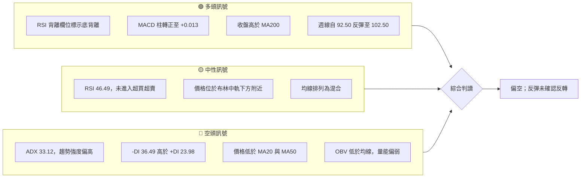
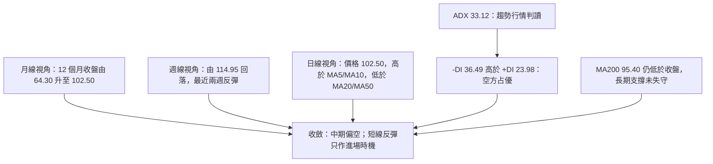
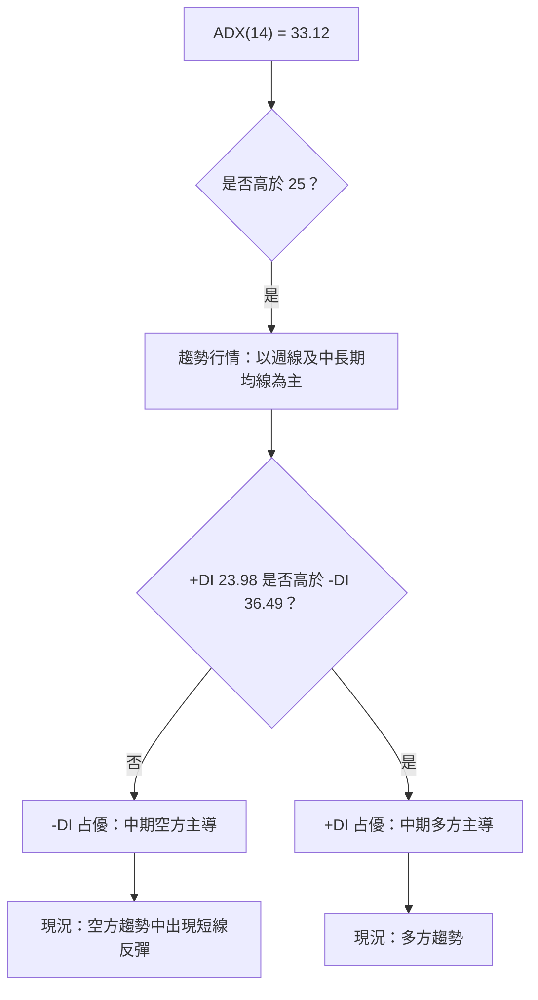
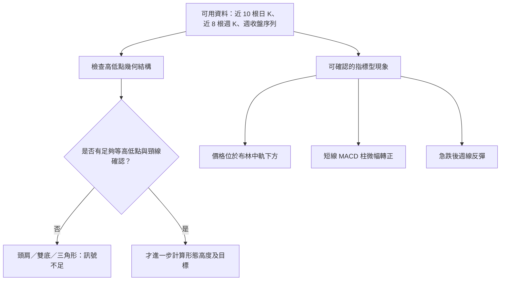
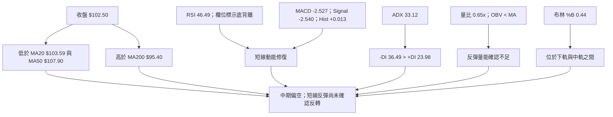
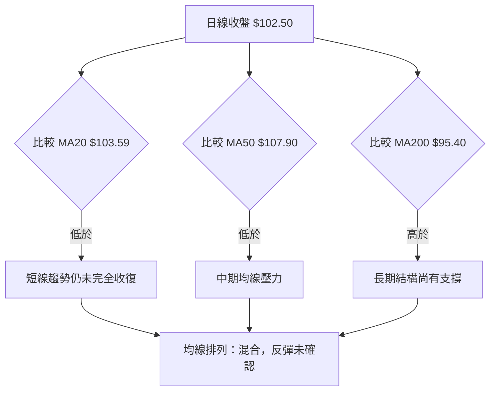
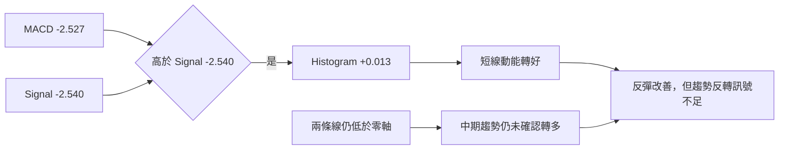
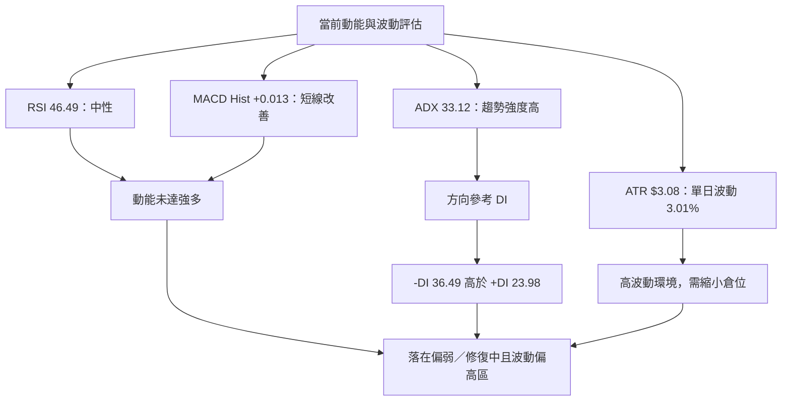
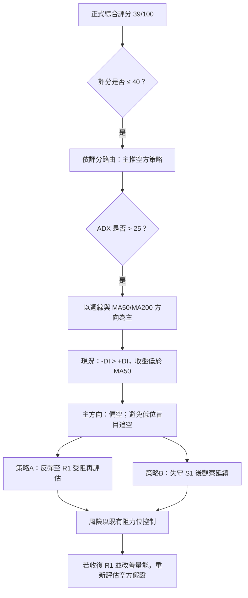
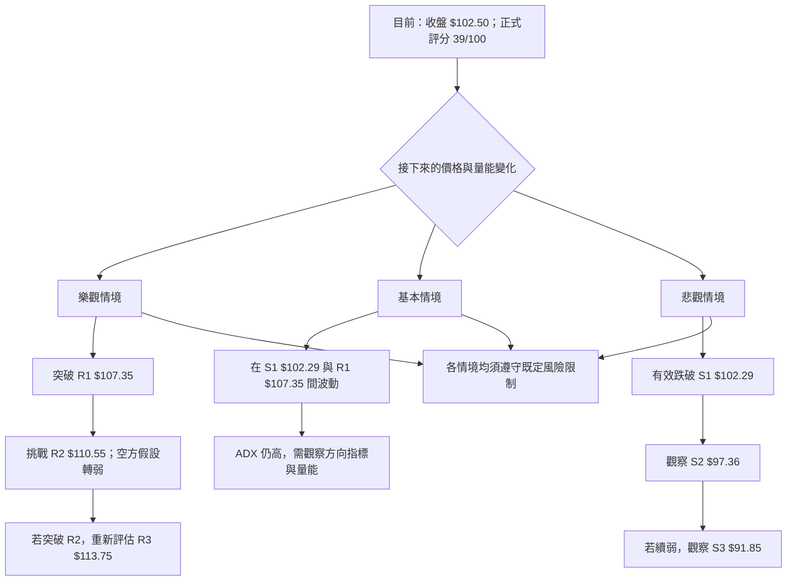

# 0050 技術分析報告

> **報告日期**：2026-11-14 ｜ **語言**：繁體中文 ｜ **數據來源**：使用者提供之 Yahoo Finance 數據 ｜ **當前價格**：$102.50 TWD（2026-11-13 收盤）

> **判讀口徑**：報告中的支撐、阻力、斐波那契價位與交易目標，僅引用數據包已提供的價位；圖形目標若無足夠形態數據，明確標示 N/A（數據未提供）。交易策略屬技術情境推演，非報酬保證。評分採 0–100 分制。

---

## 目錄

| 章節 | 內容 |
|------|------|
| [1. 技術面概覽](#1-技術面概覽) | 訊號儀表板、核心指標、評分卡 |
| [2. 趨勢分析](#2-趨勢分析) | 多時框趨勢、長中短期走勢 |
| [3. 圖表形態分析](#3-圖表形態分析) | 形態識別、K線組合、目標價 |
| [4. 支撐與阻力](#4-支撐與阻力) | 關鍵價位、斐波那契回調 |
| [5. 技術指標深度解讀](#5-技術指標深度解讀) | MA/RSI/MACD/布林/成交量 |
| [6. 動能與波動率](#6-動能與波動率) | 動能評估、ATR、Beta |
| [7. 多時框架總結](#7-多時框架總結) | 時框架評分矩陣 |
| [8. 交易策略建議](#8-交易策略建議) | 空方主策略、風險報酬比 |
| [9. 風險提示與監控](#9-風險提示與監控) | 監控指標、風險場景 |

---

## 1. 技術面概覽

### 🎯 技術訊號儀表板

整體訊號呈現「中長期結構偏弱、短線反彈改善，但反彈尚未取得均線及量能確認」的組合。ADX 高於 25，且 -DI 高於 +DI，代表目前並非典型低波動盤整；方向判讀以週線及中長期均線為主，日線反彈只視為進場時機訊號。



### 📊 核心指標速覽表

| 指標類別 | 指標名稱 | 當前數值 | 訊號 | 解讀 |
|----------|----------|----------:|:---:|------|
| 價格 | 收盤價 | $102.50 | 🟡 | 高於 MA200，但低於 MA20、MA50 |
| 區間 | 52 週高／低 | $116.60／$58.27 | 🟡 | 現價處於 52 週區間 75.8% 位置 |
| 均線 | MA20 | $103.59 | 🔴 | 收盤低於 MA20 $1.09 |
| 均線 | MA50 | $107.90 | 🔴 | 收盤低於 MA50 $5.40 |
| 均線 | MA200 | $95.40 | 🟢 | 收盤高於 MA200 $7.10 |
| 動能 | RSI(14) | 46.49 | 🟡 | 中性區；資料欄位標示底背離 |
| 動能 | MACD／Signal | -2.527／-2.540 | 🟡 | MACD 略高於 Signal，但兩者均為負值 |
| 動能 | MACD Hist | +0.013 | 🟢 | 柱體微幅轉正，反彈動能改善 |
| 趨勢 | ADX／+DI／-DI | 33.12／23.98／36.49 | 🔴 | 趨勢強度高，方向由空方主導 |
| 波動 | ATR(14) | $3.08（3.01%） | 🟡 | 單日波動參考值約為現價的 3.01% |
| 布林 | %B | 0.44 | 🟡 | 現價介於下軌與中軌之間，偏中軌下方 |
| 量能 | 量比／OBV | 0.65x／OBV < MA | 🔴 | 最新日成交量低於 20 日均量，量能確認不足 |

### 🏆 技術評分卡

以下六項均採 0–100 分制；綜合評分為六項算術平均後四捨五入至整數。

```text
╔══════════════════════════════════════════════════════════════╗
║              技術評分卡 — 0050（2026-11-14）                 ║
╠══════════════════════════════════════════════════════════════╣
║ 趨勢強度      ████████░░░░░░░░░░░░  38/100  🔴              ║
║ 動能指標      ████████░░░░░░░░░░░░  42/100  🟡              ║
║ 支撐穩定度    ████████░░░░░░░░░░░░  42/100  🟡              ║
║ 成交量配合    ██████░░░░░░░░░░░░░░  30/100  🔴              ║
║ 形態完整度    ████████░░░░░░░░░░░░  40/100  🟡              ║
║ 均線排列      ████████░░░░░░░░░░░░  42/100  🟡              ║
╠══════════════════════════════════════════════════════════════╣
║ 綜合評分      ████████░░░░░░░░░░░░  39/100  偏空            ║
╚══════════════════════════════════════════════════════════════╝
```

- 計算：`(38 + 42 + 42 + 30 + 40 + 42) ÷ 6 = 39.0`，四捨五入後仍為 **39/100**。
- **趨勢強度 38**：ADX 33.12 顯示趨勢強，但 -DI 明顯高於 +DI，方向性偏空；價格也在 MA20、MA50 下方。
- **動能指標 42**：RSI 中性、MACD 柱轉正，短線有修復，但 MACD 線仍在零軸下，尚未形成明確多頭趨勢。
- **支撐穩定度 42**：$102.29 為近價支撐，另有 $97.36、$91.85；但近期急跌顯示支撐仍須實際驗證。
- **成交量配合 30**：最新日量為 20 日均量的 0.65 倍，OBV 低於均線，反彈缺少量能確認。
- **形態完整度 40**：近期週線有急跌與反彈，但資料不足以確立可靠的雙底、頭肩或三角收斂。
- **均線排列 42**：收盤低於 MA20／MA50，惟仍高於 MA200，長短期訊號互相牽制。

---

## 2. 趨勢分析

### 🌐 多時框趨勢分析

判斷時框時，先區分「長期方向」與「中期趨勢」。現價仍高於 MA200，但低於 MA50，且近期週線從 $114.95 回落到 $92.50 後才反彈至 $102.50。ADX 33.12 大於 25，依多時框收斂規則，採週線與中長期均線作為方向主軸，日線只用於尋找交易位置。



| 時框 | 觀察結果 | 技術判讀 | 訊號 |
|------|----------|----------|:---:|
| 月線／長期 | 2025-12 收盤 $64.30，2026-11 收盤 $102.50；期間增加 $38.20，約 +59.4% | 長期升勢仍有基礎，但最近高位回落 | 🟡 |
| 週線／中期 | 2026-10-08 收盤 $114.95，2026-11-06 收盤 $92.50，2026-11-13 收盤 $102.50 | 急跌後反彈；仍未回到 MA50 $107.90 上方 | 🔴 |
| 日線／短期 | MA5 $100.76、MA10 $99.80 均低於收盤；MA20 $103.59 高於收盤 | 短線修復，但短期中樞 MA20 仍構成壓力 | 🟡 |
| 長期均線 | 收盤 $102.50 高於 MA200 $95.40 | 長期結構未完全轉空 | 🟢 |
| 方向指標 | ADX 33.12；-DI 36.49 > +DI 23.98 | 趨勢強度高，空方方向較明確 | 🔴 |

### 📈 長期趨勢 — 12 個月走勢圖

以下採 2025-12 至 2026-11 的月收盤價繪圖。圖形為價格相對位置示意；實際月收盤數值列於圖下，圖中不代表每月內的最高／最低價。

```text
0050 月線收盤走勢（過去 12 個月；TWD）

 115 ┤                                                   ● 112.05
 110 ┤                                      ●107.15  ●      ╲
 105 ┤                                  ●104.76          ●104.95
 100 ┤                                                      ╲ ●102.50
  95 ┤
  90 ┤                         ●89.95
  85 ┤
  80 ┤       ●80.66
  75 ┤
  70 ┤    ●72.16       ●71.91
  65 ┤ ●64.30
     └───────────────────────────────────────────────────────────
      12月  1月   2月   3月   4月   5月   6月   7月   8月  9月 10月 11月
      2025                         2026

月收盤：64.30 → 72.16 → 80.66 → 71.91 → 89.95 → 104.76
        → 107.15 → 102.85 → 106.25 → 112.05 → 104.95 → 102.50
```

**關鍵月線觀察**

- 2025-12 至 2026-02：月收盤由 $64.30 升至 $80.66，兩個月累計增加 $16.36，約 +25.4%。
- 2026-03：月收盤回落至 $71.91，較 2026-02 下降約 10.8%，顯示升勢中曾出現明顯回檔。
- 2026-04 至 2026-06：月收盤由 $89.95 升至 $107.15，兩個月累計約 +19.1%，為資料中的快速上行階段。
- 2026-07 至 2026-09：先回檔、再推升至 $112.05；2026-09 是所列 12 個月月收盤中的最高值。
- 2026-10 至 2026-11：由 $112.05 回落至 $102.50，兩個月約 -8.5%；目前仍高於 MA200，但已回到 MA20、MA50 下方。
- 以上均為月收盤價比較，不可等同於區間內日內波段高低點。52 週高低另依數據包列為 $116.60／$58.27。

### 📊 中期趨勢（週線分析）

近 20 週資料呈現「7 月走弱、8–9 月整理偏升、10 月起回落、11 月急跌後反彈」的轉折。週線反彈幅度明顯，但仍未收復 2026-10-16 以來的下跌區間，也尚低於 MA50 $107.90。

```text
週線收盤與關鍵區域示意（價位刻度取資料包提供值）

$116.60 ───────────────────────────────────── 52 週高
$114.95 ───────────────────────● 10/08 週收
$112.80 ────────────────────● 10/02
$109.00 ────────────────● 10/16
$107.90 ──────────────── MA50（趨勢壓力參考）
$106.90 ──────────────● 10/23
$104.95 ────────────● 10/30
$102.50 ─────────● 11/13 收盤 ← 現價
 $97.36 ─────── 支撐 S2
 $92.50 ─────● 11/06 週收
 $91.85 ───── 支撐 S3
 $87.55 ── 11/06 週低
```

- 2026-10-08 週收 $114.95，至 2026-11-06 週收 $92.50，下降 $22.45，約 -19.5%。
- 隨後一週收於 $102.50，較 $92.50 上升 $10.00，約 +10.8%。這是強烈反彈，但單週反彈不足以推翻中期回落結構。
- 週量在 2026-11-06 升至 2,073,754,087，且該週收盤下跌至 $92.50；其後 2026-11-13 週收回升，但成交量仍為 836,952,609。急跌週的量能高於後續反彈週，短線賣壓曾較集中。
- 關鍵中期觀察：若無法重新收復 MA50 $107.90，反彈仍可能屬下跌後的技術性修復。

### ⚡ 趨勢強度評估（ADX 解讀）

ADX 衡量趨勢強弱，不直接表示趨勢方向。本例 ADX 33.12 指向趨勢強度偏高；方向則由 +DI、-DI 相對位置判讀。由於 -DI 36.49 高於 +DI 23.98，方向偏空。



| ADX 區間 | 一般解讀 | 本次讀數 |
|----------|----------|----------|
| < 20 | 趨勢弱，較可能盤整 | 不適用 |
| 20–25 | 趨勢形成中 | 不適用 |
| > 25 | 趨勢較強，方向需看 DI | **33.12：符合** |
| +DI > -DI | 多方方向優勢 | **否** |
| -DI > +DI | 空方方向優勢 | **是，差值 12.51** |

---

## 3. 圖表形態分析

### 🔍 形態識別系統

本次資料提供完整的近 10 根日 K 與近 8 根週 K，以及週收盤序列；但未提供完整的每日／每週歷史 OHLC 序列以驗證複雜幾何形態。依信心度規則，不將短期急跌後反彈硬解讀為雙底、頭肩底或旗形。



| 形態／訊號 | 信心度 | 判斷依據（引用數據） | 完成度 | 目標價 |
|------------|:------:|----------------------|:------:|--------|
| 雙底／W 底 | 35% | 2026-11-06 週低 $87.55 後反彈，但只見到一組近期低點；沒有足夠的第二個相近低點與頸線確認 | 未確認 | N/A（數據未提供） |
| 頭肩頂／底 | 20% | 可用區間不足以完整判斷左右肩、頭部及頸線比例 | 未確認 | N/A（數據未提供） |
| 三角形／旗形 | 30% | 急跌後有反彈，但尚無足夠的收斂趨勢線或旗面整理證據 | 未確認 | N/A（數據未提供） |
| 指標型反彈 | 60% | RSI 欄位標示底背離；MACD Hist 為 +0.013；週線收盤由 $92.50 回升至 $102.50 | 形成中，未反轉確認 | 不適用；非幾何形態 |
| 布林位置訊號 | 65% | BB %B = 0.44，收盤低於中軌 $103.59、高於下軌 $94.36 | 仍在通道內 | 不適用；以通道及既有價位觀察 |

**結論：**可辨識的是「急跌後反彈、指標短線改善」而非已完成的反轉形態。當價格仍低於 MA20、MA50，且 OBV 低於其均線時，底背離只構成警示或反彈訊號，不能單獨等同趨勢反轉。

### 🕯️ 重要 K 線形態分析

以下只使用數據包「近 10 根日 K」與「近 8 根週 K」的開、高、低、收。K 線名稱採保守判讀，避免把單根 K 棒誇大成趨勢確認。

| 日期（日K／週K） | 開 | 高 | 低 | 收 | K 線觀察 | 解讀 | 訊號 |
|------|------:|------:|------:|------:|----------|------|:---:|
| 日K 2026-11-04 | 101.55 | 101.65 | 97.55 | 99.85 | 收跌，低點接近當日區間下端 | 當日賣壓偏重，未見強烈收復 | 🔴 |
| 日K 2026-11-05 | 99.40 | 99.75 | 96.90 | 97.15 | 收跌，收盤接近日低 | 下跌延續，空方仍主動 | 🔴 |
| 日K 2026-11-06 | 89.95 | 94.45 | 87.55 | 92.50 | 長實體下跌，收盤低於開盤，但由日低反彈 | 日內低位有承接，仍不能稱反轉 K | 🟡 |
| 日K 2026-11-09 | 95.65 | 99.00 | 94.50 | 97.45 | 收漲，收盤靠近區間上半部 | 急跌後反彈延續 | 🟢 |
| 日K 2026-11-11 | 101.00 | 103.25 | 99.80 | 103.20 | 收漲，收盤靠近當日高位 | 當日買盤較主動，但需後續確認 | 🟢 |
| 日K 2026-11-12 | 103.50 | 104.20 | 100.80 | 100.95 | 收跌，實體較明顯 | 反彈遇到賣壓，走勢不連續 | 🔴 |
| 日K 2026-11-13 | 102.85 | 104.40 | 102.10 | 102.50 | 小型收跌實體，上影線較實體長 | 高位有賣壓，但單根不足以定義趨勢 | 🟡 |
| 週K 2026-10-08 | 115.75 | 116.60 | 114.90 | 114.95 | 收跌，接近週區間低端 | 高位回落訊號，後續週線走弱 | 🔴 |
| 週K 2026-10-16 | 114.20 | 114.95 | 108.55 | 109.00 | 長實體收跌 | 下跌壓力擴大 | 🔴 |
| 週K 2026-11-06 | 103.40 | 104.45 | 87.55 | 92.50 | 長下影伴隨大幅收跌；仍低於開盤 | 低位出現承接，但整週仍是明顯下跌週 | 🟡 |
| 週K 2026-11-13 | 95.65 | 104.40 | 94.50 | 102.50 | 收漲實體，收盤位於週區間上半部 | 反彈週明確，但尚未收復 MA50 | 🟢／待確認 |

> 未列出的 K 棒雖可由 OHLC 判斷漲跌，但為集中呈現較具代表性的訊號，未對未列日期額外命名形態。

### 📉 ASCII 走勢形態示意圖

```text
近期週線：急跌後反彈（示意；以已提供週收盤價為準）

$116.60  ───────────────────────────────────────── 52 週高
$114.95  ● 10/08
           ╲
$109.00      ● 10/16
               ╲
$106.90          ● 10/23
                   ╲
$104.95              ● 10/30
                       ╲
 $92.50                  ● 11/06 ──╮
                                     ╰──── ● 11/13 $102.50
 $91.85  ──────────────────────────────── S3
 $87.55                  11/06 週低
```

此示意圖顯示「下降後急彈」，不是雙底圖。短線若後續反彈受阻，仍可能回到支撐區；若價格反而重回 MA50 上方並有量能配合，則空方趨勢判斷需要重新評估。

### 🎯 形態目標價計算

- **幾何形態目標：N/A（數據未提供）**。目前沒有足夠的頸線、形態高度與完整結構數據，不能以任意幾何高度推算目標價。
- **可引用的情境價位**：上方採既有阻力 R1 $107.35、R2 $110.55、R3 $113.75；下方採既有支撐 S1 $102.29、S2 $97.36、S3 $91.85。
- 這些是 OHLCV 區塊提供的聚類價位，不等同於形態量度目標。

---

## 4. 支撐與阻力

### 🗺️ 關鍵價位分布圖

```text
0050 價位結構分布圖（TWD；僅列數據包提供價位）

$116.60 ║████████████████████████║ 52 週高
$113.75 ║████████████████████    ║ R3 阻力
$112.82 ║························║ 布林上軌（指標參考）
$110.55 ║██████████████████      ║ R2 阻力
$107.35 ║████████████████████    ║ R1 阻力
$103.59 ║························║ 布林中軌／MA20
$102.83 ║──────────────           ║ 斐波那契 23.6%
$102.50 ╠════════════════════════╣ ◄ 當前收盤
$102.29 ║▓▓▓▓▓▓▓▓▓▓▓▓▓▓▓▓        ║ S1 支撐
 $97.36 ║████████████████████    ║ S2 支撐
 $94.36 ║························║ 布林下軌
 $94.32 ║──────────────           ║ 斐波那契 38.2%
 $91.85 ║████████████████████    ║ S3 支撐
 $87.43 ║──────────────           ║ 斐波那契 50.0%
══════════════════════════════════════════════════════════════
```

### 🚧 阻力位分析表

| 阻力級別 | 價位 | 形成原因 | 突破難度 | 重要性 |
|----------|------:|----------|----------|--------|
| R1 | $107.35 | 近一年波段高點聚類；接近週線回落後反彈需重新克服的區域 | 中高：價格需從 $102.50 上升約 4.7% | 高 |
| R2 | $110.55 | 第二層波段高點聚類；位於 R1 上方，若反彈延續需再確認 | 高：上方阻力聚集，且價格仍低於 MA50 | 高 |
| R3 | $113.75 | 近一年較高波段高點聚類；接近 52 週高位區間 | 高：若未伴隨成交量擴張，突破可靠性不足 | 高 |

### 🛡️ 支撐位分析表

| 支撐級別 | 價位 | 形成原因 | 守住機率評估 | 重要性 |
|----------|------:|----------|--------------|--------|
| S1 | $102.29 | 近一年波段低點聚類；與當前收盤 $102.50 僅差 $0.21 | 需觀察；非常接近現價，容易受短線波動測試 | 高 |
| S2 | $97.36 | 第二層近一年波段低點聚類；若 S1 失守，為下一觀察價位 | 中等偏低；須視成交量及 DI 變化 | 高 |
| S3 | $91.85 | 第三層近一年波段低點聚類；同時接近近期急跌後低位區域，但並非同一筆 OHLC 定點 | 中等偏低；若急跌再現，支撐可能受壓 | 高 |

> 「守住機率」是基於目前指標結構的定性風險評估，並非統計模型輸出，也不代表保證。

### 📐 斐波那契回調位分析

以下直接引用數據包所列的 52 週區間 $58.27 至 $116.60 之斐波那契價位，不另行重算。

| 回調比例 | 價位 | 相對現價解讀 |
|----------|------:|--------------|
| 23.6% | $102.83 | 現價 $102.50 略低於此位 |
| 38.2% | $94.32 | 現價高於此位 |
| 50.0% | $87.43 | 較深回檔觀察位 |
| 61.8% | $80.55 | 更深層回檔參考位 |
| 78.6% | $70.75 | 深度回檔參考位 |
| 100.0% | $58.27 | 52 週低點 |

現價 $102.50 **位於 23.6% 回調位 $102.83 與 38.2% 回調位 $94.32 之間**，且略低於 23.6% 位。此位置表示價格已由 52 週高點回撤，但目前仍未跌至 38.2% 回調位。若短線持續收在 $102.83 下方，23.6% 位的上方支撐角色尚未成立；若再失守 S1 $102.29，須觀察 S2 $97.36 與 38.2% 位 $94.32 的相對位置。

---

## 5. 技術指標深度解讀

### 🎛️ 指標訊號總覽



### 📈 移動平均線排列分析

| 均線 | 數值 | 收盤相對位置 | 走勢變化 | 技術解讀 |
|------|------:|--------------|----------|----------|
| MA5 | $100.76 | 收盤高於 MA5 $1.74 | 上升 +1.73% | 日線短線已有反彈修復 |
| MA10 | $99.80 | 收盤高於 MA10 $2.70 | 上升 +2.71% | 短線反彈成立，但未能證明中期轉多 |
| MA20 | $103.59 | 收盤低於 MA20 $1.09 | 下降 -1.05% | 短線中樞仍在上方，形成近端阻力 |
| MA50 | $107.90 | 收盤低於 MA50 $5.40 | 數據顯示 MA50 高於 MA20 | 中期趨勢壓力仍在 |
| MA200 | $95.40 | 收盤高於 MA200 $7.10 | 長期支撐位於現價下方 | 長期升勢尚未完全破壞 |

目前不是完整的多頭排列。日線 MA5、MA10 回升，卻仍低於 MA20；價格亦低於 MA50。另一方面，價格仍在 MA200 上方，因此訊號並非所有時框一致看空，而是「短線反彈、中期偏弱、長期尚有支撐」。



### 📉 RSI(14) 分析

**RSI(14) = 46.49**，位於中性區間，沒有進入傳統超買（常見參考 >70）或超賣（常見參考 <30）範圍。

```text
RSI(14) 位置示意
0         30                 46.49                 70        100
|----------|-------------------●-------------------|----------|
           超賣區             中性                 超買區

目前讀數：46.49
強度條：  █████████░░░░░░░░░░░  46.49%
```

- RSI 由 2026-11-06 週資料中的 18.1 回升至 2026-11-13 的 46.5，反映急跌後動能已明顯修復。
- 數據欄位標示「底背離」，但其註記只比較近 20 根 K 棒首尾的價格與 RSI 方向，缺少完整局部高低點序列；因此本報告將其視為**資料來源提供的底背離提示**，而非獨立確認的標準背離結構。
- **頂背離：目前數據未偵測到明確頂背離**，但完整配對高低點資料不足，不能將「未偵測到」理解為已充分排除。
- 多空整合：RSI 回升支持短線反彈，卻因讀數仍在中性區、收盤低於 MA20／MA50，不足以單獨扭轉中期偏空結論。

### 📊 MACD(12/26/9) 訊號解讀

| MACD 項目 | 數值 | 訊號 |
|-----------|------:|------|
| MACD 線 | -2.527 | 仍在零軸下方，趨勢動能尚未完全轉正 |
| Signal 線 | -2.540 | 略低於 MACD 線 |
| Histogram | +0.013 | 微幅正值，短線動能改善 |



- MACD 線略高於 Signal，且 Hist 為正，代表最近一段動能改善。
- MACD 與 Signal 仍為負值，表示反彈發生在零軸下方，與中期下降結構並未完全脫鉤。
- **MACD 底背離：數據快照沒有提供獨立的 MACD 背離判定欄位或足夠配對高低點，因此 N/A（數據未提供）。**
- **MACD 頂背離：N/A（數據未提供）。**
- RSI 欄位提供底背離提示，MACD 柱轉正，兩者支持短線反彈；但 ADX 的空方 DI 優勢與 OBV 疲弱形成反向訊號，故整體仍是「反彈可見，趨勢反轉未證實」。

### 📦 布林通道分析

- 上軌：$112.82
- 中軌／MA20：$103.59
- 下軌：$94.36
- 現價：$102.50
- %B：0.44

```text
布林通道（價格位置示意）

$112.82  ═════════════════════ 上軌
                            │
$103.59  ───────────────────── 中軌／MA20
$102.50  ───────────●───────── 現價（%B = 0.44）
                            │
 $94.36  ═════════════════════ 下軌
```

現價位於下軌與中軌之間，且 %B 0.44 低於通道中點 0.50，顯示價格位置略偏弱；但尚未觸及下軌，不能直接視為超跌反轉訊號。又因 ADX 33.12 高於 25，依規則應優先採趨勢方向，而非把布林通道當成無條件的上下軌反轉交易區間。布林軌可用作短線位置管理，不應取代週線與 DI 趨勢判斷。

### 💹 成交量分析（量價配合度）

| 成交量項目 | 數值 | 比較 | 解讀 |
|------------|------:|------|------|
| 最新日成交量 | 128,096,812 | — | 低於 20 日均量 |
| 20 日均量 | 196,388,186 | 最新量／均量 = 0.65x | 當日成交活躍度偏低 |
| 50 日均量 | 130,476,547 | 最新量略低於 50 日均量 | 接近但未超過較長均量 |
| OBV 趨勢 | OBV < MA | 量能疲弱 | 尚未確認反彈累積買盤 |

週成交量資料顯示，2026-11-06 的週量為 2,073,754,087，該週收盤下跌至 $92.50；2026-11-13 週量為 836,952,609，收盤回升至 $102.50。這代表急跌期間有較大的成交量，而後反彈週的成交量相對較低。價格反彈有發生，但量能尚未確認買方力量全面接手。

**量價結論：**價格回升與短線動能改善相符，但量能不配合、OBV 低於均線，因此反彈可信度低於「價格上漲且量能擴張」的確認型反轉。

---

## 6. 動能與波動率

### ⚡ 動能評估四象限

| 象限 | 動能 | 波動 | 典型狀態 | 本次判斷 |
|------|------|------|----------|----------|
| Q1 | 強 | 低 | 平穩趨勢延續 | 不符合：ADX 高且近期波動大 |
| Q2 | 弱 | 低 | 低波動盤整 | 不符合：ADX 33.12，近期出現急跌與大幅反彈 |
| Q3 | 強 | 高 | 高風險高收益趨勢 | 部分符合波動特徵，但目前方向以空方 DI 占優 |
| Q4 | 弱／修復中 | 高 | 方向不穩、風險偏高 | **較接近現況：中期偏空，短線動能反彈，波動偏高** |



### 📊 ATR 波動率分析

ATR(14) = **$3.08**，相當於現價 $102.50 的 **3.01%**。此數字是波動幅度參考，不是預測次日必然變動，也不代表應將固定倍數直接當成保證止損距離。

| ATR 參考 | 計算 | 金額參考 | 用途 |
|----------|------|---------:|------|
| 1 × ATR | 3.08 | $3.08 | 約略單日波動尺度 |
| 1.5 × ATR | 3.08 × 1.5 | $4.62 | 可用於評估一般波動與交易止損距離是否過近 |
| 2 × ATR | 3.08 × 2 | $6.16 | 極端日波動緩衝尺度參考 |

- 若止損距離遠小於 $3.08，容易遭一般日內波動觸發；但加大止損距離時，須同步降低部位，不能維持原倉位而放寬風險。
- ATR 是風控工具，不是支撐／阻力位。策略止損仍須按報告所列既有關鍵價位設定。
- 近期週線急跌與反彈顯示跳空或快速波動風險不容忽視；實際成交可能與預設停損價有差異。

### 📐 Beta 與市場相關性

- **Beta：N/A（數據未提供）。**
- 0050 為元大台灣卓越 50 ETF，追蹤台灣大型權值股組合；其市場連動性在產品性質上與台灣大型股市場相關，但此處不據此推算 Beta、相關係數或對大盤的敏感度。
- 精確 Beta、相關係數及回歸期間資料均為 **N/A（數據未提供）**。
- 本報告因此只依 0050 本身 OHLCV、均線、動能及成交量資料判讀，不將任何未提供的大盤數據假定為已驗證訊號。

---

## 7. 多時框架總結

### 📋 時框架評分表

| 時框架 | 趨勢方向 | 動能 | 均線排列 | 形態 | 綜合評分 | 建議 |
|--------|----------|------|----------|------|----------:|------|
| 月線／長期 | 長期仍偏上，但近期由 $112.05 回落至 $102.50 | 中性偏弱 | 收盤仍高於 MA200 | 月線回落，未提供可驗證反轉形態 | 55/100 | 保留長期升勢可能，但不以此否定中期弱勢 |
| 週線／中期 | 偏空；急跌後反彈 | RSI 回升，MACD 週柱轉正，但方向尚未確認 | 收盤低於 MA50 | 急跌反彈，幾何反轉未確認 | 38/100 | 反彈遇阻時偏向風險控制 |
| 日線／短期 | 修復中，仍低於 MA20 | RSI 中性、MACD 柱微正 | MA5／MA10 下方已收復，MA20 尚未收復 | 短線反彈，不宣稱底部形態 | 48/100 | 只作執行與風險管理時框 |
| **全局評分** | **中期偏空、短線反彈** | **互有確認與矛盾** | **混合排列** | **形態確認不足** | **39/100** | **偏空；等待反彈遇阻或支撐跌破確認** |

> 月線、週線、日線子時框評分是輔助比較；第 1 章六項評分所計得的**正式綜合評分為 39/100**。第 7、8 章引用正式總評時均使用 39/100。

### 🔲 綜合訊號矩陣

```text
╔══════════════════════════════════════════════════════════════╗
║                多時框訊號矩陣                                ║
╠══════════════╦══════════════╦══════════════╦════════════════╣
║ 維度         ║ 日線         ║ 週線         ║ 長期／MA200    ║
╠══════════════╬══════════════╬══════════════╬════════════════╣
║ 趨勢方向     ║ 🟡 修復       ║ 🔴 偏空       ║ 🟢 尚未轉空     ║
║ 均線位置     ║ 🟡 低於MA20   ║ 🔴 低於MA50   ║ 🟢 高於MA200    ║
║ 動能         ║ 🟡 RSI中性    ║ 🟡 反彈改善   ║ N/A            ║
║ 成交量       ║ 🔴 低於20日量 ║ 🔴 急跌量較大 ║ N/A            ║
╠══════════════╩══════════════╩══════════════╩════════════════╣
║ 收斂方向：中期偏空；日線反彈用於進場判讀，不主導大方向      ║
╚══════════════════════════════════════════════════════════════╝
```

### ⚖️ 多時框收斂結論

1. **行情分類：趨勢行情。**ADX(14) = 33.12，符合 ADX >25 的趨勢行情條件。
2. **主導時框：週線與中長期均線方向優先。**週線由 $114.95 回落，近期反彈至 $102.50，但仍低於 MA50 $107.90；同時 -DI 36.49 高於 +DI 23.98。
3. **長期修正因素：**收盤仍高於 MA200 $95.40，且 12 個月月收盤整體高於 2025 年末，代表長期結構尚未完全失守。
4. **日線定位：**短線 RSI、MACD 與 MA5／MA10 有修復，但日線低於 MA20，且成交量、OBV 未確認。
5. **唯一方向性結論：偏空。**日線反彈不推翻中期方向，交易策略以反彈受阻或支撐跌破後的風險管理為主，避免在急跌後追空。

---

## 8. 交易策略建議

### 🗺️ 策略決策流程圖



### 🧭 策略路由

**當前主策略方向 = 偏空（依正式綜合評分 39/100）。**

- 分數 39/100 落在「≤40」偏空路由。
- ADX 33.12 表示趨勢強度高；-DI 36.49 高於 +DI 23.98，且收盤低於 MA50，因此空方策略具方向依據。
- 因近期已有急跌後反彈，不建議在支撐附近不加確認地追空。主策略採「反彈至既有阻力後確認轉弱」；次策略為「支撐破位後確認延續」。
- 以下價格均直接引用已提供的關鍵價位。風險報酬比按指定公式計算，並以 T1 為主要比率。

### 🎯 價格情境階梯（Price Scenarios）

| 觸發條件 | 下一目標 | 後續延伸 | 情境含義 |
|----------|----------:|----------:|----------|
| 反彈至 R1 $107.35 但未能站穩 | S1 $102.29 | S2 $97.36 | 上方阻力有效，偏空情境延續 |
| 收盤仍位於 S1 $102.29 與 R1 $107.35 之間 | 觀察 R1／S1 | 依突破方向調整 | 區間震盪；不宜預設單邊突破 |
| 有效跌破 S1 $102.29 | S2 $97.36 | S3 $91.85 | 支撐轉弱，空方延續風險上升 |
| 有效站上 R1 $107.35 | R2 $110.55 | R3 $113.75 | 空方假設受到挑戰；須重新評估 |

「有效突破／跌破」應以收盤與成交量確認，而非只依盤中短暫穿越判斷。

### 📊 情境機率分佈

下列為根據現有技術狀態所作的主觀情境權重，總和 100%，不是統計模型勝率或保證。

| 情境 | 機率 | 主要依據 |
|------|------:|----------|
| 繼續上行／反彈 | 25% | RSI 由低位反彈至 46.49，MACD Hist +0.013、週線由 $92.50 回升至 $102.50；但低於 MA20／MA50，且 OBV 偏弱 |
| 區間震盪 | 30% | 價格位於布林下軌 $94.36 至中軌 $103.59 附近區間內，且短線指標有修復；但 ADX 偏高，故盤整情境不是主導判斷 |
| 回落／再探底 | 45% | ADX 33.12、-DI 高於 +DI、收盤低於 MA50，OBV < MA，急跌週成交量高於後續反彈週 |

### 🔴 主策略詳情（空方路由）

策略 A 為主要策略，需等待反彈至阻力並出現轉弱；策略 B 是支撐破位後的延續型備選，不建議在支撐尚未確認跌破前預先執行。

| 策略要素 | 策略 A：反彈受阻做空（主策略） | 策略 B：S1 破位延續（備選） |
|----------|---------------------------------|-----------------------------|
| 進場條件 | 價格反彈至 R1，且收盤未能站穩；觀察轉弱確認 | 收盤有效跌破 S1，並避免只因盤中穿越即追價 |
| 進場價格 | **$107.35（R1）** | **$102.29（S1）** |
| 目標價 T1 | **$102.29（S1）** | **$97.36（S2）** |
| 目標價 T2 | **$97.36（S2）** | **$91.85（S3）** |
| 止損價格 | **$110.55（R2）** | **$107.35（R1）** |
| 風險報酬比 | **1 : 1.58（以 T1 計）**；1 : 3.12（以 T2 計） | **1 : 0.97（以 T1 計）**；1 : 2.06（以 T2 計） |
| 成功機率 | 主觀情境估計 55%；非統計勝率 | 主觀情境估計 45%；非統計勝率 |
| 建議倉位 | 低至中低；單筆風險金額事前固定 | 低倉位；T1 風險報酬比不足 1，不宜作為優先執行方案 |

**風險報酬比驗算**

- 策略 A（做空）：風險距離 = $110.55 − $107.35 = **$3.20**；T1 報酬距離 = $107.35 − $102.29 = **$5.06**；`5.06 ÷ 3.20 = 1.58125`，四捨五入為 **1 : 1.58**。T2 報酬距離 = $107.35 − $97.36 = **$9.99**；`9.99 ÷ 3.20 = 3.121875`，即 **1 : 3.12**。
- 策略 B（做空）：風險距離 = $107.35 − $102.29 = **$5.06**；T1 報酬距離 = $102.29 − $97.36 = **$4.93**；`4.93 ÷ 5.06 = 0.9743`，四捨五入為 **1 : 0.97**。T2 報酬距離 = $102.29 − $91.85 = **$10.44**；`10.44 ÷ $5.06 = 2.0632`，即 **1 : 2.06**。
- 策略 B 的 T1 風險報酬低於 1，需高度重視滑價與訊號確認；若無法接受此比率，不應執行該筆策略。

### 🔴 反向風險觸發點（對沖提示）

以下不是完整多頭操作建議，而是空方假設可能失效的監控條件：

- 價格有效站上 **R1 $107.35**，且成交量同步高於其近期均量，空方策略需提高警戒。
- 若進一步突破 **R2 $110.55**，策略 A 的既定止損觸發，應依計畫執行，不宜因主觀判斷延後。
- MACD Hist 維持正值只是短線改善；若 MACD 線持續上升、價格收復 MA20 $103.59 及 MA50 $107.90，空方趨勢判讀應重新評估。
- RSI 底背離提示若伴隨 OBV 回升，反彈訊號可信度將提高；若 OBV 仍弱，則背離可能只帶來短線反抽。

### ⭐ 整體訊號強度評星

```text
做多訊號強度：★★☆☆☆  (2/5星) — RSI／MACD 短線改善，但未收復 MA20／MA50，量能未確認
做空訊號強度：★★★☆☆  (3/5星) — ADX 與 DI、MA50 位置支持偏空；短線反彈增加執行風險
整體可信度：  ★★★☆☆  (3/5星) — 多時框有衝突，策略需等待阻力或破位確認
```

---

## 9. 風險提示與監控

### ✅ 關鍵監控指標 Checklist

```text
╔══════════════════════════════════════════════════════════════╗
║                  0050 風險監控清單                            ║
╠══════════════════════════════════════════════════════════════╣
║ □ 收盤是否站回 R1 $107.35？                                  ║
║ □ 若站上 R1，是否伴隨成交量擴大？                            ║
║ □ 是否突破 R2 $110.55，觸發空方策略風險控制？               ║
║ □ S1 $102.29 是否有效失守，而非只有盤中短暫跌破？            ║
║ □ S1 失守後，是否向 S2 $97.36 延伸？                         ║
║ □ RSI 46.49 是否持續上升，或重新轉弱？                       ║
║ □ MACD Hist +0.013 是否延續，MACD 是否仍位於零軸下？         ║
║ □ -DI 36.49 與 +DI 23.98 的差距是否收斂或擴大？              ║
║ □ OBV 是否仍低於均線？                                       ║
║ □ 最新日量是否持續低於 20 日均量 196,388,186？              ║
║ □ 收盤是否仍高於 MA200 $95.40？                               ║
╠══════════════════════════════════════════════════════════════╣
║ 執行原則：依收盤確認、量能確認及事前風險額度管理              ║
╚══════════════════════════════════════════════════════════════╝
```

### ⚠️ 風險場景分析



- **樂觀情境：**價格收復 R1 $107.35，且量能改善；若續升至 R2 $110.55，代表中期空方判斷受到挑戰。進一步上行至 R3 $113.75 需另行確認，不能只以短線反彈預設必然達標。
- **基本情境：**價格在近端支撐 S1 $102.29 與阻力 R1 $107.35 之間反覆。RSI 中性、MACD 柱微正可支持整理，但 ADX 偏高代表波動可能較大，區間也可能快速失效。
- **悲觀情境：**S1 $102.29 有效跌破後，觀察 S2 $97.36；若賣壓延續，再留意 S3 $91.85。急跌週成交量較大的歷史特徵，提醒須防止跌勢加速與滑價。
- **模型限制：**沒有完整即時報價、委託簿、波動率曲面或大盤相關性資料，情境只能建立於所提供的技術快照。

### 🛡️ 風險管理重要提醒

1. **控制單筆風險，而不是只控制持有股數。**先確定最大可承受損失，再反推部位；止損距離較大時，應降低倉位。
2. **避免在支撐附近追空。**現價 $102.50 接近 S1 $102.29，若未有效跌破就追空，可能承擔反彈回抽風險。
3. **避免把 ATR 當成保證停損。**ATR $3.08 是波動參考，實際急跌、跳空或流動性變化可能造成更大成交偏差。
4. **採用收盤確認。**支撐與阻力的有效突破應參考收盤、後續延續與量能，降低盤中假突破的影響。
5. **依交易計畫執行止損。**策略 A 停損為 R2 $110.55，策略 B 停損為 R1 $107.35；若進場後市場走勢已推翻原假設，不宜任意移遠止損。
6. **避免將技術背離當成買入保證。**資料提供 RSI 底背離提示，但成交量、OBV、均線與 DI 尚未共同確認反轉。
7. **資料缺漏會限制結論。**Beta、完整歷史 OHLC、分析師目標價、即時市場深度與外部市場比較均為 N/A（數據未提供）。
8. **ETF 特性須納入考量。**0050 是指數型 ETF，技術走勢反映其追蹤標的及市場整體變化，並非單一企業的營運基本面走勢。

---

## 📋 報告總結

```text
╔══════════════════════════════════════════════════════════════╗
║                 0050 技術分析報告總結                        ║
╠══════════════════════════════════════════════════════════════╣
║ 報告日期：2026-11-14                                        ║
║ 當前價格：$102.50 TWD（2026-11-13 收盤）                    ║
║ 正式綜合評分：39/100（六項子評分算術平均）                  ║
║ 分析評級：偏空；短線反彈尚未確認中期反轉                    ║
╠══════════════════════════════════════════════════════════════╣
║ 長期趨勢：🟡 月收盤 12 個月上升，但仍高於 MA200              ║
║ 中期趨勢：🔴 週線急跌後反彈，收盤低於 MA50                  ║
║ 短期趨勢：🟡 RSI／MACD 改善，但價格低於 MA20                 ║
║ 關鍵支撐：$102.29（S1）；下方 $97.36（S2）、$91.85（S3）    ║
║ 關鍵阻力：$107.35（R1）；上方 $110.55（R2）、$113.75（R3）  ║
║ 分析師目標：N/A（數據未提供）                                ║
╠══════════════════════════════════════════════════════════════╣
║ 最優策略組合：                                                ║
║ 1. 🥇 等反彈至 R1 $107.35 受阻，再按策略 A 評估空方布局      ║
║ 2. 🥈 若有效跌破 S1 $102.29，觀察 S2 $97.36 延伸風險          ║
║ 3. 🥉 若收復 R1 並有量能確認，撤銷或重估原空方假設            ║
╚══════════════════════════════════════════════════════════════╝
```

**核心結論：**ADX 33.12 代表趨勢強度偏高，-DI 高於 +DI、價格低於 MA50，故多時框收斂結果為**中期偏空**。RSI 底背離提示、MACD 柱轉正與週線反彈支持短線修復，但 OBV、成交量與均線尚未共同確認反轉。操作上不宜在接近 S1 的位置盲目追空；優先等待反彈至既有阻力後確認轉弱，或等待支撐有效跌破後再評估。

---

> ⚠️ **免責聲明**：本報告為 AI 自動生成之技術分析，依使用者提供的歷史價格與技術指標資料撰寫，僅供研究與學術參考，不構成投資建議或報酬保證。技術分析存在訊號失效、資料延遲、滑價與市場跳空等風險；投資人應依自身風險承受能力審慎決策。

*報告生成時間：2026-11-14 ｜ 數據來源：使用者提供之 Yahoo Finance 數據 ｜ 分析框架：多時框技術分析*