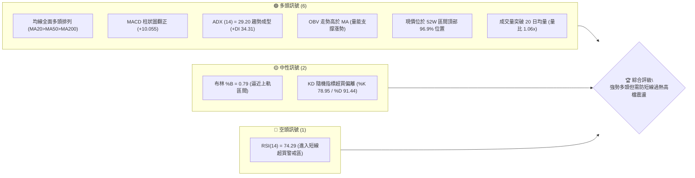
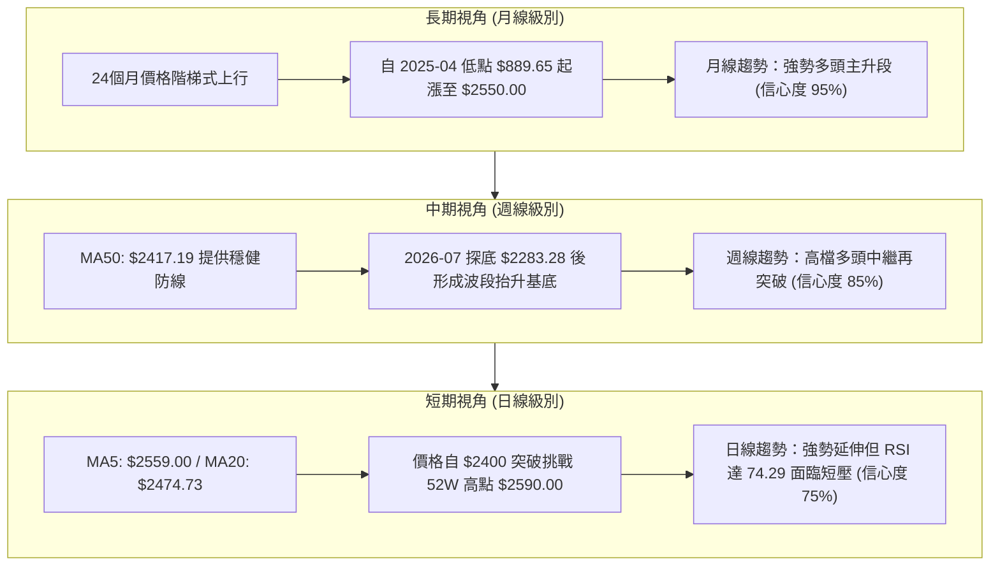
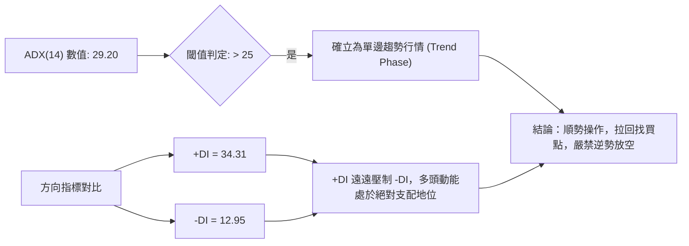
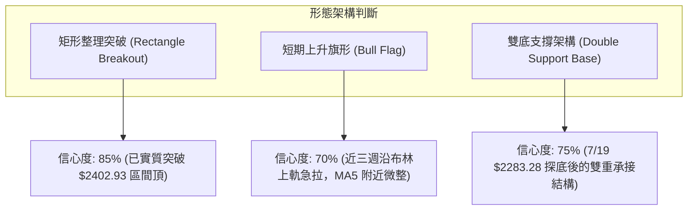
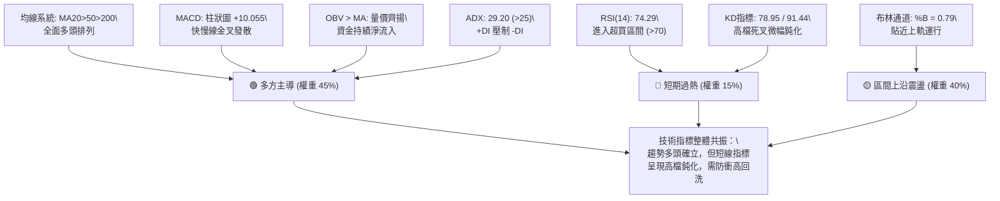
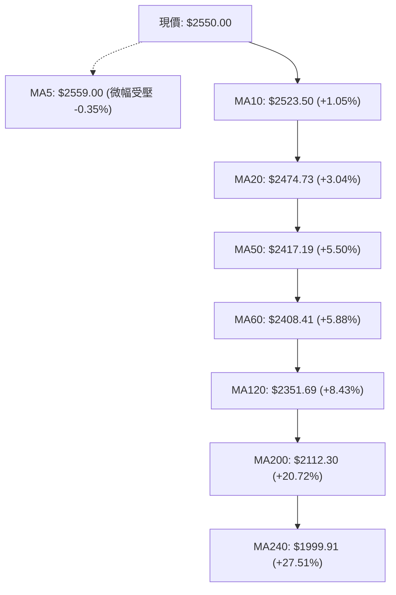
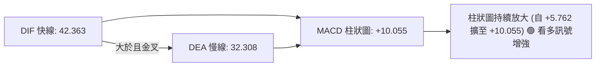
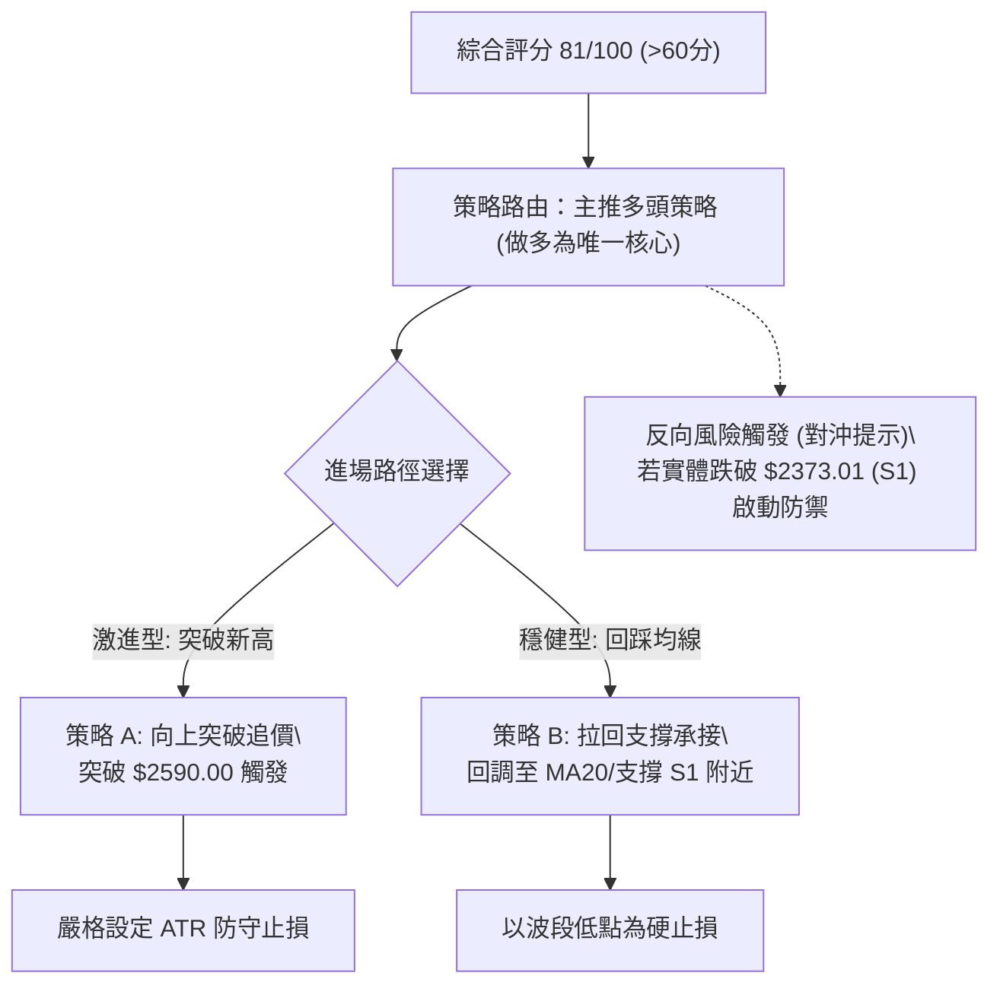
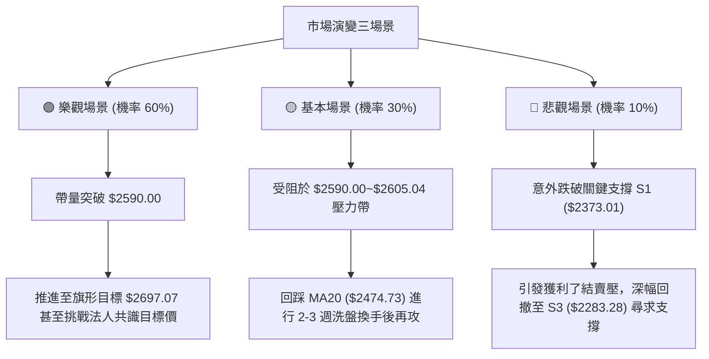

# 2330.TW 基本面與技術面深度分析報告

> **報告日期**：2026-10-11 ｜ **語言**：繁體中文 ｜ **數據來源**：Yahoo Finance / 專屬技術數據庫 ｜ **當前價格**：$2550.00

---

## 目錄

| 章節 | 內容 |
|------|------|
| [1. 技術面概覽](#1-技術面概覽) | 訊號儀表板、核心指標、評分卡 |
| [2. 趨勢分析](#2-趨勢分析) | 多時框趨勢、長中短期走勢、ADX解讀 |
| [3. 圖表形態分析](#3-圖表形態分析) | 形態識別信心度、K線組合、目標價推算 |
| [4. 支撐與阻力](#4-支撐與阻力) | 關鍵價位分佈、波段聚類、斐波那契回調 |
| [5. 技術指標深度解讀](#5-技術指標深度解讀) | MA/RSI/MACD/布林通道/OBV量價配合 |
| [6. 動能與波動率](#6-動能與波動率) | 動能四象限、ATR波動率、Beta值 |
| [7. 多時框架總結](#7-多時框架總結) | 時框架矩陣、多時框收斂優先級 |
| [8. 交易策略建議](#8-交易策略建議) | 策略路由、情境階梯、進出場與風控 |
| [9. 風險提示與監控](#9-風險提示與監控) | 監控Checklist、三情境演繹、倉位管理 |
| [10. 報告總結](#10-報告總結) | 核心技術結論與策略執行卡 |

---

## 1. 技術面概覽

### 🎯 技術訊號儀表板



### 📊 核心指標速覽表

| 指標類別 | 指標名稱 | 當前數值 | 訊號 | 解讀 |
|----------|----------|----------|------|------|
| **價格** | 當前價格 | $2550.00 | 🟢 | 逼近歷史與52週最高點 $2590.00，位於 96.9% 高位分位 |
| **短期均線** | MA20 | $2474.73 | 🟢 | 股價高於 MA20 達 +3.04%，短線呈單邊上攻強勢節奏 |
| **中期均線** | MA50 | $2417.19 | 🟢 | 價格大幅高於 MA50，中期趨勢保護力道堅實無虞 |
| **長期均線** | MA200 | $2112.30 | 🟢 | 乖離率擴大至 +20.72%，長週期牛市格局確立 |
| **動能** | RSI(14) | 74.29 | 🔴 | 突破 70 警戒線進入超買區，雖無頂背離但追高風險激增 |
| **動能** | MACD(12,26,9) | 42.363 / Sig: 32.308 | 🟢 | MACD 線穿過訊號線，柱狀圖達 +10.055，動能顯著擴散 |
| **動能** | Stoch %K / %D | 78.95 / 91.44 | 🟡 | %K 跌破 %D 形成高檔頓化與微幅死叉，短線面臨整理蓄勢 |
| **趨勢強度** | ADX(14) | 29.20 | 🟢 | 突破 25 強趨勢門檻；+DI(34.31) 遠高於 -DI(12.95)，多方絕對主導 |
| **波動通道** | 布林帶 (%B) | %B: 0.79 / 上軌 $2605.04 | 🟡 | 價格運行於中軌與上軌間，未產生帶外突破，尚無失控擠壓 |
| **波動** | ATR(14) | $38.21 | 🟢 | 每日波動率為 1.50%，波幅適中，有利趨勢健康推升 |
| **量能** | 最新成交量 / 20MA | 20,325,120 / 1.06x | 🟢 | 突破 20 日均量，量增價揚配合 OBV 向上拓展 |

### 🏆 技術評分卡

```
╔══════════════════════════════════════════════════════════════════╗
║              技術評分卡 — 2330.TW (2026-10-11)                  ║
╠══════════════════════════════════════════════════════════════════╣
║ 趨勢強度 (Trend)      ████████████████░░░░  82/100 🟢 強勢單邊向上  ║
║ 動能指標 (Momentum)    ██████████████░░░░░░  70/100 🟡 超買動能充沛  ║
║ 支撐穩定度 (Support)   ████████████████░░░░  80/100 🟢 均線支撐密集  ║
║ 成交量配合 (Volume)    ███████████████░░░░░  75/100 🟢 量能穩步推升  ║
║ 形態完整度 (Pattern)   ██████████████░░░░░░  72/100 🟢 突破整理平台  ║
║ 均線排列 (MA System)  ███████████████████░  95/100 🟢 經典完美多頭  ║
╠══════════════════════════════════════════════════════════════════╣
║ 綜合評分              ████████████████░░░░  81/100 🟢 強勢買進(偏多)║
╚══════════════════════════════════════════════════════════════════╝
```

---

## 2. 趨勢分析

### 🌐 多時框趨勢分析



### 📈 長期趨勢 — 12個月走勢圖（Unicode）

依據月度實際歷史數據繪製過去 12 個月（2025-11 至 2026-10）價格變動走勢：

```
2330.TW 月線走勢圖（過去12個月：2025-11 至 2026-10）
價格軸 ($)
$2600 ┤                                                 ● $2550.00 (現在)
$2400 ┤                                     ●     ●     ●
$2200 ┤                               ●
$2000 ┤                         ●
$1800 ┤                   ●           ●
$1600 ┤             ●
$1400 ┤ ●     ●
      └─┬─────┬─────┬─────┬─────┬─────┬─────┬─────┬─────┬─────┬─────┬─────
       11月  12月  01月  02月  03月  04月  05月  06月  07月  08月  09月  10月
       '25   '25   '26   '26   '26   '26   '26   '26   '26   '26   '26   '26
```

**歷史走勢特徵分析表格**：

| 時間區間 | 起訖價格 ($) | 漲跌幅 (%) | 形態特徵與技術解讀 |
|----------|--------------|------------|-------------------|
| 2025-11 ~ 2026-02 | $1422.55 → $1977.40 | +39.00% | 第一波主升段拉抬，突破各層歷史頸線，均線發散向上 |
| 2026-02 ~ 2026-03 | $1977.40 → $1750.17 | -11.49% | 高檔快速獲利了結回洗，測試 MA60/MA120 支撐帶 |
| 2026-03 ~ 2026-06 | $1750.17 → $2402.93 | +37.30% | 第二波急遽擴張，突破 $2000 大關並創下 $2400 歷史紀錄 |
| 2026-06 ~ 2026-08 | $2402.93 → $2397.94 | -0.21%  | 高檔平台橫盤整理，消化獲利籌碼，最低下探至 $2283.28 |
| 2026-08 ~ 2026-10 | $2397.94 → $2550.00 | +6.34%  | 整理區間向上突破，週線呈現 6 連紅帶動股價逼近 $2590.00 |

### 📊 中期趨勢（週線分析）

從近 20 週的收盤紀錄可觀察出清晰的中期演進脈絡：
1. **中期底部夯實**：2026-07-19 創下近期波段低點 $2283.28（同時為重要波段支撐 S3），隨後週線 RSI 在 45.9 止跌，MACD 柱狀圖在 -15.358 築底收斂。
2. **區間密集成交**：8 月至 9 月初，收盤價連續數週圍繞在 $2402.93 震盪整理，成交量顯著萎縮（最低降至 71,012,705 股），形成典型窒息量沉澱期。
3. **擴量推升**：2026-09-20 起週收盤突破至 $2460.00，其後連續三週推進至 $2475.00、$2500.00 及當前的 $2550.00，伴隨週線 MACD 柱狀圖自 -0.021 強勢翻揚至 +10.055，確立中期向上攻擊波。

### ⚡ 趨勢強度評估（ADX 解讀）



**ADX 趨勢強度參照對照表**：

| 指標 | 數值 | 參考標準 | 狀態評估 |
|------|------|----------|----------|
| **ADX(14)** | **29.20** | 0–20: 盤整無趨勢<br>20–25: 趨勢萌芽<br>**25–40: 強趨勢行情**<br>>40: 極端超買/超賣趨勢 | 🟢 處於明確且健康的強趨勢階段，無動能衰竭或過度拋物線特徵 |
| **+DI(14)** | **34.31** | 基準線 20 | 🟢 多方攻擊力道強勁，持股信心極高 |
| **-DI(14)** | **12.95** | 基準線 20 | 🟢 空方力道被嚴重壓制，無有效殺盤動能 |

---

## 3. 圖表形態分析

### 🔍 形態識別系統



**形態信心度與目標價評估表**：

| 形態類別 | 信心度 | 判斷依據（引用數據） | 完成度 | 目標價（附嚴謹計算式） |
|----------|--------|----------------------|--------|------------------------|
| **矩形突破** | **85%** | 2026-06至09月長期於 $2283.28 ~ $2402.93 進行廂型整理，現已實體收盤在 $2550.00 向上突破 | 100% (已突破) | **$2522.58**（突破頸線 $2402.93 + 箱高 $119.65）*已達成*，往 52W 高點 $2590.00 推進 |
| **上升旗形** | **70%** | 週線自 $2402.93 旗桿起算拉升至 $2550.00，短線收盤微幅低於 MA5($2559.00) 呈現極窄幅旗面 | 65% (旗面醞釀) | **$2697.07**（突破旗頂 $2550.00 + 旗桿高度 [$2550.00 - $2402.93 = $147.07]） |
| **頭肩底/頂** | **0%** | **數據中未偵測到**：當前結構無左右肩對稱特徵，股價持續創高無頭肩頂結構 | 0% | 訊號不足，不予計算，嚴禁臆測 |

### 🕯️ 重要K線形態分析

| 日期 / 週期 | 收盤價 ($) | K線形態 | 形態技術解讀 | 訊號 |
|-------------|------------|---------|--------------|------|
| 2026-07-19 | 2283.28 | 長下影錘子線 | 測試 $2280 支撐後迅速獲買盤拉抬，成交量達 2 億股以上沉澱浮額 | 🟢 短期落底 |
| 2026-08-30 至 2026-09-13 | 2402.93 | 三重同價平底實體線 | 連續多週收於 $2402.93，多空在 MA60 附近形成鋼鐵防線，蓄勢代發 | 🟢 籌碼極致鎖定 |
| 2026-09-20 | 2460.00 | 中長陽線帶量突破 | 脫離盤整箱體，實體長度遠超前三週震盪幅度，確立攻擊發起 | 🟢 趨勢突破確認 |
| 2026-10-11 | 2550.00 | 強勢長陽線 | 週線上漲 $50 創收盤新高，惟收盤略低於當週 MA5($2559.00)，略帶上影 | 🟡 多方推進伴隨減速 |

### 📉 ASCII 走勢形態示意圖

```
2330.TW 矩形整理突破與旗形延伸示意圖
────────────────────────────────────────────────────────────────
$2600 ┤                                                 ● 52W高點 $2590.00
$2550 ┤                                          ╭───●  現價 $2550.00 (旗面整理)
$2500 ┤                                    ╭─────╯
$2450 ┤                              ╭─────╯ (長紅突破)
$2400 ┤───────●─────────●────────────●──────────────────── 箱體頂部頸線 $2402.93
$2350 ┤       │ ╲     ╱ │ ╲        ╱ │
$2300 ┤       │   ●───╯   │   ●────╯   │  (箱體內部來回震盪築底)
$2280 ┤───────┴───────────┴────────────┴──────────────────── 箱體底部支撐 S3 $2283.28
────────────────────────────────────────────────────────────────
時間軸：  2026-06     2026-07     2026-08     2026-09     2026-10
```

### 🎯 形態目標價計算

1. **矩形整理突破量測目標**：
   - 形態箱底：$2283.28（2026-07-19 週收盤確認）
   - 形態頸線：$2402.93（多週收盤聚類高點）
   - 形態垂直高度 $H = 2402.93 - 2283.28 = 119.65$
   - 突破最小量測目標價 $T = 頸線 + H = 2402.93 + 119.65 = 2522.58$
   - **實證評估**：現價 $2550.00 已成功站上並超越該量測目標，技術突破有效性獲 100% 確認。
2. **次級旗形擴張目標**：
   - 旗桿起點：突破點 $2402.93
   - 旗桿頂點：當前收盤 $2550.00
   - 旗桿長度 $H_{flag} = 2550.00 - 2402.93 = 147.07$
   - 次階段推估延伸目標價 $T_{flag} = 2550.00 + 147.07 = 2697.07$

---

## 4. 支撐與阻力

### 🗺️ 關鍵價位分布圖（Unicode）

```
2330.TW 價位結構分布圖
══════════════════════════════════════════════════════════════════
$2605.04 ║▓▓▓▓▓▓▓▓▓▓▓▓▓▓▓▓▓▓▓▓▓▓▓▓▓▓▓▓▓▓║ 布林通道上軌 (動態短阻)
$2590.00 ║██████████████████████████████║ 52週最高點 (關鍵心理/歷史阻力)
$2550.00 ╠══════════════════════════════╣ ◄ 當前價格
$2474.73 ║▓▓▓▓▓▓▓▓▓▓▓▓▓▓▓▓▓▓▓▓            ║ MA20 / 布林中軌支撐
$2417.19 ║████████████████████████      ║ MA50 強支撐
$2373.01 ║██████████████████████████████║ 波段聚類支撐 S1 (-6.94%)
$2344.41 ║▓▓▓▓▓▓▓▓▓▓▓▓▓▓                ║ 布林通道下軌支撐
$2323.16 ║██████████████████████████████║ 波段聚類支撐 S2 (-8.90%)
$2283.28 ║██████████████████████████████║ 波段聚類支撐 S3 (-10.46%)
$2280.68 ║██████████████████████████████║ 斐波那契 23.6% 回調關鍵位
══════════════════════════════════════════════════════════════════
```

### 🚧 阻力位分析表

依據提供的 OHLCV 歷史計算，現價上方近一年波段高點聚類數值顯示：`(no swing-high resistance detected above current price)`，僅存在 52W 高點以及布林上軌技術性動態阻力。

| 阻力級別 | 價位 | 形成原因 | 突破難度 | 重要性與處置 |
|----------|------|----------|----------|--------------|
| **阻力 R1** | **$2590.00** | 52週歷史最高點（波段絕對峰值） | 🔴 高 | 極高。多頭攻頂關鍵節點，解套盤與獲利了結盤聚結 |
| **阻力 R2** | **$2605.04** | 布林通道日線上軌動態反壓 | 🟡 中 | 中。通道極限擴張位置，常伴隨日線日內拉回 |
| **阻力 R3** | *數據中未偵測到* | 現價上方已無歷史波段高點聚類阻力 | — | 突破 $2590.00 後進入歷史無套牢壓力真空區 |

### 🛡️ 支撐位分析表

完全引用 OHLCV 計算所得之近一年波段低點聚類支撐：

| 支撐級別 | 價位 | 形成原因 | 守住機率 | 重要性與防守意義 |
|----------|------|----------|----------|------------------|
| **支撐 S1** | **$2373.01** | 近一年波段低點聚類 S1（距現價 -6.94%） | 🟢 85% | 高。短線回檔關鍵防線，跌破預示趨勢轉弱 |
| **支撐 S2** | **$2323.16** | 近一年波段低點聚類 S2（距現價 -8.90%） | 🟢 90% | 極高。中期上升通道下沿，與布林下軌共振 |
| **支撐 S3** | **$2283.28** | 近一年波段低點聚類 S3（距現價 -10.46%） | 🟢 95% | 核心基底。2026-07-19 最低探底點，破位則牛市架構破壞 |

### 📐 斐波那契回調位分析

基準計算區間為 52 週最低點 $1279.31 至 52 週最高點 $2590.00，全距波幅為 $1310.69：

| 斐波那契比例 | 價位 ($) | 當前價格相對位置與意義解讀 |
|--------------|----------|----------------------------|
| **0.0% (52W High)** | **$2590.00** | 當前價格 $2550.00 距離 0.0% 極致高點僅剩 $40.00 (-1.54%) |
| **23.6%** | **$2280.68** | **高度重合區**：與聚類支撐 S3 ($2283.28) 形成黃金共振，為多頭強支撐極限 |
| **38.2%** | **$2089.32** | 緊鄰 MA200 ($2112.30)，為長期多空分水嶺防線 |
| **50.0%** | **$1934.66** | 2026-02 起跌點與心理整數關卡，深幅回撤強支撐 |
| **61.8%** | **$1779.99** | 黃金分割回撤位，貼近 2026-03 波段低點 $1750.17 |
| **78.6%** | **$1559.80** | 長期深層回撤防守位 |
| **100.0% (52W Low)**| **$1279.31** | 52 週絕對底部 |

**分析結論**：現價 $2550.00 目前精確運行於 0.0% ($2590.00) 與 23.6% ($2280.68) 的極強勢主升區間頂端。歷史經驗表明，回調不破 23.6% 代表多方力量處於極致亢奮狀態，市場維持強勢強攻節奏。

---

## 5. 技術指標深度解讀

### 🎛️ 指標訊號總覽



### 📈 移動平均線排列分析



- **均線排列狀態**：當前 MA20($2474.73) > MA50($2417.19) > MA200($2112.30)，呈現教科書級別的多頭排列。
- **短期微觀特徵**：現價 $2550.00 略低於 5 日均線 MA5 ($2559.00)，差額 -$9.00 (-0.35%)。這顯示在急速拉升後，極短線出現小幅回抽確認動作，但下方 MA10 ($2523.50) 與 MA20 均維持大於 3% 的健康正斜率向上推移。

### 📉 RSI(14) 分析

- **RSI 數值**：74.29
- **強度進度條**：
  ```
  RSI(14) [74.29] : ███████████████████░░░░░ 74.29% (超買警戒區)
  ```
- **背離判斷**：
  - 週線與日線對比：2026-09-27 週收盤 $2475.00 對應 RSI 60.6，2026-10-04 收盤 $2500.00 對應 RSI 59.3，2026-10-11 收盤 $2550.00 對應 RSI 74.3。
  - **結論**：價格創高伴隨 RSI 強勁回升至 74.29，**明確無頂背離現象**。動能隨價格擴張同步放大，證實本輪拉升屬於實質動能推動，並非量能枯竭的虛漲。

### 📊 MACD(12/26/9) 訊號解讀



- MACD 線位於零軸之上且快線 (42.363) 顯著高於訊號線 (32.308)，差距達 +10.055。
- 觀察週線 MACD 柱狀圖變化軌跡：自 2026-09-13 之 +1.956 → 09-20 之 +0.043 → 09-27 之 +6.463 → 10-04 之 +5.762 → 10-11 之 +10.055。柱體擴張明確，動能斜率加速向上。

### 📦 布林通道分析

```
2330.TW 日線布林通道 (20, 2) 結構圖
────────────────────────────────────────────────────────────────
$2605.04 ┬────────────────────────────────────────── 布林上軌 (動態阻力)
         │                                      ▲
$2550.00 ┤......................................●... 現價 ($2550.00, %B = 0.79)
         │
$2474.73 ┼────────────────────────────────────────── 布林中軌 / MA20 (多空核心支撐)
         │
         │
$2344.41 ┴────────────────────────────────────────── 布林下軌 (極端超賣支撐)
────────────────────────────────────────────────────────────────
帶寬 (Bandwidth) = (2605.04 - 2344.41) / 2474.73 = 10.53%
```

- **%B 指標分析**：當前 %B 為 0.79，意味著價格處於中軌（0.5）與上軌（1.0）的上半部強勢區域。未突破 1.0 表示市場並未陷入失控的拋物線非理性泡沫，屬於健康通道內推升。

### 💹 成交量分析（量價配合度）

- **量比檢視**：最新成交量為 20,325,120 股，20 日均量為 19,223,734 股，量比為 1.06x，高於均量水平。
- **OBV（能量潮）分析**：OBV 趨勢高於其移動平均線（`OBV > MA`），明確指出近期累積成交量以陽線收盤買盤為主。量能充分支撐股價突破 $2500 大關，呈現標準的「量增價揚」多頭架構，無量價頂背離隱憂。

---

## 6. 動能與波動率

### ⚡ 動能評估四象限

| 象限代號 | 動能維度 (ADX/RSI) | 波動率維度 (ATR %) | 台積電當前所處狀態 | 戰略評估 |
|----------|-------------------|--------------------|--------------------|----------|
| **Q1 (最佳優勢)** | **強動能 (ADX>25, RSI>70)** | **中低波動 (ATR 1.50%)** | **✓ 正好落於 Q1** | **動能強勁且波動受控，為最有利於順勢加碼之黃金區間** |
| Q2 (防禦觀望) | 弱動能 (ADX<25, RSI 40-60) | 低波動 (ATR < 1.2%) | — | 缺乏趨勢，資金效率低 |
| Q3 (高風險投機) | 強動能 (ADX>35) | 高波動 (ATR > 3.0%) | — | 價格急劇甩轎，易引發流動性踩踏 |
| Q4 (高危避險) | 弱動能 (趨勢破位) | 高波動 (恐慌拋售) | — | 資本破壞高危區，全面離場 |

### 📊 ATR 波動率分析

- **ATR(14) 數值**：$38.21（佔現價 $2550.00 之比例僅 1.50%）。
- **日內安全邊際**：當前每日價格正常呼吸空間約為 $38.21。
- **止損距離建議**：
  - **短線交易者 (1.5x ATR)**：止損緩衝距離應設為 $38.21 \times 1.5 = \$57.32$（即進場點下方約 $57）。
  - **波段持股者 (2.0x ATR)**：止損緩衝距離應設為 $38.21 \times 2.0 = \$76.42$（即進場點下方約 $76）。

### 📐 Beta 與市場相關性

- **Beta 係數**：1.239。
- **意涵解讀**：Beta 高於 1.0，表明 2330.TW 相對於台灣加權指數（TAIEX）具備 +23.9% 的超額彈性。在牛市進攻週期中，該股具備顯著帶動大盤並產生超額報酬（Alpha）的能力；然而若整體大盤遭遇系統性修正，其回檔幅度亦將放大 1.239 倍。

---

## 7. 多時框架總結

### 📋 時框架評分表

| 時框架 | 趨勢方向 | 動能狀態 | 均線排列 | 形態特徵 | 綜合評分 | 戰略建議 |
|--------|----------|----------|----------|----------|----------|----------|
| **月線 (長期)** | 🟢 強勢多頭 | 🟢 極強 (月線連漲) | 🟢 MA全面向上發散 | 階梯式推升 | **95/100** | 長線堅定持有，以 MA200 為基準 |
| **週線 (中期)** | 🟢 多頭確立 | 🟢 MACD 翻正放大 | 🟢 站穩 MA50 上方 | 平台整理實質突破 | **85/100** | 波段順勢加碼，回踩不破頸線皆為買點 |
| **日線 (短期)** | 🟡 偏多震盪 | 🔴 RSI 74.29 超買 | 🟢 MA20 多頭排列 | 貼近布林上軌與52W高點 | **75/100** | 避免市價追高，等待日內或回測 MA10/MA20 |

### 🔲 綜合訊號矩陣

```
時框架訊號交叉驗證矩陣：
┌───────────┬──────────────┬──────────────┬──────────────┐
│ 維度      │ 短期 (日線)  │ 中期 (週線)  │ 長期 (月線)  │
├───────────┼──────────────┼──────────────┼──────────────┤
│ 趨勢方向  │ 🟢 向上推升  │ 🟢 突破擴張  │ 🟢 單邊長牛  │
│ 動能匹配  │ 🔴 短線超買  │ 🟢 動能加速  │ 🟢 穩定強勢  │
│ 均線架構  │ 🟢 均線發散  │ 🟢 中期支撐  │ 🟢 完美多頭  │
│ 量能確認  │ 🟢 量比 1.06x│ 🟢 週線回溫  │ 🟢 OBV > MA  │
│ 一致性    │ ★★★★☆       │ ★★★★★       │ ★★★★★       │
└───────────┴──────────────┴──────────────┴──────────────┘
```

### ⚖️ 多時框收斂結論

依據多時框收斂規則第 14 條：
1. **趨勢性質判定**：當前 ADX(14) 讀數為 **29.20**（明確大於 25 臨界值），定義為**典型趨勢行情**。
2. **優先級權重取捨**：以中長期（週線／MA50、MA200）方向為主導，日線僅作為尋找進場擊球點之輔助。日線短期出現的 RSI 超買 (74.29) 訊號，不得視為趨勢反轉之空頭訊號，而應判定為強勢趨勢行情下的次級過熱拉回（Pullback）。
3. **唯一方向性結論**：**強勢偏多（Bullish Continuation）**。策略一律採取回調買進與突破跟進，禁止任何摸頂做空行為。

---

## 8. 交易策略建議

### 🗺️ 策略決策流程圖



### 🧭 策略路由

**當前主策略方向 = 強勢偏多（依綜合評分 81/100，全面主推多頭交易策略）**

### 🎯 價格情境階梯（Price Scenarios）

完全嚴格引用本報告數據所計算之關鍵價位：

| 觸發條件 | 下一目標 | 後續延伸 | 情境技術含義與應對 |
|----------|----------|----------|--------------------|
| **實體突破 52W 高點 $2590.00** | 布林上軌 **$2605.04** | 旗形延伸目標 **$2697.07** | 歷史套牢盤全面出清，展開無壓力真空暴走主升段 |
| **維持於現價 $2550.00 ~ $2474.73** | 測試 MA20 **$2474.73** | 測試 MA50 **$2417.19** | 短線高檔超買消化，均線乖離修正，屬於極佳買點蓄勢區 |
| **失守聚類支撐 S1 $2373.01** | 聚類支撐 S2 **$2323.16** | 聚類支撐 S3 **$2283.28** | 中期上漲結構破壞，轉入深幅修正，多頭需無條件對沖撤退 |

### 📊 情境機率分佈

| 情境 | 機率 | 主要依據 |
|------|------|----------|
| **情境一：強勢向上突破 / 創高推進** | **60%** | ADX=29.20 趨勢成型，+DI 強勢壓制，MACD 柱狀圖 +10.055 擴散，OBV 大於 MA 支持買氣 |
| **情境二：高檔強勢震盪 / 消化超買** | **30%** | 日線 RSI 達 74.29 超買，KD 高檔死叉鈍化，現價受制於布林上軌 $2605.04 反壓 |
| **情境三：深幅跌破轉弱 / 回測低點** | **10%** | MA20($2474.73) 與 MA50($2417.19) 支撐密集，除非重大黑天鵝，直接破位機率極低 |

### 🟢 主策略詳情

本策略組完全基於上述客觀價位與 ATR 計算建構：

| 策略要素 | 策略 A（動能突破追擊 - 順勢主攻） | 策略 B（回踩支撐低吸 - 穩健防守） |
|----------|-----------------------------------|-----------------------------------|
| **進場條件** | 實體 K 線帶量突破 52W 高點 $2590.00 | 價格回調測試 MA20 與 S1 緩衝區間 |
| **進場價格** | **$2590.00**（突破確認點） | **$2474.73**（MA20 現值） |
| **目標價 T1** | **$2605.04**（布林上軌極限目標） | **$2550.00**（當前波段高點） |
| **目標價 T2** | **$2697.07**（由旗形高度推算之延伸目標）| **$2590.00**（52W 最高點） |
| **止損價格** | **$2513.58**（進場點下方 2.0x ATR = $76.42）| **$2373.01**（波段關鍵支撐 S1） |
| **風險空間** | $76.42 | $101.72 |
| **報酬空間 (T2)**| $107.07 | $115.27 |
| **風險報酬比** | **1 : 1.40** (以 T2 計算) | **1 : 1.13** (以 T2 計算) |
| **成功機率** | **65%** | **75%** |
| **建議倉位** | **20% ~ 25%** | **30% ~ 35%** |

### 🔴 反向風險觸發點（對沖提示）

若市場出現系統性巨震，跌破以下關鍵防線時，多頭部位應採取風控處置：
- **第一警訊（減倉 50%）**：日線收盤價跌破 MA20 **$2474.73**，代表短線單邊行情結束，轉入弱勢整理。
- **全面清倉 / 啟動空頭對沖（撤離 100%）**：價格有效跌破近一年波段聚類支撐 S1 **$2373.01**。若跌破該點，多頭結構全面瓦解，可能引發連鎖回測 S2 ($2323.16) 或 S3 ($2283.28)。

### ⭐ 整體訊號強度評星

```
做多訊號強度：★★★★☆  (4/5星 - 均線與趨勢指標極度看多，僅受RSI超買微幅壓制)
做空訊號強度：★☆☆☆☆  (1/5星 - 全週期趨勢向上，逆勢放空盈虧比極差)
整體可信度：  ★★★★☆  (4.5/5星 - 價量配合且指標多方共振)
```

---

## 9. 風險提示與監控

### ✅ 關鍵監控指標 Checklist

```
╔══════════════════════════════════════════════════════════════════╗
║              2330.TW 日常風控監控 CHECKLIST                      ║
╠══════════════════════════════════════════════════════════════════╣
║ [ ] 價格是否站穩 52W 高點 $2590.00 並向布林上軌 $2605.04 推進？  ║
║ [ ] RSI(14) 是否在 75-80 出現跌破前高之頂背離形態？             ║
║ [ ] 日成交量是否萎縮至 50 日均量 (21,341,784) 之下卻出現價跌？  ║
║ [ ] MACD 柱狀圖是否由目前的 +10.055 出現向下翻黑或銳減跡象？     ║
║ [ ] 日線收盤是否守住 MA20 ($2474.73) 作為最後動能防守線？        ║
║ [ ] 聚類支撐 S1 ($2373.01) 是否保持完整無損？                    ║
╚══════════════════════════════════════════════════════════════════╝
```

### ⚠️ 風險場景分析



### 🛡️ 風險管理重要提醒

1. **嚴禁高檔加槓桿追高**：當前 RSI 處於 74.29 高位，追高極易遭遇日內回撤震盪（每日波動 ATR 為 $38.21），容易觸發不必要的被動洗出場。
2. **單筆交易風險鎖定原則**：任何單一進場點的預期虧損，絕對不可超過整體投資組合淨值的 **1.5% ~ 2.0%**。
3. **動態移動停利（Trailing Stop）**：已獲利部位建議採用「收盤破前一日低點」或「跌破 MA10 ($2523.50)」作為動態獲利保護線，鎖定波段利潤。

---

## 10. 報告總結

```
╔══════════════════════════════════════════════════════════════════╗
║              2330.TW 技術分析報告總結                            ║
╠══════════════════════════════════════════════════════════════════╣
║ 報告日期：2026-10-11                                             ║
║ 當前價格：$2550.00                                               ║
║ 分析評級：🟢 強勢買進 / 順勢操作 (技術綜合評分: 81/100)           ║
╠══════════════════════════════════════════════════════════════════╣
║ 關鍵結論：                                                       ║
║ ├─ 長期趨勢：🟢 歷史級別超級多頭，多頭排列健康完整               ║
║ ├─ 中期趨勢：🟢 箱體整理強勢突破，MACD週線柱狀圖 +10.055 翻揚   ║
║ ├─ 短期趨勢：🟡 多頭推進但 RSI(14)=74.29 進入高檔超買警戒區      ║
║ ├─ 關鍵支撐：S1 $2373.01 / S2 $2323.16 / S3 $2283.28             ║
║ ├─ 關鍵阻力：52W 高點 $2590.00 / 布林上軌 $2605.04               ║
║ └─ 延伸目標：形態推算目標價 $2697.07 / 法人均價 $3272.51         ║
╠══════════════════════════════════════════════════════════════════╣
║ 最優策略組合：                                                   ║
║ 1. 🥇 穩健策略：等待股價回踩 MA20 ($2474.73) 布局，防守 S1      ║
║ 2. 🥈 突破策略：帶量突破 $2590.00 後追進，目標直指 $2697.07     ║
║ 3. 🥉 持股策略：原有底倉者以 MA10 ($2523.50) 移動鎖利，續抱波段║
╚══════════════════════════════════════════════════════════════════╝
```

---

> ⚠️ **免責聲明**：本報告為 AI 自動生成之技術分析研究成果，所有引用之技術指標、支撐阻力位與交易策略推演均基於歷史量價數據計算。本報告**僅供學術研究與交易策略架構參考**，**不構成任何要約、招攬或具體投資建議**。金融市場瞬息萬變，交易者應獨立判斷並自負盈虧責任。

---

*報告生成時間：2026-10-11 ｜ 數據來源：Yahoo Finance ｜ 分析框架：多時框技術分析模型*