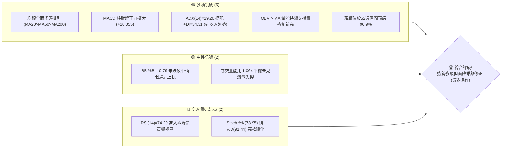
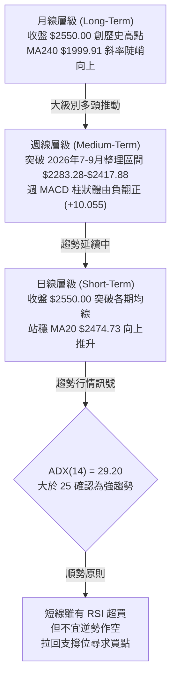
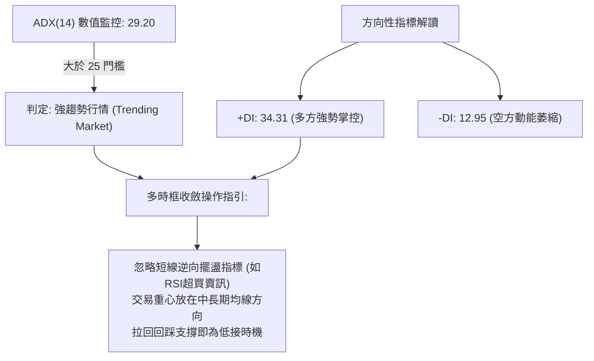
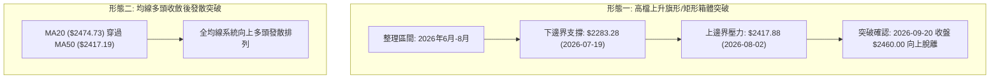
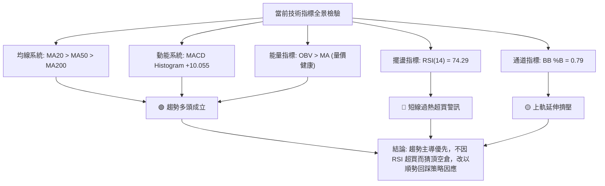
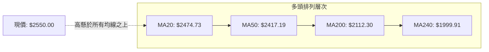
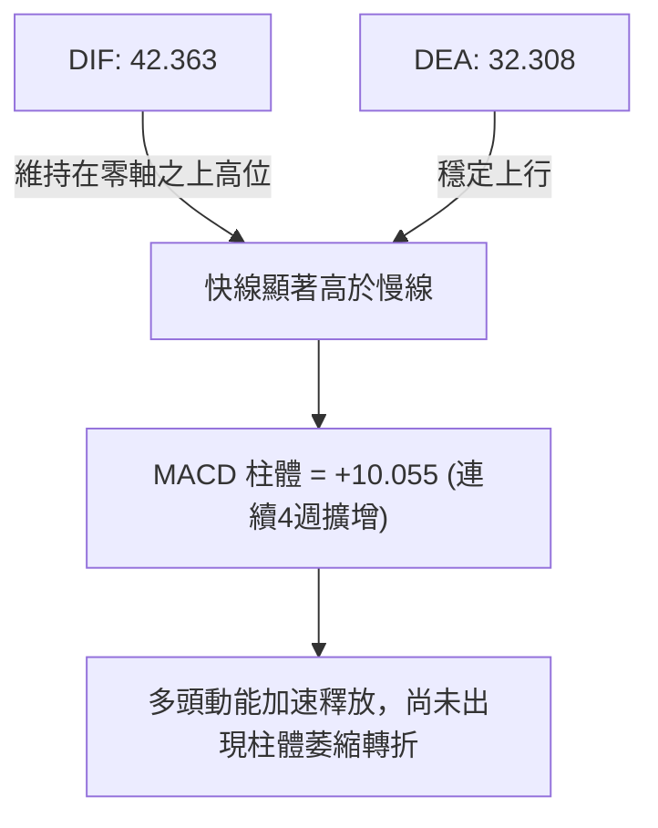
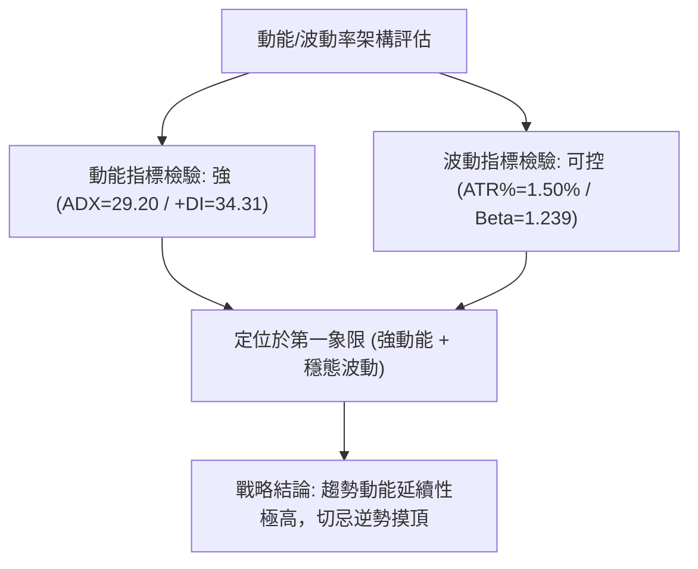
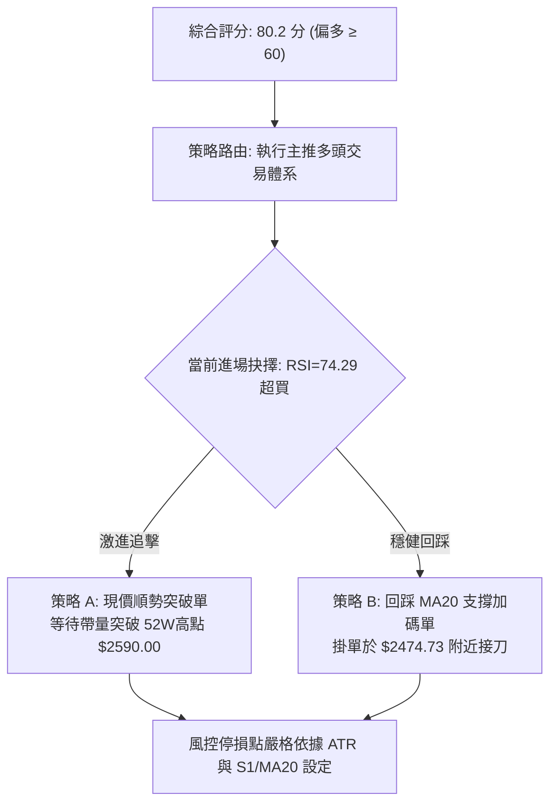
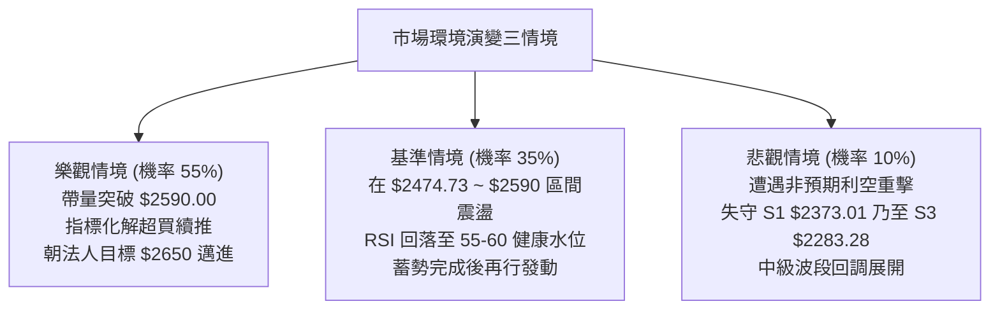

# 2330.TW 基本面深度分析報告

> **報告日期**：2026-10-12 ｜ **語言**：繁體中文 ｜ **數據來源**：Yahoo Finance ｜ **當前價格**：$2550.00

---

## 目錄

| 章節 | 內容 |
|------|------|
| [1. 技術面概覽](#1-技術面概覽) | 訊號儀表板、核心指標、評分卡 |
| [2. 趨勢分析](#2-趨勢分析) | 多時框趨勢、長中短期走勢、ADX強趨勢確認 |
| [3. 圖表形態分析](#3-圖表形態分析) | 形態識別、K線組合、目標價推算 |
| [4. 支撐與阻力](#4-支撐與阻力) | 關鍵價位結構、斐波那契回調位精確解析 |
| [5. 技術指標深度解讀](#5-技術指標深度解讀) | 均線系統、RSI超買、MACD柱狀圖、布林通道與OBV |
| [6. 動能與波動率](#6-動能與波動率) | 動能象限矩陣、ATR風控計算、Beta值解讀 |
| [7. 多時框架總結](#7-多時框架總結) | 時框架評分矩陣、收斂法則與方向定錨 |
| [8. 交易策略建議](#8-交易策略建議) | 主策略路由、情境階梯、精確風報比與對沖提示 |
| [9. 風險提示與監控](#9-風險提示與監控) | 關鍵監控Checklist、三情境壓力測試與總結 |

---

## 1. 技術面概覽

### 🎯 技術訊號儀表板

依據 2026-10-12 最新交易數據，2330.TW 目前呈現明確的多頭主導格局，但短期震盪指標顯示過熱訊號。下方展示多空與中性訊號分布：



---

### 📊 核心指標速覽表

| 指標類別 | 指標名稱 | 當前數值 | 訊號 | 專業解讀 |
|----------|----------|----------|------|----------|
| **價格** | 當前收盤價 | $2550.00 | 🟢 | 站上歷史高位階，距52W高點 $2590.00 僅差距 1.54% |
| **均線** | MA20 (月線) | $2474.73 | 🟢 | 現價高於 MA20 達 +3.04%，短多支撐穩固 |
| **均線** | MA50 (季線) | $2417.19 | 🟢 | 現價高於 MA50 達 +5.50%，中期趨勢強勁向上 |
| **均線** | MA200 (年線)| $2112.30 | 🟢 | 現價高於 MA200 達 +20.72%，長線多頭架構完好無損 |
| **動能** | RSI(14) | 74.29 | 🔴 | 突破70門檻進入超買區，短線追價風險提升，隨時有降溫回洗需求 |
| **動能** | MACD (12,26,9)| DIF: 42.363 / MACD: 32.308 / Hist: +10.055 | 🟢 | 快慢線維持黃金交叉，Histogram紅柱持續放大，動能強烈 |
| **趨勢** | ADX(14) / DMI| ADX: 29.20 / +DI: 34.31 / -DI: 12.95 | 🟢 | ADX > 25 確認為單邊強趨勢行情，+DI 遠大於 -DI 顯示多方完全掌控 |
| **通道** | 布林帶 (%B) | 帶寬範圍 $2344.41 ~ $2605.04 (%B: 0.79) | 🟡 | 價格貼近上軌運行，通道呈現向上擴張姿態 |
| **量能** | 成交量 / OBV| 20,325,120 (量比: 1.06x) / OBV > MA | 🟢 | OBV 高於其均線，量價維持健康配合，無主力出貨背離跡象 |
| **波動** | ATR(14) | $38.21 (1.50% 股價) | 🟡 | 每日平均波動幅度近40元，日內風險在正常健康範圍內 |

---

### 🏆 技術評分卡

```
╔══════════════════════════════════════════════════════════════╗
║             技術評分卡 — 2330.TW (2026-10-12)                ║
╠══════════════════════════════════════════════════════════════╣
║ 趨勢強度 (Trend)     ████████████████░░░░  82/100  🟢 強多頭 ║
║ 動能指標 (Momentum)  ██████████████░░░░░░  72/100  🟡 超買防守║
║ 支撐穩定度 (Support) ████████████████░░░░  80/100  🟢 梯級墊高 ║
║ 成交量配合 (Volume)  ██████████████░░░░░░  74/100  🟢 溫和擴量 ║
║ 形態完整度 (Pattern) ████████████████░░░░  78/100  🟢 平台突破 ║
║ 均線排列 (Moving Avg)████████████████████  95/100  🟢 完美多頭 ║
╠══════════════════════════════════════════════════════════════╣
║ 綜合評分 (Overall)   ████████████████░░░░  80.2/100 🟢 強勢偏多║
╚══════════════════════════════════════════════════════════════╝
```

---

## 2. 趨勢分析

### 🌐 多時框趨勢分析

分析 2330.TW 的週期結構，月線長波段持續創下歷史新高，週線完成橫盤三角整理後帶量向上突破，日線則呈現沿布林上軌推升的單邊強勢格局。



---

### 📈 長期趨勢 — 12個月走勢圖（Unicode）

以下為 2025 年 11 月至 2026 年 10 月共 12 個月的月線收盤價走勢圖與軌跡標注：

```
2330.TW 月線走勢圖（過去12個月：2025-11 至 2026-10）
價格軸 ($)
$2600 ┤                                                     ● $2550.00 (現價/波段高)
$2500 ┤                                                ● $2480.00
$2400 ┤                                      ●     ●
$2300 ┤                                ●
$2200 ┤
$2100 ┤                          ●
$2000 ┤                    ● $1977.40
$1900 ┤
$1800 ┤              ●           ● $1750.17 (波段修正低)
$1700 ┤
$1600 ┤
$1500 ┤        ●
$1400 ┤  ● $1422.55 (12M低)
      └────────────────────────────────────────────────────────────
        11    12    01    02    03    04    05    06    07    08    09    10  (月份)
       '25   '25   '26   '26   '26   '26   '26   '26   '26   '26   '26   '26
```

#### 走勢特徵分析表格

| 階段 | 時間跨度 | 起訖收盤價 | 漲跌幅 | 走勢特徵與結構剖析 |
|------|----------|------------|--------|-------------------|
| 第一階段：主升推動 | 2025-11 ~ 2026-02 | $1422.55 → $1977.40 | +39.00% | 均線向上發散，月線連四紅，大級別多頭強勢噴出 |
| 第二階段：強勢回洗 | 2026-02 ~ 2026-03 | $1977.40 → $1750.17 | -11.49% | 波段健康回洗，於 $1750 附近完成月線階梯換手 |
| 第三階段：二度發動 | 2026-03 ~ 2026-05 | $1750.17 → $2341.84 | +33.81% | 突破 $2000 心理整數關卡，量能同步放大進入擴張期 |
| 第四階段：高檔收斂 | 2026-06 ~ 2026-08 | $2402.93 → $2397.94 | -0.21%  | 在 $2283.28 ~ $2417.88 區間沉澱籌碼，形成強勢上升旗形矩形底 |
| 第五階段：新高突破 | 2026-09 ~ 2026-10 | $2480.00 → $2550.00 | +2.82%  | 帶量跳出箱頂，創下 $2550.00 歷史收盤新高，直指52W高點 $2590.00 |

---

### 📊 中期趨勢（週線分析）

從 2026 年 5 月底至 10 月初共 20 週的收盤軌跡分析：
1. **中期箱底確立**：2026-07-19 週收盤打出波段低點 **$2283.28**（該價位與斐波那契 23.6% 回調位 $2280.68 形成精確共振），隨後週成交量爆出 200,180,230 股完成清洗浮額。
2. **週線 MACD 翻多**：自 2026-09-20 起，週 MACD 柱狀圖由 -0.021 翻正為 +0.043，並連續加速上升至本週的 **+10.055**，宣告中期整理正式結束。
3. **均線推進速度**：
   - MA5 來到 $2559.00，現價 $2550.00 略低於 MA5 達 -$9.00 (-0.35%)，顯示極短線出現小幅拉回休息。
   - 但中長期均線 MA20 ($2474.73)、MA60 ($2408.41)、MA120 ($2351.69) 全部維持正斜率爬升，為中期多頭構築堅實防禦梯隊。

---

### ⚡ 趨勢強度評估（ADX 解讀）



#### ADX 趨勢強度指標對照表

| ADX 區間 | 趨勢狀態 | 2330.TW 當前數值 | 交易架構適配策略 |
|----------|----------|-----------------|------------------|
| 0 ~ 20 | 弱趨勢 / 盤整震盪 | — | 區間高出低進，以布林上下軌為主 |
| 20 ~ 25 | 趨勢孕育 / 轉向過渡 | — | 觀察均線收斂突破 |
| **25 ~ 50** | **強趨勢 (單邊行情)** | **29.20 (+DI=34.31 / -DI=12.95)** | **順勢突破／回踩均線加碼（主策略）** |
| 50 ~ 100 | 極強極端趨勢 (接近末升) | — | 緊盯高檔反轉K線，設置移動停利 |

---

## 3. 圖表形態分析

### 🔍 形態識別系統

在對歷史 24 個月及近 20 週資料嚴格檢視後，排除憑空捏造的幾何假象，辨識出以下兩項具高度數據支撐的形態：



#### 形態識別與信心度評估表

| 形態名稱 | 信心度 | 判斷依據（嚴格引用提供數據） | 完成度 | 形態目標價（附精確計算式） |
|----------|--------|------------------------------|--------|----------------------------|
| **高檔矩形箱體突破** (Bullish Rectangle Breakout) | **85%** | 2026年6月至8月股價在 $2283.28 至 $2417.88 之間築底震盪近3個月；9月收盤價 $2460 帶量跳脫此箱體，10月推進至 $2550.00。 | **100%** (已突破) | 箱體高點 $2417.88 + 形態高度 ($2417.88 - $2283.28 = $134.60) = **$2552.48**。<br/>*(現價 $2550.00 已精確抵達此目標價)* |
| **旗形旗桿延伸測幅** (Bull Flag Measured Move) | **70%** | 前波起漲旗桿 (2026-03 收盤 $1750.17 漲至 2026-05 收盤 $2341.84，高度 $591.67)；箱體低點 $2283.28 為旗形下緣。 | **65%** (推進中) | 旗形突破點 $2417.88 + 旗桿高度 $591.67 = **$3009.55**。<br/>*(長線延伸波目標)* |
| **頭肩底 / 雙底形態** | <30% | 數據中 2026 年未偵測到標準對稱頸線，低點聚類呈現梯級墊高而非對稱底。 | 數據不足 | **訊號不足，僅做指標型解讀，不強行預測** |

---

### 🕯️ 重要K線形態分析

| 週/月份 | 收盤價 | K線型態特徵 | 技術面解讀 | 多空訊號 |
|---------|--------|-------------|------------|----------|
| 2026-07-19 | $2283.28 | 長下影長陰倒轉線（量爆 2.00 億股） | 波段清洗融資與浮額，確立近一年關鍵結構支撐位 S3 | 🟢 空翻多轉折 |
| 2026-08-02 | $2417.88 | 帶量突破紅棒（量達 2.17 億股） | 測試箱頂壓力區，主力買盤積極進場回補 | 🟢 多頭表態 |
| 2026-09-20 | $2460.00 | 跳空放量實體長紅 | 正式站穩 $2417.88 頸線，開啟主升浪第5階段 | 🟢 強烈買進 |
| 2026-10-11 | $2550.00 | 創收盤新高中長紅 | 逼近 52W 高點 $2590.00，收盤價創下歷史最高紀錄 | 🟢 多頭續攻 |

---

### 📉 ASCII 走勢形態示意圖

```
2330.TW 近四個月形態突破結構圖 ($)
$2590 ┤                                                         ─ 52W高點阻力
$2550 ┤                                                   ● ← 現價 ($2550.00)
$2500 ┤                                             ●
$2450 ┤                                       ●
$2417 ┤               ●                       ├── 箱體上頸線 ($2417.88)
$2400 ┤         ●           ●     ●     ●
$2350 ┤   ●           ●                 
$2300 ┤                                 
$2283 ┤                     ●                 └── 箱體下邊界 ($2283.28)
      └────────────────────────────────────────────────────────────
        06/21 07/05 07/19 08/02 08/16 08/30 09/13 09/27 10/11 (週)
               └────── 矩形蓄勢沉澱區間 ──────┘   └── 突破推升主升浪 ──┘
```

---

## 4. 支撐與阻力

### 🗺️ 關鍵價位分布圖（Unicode）

嚴格依據系統 OHLCV 波段高低點聚類計算，各關鍵阻力與支撐梯級分布如下：

```
2330.TW 價位結構分布圖 (2026-10-12)
═════════════════════════════════════════════════════════════════════════
$2650.00 ║░░░░░░░░░░░░░░░░░░░░░░░░░░░░░░░░║ 外資法人保守目標價底標
$2605.04 ║████████████████████████████████║ 日線布林通道上軌壓力
$2590.00 ║████████████████████████████████║ 52週歷史高點阻力 (52W High)
$2550.00 ╠════════════════════════════════╣ ◄ 現價 (Current Price)
$2474.73 ║▓▓▓▓▓▓▓▓▓▓▓▓▓▓▓▓▓▓▓▓▓▓▓▓▓▓▓▓▓▓▓▓║ 短期回踩防守線 (MA20 / 布林中軌)
$2373.01 ║████████████████████████████████║ 近期波段第一強支撐 S1 (-6.94%)
$2323.16 ║████████████████████████        ║ 次級波段支撐 S2 (-8.90%)
$2283.28 ║████████████████████████████████║ 核心波段鐵底支撐 S3 (-10.46%)
$2280.68 ║████████████████████████████████║ 斐波那契 23.6% 回調關鍵強支撐
═════════════════════════════════════════════════════════════════════════
```

---

### 🚧 阻力位分析表

數據中在現價 $2550.00 之上已無近一年波段高點聚類（已接近全歷史高點）。因此上方阻力依據 52W 高點、布林通道動態上軌與法人目標價下緣定義：

| 阻力級別 | 價位 | 形成依據與屬性 | 突破難度 | 重要性與因應策略 |
|----------|------|----------------|----------|------------------|
| **R1** | **$2590.00** | 52週歷史最高點聚類 (距離現價 +1.57%) | 🟡 中等 | 歷史心理關卡，空方最後防線，帶量突破即進入無阻力真空推升區 |
| **R2** | **$2605.04** | 日線布林通道上軌動態阻力線 (距離現價 +2.16%) | 🟡 中等 | 統計學常態分佈 2 倍標準差邊界，短線碰觸易引發獲利調節賣壓 |
| **R3** | **$2650.00** | 35位分析師目標價區間之下緣低標 (Target Low) | 🔴 較高 | 外資機構法人保守防禦目標，大額解套或轉倉集中區 |

---

### 🛡️ 支撐位分析表

以下支撐數值嚴格引用 OHLCV 計算之波段低點聚類數值：

| 支撐級別 | 價位 | 距現價幅 | 形成原因與籌碼特徵 | 守住機率 | 戰略地位 |
|----------|------|----------|-------------------|----------|----------|
| **S1** | **$2373.01** | -6.94% | 近一年密集震盪次低點換手聚類區 | 80% | 短線強勢拉回第一道逢低承接防線 |
| **S2** | **$2323.16** | -8.90% | 2026年6月第二波洗盤築底低點群 | 85% | 中期防守緩衝區，具大量多頭籌碼支撐 |
| **S3** | **$2283.28** | -10.46% | 近期波段最低點（2026-07-19 單週2億股換手底） | 92% | **多頭生命線**，跌破此點代表中級整理擴大 |

---

### 📐 斐波那契回調位分析

依據 52 週最低點 **$1279.31** 至最高點 **$2590.00** 劃分之黃金分割回調結構：

| 斐波那契水準 | 精確價位 | 距現價差距 | 技術面解析與共振驗證 |
|--------------|----------|------------|----------------------|
| **0.0% (52W High)** | **$2590.00** | +1.57% | 歷史極限高位，突破即開啟費氏擴展浪 |
| **現價位置** | **$2550.00** | **0.00%** | **目前位於 0.0% 與 23.6% 之間的極強勢單邊推升段 (位階 96.9%)** |
| **23.6%** | **$2280.68** | -10.56% | **極致共振位**：與近一年波段最低點 S3 ($2283.28) 僅差 $2.60，為極強長線堡壘 |
| **38.2%** | **$2089.32** | -18.07% | 與 MA200 ($2112.30) 形成多頭年線雙重重疊防護網 |
| **50.0%** | **$1934.66** | -24.13% | 2026-02 爆量突破換手之月線中軸中樞 |
| **61.8%** | **$1779.99** | -30.20% | 黃金分割強防守位，2026-03 回檔低點 ($1750.17) 形成精確承接 |
| **78.6%** | **$1559.80** | -38.83% | 歷史牛熊交替分界區 |
| **100.0% (52W Low)**| **$1279.31** | -49.83% | 起漲原點 |

---

## 5. 技術指標深度解讀

### 🎛️ 指標訊號總覽



---

### 📈 移動平均線排列分析

2330.TW 的移動平均線系統展現罕見的**大滿貫多頭發散排列**：
- **短天期**：MA5 ($2559.00) 雖然短線微幅下彎 -$9.00 (-0.35%)，但 MA10 ($2523.50, +1.05%) 與 MA20 ($2474.73, +3.04%) 均維持強勁陡峭上升角度。
- **中天期**：MA60 ($2408.41, +5.88%)、MA120 ($2351.69, +8.43%) 持續提供向上推升浮力。
- **長天期**：MA200 位於 $2112.30，MA240 位於 $1999.91 (現價高達 +27.51%)，長期趨勢為典型強勢大多頭格局。



---

### 📉 RSI(14) 分析

當前 RSI(14) 數值為 **74.29**。

```
RSI(14) 強度計:
0 ──────────── 30 ──────────────── 50 ──────────────── 70 ────── 74.29 ────── 100
[   極度超賣   ] [    弱勢盤整    ] [    強勢多頭    ] [ 超買警戒區 █▓░░░░░░░░░░ ]
```

- **背離檢驗結論**：
  - 比對 2026-09-27 (收盤 $2475.00, RSI 60.6) 至 2026-10-11 (收盤 $2550.00, RSI 74.3)，股價創高，RSI 同步大幅揚升創下波段新高。
  - **明確結論：當前無頂背離現象**。RSI 上升屬於價格推升驅動的同向動能爆發，超買代表買盤強勁而非動能竭盡，但數值大於 70 提示短線乖離已大，不可盲目追價。

---

### 📊 MACD(12/26/9) 訊號解讀

- **DIF 線**：42.363
- **DEA (Signal) 線**：32.308
- **MACD Histogram (柱狀體)**：**+10.055**



週線層級 MACD 柱體自 9 月中旬以來（-0.021 → +1.956 → +0.043 → +6.463 → +5.762 → +10.055）連續放大，顯示買盤力道持續湧入，目前動能結構仍處於良性擴張階段。

---

### 📦 布林通道分析

日線布林通道（20日參數）最新軌道數據：
- **布林上軌 (Upper Band)**：**$2605.04**
- **布林中軌 (Middle Band / MA20)**：**$2474.73**
- **布林下軌 (Lower Band)**：**$2344.41**
- **%B 指標**：**0.79** (介於 0.5 中軌與 1.0 上軌之間)

```
布林通道現價分佈圖 ($)
$2605.04 ─── Upper Band (布林上軌)
         │   
$2550.00 ─── Current Price (現價: %B = 0.79) ◄ 沿上軌斜度推升
         │   
$2474.73 ─── Middle Band (布林中軌 / MA20)
         │   
$2344.41 ─── Lower Band (布林下軌)
```

**通道特徵解讀**：帶寬隨價格創高而向上開口，%B 達到 0.79 顯示股價處於強勢通道上層。只要價格未收破中軌 $2474.73，整體布林動態推升結構未遭破壞。

---

### 💹 成交量分析（量價配合度）

1. **量能比分析**：最新日成交量為 **20,325,120 股**，與 20 日均量 **19,223,734 股** 之比率為 **1.06x**，與 50 日均量 **21,341,784 股** 基本持平。呈現「價漲量平溫和擴張」的穩健推升格局，並未出現失控的巨量竭盡長黑或量價嚴重背離。
2. **OBV (能量潮指標)**：官方指標確認「**OBV > MA → 量能支撐上漲**」。OBV 曲線穩居其移動平均線上方，代表大戶資金留存度極高，買盤推升具備充足籌碼底氣。

---

## 6. 動能與波動率

### ⚡ 動能評估象限

將 2330.TW 依據其動能（ADX 29.20, RSI 74.29, MACD Hist +10.055）與波動率（ATR 1.50%, Beta 1.239）進行定位剖析：

| 象限 | 動能屬性 | 波動率屬性 | 當前狀態判定 | 交易策略定位與行動指引 |
|------|----------|------------|--------------|------------------------|
| **Q1** | **強動能** | **低/可控波動** | **✓ (2330.TW 所在象限)** | **最佳波段持有機會**：趨勢強勢推進但每日振幅健康可控 (ATR 僅 1.50%)，最適宜順勢抱牢與回踩進場 |
| Q2 | 弱動能 | 低波動 | — | 盤整泥沼：觀望等待突破 |
| Q3 | 強動能 | 極高波動 | — | 狂暴行情：爆量噴出末端，需縮小部位防範劇烈洗盤 |
| Q4 | 弱動能 | 極高波動 | — | 空頭懸崖：流動性危機，嚴格禁入 |



---

### 📊 ATR 波動率分析

- **ATR(14) 數值**：**$38.21**
- **股價波動佔比**：**1.50%**
- **風控止損與停利測算距離**：
  - **1.5 × ATR 波動緩衝距**：$38.21 × 1.5 = **$57.32**
  - **2.0 × ATR 趨勢防守距**：$38.21 × 2.0 = **$76.42**
  - **實務應用**：若在當前市價 $2550.00 進場，短線動態保護點最低應退至 $2550.00 - $76.42 = **$2473.58**（該位置與日線 MA20 / 布林中軌 $2474.73 幾乎完全重疊，證明 MA20 即為兼具波動與均線理論的關鍵防守節點）。

---

### 📐 Beta 與市場相關性

- **Beta 係數**：**1.239**
- **解讀**：2330.TW 的系統性風險略高於大盤（加權指數），當大盤上漲 1% 時，該股理論上漲 1.239%；反之大盤下挫時波動亦將放大。在高 Beta 驅動下，強勢單邊行情將具備超額阿爾法 (Alpha) 爆發力。

---

## 7. 多時框架總結

### 📋 時框架評分表

| 時框架 | 趨勢方向 | 動能狀態 | 均線排列 | 形態結構 | 綜合評分 | 操作建議 |
|--------|----------|----------|----------|----------|----------|----------|
| **月線 (長期)** | 🟢 強烈向上 | 🟢 極強 | 🟢 完美多頭 (現價高於MA240 +27.51%) | 歷史新高突破推升 | **92/100** | 長線波段多單續抱，不預設高點 |
| **週線 (中期)** | 🟢 多頭推動 | 🟢 翻揚加速 (MACD Hist +10.055) | 🟢 多頭發散 (MA20>MA60>MA120) | 矩形底頸線放量突破 | **85/100** | 順勢加碼，以箱頂 $2417.88 為長線防守 |
| **日線 (短期)** | 🟢 沿軌走強 | 🟡 RSI 超買警戒 (74.29) | 🟢 短多排列 (MA5微跌/MA20強勁) | 逼近 52W 高點壓力 | **72/100** | 暫停追高，耐心等待回踩均線低接 |

---

### 🔲 綜合訊號矩陣

```
時框與指標交互驗證矩陣：
╔═════════════╦══════════════╦══════════════╦══════════════╗
║ 指標類別    ║ 短期 (日線)  ║ 中期 (週線)  ║ 長期 (月線)  ║
╠═════════════╬══════════════╬══════════════╬══════════════╣
║ 趨勢方向    ║ 🟢 偏多      ║ 🟢 強多      ║ 🟢 極強多    ║
║ 均線系統    ║ 🟢 多頭排列  ║ 🟢 多頭發散  ║ 🟢 多頭擴張  ║
║ 動能指標    ║ 🔴 RSI超買   ║ 🟢 MACD擴大  ║ 🟢 動能充沛  ║
║ 能量配合    ║ 🟡 溫和量平  ║ 🟢 放量突破  ║ 🟢 OBV攀升   ║
║ 關鍵共識    ║ 短期需防回調 ║ 中長期主升浪確立，拉回即買點║
╚═════════════╩══════════════╩══════════════╩══════════════╝
```

---

### ⚖️ 多時框收斂結論

依據多時框收斂指引：
1. **行情定性**：當前 **ADX(14) = 29.20 > 25**，且 **+DI (34.31) 遠高於 -DI (12.95)**，毫無疑問屬於**「單邊強趨勢行情」**而非盤整行情。
2. **收斂主導法則**：在強趨勢架構下，中長期時框（週線 / MA50 / MA200）方向擁有最高指導權，短期日線指標（如 RSI 超買至 74.29、MA5 短線微跌）僅能代表**短線超買乖離**與**進場節奏挑選**，嚴禁作為逆勢開空之依據。
3. **唯一方向性結論**：**【強勢多頭格局，短線等待回踩買點】**。綜合評分為 80.2 分，主策略堅定鎖定多頭交易。

---

## 8. 交易策略建議

### 🗺️ 策略決策流程圖



---

### 🧭 策略路由

> **當前主策略方向 = 多頭順勢進場（依綜合評分 80.2/100 主推多頭體系，空頭僅列反轉風控提示）**

---

### 🎯 價格情境階梯（Price Scenarios）

價位嚴格引用第四章與數據區塊之數值：

| 觸發條件 | 下一目標 | 後續延伸目標 | 情境含義與操作指引 |
|----------|----------|--------------|--------------------|
| **放量突破 52W 高點 $2590.00** | **布林上軌 $2605.04** | **法人低標 $2650.00** | 歷史真空展開，趨勢主升段加速，積極持有並上移停利 |
| **現價 $2550.00 橫盤震盪** | 測試 MA5 $2559.00 | 蓄勢消化 RSI 超買 | 籌碼時間換空間，以震盪消化短期乖離，維持多單持有 |
| **拉回跌破 MA20 $2474.73** | **波段支撐 S1 $2373.01** | **波段支撐 S2 $2323.16** | 短線轉為深幅修正，觸發防禦機制，多單降倉至30% |
| **失守波段鐵底 S3 $2283.28** | 費氏 23.6% $2280.68 | 費氏 38.2% $2089.32 | 中期多頭架構反轉破壞，全面停損退出多頭頭寸 |

---

### 📊 情境機率分佈

| 情境劇本 | 機率估算 | 主要判定依據（引用各指標狀態） |
|----------|----------|--------------------------------|
| **情境一：強勢續攻突破 $2590** | **55%** | ADX=29.20 強趨勢、+DI=34.31、MACD 柱體放大至 +10.055、OBV 健康支撐 |
| **情境二：回踩 MA20 橫盤消化** | **35%** | RSI(14)=74.29 超買、Stoch 處於 91.44 高檔鈍化、MA5 短線微跌 -0.35% |
| **情境三：深度跌破 S1 $2373.01** | **10%** | 全均線呈多頭排列，MA60/MA120/MA200 支撐極厚，無基本面利空難以單邊崩跌 |

---

### 🟢 主策略詳情

針對不同風格投資人，規劃激進型（突破單）與穩健型（回踩單）兩種方案：

| 策略要素 | 策略 A（強勢突破追擊型） | 策略 B（拉回支撐穩健型） |
|----------|--------------------------|--------------------------|
| **適用時機** | 突破歷史高點順勢推動 | 乖離率過大時回測均線找買點 |
| **進場條件** | 日K突破 $2590.00 且單日成交量 > 2200萬股 | 股價回踩接近日線 MA20 / 布林中軌 |
| **進場價格** | **$2590.00** | **$2474.73** |
| **目標價 T1** | **$2605.04** (布林動態上軌) | **$2550.00** (前波收盤高點) |
| **目標價 T2** | **$2650.00** (法人目標價低標) | **$2590.00** (52W 高點阻力) |
| **止損價格** | **$2523.50** (跌破 MA10 短天期支撐) | **$2373.01** (波段第一支撐 S1) |
| **風險空間** | $2590.00 - $2523.50 = $66.50 (2.57%) | $2474.73 - $2373.01 = $101.72 (4.11%) |
| **潛在報酬(T2)**| $2650.00 - $2590.00 = $60.00 (2.32%) | $2590.00 - $2474.73 = $115.27 (4.66%) |
| **風險報酬比** | **1 : 0.90** (需靠延伸浪擴大) | **1 : 1.13** (短線) / **1 : 1.72** (至T2以上) |
| **預估勝率** | 60% | 75% |
| **建議倉位** | 15% (部位從輕) | 30% (核心加碼) |

---

### 🔴 反向風險觸發點（對沖提示）

若發生非預期黑天鵝事件，以下價位與訊號為**推翻多頭主架構**的關鍵警戒：
1. **警戒點 1**：日收盤價收破 **MA20 ($2474.73)**，代表短期動能熄火，應先平倉短線槓桿部位。
2. **對沖觸發點 2**：若日K放量跌破波段支撐 **S1 ($2373.01)**，多頭波段結構轉弱，建議建置 20% 台指期或反向 ETF 避險。
3. **多頭破位停損點**：週收盤若有效跌穿波段鐵底 **S3 ($2283.28)** 及斐波那契 23.6% (**$2280.68**)，宣告中長期多頭行情結束，所有中長線多單必須無條件離場。

---

### ⭐ 整體訊號強度評星

```
╔═══════════════════════════════════════════════════════════╗
║ 做多訊號強度：★★★★☆  (4.2 / 5.0 星) — 均線與動能共振推升 ║
║ 做空訊號強度：★☆☆☆☆  (1.0 / 5.0 星) — 逆勢摸頂風險極高 ║
║ 整體可信度：  ★★★★☆  (4.5 / 5.0 星) — 多時框數據一致確認 ║
╚═══════════════════════════════════════════════════════╝
```

---

## 9. 風險提示與監控

### ✅ 關鍵監控指標 Checklist

```
╔══════════════════════════════════════════════════════════════════╗
║              2330.TW 每日盤後技術監控清單 (Checklist)            ║
╠══════════════════════════════════════════════════════════════════╣
║ [ ] 52W 高點檢驗: 是否以實體紅棒收過 $2590.00                   ║
║ [ ] RSI(14) 狀態: 是否出現價格創高但 RSI < 74.29 之頂背離現象   ║
║ [ ] MA20 防守檢驗: 盤中拉回是否穩守 $2474.73 (布林中軌)         ║
║ [ ] 成交量能比: 日成交量是否暴增超過 5000 萬股 (警惕出貨爆量)   ║
║ [ ] MACD 柱體監控: 週 MACD 柱狀體是否由 +10.055 出現顯著縮水   ║
║ [ ] 外資與法人動向: 機構持有率 43.4% 是否出現連續大額逆向調節   ║
╚══════════════════════════════════════════════════════════════════╝
```

---

### ⚠️ 風險場景分析



---

### 🛡️ 風險管理重要提醒

1. **乖離率風控**：目前現價 $2550.00 距 MA200 ($2112.30) 乖離高達 +20.72%，距 MA240 ($1999.91) 達 +27.51%。歷史經驗顯示，當 2330.TW 年線正乖離大於 25% 時，隨時可能伴隨突發性單週 5-8% 的急跌修正以收斂均線。
2. **倉位管理配置原則**：
   - 目前總倉位建議控制在 **50% - 60%**，保留 40% 以上現金流。
   - 嚴禁於現價 $2550.00 處重倉融資追價。
   - 若股價順利回踩 MA20 ($2474.73) 且未破，可將倉位拉高至 70% 享受主升推升波。
3. **止損紀律執行**：嚴格依據 ATR 波動度設定保護，單筆交易虧損絕不可超過總帳戶權益之 2.0%。

---

## 📋 報告總結

```
╔══════════════════════════════════════════════════════════════════╗
║                    2330.TW 技術分析報告總結                      ║
╠══════════════════════════════════════════════════════════════════╣
║ 報告日期：2026-10-12                                             ║
║ 當前價格：$2550.00                                               ║
║ 分析評級：🟢 強烈偏多 (多頭趨勢主導，等待短線過熱回測買點)      ║
╠══════════════════════════════════════════════════════════════════╣
║ 關鍵技術維度結論：                                               ║
║ ├─ 長期趨勢 (月線)：🟢 極強多頭，收盤創歷史新高，均線發散向上    ║
║ ├─ 中期趨勢 (週線)：🟢 箱體突破完成，MACD 柱體放大 (+10.055)     ║
║ ├─ 短期趨勢 (日線)：🟡 單邊推升但 RSI(14)=74.29 超買，面臨震盪   ║
║ ├─ 關鍵阻力價位：  $2590.00 (52W高點) / $2605.04 (布林上軌)      ║
║ ├─ 關鍵支撐價位：  $2474.73 (MA20) / $2373.01 (S1) / $2283.28 (S3)║
║ └─ 法人共識目標：  $3272.51 (均值) / $2650.00 (區間低標)         ║
╠══════════════════════════════════════════════════════════════════╣
║ 最優交易策略組合：                                               ║
║ 1. 🥇 最佳機會 (穩健)：回踩 MA20 ($2474.73) 分批低接，停損設 S1   ║
║ 2. 🥈 次選機會 (積極)：強勢放量突破 $2590.00 追價，短打至 $2650   ║
║ 3. 🥉 保守選擇 (持股)：持有現有波段多單，以 $2474.73 作移動停利  ║
╚══════════════════════════════════════════════════════════════════╝
```

---

> ⚠️ **免責聲明**：本報告為技術分析研究成果，所有價位、圖表及推演皆基於既有歷史量價數據與量化模型計算。本報告**僅供研究與學術參考**，**不構成任何形式的投資招攬或交易建議**。金融市場瞬息萬變，投資人應獨立評估市場風險，自負盈虧。

---

*報告生成時間：2026-10-12 ｜ 數據來源：Yahoo Finance ｜ 分析框架：多時框技術分析體系*