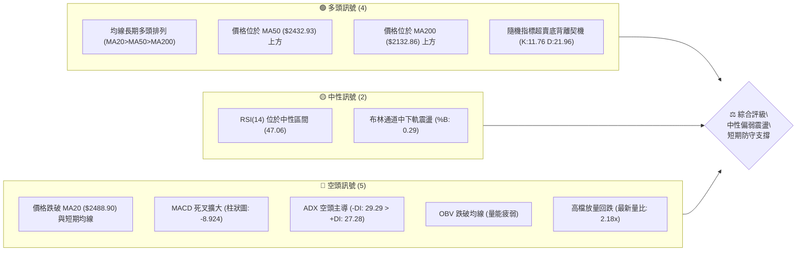
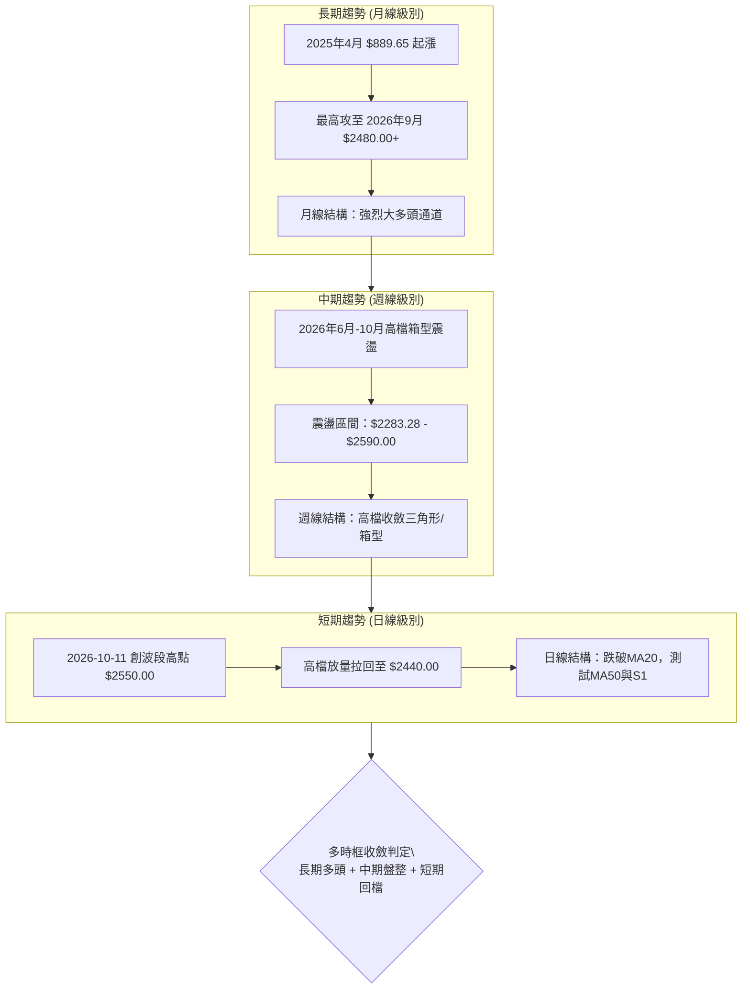
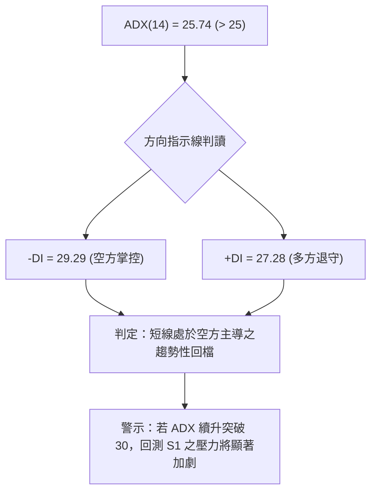
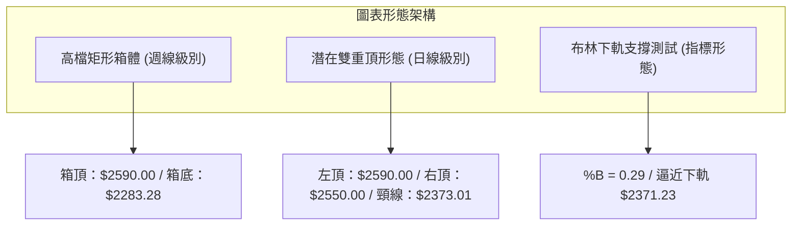
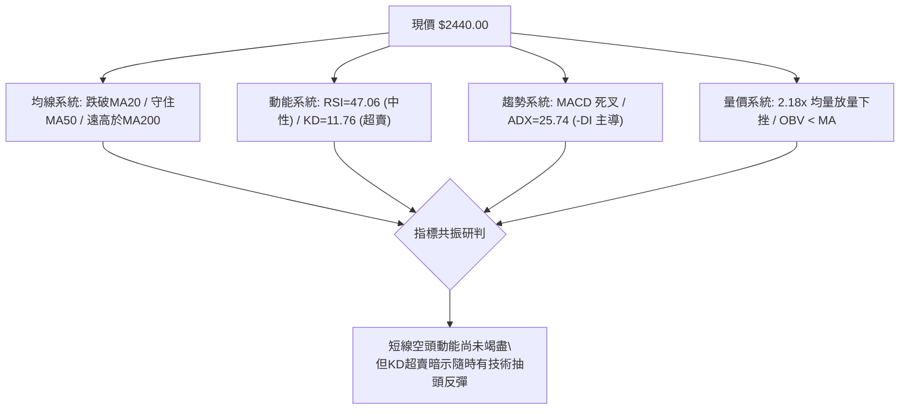
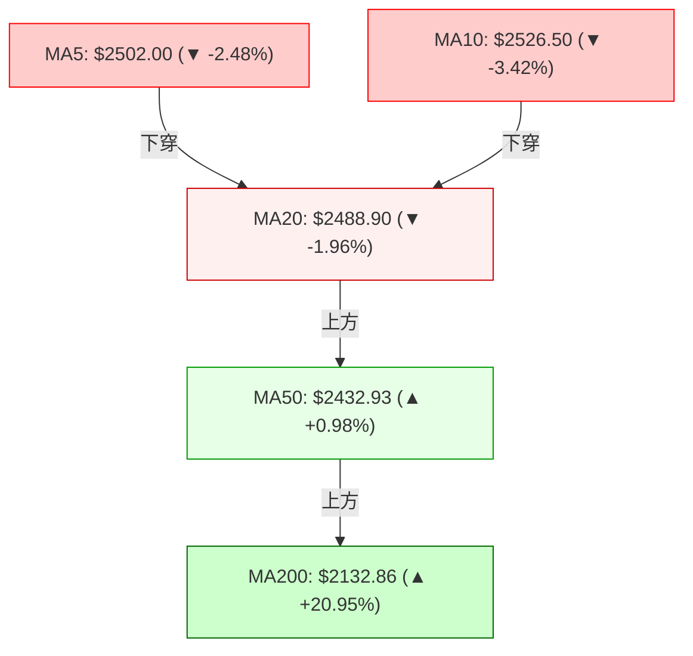
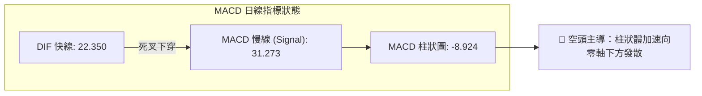
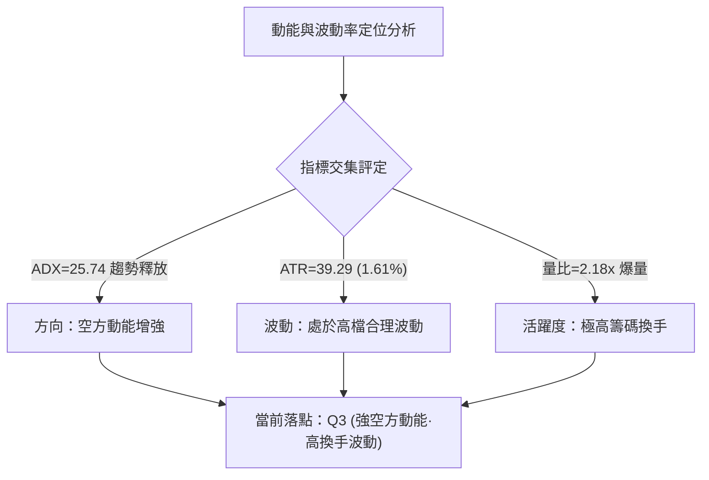
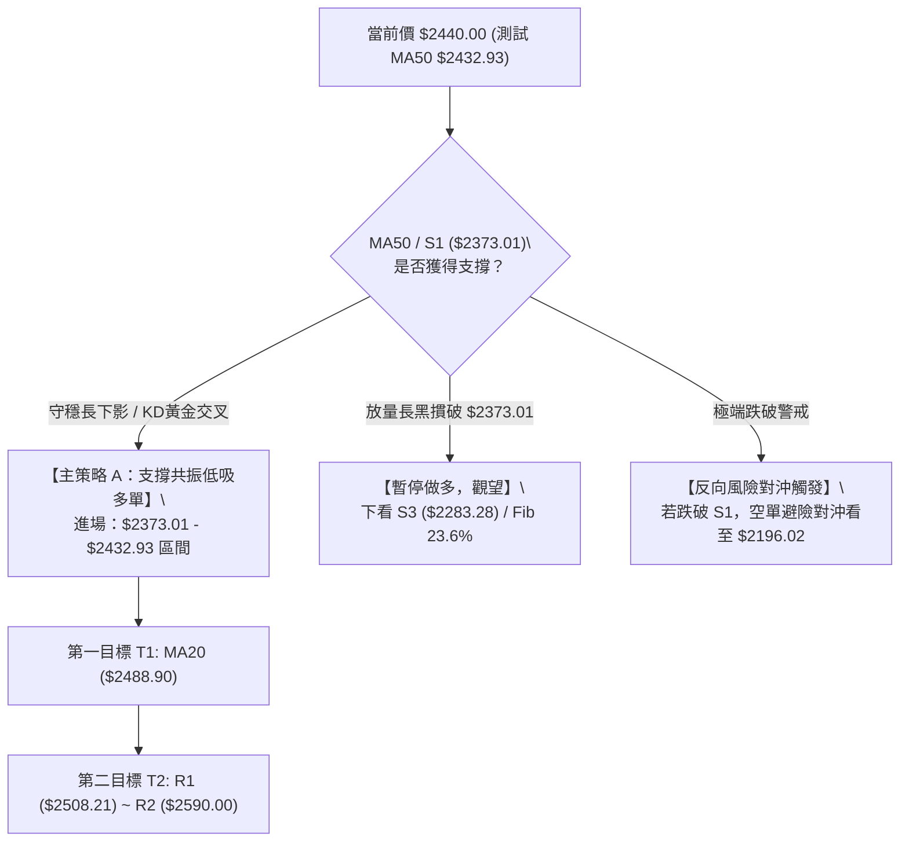
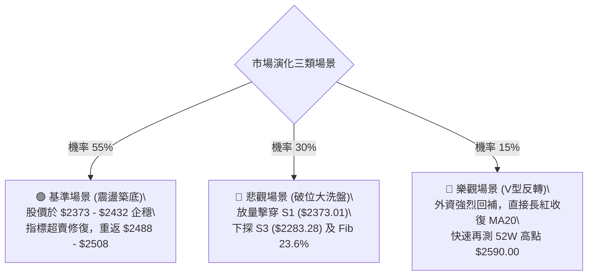

# 2330.TW 基本面深度分析報告

> **報告日期**：2026-10-15 ｜ **語言**：繁體中文 ｜ **數據來源**：Yahoo Finance ｜ **當前價格**：$2440.00

---

## 目錄

| 章節 | 內容 |
|------|------|
| [1. 技術面概覽](#1-技術面概覽) | 訊號儀表板、核心指標、評分卡 |
| [2. 趨勢分析](#2-趨勢分析) | 多時框趨勢、長中短期走勢 |
| [3. 圖表形態分析](#3-圖表形態分析) | 形態識別、K線組合、目標價 |
| [4. 支撐與阻力](#4-支撐與阻力) | 關鍵價位、斐波那契回調 |
| [5. 技術指標深度解讀](#5-技術指標深度解讀) | MA/RSI/MACD/布林/成交量 |
| [6. 動能與波動率](#6-動能與波動率) | 動能評估、ATR、Beta |
| [7. 多時框架總結](#7-多時框架總結) | 時框架評分矩陣 |
| [8. 交易策略建議](#8-交易策略建議) | 多空策略、風險報酬比 |
| [9. 風險提示與監控](#9-風險提示與監控) | 監控指標、風險場景 |

---

## 1. 技術面概覽

台積電（2330.TW）當前報價為 $2440.00，在歷經 2024 年底至 2026 年初的強勁主升段後，目前處於高檔震盪整理與技術性回檔的敏感節點。日線層級上，短期均線出現拐頭，MACD 柱狀圖呈現負值，且價格跌破 MA20（$2488.90）；然而，中長期均線（MA50 $2432.93、MA200 $2132.86）依然維持完好的多頭排列架構，呈現「短空格局、長多未變」的多時框矛盾狀態。

### 🎯 技術訊號儀表板



### 📊 核心指標速覽表

| 指標類別 | 指標名稱 | 當前數值 | 訊號 | 解讀 |
|----------|----------|----------|------|------|
| **價格** | 當前價格 | $2440.00 | 🟡 | 位於52週區間 88.5% 之高檔強勢區，但處於短期拉回階段 |
| **均線** | MA20 | $2488.90 | 🔴 | 價格低於 MA20 達 -1.96%，跌破月線短線轉弱 |
| **均線** | MA50 | $2432.93 | 🟢 | 價格在季線上方 +0.29%，短線關鍵支撐測試中 |
| **均線** | MA200 | $2132.86 | 🟢 | 價格在年線上方 +14.40%，長期牛市基石極為穩固 |
| **動能** | RSI(14) | 47.06 | 🟡 | 處於 30-70 中性格局，未達超賣但動能明顯降溫 |
| **動能** | MACD (12,26,9) | 22.350 / 31.273 | 🔴 | DIF 低於 MACD Signal，柱狀圖 -8.924，空頭動能釋放 |
| **動能** | KD(9,3,3) | %K: 11.76 / %D: 21.96 | 🟢 | 進入 20 以下超賣區，具備技術性反彈契機 |
| **趨勢** | ADX(14) | 25.74 | 🔴 | ADX > 25 進入趨勢區，-DI(29.29) > +DI(27.28) 短期由空方主導 |
| **波動** | ATR(14) | $39.29 | 🟡 | 佔股價 1.61%，每日預期波動區間約 ±$40，波動適中 |
| **量能** | Volume / OBV | 48,190,233 (2.18x) | 🔴 | 量比放大至 2.18x 伴隨回檔，OBV < MA，量價呈現短線背離 |

### 🏆 技術評分卡

```
╔══════════════════════════════════════════════════════════════════╗
║                技術評分卡 — 2330.TW (2026-10-15)                 ║
╠══════════════════════════════════════════════════════════════════╣
║ 趨勢強度 (ADX/方向)   ██████████░░░░░░░░░░  52/100  🟡 空方微幅主導 ║
║ 動能指標 (MACD/RSI)   ████████░░░░░░░░░░░░  42/100  🔴 動能快速耗損 ║
║ 支撐穩定度 (S1/MA50)  ██████████████░░░░░░  70/100  🟢 季線具備強防禦 ║
║ 成交量配合 (量比/OBV) ██████░░░░░░░░░░░░░░  35/100  🔴 放量下挫量能差 ║
║ 形態完整度 (箱體/平台)████████████░░░░░░░░  60/100  🟡 高檔箱型震盪 ║
║ 均線排列 (多時框MA)   ██████████████░░░░░░  72/100  🟢 中長多頭架構 ║
╠══════════════════════════════════════════════════════════════════╣
║ 綜合技術評分          ███████████░░░░░░░░░  55/100  🟡 中性震盪待變 ║
╚══════════════════════════════════════════════════════════════════╝
```

---

## 2. 趨勢分析

### 🌐 多時框趨勢分析

台積電展現出強烈的跨週期多空拉鋸。長期月線為超強大多頭走勢；中期週線在進入 $2400-$2550 區間後呈現寬幅震盪築頂/蓄勢格局；短期日線則遭遇空頭反撲，測試中長期趨勢底線。



### 📈 長期趨勢 — 12個月走勢圖（Unicode）

過去 12 個月（2025-10 至 2026-10），台積電完成了從千元中段向兩千五百元大關的史詩級突破。

```
2330.TW 月線收盤走勢圖（過去12個月：2025-10 至 2026-10）
價格軸 ($)
$2600 ┤                                                    ● 2590.00 (52W High)
$2450 ┤                                      ●      ●      ● 2440.00 (現在)
$2300 ┤                               ●
$2150 ┤                        ●
$2000 ┤                 ●
$1850 ┤          ●
$1700 ┤   ●
$1550 ┤          ●
$1400 ┤● 1481.83
      └────────────────────────────────────────────────────────
        25-10 25-11 25-12 26-01 26-02 26-03 26-04 26-05 26-06 26-07 26-08 26-09 26-10
```

#### 走勢特徵分析表格

| 階段 | 時間區間 | 起始價 → 結束價 | 區間漲跌幅 | 主要走勢特徵 |
|------|----------|-----------------|------------|--------------|
| **第 I 階段** | 2025-10 ~ 2025-12 | $1481.83 → $1536.33 | +3.68% | 平台整理期，消化前期千元以下漲幅，蓄積突破動能 |
| **第 II 階段** | 2025-12 ~ 2026-02 | $1536.33 → $1977.40 | +28.71% | 主升主攻浪，巨量突破 $1600，直逼兩千元關卡 |
| **第 III 階段** | 2026-02 ~ 2026-03 | $1977.40 → $1750.17 | -11.49% | 急速技術性洗盤修正，回測季線獲得強勁支撐 |
| **第 IV 階段** | 2026-03 ~ 2026-06 | $1750.17 → $2402.93 | +37.30% | 噴出段主升浪，強勢貫穿 $2000，奠定中長線多頭基礎 |
| **第 V 階段** | 2026-06 ~ 2026-10 | $2402.93 → $2440.00 | +1.54% | 高位高原整理期，波動範圍 $2283.28 - $2590.00，量能邊際遞減 |

### 📊 中期趨勢（週線分析）

從近 20 週的收盤紀錄可清晰觀察到，台積電於 2026 年 7 月 19 日下探週收盤低點 $2283.28 後，逐步墊高底部，形成向上傾斜的高檔收斂整理通道。10 月 11 日當週拉出 $2550.00 的強勢週收盤（RSI 衝高至 74.3 超買），隨後於當週（2026-10-18 收盤紀錄）重挫至 $2440.00，週 RSI 回落至 47.1，MACD 柱狀圖由 +10.055 陡降至 -8.924。

```
中期週線高檔震盪與壓力支撐示意圖：
  $2590.00 ┬────────────────────────────────────────── 52W High (R2 強阻力)
           │              ▲ 2550.00 (10-11 波段高點)
  $2508.21 ┼─────────────▲──────────────────────────── R1 阻力
           │            / \  
  $2440.00 ┼───────────/───▼────────────────────────── 現價 ($2440.00) 測 MA50 ($2432.93)
           │          /     
  $2373.01 ┼─────────/──────────────────────────────── S1 近期波段支撐 (BB下軌 $2371.23)
           │        /       
  $2323.16 ┼───────/────────────────────────────────── S2 次級支撐
           │      /         
  $2283.28 ┴────▲──────────────────────────────────── S3 / 斐波那契 23.6% ($2283.01)
               2026-07-19 低點
```

### ⚡ 趨勢強度評估（ADX 解讀）

當前日線 ADX(14) 讀數為 **25.74**，突破了 25 的關鍵趨勢分界閾值，顯示市場已經脫離完全無方向的盤整，而進入明確的方向性趨勢釋放期。



| 指標變數 | 當前讀數 | 臨界門檻 | 狀態解讀 |
|----------|----------|----------|----------|
| **ADX(14)** | **25.74** | 25.00 | **趨勢啟動**：數值 > 25，表明短線行情具備趨勢貫性，非微幅雜訊 |
| **+DI(14)** | **27.28** | - | **多方力道**：自高點回落，多方攻勢遭受壓制 |
| **-DI(14)** | **29.29** | - | **空方力道**：超越 +DI，確認空頭在日線週期取得主動權 |
| **差值 (-DI - +DI)** | **+2.01** | 0.00 | **空方優勢**：差值剛翻正，空方動能處於初期至中期的釋放過程 |

---

## 3. 圖表形態分析

### 🔍 形態識別系統

在日線與週線複合時框中，台積電於 $2283.28 至 $2590.00 之間運行了近五個月的高檔箱型整理。隨著 10 月衝擊 $2550.00 - $2590.00 未果放量下挫，日線層級浮現出潛在的「雙重頂（M頭）」與「高檔寬幅矩形箱體」兩組主要形態。



#### 圖表形態信心度評估表

| 形態類別 | 信心度 | 判斷依據（嚴格引用數據） | 完成度 | 目標價（附嚴謹計算式） |
|----------|--------|--------------------------|--------|------------------------|
| **高檔矩形箱體** | **78%** | 上界為 52W 高點 $2590.00；下界為 7/19 週低點 $2283.28（S3）。過去 20 週收盤價均收在 $2283.28 至 $2550.00 之間。 | 85% | **箱體下軌目標**：依箱底支撐 S3 即為 **$2283.28**。<br>若向下假突破回調，對應斐波那契 23.6% 即 **$2283.01**。 |
| **潛在雙重頂 (M頭)** | **58%** | 峰一為 52W 高點 $2590.00，峰二為 10-11 高點 $2550.00；頸線位置為近一年低點聚類 S1 **$2373.01**。現價未破頸線，仍屬潛在形態。 | 60% | 若實體收盤跌破頸線 $2373.01：<br>形態高度 = $2550.00 - $2373.01 = $176.99<br>**向下最小測幅目標** = $2373.01 - $176.99 = **$2196.02**（接近年線 MA200 $2132.86）。 |
| **均線死叉指標形態** | **85%** | MA5 ($2502.00) 下穿 MA10 ($2526.50) 與 MA20 ($2488.90)，價格正式跌破月線 MA20。 | 100% | 依均線回測法則，回測 MA50 支撐即為 **$2432.93**（現正測試中）。 |

### 🕯️ 重要K線形態分析

| 週期/日期 | 收盤價 | K線形態 | 量價結構與技術解讀 | 訊號方向 |
|-----------|--------|---------|--------------------|----------|
| **2026-09-27** | $2475.00 | 連續紅K突破 | 週成交量萎縮至 66,944,987，量縮價漲，推升至 $2475.00，蓄勢衝擊兩千五。 | 🟢 多頭推升 |
| **2026-10-04** | $2500.00 | 中陽線帶上影 | 週量回升至 87,707,137，成功收復兩千五整數關卡，但出現高檔獲利了結賣壓。 | 🟡 滯漲轉折 |
| **2026-10-11** | $2550.00 | 高檔長上影避雷針 | RSI 衝高至 74.3 超買，高檔逼近 $2590.00 遭空頭強烈狙擊，留下長上影線。 | 🔴 頂部衰竭 |
| **2026-10-18 (現階段)** | $2440.00 | 長黑放量貫穿棒 | 單日放量至 48,190,233（2.18x 均量），實體長黑摜破 MA20，週 RSI 急墜至 47.1。 | 🔴 空方長黑 |

### 📉 ASCII 走勢形態示意圖

```
2330.TW 日線級別潛在雙重頂 (M頭) 與箱型結構剖析：

  $2590.00 ┤        峰一 (52W High)                 峰二 ($2550.00)
           │         ╭───╮                           ╭───╮
  $2508.21 ┤─────────│───│────────── R1 阻力 ───────│───│──────────
           │        /     \                         /     \
  $2488.90 ┤───────/───────\─────── MA20 (月線破位)─/───────\─────────
           │      /         \                     /         \  現價
  $2440.00 ┤─────/───────────\───────────────────/───────────● ($2440.00)
           │    /             \                 /            │ (測MA50 $2432.93)
  $2373.01 ┤───/───────────────╰───────┬───────╯─────────────┼─── 頸線 / S1
           │                          谷底 ($2373.01)        │
  $2283.28 ┴─────────────────────────────────────────────────┴─── 箱底 / S3
```

### 🎯 形態目標價計算

根據嚴格之技術分析理論，在形態尚未跌破關鍵分水嶺前，應以區間震盪看待；一旦確立跌破或突破，則啟動等距測幅：

1. **若頸線跌破（悲觀情境）：**
   - 形態高度 $H = \text{峰二}(\$2550.00) - \text{頸線}(\$2373.01) = \$176.99$
   - 跌破確認點：日線實體陰線收盤低於 $2373.01
   - 理論向下滿足點 = $\$2373.01 - \$176.99 = \mathbf{\$2196.02}$
   - 該滿足點恰好介於斐波那契 23.6%（$2283.01）與 38.2%（$2093.09）之間，且高度接近 MA200（$2132.86）。

2. **若箱底守穩並反彈（基本情境）：**
   - 箱體運行高度 $H_{\text{box}} = \$2590.00 - \$2373.01 = \$216.99$
   - 在 S1（$2373.01）或 MA50（$2432.93）獲利回補買盤介入，向上目標第一步回測中軌/MA20 之 **$2488.90**，第二步挑戰 R1 **$2508.21**。

---

## 4. 支撐與阻力

### 🗺️ 關鍵價位分布圖（Unicode）

本節嚴格引用系統由歷史 OHLCV 聚類計算之核心支撐與阻力價位，以及 52 週區間之精確斐波那契回調位，杜絕任何臆測數據。

```
2330.TW 價位結構分佈圖 (Current Price: $2440.00)
══════════════════════════════════════════════════════════════════════
$2606.57 ║░░░░░░░░░░░░░░░░░░░░░░░░░░░░░░░░░░░░║ 布林通道上軌 (極端超買警戒)
$2590.00 ║████████████████████████████████████║ 強阻力 R2 / 52W High (0.0% Fib)
$2508.21 ║████████████████████████░░░░░░░░░░░░║ 關鍵阻力 R1 (波段密集套牢區)
$2488.90 ║▓▓▓▓▓▓▓▓▓▓▓▓▓▓▓▓▓▓▓▓▓▓░░░░░░░░░░░░║ 短線反壓 MA20 (布林中軌)
─────────╫────────────────────────────────────╫───────────────────────────────
$2440.00 ╠════════════════════════════════════╣ ◄ 當前市價 ($2440.00)
$2432.93 ║▓▓▓▓▓▓▓▓▓▓▓▓▓▓▓▓▓▓▓▓▓▓▓▓▓▓▓▓▓▓░░░░║ 即時動態支撐 MA50 (季線)
─────────╫────────────────────────────────────╫───────────────────────────────
$2373.01 ║████████████████████████░░░░░░░░░░░░║ 近期支撐 S1 (波段低點聚類)
$2371.23 ║▓▓▓▓▓▓▓▓▓▓▓▓▓▓▓▓▓▓▓▓▓▓▓▓░░░░░░░░░░░░║ 布林通道下軌 (統計超賣防線)
$2323.16 ║████████████████████░░░░░░░░░░░░░░░░║ 次級強支撐 S2 (密集成交區)
$2283.28 ║████████████████████████████████████║ 強支撐 S3 (7/19低點聚類)
$2283.01 ║░░░░░░░░░░░░░░░░░░░░░░░░░░░░░░░░░░░░║ 斐波那契 23.6% 回調位
══════════════════════════════════════════════════════════════════════
```

### 🚧 阻力位分析表

| 阻力級別 | 價位 | 距現價幅動 | 形成原因（嚴格引用數據） | 突破難度 | 重要性評級 |
|----------|------|------------|--------------------------|----------|------------|
| **短線反壓** | **$2488.90** | +2.00% | **MA20 / 布林中軌**：月線扣高反轉向下，跌破後成為多頭第一道反彈強阻力。 | 🟡 中等 | ★★★☆☆ |
| **阻力 R1** | **$2508.21** | +2.80% | **近一年波段高點聚類**：兩千五百元整數大關上方的解套浮額密集區。 | 🔴 較高 | ★★★★☆ |
| **阻力 R2** | **$2590.00** | +6.15% | **52週歷史高點 (52W High)**：全歷史天花板，Fib 0.0% 所在，存在強大獲利了結賣壓。 | 🔴 極高 | ★★★★★ |

### 🛡️ 支撐位分析表

| 支撐級別 | 價位 | 距現價幅動 | 形成原因（嚴格引用數據） | 守住機率 | 重要性評級 |
|----------|------|------------|--------------------------|----------|------------|
| **動態支撐** | **$2432.93** | -0.29% | **MA50 (季線)**：中期生命線，自 2026 年初以來多頭主升趨勢的核心依託。 | 🟡 55% | ★★★★☆ |
| **支撐 S1** | **$2373.01** | -2.75% | **波段低點聚類 / 鄰近布林下軌 $2371.23**：短線雙頂頸線，亦為布林通道極限帶。 | 🟢 65% | ★★★★★ |
| **支撐 S2** | **$2323.16** | -4.79% | **近一年波段低點聚類**：6 月中旬回檔起漲平台，具備扎實結構換手量。 | 🟢 75% | ★★★☆☆ |
| **支撐 S3** | **$2283.28** | -6.42% | **7/19 週低點聚類 / Fib 23.6% ($2283.01)**：中期多頭防守底線，此處不破中多格局不變。 | 🟢 85% | ★★★★★ |

### 📐 斐波那契回調位分析

依據 52 週最低點 **$1289.19** 至 52 週最高點 **$2590.00**（全波段總上漲點數達 $1300.81）計算之標準黃金分割回調水準如下：

| 回調比例 | 斐波那契價位 | 距現價幅動 | 技術意義與多空攻防解讀 |
|----------|--------------|------------|------------------------|
| **0.0% (高點)** | **$2590.00** | +6.15% | 52 週歷史高點，目前回檔之起算頂部。 |
| **23.6%** | **$2283.01** | -6.43% | **淺幅回調強勢支撐**：與 S3（$2283.28）精準重疊（僅差 $0.27），為強勢市場回踩之理想極限。只要收盤維持其上，整體牛市推進架構未遭實質破壞。 |
| **38.2%** | **$2093.09** | -14.22% | **健康回調位**：位於 200 日均線（$2132.86）下方不遠，為中期多頭防線。 |
| **50.0%** | **$1939.60** | -20.51% | **多空平衡中軸**：2026 年 2 月震盪平台所在，若失守牛市格局告終。 |
| **61.8%** | **$1786.10** | -26.80% | **黃金分割極限**：若跌至此處，代表中長期趨勢轉入大型空頭熊市。 |
| **78.6%** | **$1567.56** | -35.76% | 長期起漲基石回撤區。 |
| **100.0% (低點)**| **$1289.19** | -47.16% | 52 週起漲最低點。 |

**現價落點判定**：當前價格 **$2440.00** 處於 **0.0%（$2590.00）** 與 **23.6%（$2283.01）** 之間，屬於強勢多頭格局下的首輪良性拉回。回檔幅度僅為波段漲幅的 11.53%，遠未觸及 23.6% 警戒線，技術面定性為「強勢高檔整理」。

---

## 5. 技術指標深度解讀

### 🎛️ 指標訊號總覽



### 📈 移動平均線排列分析



均線系統展現出典型的「短均死叉、長均多頭」架構：
1. **短天期走疲**：MA5（$2502.00）、MA10（$2526.50）與 MA20（$2488.90）全面形成空頭發散，且 MA5 與 MA10 之走勢斜率驟降（-2.48% 與 -3.42%），表明近兩週進場之短線籌碼全面套牢，構成 $2488 - $2526 的上方蓋頭反壓。
2. **中長天期托底**：MA50（$2432.93）維持 +0.98% 之微幅上行斜率，MA120（$2367.11）與 MA240（$2017.43）更分別高出 +3.08% 與 +20.95%。大週期均線呈現完美的多頭扣抵排列（MA20 > MA50 > MA200），確認長期牛市主升軌道並未遭到實質性損壞。

### 📉 RSI(14) 分析

當前 RSI(14) 讀數為 **47.06**：

```
RSI(14) 強度進度條：
0 ────── 超賣(30) ───────── 現值(47.06) ──────── 超買(70) ────── 100
[███████████████████████░░░░░░░░░░░░░░░░░░░░░░░░░░] 47.06%
```

- **區間解讀**：RSI 脫離了 10 月 11 日的超買警戒區（當時為 74.3），急跌至 47.06，跌破 50 多空分水嶺，落入空方控盤區間。
- **背離分析結論**：在 10 月 11 日收盤創下 $2550.00 時，RSI 衝至 74.3，與 52W 高點 $2590.00 時相比並**無明顯頂背離**；當前回落至 47.06 亦**無底背離**跡象。因此，RSI 訊號定性為純粹的動能降溫與多頭獲利回吐，尚未發出反轉見底訊號。

### 📊 MACD(12,26,9) 訊號解讀



- **MACD DIF (22.350)** 低於 **Signal (31.273)**，且二者均位於零軸上方運作。這屬於「牛市回檔死叉」（水上死叉），代表大趨勢多頭架構下的波段回踩。
- **柱狀圖 (Histogram)** 為 **-8.924**，負值呈現持續擴大跡象，顯示空方殺跌力道尚未耗竭，投資人不宜在 MACD 柱狀圖未見縮頭前盲目左側重倉摸底。

### 📦 布林通道分析

```
2330.TW 布林通道空間位置圖 (帶寬: $235.34 / 9.65%)
  $2606.57 ┬──────────────────────────────────────── 布林上軌 (Resistance)
           │
           │
  $2488.90 ┼──────────────────────────────────────── 布林中軌 (MA20 反壓)
           │                                 
  $2440.00 ┼──────────────● 現價 (%B: 0.29)
           │
  $2371.23 ┴──────────────────────────────────────── 布林下軌 (Support)
```

- **上軌**：$2606.57 ｜ **中軌**：$2488.90 ｜ **下軌**：$2371.23
- **帶寬與位置**：%B 數值為 **0.29**（位於中軌 0.5 與下軌 0 之間偏下軌位置）。當前價格跌破中軌後，通道開口呈現向外微擴態勢，暗示價格具備順應軌道向下軌 **$2371.23** 靠攏的慣性。下軌 $2371.23 與前述靜態支撐 S1（$2373.01）形成共振支撐區間。

### 💹 成交量分析（量價配合度）

1. **爆量下挫警訊**：最新單日成交量高達 **48,190,233** 股，相較於 20 日均量（22,068,950 股）放大了 **2.18 倍**，亦大幅超越 50 日均量（20,131,152 股）。在高檔出現量比 > 2.0x 的放量長黑，顯示主力機構出現籌碼鬆動與大額調節動作。
2. **量價背離與 OBV 疲弱**：指標顯示「**OBV < MA → 量能疲弱**」。能量潮指標跌破均線，確認資金淨流出，量能未能確認此前的上漲走勢，形成典型的「價平量退、放量下殺」之空方量價特徵。

---

## 6. 動能與波動率

### ⚡ 動能評估四象限

評估市場處於四象限模型之具體位置：

| 象限 | 動能狀態 (Momentum) | 波動率狀態 (Volatility) | 當前判定 | 戰略應對方針 |
|------|---------------------|--------------------------|----------|--------------|
| **Q1 (高動能·低波動)** | 強勁上漲 / 趨勢明確 | 窄幅推升 / 籌碼穩定 | — | 最佳順勢抱波段 |
| **Q2 (低動能·低波動)** | 橫向收斂 / 動能枯竭 | 壓縮盤整 / 振幅縮小 | — | 區間高出低進，等待突破 |
| **Q3 (強動能·高波動)** | 空方宣洩 / 趨勢加速 | ATR放大 / 振幅急劇擴大 | **✓ 本股位置** | **謹防右側殺跌，嚴控持倉風險** |
| **Q4 (低動能·高波動)** | 無序震盪 / 多空拉鋸 | 洗盤劇烈 / 雜訊繁多 | — | 降低槓桿，靜待塵埃落定 |



### 📊 ATR 波動率分析

- **ATR(14)** 讀數為 **$39.29**（佔當前股價 1.61%）。
- **日內波動區間推算**：在常規交易日內，台積電的隨機波動範圍約為 $\pm \$39.29$。這意味著單日內股價在 $\$2400.71 \sim \$2479.29$ 之間跳動均屬於統計雜訊範圍。
- **動態止損設定依據**：
  - *激進型止損*（$1.0 \times \text{ATR}$）：距進場點扣除 **$39.29**。
  - *標準波段止損*（$1.5 \times \text{ATR}$）：距進場點扣除 **$58.94**。
  - *寬鬆結構止損*（$2.0 \times \text{ATR}$）：距進場點扣除 **$78.58**。

### 📐 Beta 與市場相關性

- **Beta 係數**：**1.239**。
- **市場特徵分析**：Beta 為 1.239 顯示台積電相對於台灣加權指數具備顯著的高彈性特質（大盤變動 1%，台積電理論變動 1.239%）。作為權值之王，當台積電放量回測時，市場整體避險情緒將快速升溫。在此高 Beta 階段，做多操作必須要求更高的風險報酬比門檻。

---

## 7. 多時框架總結

### 📋 時框架評分表

| 時框架 | 趨勢方向 | 動能狀態 | 均線排列 | 形態結構 | 綜合評分 | 戰術建議 |
|--------|----------|----------|----------|----------|----------|----------|
| **長期 (月線)** | 🟢 強烈看多 | 🟢 處於強勢通道 | 🟢 完美多頭排列 | 🟢 上升趨勢未變 | **88/100** | 戰略多頭底倉續抱 |
| **中期 (週線)** | 🟡 高檔盤整 | 🟡 RSI 回測中軸 | 🟢 MA20>50>200 | 🟡 寬幅箱型整理 | **60/100** | 箱體操作，低吸高拋 |
| **短期 (日線)** | 🔴 回檔空頭 | 🔴 MACD死叉擴大 | 🔴 跌破MA20月線 | 🔴 潛在雙頂拉回 | **38/100** | 嚴禁追多，靜待止跌 |

### 🔲 綜合訊號矩陣

```
時框架訊號交叉驗證矩陣：
┌──────────────┬────────────────┬────────────────┬────────────────┐
│ 指標系統     │ 日線 (短期)    │ 週線 (中期)    │ 月線 (長期)    │
├──────────────┼────────────────┼────────────────┼────────────────┤
│ 均線系統     │ 🔴 跌破MA20    │ 🟢 守穩均線群  │ 🟢 完美多頭    │
│ MACD 動能    │ 🔴 水上死叉擴大│ 🔴 柱狀轉負    │ 🟢 強勁正向    │
│ RSI 擺盪     │ 🟡 47.06 (中性)│ 🟡 47.10 (降溫)│ 🟢 65+ (多頭)  │
│ ADX 趨勢強度 │ 🔴 25.74 (-DI) │ 🟡 震盪整理    │ 🟢 超強牛市    │
│ 量價/OBV     │ 🔴 放量下殺    │ 🟡 量縮整理    │ 🟢 價量齊揚    │
└──────────────┴────────────────┴────────────────┴────────────────┘
```

### ⚖️ 多時框收斂結論

依據多時框收斂優先級規則：
1. **趨勢/盤整判定**：當前日線 ADX(14) 讀數為 **25.74**（> 25.00），標誌著市場由先前的窄幅盤整正式進入**趨勢性釋放行情**；同時，方向線顯示 **-DI(29.29) > +DI(27.28)**，短期為空方佔優。
2. **優先級收斂原則**：在趨勢行情（ADX > 25）中，必須依據中長期趨勢（週線與 MA50、MA200）方向為定海神針，日線則作為尋找低風險進場點（回測支撐）的顯微鏡。
3. **收斂唯一方向判定**：**【中性觀望，偏多防守】**。
   短期空頭殺跌力道兇猛（MACD 負柱放大、成交量 2.18x），但股價即將碰撞強大的季線支撐 MA50（$2432.93）與 S1（$2373.01）。在中長期多頭結構絕對完好的背景下，不可盲目追空；但因日線空方趨勢正在宣洩，亦不得在未出止跌訊號前盲目接刀。最終結論定調為：**耐心等待股價回踩 S1 / MA50 支撐區間的指針式止跌訊號，逢低布局長多策略**。

---

## 8. 交易策略建議

### 🗺️ 策略決策流程圖



### 🧭 策略路由（依評分卡分流）

> **當前主策略方向 = 【中性偏多，逢低區間佈局】（依技術評分卡：55 / 100）**
> 
> 評分落在 40–60 分之中性區間，且中長線架構處於多頭通道。因此，交易策略嚴格定位為**「耐心等待支撐確認後的區間低吸多頭策略」**，堅決杜絕市價盲目追高，同時將空頭視為風控停損與對沖提示。

### 🎯 價格情境階梯（Price Scenarios）

以當前市價 $2440.00 為軸心，嚴格採用第 4 章計算之關鍵價位構建之階梯矩陣：

| 觸發條件 | 下一目標價 | 後續延伸價位 | 情境技術含義 |
|----------|------------|--------------|--------------|
| **強勢突破 R1 ($2508.21)** | **R2 ($2590.00)** | 分析師平均 $3342.51 | 短線洗盤結束，多頭重啟主升浪，挑戰歷史新高 |
| **站穩 MA20 ($2488.90)** | **R1 ($2508.21)** | R2 ($2590.00) | 短線止跌回穩，化解破位危機，轉為偏多震盪 |
| **現價守穩 MA50 ($2432.93)** | **MA20 ($2488.90)** | R1 ($2508.21) | 季線發揮支撐效力，維持在箱體中軸區間運作 |
| **有效跌破 S1 ($2373.01)** | **S2 ($2323.16)** | **S3 ($2283.28)** | M頭雙頂確認成型，短線全面轉空，下探強防線 |
| **失守 S3 ($2283.28)** | 形態測幅 **$2196.02** | **MA200 ($2132.86)** | 深度修正展開，考驗 52 週 Fib 23.6% 與年線基石 |

### 📊 情境機率分佈

| 演化情境 | 機率估計 | 核心技術指標依據 |
|----------|----------|------------------|
| **情境一：回踩 S1/MA50 止跌反彈 (主策略)** | **55%** | KD 進入極度超賣區（K: 11.76）；中長均線 MA50/MA200 強勁托底；價格接近布林下軌 $2371.23。 |
| **情境二：跌破 S1 引發深度回調 (避險情境)** | **30%** | 最新日成交量爆發 2.18 倍放量下挫；MACD 柱狀圖 -8.924 持續發散；ADX 空方主導。 |
| **情境三：直接平地拔起暴空突破 (小機率)** | **15%** | 上方遭遇 MA5、MA10、MA20 三道蓋頭均線密集壓制，成交量尚待沉澱，直接大漲機率低。 |

### 🟢 主策略詳情

本報告依據防守點位差異，為不同風險偏好之投資人量身定制兩套多頭策略：

| 策略要素 | 策略 A（季線激進低吸型） | 策略 B（S1 支撐穩健確認型） |
|----------|--------------------------|-----------------------------|
| **進場條件** | 現價測試 MA50，分批掛單介入 | 跌至 S1 附近出現下影線或 60分KD金叉 |
| **進場價格** | **$2435.00**（緊貼 MA50 $2432.93） | **$2375.00**（緊貼 S1 $2373.01） |
| **目標價 T1** | **$2488.90**（MA20 反壓） | **$2488.90**（布林中軌） |
| **目標價 T2** | **$2508.21**（阻力 R1） | **$2590.00**（歷史高點 R2） |
| **止損價格** | **$2360.00**（跌破 S1 及布林下軌） | **$2270.00**（跌破 S3 及 Fib 23.6%） |
| **風險空間** | $\$2435 - \$2360 = \$75.00$ | $\$2375 - \$2270 = \$105.00$ |
| **報酬空間 (T2)**| $\$2508.21 - \$2435 = \$73.21$ | $\$2590 - \$2375 = \$215.00$ |
| **風險報酬比** | **1 : 0.98**（偏短線博弈） | **1 : 2.05**（優質波段比率） |
| **模型預估成功率**| **48%** | **65%** |
| **建議倉位** | **10%**（輕倉試單） | **25%**（標準波段倉位） |

### 🔴 反向風險觸發點（對沖提示）

若出現以下極端技術破位訊號，意味著主策略之「支撐守穩」假設徹底失效，應立即停止做多並啟動避險：
- **觸發條件**：日線實體陰線收盤價**跌破 S1 ($2373.01)**，且成交量持續高於 20 日均量。
- **對沖處置**：
  1. 所有多頭短線部位無條件市價止損出場。
  2. 若具備期貨或衍生品權限，可於反抽 $2373.01 遇阻時建立避險空單，對沖目標直指潛在雙頂測幅位 **$2196.02** 與強支撐 S3 **$2283.28**。

### ⭐ 整體訊號強度評星

```
做多訊號強度：★★★☆☆  (3/5 星 — 依託長多與超賣，等待指針信號)
做空訊號強度：★★★☆☆  (3/5 星 — 短線動能強，但面臨中長均線壁壘)
整體分析可信度：★★★★☆  (4/5 星 — 關鍵價位聚類清晰，多時框邏輯收斂)
```

---

## 9. 風險提示與監控

### ✅ 關鍵監控指標 Checklist

```
╔══════════════════════════════════════════════════════════════════╗
║               2330.TW 每日盤後技術監控清單 (Checklist)           ║
╠══════════════════════════════════════════════════════════════════╣
║ [ ] 1. 價格防線：收盤價是否嚴守 MA50 ($2432.93) 與 S1 ($2373.01)║
║ [ ] 2. 均線修復：何時重新收復 MA20 月線 ($2488.90) 之多空分水嶺 ║
║ [ ] 3. 擺盪指標：KD (%K: 11.76) 是否自 20 以下超賣區低檔金叉     ║
║ [ ] 4. 動能收斂：MACD 柱狀圖 (-8.924) 負值是否停止放大並縮頭     ║
║ [ ] 5. 趨勢轉變：ADX 是否維持在 25 以上，且 +DI 何時重新反穿 -DI ║
║ [ ] 6. 籌碼配合：成交量是否自 4800 萬股降溫至 2000-2500 萬正常量 ║
║ [ ] 7. 能量潮汐：OBV 指標是否止跌並重新上穿其均線               ║
╚══════════════════════════════════════════════════════════════════╝
```

### ⚠️ 風險場景分析



### 🛡️ 風險管理重要提醒

1. **嚴禁左側盲目重倉抄底**：當前日成交量比達 2.18x，且跌幅達到 -2.48% 至 -3.42% 級別，說明短期空方能量仍在宣洩。務必等待日線出現明確的「止跌 K 線組合」（如晨星、長下影錘頭線）且 KD 自低檔金叉後，再行建立部位。
2. **波動率倉位控管規則**：當前 ATR 為 $39.29，每日預期波動達 1.61%。建議單筆交易承擔之最大帳戶風險不超過總資金之 1.5%。以策略 B 為例，單股風險空間為 $105.00，若總資金為 1000 萬新台幣（1.5% 風險為 15 萬元），則最大允許持倉股數為：
   $$\text{部位限制} = \frac{\$150,000}{\$105.00} \approx 1,428 \text{ 股 (約 1.4 張)}$$
3. **宏觀與基本面防護網**：台積電目前 TTM 本益比為 29.13 倍，Forward 本益比大幅降至 16.48 倍（PEG 僅 0.73），且毛利率高達 64.2%、淨利率 49.9%，基本面具備無與倫比的護城河。法人目標價均值達 **$3342.51**。技術面的回檔提供的是中長線價值投資者與波段交易者優化進場成本的契機，切忌因短線技術破位而陷入過度恐慌。

---

## 📋 報告總結

```
╔════════════════════════════════════════════════════════════════════════╗
║                  2330.TW 技術分析報告總結 (2026-10-15)                 ║
╠════════════════════════════════════════════════════════════════════════╣
║ 當前價格：$2440.00                    52週高低：$2590.00 / $1289.19    ║
║ 綜合技術評分：55 / 100                 綜合評級：⚖️ 中性觀望，偏多防守   ║
╠════════════════════════════════════════════════════════════════════════╣
║ 關鍵結論綱要：                                                         ║
║ ├─ 長期趨勢：🟢 強烈大多頭 (MA200 $2132.86 提供絕對基石保護)          ║
║ ├─ 中期趨勢：🟡 高檔箱型收斂 ($2283.28 - $2590.00 寬幅震盪)            ║
║ ├─ 短期趨勢：🔴 回檔空頭控盤 (放量摜破 MA20，測試季線 MA50 $2432.93)   ║
║ ├─ 核心支撐：S1 $2373.01 (波段聚類) ｜ S3 $2283.28 (Fib 23.6%)       ║
║ ├─ 關鍵阻力：MA20 $2488.90 (月線反壓) ｜ R1 $2508.21 ｜ R2 $2590.00    ║
║ └─ 機構共識：35 位分析師評級「強力買入」，平均目標價 $3342.51           ║
╠════════════════════════════════════════════════════════════════════════╣
║ 最優交易策略推薦：                                                     ║
║ 1. 🥇 最佳機會（策略 B）：耐心等待回踩支撐 S1 ($2373.01) 附近且 KD     ║
║    指標自低檔翻揚時進場做多，止損設於 $2270.00，目標上看 $2590.00，   ║
║    享有高達 1 : 2.05 之優質風險報酬比。                                ║
║ 2. 🥈 次選機會（策略 A）：於當前季線 MA50 ($2432.93) 建立 10% 試探倉， ║
║    目標短看 MA20 ($2488.90)，嚴格以 $2360.00 止損。                   ║
║ 3. 🥉 保守選擇：完全空手觀望，靜待日線 MACD 負柱狀體收斂或股價重新   ║
║    站穩 MA20 月線 ($2488.90) 之後，再行順勢進場追隨中長多行情。       ║
╚════════════════════════════════════════════════════════════════════════╝
```

---

> ⚠️ **免責聲明**：本報告為依據量化技術指標與圖表幾何結構自動生成之研究報告，報告內所有數據、支撐阻力點位及模型推演均基於提供之歷史市場資訊。本報告**僅供專業投資研究與學術探討參考**，**絕不構成任何形式的證券買賣邀約或投資建議**。市場具有高度不確定性，金融交易存在重大本金虧損風險，投資人應獨立評估自身財務承受能力並自負盈虧。

---

*報告生成時間：2026-10-15 ｜ 數據來源：Yahoo Finance ｜ 分析框架：多時框技術分析模型*