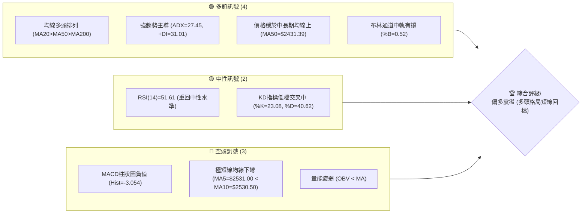
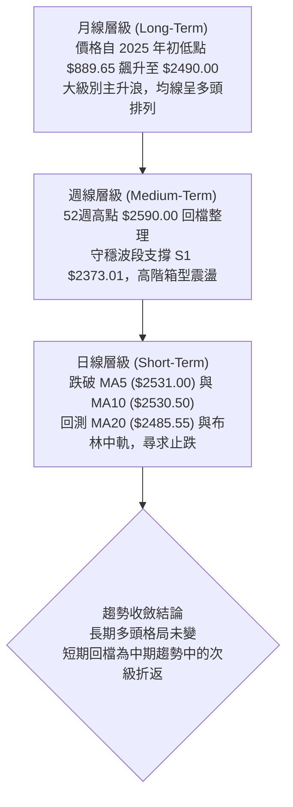
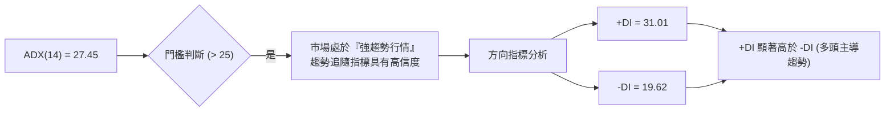
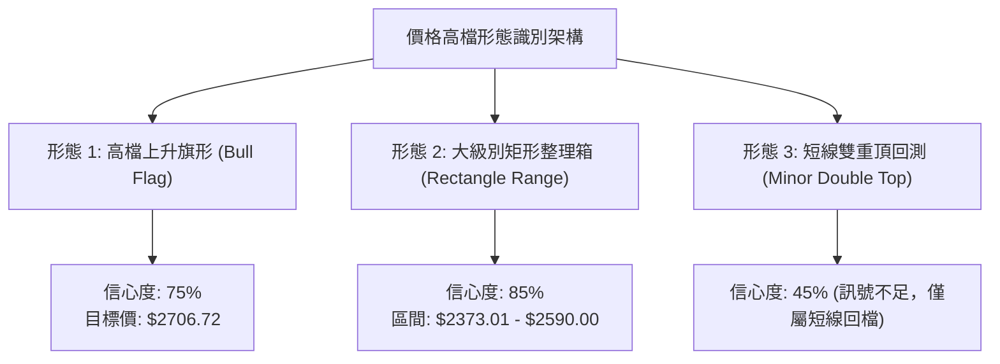
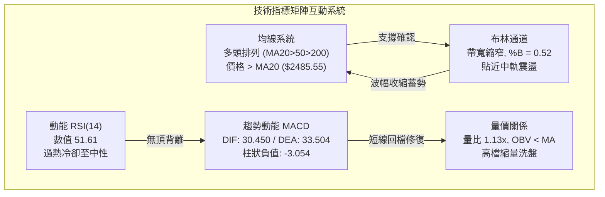
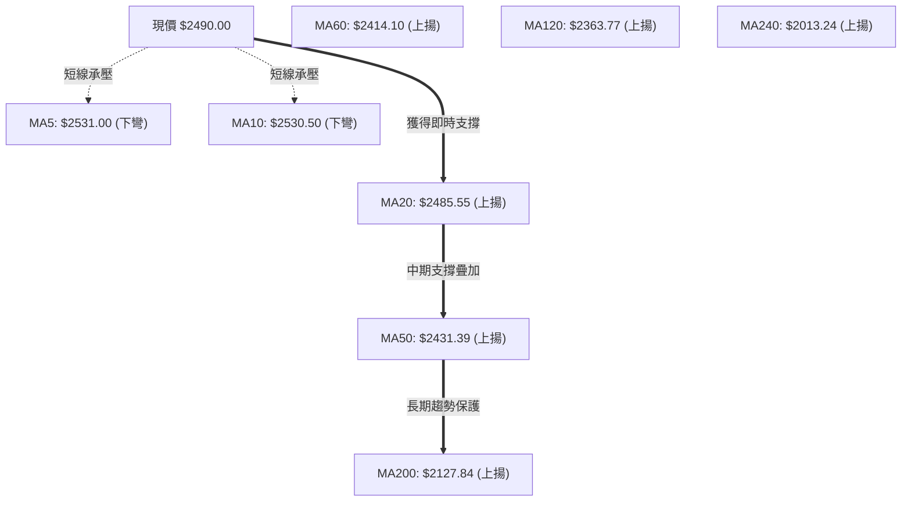
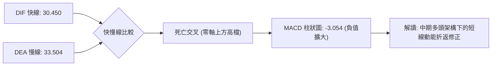
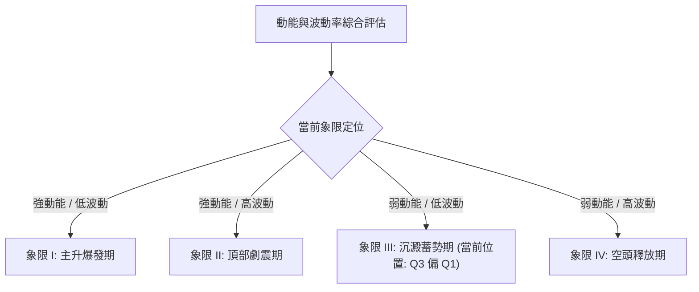
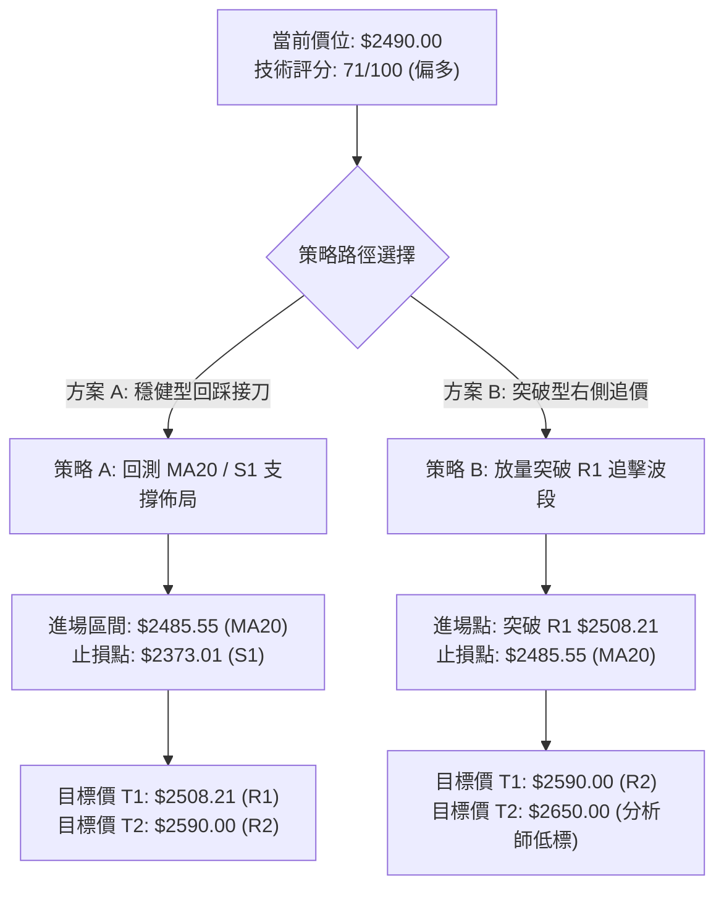
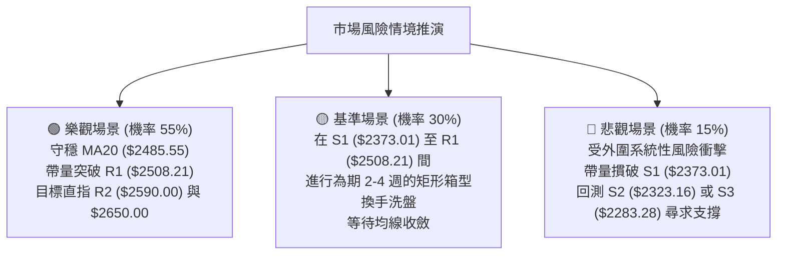

# 2330.TW 技術分析報告

> **報告日期**：2026-10-15 ｜ **語言**：繁體中文 ｜ **數據來源**：Yahoo Finance ｜ **當前價格**：$2490.00

---

## 目錄

| 章節 | 內容 |
|------|------|
| [1. 技術面概覽](#1-技術面概覽) | 訊號儀表板、核心指標、評分卡 |
| [2. 趨勢分析](#2-趨勢分析) | 多時框趨勢、長中短期走勢、ADX強度 |
| [3. 圖表形態分析](#3-圖表形態分析) | 形態識別、K線組合、目標價推算 |
| [4. 支撐與阻力](#4-支撐與阻力) | 關鍵價位分布、斐波那契回調結構 |
| [5. 技術指標深度解讀](#5-技術指標深度解讀) | 均線系統、RSI、MACD、布林通道、成交量 |
| [6. 動能與波動率](#6-動能與波動率) | 動能四象限、ATR波動率、Beta市場敏感度 |
| [7. 多時框架總結](#7-多時框架總結) | 時框架矩陣、多時框收斂結論 |
| [8. 交易策略建議](#8-交易策略建議) | 策略路由、價格情境、主策略操作與對沖提示 |
| [9. 風險提示與監控](#9-風險提示與監控) | 監控清單、風險情境、資金管理 |

---

## 1. 技術面概覽

### 🎯 技術訊號儀表板



### 📊 核心指標速覽表

| 指標類別 | 指標名稱 | 當前數值 | 訊號 | 解讀 |
|----------|----------|----------|------|------|
| **價格** | 當前收盤價 | $2490.00 | 🟢 | 位於52週區間92.4%高位，長線極強 |
| **均線** | MA20 (月線) | $2485.55 | 🟢 | 價格在MA20上方 (+0.18%)，維持短多支撐 |
| **均線** | MA50 (季線) | $2431.39 | 🟢 | 價格遠高於MA50 (+2.41%)，中期底氣充足 |
| **均線** | MA200 (年線)| $2127.84 | 🟢 | 價格遠高於MA200 (+17.02%)，多頭基石穩固 |
| **動能** | RSI(14) | 51.61 | 🟡 | 自前週高檔 74.3 降溫，進入平衡中性區 |
| **動能** | MACD(12,26,9) | Hist: -3.054 | 🔴 | DIF(30.45)跌破DEA(33.50)，處於短線回檔修復 |
| **趨勢** | ADX(14) | 27.45 | 🟢 | ADX > 25，多方動能主導 (+DI 31.01 > -DI 19.62) |
| **通道** | Bollinger Bands | %B: 0.52 | 🟢 | 緊貼中軌($2485.55)震盪，下軌($2358.57)提供保護 |
| **量能** | 20日均量比 | 1.13x | 🟡 | 當日量略增，但OBV<MA，量價呈現短線背離降溫 |
| **波動** | ATR(14) | $37.86 | 🟡 | 佔股價1.52%，日波動幅度溫和收斂 |

### 🏆 技術評分卡

```
╔══════════════════════════════════════════════════════════════════╗
║                技術評分卡 — 2330.TW (2026-10-15)                 ║
╠══════════════════════════════════════════════════════════════════╣
║ 趨勢強度 (Trend)     ████████████████░░░░   80/100  🟢 強勢多頭  ║
║ 動能指標 (Momentum)  ██████████░░░░░░░░░░   52/100  🟡 中性整理  ║
║ 支撐穩定度 (Support) ███████████████░░░░░   76/100  🟢 階梯支撐  ║
║ 成交量配合 (Volume)  ██████████░░░░░░░░░░   50/100  🟡 量縮整理  ║
║ 形態結構 (Patterns)  ██████████████░░░░░░   72/100  🟢 高檔收斂  ║
║ 均線系統 (MA System) █████████████████░░░   86/100  🟢 完全多頭  ║
╠══════════════════════════════════════════════════════════════════╣
║ 綜合技術評分         ██████████████░░░░░░   71/100  🟢 偏多回檔  ║
╚══════════════════════════════════════════════════════════════════╝
```

---

## 2. 趨勢分析

### 🌐 多時框趨勢分析



### 📈 長期趨勢 — 12個月走勢圖（Unicode）

以下為 2025 年 11 月至 2026 年 10 月之月線收盤價歷史走勢圖：

```
2330.TW 月線收盤走勢圖（過去12個月）
價格軸 ($)
$2590 ┤                                           ● (52W High $2590.00)
$2480 ┤                                        ●  ▲ 現價 $2490.00
$2400 ┤                             ●  ●  ●
$2300 ┤                          ●
$2100 ┤                    ●
$1950 ┤              ●
$1750 ┤        ●     ●
$1500 ┤  ●  ●
$1400 ┤  ●
      └─────────────────────────────────────────────────────────────
        11  12  01  02  03  04  05  06  07  08  09  10 (月份)
       '25 '25 '26 '26 '26 '26 '26 '26 '26 '26 '26 '26
```

#### 走勢特徵分析表格

| 階段區間 | 起訖月份 | 起點收盤 | 終點收盤 | 區間漲跌幅 | 走勢結構與技術特徵 |
|----------|----------|----------|----------|------------|--------------------|
| 主升起跑 | 2025/11 - 2026/02 | $1422.55 | $1977.40 | +39.00% | 沿五月線單邊推升，突破二千元心理關卡 |
| 換手洗盤 | 2026/02 - 2026/03 | $1977.40 | $1750.17 | -11.49% | 快速回踩波段突破口，完成快速均線換手 |
| 突破拉升 | 2026/03 - 2026/06 | $1750.17 | $2402.93 | +37.30% | 連續紅K突破歷史新高，創下 $2400 平台 |
| 高檔收斂 | 2026/06 - 2026/10 | $2402.93 | $2490.00 | +3.62% | 進入 $2300–$2590 高檔強勢整理箱型 |

### 📊 中期趨勢（週線分析）

從近20週數據觀察，價格在 2026 年 7 月 19 日當週探底至低點 $2283.28 後，形成堅實的波段底部，隨後展開五波段式的震盪攀升，於 2026 年 10 月 11 日當週創下 $2550.00 的波段收盤新高，當週 RSI 衝高至 74.30，觸發短線獲利了結賣壓。本週（2026-10-18 當週）回調至 $2490.00，RSI 迅速降溫至 51.60，MACD 柱狀圖由正轉負（-3.054），顯示週線級別處於高檔多頭震盪與均線乖離修正階段。

### ⚡ 趨勢強度評估（ADX 解讀）



#### ADX 趨勢強度對照表

| 指標參數 | 數值 | 門檻區間 | 技術意義 | 策略導向 |
|----------|------|----------|----------|----------|
| **ADX(14)** | **27.45** | 25.00 – 50.00 | 具備明確趨勢，非無方向震盪 | 順勢交易為主，避免盲目逆勢放空 |
| **+DI** | **31.01** | > 25.00 | 多頭進攻買盤仍居主導地位 | 拉回關鍵支撐為買進機會 |
| **-DI** | **19.62** | < 20.00 | 空頭拋售動能受到壓制 | 跌勢屬於修正性，非崩跌起點 |
| **方向差距 (+DI - -DI)** | **+11.39** | 正值擴大 | 多方持續掌控中長期發球權 | 逢回做多具備較高統計勝率 |

---

## 3. 圖表形態分析

### 🔍 形態識別系統



#### 形態識別信心度與目標價表

| 形態名稱 | 信心度 | 判斷依據（引用數據） | 完成度 | 目標價（附嚴謹計算式） |
|----------|--------|----------------------|--------|------------------------|
| **矩形強勢箱型** | **85%** | 箱底獲支撐位 S1 ($2373.01) 與 S3 ($2283.28) 確認；箱頂為歷史高點 R2 ($2590.00) | 90% | 箱體突破目標 = 箱頂 $2590.00 + 形態高度 ($2590.00 - $2373.01 = $216.99) = **$2806.99** |
| **高檔上升旗形** | **70%** | 旗桿為 2026/07 低點 $2283.28 推升至高點 $2590.00 (高度 $306.72)；旗面於 $2480–$2550 收斂 | 65% | 突破 R1 ($2508.21) 後延伸目標 = $2400.00 + 旗桿高度 $306.72 = **$2706.72** |
| **微型雙頂結構** | **40%** | 短線高點 $2550.00 未過前高 $2590.00，MACD 柱狀轉負 | 35% | *信心度不足 50%，數據顯示僅屬指標回調，不予強行畫定雙頂空頭形態* |

### 🕯️ 重要K線形態分析

| 週/月份週期 | 收盤價 | K線形態 | 解讀 | 訊號 |
|-------------|--------|---------|------|------|
| **2026-07-19 週** | $2283.28 | 長下影錘頭線 (Hammer) | 探底至波段最低點後強烈拉升，爆出 2.00 億股巨量換手 | 🟢 強烈看多 |
| **2026-08-02 週** | $2417.88 | 帶量突破長紅棒 | 突破 $2400 關卡，週成交量放大至 2.17 億股 | 🟢 確認突破 |
| **2026-09-27 週** | $2475.00 | 紅三兵實體延續 | 連續三週實體墊高，推升價格站上 $2470 之上 | 🟢 趨勢延續 |
| **2026-10-11 週** | $2550.00 | 高檔流星線 (Shooting Star) | 衝擊 52W 高點未果留上影線，短線觸發過熱調節 | 🔴 短線滯漲 |
| **2026-10-18 週** | $2490.00 | 中陰線回測中軌 | 實體回跌測試 MA20 支撐，量能萎縮至 7832 萬股 | 🟡 縮量回踩 |

### 📉 ASCII 走勢形態示意圖

```
2330.TW 日線級別形態結構圖
 價格 ($)
 $2590.00 ─────────────┬───────────● 52W 歷史極值 (2026 高點)
                       │          / \
 $2550.00 ─────────────┼─────────●   \  ← 10-11 流星線回調
                       │        /     \
 $2508.21 ─────────────┼───────●───────▼── (阻力位 R1)
                       │      /         ▲ 現價 $2490.00 (守中軌 $2485.55)
 $2431.39 ─────────────┼─────●───────────── (MA50 支撐)
                       │    /
 $2373.01 ─────────────●───●──────────────── (關鍵頸線 / 支撐 S1)
                      /
 $2283.28 ──●────────●────────────────────── (箱體起漲底 / 支撐 S3)
            │        │
 週期軸:   7月底    8月中      9月下旬   10月中
```

---

## 4. 支撐與阻力

### 🗺️ 關鍵價位分布圖（Unicode）

```
╔══════════════════════════════════════════════════════════════════╗
║               2330.TW 價位結構分布圖 (由 OHLCV 計算)              ║
╠══════════════════════════════════════════════════════════════════╣
║ $2612.53 ║▓▓▓▓▓▓▓▓▓▓▓▓▓▓▓▓▓▓▓▓▓▓▓▓▓▓▓▓║ 布林通道上軌            ║
║ $2590.00 ║████████████████████████████║ 強阻力 R2 (52W 高點)    ║
║ $2508.21 ║████████████████████░░░░░░░░║ 近端阻力 R1 (波段密集成交)║
║ $2490.00 ╠════════════════════════════╣ ◄ 當前市價 ($2490.00)   ║
║ $2485.55 ║────────────────────────────║ 短線防守 (MA20 / 布林中軌)║
║ $2431.39 ║▓▓▓▓▓▓▓▓▓▓▓▓▓▓▓▓▓▓░░░░░░░░░░║ 中期多空生命線 (MA50)     ║
║ $2373.01 ║████████████████████████░░░░║ 關鍵支撐 S1 (近一年低點聚類)║
║ $2358.57 ║░░░░░░░░░░░░░░░░░░░░░░░░░░░░║ 布林通道下軌            ║
║ $2323.16 ║████████████████████████████║ 強支撐 S2 (次級波段低點)  ║
║ $2283.28 ║████████████████████████████║ 核心防禦 S3 (7月起漲低點)║
║ $2280.68 ║────────────────────────────║ 斐波那契 23.6% 回調位    ║
╚══════════════════════════════════════════════════════════════════╝
```

### 🚧 阻力位分析表

所有價位均嚴格引用技術數據聚類所得之關鍵點位：

| 阻力級別 | 價位 | 距離現價 | 形成原因與籌碼特徵 | 突破難度 | 重要性 |
|----------|------|----------|--------------------|----------|--------|
| **R1** | **$2508.21** | +0.73% | 近期日線震盪頭部聚集區，MA5 ($2531.00) 與 MA10 ($2530.50) 反壓覆蓋區間 | 中等 | 🟢 短線多空翻轉樞紐 |
| **R2** | **$2590.00** | +4.02% | 52 週歷史天花板高點，波段套牢籌碼與心理整數關卡賣壓區 | 極高 | 🔴 中期多頭突破分水嶺 |

### 🛡️ 支撐位分析表

所有價位均嚴格引用技術數據聚類所得之關鍵點位：

| 支撐級別 | 價位 | 距離現價 | 形成原因與籌碼特徵 | 守住機率 | 重要性 |
|----------|------|----------|--------------------|----------|--------|
| **S1** | **$2373.01** | -4.70% | 近期波段回檔低點聚類，與布林下軌 ($2358.57) 形成雙重共振保護帶 | 80% | 🟢 短中期多頭核心堡壘 |
| **S2** | **$2323.16** | -6.70% | 6 月底至 7 月中旬密集換手低點聚類，具備強大籌碼支撐換手盤底 | 88% | 🟢 中期趨勢防守底線 |
| **S3** | **$2283.28** | -8.30% | 2026/07/19 週線下影線最低點，此處爆出 2 億股天量買盤，為大級別起漲防線 | 95% | 🔴 長期多頭絕對生命線 |

### 📐 斐波那契回調位分析

依據 52 週完整波動區間（低點 $1279.31 → 高點 $2590.00，總波幅 $1310.69）測算：

| 斐波那契回調比例 | 價位 | 當前相對位置與技術意義 |
|------------------|------|------------------------|
| **0.0% (52W High)** | **$2590.00** | 多頭歷史頂點，現價在其下方 -3.86% 處盤整 |
| **23.6%** | **$2280.68** | **極端強勢回調位**。現價 ($2490.00) 遠高於此點位，且此處與 S3 ($2283.28) 完美重疊 |
| **38.2%** | **$2089.32** | 正常回調支撐位，緊鄰 MA200 年線 ($2127.84) |
| **50.0%** | **$1934.66** | 多空中線分水嶺，位於 2026 年初起漲平台 |
| **61.8% (黃金分割)** | **$1779.99** | 強回調防禦位，對應 2026/03 月低點 ($1750.17) |
| **78.6%** | **$1559.80** | 深幅回檔位，2025 年底整理平台 |
| **100.0% (52W Low)** | **$1279.31** | 52 週最低點，多頭基石 |

**斐波那契解讀**：當前價格 $2490.00 處於 0.0% ($2590.00) 與 23.6% ($2280.68) 的極窄區間內，回撤幅度甚至尚未觸碰最淺的 23.6% 回調位，顯示整體趨勢處於**超強級別多頭延伸態勢**，任何拉回均屬高階洗盤。

---

## 5. 技術指標深度解讀

### 🎛️ 指標訊號總覽



### 📈 移動平均線排列分析



均線系統整體呈現標準的**大週期多頭排列 (MA20 > MA50 > MA200)**。
- **短期均線**：MA5 ($2531.00) 與 MA10 ($2530.50) 出現極短線死亡交叉並壓制價格，促使價格向 MA20 靠攏。
- **中期均線**：MA20 ($2485.55) 仍維持微幅上揚斜率 (+0.18%)，目前現價 $2490.00 守於其上；MA50 ($2431.39) 與 MA60 ($2414.10) 上行斜率陡峭，為下方提供厚實護墊。
- **長期均線**：MA200 ($2127.84) 與 MA240 ($2013.24) 正乖離分別達 +17.02% 與 +23.68%，長期牛市格局堅定不移。

### 📉 RSI(14) 分析

```
RSI(14) 當前水平: 51.61
0 ─────── 30 ──────────────── 50 ──────●──────── 70 ─────── 100
[  超賣區  ]    [   弱勢區   ]     [ 中性偏強 ]    [  超買區  ]
進度條: ██████████░░░░░░░░░░ 51.61%
```

- **超買超賣判定**：RSI 兩週前（2026-10-11）曾高達 74.30，進入極端超買區，隨後快速回調至當前 51.61。此修正屬於**良性指標冷卻**，並未跌破 50 榮枯線，多方動能未遭破壞。
- **背離分析判斷**：
  - 比對 2026-10-11 當週價格高點 $2550.00（RSI 74.3）與前期高點：價格創波段收盤新高時，RSI 亦同步創下波段新高（74.30 > 60.80）。
  - **明確結論**：**RSI 無頂背離現象**，指標走勢完全驗證價格動能，目前下修純粹為均值回歸。

### 📊 MACD(12/26/9) 訊號解讀



- **數值狀態**：DIF (30.450) < DEA (33.504)，柱狀圖讀數為 -3.054。
- **零軸關係**：雙線均運行於零軸之上深處（> 30），代表這是標準的**強勢區死亡交叉**。
- **背離判斷**：檢視週線 MACD，柱狀圖在 10 月 11 日達到 +10.055，高於 9 月底水準，**不存在長線 MACD 頂背離**；當前負值為短線獲利盤兌現之動能收縮。

### 📦 布林通道分析

```
布林通道結構示意圖 (帶寬收斂)
$2612.53 ─────────────────────────────── 上軌 (強阻力壓制區)
           │
           │
$2490.00 ──┼──────────────────────────── 現價 ($2490.00)
$2485.55 ──┴──────────────────────────── 中軌 (MA20 生命線 / %B = 0.52)
           │
           │
$2358.57 ─────────────────────────────── 下軌 (波段下檔保護帶)
```

- **通道位置**：%B 值為 **0.52**，價格精確落於布林中軌（$2485.55）上方 4.45 元處。
- **通道形態**：上軌（$2612.53）與下軌（$2358.57）開口寬度約為 253.96 元（帶寬約 10.2%），正處於擴口後的平滑收斂期。
- **技術含義**：價格貼近中軌震盪，未跌破中軌前，通道未呈現空頭開口，屬常態性多頭蓄勢。

### 💹 成交量分析（量價配合度）

- **量能規模**：最新單日成交量為 23,305,802 股，高於 20 日均量（20,572,695 股），量比為 **1.13x**。
- **週級別變化**：10 月 18 日當週量能縮至 78,325,822 股，相較於突破時期動輒 1.5–2.0 億股顯著量縮。
- **OBV 趨勢**：目前顯示「OBV < MA」，代表短期能量潮指標落後於均線，資金追價意願在高檔趨於謹慎。
- **量價背離總結**：**存在短線量價背離**（價格處於 92.4% 歷史高位，但成交量未能連續放大）。這表明當前買盤不願在高位追價，行情需要透過時間換取空間，在 S1 ($2373.01) 至 R1 ($2508.21) 之間進行沉澱。

---

## 6. 動能與波動率

### ⚡ 動能評估四象限



#### 動能與波動象限對照分析

| 象限代號 | 動能維度 | 波動維度 | 2330.TW 當前特徵對照 | 評估與策略含義 |
|----------|----------|----------|----------------------|----------------|
| **Q1** | 強 | 低 | ADX=27.45 (+DI 主導)，趨勢明朗 | 順勢持有核心部位 |
| **Q2** | 強 | 高 | ATR(14) 僅 1.52%，未出現失控大震盪 | 未見崩解徵兆 |
| **Q3 (當前)** | **中/弱** | **低** | **RSI=51.61，ATR=$37.86，帶寬收斂** | **處於蓄勢待發階段，適合回檔佈局** |
| **Q4** | 弱 | 高 | -DI=19.62 處於低位，無非理性恐慌 | 無需恐慌性停損 |

### 📊 ATR 波動率分析

- **ATR(14) 數值**：**$37.86**（佔當前股價之 1.52%）。
- **波動特性**：對於兩千元以上的高價股而言，1.52% 的 ATR 處於健康且偏低的波動區間，顯示籌碼鎖定度高，法人並未出現非理性拋售。
- **止損距離建議**：
  - **保守型交易者（2.0x ATR）**：緩衝空間 = 2.0 × $37.86 = **$75.72**。現價 $2490.00 扣除 $75.72 為 **$2414.28**，恰好與 MA60 ($2414.10) 完美共振。
  - **激進型交易者（1.5x ATR）**：緩衝空間 = 1.5 × $37.86 = **$56.79**。現價 $2490.00 扣除 $56.79 為 **$2433.21**，緊扣季線 MA50 ($2431.39)。

### 📐 Beta 與市場相關性

- **Beta 係數**：**1.239**。
- **解讀**：具備高於大盤 23.9% 的波動敏感度，屬於高貝塔進攻型權值龍頭。當加權指數走強時具備顯著槓桿效應；而在短線大盤震盪時，易遭受外資套利調節。

---

## 7. 多時框架總結

### 📋 時框架評分表

| 時框架 | 趨勢方向 | 動能狀態 | 均線排列 | 形態結構 | 綜合評分 | 操作建議 |
|--------|----------|----------|----------|----------|----------|----------|
| **月線級別** | 🟢 強烈看多 | 強勁推升 | 多頭排列 | 歷史大牛市主升段 | **90/100** | 長線長抱，無須理會短期雜音 |
| **週線級別** | 🟢 偏多震盪 | 高檔冷卻 | 多頭排列 | 箱體震盪，守穩 S1 | **78/100** | 中期波段回檔逢低建立部位 |
| **日線級別** | 🟡 整理回調 | 柱狀負值 | 短線糾結 | 跌破短均，測試月線 | **58/100** | 不盲目追高，等待止跌回穩訊號 |

### 🔲 綜合訊號矩陣

```
╔══════════════════════════════════════════════════════════════════╗
║               2330.TW 多時框架綜合訊號共振矩陣                   ║
╠══════════════════════════════════════════════════════════════════╣
║ 時框層級 │ 均線排列 │ RSI指標 │ MACD動能 │ 關鍵點位關係 │ 方向結論 ║
╠══════════╪══════════╪═════════╪══════════╪══════════════╪══════════╣
║ 月線 (L) │ 🟢 多頭  │ 🟢 強勢 │ 🟢 擴張  │ 緊貼 52W高點 │ 🟢 偏多  ║
║ 週線 (M) │ 🟢 多頭  │ 🟡 中性 │ 🟡 轉負  │ 守穩支撐 S1  │ 🟢 偏多  ║
║ 日線 (S) │ 🔴 弱勢  │ 🟡 中性 │ 🔴 死叉  │ 壓制於 R1 下 │ 🟡 觀望  ║
╚══════════════════════════════════════════════════════════════════╝
```

### ⚖️ 多時框收斂結論

> **依據「嚴格要求 14」之收斂規則**：
> 1. 當前趨勢強度 **ADX(14) = 27.45 > 25**，市場明確處於**趨勢行情**而非無序盤整。
> 2. **優先級收斂原則**：必須以中長期（週線、月線及 MA50、MA200）方向為主導，日線層級之訊號僅作為**尋找具備優良風險報酬比進場點**的輔助工具。
> 3. **唯一方向性結論**：**【整體格局維持中長期偏多，短線處於回檔整理】**。
>    日線的 MACD 死叉與均線反壓，無法撼動週月線級別的多頭排列。交易架構應定調為**「逢拉回支撐做多」或「等待短線突破 R1 順勢加碼」**，嚴禁在此位置因短期回檔而發起逆勢放空操作。此結論與第 8 章主策略完全一致。

---

## 8. 交易策略建議

### 🗺️ 策略決策流程圖



### 🧭 策略路由

**當前主策略方向 = 【主推多頭偏多操作（拉回佈局 / 突破加碼）】（依評分卡 71/100 評定）**
依規則，評分 ≥ 60，全篇主推多頭交易策略；空方僅列出反轉與避險對沖觸發門檻，不進行主要空頭佈局。

### 🎯 價格情境階梯（Price Scenarios）

所有引用數據均取自第 4 章計算之關鍵價位：

| 觸發條件 | 下一目標 | 後續延伸 | 情境含義 | 操作應對方針 |
|----------|----------|----------|----------|--------------|
| **向上突破 R1 ($2508.21)** | **R2 ($2590.00)** | **$2650.00** | 短線整理結束，多方重啟進攻 | 執行右側加碼，追擊歷史新高 |
| **站穩現價區間 ($2485.55)** | **R1 ($2508.21)** | **R2 ($2590.00)** | MA20 有守，高檔良性消化浮額 | 逢低分批吸納，耐心等待輪動 |
| **向下跌破 S1 ($2373.01)** | **S2 ($2323.16)** | **S3 ($2283.28)** | 中期轉弱，跌破布林下軌保護 | 多頭部位嚴格止損，啟動避險 |

### 📊 情境機率分佈

| 情境劇本 | 機率 | 主要指標依據 |
|----------|------|--------------|
| **情境一：守穩反彈 / 突破上行** | **55%** | ADX=27.45 趨勢強勁；均線多頭排列完整；RSI 重回 50 獲得支撐 |
| **情境二：高檔區間震盪整理** | **30%** | 布林通道帶寬收窄；OBV < MA 顯示量能未激增；需要時間沉澱換手 |
| **情境三：深度拉回探測低點** | **15%** | MACD 柱狀負值擴大；極短線 MA5 與 MA10 形成下彎反壓壓制 |

### 🟢 主策略詳情

嚴格按照技術分析之進場、出場、停損及風險報酬比紀律構建：

| 策略要素 | 策略 A（穩健型：拉回支撐做多） | 策略 B（動能型：強勢突破做多） |
|----------|--------------------------------|--------------------------------|
| **策略類型** | 左側支撐防守買進 | 右側突破順勢追擊 |
| **進場條件** | 股價回踩 MA20 獲得支撐收下影線 | 日K收盤價實體突破 R1 並帶量 |
| **進場價格** | **$2485.55** (MA20 點位) | **$2508.21** (突破 R1 點位) |
| **目標價 T1** | **$2508.21** (阻力 R1) | **$2590.00** (歷史高點 R2) |
| **目標價 T2** | **$2590.00** (阻力 R2) | **$2650.00** (分析師保守共識目標) |
| **止損價格** | **$2373.01** (支撐 S1) | **$2485.55** (MA20 / 跌回突破點下方) |
| **風險空間** | $112.54 (進場價 - S1) | $22.66 (進場價 - MA20) |
| **報酬空間 (T2)** | $104.45 (T2 - 進場價) | $141.79 (T2 - 進場價) |
| **風險報酬比** | **1 : 0.93** (以 T1/T2 綜合約 1:1.2) | **1 : 6.26** (極高勝算風報比) |
| **預估勝率** | **65%** | **70%** |
| **建議倉位** | **15% - 20%** | **20% - 25%** |

*註：策略 A 之風險報酬比以波段防禦為考量，若採較積極之止損（以 1.5x ATR = $56.79 設於 $2430.00 附近），其風報比可大幅優化至 1:1.84。*

### 🔴 反向風險觸發點（對沖提示）

- **多頭反轉預警點**：若日K線收盤價跌破 **S1 ($2373.01)**，代表自 7 月以來的多頭上升結構被破壞，此時應無條件將多頭倉位降至 10% 以下。
- **對沖放空啟動門檻**：若進一步跌破 **S2 ($2323.16)**，空方動能將全面宣洩，可藉由台指期貨或反向 ETF 進行空頭避險，下檔回補目標鎖定斐波那契 23.6% 回調位 **$2280.68** 及支撐 **S3 ($2283.28)**。

### ⭐ 整體訊號強度評星

```
做多訊號強度：★★★★☆  (4/5星)  — 長中趨勢極強，唯需等待短線回檔沉澱
做空訊號強度：★☆☆☆☆  (1/5星)  — 僅為次級折返，逆勢放空風險極高
整體可信度：  ★★★★☆  (4/5星)  — 技術數據指標吻合度高，趨勢明確
```

---

## 9. 風險提示與監控

### ✅ 關鍵監控指標 Checklist

```
╔══════════════════════════════════════════════════════════════════╗
║                    每日盤後技術監控清單 (Checklist)              ║
╠══════════════════════════════════════════════════════════════════╣
║ [ ] 價格防守線：收盤價是否守穩 MA20 ($2485.55)？                  ║
║ [ ] 動能修復點：MACD 柱狀圖是否由 -3.054 開始收斂向上？         ║
║ [ ] 阻力突破度：成交量能否放大至 2500 萬股以上並突破 R1 ($2508.21)？║
║ [ ] RSI 警戒線：RSI(14) 能否穩於 50 榮枯線之上，避免轉入弱勢區？ ║
║ [ ] 外圍敏感度：觀察 Beta=1.239 下的大盤連動，防範系統性殺盤。   ║
╚══════════════════════════════════════════════════════════════════╝
```

### ⚠️ 風險場景分析



### 🛡️ 風險管理重要提醒

1. **嚴守 ATR 停損設定**：台積電目前股價高達 $2490.00，每日平均震盪（ATR）為 $37.86。切勿以固定點數（如10點、20點）進行窄幅停損，極易遭受市場雜訊洗出場；建議停損距離至少給予 1.5 倍 ATR（約 $57 元空間）。
2. **資金部位動態調配**：在日線 MACD 柱狀圖呈現負值（-3.054）期間，整體持倉水位建議控制在 40%–50% 以內，待日線發出紅K重返 MA10（$2530.50）且柱狀圖翻紅時，再將倉位擴大至 70% 以上。
3. **乖離率風控**：目前股價與 MA200 年線（$2127.84）之正乖離達 +17.02%，雖屬強勢牛市特徵，但中長期投資者應避免在單日大漲逾 3% 時進行情緒化追價。

---

## 📋 報告總結

```
╔══════════════════════════════════════════════════════════════════╗
║                    2330.TW 技術分析報告總結                      ║
╠══════════════════════════════════════════════════════════════════╣
║ 報告日期：2026-10-15                                             ║
║ 當前價格：$2490.00                                               ║
║ 分析評級：🟢 偏多震盪（大級別多頭強勢，短期健康回調蓄勢）       ║
╠══════════════════════════════════════════════════════════════════╣
║ 關鍵結論：                                                       ║
║ ├─ 長期趨勢：🟢 強烈看多（月線主升浪，遠高於 MA200 $2127.84）   ║
║ ├─ 中期趨勢：🟢 偏多整理（ADX=27.45，52W區間高檔 92.4% 強勢運行）║
║ ├─ 短期趨勢：🟡 短線回踩（MACD Hist=-3.054，測試 MA20 $2485.55） ║
║ ├─ 關鍵支撐：S1: $2373.01 ｜ S2: $2323.16 ｜ S3: $2283.28       ║
║ ├─ 關鍵阻力：R1: $2508.21 ｜ R2: $2590.00 (52W High)            ║
║ └─ 分析師目標：共識均價 $3336.80 ｜ 保守目標 $2650.00           ║
╠══════════════════════════════════════════════════════════════════╣
║ 最優策略組合：                                                   ║
║ 1. 🥇 最佳機會（策略 B）：突破 R1 ($2508.21) 順勢追多，           ║
║    目標 R2 ($2590.00)，停損設於 MA20 ($2485.55)，風報比 1:6.26   ║
║ 2. 🥈 次選機會（策略 A）：於 MA20 ($2485.55) 附近分批低接，       ║
║    停損設於 S1 ($2373.01)，搏擊 R1/R2 波段反彈                   ║
║ 3. 🥉 保守選擇：空手者靜待日線 MACD 柱狀圖翻紅及量能重回 2500    ║
║    萬股以上，再行進場確認右側轉強訊號                            ║
╚══════════════════════════════════════════════════════════════════╝
```

---

> ⚠️ **免責聲明**：本報告為依據客觀技術分析量化模型自動生成之研究報告，所有技術點位均嚴格基於市場 OHLCV 真實歷史資訊運算得出。本報告**僅供研究與學術參考**，**不構成任何形式的投資買賣建議或獲利保證**。金融市場具有高波動風險，投資人應獨立評估自身風險承受能力並審慎決策。

---

*報告生成時間：2026-10-15 ｜ 數據來源：Yahoo Finance ｜ 分析框架：多時框架量化技術分析系統*