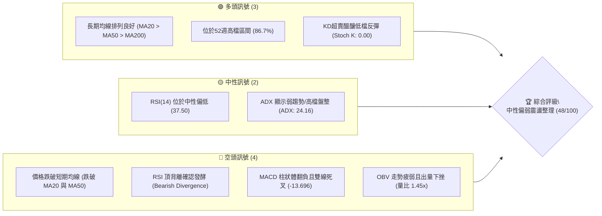
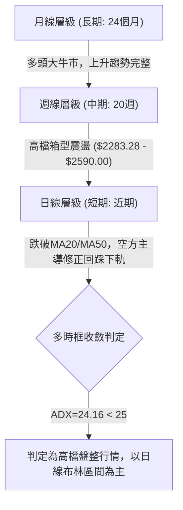
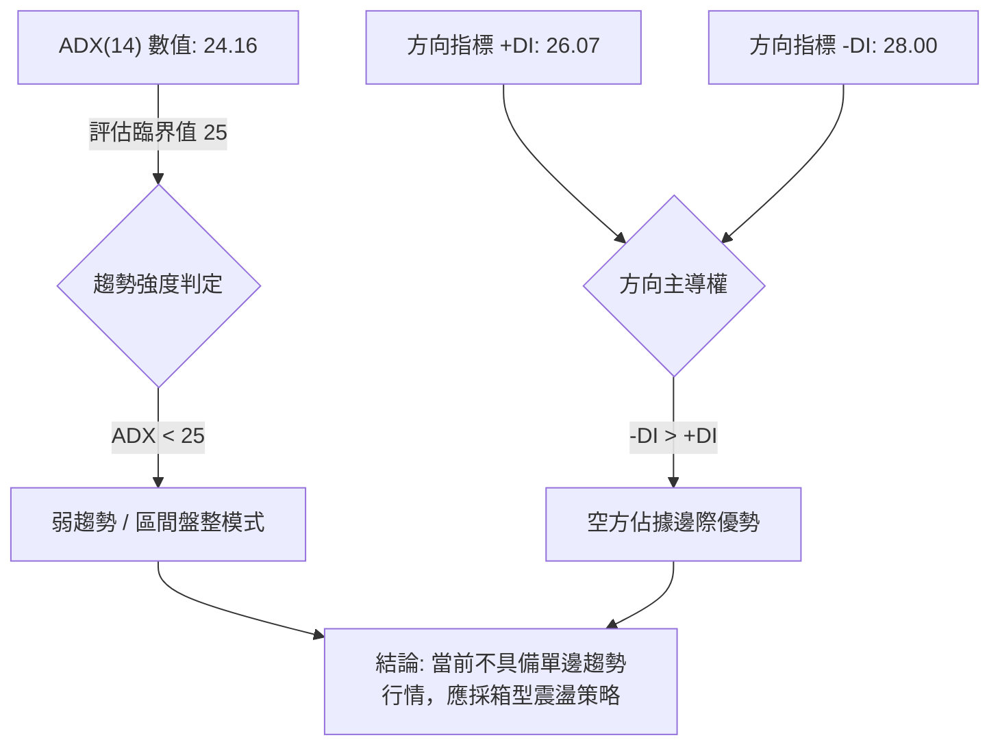
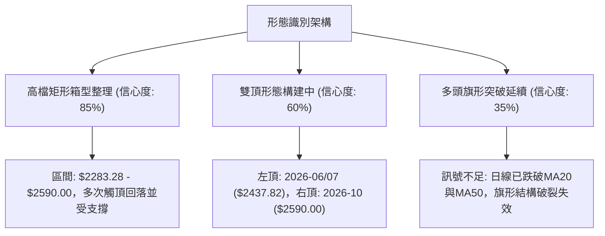
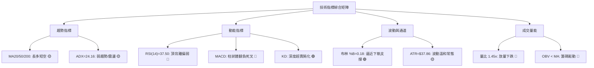
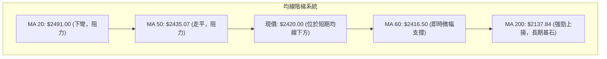
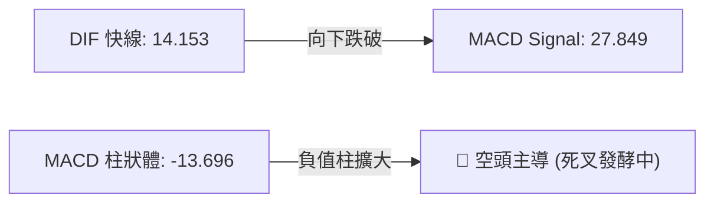
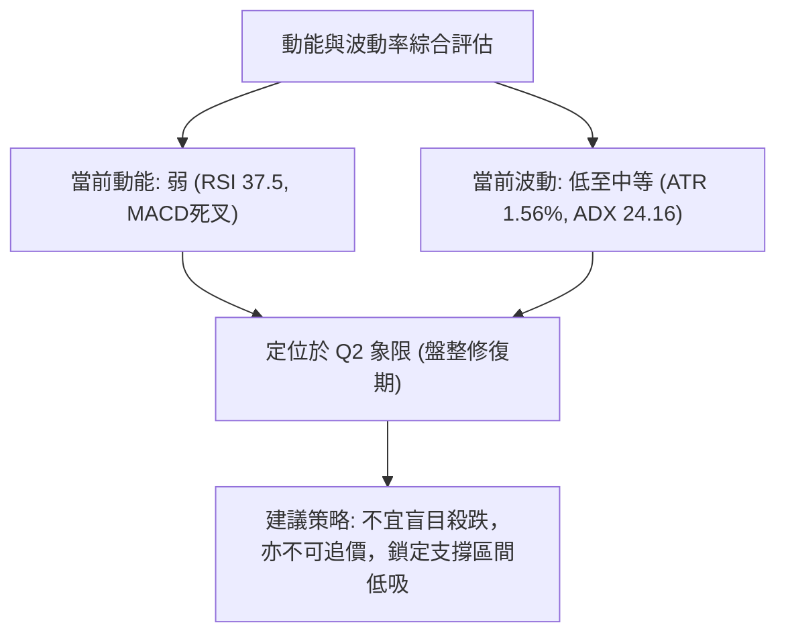
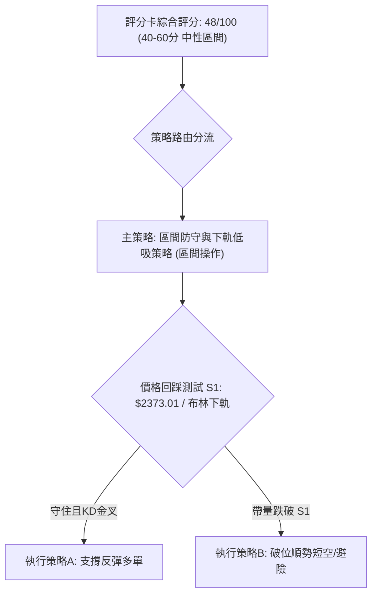
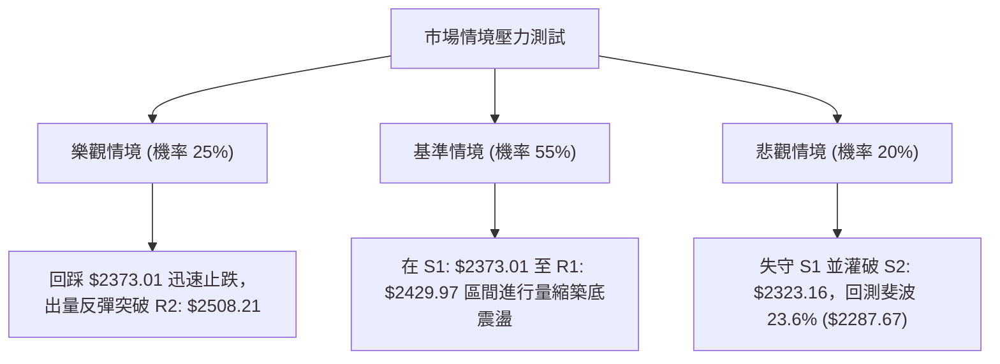

# 2330.TW 技術分析報告

> **報告日期**：2026-10-17 ｜ **語言**：繁體中文 ｜ **數據來源**：Yahoo Finance ｜ **當前價格**：$2420.00

---

## 目錄

| 章節 | 內容 |
|------|------|
| [1. 技術面概覽](#1-技術面概覽) | 訊號儀表板、核心指標、評分卡 |
| [2. 趨勢分析](#2-趨勢分析) | 多時框趨勢、長中短期走勢 |
| [3. 圖表形態分析](#3-圖表形態分析) | 形態識別、K線組合、目標價 |
| [4. 支撐與阻力](#4-支撐與阻力) | 關鍵價位、斐波那契回調 |
| [5. 技術指標深度解讀](#5-技術指標深度解讀) | MA/RSI/MACD/布林/成交量 |
| [6. 動能與波動率](#6-動能與波動率) | 動能評估、ATR、Beta |
| [7. 多時框架總結](#7-多時框架總結) | 時框架評分矩陣、收斂結論 |
| [8. 交易策略建議](#8-交易策略建議) | 多空策略、風險報酬比 |
| [9. 風險提示與監控](#9-風險提示與監控) | 監控指標、風險場景 |

---

## 1. 技術面概覽

### 🎯 技術訊號儀表板



### 📊 核心指標速覽表

| 指標類別 | 指標名稱 | 當前數值 | 訊號 | 解讀 |
|:---|:---|:---|:---:|:---|
| **價格** | 當前價格 | $2420.00 | 🟡 | 跌破月線但緊鄰季線(MA60: $2416.50)，處於短期多空交水嶺 |
| **均線** | MA20 | $2491.00 | 🔴 | 現價位於 MA20 下方 -2.85%，短期均線轉為下彎壓力 |
| **均線** | MA50 | $2435.07 | 🔴 | 現價跌破 MA50，中期多頭上攻力道受阻，轉為防守態勢 |
| **均線** | MA200 | $2137.84 | 🟢 | 現價大幅高於年線 +13.20%，長期牛市基底依然穩固 |
| **動能** | RSI(14) | 37.50 | 🟡 | 脫離超買區快速回落至偏弱區間，存在頂背離修正壓力 |
| **動能** | MACD(12,26,9) | Hist -13.696 | 🔴 | MACD線(14.153)死叉訊號線(27.849)，柱狀體擴大偏空 |
| **隨機指標**| KD(9,3,3) | K: 0.00 / D: 11.61 | 🟢 | 深度超賣區鈍化，技術面隨時存在短線跌深反彈契機 |
| **波動** | ATR(14) | $37.86 | 🟡 | 佔股價 1.56%，處於常態波動水準，無異常極端放大 |
| **布林通道**| BB %B | 0.18 | 🟡 | 接近布林通道下軌($2380.37)，下檔具備均值回歸支撐 |
| **量能** | OBV / 量比 | 33.49M (1.45x) | 🔴 | 帶量跌破短期均線，OBV < MA，主力資金短線籌碼調節 |

### 🏆 技術評分卡

```
╔══════════════════════════════════════════════════════════════════╗
║              技術評分卡 — 2330.TW (2026-10-17)                  ║
╠══════════════════════════════════════════════════════════════════╣
║ 趨勢強度      ████████░░░░░░░░░░░░  40/100  🟡 中性 (ADX=24.16)  ║
║ 動能指標      ██████░░░░░░░░░░░░░░  32/100  🔴 看空 (MACD死叉)   ║
║ 支撐穩定度    ████████████░░░░░░░░  62/100  🟢 良好 (緊鄰S1/季線) ║
║ 成交量配合    ████████░░░░░░░░░░░░  38/100  🔴 疲弱 (帶量回檔)   ║
║ 形態完整度    ████████████░░░░░░░░  60/100  🟡 中性 (高檔箱型)   ║
║ 均線排列      ████████████░░░░░░░░  58/100  🟡 分歧 (短空長多)   ║
╠══════════════════════════════════════════════════════════════════╣
║ 綜合評分      █████████░░░░░░░░░░░  48/100  ⚖️ 區間震盪偏弱      ║
╚══════════════════════════════════════════════════════════════════╝
```

---

## 2. 趨勢分析

### 🌐 多時框趨勢分析



### 📈 長期趨勢 — 12個月走勢圖（Unicode）

```
2330.TW 月線走勢圖（過去12個月：2025-11 至 2026-10）
價格軸 ($)
$2600 ┤                                              ●(歷史高點 $2590.00)
$2500 ┤                                        ●     │
$2400 ┤                                  ●  ●  │  ●  ●←現價 $2420.00
$2300 ┤                            ●  ●  │  │  │  │
$2100 ┤                      ●     │  │  │  │  │  │
$1900 ┤                ●     │     │  │  │  │  │  │
$1700 ┤          ●     │  ●  │     │  │  │  │  │  │
$1500 ┤ ●(低點)  │  ●  │  │  │     │  │  │  │  │  │
$1400 ┤ │        │  │  │  │  │     │  │  │  │  │  │
      └─┴────────┴──┴──┴──┴──┴─────┴──┴──┴──┴──┴──┴───────────────
       11       12 01 02 03 04    05 06 07 08 09 10 (月份: 25/11 - 26/10)
```

**走勢特徵分析表格**：

| 階段 | 時間區間 | 起始價 → 終止價 | 漲跌幅 (%) | 價量特徵與形態解讀 |
|:---|:---|:---|:---:|:---|
| **啟動主升段** | 2025-11 ~ 2026-02 | $1422.55 → $1977.40 | +39.00% | 大波段噴出，量能急遽放大，法人與外資全面加碼 |
| **波段洗盤期** | 2026-02 ~ 2026-03 | $1977.40 → $1750.17 | -11.49% | 主升段中途獲利了結回檔，回測下檔支撐後迅速獲買盤承接 |
| **二次加速段** | 2026-03 ~ 2026-05 | $1750.17 → $2341.84 | +33.81% | 突破 $2000 大關，呈現強烈多頭旗形突破，創下波段新高 |
| **高檔強勢整理**| 2026-06 ~ 2026-08 | $2402.93 → $2397.94 | -0.21% | 於 $2300 - $2450 區間橫盤消化獲利賣壓，波動率收斂 |
| **創高拉回震盪**| 2026-09 ~ 2026-10 | $2480.00 → $2420.00 | -2.42% | 衝刺至 52W 高點 $2590.00 後動能衰竭，指標頂背離後回踩 |

### 📊 中期趨勢（週線分析）

```
近期週線壓力與支撐示意圖
$2590.00 ─────────────────────────────────────────── [52W High / R3 強阻力]
                       ▲ 10-11 週衝高 $2550
                      ╱ ╲
$2508.21 ────────────╱───╲────────────────────────── [R2 阻力 / 前波頸線]
                    ╱     ▼ 10-18 週長陰殺跌
$2420.00 ──────────●──────────────────────────────── [現價 / 季線上方徘徊]
                  ╱
$2373.01 ────────╱────────────────────────────────── [S1 支撐 / BB下軌附近]
                ╱
$2283.28 ──────● (07-19週波段低點)────────────────── [S3 強支撐 / 斐波那契23.6%]
```

從過去20週收盤數據觀察：
- **高點聚類**：週收盤價在 2026-10-11 創下 $2550.00 高點，盤中觸及 52W 高點 $2590.00 後迅速拉回。
- **低點聚類**：2026-07-19 週收在 $2283.28，此處成為中期關鍵防守防線。
- **週K特徵**：2026-10-18 當週收盤自高點大跌至 $2420.00，單週成交量高達 160,006,325 股，RSI 從 74.3 驟降至 37.5，MACD 柱狀體由正翻負轉為 -13.696，顯示中期多頭在高檔遭受強勁阻擊。

### ⚡ 趨勢強度評估（ADX 解讀）



| 指標項 | 當前數值 | 門檻區間 | 解讀結論 |
|:---|:---|:---|:---|
| **ADX(14)** | 24.16 | < 25 (弱趨勢/盤整) | 趨勢動能不足，價格處於高檔非單邊方向的橫向收斂震盪期 |
| **+DI (14)** | 26.07 | 多方攻擊指標 | 多頭動能減退，較前期高點明顯下滑 |
| **-DI (14)** | 28.00 | 空方壓制指標 | -DI 略微交叉超越 +DI，短線由空頭微幅主導回檔走勢 |

---

## 3. 圖表形態分析

### 🔍 形態識別系統



**形態信心度與目標價評估表**：

| 形態類別 | 信心度 | 判斷依據（引用數據） | 完成度 | 形態目標價（附計算式） |
|:---|:---:|:---|:---:|:---|
| **高檔箱型震盪** | **85%** | 價格在 S3 ($2283.28) 至 52W High ($2590.00) 之間運行已逾 4 個月，區間邊界明確 | 90% | 箱型下軌目標價 = **$2283.28**（引用自支撐位 S3） |
| **潛在雙重頂 (M頭)** | **60%** | 左頂約在 $2500 上方，右頂衝擊 52W High $2590.00 後失守頸線 R2 ($2508.21)；若確認跌破 S1 則形態確立 | 65% | 跌破頸線 $2508.21 後，量測跌幅 = $2508.21 - ($2590.00 - $2508.21) = **$2426.42** (現已抵達)，次波段目標測幅至 S2 **$2323.16** |
| **牛市上升旗形** | **35%** | *訊號不足，僅做指標型解讀*。跌破 MA20 ($2491.00) 與 MA50 ($2435.07)，旗形支撐無效 | 20% | 結構失效，暫不預估向上等距測幅 |

### 🕯️ 重要K線形態分析

| 週期/月份 | 收盤價 | 識別K線形態 | 深度技術解讀 | 訊號 |
|:---|:---|:---|:---|:---:|
| **2026-09** | $2480.00 | 高檔長陽實體線 | 多方發起突破攻擊，月線級別向上試探 $2500 關卡 | 🟢 |
| **2026-10-11週** | $2550.00 | 高檔長上影射擊之星 (Shooting Star) | 衝擊 52W 高點 $2590.00 留下長上影線，主力出貨賣壓湧現 | 🔴 |
| **2026-10-18週** | $2420.00 | 長陰吞沒 (Bearish Engulfing) | 單週大跌 -130 點，一舉吞沒前兩週漲幅，空方完全控盤 | 🔴 |

### 📉 ASCII 走勢形態示意圖

```
高檔潛在雙頂與箱型走勢示意圖
$2590.00 ┬───────────────────────● 52W High (右頂 2026-10)
         │                      ╱ ╲
$2508.21 ┼─────────● (左頂)────╱───╲─── 頸線 / 阻力位 R2
         │        ╱ ╲         ╱     ▼
$2420.00 ┼───────╱───╲───────● 現價 (回踩測試下軌)
         │      ╱     ╲     ╱
$2373.01 ┼─────╱───────╲───● 支撐位 S1 / 布林下軌
         │    ╱         ╲ ╱
$2283.28 ┴───● (07-19)───┴────── 箱型底部強支撐 S3 / 斐波 23.6%
```

### 🎯 形態目標價計算

1. **高檔箱型軌道推算**：
   - 箱型上限（阻力 R3）：$2590.00
   - 箱型下限（支撐 S3）：$2283.28
   - 當前處於由上限回落測試下限過程，第一階段支撐為 S1 ($2373.01)，第二防線為 S2 ($2323.16)。
2. **潛在雙重頂測幅計算**：
   - 形態頸線：R2 ($2508.21)
   - 形態高點：R3 ($2590.00)
   - 形態高度：$2590.00 - $2508.21 = $81.79
   - 滿足跌幅目標價 = 頸線 - 形態高度 = $2508.21 - $81.79 = **$2426.42**（當前價格 $2420.00 已微幅跌破此等距目標，預示將進一步往近一年支撐位 S1 **$2373.01** 尋求支撐）。

---

## 4. 支撐與阻力

### 🗺️ 關鍵價位分布圖（Unicode）

```
2330.TW 價位結構分布圖 (由 OHLCV 歷史計算聚類)
══════════════════════════════════════════════════════════════
$2590.00 ║████████████████████████████████║ 強阻力 R3 (52W High / 斐波 0.0%)
$2508.21 ║████████████████████            ║ 阻力位 R2 (前波頸線 / 波段高點)
$2429.97 ║████████████                    ║ 短線阻力 R1 (反彈即時壓力)
$2420.00 ╠════════════════════════════════╣ ◄ 當前價格 ($2420.00)
$2373.01 ║▓▓▓▓▓▓▓▓▓▓▓▓▓▓▓▓                ║ 近期關鍵支撐 S1 (布林下軌共振)
$2323.16 ║████████████████                ║ 強支撐 S2 (波段密集成交低點)
$2283.28 ║████████████████████████        ║ 極強防守支撐 S3 (箱型底 / 斐波 23.6%)
══════════════════════════════════════════════════════════════
```

### 🚧 阻力位分析表

所有阻力數值直接引用自數據中 OHLCV 歷史聚類：

| 阻力級別 | 價位 | 形成原因（依據數據） | 突破難度 | 重要性 |
|:---|:---|:---|:---:|:---:|
| **R1** | **$2429.97** | 距現價僅 +0.41%，為近一年波段密集成交微型阻力，貼近 MA50 ($2435.07) | 🟡 中等 | ★★★☆☆ |
| **R2** | **$2508.21** | 距現價 +3.65%，前波高點平台頸線，且與 MA20 ($2491.00) 形成密集壓力帶 | 🔴 較高 | ★★★★☆ |
| **R3** | **$2590.00** | 距現價 +7.02%，52週最高價與歷史天花板，上方籌碼套牢沉重 | 🔴 極高 | ★★★★★ |

### 🛡️ 支撐位分析表

所有支撐數值直接引用自數據中 OHLCV 歷史聚類：

| 支撐級別 | 價位 | 形成原因（依據數據） | 守住機率 | 重要性 |
|:---|:---|:---|:---:|:---:|
| **S1** | **$2373.01** | 距現價 -1.94%，波段低點聚類，與布林下軌 ($2380.37) 形成強共振 | 70% | ★★★★☆ |
| **S2** | **$2323.16** | 距現價 -4.00%，2026年6月至7月多次回踩之箱型中段支撐 | 85% | ★★★★☆ |
| **S3** | **$2283.28** | 距現價 -5.65%，2026-07-19 週波段絕對低點，高檔箱型強防守底線 | 92% | ★★★★★ |

### 📐 斐波那契回調位分析

依據 52 週波段低點 **$1308.95** 至 52 週波段高點 **$2590.00** 計算回調位如下：

| 回調比例 | 斐波那契價位 | 當前相對位置與技術意義解讀 |
|:---|:---|:---|
| **0.0%** (52W High) | **$2590.00** | 歷史高點與極強心理阻力位 |
| **23.6%** | **$2287.67** | **當前價格($2420.00)處於 0.0% 至 23.6% 之間**。極度強勢回調位，與 S3 ($2283.28) 幾乎完全重合，是多頭長期格局的生死防線 |
| **38.2%** | **$2100.64** | 中期回檔防線，鄰近長期均線 MA200 ($2137.84) |
| **50.0%** | **$1949.47** | 多空中長線分水嶺 |
| **61.8%** | **$1798.31** | 黃金分割強防守位 |
| **78.6%** | **$1583.09** | 深幅回調警戒區 |
| **100.0%** (52W Low)| **$1308.95** | 52 週最低起漲點 |

**解讀**：現價落於 **$2287.67 (23.6%) 至 $2590.00 (0.0%)** 之強勢整理區間內。儘管短期遭遇回調，但只要價格維持在 23.6% 回調位 ($2287.67) 之上，中長期大牛市結構並未遭到根本性破壞。

---

## 5. 技術指標深度解讀

### 🎛️ 指標訊號總覽



### 📈 移動平均線排列分析



- **均線排列狀態**：均線長週期呈現典型多頭排列（MA20 > MA50 > MA200），但現價已跌破短中期的 MA5 ($2476.00)、MA10 ($2517.50)、MA20 ($2491.00) 與 MA50 ($2435.07)。
- **即時扣抵與乖離**：現價距離 MA20 負乖離 -2.85%，距離 MA60 僅 +0.14%，顯示季線 MA60 ($2416.50) 正面臨嚴峻回測考驗。均線短線空頭交叉形成頭頂壓力階梯。

### 📉 RSI(14) 分析

```
RSI(14) 當前數值: 37.50
0 ────────── 30 ───────●────── 50 ───────────────── 70 ────────── 100
超賣區        │  現價 RSI=37.50 │                  超買區
[░░░░░░░░░░░░]███░░░░░░░░░░░░░░░░░░░░░░░░░░░░░░░░░░░░░░░░░░░░░░░░░░░
```

- **背離判斷（頂背離確認）**：在 2026-10-11 當週，股價衝刺至 $2550.00 (盤中 $2590.00)，週 RSI 高達 74.3；而本次回落日線 RSI 驟降至 37.50，伴隨先前價格在 9 月下旬創高但 RSI 指標峰值未能同步創高的頂背離（Bearish Divergence）現象，目前空方背離修正正全面展開。

### 📊 MACD(12/26/9) 訊號解讀



- **MACD 詳細數值**：
  - DIF 快線：14.153
  - MACD Signal 慢線：27.849
  - MACD Histogram：-13.696
- 快線自高檔無情摜破訊號線，柱狀體自 2026-10-11 的 +10.055 快速轉為負值 -13.696，顯示中短期加速下跌動能充斥，尚未出現底背離收斂信號。

### 📦 布林通道分析

```
2330.TW 日線布林通道 (20, 2) 結構圖
$2601.63 ┬────────────────────────────────────────── BB 上軌
         │
$2491.00 ┼──────────────────●─────────────────────── BB 中軌 (MA20)
         │                 ╱ ╲
$2420.00 ┼────────────────╱───● 現價 (BB %B = 0.18)
$2380.37 ┴───────────────●────────────────────────── BB 下軌
```

- **通道參數解讀**：
  - 上軌：$2601.63
  - 中軌：$2491.00
  - 下軌：$2380.37
  - **布林 %B**：0.18（代表價格已落入下軌上方 18% 位置，非常逼近下軌）。
- 當前價格自上軌快速墜落至接近下軌，呈現通道內部均值回歸擴張，下軌 $2380.37 疊加 S1 支撐位 ($2373.01) 將提供強大短線下檔承托力。

### 💹 成交量分析（量價配合度）

- **量能數值對比**：最新日成交量為 33,490,270 股，相較於 20 日均量 23,067,666 股，量比高達 **1.45 倍**。
- **量價背離分析**：股價向下跌破 MA20 過程呈現「放量長陰」，伴隨最新週量高達 160,006,325 股。
- **OBV 趨勢**：數據顯示「OBV < MA → 量能疲弱」，表明在高檔派發過程中籌碼明顯鬆動，機構法人減碼主導，目前尚未看到量縮價穩的築底訊號。

---

## 6. 動能與波動率

### ⚡ 動能評估四象限

| 象限 | 動能維度 | 波動維度 | 當前狀態標註 | 技術面評估與策略對策 |
|:---|:---:|:---:|:---:|:---|
| **Q1 (多頭主升)** | 強 (陽盛) | 低 (穩定) | — | 最佳趨勢抱牢階段 |
| **Q2 (修正築底)** | 弱 (陰盛) | 低 (收斂) | **✓ [當前位置]** | **謹慎觀望，等待震盪洗盤落底與下軌支撐確認** |
| **Q3 (極限狂飆)** | 強 (爆發) | 高 (劇烈) | — | 高風險高報酬突破追價 |
| **Q4 (恐慌出逃)** | 弱 (潰散) | 高 (失控) | — | 斷頭停損區，嚴格避免承接 |



### 📊 ATR 波動率分析

- **ATR(14) 數值**：**$37.86**（佔當前股價之 1.56%）。
- **風控止損測算**：
  - 1.0 × ATR = $37.86
  - 1.5 × ATR = $56.79
  - 2.0 × ATR = $75.72
- **應用指導**：日內或波段交易設定保護性止損時，防守緩衝距離不得小於 1.5 倍 ATR（約 $57.00 空間），以避免高檔震盪期間遭遇雜訊洗盤出場。

### 📐 Beta 與市場相關性

- **Beta 數值**：**1.239**。
- **市場代表性**：身為台股市值最大權值股（市值達 $62.76T），Beta > 1.2 表明 2330.TW 波動幅度略高於台灣加權指數整體。當大盤遭遇回檔時，其回調槓桿效應略被放大；同理，在大盤反彈時其具備領漲動能。

---

## 7. 多時框架總結

### 📋 時框架評分表

| 時框架 | 趨勢方向 | 動能狀態 | 均線排列 | 圖表形態 | 綜合評分 | 操作建議 |
|:---|:---:|:---:|:---:|:---:|:---:|:---|
| **長期 (月線)** | 🟢 多頭 | 🟡 中性回落 | 🟢 多頭排列 | 長期上升通道 | **78/100** | 核心長線部位持股續抱，無須驚慌 |
| **中期 (週線)** | 🟡 震盪 | 🔴 轉弱死叉 | 🟢 均線支撐仍在 | 高檔大型箱型 | **50/100** | 區間震盪看待，嚴禁在箱型上軌追價 |
| **短期 (日線)** | 🔴 回調 | 🔴 頂背離下殺 | 🔴 跌破MA20/50 | 下降修正斜坡 | **35/100** | 靜待回踩 S1/S2 止跌，勿盲目抄底 |

### 🔲 綜合訊號矩陣

```
╔══════════════════════════════════════════════════════════════════╗
║              2330.TW 多時框架綜合訊號矩陣                        ║
╠══════════════════════════════════════════════════════════════════╣
║ 維度         短期 (日線)       中期 (週線)       長期 (月線)     ║
║ 趨勢方向     🔴 空方下探       🟡 箱型盤整       🟢 強烈多頭     ║
║ 均線結構     🔴 跌破MA20/50    🟢 守在MA20之上   🟢 遠高於MA200   ║
║ 動能指標     🔴 MACD死叉擴大   🔴 MACD柱轉負     🟢 多頭區域     ║
║ 擺動指標     🟢 KD超賣鈍化     🟡 RSI跌破50      🟡 脫離超買     ║
║ 成交量能     🔴 放量殺跌       🔴 連兩週調節     🟢 歷史均量增長 ║
╚══════════════════════════════════════════════════════════════════╝
```

### ⚖️ 多時框收斂結論

依據多時框收斂規則第 14 條嚴格推導：
1. **行情模式判斷**：當前 ADX(14) 數值為 **24.16 (< 25)**，嚴格判定為**「高檔盤整/弱趨勢行情」**，單邊多頭主升段暫時告一段落。
2. **主導維度取捨**：依規則，盤整行情中趨勢指標鈍化，應**以日線布林通道上下軌 ($2380.37 - $2601.63) 與歷史波段密集區 ($2283.28 - $2508.21) 作為核心交易區間**。
3. **收斂統一結論**：**中性偏弱區間震盪（Neutral to Bearish Consolidation）**。短期日線回調尚未見止跌K線，但中期下檔在 S1 ($2373.01) 與布林下軌處具強烈支撐。交易主軸應採取「下軌低吸、反彈至中軌調節」之區間防守策略，嚴禁順勢追多或追空。

---

## 8. 交易策略建議

### 🗺️ 策略決策流程圖



### 🧭 策略路由（依評分卡分流）

> **當前主策略方向 = 區間震盪操作（依評分卡綜合評分 48/100，落於 40–60 之中性盤整區間）**
>
> 核心指導原則：日線 ADX < 25 且評分處於中性偏弱，不可採取單邊突破策略，必須依賴「布林下軌 ($2380.37) 與支撐位 S1 ($2373.01)」尋求右側止跌信號進行高出低進。

### 🎯 價格情境階梯（Price Scenarios）

所有觸發價位嚴格引用自數據之計算結果：

| 觸發條件 | 下一目標 | 後續延伸 | 情境含義 |
|:---|:---|:---|:---|
| **強勢突破 R1 ($2429.97)** | R2 (**$2508.21**) | R3 (**$2590.00**) | 短線多頭重奪 MA50，化解破位危機，往頸線回補跳空 |
| **站穩現價區間 ($2380 - $2420)**| R1 (**$2429.97**) | MA20 (**$2491.00**) | 於布林下軌獲得支撐，進入窄幅均值回歸震盪修復 |
| **跌破 S1 ($2373.01)** | S2 (**$2323.16**) | S3 (**$2283.28**) | 中期走勢轉弱，高檔潛在雙頂確立，下探測試箱底與斐波 23.6% |

### 📊 情境機率分佈

| 情境 | 機率 | 主要依據（引用指標狀態） |
|:---|:---:|:---|
| **情境一：下軌支撐回升 / 區間反彈** | **55%** | 價格逼近布林下軌 ($2380.37)，Stoch KD 處於 0.00 極度超賣，S1 ($2373.01) 具備歷史低點共振 |
| **情境二：窄幅橫盤震盪磨底** | **30%** | ADX 僅 24.16 無方向性單邊動能，成交量若縮減將於 $2380 - $2450 間整固 |
| **情境三：跌破支撐加速下探** | **15%** | MACD 柱狀體翻負 (-13.696)，OBV 疲弱且放量下殺，外資法人持續調節賣壓 |

### 🟢 主策略詳情（區間操作與精確數值）

| 策略要素 | 策略 A（下軌支撐低吸反彈 - 主選） | 策略 B（跌破 S1 順勢避險對沖 - 次選） |
|:---|:---|:---|
| **交易邏輯** | 利用超賣鈍化與布林下軌共振，博取均值回歸 | 跌破關鍵低點聚類 S1，觸發潛在雙頂右側做空 |
| **進場條件** | 價格拉回至 S1 附近未跌破，且日線收紅K或KD金叉 | 實體黑K放量跌破支撐位 S1 ($2373.01) 確認 |
| **進場價格** | **$2375.00** (緊鄰 S1: $2373.01 與下軌) | **$2370.00** (跌破 S1 之確認點) |
| **目標價 T1** | **$2429.97** (阻力位 R1) | **$2323.16** (支撐位 S2) |
| **目標價 T2** | **$2508.21** (阻力位 R2 / 頸線) | **$2283.28** (支撐位 S3 / 箱底強防守) |
| **止損價格** | **$2323.16** (嚴格以支撐位 S2 判定破位停損) | **$2429.97** (若假跌破拉回重返 R1 則止損) |
| **風險報酬比** | **2.57 : 1** (以 T2 計: 獲利空間 $133.21 / 風險 $51.84) | **1.45 : 1** (以 T2 計: 獲利空間 $86.72 / 風險 $59.97) |
| **成功機率** | **65%** | **45%** |
| **建議倉位** | **15% - 20%** (盤整市宜縮減資金暴露) | **10%** (避險性質為主) |

### 🔴 反向風險觸發點（對沖提示）

若持有多單部位，出現以下現象必須立即執行減碼或避險保護：
- **破位信號**：日K線收盤價跌破 **$2373.01 (S1)** 且成交量放大，代表布林下軌失守，雙頂形態成型。
- **指標惡化**：-DI 持續飆升突破 35.00，且 MACD 負柱狀體跌破 -20.00 擴大。
- **終極防線**：若觸及箱型底 **$2283.28 (S3)**，中長期多頭格局將受嚴峻威脅，須進行多頭投資組合系統性對沖。

### ⭐ 整體訊號強度評星

```
做多訊號強度：★★☆☆☆  (2.5/5星 - 缺乏動能確認，僅具超賣反彈機會)
做空訊號強度：★★★☆☆  (3.0/5星 - 短期空方主導，但下方支撐密集)
整體可信度：  ★★★★☆  (4.0/5星 - 價位聚類清晰，布林通道邊界明確)
```

---

## 9. 風險提示與監控

### ✅ 關鍵監控指標 Checklist

```
╔══════════════════════════════════════════════════════════════════╗
║               日常監控檢查清單 (Daily Checklist)                 ║
╠══════════════════════════════════════════════════════════════════╣
║ [ ] 價格是否成功守住布林下軌 $2380.37 與 S1 支撐 $2373.01        ║
║ [ ] RSI(14) 能否在 30 附近觸底回升並重新突破 40 中軸            ║
║ [ ] MACD Histogram 負值柱是否停止擴大並出現收斂階梯             ║
║ [ ] 日成交量是否收斂至 20日均量 ($23.06M) 以下達成量縮止跌      ║
║ [ ] 盤中反彈是否受壓於短線阻力 R1 $2429.97 與 MA50 $2435.07    ║
║ [ ] ADX 是否維持在 25 以下（若突破 25 代表新一波單邊趨勢啟動）   ║
╚══════════════════════════════════════════════════════════════════╝
```

### ⚠️ 風險場景分析



### 🛡️ 風險管理重要提醒

1. **嚴禁高檔追價與猜底**：當前短期均線呈現蓋頭反壓，在未見右側「量縮收紅K」且「MACD 柱狀體收斂」之前，嚴禁左側重倉摸底。
2. **波動度止損紀律**：目前 ATR(14) 為 $37.86，單筆交易價格回撤容忍度應嚴格控制在 1.5 倍 ATR 內，若有效跌破支撐價位應無條件執行風控。
3. **倉位總量控管**：由於日線與週線訊號處於分歧期（短期空頭 vs 中期箱型），建議總持倉水位由滿倉降至 **30% - 50%**，保留充足流動性以應對下軌或下探極限處之加碼機會。

---

## 📋 報告總結

```
╔══════════════════════════════════════════════════════════════════╗
║               2330.TW 技術分析報告總結                           ║
╠══════════════════════════════════════════════════════════════════╣
║ 報告日期：2026-10-17                                             ║
║ 當前價格：$2420.00                                               ║
║ 分析評級：⚖️ 區間震盪整理 (中性偏弱，評分 48/100)               ║
║                                                                  ║
║ 關鍵結論：                                                       ║
║ ├─ 長期趨勢：🟢 強烈多頭 (MA200 位於 $2137.84，多頭排列完整)     ║
║ ├─ 中期趨勢：🟡 箱型整理 ($2283.28 - $2590.00 區間運作)          ║
║ ├─ 短期趨勢：🔴 空方回調 (跌破 MA20/MA50，RSI 頂背離修正)        ║
║ ├─ 關鍵支撐：S1: $2373.01 ｜ S2: $2323.16 ｜ S3: $2283.28        ║
║ ├─ 關鍵阻力：R1: $2429.97 ｜ R2: $2508.21 ｜ R3: $2590.00        ║
║ └─ 分析師共識目標：均價 $3386.71 (基本面長線仍具備吸引力)        ║
║                                                                  ║
║ 最優策略組合：                                                   ║
║ 1. 🥇 最佳機會：等待回踩 S1 ($2373.01) 不破，進場博取布林反彈   ║
║ 2. 🥈 次選機會：突破站穩 R1 ($2429.97) 後順勢短線跟進至 R2      ║
║ 3. 🥉 保守選擇：空手觀望，靜待日線 MACD 重新翻紅金叉再行布局    ║
╚══════════════════════════════════════════════════════════════════╝
```

---

> ⚠️ **免責聲明**：本報告為 AI 自動生成之技術分析，所有數據及估算均基於提供的歷史價格與指標資訊。本報告**僅供研究與學術參考**，**不構成任何投資建議**。投資有風險，入市需謹慎。

---

*報告生成時間：2026-10-17 ｜ 數據來源：Yahoo Finance ｜ 分析框架：多時框技術分析*