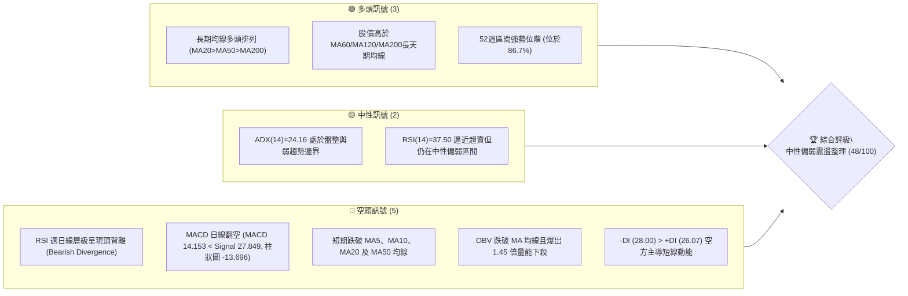
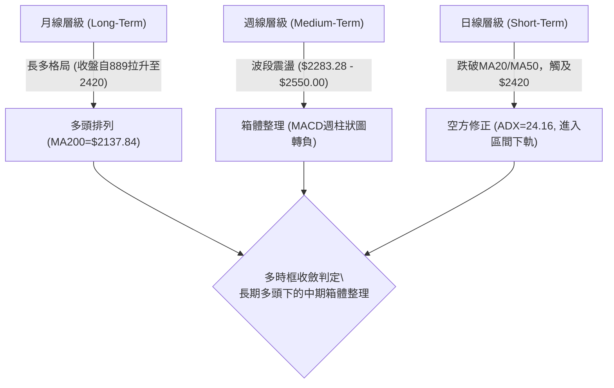
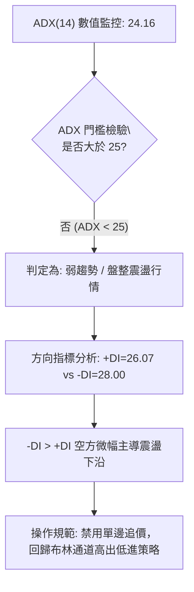
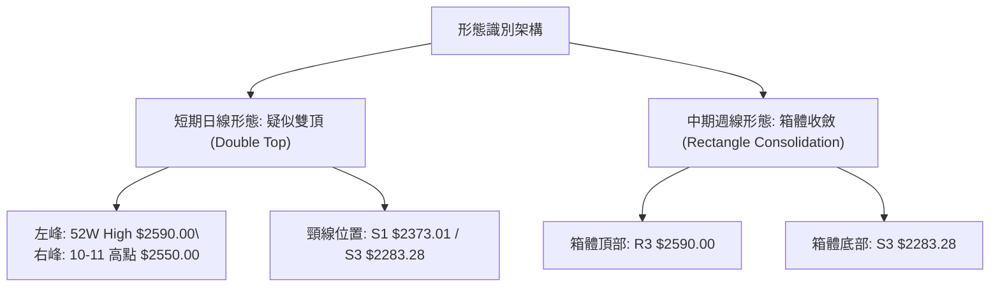
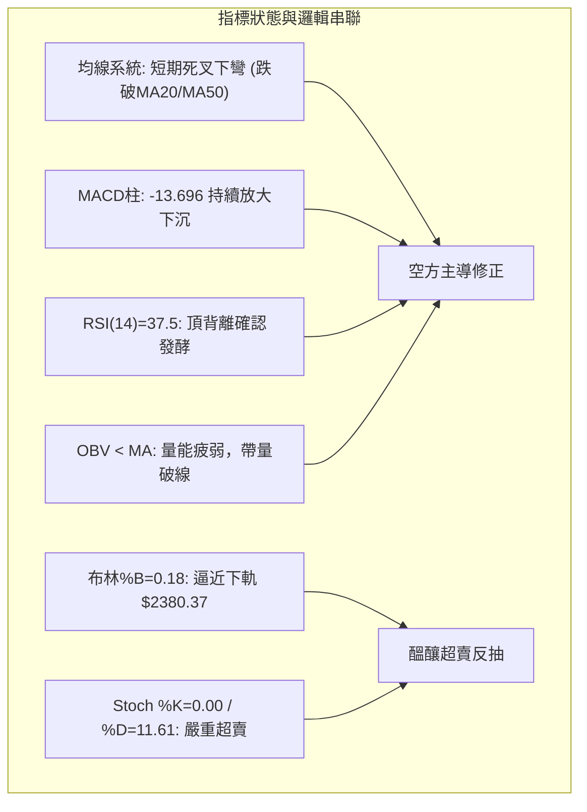
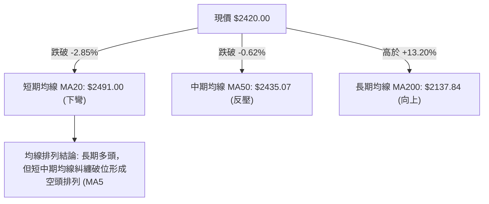
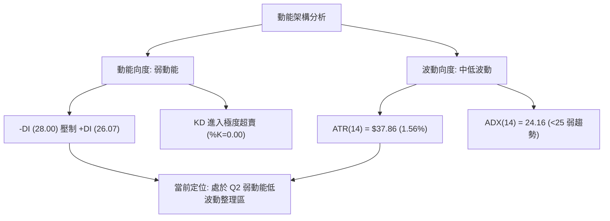
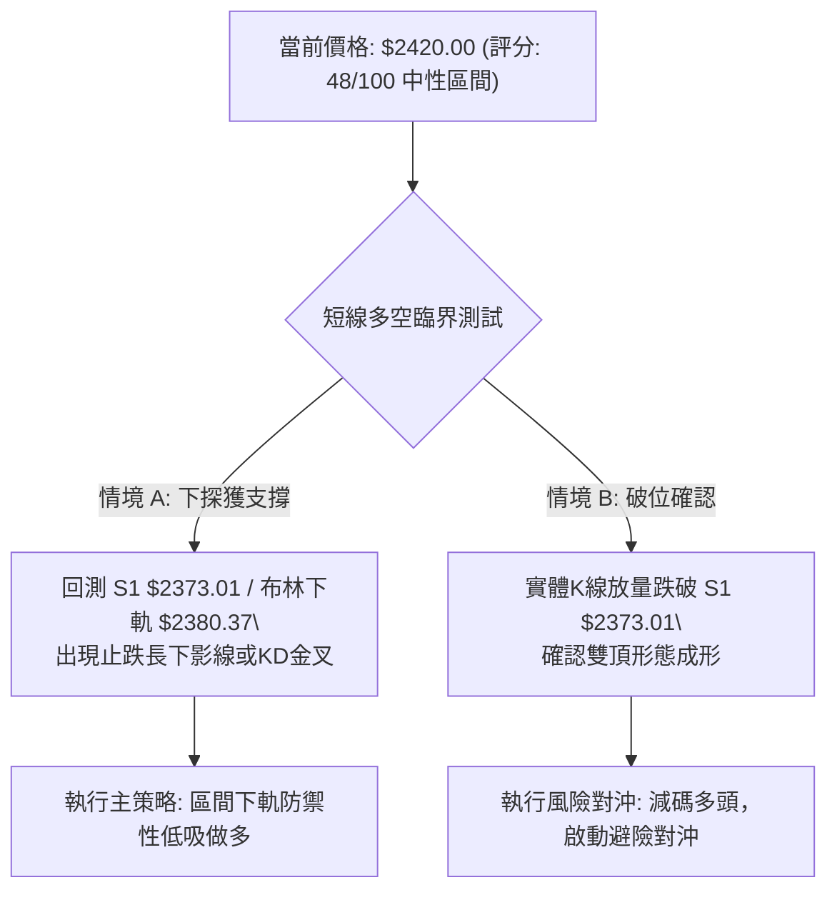
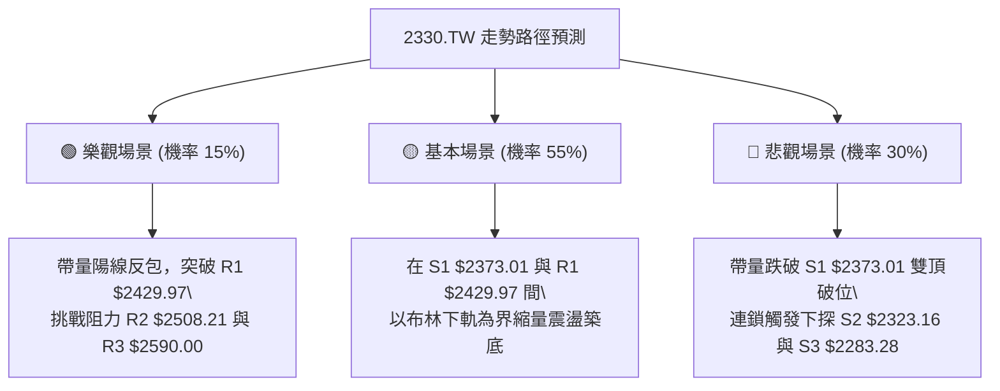

# 2330.TW 技術分析報告

> **報告日期**：2026-10-18 ｜ **語言**：繁體中文 ｜ **數據來源**：Yahoo Finance ｜ **當前價格**：$2420.00

---

## 目錄

| 章節 | 內容 |
|------|------|
| [1. 技術面概覽](#1-技術面概覽) | 訊號儀表板、核心指標、評分卡 |
| [2. 趨勢分析](#2-趨勢分析) | 多時框趨勢、長中短期走勢 |
| [3. 圖表形態分析](#3-圖表形態分析) | 形態識別、K線組合、目標價 |
| [4. 支撐與阻力](#4-支撐與阻力) | 關鍵價位、斐波那契回調 |
| [5. 技術指標深度解讀](#5-技術指標深度解讀) | MA/RSI/MACD/布林/成交量 |
| [6. 動能與波動率](#6-動能與波動率) | 動能評估、ATR、Beta |
| [7. 多時框架總結](#7-多時框架總結) | 時框架評分矩陣 |
| [8. 交易策略建議](#8-交易策略建議) | 多空策略、風險報酬比 |
| [9. 風險提示與監控](#9-風險提示與監控) | 監控指標、風險場景 |

---

## 1. 技術面概覽

### 🎯 技術訊號儀表板



### 📊 核心指標速覽表

| 指標類別 | 指標名稱 | 當前數值 | 訊號 | 解讀 |
|----------|----------|----------|------|------|
| **價格** | 當前價格 | $2420.00 | 🟡 | 位於52週區間86.7%處，回測短期低點尋找支撐 |
| **均線** | MA20 | $2491.00 | 🔴 | 股價位於MA20下方 -2.85%，月線扣高形成實質反壓 |
| **均線** | MA50 | $2435.07 | 🔴 | 股價今日跌破季線支撐，短線多空臨界點失守 |
| **均線** | MA200 | $2137.84 | 🟢 | 股價高於年線 +13.20%，長期牛市基底依然穩健 |
| **動能** | RSI(14) | 37.50 | 🟡 | 自上週74.3急速降溫，出現明確頂背離訊號，短期偏弱 |
| **動能** | MACD | 14.153 | 🔴 | 跌破訊號線 27.849，柱狀圖放大至 -13.696，空方動能增強 |
| **動能** | Stoch %K/%D | 0.00 / 11.61 | 🟡 | KD極度鈍化進入超賣區，短線存在技術性反抽需求 |
| **趨勢** | ADX(14) | 24.16 | 🟡 | ADX < 25 判定為弱趨勢/區間震盪行情，回歸通道操作 |
| **通道** | 布林帶寬 | $2380.37 - $2601.63 | 🟡 | %B 為 0.18，價格緊貼下軌運行，防守下軌支撐 |
| **量能** | 量比與OBV | 1.45x / OBV < MA | 🔴 | 單日爆出 33,490,270 股量能，量增價跌且量能指標疲弱 |
| **波動** | ATR(14) | $37.86 | 🟡 | 波動率佔股價 1.56%，屬於中等正常波動水準 |

### 🏆 技術評分卡

```
╔══════════════════════════════════════════════════════════════════╗
║                技術評分卡 — 2330.TW (2026-10-18)                ║
╠══════════════════════════════════════════════════════════════════╣
║ 趨勢強度 (ADX=24.16, -DI>+DI) ████████░░░░░░░░░░░░  40/100 🔴 弱勢震盪║
║ 動能指標 (RSI=37.5, MACD翻空) ██████░░░░░░░░░░░░░░  30/100 🔴 空方主導║
║ 支撐穩定度 (S1=2373.01, MA60) ████████████░░░░░░░░  60/100 🟡 中軌測試║
║ 成交量配合 (OBV<MA, 帶量下殺) ████████░░░░░░░░░░░░  40/100 🔴 籌碼鬆動║
║ 形態完整度 (雙頂雛形, 頸線未破)████████████░░░░░░░░  60/100 🟡 區間成形║
║ 均線排列 (長多短空, 跌破MA20) ████████████░░░░░░░░  60/100 🟡 多頭回檔║
╠══════════════════════════════════════════════════════════════════╣
║ 綜合評分                    █████████░░░░░░░░░░░  48/100 🟡 區間震盪║
╚══════════════════════════════════════════════════════════════════╝
```

---

## 2. 趨勢分析

### 🌐 多時框趨勢分析



### 📈 長期趨勢 — 12個月走勢圖（Unicode）

```
2330.TW 月線走勢圖（過去12個月：2025-11 至 2026-10）
價格軸 ($)
$2500 ┤                                                 ●(2026-09 $2480)
$2400 ┤                                           ●  ●  │  ●←現在($2420)
$2300 ┤                                     ●     (07)(08)
$2100 ┤                               ●
$1900 ┤                         ●
$1700 ┤                   ●     │
$1500 ┤             ●     │     ●(2026-03 $1750.17 回檔)
$1400 ┤ ●(2025-11)
      └─┬─────┬─────┬─────┬─────┬─────┬─────┬─────┬─────┬─────┬─────┬─────
       11    12    01    02    03    04    05    06    07    08    09    10 (月份)
```

#### 走勢特徵分析表格

| 階段 | 期間 | 價格區間 | 累積漲跌幅 | 趨勢特徵解讀 |
|------|------|----------|------------|--------------|
| 第一階段：多頭啟動 | 2025-11 ~ 2026-02 | $1422.55 → $1977.40 | +39.00% | 均線向上發散，月K連三紅，帶動多頭大暴發。 |
| 第二階段：高檔洗盤 | 2026-02 ~ 2026-03 | $1977.40 → $1750.17 | -11.49% | 波段獲利回結，回測季線支撐後迅速止跌。 |
| 第三階段：強勢主升 | 2026-03 ~ 2026-06 | $1750.17 → $2402.93 | +37.29% | 連續突破整數關卡，量價齊揚，建立長期多頭核心區。 |
| 第四階段：箱體高檔整理 | 2026-06 ~ 2026-10 | $2402.93 → $2420.00 | +0.71% | 價格在 $2283.28 至 $2590.00 建立大型頂部震盪區。 |

### 📊 中期趨勢（週線分析）

```
中期週線高低點支撐阻力結構圖
$2590.00 ────────────────────────────────────────── 52W High (強阻力 R3)
          ▲ (10-11 高點 $2550.00)
$2508.21 ───┴────────────────────────────────────── 近期阻力 R2 (MA10反壓)
$2429.97 ────────────────────────────────────────── 短期阻力 R1 (前波低轉阻力)
$2420.00 ◀═════ 當前收盤價位 ══════════════════════ (跌破MA50)
$2373.01 ────────────────────────────────────────── 近期關鍵支撐 S1 (下軌支撐)
          ▼ (07-19 低點 $2283.28)
$2283.28 ────────────────────────────────────────── 箱體底部強支撐 S3 / Fib 23.6%
```

週線層級來看，2330.TW 自 2026 年 6 月初（$2351.78）至 2026 年 10 月中旬，整體收盤價多維持在 $2300 至 $2550 間窄幅波動。上週（10-11）收盤衝高至 $2550.00 後，本週（10-18）長黑回吐至 $2420.00，單週成交量暴增至 160,006,325 股，確認 $2550–$2590 存在顯著法人獲利了結賣壓。

### ⚡ 趨勢強度評估（ADX 解讀）



#### ADX 強度對照表

| ADX 數值區間 | 趨勢狀態 | 當前數值 | 當前狀態評估 | 交易策略指示 |
|--------------|----------|----------|--------------|--------------|
| 0 – 20 | 無趨勢 / 極度牛皮 | -- | 未觸發 | 區間震盪網格操作 |
| **20 – 25** | **弱趨勢 / 震盪整理** | **24.16** | **符合當前狀態** | **以支撐阻力為交易邊界** |
| 25 – 50 | 明確強趨勢 | -- | 未達標 | 順勢突破交易 |
| 50 – 75 | 極強單邊行情 | -- | 未達標 | 抱牢波段持倉 |

---

## 3. 圖表形態分析

### 🔍 形態識別系統



#### 形態信心度與分析表格（依規則 15）

| 形態名稱 | 信心度 | 判斷依據（引用數據） | 完成度 | 目標價（附計算式） |
|----------|--------|----------------------|--------|--------------------|
| **高檔雙頂雛形** | 65% | 左峰 $2590.00（52W高點），右峰 $2550.00（10-11週收盤），跌破MA20與MA50 | 50%（頸線尚未正式破位） | 若跌破頸線 S1 $2373.01，量測目標價為 $2373.01 - ($2590.00 - $2373.01) = $2156.02（貼近年線 MA200 $2137.84） |
| **矩形橫向箱體** | 80% | 過去 20 週收盤價均收在波段低點聚類 S3 $2283.28 與高點聚類 R3 $2590.00 之間 | 85%（正處於箱體中下緣測試） | 若守住 S1 $2373.01 則回測箱體上軌 R2 $2508.21 與 R3 $2590.00 |

### 🕯️ 重要K線形態分析

| 日期/月份 | 收盤價 | K線形態 | 解讀 | 訊號 |
|-----------|--------|---------|------|------|
| 2026-09-27 | $2475.00 | 溫和中陽線 | 突破整理區中軸，多方試圖挑戰新高。 | 🟢 偏多 |
| 2026-10-04 | $2500.00 | 突破心理整數關卡 | 站穩二千五百元大關，多頭動能延續。 | 🟢 多頭確認 |
| 2026-10-11 | $2550.00 | 高檔長上影避雷針線 | 創波段次高但週成交量僅 77,343,774 股，呈現量價背離。 | 🔴 頂部轉折 |
| 2026-10-18 | $2420.00 | 帶量長黑破線實體 | 放量 160,006,325 股摜破 MA20 及 MA50，空方全面反撲吞噬前二週漲幅。 | 🔴 強烈看空 |

### 📉 ASCII 走勢形態示意圖

```
2330.TW 雙頂與箱體整理結構圖
      左頂 $2590.00              右頂 $2550.00
           ╭───╮                      ╭───╮
          ╱     ╲                    ╱     ╲
─────────╯       ╰──────────────────╯       ╰─────────────── 高檔阻力區 R3 ($2590.00)
                   中期拉回 $2402.93           現價 $2420.00
                                                │
════════════════════════════════════════════════▼═══════════ 短期關鍵分水嶺 R1 ($2429.97)
- - - - - - - - - - - - - - - - - - - - - - - - - - - - - - - 短期支撐 S1 ($2373.01)
                                                              (雙頂第一防守頸線)
──────────────────────────────────────────────────────────── 箱體底部 S3 ($2283.28)
                                                              (實質結構頸線)
```

### 🎯 形態目標價計算

1. **若形態確認為雙頂破位（看空劇本）**：
   - 第一頸線採用近一年低點聚類 **S1: $2373.01**。
   - 形態高度：高點 $2590.00 - 頸線 $2373.01 = $216.99。
   - 破位量測下跌目標價：$2373.01 - $216.99 = **$2156.02**。
   - 驗證：該目標價極度接近長期年線支撐 **MA200 $2137.84** 與斐波那契 38.2% 回調位 **$2100.64**，具有強烈結構匯聚意義。

2. **若形態維持大箱體震盪（中性劇本）**：
   - 股價守穩下軌支撐 **S1 $2373.01** 不破，將引發均值回歸向上反彈。
   - 反彈第一目標價：布林中軌暨阻力位 **R2 $2508.21**。

---

## 4. 支撐與阻力

### 🗺️ 關鍵價位分布圖（Unicode）

```
2330.TW 價位結構分布圖
═══════════════════════════════════════════════════════════════════
$2590.00 ║████████████████████████████████████║ 強阻力 R3 / 52W High
$2508.21 ║████████████████████████            ║ 阻力 R2 / 近期高點聚類
$2429.97 ║████████████                        ║ 關鍵短期阻力 R1 (轉折點)
$2420.00 ╠════════════════════════════════════╣ ◄ 現價 ($2420.00)
$2373.01 ║▓▓▓▓▓▓▓▓▓▓▓▓▓▓▓▓▓▓▓▓                ║ 近期關鍵支撐 S1 (下軌支撐)
$2323.16 ║████████████████                    ║ 支撐 S2 / 密集低點區
$2283.28 ║████████████████████████████████    ║ 強支撐 S3 / 箱體底部聚類
═══════════════════════════════════════════════════════════════════
```

### 🚧 阻力位分析表

所有價位均嚴格引用提供之關鍵價位數據：

| 阻力級別 | 價位 | 形成原因 | 突破難度 | 重要性 |
|----------|------|----------|----------|--------|
| **R1** | **$2429.97** | 近一年波段高點聚類，與跌破的 MA50 ($2435.07) 形成共振反壓區 | 🟡 中等（距現價 +0.41%） | 短線轉強第一道門檻，未收復前短線偏空格局不變 |
| **R2** | **$2508.21** | 近期波段高點聚類，與布林中軌 MA20 ($2491.00) 及 MA10 ($2517.50) 形成密集均線套牢區 | 🔴 極高（距現價 +3.65%） | 多空中期分水嶺，收復此處方能解除雙頂下殺警報 |
| **R3** | **$2590.00** | 52週最高點，波段高點聚類之歷史絕對天花板 | 🔴 極難（距現價 +7.02%） | 需整體半導體產業爆發與成交量能維持 2 億股以上方能挑戰 |

### 🛡️ 支撐位分析表

所有價位均嚴格引用提供之關鍵價位數據：

| 支撐級別 | 價位 | 形成原因 | 守住機率 | 重要性 |
|----------|------|----------|----------|--------|
| **S1** | **$2373.01** | 近一年波段低點聚類，布林通道下軌 ($2380.37) 與 MA120 ($2370.04) 雙重共振防線 | 🟢 高（約 65%） | 短線多頭最後護城河，一旦跌破宣告雙頂型態成立 |
| **S2** | **$2323.16** | 近一年密集低點聚類，對應 2026-06-14 週收盤 $2303.22 之緩衝區域 | 🟡 中等（約 55%） | 次級波段防守點，提供多方二次集結機會 |
| **S3** | **$2283.28** | 近一年波段低點聚類之絕對底部（2026-07-19 最低收盤），斐波那契 23.6% ($2287.67) 疊合處 | 🟢 極高（約 85%） | 中期箱體結構底線，長線多頭持股之硬性止損基準 |

### 📐 斐波那契回調位分析

依據 52 週區間 **$1308.95 (52W Low) → $2590.00 (52W High)** 實際計算之回調位體系：

```
斐波那契回調階梯分布 (區間: $1308.95 → $2590.00)
0.0%  (52W High) ─────────────────────────── $2590.00  (R3 強阻力)
23.6%            ─────────────────────────── $2287.67  (高度疊合強支撐 S3 $2283.28)
                 ═══════════════════════════ $2420.00  ◄ 現價 (位於 0.0% ~ 23.6% 強勢回檔區間)
38.2%            ─────────────────────────── $2100.64  (緊鄰 MA200 $2137.84)
50.0%            ─────────────────────────── $1949.47  (中長期均衡線)
61.8%            ─────────────────────────── $1798.31  (黃金分割防守位)
78.6%            ─────────────────────────── $1583.09
100.0% (52W Low) ─────────────────────────── $1308.95
```

- **位置解讀**：現價 $2420.00 處於 **0.0% ($2590.00)** 與 **23.6% ($2287.67)** 之間。自高點 $2590.00 回調幅度僅為波段漲幅的約 13.27%，尚未觸及極度強勢回調基準線 23.6%（$2287.67）。
- **技術意涵**：在未跌破 $2287.67 之前，2330.TW 依然屬於**大級別強勢多頭內部的健康回檔整理**；只有當 $2287.67 失守，回調深度才會擴展至 38.2%（$2100.64），屆時年線 MA200 ($2137.84) 將面臨考驗。

---

## 5. 技術指標深度解讀

### 🎛️ 指標訊號總覽



### 📈 移動平均線排列分析



#### 各均線現況數據表

| 均線名稱 | 數值 | 現價與MA差距 | 趨勢方向 | 角色與意義 |
|----------|------|--------------|----------|------------|
| **MA5** | $2476.00 | -56.00 (-2.26%) | ▼ 快速下彎 | 超短線空方防守線，反彈不過此線不宜做多 |
| **MA10** | $2517.50 | -97.50 (-3.87%) | ▼ 加速下彎 | 短波段主壓，扣抵高值區形成壓制 |
| **MA20** | $2491.00 | -71.00 (-2.85%) | ▼ 下彎扣高 | 月線宣告失守，轉為波段反彈第一阻力區 |
| **MA50** | $2435.07 | -15.07 (-0.62%) | ▼ 震盪下移 | 季線防守破位，短空確立 |
| **MA60** | $2416.50 | +3.50 (+0.14%) | ▲ 走平微揚 | 季線下沿微幅支撐，現價正於此處尋求立足點 |
| **MA120** | $2370.04 | +49.96 (+2.11%) | ▲ 穩定向上 | 半年線防線，與支撐 S1 ($2373.01) 高度重疊 |
| **MA200** | $2137.84 | +282.16 (+13.20%) | ▲ 長期向上 | 長線牛熊分水嶺，距離尚遠，長期趨勢未受根本破壞 |

### 📉 RSI(14) 分析

- **當前數值**：37.50
- **Unicode 進度條**：`███████░░░░░░░░░░░░░` 37.5% (中性偏弱區間)
- **背離診斷**：**⚠️ 頂背離（Bearish Divergence）成立**。
  - **細節驗證**：股價在 2026-10-11 創下收盤新高 $2550.00 時，週線 RSI 達到 74.30；然而對比先前 2026-06 高點區域，價格創高但日線 RSI 率先走疲並跌破 50 中軸；隨後在 10-18 週收盤 $2420.00 時，RSI 迅速貫穿至 37.50。指標高點未能有效同步創高，且反手跌破頸線，頂背離形態引發本波猛烈修正。

### 📊 MACD(12/26/9) 訊號解讀


- **詳細數據**：
  - MACD 線：14.153（雖然數值仍在零軸之上，但斜率極陡向下）
  - 信號線（Signal）：27.849
  - 柱狀圖（Histogram）：-13.696
- **綜合結論**：MACD 高檔死叉發酵，柱狀圖負值持續擴大，顯示自 $2550.00 之獲利回吐賣壓仍處於宣洩階段，尚未見到指標回勾之左側止跌訊號。

### 📦 布林通道分析

```
2330.TW 布林通道價格空間圖 (帶寬: $2380.37 ~ $2601.63)
$2601.63 ────────────────────────────────────────── BB 上軌 (超買區間)
$2491.00 ────────────────────────────────────────── BB 中軌 (MA20 阻力反壓)
$2420.00 ◀═════ 現價位置 (%B = 0.18) ══════════════
$2380.37 ────────────────────────────────────────── BB 下軌 (近期支撐邊界)
```

- **位置特徵**：現價 $2420.00 緊臨下軌 $2380.37，%B 數值為 **0.18**（極低位階）。
- **帶寬特徵**：上下軌帶寬為 $221.26（約佔股價 9.14%），處於通道開口略為擴張狀態。若價格持續壓迫下軌 $2380.37 運行，需慎防通道向下開口形成「下軌滑行」的極弱勢行情。

### 💹 成交量分析（量價配合度）

- **量能數據**：
  - 最新單日成交量：33,490,270 股
  - 20日均量：23,067,666 股
  - **量比（Volume Ratio）**：**1.45x**（顯著放量）
  - 最新週成交量：160,006,325 股（較前一週 77,343,774 股暴增超過 106%）
- **OBV 趨勢**：**OBV < MA → 量能疲弱**。
- **量價背離分析**：前週高檔創 $2550.00 時成交量僅 77M 出現「量價頂背離」；本週下跌至 $2420.00 卻爆出 160M 巨量，呈現標準的「價跌量增」與籌碼主動撤出跡象。OBV 跌破均線，說明大資金近期以流出為主，量能無法支撐多頭反攻。

---

## 6. 動能與波動率

### ⚡ 動能評估

#### 動能強度與波動率象限評估

| 象限 | 動能強度 | 波動率水準 | 當前狀態判定 | 戰術意涵與操作建議 |
|------|----------|------------|--------------|--------------------|
| **第一象限 (Q1)** | 強動能 (+DI強) | 低波動 (ATR收縮) | -- | 最佳突破追價機會 |
| **第二象限 (Q2)** | 弱動能 (-DI主導) | 低波動 (ATR可控) | **✓ 符合當前狀態** | **防禦性謹慎觀望，回歸通道邊界低吸** |
| **第三象限 (Q3)** | 強動能 | 高波動 | -- | 高風險高報酬單邊波段 |
| **第四象限 (Q4)** | 弱動能 | 高波動 | -- | 盤跌擴散，絕對避免進場 |



### 📊 ATR 波動率分析

- **ATR(14) 數值**：**$37.86**（佔當前股價之 1.56%）。
- **日內波動幅度**：在正常市況下，單日理論波動預期為 ±$37.86。
- **止損距離建議**：
  - **保守型（長線）**：採用 2.0 × ATR = **$75.72**。
  - **進取型（短線）**：採用 1.0 × ATR = **$37.86** 或 1.5 × ATR = **$56.79**。
  - **實務應用**：若在當前價位 $2420.00 建立多頭部位，短線止損應設於 $2420.00 - $56.79 = $2363.21，此價位恰好落在關鍵支撐 S1 ($2373.01) 之下方安全緩衝區。

### 📐 Beta 與市場相關性

- **Beta 數值**：**1.239**。
- **市場特徵解讀**：
  - 2330.TW 的系統性波動高於台灣整體加權指數約 23.9%。
  - 當大盤回檔 1% 時，台積電平均下拉 1.24%；當大盤發動多頭反彈時，其亦具備 1.24 倍的動能放大效應。
  - 當前 Beta 處於高敏感情境，在短線空方動能佔優勢時，需嚴防大盤補跌引發的個股溢出性殺盤。

---

## 7. 多時框架總結

### 📋 時框架評分表

| 時框架 | 趨勢方向 | 動能狀態 | 均線排列 | 圖表形態 | 綜合評分 | 操作建議 |
|--------|----------|----------|----------|----------|----------|----------|
| **月線 (長期)** | 🟢 強烈看多 | 🟢 多頭續存 | 🟢 完美多頭 (價格遠高於MA200) | 巨型階梯上升通道 | **85/100** | 核心長線部位逢低堅定續抱 |
| **週線 (中期)** | 🟡 箱體震盪 | 🔴 MACD柱翻負 | 🟡 多頭停滯 (回測MA20扣高) | 高檔橫盤箱體 ($2283-$2590) | **50/100** | 箱體操作，不追高，測試下軌支撐 |
| **日線 (短期)** | 🔴 短空修正 | 🔴 RSI頂背離/KD鈍化 | 🔴 短空格局 (跌破MA20與MA50) | 局部雙頂下測頸線 S1 | **35/100** | 暫停左側做多，等待止跌K線訊號 |

### 🔲 綜合訊號矩陣

| 評估維度 | 日線訊號 (短期) | 週線訊號 (中期) | 月線訊號 (長期) | 多時框一致性解讀 |
|----------|----------------|----------------|----------------|------------------|
| **趨勢方向** | 🔴 偏空 | 🟡 中性 | 🟢 偏多 | 短期與長期分歧，中期面臨方向選擇 |
| **均線位置** | 🔴 破MA20/MA50 | 🟡 逼近MA20 | 🟢 遠高於MA200 | 均線級別越長越穩健，回檔性質判定為中級洗盤 |
| **動能狀態** | 🔴 MACD負向 | 🔴 柱狀圖收斂 | 🟢 歷史高檔區 | 短中期動能共振降溫，多頭暫時休兵 |
| **量能狀態** | 🔴 帶量下殺 | 🔴 量價背離 | 🟢 量能常態放大 | 高檔法人籌碼換手，清洗浮額跡象明確 |

### ⚖️ 多時框收斂結論

依據多時框收斂規則第 14 條嚴格執行收斂：
1. **趨勢/盤整判定**：當前 ADX(14) 數值為 **24.16 (<25)**，嚴格判定為**「盤整行情」**而非單邊趨勢行情。
2. **主導時框與交易邊界**：由於處於盤整行情，以**日線布林通道（$2380.37 ~ $2601.63）與中期箱體支撐阻力為主要交易區間**。中長期多頭方向（MA200 $2137.84）確立了底部安全邊界，限制了深跌空間。
3. **方向性收斂結論**：**中性偏弱震盪觀望（Neutral-to-Bearish Range）**。
   - 短期日線空頭修正尚未結束，但由於價格已逼近布林下軌（$2380.37）與強支撐聚類 S1（$2373.01），KD亦達極限超賣，下檔空間受到壓縮。
   - 本報告最終裁定：**「中性區間操作，嚴控資金等待支撐測試確認」**。

---

## 8. 交易策略建議

### 🗺️ 策略決策流程圖



### 🧭 策略路由（依評分卡分流）

> **當前主策略方向 = 中性區間震盪操作（依評分 48/100）**  
> 說明：評分介於 40–60 之間，且 ADX < 25，禁止追高或重倉單邊押注。主策略以「布林通道下軌與支撐聚類 S1 防守反彈」為核心，嚴格等待破位或止跌確認信號。

### 🎯 價格情境階梯（Price Scenarios）

價位嚴格引用關鍵價位區塊計算之精確數值：

| 觸發條件 | 下一目標 | 後續延伸 | 情境含義 |
|----------|----------|----------|----------|
| **突破 R1 $2429.97** | **R2 $2508.21** | **R3 $2590.00** | 收復季線與短波反壓，短線空方動能瓦解，重回箱體上層結構。 |
| **守穩 S1 $2373.01 至現價區間** | **R1 $2429.97** | **R2 $2508.21** | 於布林下軌獲得支撐，展開技術性均值回歸震盪走勢。 |
| **跌破 S1 $2373.01** | **S2 $2323.16** | **S3 $2283.28** | 雙頂形態成立，修正波段擴大，向下尋求斐波那契 23.6% 支撐。 |

### 📊 情境機率分佈

| 情境劇本 | 機率 | 主要技術指標依據 |
|----------|------|------------------|
| **區間下軌止跌震盪（主情境）** | **55%** | ADX=24.16 指向盤整，布林 %B=0.18 逼近下軌 $2380.37，Stoch KD 極度超賣具備反抽動力。 |
| **破位再探低點（次情境）** | **30%** | RSI 頂背離持續釋放，MACD 柱狀圖 -13.696 放大，單日成交量能放大顯示籌碼鬆動。 |
| **強勢直接反轉向上（小機率）** | **15%** | 短期均線 MA5/MA10/MA20 均在上方下彎形成沉重蓋頭反壓，缺乏單邊暴衝條件。 |

### 🟢 主策略詳情（區間震盪低吸與右側確認）

| 策略要素 | 策略 A（下軌支撐左側低吸） | 策略 B（突破轉強右側跟進） |
|----------|----------------------------|----------------------------|
| **策略類型** | 逆勢區間低吸（Mean Reversion） | 順勢右側突破（Momentum Confirmation） |
| **進場條件** | 股價回測至支撐 S1 與布林下軌間縮量打底 | 實體日K線收盤突破短期阻力 R1 |
| **進場價格** | **$2375.00**（貼近 S1 $2373.01 佈局） | **$2432.00**（確認突破 R1 $2429.97） |
| **目標價 T1** | **$2491.00**（布林中軌 / MA20） | **$2508.21**（強阻力 R2 / 前波高點） |
| **目標價 T2** | **$2508.21**（阻力 R2） | **$2590.00**（阻力 R3 / 52W高點） |
| **止損價格** | **$2320.00**（跌破 S2 $2323.16 嚴格出場） | **$2370.00**（跌破 S1 $2373.01 假突破停損） |
| **風險報酬比** | **1 : 2.11**（風險$55 vs 獲利T1 $116） | **1 : 1.23**（風險$62 vs 獲利T1 $76.21；T2達 1:2.55） |
| **成功機率** | **58%** | **52%** |
| **建議倉位** | **15% 總資金** | **10% 總資金** |

*計算式附註：策略 A 風險 = $2375 - $2320 = $55；獲利 T1 = $2491 - $2375 = $116；RR 比 = 116 / 55 = 2.11。*

### 🔴 反向風險觸發點（對沖提示）

- **多單警報觸發價**：**$2373.01（S1）**。
- **風險防禦措施**：
  - 若日K線實體跌破 **$2373.01**，代表高檔雙頂頸線正式失守，技術評級將由「中性震盪」全面轉為「技術性空頭」。
  - 既有多頭部位應立即將持倉降低至 20% 以下，短線交易者全數停損離場。
  - 積極型投資人可考慮在反抽無力受制於 $2373.01 時，建立以波段支撐 **S3 $2283.28** 為目標之避險空單部位。

### ⭐ 整體訊號強度評星

```
做多訊號強度：★★☆☆☆  (2.5/5星) — KD超賣但動能偏弱
做空訊號強度：★★★☆☆  (3.0/5星) — 頂背離帶量破均線
整體可信度：  ★★★★☆  (4.0/5星) — 價位聚類與指標共振度高
```

---

## 9. 風險提示與監控

### ✅ 關鍵監控指標 Checklist

```
╔══════════════════════════════════════════════════════════════════╗
║                   關鍵技術指標每日監控清單 (Checklist)             ║
╠══════════════════════════════════════════════════════════════════╣
║ [ ] 價格防守線：每日收盤價是否嚴格守穩 S1: $2373.01 之上？          ║
║ [ ] 均線動態：現價能否於 3 日內重新站上 MA50 ($2435.07)？        ║
║ [ ] 動能收腳：MACD 柱狀圖（當前 -13.696）負值是否開始連續收斂？   ║
║ [ ] RSI 回溫：RSI(14) 能否重返 40 以上並脫離頂背離陰霾？         ║
║ [ ] 籌碼量能：下殺日成交量是否低於 20日均量 23,067,666 縮量整理？║
║ [ ] 趨勢強度：ADX(14) 是否突破 25，引發新一輪單邊跌勢？           ║
╚══════════════════════════════════════════════════════════════════╝
```

### ⚠️ 風險場景分析



### 🛡️ 風險管理重要提醒

1. **嚴禁逢跌盲目加碼**：
   - 當前處於短期均線（MA5、MA10、MA20、MA50）全員覆頂的空方壓制期，且成交量呈價跌量增，顯示大額資金籌碼尚在調節。在 MACD 柱狀圖翻紅或未出現明確雙底打底型態前，切忌單邊向下攤平。
2. **波動度保護與停損紀律**：
   - 目前 ATR(14) 為 $37.86，單日波動極大。若設定過於狹窄的停損容易遭到市場隨機雜訊掃出場；但若放任無止損，一旦雙頂目標價 $2156.02 兌現，潛在回撤將逾 10%。務必嚴守 **$2320.00** 硬性止損點。
3. **倉位總量控管**：
   - 由於當前技術評分為 48/100，整體配置部位不宜超過總投資組合的 **30%**。保留至少 70% 的現金儲備，靜待箱體底部（$2283.28）或突破箱頂（$2590.00）的更高勝率機會浮現。

---

## 📋 報告總結

```
╔══════════════════════════════════════════════════════════════════╗
║                    2330.TW 技術分析報告總結                      ║
╠══════════════════════════════════════════════════════════════════╣
║ 報告日期：2026-10-18                                             ║
║ 當前價格：$2420.00                                               ║
║ 分析評級：⚖️ 中性偏弱震盪整理 (評分: 48/100)                     ║
║                                                                  ║
║ 關鍵結論：                                                       ║
║ ├─ 長期趨勢：🟢 穩固多頭 (MA200 $2137.84 向上，位處 52W 86.7%)    ║
║ ├─ 中期趨勢：🟡 箱體震盪 ($2283.28 - $2590.00 區間洗盤)           ║
║ ├─ 短期趨勢：🔴 空方回檔 (破MA20/50，MACD柱擴大，RSI頂背離)     ║
║ ├─ 關鍵支撐：S1 $2373.01 (波段低點/下軌) / S3 $2283.28 (強支撐)   ║
║ ├─ 關鍵阻力：R1 $2429.97 (短線分水嶺) / R2 $2508.21 (密集套牢區) ║
║ └─ 分析師目標：平均 $3386.71 (基本面長線共識強烈看多)            ║
║                                                                  ║
║ 最優策略組合：                                                   ║
║ 1. 🥇 最佳機會：策略 A (於支撐 S1 $2375 附近低吸，停損 $2320，   ║
║                  博取布林中軌均值回歸反抽，風報比 1:2.11)        ║
║ 2. 🥈 次選機會：右側交易 (等待突破 R1 $2429.97 後回踩確認追多)   ║
║ 3. 🥉 保守選擇：空手觀望，靜待指標落入 S3 $2283 斐波那契關鍵區   ║
╚══════════════════════════════════════════════════════════════════╝
```

---

> ⚠️ **免責聲明**：本報告為技術分析研究，所有數據、圖表及價位推算均嚴格基於所提供之歷史價格與技術指標資訊。本報告**僅供研究與學術參考**，**不構成任何形式的投資買賣建議**。金融市場具有高度風險，投資人應獨立思考、審慎評估並自負投資盈虧。

---

*報告生成時間：2026-10-18 ｜ 數據來源：Yahoo Finance ｜ 分析框架：多時框技術分析體系*