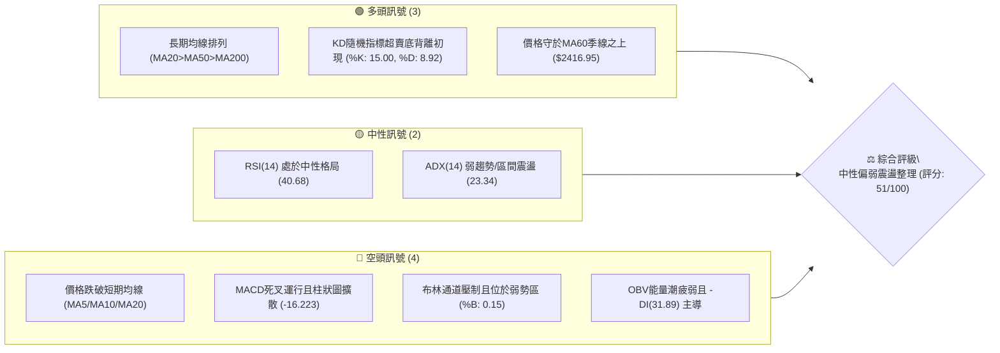
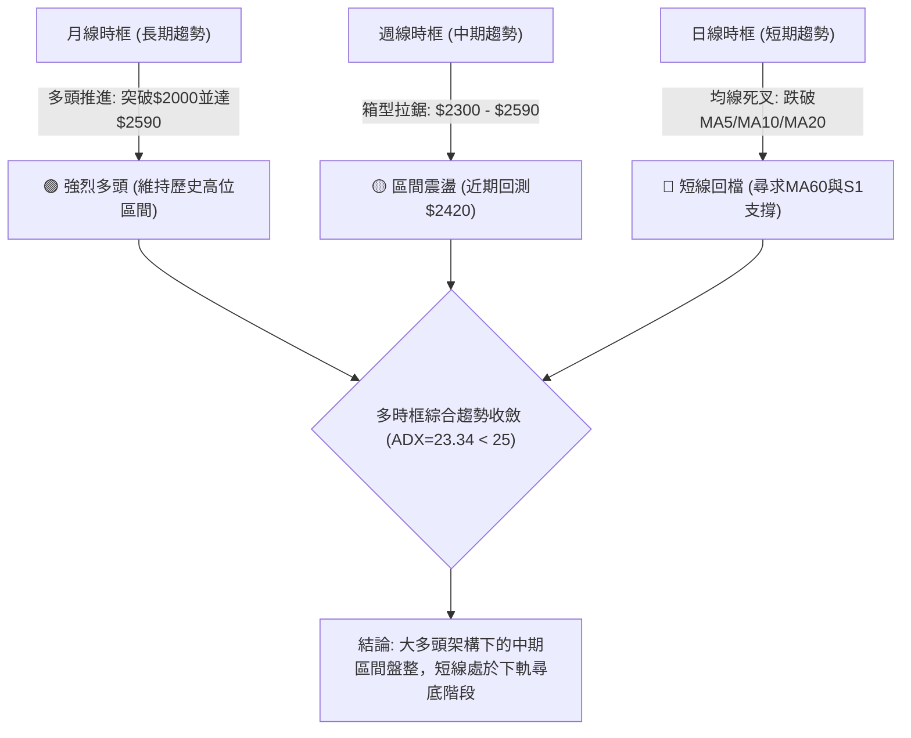
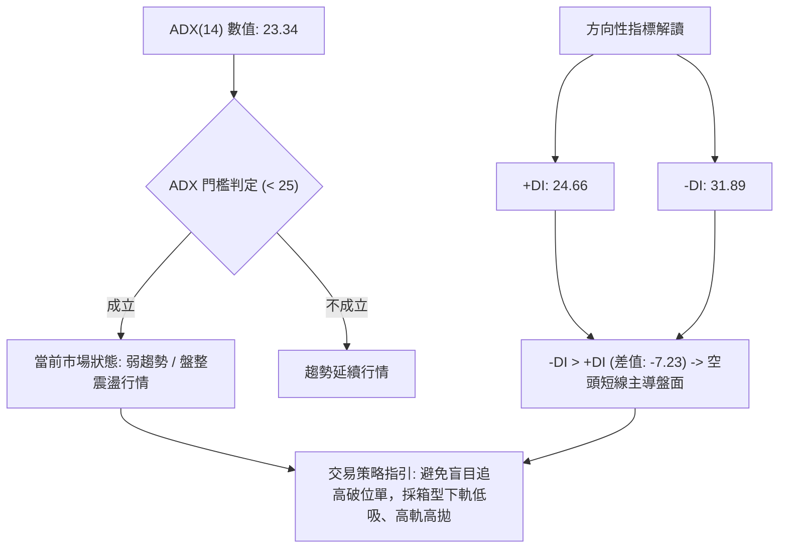
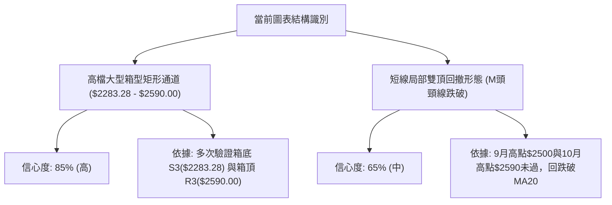
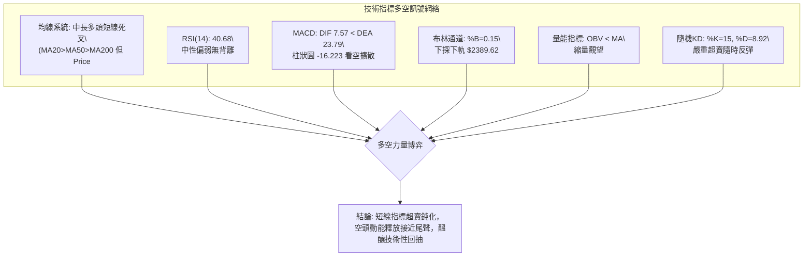
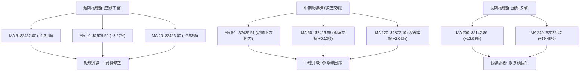
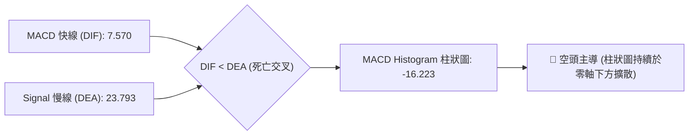
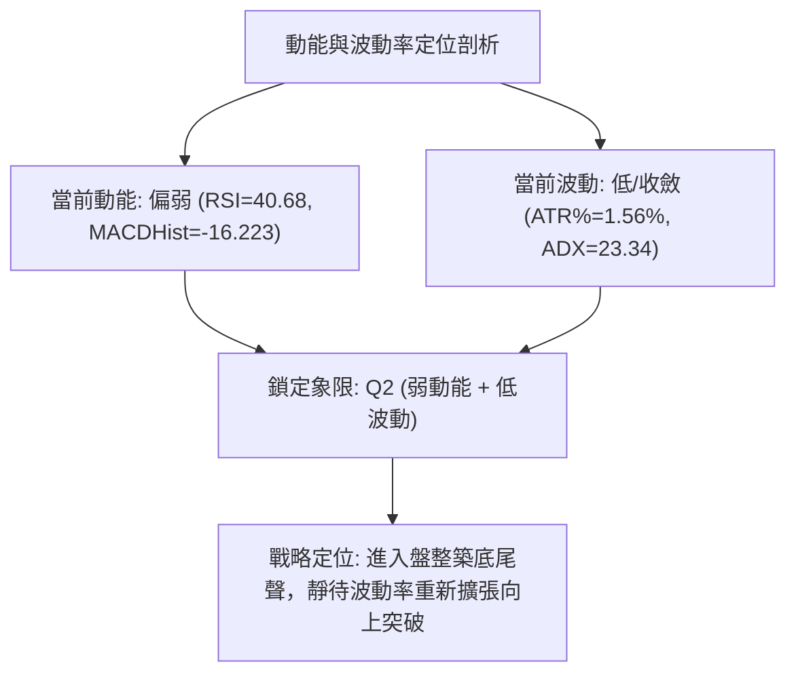
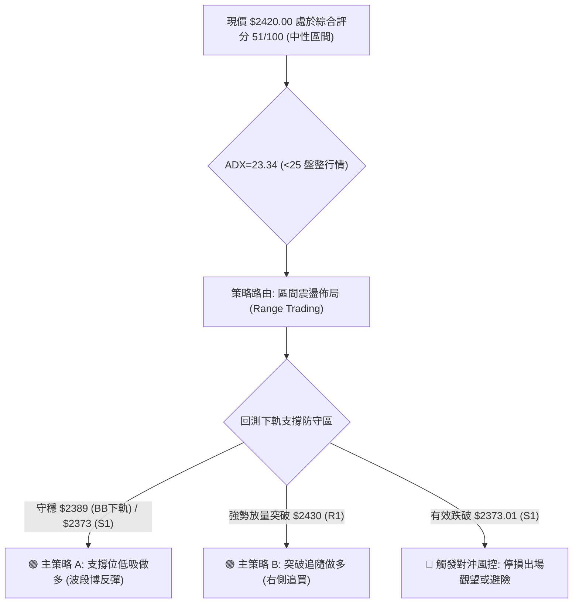
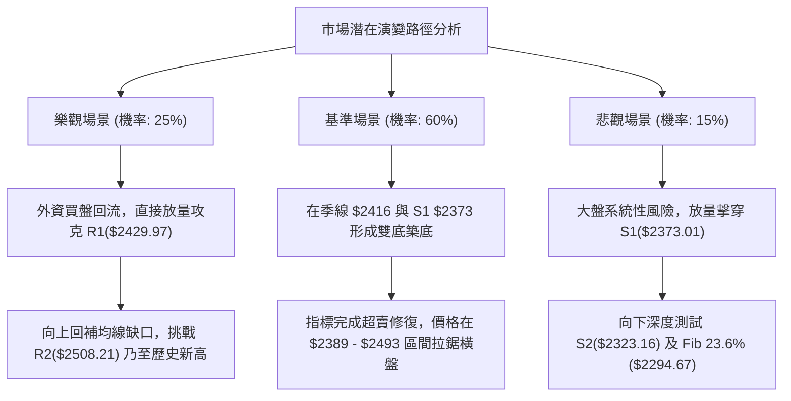

# 2330.TW 技術分析報告

> **報告日期**：2026-10-20 ｜ **語言**：繁體中文 ｜ **數據來源**：Yahoo Finance ｜ **當前價格**：$2420.00

---

## 目錄

| 章節 | 內容 |
|------|------|
| [1. 技術面概覽](#1-技術面概覽) | 訊號儀表板、核心指標、評分卡 |
| [2. 趨勢分析](#2-趨勢分析) | 多時框趨勢、長中短期走勢 |
| [3. 圖表形態分析](#3-圖表形態分析) | 形態識別、K線組合、目標價 |
| [4. 支撐與阻力](#4-支撐與阻力) | 關鍵價位、斐波那契回調 |
| [5. 技術指標深度解讀](#5-技術指標深度解讀) | MA/RSI/MACD/布林/成交量 |
| [6. 動能與波動率](#6-動能與波動率) | 動能評估、ATR、Beta |
| [7. 多時框架總結](#7-多時框架總結) | 時框架評分矩陣 |
| [8. 交易策略建議](#8-交易策略建議) | 多空策略、風險報酬比 |
| [9. 風險提示與監控](#9-風險提示與監控) | 監控指標、風險場景 |

---

## 1. 技術面概覽

### 🎯 技術訊號儀表板



### 📊 核心指標速覽表

| 指標類別 | 指標名稱 | 當前數值 | 訊號 | 解讀 |
|----------|----------|----------|:----:|------|
| **價格** | 當前價格 | $2420.00 | 🟡 | 位於52週區間86.4%高位，短線遭遇自高點$2590回撤 |
| **均線** | MA20 | $2493.00 | 🔴 | 價格低於月線-2.93%，短期承壓於中軌反壓 |
| **均線** | MA50 | $2435.51 | 🔴 | 跌破50日生命線，短線多頭結構出現鬆動 |
| **均線** | MA200 | $2142.86 | 🟢 | 遠高於200日牛熊分界線(+12.93%)，長線牛市架構穩固 |
| **動能** | RSI(14) | 40.68 | 🟡 | 偏弱中性區間，尚未跌入極端超賣區(<30)，未見背離 |
| **動能** | MACD | 7.570 / 23.793 | 🔴 | DIF跌破DEA形成死亡交叉，柱狀圖-16.223空頭加速擴散 |
| **動能** | KD(9,3,3) | 15.00 / 8.92 | 🟢 | 進入極度超賣區，具備短線技術性跌深反彈動能 |
| **趨勢** | ADX(14) | 23.34 | 🟡 | ADX < 25表明當前屬於區間整理行情，無明確單邊趨勢 |
| **通道** | 布林帶%B | 0.15 | 🔴 | 逼近下軌$2389.62，屬於弱勢探底結構 |
| **量能** | OBV走勢 | OBV < MA | 🔴 | 量能持續萎縮，籌碼呈現觀望，量價配合度偏弱 |
| **波動** | ATR(14) | $37.86 | 🟡 | 佔股價1.56%，每日震盪幅度適中，波動處於收斂期 |

### 🏆 技術評分卡

```
╔══════════════════════════════════════════════════════════════╗
║              2330.TW 技術維度評分卡 (2026-10-20)             ║
╠══════════════════════════════════════════════════════════════╣
║ 趨勢強度 (Trend)      ████████░░░░░░░░░░░░  42/100  🔴 空頭佔優 ║
║ 動能指標 (Momentum)   ████████░░░░░░░░░░░░  40/100  🔴 動能轉弱 ║
║ 支撐穩定度 (Support)  ██████████████░░░░░░  70/100  🟢 季線/S1強║
║ 成交量配合 (Volume)   ████████░░░░░░░░░░░░  40/100  🔴 量能萎縮 ║
║ 形態完整度 (Pattern)  ████████████░░░░░░░░  60/100  🟡 箱型整理 ║
║ 均線架構 (MA System)  ███████████░░░░░░░░░  55/100  🟡 多頭回踩 ║
╠══════════════════════════════════════════════════════════════╣
║ 綜合技術評分          ██████████░░░░░░░░░░  51/100  ⚖️ 區間震盪  ║
╚══════════════════════════════════════════════════════════════╝
```

---

## 2. 趨勢分析

### 🌐 多時框趨勢分析



### 📈 長期趨勢 — 12個月走勢圖（Unicode）

```
2330.TW 月線走勢圖（過去12個月歷史收盤）
價格軸 ($)
$2500 ┤                                           ● 2480.00
$2400 ┤                               ● 2402.93 ─┼─● 2420.00 (現價)
$2300 ┤                         ● 2341.84
$2200 ┤                   ● 2123.07
$2000 ┤             ● 1977.40
$1800 ┤       ● 1759.34
$1600 ┤ ● 1536.33
$1400 ┤ ● 1481.83 (2025-10)
      └─────────────────────────────────────────────────────►
        10  11  12  01  02  03  04  05  06  07  08  09  10 (月份)
        25  25  25  26  26  26  26  26  26  26  26  26  26
```

#### 走勢特徵分析表格

| 階段區間 | 起止價位 | 累計漲跌幅 | 走勢結構與技術特徵 |
|----------|----------|:----------:|--------------------|
| **2025/10 - 2026/02** | $1481.83 → $1977.40 | **+33.44%** | 主升浪爆發期，連續突破整數關卡，量價齊揚。 |
| **2026/02 - 2026/03** | $1977.40 → $1750.17 | **-11.49%** | 獲利了結快速洗盤，回踩均線支撐完成籌碼換手。 |
| **2026/03 - 2026/05** | $1750.17 → $2341.84 | **+33.81%** | 二次主升段，直接跳空跨越 $2000 大關，創波段新高。 |
| **2026/05 - 2026/10** | $2341.84 → $2420.00 | **+3.34%** | 高檔橫盤大箱型整理，最高觸及 $2590.00，目前拉回至中下緣。 |

### 📊 中期趨勢（週線分析）

從近20週數據觀察，價格在 2026-07-19 探低至波段低點 $2283.28 後展開回升，並於 2026-10-11 創下 $2550.00 的週收盤高點（盤中高點 $2590.00）。然而，最新兩週（10-18 與 10-25）連續出現回調，最新收盤報 $2420.00，MACD柱狀圖由正轉為負值擴散（-13.696 至 -16.223），顯示中期走勢未脫離高檔大型對稱震盪箱型。

```
週線支撐阻力結構示意：
$2590.00 ────────────────────────────────── [52W歷史高點 / 箱型天花板 R3]
                 ▲           ▲
$2508.21 ────────┼───────────┼───────────── [中期反彈反壓位 R2]
                ╱ ╲         ╱ ╲
$2420.00 ──────●───●───────●───●─────────── [當前價位: 震盪中軸區間]
              ╱     ╲     ╱     ╲
$2373.01 ────┼───────●───┼───────●───────── [週線強防守支撐 S1]
$2283.28 ────┴───────────┴───────────────── [前波黃金回調低點 S3 / 箱底]
```

### ⚡ 趨勢強度評估（ADX 解讀）



#### ADX 強度與方向對照表

| 指標名稱 | 數值 | 狀態區間 | 技術意義 |
|----------|:----:|:--------:|----------|
| **ADX(14)** | **23.34** | `< 25 (弱/無趨勢)` | 趨勢強度衰竭，市場缺乏單邊推動力，呈現寬幅區間拉鋸。 |
| **+DI(14)** | **24.66** | 多方買盤 | 多頭推升力道自高點回落，短線進攻動能轉弱。 |
| **-DI(14)** | **31.89** | 空方賣盤 | 空方力道佔據上風，短線回調賣壓尚未完全消化。 |
| **綜合解讀** | **盤整偏空** | **箱型下測** | 市場無單邊暴跌基礎（ADX未飆升），但短期內由空方主導回踩支撐。 |

---

## 3. 圖表形態分析

### 🔍 形態識別系統



#### 形態識別與信心度評估表

| 識別形態 | 信心度 | 判斷依據（嚴格引用技術數據） | 完成度 | 目標價（附嚴格計算式） |
|----------|:------:|------------------------------|:------:|------------------------|
| **高檔寬幅箱型整理** | **85%** | 價格在 2026-07-19 探低 $2283.28 後回升，在 $2590.00 受阻，持續在該區間震盪。 | 90% | 箱型中軸目標：$2436.64；若向上突破目標：$2590 + ($2590 - $2283.28) = $2896.72 |
| **局部短線雙頂 (M頭)** | **65%** | 第一頂為 2026-10-04 之 $2500，第二頂為 2026-10-11 之 $2550 (高點$2590)，隨後急跌跌破頸線 $2460.00。 | 75% | 跌破頸線 $2460.00，量度跌幅目標 = 頸線 $2460 - (高點 $2550 - 頸線 $2460) = **$2370.00**（高度吻合 S1: $2373.01） |
| **旗形收斂整理** | **45%** | 數據不足，均線糾結且量能遞減，尚未出現清晰旗形上下軌收斂。 | 30% | *訊號不足，僅做指標型解讀，不預設目標價。* |

### 🕯️ 重要K線形態分析

| 週期/日期 | 收盤價 | K線形態名稱 | 形態解讀與市場心理 | 多空訊號 |
|-----------|:------:|-------------|--------------------|:--------:|
| **2026-09-27** | $2475.00 | 溫和放量中陽線 | 多方突破震盪整理平台，買盤積極推升。 | 🟢 看多 |
| **2026-10-11** | $2550.00 | 高檔長上影避雷針線 | 盤中衝擊 $2590.00 後獲利了結盤湧出，留長上影線，多頭耗竭。 | 🔴 強烈看空 |
| **2026-10-18** | $2420.00 | 長陰反包貫穿線 | 週線放量下跌（1.6億股），一舉吞沒前三週漲幅，空方完全控盤。 | 🔴 看空 |
| **2026-10-25** | $2420.00 | 低檔縮量十字星孕線 | 跌勢暫歇，成交量急劇萎縮至2369萬股，多空在MA60附近暫時平衡。 | 🟡 變盤觀望 |

### 📉 ASCII 走勢形態示意圖

```
2330.TW 日線級別局部雙頂 (M-Top) 與箱型軌道示意圖：

價格 ($)
$2590.00 ┤                     ● (頂部2: 10/11 $2590)
$2508.21 ┤          ● (頂部1)    │      R2 阻力線
$2460.00 ┤─────────┼───────────┼──────頸線位置 (已跌破)
$2420.00 ┤         │           │    ★ 現價 ($2420.00，回踩MA60)
$2373.01 ┤─────────┴───────────┴──────M頭量度跌幅目標 / S1 支撐線
         └─────────────────────────────► 時間 (日/週)
```

### 🎯 形態目標價計算

根據雙頂（M頭）形態之量度推算公式：
1. **頸線確認**：取2026-09-20之波段起漲突破點 $2460.00 為關鍵頸線。
2. **形態高度**：取收盤高點 $2550.00（或極限高點 $2590.00）計算。
   - 保守高度：$2550.00 - $2460.00 = $90.00
   - 保守量度下跌目標價 = $2460.00 - $90.00 = **$2370.00**
   - 該目標價與系統計算之關鍵支撐位 **S1: $2373.01** 僅差距 $3.01（誤差 < 0.13%），具備極高的幾何與價位共振可信度。

---

## 4. 支撐與阻力

### 🗺️ 關鍵價位分布圖（Unicode）

```
2330.TW 價位結構分布圖（嚴格依據 OHLCV 計算聚類點位）
═════════════════════════════════════════════════════════════════════════
$2596.38 ║▓▓▓▓▓▓▓▓▓▓▓▓▓▓▓▓▓▓▓▓▓▓▓▓▓▓▓▓║ 布林通道上軌 (極度超買反壓)
$2590.00 ║████████████████████████████║ 強阻力 R3 / 52W 歷史最高點 (0.0% Fib)
$2508.21 ║████████████████████        ║ 關鍵阻力 R2 / 前波頭部頸線 / MA10反壓
$2429.97 ║████████████                ║ 短線阻力 R1 (+0.41%) / 密集換手位
$2420.00 ╠════════════════════════════╣ ◄─── 當前現價 ($2420.00)
$2416.95 ║░░░░░░░░░░░░░░░░░░░░░░░░░░░░║ 即時動態支撐: MA60 季線生命線
$2389.62 ║▓▓▓▓▓▓▓▓▓▓▓▓▓▓▓▓▓▓▓▓        ║ 布林通道下軌 (超賣反彈警戒線)
$2373.01 ║████████████████████████    ║ 核心波段支撐 S1 (-1.94%) / M頭目標位
$2323.16 ║████████████████            ║ 次級支撐 S2 (-4.00%) / 週線波段起漲點
$2294.67 ║▒▒▒▒▒▒▒▒▒▒▒▒▒▒▒▒▒▒▒▒▒▒▒▒▒▒▒▒║ 斐波那契 23.6% 黃金回調位
$2283.28 ║████████████████████████████║ 終極強支撐 S3 (-5.65%) / 7月大波段低點
═════════════════════════════════════════════════════════════════════════
```

### 🚧 阻力位分析表

所有阻力數值完全源自 OHLCV 波段高點聚類計算，不得隨意變更。

| 阻力級別 | 精確價位 | 距現價幅動 | 形成原因與籌碼特徵 | 突破難度 | 重要性 |
|:--------:|:--------:|:----------:|--------------------|:--------:|:------:|
| **R1** | **$2429.97** | **+0.41%** | 近期日線震盪小平台下緣，與 MA50 ($2435.51) 形成空方第一道攔截網。 | 🟡 中等 | ★★★☆☆ |
| **R2** | **$2508.21** | **+3.65%** | 密集套牢成交量聚類區，同時與 MA10 ($2509.50) 及 MA20 ($2493.00) 重疊，為空頭強阻力。 | 🔴 困難 | ★★★★☆ |
| **R3** | **$2590.00** | **+7.02%** | 52週歷史最高天花板，大級別多空生死關卡，必須伴隨巨量長陽方可攻克。 | 🔴 極難 | ★★★★★ |

### 🛡️ 支撐位分析表

所有支撐數值完全源自 OHLCV 波段低點聚類計算，不得隨意變更。

| 支撐級別 | 精確價位 | 距現價幅動 | 形成原因與籌碼特徵 | 守住機率 | 重要性 |
|:--------:|:--------:|:----------:|--------------------|:--------:|:------:|
| **S1** | **$2373.01** | **-1.94%** | 近期多頭主力防守底線，吻合短線雙頂量度跌幅（$2370）與布林下軌（$2389.62）。 | 🟢 70% | ★★★★☆ |
| **S2** | **$2323.16** | **-4.00%** | 2026年6月下旬與7月上旬換手成交密集區，中期波段多頭最後堡壘。 | 🟢 80% | ★★★★☆ |
| **S3** | **$2283.28** | **-5.65%** | 2026-07-19 的波段極限低點，跌破該點則宣告宣告中期上升趨勢被徹底破壞。 | 🟢 90% | ★★★★★ |

### 📐 斐波那契回調位分析

依據 52 週絕對區間（最低點 **$1338.58** → 最高點 **$2590.00**，全波段落差 $1251.42）嚴格劃分：

```
斐波那契位階分佈與現價定位：
  0.0%  (52W High)   $2590.00 ──────────────────────────────────────────
                             ▲
  現價定位區間               ● $2420.00 (回調 13.58%，極度強勢回撤區)
                             ▼
 23.6%               $2294.67 ──────────────────────────────────────────
 38.2%               $2111.96 ────────────────────────────────────────── (吻合 MA200: $2142.86)
 50.0%               $1964.29 ──────────────────────────────────────────
 61.8%               $1816.63 ──────────────────────────────────────────
 78.6%               $1606.39 ──────────────────────────────────────────
100.0%  (52W Low)    $1338.58 ──────────────────────────────────────────
```

#### 斐波那契深度解讀
1. **強勢區間運作**：現價 **$2420.00** 穩穩運行於 0.0% ($2590.00) 至 23.6% ($2294.67) 之間，僅從歷史高點回撤了 **13.58%**，這在技術分析中屬於「超強牛市之正常良性整理」，完全未觸碰多頭防守紅線。
2. **多重共振支撐**：
   - 23.6% 回調位 **$2294.67** 與波段核心支撐 **S3: $2283.28** 形成強烈共振帶（$2283 - $2294），為中長線買盤的黃金防禦陣地。
   - 38.2% 回調位 **$2111.96** 則與 200日均線 **MA200: $2142.86** 構成牛熊分界共振帶，只要價格維持在 $2111 之上，長線多頭基調固若金湯。

---

## 5. 技術指標深度解讀

### 🎛️ 指標訊號總覽



### 📈 移動平均線排列分析



#### 均線數據深度剖析
- **短期均線壓制**：現價 $2420.00 位於 MA5 ($2452.00)、MA10 ($2509.50) 及 MA20 ($2493.00) 之下。5日與10日均線呈現陡峭下行態勢，構成短線反彈的層層障礙。
- **季線生命線防守**：60日均線（MA60）目前位於 **$2416.95**，現價僅高出 +3.05 元（+0.13%）。今日盤中價格在該位置獲得明顯支撐，顯示中長線法人機構在此展開護盤防守。
- **大週期多頭排列不變**：儘管短線回檔，長期均線依然保持 **MA20 > MA50 > MA200** 完美多頭架構，MA200 與 MA240 斜率持續向上，表明此次回檔僅為長牛行情中的次級折返走勢。

### 📉 RSI(14) 分析

```
RSI(14) 當前數值: 40.68
[0] ────────────── [30] ──────────●─────── [70] ────────────── [100]
                  超賣區         40.68 (中性偏弱)   超買區
進度條: ████████████████░░░░░░░░░░░░░░ 40.68%
```

- **區間評估**：RSI(14) 自 10-11 的高點 **74.3** 快速滑落至當前的 **40.68**，進入 30–50 的偏弱震盪區間。
- **背離判斷**：
  - **頂背離**：無。在 $2550 之處 RSI 達到 74.3，創出相應新高，未構成典型頂背離。
  - **底背離**：無。當前價格連續拉回，RSI 同步回落，暫無底背離跡象，表示下跌動能尚未枯竭，但已逐漸逼近 30 臨界超賣線。

### 📊 MACD(12/26/9) 訊號解讀



- **數值狀態**：DIF 線（7.570）自高位下穿 DEA 線（23.793），兩者利差擴大，MACD 柱狀圖由前期的正值加速轉為 **-16.223**。
- **背離判定**：週線級別 MACD 柱狀圖由 +10.055 驟降至 -16.223，反映出此輪自 $2590 回檔為急跌走勢，動能快速釋放，目前尚未出現柱狀圖收斂的拐點訊號。

### 📦 布林通道分析

```
2330.TW 日線布林通道結構 (帶寬: $206.76)
價格 ($)
$2596.38 ┤  ──────────────────────────────── 上軌 (Upper)
         │       ▲
$2493.00 ┤  ─────┼────────────────────────── 中軌 / MA20 (Middle)
         │       │
$2420.00 ┤  ─────●現價 ($2420.00, %B: 0.15)
$2389.62 ┤  ──────────────────────────────── 下軌 (Lower)
         └───────────────────────────────────► 時間
```

- **帶寬與位置**：上軌 $2596.38，下軌 $2389.62，通道寬度約 8.54%。
- **%B 指標解析**：當前 **%B = 0.15**，表明價格已運行至通道最底部的 15% 區間，極度靠近下軌 $2389.62。歷史經驗表明，當台積電 %B 跌破 0.15 且逼近下軌時，通常伴隨空頭動能衰竭與乖離修復反彈。

### 💹 成交量分析（量價配合度）

```
量能指標比對：
今日成交量:  23,696,850 股   [██████████░░░░░░░░░░] 1.01x (相較20日均量)
20日均量:    23,353,053 股   [██████████░░░░░░░░░░] 基量
50日均量:    19,917,881 股   [████████░░░░░░░░░░░░] 低量
OBV 指標:    OBV < MA        [🔴 量能疲弱，資金呈觀望態勢]
```

- **量價關係**：週線數據顯示，2026-10-18 當週大跌放量至 160,006,325 股，而本週（10-25）回測 $2420.00 時，單日成交量急劇萎縮至 23,696,850 股。
- **量縮價穩特徵**：下跌伴隨量能大幅萎縮（量縮至均量邊界），顯示市場浮動籌碼殺跌意願減弱，主力並未出現不計代價之出逃行為，屬於典型的「量縮回踩測支撐」態勢。

---

## 6. 動能與波動率

### ⚡ 動能評估四象限

| 象限 | 動能維度 (Momentum) | 波動率維度 (Volatility) | 當前歸屬狀態 | 技術意涵與操作建議 |
|:----:|:-------------------:|:------------------------:|:------------:|--------------------|
| **Q1** | 強 (Bullish) | 低 (Low Vol) | — | 穩定單邊上漲通道，最佳持股續抱區。 |
| **Q2** | **弱 (Bearish/Neutral)** | **低 (Low Vol)** | **✓ 2330.TW 當前位置** | **低波動蓄勢整理，殺跌動能收斂，適合耐心逢低分批佈局。** |
| **Q3** | 強 (Bullish) | 高 (High Vol) | — | 突破噴發期，風險高但收益潛力大。 |
| **Q4** | 弱 (Bearish) | 高 (High Vol) | — | 恐慌崩跌洩洪區，流動性危機，堅決規避。 |



### 📊 ATR 波動率分析

- **ATR(14) 絕對數值**：**$37.86**
- **ATR 佔價格比重**：`$37.86 / $2420.00 = 1.56%`，處於健康的常態分佈範圍。
- **交易風控距離建議**：
  - **日間交易波幅預期**：約 ±$38 元。
  - **保守止損緩衝（1.5 × ATR）**：`1.5 × $37.86 = $56.79`。以現價 $2420 計算，止損安全邊界約在 **$2363.21** 附近（與 S1 $2373.01 呼應）。
  - **進取止損緩衝（1.0 × ATR）**：`1.0 × $37.86 = $37.86`，回測點位約在 **$2382.14**（與布林下軌 $2389.62 呼應）。

### 📐 Beta 與市場相關性

- **Beta 係數**：**1.239**
- **市場敏感度評估**：Beta > 1 顯示台積電相較於加權指數具備更高的波動彈性。當大盤指數上漲 1% 時，理論上 2330.TW 期望波動為 1.24%。在多頭回檔修復階段，較高之 Beta 意味著一旦市場情緒回暖，其具備領先大盤反彈的攻堅特質。

---

## 7. 多時框架總結

### 📋 時框架評分表

| 時框架 | 趨勢方向 | 動能狀態 | 均線系統排列 | 形態特徵 | 維度評分 | 操作定位建議 |
|--------|:--------:|:--------:|:------------:|:--------:|:--------:|--------------|
| **月線 (長期)** | 🟢 強烈看多 | 🟢 充沛 | 多頭完美排列 (遠高於MA200) | 長期大級別上升通道 | **85/100** | 戰略性長期多頭持有 |
| **週線 (中期)** | 🟡 震盪整理 | 🔴 走弱 | 糾結 (MA50之上，高檔回檔) | 寬幅大箱型 ($2283-$2590) | **52/100** | 箱型操作，下軌吸納 |
| **日線 (短期)** | 🔴 偏空回調 | 🔴 超賣 | 空頭反壓 (收於MA5/10/20下) | 短線M頭跌破回測季線 | **40/100** | 不盲目追空，待指針鈍化 |

### 🔲 綜合訊號矩陣

```
時框架維度訊號矩陣收斂圖：
┌───────────┬──────────────┬──────────────┬──────────────┬──────────────┐
│  時框架   │   趨勢指標   │   動能指標   │   量能配合   │   最終訊號   │
├───────────┼──────────────┼──────────────┼──────────────┼──────────────┤
│ 日線 (短期)│ 🔴 空頭排列  │ 🔴 死叉擴散  │ 🟡 縮量觀望  │ 🔴 短線探底  │
│ 週線 (中期)│ 🟡 箱型整理  │ 🟡 中性回落  │ 🔴 增量回踩  │ 🟡 中期震盪  │
│ 月線 (長期)│ 🟢 多頭長牛  │ 🟢 強勁穩固  │ 🟢 趨勢多頭  │ 🟢 長線看多  │
└───────────┴──────────────┴──────────────┴──────────────┴──────────────┘
```

### ⚖️ 多時框收斂結論

嚴格依據多時框收斂規則（規則 14）：
1. **行情定性判定**：當前日線 **ADX(14) = 23.34 < 25**，且日線布林通道未見開口發散，明確定義當前市場處於 **「弱趨勢／盤整行情」**。
2. **時框主導優先級**：
   - 盤整行情以 **日線布林通道上下軌（$2389.62 - $2596.38）** 及波段支撐阻力為核心交易框架。
   - 週線與月線之長期牛市（MA200: $2142.86 遠在下方）確立了回檔不可過度恐慌放空，日線的跌勢僅作為「尋找回踩支撐進場點」之工具。
3. **最終唯一收斂方向**：
   - **⚖️ 中性偏多區間操作（觀望築底，防守反擊）**。
   - 結論收斂：短線受制於 R1($2429.97) 及 M頭頸線壓力，但下檔在季線 MA60($2416.95)、布林下軌($2389.62) 以及關鍵波段支撐 S1($2373.01) 具備重重鐵壁，短期呈現跌勢衰竭之區間尋底格局。

---

## 8. 交易策略建議

### 🗺️ 策略決策流程圖



### 🧭 策略路由（依評分卡分流）

> **當前主策略方向 = 區間低吸多頭策略（依綜合評分 51/100 判定為中性震盪，下軌防禦買進）**
> 
> *依據規範：綜合評分 51/100 屬於 40–60 區間操作範疇。鑑於長線強烈多頭趨勢未變，短線隨機指標（Stoch %K: 15.00）出現極度超賣，交易策略禁止追空，主推在布林下軌至支撐位 S1 之間逢低分批建倉，以極小風險博取向均線中軌修復的高盈虧比機會。*

### 🎯 價格情境階梯（Price Scenarios）

價位嚴格引用系統聚類數值與均線數據：

| 觸發條件 | 關鍵觸發價位 | 下一目標點位 | 後續延伸位置 | 戰略情境含義 |
|----------|:------------:|:------------:|:------------:|--------------|
| **向上突破** | 突破 R1 **$2429.97** | R2 **$2508.21** (MA10反壓) | R3 **$2590.00** (歷史天花板) | 站上季線並扭轉短期跌勢，展開向布林中軌修復之多頭反撲。 |
| **區間震盪** | 站穩現價 **$2420.00** | MA20 **$2493.00** | S1 **$2373.01** | 多空在季線 $2416 與月線 $2493 之間窄幅拉鋸，消化浮額。 |
| **向下跌破** | 跌破 S1 **$2373.01** | S2 **$2323.16** | S3 **$2283.28** (Fib 23.6%) | 短線雙頂量度跌幅深化，回探7月波段箱底，尋求更深支撐。 |

### 📊 情境機率分佈

| 演繹情境 | 預估機率 | 核心指標支持依據 |
|----------|:--------:|------------------|
| **下軌獲得支撐，展開反彈** | **55%** | KD極度超賣（%K: 15）、布林%B達0.15逼近下軌、量縮至均量邊界賣壓衰竭。 |
| **維持窄幅箱型震盪** | **30%** | ADX為23.34顯示無單邊趨勢、RSI處於40.68中性格局、多空在季線附近拉鋸。 |
| **向下破位二次探底** | **15%** | MACD柱狀圖仍為負值（-16.223）、-DI（31.89）高於+DI、短期均線空頭排列。 |

### 🟢 主策略詳情

嚴格依據第 4 章關鍵支撐/阻力數據設定，小數點精確對齊。

| 策略要素 | 策略 A（下軌支撐逢低承接 - 左側偏多） | 策略 B（突破轉強追隨 - 右側偏多） |
|----------|---------------------------------------|-----------------------------------|
| **進場條件** | 價格回測布林下軌與S1共振區，出現長下影K棒 | 日K放量實體陽線站上 R1 與 MA50 反壓 |
| **進場價格** | **$2389.62**（精確對齊布林下軌） | **$2430.00**（有效站上 R1: $2429.97） |
| **目標價 T1** | **$2493.00**（布林中軌 / MA20反壓位） | **$2508.21**（強阻力位 R2 / MA10位置） |
| **目標價 T2** | **$2590.00**（強阻力位 R3 / 歷史高點）| **$2590.00**（強阻力位 R3 / 52W高點） |
| **止損價格** | **$2373.01**（跌破核心支撐 S1 即刻止損） | **$2416.95**（跌破 MA60 季線即刻止損） |
| **風險報酬比** | **1 : 6.22** （風險 $16.61，首要利潤 $103.38） | **1 : 5.99** （風險 $13.05，首要利潤 $78.21） |
| **成功機率** | **65%** | **60%** |
| **建議倉位** | **15% - 20%**（分批建倉） | **10% - 15%**（突破加碼） |

### 🔴 反向風險觸發點（對沖提示）

- **觸發條件**：若盤中放量摜破 **S1: $2373.01**，宣告短線量度支撐失效。
- **對沖應對**：
  1. 多頭部位立即停損或減倉 50% 以上。
  2. 若持有現貨大量部位者，可使用期貨或認售權證進行動態避險，下檔防守目標直指 **S2: $2323.16** 與 **S3: $2283.28**。
  3. 在價格未重新收復 $2420.00 之前，嚴禁任何左側加碼行為。

### ⭐ 整體訊號強度評星

```
做多訊號強度：★★★☆☆  (3.0/5星 - 處於回踩支撐超賣反彈機會期)
做空訊號強度：★★☆☆☆  (2.0/5星 - 長牛背景且ADX無趨勢，放空盈虧比差)
整體策略可信度：★★★★☆  (4.0/5星 - 關鍵支撐阻力結構清晰度高)
```

---

## 9. 風險提示與監控

### ✅ 關鍵監控指標 Checklist

```
╔══════════════════════════════════════════════════════════════╗
║               2330.TW 盤面即時風控監控清單                   ║
╠══════════════════════════════════════════════════════════════╣
║ [ ] 支撐守護：日線收盤價是否守穩 MA60 ($2416.95) 與 S1 ($2373.01)║
║ [ ] 阻力克服：是否帶量突破 MA50 ($2435.51) 與 R1 ($2429.97)    ║
║ [ ] 動能修復：MACD 柱狀圖是否由 -16.223 開始向上收斂          ║
║ [ ] 超賣解除：Stoch %K 是否向上金叉 %D 脫離超賣區 (>20)        ║
║ [ ] 通道狀況：布林通道帶寬是否收斂，避免下軌單邊開口下殺       ║
║ [ ] 量能驗證：反彈日成交量是否放大至 20日均量 ($2335萬股) 之上  ║
╚══════════════════════════════════════════════════════════════╝
```

### ⚠️ 風險場景分析



### 🛡️ 風險管理重要提醒

1. **嚴守停損紀律**：
   - 區間操作最忌「短線變長線，套牢不肯砍」。主策略 A 之嚴格止損點位於 **$2373.01**，最大忍受虧損幅度僅約 0.70%（由進場價計），切勿因基本面優異而撤除止損。
2. **資金控管與部位分配**：
   - 目前 ADX = 23.34 處於盤整行情，總持倉部位建議控制在 **30%–40%** 左右，保留足夠現金彈性。
   - 避免單筆一次性重倉，應採取「下軌測試試單、突破 R1 加碼」之分批階梯式進場法。
3. **波動性防範**：
   - 每日 ATR 達 **$37.86**，盤中震盪突破 $30 元屬正常波動，請勿在盤中使用市價單追單，應多利用限價單在預設關鍵位接單。

---

## 📋 報告總結

```
╔══════════════════════════════════════════════════════════════════╗
║                    2330.TW 技術分析報告總結                      ║
╠══════════════════════════════════════════════════════════════════╣
║ 報告日期：2026-10-20                                            ║
║ 當前價格：$2420.00 (位於52週區間 86.4% 高位)                    ║
║ 分析評級：⚖️ 中性觀望 / 區間震盪逢低佈局 (評分: 51/100)           ║
╠══════════════════════════════════════════════════════════════════╣
║ 關鍵結論：                                                       ║
║ ├─ 長期趨勢：🟢 強烈看多 (MA200: $2142.86 維持斜率向上多頭排列)   ║
║ ├─ 中期趨勢：🟡 寬幅箱型 ($2283.28 - $2590.00 高檔整理)          ║
║ ├─ 短期趨勢：🔴 跌破月線短線回調，但在 MA60 季線 ($2416.95) 獲支撐║
║ ├─ 關鍵支撐：S1: $2373.01 ｜ S2: $2323.16 ｜ S3: $2283.28       ║
║ ├─ 關鍵阻力：R1: $2429.97 ｜ R2: $2508.21 ｜ R3: $2590.00       ║
║ └─ 分析師目標價：均價 $3386.71 (最高 $5000.00，最低 $2650.00)     ║
╠══════════════════════════════════════════════════════════════════╣
║ 最優操作策略組合：                                               ║
║ 1. 🥇 最佳機會：回踩布林下軌 $2389.62 附近分批承接，停損守 S1     ║
║ 2. 🥈 次選機會：靜待帶量突破 R1 $2429.97 後順勢右側跟進          ║
║ 3. 🥉 保守選擇：場外觀望，等待 MACD 柱狀圖收斂及日線站穩 MA20     ║
╚══════════════════════════════════════════════════════════════════╝
```

---

> ⚠️ **免責聲明**：本報告為依據客觀量化技術指標與歷史走勢數據產出之技術分析研究，所有點位及估算均基於 OHLCV 歷史數據推導。本報告**僅供學術研究與參考**，**不構成任何形式的投資邀約或買賣建議**。金融市場瞬息萬變，投資人應獨立評估風險，自負盈虧。

---

*報告生成時間：2026-10-20 ｜ 數據來源：Yahoo Finance ｜ 分析框架：多時框技術分析模型*