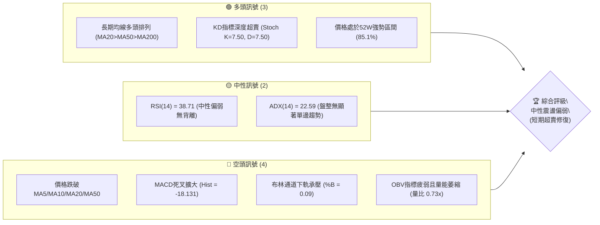
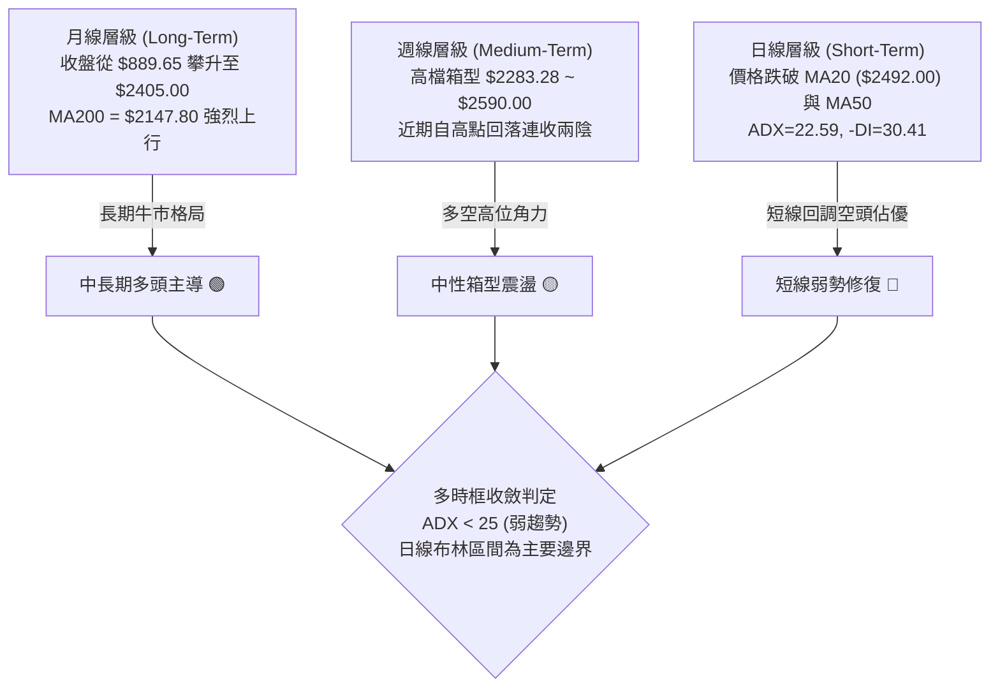
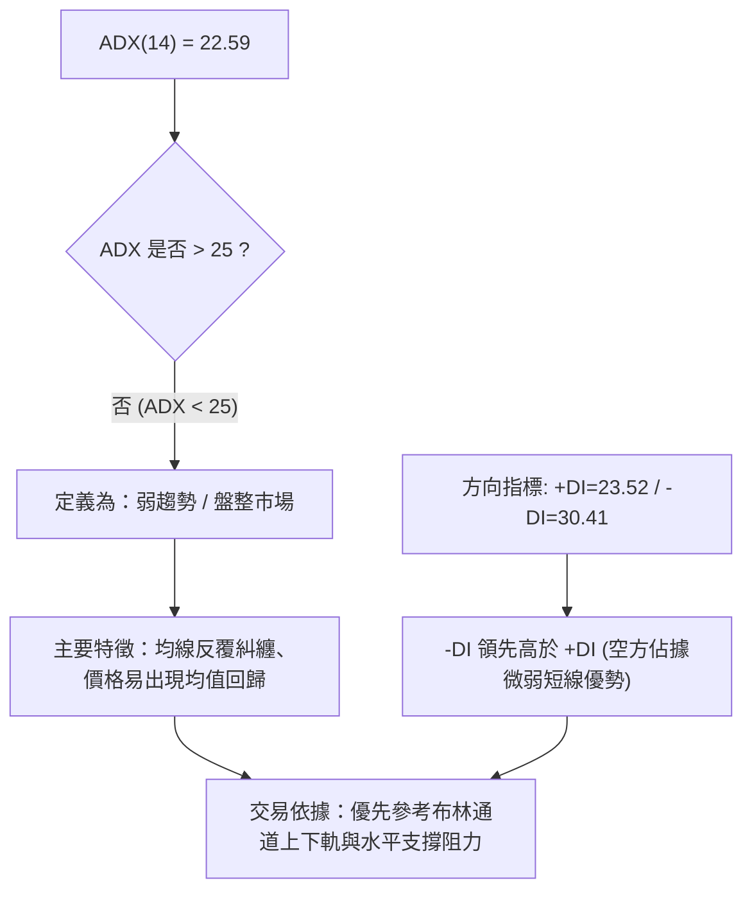
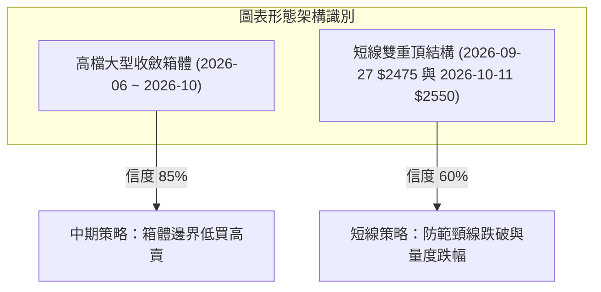
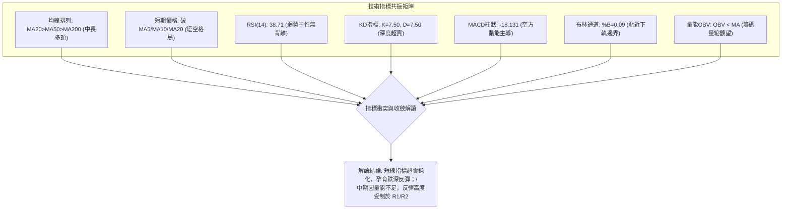
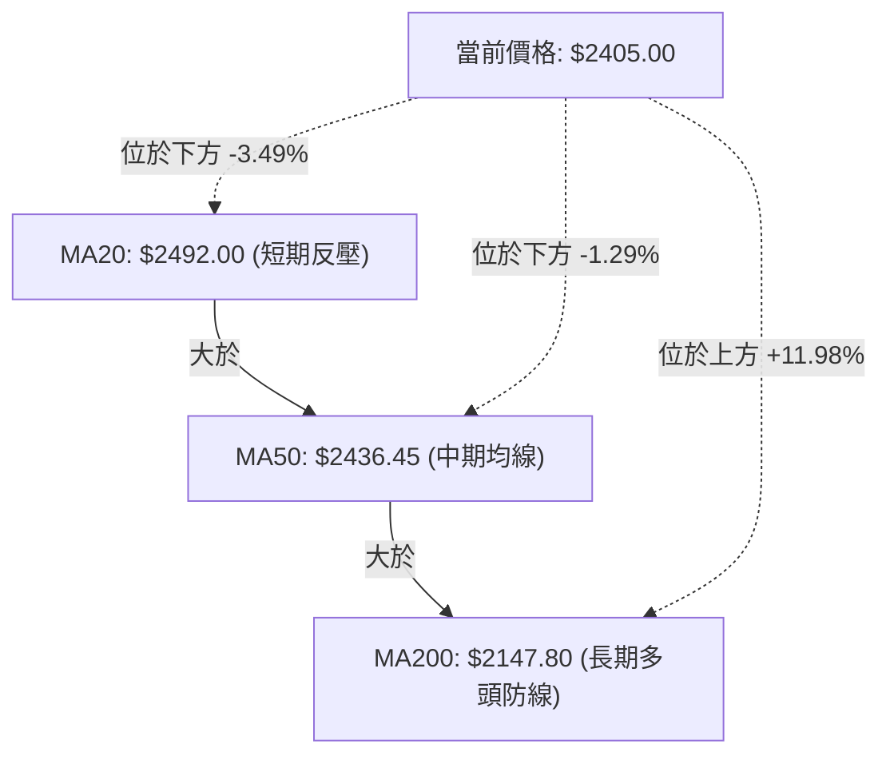
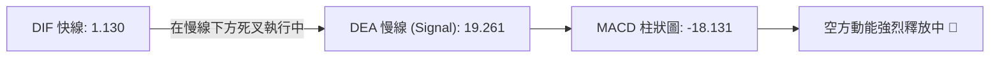
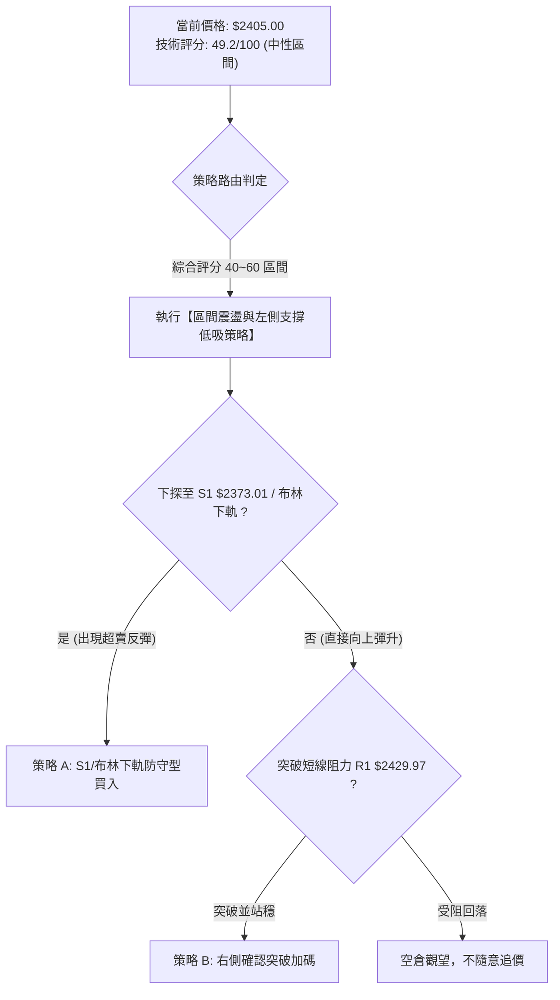
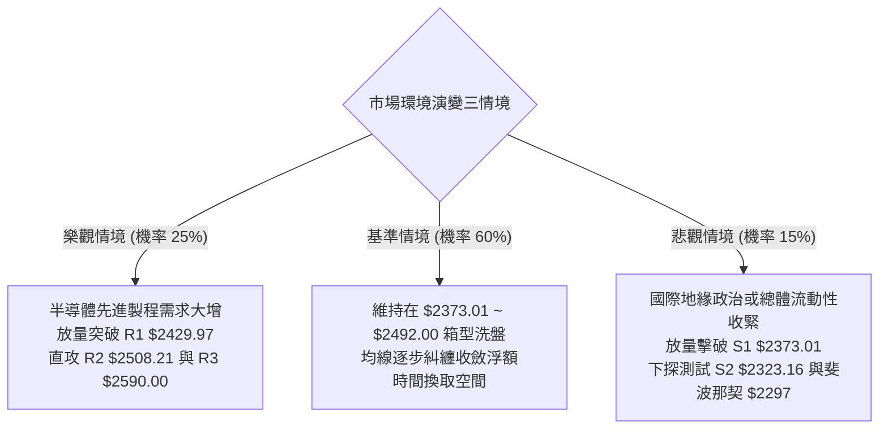

# 2330.TW 技術分析報告

> **報告日期**：2026-10-21 ｜ **語言**：繁體中文 ｜ **數據來源**：Yahoo Finance ｜ **當前價格**：$2405.00

---

## 目錄

| 章節 | 內容 |
|------|------|
| [1. 技術面概覽](#1-技術面概覽) | 訊號儀表板、核心指標、評分卡 |
| [2. 趨勢分析](#2-趨勢分析) | 多時框趨勢、長中短期走勢 |
| [3. 圖表形態分析](#3-圖表形態分析) | 形態識別、K線組合、目標價 |
| [4. 支撐與阻力](#4-支撐與阻力) | 關鍵價位、斐波那契回調 |
| [5. 技術指標深度解讀](#5-技術指標深度解讀) | MA/RSI/MACD/布林/成交量 |
| [6. 動能與波動率](#6-動能與波動率) | 動能評估、ATR、Beta |
| [7. 多時框架總結](#7-多時框架總結) | 時框架評分矩陣 |
| [8. 交易策略建議](#8-交易策略建議) | 多空策略、風險報酬比 |
| [9. 風險提示與監控](#9-風險提示與監控) | 監控指標、風險場景 |

---

## 1. 技術面概覽

### 🎯 技術訊號儀表板



### 📊 核心指標速覽表

| 指標類別 | 指標名稱 | 當前數值 | 訊號 | 解讀 |
|----------|----------|----------|------|------|
| **價格** | 當前收盤價 | $2405.00 | 🟡 | 位於52週區間 85.1%，自歷史高位回落整固 |
| **均線** | 短期 MA20 | $2492.00 | 🔴 | 現價低於 MA20 (-3.49%)，短期均線受壓向下 |
| **均線** | 中期 MA50 | $2436.45 | 🔴 | 現價低於 MA50 (-1.29%)，中期回踩考驗防線 |
| **均線** | 長期 MA200| $2147.80 | 🟢 | 現價高於 MA200 (+11.98%)，長期牛市基底穩固 |
| **動能** | RSI(14) | 38.71 | 🟡 | 位於 30-40 偏弱中性區間，未破30，無背離跡象 |
| **動能** | MACD(12,26,9)| 柱狀 -18.131 | 🔴 | 快線 1.130 低於慢線 19.261，空方動能釋放中 |
| **動能** | Stoch %K/%D | 7.50 / 7.50 | 🟢 | 進入雙重極度超賣區，技術性反彈動能醞釀 |
| **通道** | 布林通道 %B| 0.09 | 🟡 | 逼近下軌 $2385.51，顯示下檔具備波段緩衝墊 |
| **趨勢** | ADX(14) | 22.59 | 🟡 | 低於 25，趨勢力道衰竭，處於典型箱型震盪 |
| **量能** | 當日量比 | 0.73x | 🔴 | 最新量 17.1M < 20日均量 23.4M，OBV低於均線 |
| **波動** | ATR(14) | $38.21 | 🟢 | 佔股價 1.59%，波動率溫和受控，利於低吸防守 |

### 🏆 技術評分卡

```
╔══════════════════════════════════════════════════════════════╗
║             技術評分卡 — 2330.TW (2026-10-21)               ║
╠══════════════════════════════════════════════════════════════╣
║ 趨勢強度 (Trend)     ▓▓▓▓▓▓▓▓░░░░░░░░░░░░  42/100  🟡 中性弱勢 ║
║ 動能指標 (Momentum)  ▓▓▓▓▓▓░░░░░░░░░░░░░░  35/100  🔴 空方主導 ║
║ 支撐穩定度 (Support) ▓▓▓▓▓▓▓▓▓▓▓▓▓▓░░░░░░  70/100  🟢 下檔強韌 ║
║ 成交量配合 (Volume)  ▓▓▓▓▓▓▓▓░░░░░░░░░░░░  38/100  🔴 量能退潮 ║
║ 形態完整度 (Pattern) ▓▓▓▓▓▓▓▓▓▓▓▓░░░░░░░░  58/100  🟡 箱型洗盤 ║
║ 均線架構 (Moving Avg)▓▓▓▓▓▓▓▓▓▓░░░░░░░░░░  52/100  🟡 長多短空 ║
╠══════════════════════════════════════════════════════════════╣
║ 綜合技術評分         ▓▓▓▓▓▓▓▓▓▓░░░░░░░░░░  49.2/100 🟡 中性盤整 ║
╚══════════════════════════════════════════════════════════════╝
```

---

## 2. 趨勢分析

### 🌐 多時框趨勢分析



### 📈 長期趨勢 — 12個月走勢圖（Unicode）

```
2330.TW 月線走勢圖（2025-11 至 2026-10）
價格軸 ($)
$2500 ┤                                              ●($2480.00)
$2400 ┤                                        ●   ●           ●($2405.00)←現價
$2300 ┤                                    ●
$2100 ┤                            ●
$1900 ┤                    ●
$1700 ┤                ●       ●
$1500 ┤        ●   ●
$1400 ┤    ●
$1300 ┤
      └────┬───┬───┬───┬───┬───┬───┬───┬───┬───┬───┬───┬───
          11  12  01  02  03  04  05  06  07  08  09  10 (月份)
          2025                    2026
```

#### 長期走勢特徵分析表格

| 階段 | 時間跨度 | 起訖收盤價區間 | 區間漲跌幅 | 主要走勢特徵 |
|------|----------|----------------|------------|--------------|
| **基底起漲期** | 2025-04 ~ 2025-09 | $889.65 ➔ $1289.19 | +44.91% | 自底部築底完成後展開首波主升段，放量突破千元關卡 |
| **主升加速段** | 2025-10 ~ 2026-02 | $1481.83 ➔ $1977.40 | +33.44% | 沿MA20強勢單邊推升，突破二千元心理關卡前夕出現加速 |
| **強烈回洗段** | 2026-02 ~ 2026-03 | $1977.40 ➔ $1750.17 | -11.49% | 急速獲利回吐，確立中長線波段回調低點，消化浮額 |
| **二次爆發段** | 2026-03 ~ 2026-05 | $1750.17 ➔ $2341.84 | +33.81% | 軋空噴出走勢，連續突破新高並在二千三百元建立新平台 |
| **高位箱型整固**| 2026-06 ~ 2026-10 | $2402.93 ➔ $2405.00 | +0.09% | 圍繞 $2400 橫盤震盪5個月，最高見 $2590.00，波動逐漸收斂 |

### 📊 中期趨勢（週線分析）

中期走勢呈現典型高檔對稱震盪箱體，過去20週收盤價緊密圍繞在 $2283.28 至 $2550.00 之間。2026-10-11 當週曾觸及週收盤高點 $2550.00（伴隨 52W 高點 $2590.00），隨後連續兩週快速拉回至 $2405.00，顯示在 $2500 以上籌碼換手意願降低，高檔追價力道枯竭。

```
中期週線震盪箱體示意圖
$2590.00 ┬────────────────────────────────────────── 52W高點強阻力
         │      ▲ 假突破 (2026-10-11 $2550.00)
$2508.21 ┼──────┼─────────────────────────────────── 箱體上沿阻力 R2
         │      │      ╭─╮
$2405.00 ┼──────┼──────│現│──────────────────── 箱體中軸平衡點 (現價)
         │      │      ╰─╯   ▼ 回踩下測中
$2323.16 ┼──────┴──────────────┼───────────────────── 箱體下沿支撐 S2
$2283.28 ┴────────────────────┴───────────────────── 7月波段極值低點 S3
```

### ⚡ 趨勢強度評估（ADX 解讀）



#### ADX 強度對照表

| 指標名稱 | 數值 | 區間定義 | 當前市場狀態判定 |
|----------|------|----------|------------------|
| **ADX(14)** | 22.59 | 20 - 25 | **弱趨勢 / 箱型盤整**：缺乏單邊動能，切勿追高殺低 |
| **+DI** | 23.52 | 多方動能 | 處於回落狀態，買盤推進力道趨緩 |
| **-DI** | 30.41 | 空方動能 | 高於 +DI，反映自 $2590.00 下殺之短線賣壓 |
| **趨勢方向** | -DI > +DI | 空頭主導短線 | 空方暫居上風，但因 ADX<25，不具備強烈向下暴跌趨勢 |

---

## 3. 圖表形態分析

### 🔍 形態識別系統



#### 形態識別與信心度評估表

| 形態類別 | 信心度 | 判斷依據（引用真實數據） | 完成度 | 目標價（附嚴謹計算式） |
|----------|--------|--------------------------|--------|------------------------|
| **高檔矩形箱體** | 85% | 2026年6月至10月價格區間反覆受阻於 $2508.21-$2590.00，並受撐於 $2283.28-$2323.16 | 90% | 上軌目標：$2508.21<br/>下軌目標：$2323.16 |
| **短線雙頂型態** | 60% | 頂點一：2026-09-27 $2475.00，頂點二：2026-10-11 $2550.00，短線回落失守 MA20 ($2492.00) | 65% | 頸線位 = $2460.00 (2026-09-20)<br/>高度 H = $2550.00 - $2460.00 = $90.00<br/>量度跌幅 = 頸線 $2460.00 - $90.00 = **$2370.00**（高度契合 S1 支撐位 $2373.01） |

### 🕯️ 重要K線形態分析

| 週期/月份 | 收盤價 | K線形態 | 解讀 | 訊號 |
|-----------|--------|---------|------|------|
| **2026-07-19** | $2283.28 | 長下影打底陰線 | 週放量 200.1M 測試波段底部，確認 S3 支撐強烈有效 | 🟢 |
| **2026-09-20** | $2460.00 | 溫和放量小陽線 | 結束整理並向上攻擊，週量回升突破 100M | 🟢 |
| **2026-10-11** | $2550.00 | 高檔長上影假突破 | 觸及 52W 高點 $2590.00 後收斂，週量縮至 77.3M 呈現量價背離 | 🔴 |
| **2026-10-18** | $2420.00 | 大陰線長實體下殺 | 週量放大至 160.0M，機構籌碼獲利了結吞沒前兩週漲幅 | 🔴 |
| **2026-10-25 (當前)** | $2405.00 | 縮量十字收斂線 | 週量萎縮至 40.7M，賣壓衰竭，於布林下軌處尋求支撐 | 🟡 |

### 📉 ASCII 走勢形態示意圖

```
高檔箱體與短線雙頂破位示意圖
$2590 ──────────────────────────────────────── 52W 高點 (2026-10)
                 頂部2: $2550
                  ╭─╮
  頂部1: $2475     │ │
      ╭─╮         │ │
      │ │   頸線: $2460
──────┼─┼────╭─╮──┼─┼──────────────────────── 短線多空分水嶺
      │ │    │ │  │ │
      │ ╰────╯ │  │ ╰───╮
──────┼────────┼──┼─────┼───────────────────── MA50: $2436.45
      │        │  │     │  現價: $2405.00
──────┼────────┼──┼─────┼───●──────────────────
      │        │  │     ╰───────┐ (雙頂量度滿足點 / 支撐 S1)
$2373 ┴────────┴──┴─────────────┴───────────── S1: $2373.01 (強防守區)
```

---

## 4. 支撐與阻力

### 🗺️ 關鍵價位分布圖（Unicode）

```
2330.TW 價位結構分布圖
═══════════════════════════════════════════════════════════════════════
$2590.00 ║████████████████████████████████║ 強阻力 R3 (52W歷史天花板)
$2508.21 ║██████████████████████          ║ 關鍵阻力 R2 (箱體上邊界密集區)
$2429.97 ║████████████                    ║ 短線阻力 R1 (反彈首要減壓位)
$2405.00 ╠════════════════════════════════╣ ◄ 當前收盤價 ($2405.00)
$2373.01 ║▓▓▓▓▓▓▓▓▓▓▓▓▓▓▓▓                ║ 近期支撐 S1 (雙頂量度滿足/MA120)
$2323.16 ║██████████████████████          ║ 強力支撐 S2 (7-8月波段底部換手區)
$2283.28 ║████████████████████████████████║ 核心防守 S3 (近半年極限低點)
═══════════════════════════════════════════════════════════════════════
```

### 🚧 阻力位分析表

| 阻力級別 | 價位 | 形成原因 | 突破難度 | 重要性 |
|----------|------|----------|----------|--------|
| **R1** | **$2429.97** | 近期波段下殺的密集換手點，與 MA5 ($2435.00) 及 MA50 ($2436.45) 形成三合一重疊反壓 | 🟡 中等 | 短線轉強判斷關鍵點，站穩方可緩解下行壓力 |
| **R2** | **$2508.21** | 波段高點聚類位，近4週密集橫盤套牢帶，且與 MA20 ($2492.00) 形成心理共振 | 🔴 較高 | 中期箱型多空平衡關鍵樞紐，需補量突破 |
| **R3** | **$2590.00** | 52週歷史最高紀錄價位，籌碼歷史解套天花板 | 🔴 極高 | 需整體半導體產業利多與量能暴增方能突破 |

### 🛡️ 支撐位分析表

| 支撐級別 | 價位 | 形成原因 | 守住機率 | 重要性 |
|----------|------|----------|----------|--------|
| **S1** | **$2373.01** | 近一年波段低點聚類，與上升中 MA120 ($2373.37) 形成高精度重合防線 | 🟢 75% | 短線空方攻擊減速區，布林通道下軌擴展煞車位 |
| **S2** | **$2323.16** | 2026年6月至8月多次探底回升的密集承接平台 | 🟢 85% | 中期生命線核心防禦點，失守則中期型態破裂 |
| **S3** | **$2283.28** | 2026-07-19 當週創下的半年波段低點，大資金防守底線 | 🟢 92% | 多頭牛市防線底線，對應斐波那契 23.6% ($2297.00) |

### 📐 斐波那契回調位分析

依據 52週極值區間 **$1348.46 (0.0%) ➔ $2590.00 (100.0%)** 計算之黃金分割架構如下：

```
斐波那契回調階梯分布
  0.0%  (52W High)   $2590.00 ───────────────────── 極限頂部
                       │
 23.6%               $2297.00 ───┐ 
                       │         │  現價 $2405.00 處於強勢回調區間
                       │         │  位於 0.0% 與 23.6% 之間 (超強整理)
 38.2%               $2115.73 ───┴ 
 50.0%               $1969.23 ─── 中期多空平衡點
 61.8%               $1822.73 ─── 黃金分割生命線
 78.6%               $1614.15 
100.0%  (52W Low)    $1348.46 ───────────────────── 歷史大底起漲點
```

- **位置意義解讀**：現價 $2405.00 依然穩固保持在 **23.6% 回調位 ($2297.00) 之上**。在技術分析學派中，強勢上漲個股回調若能守住 23.6% 分割位，代表整體市場屬於「極強勢強體整理」，並未傷及多頭核心趨勢。
- **回調空間測算**：目前價格距 23.6% 回調位尚有 $108.00 (+4.49%) 的安全緩衝墊，且下方還有 S1 ($2373.01)、S2 ($2323.16) 兩道密集低點群攔截，整體下檔防禦結構嚴密。

---

## 5. 技術指標深度解讀

### 🎛️ 指標訊號總覽



### 📈 移動平均線排列分析



#### 均線數據深度解讀

- **排列格局**：當前 MA20 ($2492.00) > MA50 ($2436.45) > MA200 ($2147.80)，整體均線架構維持長週期多頭排列。
- **短期均線空頭排列**：短期視角下，MA5 ($2435.00) < MA10 ($2492.50) ≈ MA20 ($2492.00)，且現價 $2405.00 處於所有短天期均線下方。
- **扣抵與助跌效應**：MA5 日均線斜率向下 (-1.23%)，MA10 與 MA20 同步走平下彎 (-3.51% 與 -3.49%)，顯示兩週前在 $2500 以上進場的籌碼全面轉為浮額套牢，對短線反彈形成壓制。

### 📉 RSI(14) 分析

```
RSI(14) 狀態指示計
0           20          40     50          70          100
├───────────┼───────────┼──────┼───────────┼───────────┤
                        ▲
                     38.71 (中性偏弱)
進度條: ███████████████░░░░░░░░░░░░░░░ 38.71%
```

- **超買超賣判定**：數值為 38.71，脫離 50 中軸弱勢區，但尚未觸及 30 極端超賣閾值。
- **背離檢查**：
  - 價格於 2026-10-11 創波段高點 $2550.00 時，週 RSI 達到 74.3；而現價跌至 $2405.00，RSI 迅速降至 38.71。
  - **結論**：指標與價格走勢同步下行，**並無底背離（Bullish Divergence）亦無頂背離**，反映當前下跌為籌碼正常釋放，非主力暗中吸籌。

### 📊 MACD(12/26/9) 訊號解讀



- **快慢線分析**：快線 DIF (1.130) 急遽下穿慢線 DEA (19.261)，雖仍處於零軸上方，但已形成高檔死叉。
- **柱狀圖動能**：柱狀圖自前週的 +10.055 驟降至 -13.696，最新進一步擴大至 -18.131，顯示短線下殺動能充沛，空方尚未出現衰竭拐點。

### 📦 布林通道分析

```
布林通道 (20, 2) 價位空間分布
$2598.49 ┬────────────────────────────────────────── BB 上軌 (阻力帶)
         │
$2492.00 ┼────────────────────────────────────────── BB 中軌 (MA20)
         │
$2405.00 ┼─● 現價 (已下穿中軌，逼近下軌)
$2385.51 ┴────────────────────────────────────────── BB 下軌 (支撐帶)

%B 位置: 0.09 (極低位，下軌防禦力測試)
進度條: █░░░░░░░░░ 9.0%
```

- **頻寬與通道形態**：中軌維持在 $2492.00，通道上下軌呈現平行微張狀態。
- **%B 指標解讀**：目前 %B 僅為 **0.09**，價格與下軌 $2385.51 僅差 $19.49。根據布林通道統計規律，當 %B < 0.10 且 ADX < 25 時，股價極易出現均值回歸（Mean Reversion），向中軌靠攏。

### 💹 成交量分析（量價配合度）

```
成交量量能柱狀圖比較
今日成交量 : 17.10M  ███████████████░░░░░░░░░ (0.73x)
20日均量   : 23.41M  █████████████████████
50日均量   : 19.80M  █████████████████░
```

- **量比評估**：今日量比僅 0.73x，顯示跌勢過程並未引發大規模恐慌性拋售，殺跌主要源於市場追價意願缺乏造成的流動性滑點。
- **OBV 趨勢解讀**：OBV 指標已跌落至其均線下方，驗證當前量能疲弱，市場大戶主力處於觀望停看聽階段，未見積極增量買盤進場。

---

## 6. 動能與波動率

### ⚡ 動能評估四象限

```
動能與波動率矩陣分佈
    高動能 ↑
           │      Q3 (高動能·高波動)      │      Q1 (強動能·低波動)
           │      [高風險單邊趨勢]        │      [穩健單邊攻擊段]
           │                              │
───────────┼──────────────────────────────┼───────────────────────────────
           │      Q4 (弱動能·高波動)      │      Q2 (弱動能·低波動)
           │      [破位洗盤風險區]        │  ★ 2330.TW 當前位置 (Q2)
           │                              │  (ATR=1.59%, ADX=22.59)
    低動能 ┴──────────────────────────────┴───────────────────────────────
           0                              中                             高
                                      波動率 (ATR) →
```

#### 動能狀態對照表

| 象限 | 動能維度 | 波動維度 | 2330.TW 判定 | 戰略應對方針 |
|------|----------|----------|--------------|--------------|
| **Q1** | 強 | 低 | ✕ | 最佳單邊順勢買點 |
| **Q2** | **弱** | **低** | **✓ 正處於此** | **箱型邊界低吸，控制停損，嚴禁追價** |
| **Q3** | 強 | 高 | ✕ | 激進突破交易 |
| **Q4** | 弱 | 高 | ✕ | 嚴格停損出場 |

### 📊 ATR 波動率分析

- **ATR(14) 絕對值**：**$38.21**。
- **價格佔比**：約佔當前股價之 **1.59%**，代表每日平均合理震盪區間約在 38 元上下。
- **風控止損距離量化建議**：
  - **極短線交易（1.5 倍 ATR）**：$38.21 × 1.5 = **$57.32**。
  - **波段交易（2.0 倍 ATR）**：$38.21 × 2.0 = **$76.42**。
  - **防守位指引**：在 $2405.00 進場，若以 2 倍 ATR 設置止損，底線約落於 $2328.58，剛好覆蓋關鍵支撐 S2 ($2323.16)。

### 📐 Beta 與市場相關性

- **Beta 數值**：**1.239**。
- **特性分析**：Beta > 1 顯示該股具備高於大盤（加權指數）23.9% 的波動敏感度。
- **大盤共振效應**：當加權指數出現反彈波時，2330.TW 具備超越大盤的彈升力道；反之，若大盤受國際系統性風險衝擊，本股回調幅度亦將大於市場平均。

---

## 7. 多時框架總結

### 📋 時框架評分表

| 時框架 | 趨勢方向 | 動能狀態 | 均線排列 | 圖表形態 | 綜合評分 | 戰略建議 |
|--------|----------|----------|----------|----------|----------|----------|
| **月線** | 🟢 強烈看多 | 偏強 (均線推升) | 多頭排列 (MA200遠在下方) | 長線巨型上升階梯 | 85/100 | 長期投資者底倉續抱 |
| **週線** | 🟡 箱型震盪 | 中性 (-DI小幅領先) | 均線糾纏 | 高檔 $2283-$2590 矩形箱體 | 55/100 | 箱體區間高拋低吸 |
| **日線** | 🔴 短線修正 | 弱勢 (MACD負柱擴大) | 跌破 MA20/MA50 | 雙頂初步頸線破位 | 35/100 | 嚴控多頭倉位，等待跌勢止穩 |

### 🔲 綜合訊號矩陣

```
時框架訊號收斂圖
┌──────────┬─────────────────┬─────────────────┬─────────────────┐
│ 維度     │ 短期 (日線)     │ 中期 (週線)     │ 長期 (月線)     │
├──────────┼─────────────────┼─────────────────┼─────────────────┤
│ 價格位置 │ 偏空 (跌破MA20) │ 中性 (箱體中樞) │ 偏多 (牛市高檔) │
│ 動能方向 │ 🔴 下行擴大     │ 🟡 趨勢衰竭     │ 🟢 多頭掌控     │
│ 支撐測試 │ 測試下軌 $2385  │ 測試 S1/S2      │ 遠高於 MA200    │
└──────────┴─────────────────┴─────────────────┴─────────────────┘
```

### ⚖️ 多時框收斂結論

> **收斂法則執行**：
> 1. 當前趨勢強度指標 **ADX(14) = 22.59 < 25**，依規定判定為**「盤整行情」**。
> 2. 在盤整格局下，市場主導邏輯不宜採用單邊追隨法，而**必須依日線布林通道上下軌 ($2385.51 ~ $2598.49) 與關鍵高低點 ($2323.16 ~ $2508.21) 為核心交易區間**。
> 3. **唯一方向性結論：【中性觀望，偏向區間下軌防禦型低吸】**。日線雖見空方 MACD 壓制，但受制於 ADX 疲弱與 KD 超賣 (7.50)，向下殺跌空間有限；而週線長線多頭基底尚在，故不宜在此處盲目追空。

---

## 8. 交易策略建議

### 🗺️ 策略決策流程圖



### 🧭 策略路由

**當前主策略方向 = 【中性區間操作，布林下軌支撐回測低吸】（依綜合評分 49.2/100）**
依據評分卡 49.2 分屬 40–60 中性區間，禁止單邊追空或追多，主推以布林通道下軌及 S1 支撐構築的區間低吸架構。

### 🎯 價格情境階梯（Price Scenarios）

| 觸發條件 | 下一目標 | 後續延伸 | 情境含義 |
|----------|----------|----------|----------|
| **向上突破 R1 $2429.97** | R2 $2508.21 | R3 $2590.00 | 短線止跌轉強，回補雙頂缺口，重返多頭走勢 |
| **守穩 $2385.51 ~ $2405.00** | R1 $2429.97 | — | 於布林下軌展開技術性超賣均值回歸修復 |
| **跌破 S1 $2373.01** | S2 $2323.16 | S3 $2283.28 | 短線結構弱化，雙頂量度滿足後下探箱體下沿尋求大資金接盤 |

### 📊 情境機率分佈

| 情境 | 機率 | 主要依據 |
|------|------|----------|
| **情境一：下測 S1 後展開超賣反彈** | **55%** | KD 雙指標極度超賣 (%K=7.50)，布林 %B=0.09 臨近下軌，跌勢逼近 S1 支撐與 MA120 ($2373.37) 共振帶 |
| **情境二：箱體 $2373 ~ $2430 窄幅震盪** | **30%** | ADX=22.59 指向典型弱勢盤整，成交量 17.1M 嚴重退潮，市場進入等待期 |
| **情境三：下破 S1 加速跌向 S2** | **15%** | MACD 負柱狀體持續擴大 (-18.131)，若外盤半導體突發利空導致機構進一步斬倉 |

### 🟢 主策略詳情（區間操作多頭方案）

| 策略要素 | 策略 A（左側低吸策略） | 策略 B（右側確認策略） |
|----------|------------------------|------------------------|
| **進場條件** | 股價回踩至布林下軌至 S1 支撐區，出現盤中止跌下影線 | 日線收盤價帶量突破站穩 R1 阻力位 |
| **進場價格** | **$2375.00**（浮動區間 $2373.01 ~ $2385.51） | **$2432.00**（突破 R1 $2429.97 後回踩確認） |
| **目標價 T1** | **$2429.97**（短線阻力 R1） | **$2508.21**（箱體上緣 R2） |
| **目標價 T2** | **$2508.21**（波段阻力 R2） | **$2590.00**（52週高點 R3） |
| **止損價格** | **$2318.00**（跌破 S2 $2323.16 關鍵低點） | **$2390.00**（重回 MA50 之下並跌破心理關口） |
| **風險報酬比** | **2.34 : 1**（獲利空間 $133.21 / 風險空間 $57.00） | **1.81 : 1**（獲利空間 $76.21 / 風險空間 $42.00） |
| **成功機率** | 60% | 55% |
| **建議倉位** | 15%（分批建倉） | 20%（突破順勢） |

### 🔴 反向風險觸發點（對沖與轉空提示）

- **觸發條件**：若股價收盤價**實體跌破 S1 $2373.01**，且成交量顯著放大超過 20日均量（>23.4M），代表超賣指標失效，短線空方主導加速。
- **對沖應對**：若手握多頭底倉，應於跌破 S1 時減碼 30%–50%，或在衍生品市場建立對沖空單，下檔預期回踩至 S2 ($2323.16) 或斐波那契 23.6% ($2297.00) 附近方可考慮回補。

### ⭐ 整體訊號強度評星

```
╔═══════════════════════════════════════════════╗
║ 做多訊號強度：★★☆☆☆  (2.5/5星 - 超賣反彈格局) ║
║ 做空訊號強度：★★☆☆☆  (2.0/5星 - 下檔支撐密集) ║
║ 整體可信度：  ★★★★☆  (4.0/5星 - 區間震盪確立) ║
╚═══════════════════════════════════════════════╝
```

---

## 9. 風險提示與監控

### ✅ 關鍵監控指標 Checklist

```
╔══════════════════════════════════════════════════════════════╗
║               2330.TW 交易關鍵監控清單 (Checklist)           ║
╠══════════════════════════════════════════════════════════════╣
║ [ ] 監控價位 $2373.01 (S1)：日線收盤是否守穩，布林下軌是否收斂  ║
║ [ ] 監控價位 $2429.97 (R1)：是否能放量重回 MA50 之上           ║
║ [ ] 指標動態 KD(9,3)：%K 是否自 7.50 超賣區向上金叉突破 %D      ║
║ [ ] 指標動態 MACD：柱狀體是否由 -18.131 開始翻紅縮小             ║
║ [ ] 成交量能：日成交量是否突破 23.4M (20MA均量) 擺脫量縮弱勢   ║
║ [ ] 籌碼指標 OBV：OBV 能否重新穿越向上突破自身均線              ║
╚══════════════════════════════════════════════════════════════╝
```

### ⚠️ 風險場景分析



### 🛡️ 風險管理重要提醒

1. **嚴禁追價與加碼攤平**：由於 MACD 仍處於空頭柱狀擴大階段，切勿在價格反彈至 R1 ($2429.97) 附近尚未站穩前急躁追進，亦不可在跌破止損位後向下盲目攤平成本。
2. **倉位管理原則**：在弱趨勢（ADX=22.59）盤整市場中，單一個股技術交易倉位上限建議嚴控在總投資資產的 **15%–20%** 以內。
3. **波動適應型停損**：嚴格依據 ATR ($38.21) 設置浮動追蹤停損，任何進場單的最大容忍虧損金額不得超過總帳戶權益的 **1.5%**。

---

## 📋 報告總結

```
╔══════════════════════════════════════════════════════════════════════╗
║                    2330.TW 技術分析報告總結                          ║
╠══════════════════════════════════════════════════════════════════════╣
║ 報告日期：2026-10-21                                                 ║
║ 當前價格：$2405.00                                                   ║
║ 分析評級：⚖️ 中性觀望 (區間箱型震盪，短線技術超賣)                    ║
╠══════════════════════════════════════════════════════════════════════╣
║ 關鍵結論：                                                           ║
║ ├─ 長期趨勢：🟢 穩固牛市 (MA20>MA50>MA200，價格遠高於 MA200)         ║
║ ├─ 中期趨勢：🟡 箱型震盪 ($2283.28 ~ $2590.00 間橫盤已歷時5個月)     ║
║ ├─ 短期趨勢：🔴 偏弱回調 (跌破 MA20，KD 深度超賣 7.50，MACD 負柱)    ║
║ ├─ 關鍵支撐：S1 $2373.01 ｜ S2 $2323.16 ｜ S3 $2283.28               ║
║ ├─ 關鍵阻力：R1 $2429.97 ｜ R2 $2508.21 ｜ R3 $2590.00               ║
║ └─ 機構共識：Strong Buy ｜ 分析師均價 $3386.71 (目標高點 $5000.00)   ║
╠══════════════════════════════════════════════════════════════════════╣
║ 最優策略組合：                                                       ║
║ 1. 🥇 最佳機會：等待回踩 S1 $2373.01 / 布林下軌附近低吸，博弈均值回歸  ║
║ 2. 🥈 次選機會：突破站穩 R1 $2429.97 後右側小幅跟進，目標看至 R2 $2508 ║
║ 3. 🥉 保守選擇：空倉耐心等待日線 MACD 出現首根收斂柱與放量再行進場   ║
╚══════════════════════════════════════════════════════════════════════╝
```

---

> ⚠️ **免責聲明**：本報告為 AI 自動生成之技術分析，所有數據及估算均基於提供的歷史價格資訊。本報告**僅供研究與學術參考**，**不構成任何投資建議**。投資有風險，入市需謹慎。

---

*報告生成時間：2026-10-21 ｜ 數據來源：Yahoo Finance ｜ 分析框架：多時框技術分析*