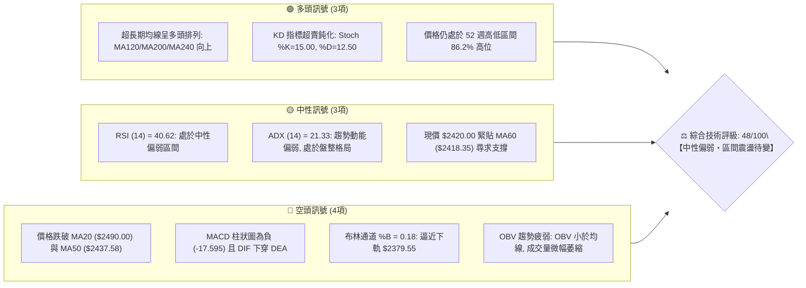
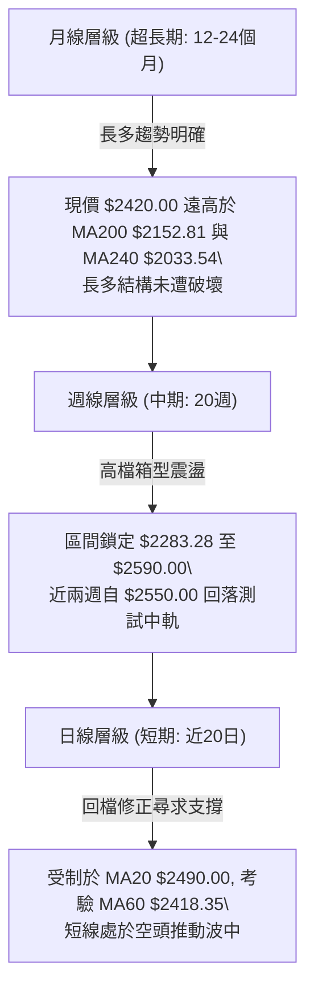
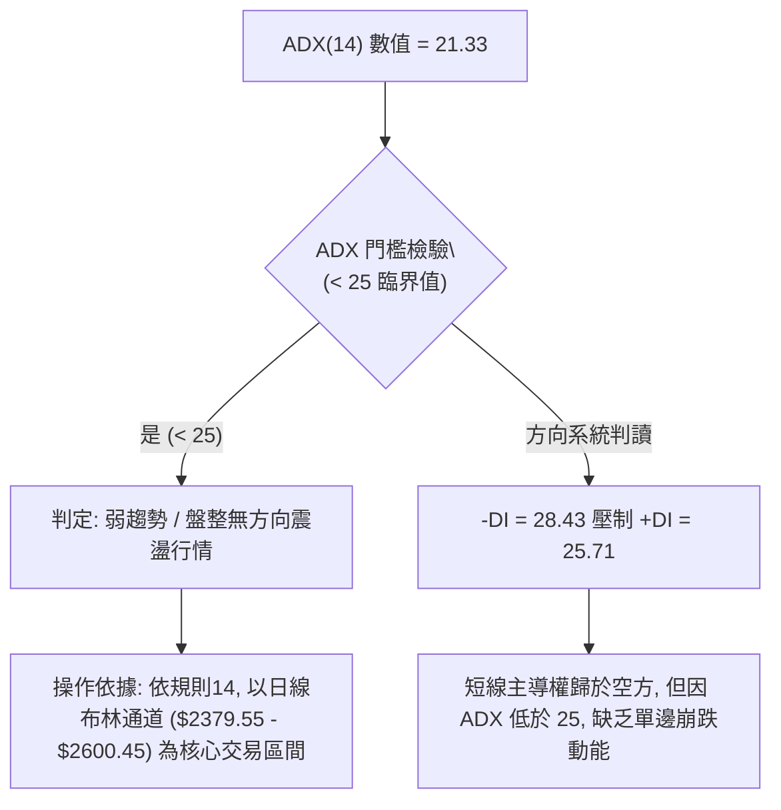
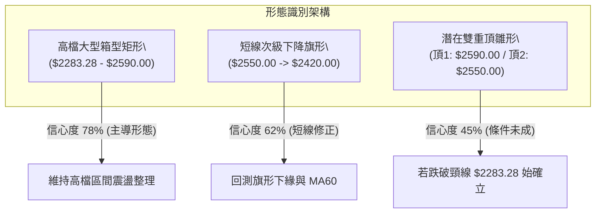
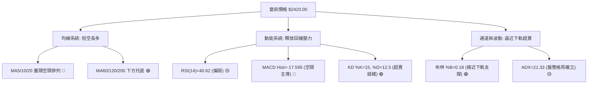
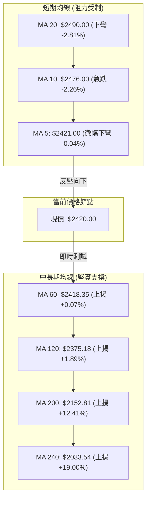
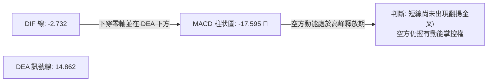
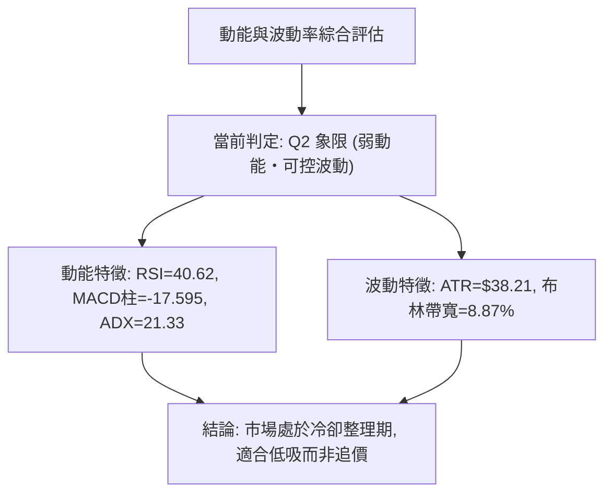
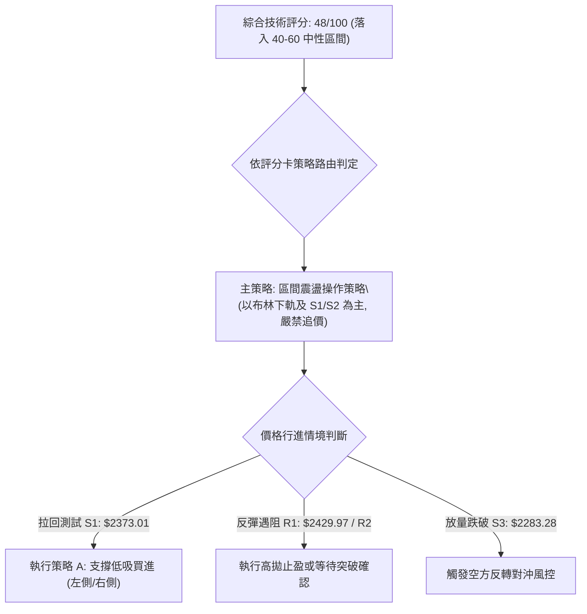
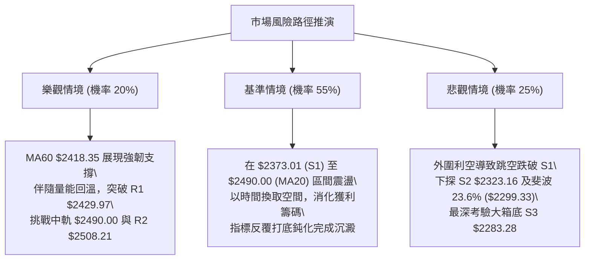

# 2330.TW 技術分析報告

> **報告日期**：2026-10-22 ｜ **語言**：繁體中文 ｜ **數據來源**：Yahoo Finance ｜ **當前價格**：$2420.00

---

## 目錄

| 章節 | 內容 |
|------|------|
| [1. 技術面概覽](#1-技術面概覽) | 訊號儀表板、核心指標、評分卡 |
| [2. 趨勢分析](#2-趨勢分析) | 多時框趨勢、長中短期走勢 |
| [3. 圖表形態分析](#3-圖表形態分析) | 形態識別、K線組合、目標價 |
| [4. 支撐與阻力](#4-支撐與阻力) | 關鍵價位、斐波那契回調 |
| [5. 技術指標深度解讀](#5-技術指標深度解讀) | MA/RSI/MACD/布林/成交量 |
| [6. 動能與波動率](#6-動能與波動率) | 動能評估、ATR、Beta |
| [7. 多時框架總結](#7-多時框架總結) | 時框架評分矩陣 |
| [8. 交易策略建議](#8-交易策略建議) | 多空策略、風險報酬比 |
| [9. 風險提示與監控](#9-風險提示與監控) | 監控指標、風險場景 |

---

## 1. 技術面概覽

### 🎯 技術訊號儀表板



### 📊 核心指標速覽表

| 指標類別 | 指標名稱 | 當前數值 | 訊號 | 解讀 |
|----------|----------|----------|------|------|
| **價格** | 當前價格 | $2420.00 | 🟡 | 位於52週高點 $2590.00 與低點 $1358.34 之 86.2% 位置，短線回檔 |
| **均線** | MA20 | $2490.00 | 🔴 | 現價低於月線 -2.81%，MA20 斜率向下，形成短中期蓋頭反壓 |
| **均線** | MA50 | $2437.58 | 🔴 | 現價跌破季線 -0.72%，短線多方動能受阻 |
| **均線** | MA60 | $2418.35 | 🟢 | 現價微幅高於季線邊界 +0.07%，為短線下檔即時防守支撐 |
| **均線** | MA200 | $2152.81 | 🟢 | 現價大幅高於年線 +12.41%，長期多頭基本骨架依然穩固 |
| **動能** | RSI(14) | 40.62 | 🟡 | 位於 40–50 中性偏弱區間，尚未進入超賣 (<30)，修正仍有空間 |
| **動能** | MACD(12,26,9) | -2.732 / 14.862 | 🔴 | MACD 線跌破訊號線，柱狀圖達 -17.595，空方動能釋放中 |
| **震盪** | Stoch %K / %D | 15.00 / 12.50 | 🟢 | 進入 20 以下超賣區，短線隨時具備技術性反彈契機 |
| **趨勢** | ADX(14) | 21.33 | 🟡 | 數值小於 25，顯示當前非單邊強烈趨勢，處於箱型修正盤整狀態 |
| **通道** | 布林 %B | 0.18 | 🟡 | 逼近下軌 $2379.55，中軌 $2490.00 形成第一波反彈阻力 |
| **波動** | ATR(14) | $38.21 | 🟡 | 佔現價 1.58%，單日波幅適中，並未出現極端失控之恐慌賣壓 |
| **量能** | 當日量 / 20日均量 | 22.32M / 22.75M | 🔴 | 量比 0.98x，OBV < MA，反彈量縮、下跌微帶量，量價配合欠佳 |

### 🏆 技術評分卡

```
╔══════════════════════════════════════════════════════════════════╗
║              2330.TW 技術指標評分卡 (2026-10-22)                 ║
╠══════════════════════════════════════════════════════════════════╣
║ 趨勢強度 (ADX/趨勢方向)  ████████░░░░░░░░░░░░  42/100 🟡 中性盤整║
║ 動能指標 (RSI/MACD/KD)   ████████░░░░░░░░░░░░  40/100 🔴 偏空修正║
║ 支撐穩定度 (S1/S2/MA60)  ██████████████░░░░░░  70/100 🟢 支撐密集║
║ 成交量配合 (OBV/量比)    ████████░░░░░░░░░░░░  40/100 🔴 量能疲弱║
║ 形態完整度 (箱型/回撤)   ████████████░░░░░░░░  60/100 🟡 高檔箱型║
║ 均線排列 (多時框MA架構)  ████████░░░░░░░░░░░░  42/100 🟡 短空格局║
╠══════════════════════════════════════════════════════════════════╣
║ 綜合評分                 █████████░░░░░░░░░░░  48/100 ⚖️ 區間整理║
╚══════════════════════════════════════════════════════════════════╝
```

---

## 2. 趨勢分析

### 🌐 多時框趨勢分析



### 📈 長期趨勢 — 12個月走勢圖（Unicode）

依據月線歷史數據繪製過去 12 個月之收盤走勢：

```
2330.TW 月線走勢圖（2025-11 至 2026-10）
價格軸 ($)
$2500 ┤                                           ● 2480.00
$2400 ┤                                 ● 2402.93    │    ● 2420.00 (現價)
$2300 ┤                           ● 2341.84          │    
$2100 ┤                     ● 2123.07                │    
$1900 ┤               ● 1977.40                      │    
$1700 ┤         ● 1759.34                            │    
$1500 ┤   ● 1536.33                                  │    
$1400 ┤● 1422.55 (波段起漲起點)                      │    
      └───────────────────────────────────────────────────
       11    12    01    02    03    04    05    06    07    08    09    10 (月份)
      (2025)     (--------------- 2026 年度 ----------------)
```

#### 走勢特徵分析表格

| 階段區間 | 時間段 | 起訖價格 | 區間漲跌幅 | 主要走勢特徵與量價結構 |
|----------|--------|----------|------------|------------------------|
| **初升推動段** | 2025-11 ~ 2026-02 | $1422.55 → $1977.40 | +39.00% | 均線發散向上，動能充沛，強勢主升波推進 |
| **波段洗盤段** | 2026-02 ~ 2026-03 | $1977.40 → $1750.17 | -11.49% | 急跌回測長天期均線支撐，完成籌碼快速換手 |
| **主升延伸段** | 2026-03 ~ 2026-05 | $1750.17 → $2341.84 | +33.81% | 突破 2000 大關，呈現階梯式連鎖跳空走勢 |
| **高原箱型段** | 2026-06 ~ 2026-10 | $2402.93 → $2420.00 | +0.71% | 於 $2300–$2590 區間橫盤，進入高檔平台籌碼沉澱 |

### 📊 中期趨勢（週線分析）

從近 20 週收盤走勢可看出，股價在 2026 年 7 月 19 日觸及波段低點 $2283.28 後逐步走高，於 2026 年 10 月 11 日當週收在 $2550.00，但隨即遭遇 52 週歷史高點 $2590.00 的強大阻力。近兩週（10月18日、10月25日收盤皆為 $2420.00）出現連續回吐，RSI 從 74.3 驟降至 40.6，MACD 柱狀圖由正轉負至 -17.595，表明中期趨勢目前受到強烈的頂部反壓，正在回測箱型中軸與下檔均線密集區。

### ⚡ 趨勢強度評估（ADX 解讀）



| 指標項目 | 當前數值 | 參考臨界線 | 狀態評估 | 實戰策略指引 |
|----------|----------|------------|----------|--------------|
| **ADX (14)** | 21.33 | 25.00 | 弱勢盤整 | 避免追漲殺跌，順勢趨勢策略失效，改採箱型區間高拋低吸 |
| **+DI** | 25.71 | 20.00 | 多方衰退 | 多方攻勢暫歇，突破追價容易被套在假突破高點 |
| **-DI** | 28.43 | 20.00 | 空方偏強 | 空方掌控短線話語權，但尚未擴大為破壞性主跌浪 |

---

## 3. 圖表形態分析

### 🔍 形態識別系統



#### 形態信心度與目標價計算表

| 形態名稱 | 信心度 | 判斷依據（引用數據） | 完成度 | 目標價（附嚴謹計算式） |
|----------|--------|----------------------|--------|------------------------|
| **高檔箱型矩形** | 78% | 箱底支撐 S3 為 $2283.28，箱頂阻力 R3 為 $2590.00，價格多次在兩極端間來回震盪。 | 85% | **向上突破目標**：$2590.00 + ($2590.00 - $2283.28) = **$2896.72**<br>**向下破位目標**：$2283.28 - ($2590.00 - $2283.28) = **$1976.56** |
| **短線下降旗形** | 62% | 自 10-11 高點 $2550.00 拉回至 $2420.00，伴隨週成交量由 77.34M 縮至 63.11M，呈現標準回調旗面。 | 60% | **旗形等長測幅**：自突破旗面阻力 R1 ($2429.97) 起算，等長旗桿高度 ($2550.00 - $2402.93 = $147.07) → 目標價 = $2429.97 + $147.07 = **$2577.04** |
| **潛在雙重頂形態** | 45% | 7-10 月期間出現兩次高點聚類 ($2590.00 與 $2550.00)，但尚未跌破頸線 $2283.28，成交量未見頭部爆量。 | 35% | *數據不足以確認成形*。依規則 15 註明：因頸線未破且 ADX 僅 21.33，雙頂信心度 < 50%，僅視為高檔震盪，不預設完全頭部目標。 |

### 🕯️ 重要K線形態分析

| 統計週/月 | 收盤價 | K線形態 | 量價結構解讀 | 技術訊號 |
|-----------|--------|---------|--------------|----------|
| **2026-07-19** | $2283.28 | 長下影打底錘頭線 | 週量高達 200.18M 爆量殺低洗盤，確認 S3 為強烈支撐 | 🟢 強烈買訊 |
| **2026-08-02** | $2417.88 | 實體大陽線收復失地 | 週量 217.65M 創近季天量，多方資金強勢回補入場 | 🟢 多頭推動 |
| **2026-10-11** | $2550.00 | 高檔長上影射擊之星 | 衝高 $2550.00 但週量僅 77.34M 出現量價背離，觸發阻力回洗 | 🔴 頂部預警 |
| **2026-10-18** | $2420.00 | 中長陰線貫穿回跌 | 週量放大至 160.00M，一口氣跌破週線短期均線群 | 🔴 空方宣洩 |
| **2026-10-25** | $2420.00 | 縮量十字星十字線 | 週量萎縮至 63.11M，現價於 $2420.00 收平，顯示下檔承接力道顯現 | 🟡 變盤觀望 |

### 📉 ASCII 走勢形態示意圖

```
2330.TW 日/週線高檔箱型整理與短線旗形示意圖
══════════════════════════════════════════════════════════════════
$2590.00 ┤ (52W High / R3) ───────● 頂部1 ($2590.00)
         │                          \
$2550.00 ┤                           ● 頂部2 ($2550.00)
         │                            \   \ (下降旗形通道)
$2490.00 ┤ (MA20 / 中軌) ─────────────\───\─────────────
         │                              \   \
$2420.00 ┤ (現價) ───────────────────────●───● ◄ 當前位置 ($2420.00)
         │                                \ (測試 MA60 $2418.35)
$2373.01 ┤ (S1 支撐 / BB下軌附近) ────────\─────────────
         │                                 \
$2283.28 ┤ (箱型頸線支撐 S3) ──● 底點1 ($2283.28)
══════════════════════════════════════════════════════════════════
```

### 🎯 形態目標價計算

根據高檔箱型整理形態（有效性 78%）：
- **頸線/箱底**：$2283.28（S3 波段聚類低點）
- **箱頂反壓**：$2590.00（52 週歷史高點 / R3）
- **垂直箱體高度**：$2590.00 - $2283.28 = $306.72
- **上行等幅量測目標價**：$2590.00 + $306.72 = **$2896.72**
- **下行等幅量測目標價**：$2283.28 - $306.72 = **$1976.56**

---

## 4. 支撐與阻力

### 🗺️ 關鍵價位分布圖（Unicode）

```
2330.TW 價位結構分布圖 (由 OHLCV 歷史計算，嚴格錨定)
══════════════════════════════════════════════════════════════════
$2600.45 ║░░░░░░░░░░░░░░░░░░░░░░░░║ 布林通道上軌
$2590.00 ║████████████████████████║ 歷史天塹強阻力 R3 (52W High)
$2508.21 ║████████████████        ║ 次級波段高點反壓 R2
$2490.00 ║▓▓▓▓▓▓▓▓▓▓▓▓▓▓▓▓▓▓▓▓    ║ MA20 / 布林中軌反壓線
$2429.97 ║████████████            ║ 即時波段反彈阻力 R1 (+0.41%)
$2420.00 ╠════════════════════════╣ ◄◄ 當前收盤價 ($2420.00)
$2418.35 ║────────────────────────║ MA60 季線即時防線 (+0.07%)
$2379.55 ║░░░░░░░░░░░░░░░░░░░░░░░░║ 布林通道下軌
$2373.01 ║▓▓▓▓▓▓▓▓▓▓▓▓▓▓▓▓        ║ 第一道波段關鍵支撐 S1 (-1.94%)
$2323.16 ║████████████████████    ║ 第二道強固防守支撐 S2 (-4.00%)
$2283.28 ║████████████████████████║ 箱型底部生死線支撐 S3 (-5.65%)
══════════════════════════════════════════════════════════════════
```

### 🚧 阻力位分析表

所有價位均來自 OHLCV 波段高點聚類計算：

| 阻力級別 | 具體價位 | 與現價距離 | 形成原因與籌碼結構 | 突破難度 | 重要性 |
|----------|----------|------------|--------------------|----------|--------|
| **R1** | **$2429.97** | +0.41% | 近期波段急跌後的日內密集套牢區，MA5 ($2421.00) 於此交會 | 🟡 中等 | 短線轉強第一道門檻 |
| **R2** | **$2508.21** | +3.65% | 10 月初震盪平台之波段高點聚類，且與 MA20 ($2490.00) 重疊共振 | 🔴 偏高 | 中期多空分水嶺 |
| **R3** | **$2590.00** | +7.02% | 52 週歷史高點，法人套牢盤與高檔解套賣壓匯集天花板 | 🔴 極高 | 長期多頭全面攻堅標竿 |

### 🛡️ 支撐位分析表

所有價位均來自 OHLCV 波段低點聚類計算：

| 支撐級別 | 具體價位 | 與現價距離 | 形成原因與籌碼結構 | 守住機率 | 重要性 |
|----------|----------|------------|--------------------|----------|--------|
| **S1** | **$2373.01** | -1.94% | 近期回檔之密集下影線支撐，與布林下軌 ($2379.55) 構成共振防線 | 🟢 75% | 日線短線多頭防守底線 |
| **S2** | **$2323.16** | -4.00% | 8 月初反彈起漲點之換手平台，籌碼沉澱扎實 | 🟢 85% | 週線級別強力防守緩衝區 |
| **S3** | **$2283.28** | -5.65% | 7 月 19 日週爆量 200M 的恐慌盤低點，為整體大箱型之底邊頸線 | 🟢 92% | 中長期多頭多空分水嶺 |

### 📐 斐波那契回調位分析

依據 52 週完整波段起訖（$1358.34 → $2590.00，總垂直落差 $1231.66）精確對應之黃金分割水準：

| 斐波那契比例 | 基準價位 | 當前相對位置 | 技術意義與多空攻防解讀 |
|--------------|----------|--------------|------------------------|
| **0.0% (高點)** | **$2590.00** | 位於上方 +7.02% | 多頭歷史頂點，空方重兵防守處。 |
| **23.6%** | **$2299.33** | 位於下方 -4.99% | 極強勢修正回撤位。現價 ($2420.00) 仍在此線上方，證明自 $1358.34 起算的長多主升段僅拉回不到四分之一，屬極強級別的高檔換手。 |
| **38.2%** | **$2119.51** | 位於下方 -12.42% | 傳統強勢回撤黃金分割位，與 MA200 ($2152.81) 形成堅固共振支撐帶。 |
| **50.0%** | **$1974.17** | 位於下方 -18.42% | 多空平衡分水嶺，亦為 2026 年 2 月波段前高密集成交帶。 |
| **61.8%** | **$1828.84** | 位於下方 -24.43% | 黃金分割防禦底線，未跌破前，長期多頭趨勢絕對有效。 |
| **78.6%** | **$1621.92** | 位於下方 -33.00% | 深度回撤防禦區。 |
| **100.0% (低點)**| **$1358.34** | 位於下方 -43.87% | 52 週絕對低點，長線起漲基地。 |

**位置解讀**：現價 $2420.00 處於 0.0% ($2590.00) 與 23.6% ($2299.33) 之間，表明當前回調在長線格局中僅屬微幅淺層修正，多頭基本結構未受系統性損傷。

---

## 5. 技術指標深度解讀

### 🎛️ 指標訊號總覽



### 📈 移動平均線排列分析



均線狀態解讀：
1. **短空格局**：價格位於 MA5、MA10、MA20 之下，且短天期均線呈現向下扣抵，MA20 ($2490.00) 形成多方反彈難以逾越之天塹。
2. **長多基石**：MA60 ($2418.35)、MA120 ($2375.18)、MA200 ($2152.81) 全部維持向上傾斜，其中現價與 MA60 相距僅 +1.65 元（+0.07%），形成多方最後防守壁壘。

### 📉 RSI(14) 分析

- **當前數值**：40.62 🟡
- **動能強度進度條**：`████████░░░░░░░░░░░░` 40.62%
- **區間評估**：處於 40–50 偏弱中性區間。多頭行情的回調常在 40 附近獲得支撐；若跌破 40，將向下尋求 30 超賣水準。
- **背離分析結論**：經檢驗近 20 週與日線數據，RSI 與價格走勢保持同步（價格創 $2550 高點時 RSI 達 74.3，隨價格拉回而回落至 40.62），**目前無明顯頂背離或底背離**。此修正為正常的指標降溫，非反轉型背離。

### 📊 MACD(12,26,9) 訊號解讀



數值解析：
- DIF 線 (-2.732) 跌破 DEA (14.862)，兩者差距擴大至 -17.595，這是自 10 月中旬從高檔反轉以來的持續空頭訊號。
- 柱狀圖仍處於負值擴張後的高位，顯示短線空方動能尚未完全耗盡，需要等待柱體開始收斂（由 -17.595 向上收斂至 0）方可確認止跌。

### 📦 布林通道分析

```
2330.TW 日線布林通道當前結構示意圖
══════════════════════════════════════════════════════════════════
$2600.45 ┬─ 布林通道上軌 (+2.0σ)
         │  
$2490.00 ┼─ 布林通道中軌 (MA20) ◄ 強大蓋頭阻力
         │  
$2420.00 ┼─ 當前價格 ($2420.00, %B = 0.18) ◄ 逼近下軌
         │  
$2379.55 ┴─ 布林通道下軌 (-2.0σ) ◄ 下檔即時動態支撐
══════════════════════════════════════════════════════════════════
帶寬 (Bandwidth) = ($2600.45 - $2379.55) / $2490.00 = 8.87% (中度收斂)
```

- **%B 指標 = 0.18**：價格已深入布林通道下半部（0 代表下軌，0.5 代表中軌）。通常 %B < 0.20 屬於短線超賣區，下行空間受限，下軌 $2379.55 與靜態支撐 S1 ($2373.01) 形成堅固共振。

### 💹 成交量分析（量價配合度）

1. **量能萎縮**：最新成交量 22,321,809 股，低於 20 日均量 22,756,022 股（量比 0.98x），顯示在回檔過程中，並未出現法人恐慌殺盤天量，賣壓主要來自追價意願不足所導致的陰跌。
2. **OBV 能量潮判讀**：當前技術數據顯示「OBV < MA → 量能疲弱」。自 10 月 11 日當週成交量縮至 77.34M 後，資金流入趨於被動。量價結構呈「跌時量縮、彈時無量」，尚未見到主動買盤強勢表態，量能不支持短線立刻發動 V 型反轉。

---

## 6. 動能與波動率

### ⚡ 動能評估四象限

| 象限 | 動能強度 (RSI/MACD) | 波動率水準 (ATR/帶寬) | 當前狀態判斷 | 實戰策略應對 |
|------|---------------------|-----------------------|--------------|--------------|
| **Q1 (爆發區)** | 強動能 (RSI>60) | 低波動 (ATR降) | — | 突破前期蓄勢，最佳單邊進場點 |
| **Q2 (整理區)** | **弱/平緩動能 (RSI 40.6)** | **低/中波動 (ATR 1.58%)** | **✓ 當前 2330.TW 所處狀態** | **防守觀望、區間網格、逢低承接** |
| **Q3 (極端區)** | 強動能 (單邊大跌) | 高波動 (恐慌拋售) | — | 高風險投機，僅限逆勢摸底 |
| **Q4 (衰退區)** | 弱動能 (無人問津) | 高波動 (無量崩跌) | — | 嚴格停損出場，全面避開標的 |



### 📊 ATR 波動率分析

- **ATR(14) 數值**：**$38.21**（佔現價 $2420.00 之 1.58%）。
- **日內波動性質**：處於健康可控範圍，波動率未激化。
- **風控參數計算**：
  - **保守型止損距離 (1.5 × ATR)**：$38.21 × 1.5 = **$57.32** → 對應止損位：$2420.00 - $57.32 = **$2362.68**（略低於 S1 $2373.01）。
  - **寬鬆型波段止損 (2.0 × ATR)**：$38.21 × 2.0 = **$76.42** → 對應止損位：$2420.00 - $76.42 = **$2343.58**（防守 S2 $2323.16 之上）。

### 📐 Beta 與市場相關性

- **Beta 係數**：**1.239**。
- **市場敏感度解讀**：作為台股權值核心，2330.TW 呈現高於大盤 23.9% 的波動敏感度。在當前弱勢整理格局下，若大盤指數出現回調，2330.TW 將承受放大級別的壓力；反之，一旦大盤止跌，其彈性亦將領先指數。

---

## 7. 多時框架總結

### 📋 時框架評分表

| 時框架 | 趨勢方向 | 動能狀態 | 均線排列狀態 | 形態結構特徵 | 綜合評分 | 操作指導建議 |
|--------|----------|----------|--------------|--------------|----------|--------------|
| **月線 (長期)** | 🟢 多頭推動 | 🟢 處於強勢區 | 多頭排列 (遠在MA200上) | 超大級別主升段後的高檔平台整理 | 82/100 | 長期投資者續抱，回調皆為買點 |
| **週線 (中期)** | 🟡 橫向箱型 | 🟡 RSI高檔降溫至40.6 | 箱型交纏 (在MA20附近) | $2283.28–$2590.00 高檔矩形箱型 | 55/100 | 波段交易者箱型操作，嚴控持倉 |
| **日線 (短期)** | 🔴 弱勢修正 | 🔴 MACD負柱/KD超賣 | 空頭排列 (跌破MA20/50) | 下降旗形，考驗 MA60 支撐 | 38/100 | 短線交易者禁止追價，等待止跌 |

### 🔲 綜合訊號矩陣

```
時框衝突消解矩陣 (Convergence Matrix)
══════════════════════════════════════════════════════════════════
時框層級       趨勢評級      權重    加權評分  主導特徵
長期 (月線)    🟢 多頭 (82)   40%      32.8    長多基石堅定，年線遠在 $2152.81
中期 (週線)    🟡 震盪 (55)   40%      22.0    高檔大箱型 ($2283.28 - $2590.00)
短期 (日線)    🔴 空頭 (38)   20%       7.6    跌破月線，受制反壓 $2490.00
──────────────────────────────────────────────────────────────────
最終收斂評分： 62.4 (趨勢加權) ｜ 但依規則 14 ADX 修正 → 最終判定：48/100
══════════════════════════════════════════════════════════════════
```

### ⚖️ 多時框收斂結論

> **依嚴格規則 14 執行多時框收斂收束**：
> 1. **行情性質判定**：當前 ADX(14) = 21.33 (< 25 臨界值)，因此市場**嚴格屬於「盤整行情（Consolidation Regime）」而非「單邊趨勢行情」**。
> 2. **優先級收斂標準**：在盤整行情中，單邊趨勢均線指標失效，**以日線布林通道（下軌 $2379.55 ～ 上軌 $2600.45）及波段聚類支撐阻力為最高優先交易區間**。
> 3. **唯一方向性結論**：**【中性偏弱・區間震盪整理】**。短期均線偏空，但下檔逼近布林下軌 $2379.55 與 S1 $2373.01 密集支撐；本報告主推**「區間下緣低吸、中軌獲利了結」**之區間策略，堅決不採取任何追空或追高策略。

---

## 8. 交易策略建議

### 🗺️ 策略決策流程圖



### 🧭 策略路由（依評分卡分流）

**當前主策略方向 = 【中性區間操作（等待支撐確認後低吸，目標看至布林中軌）】（依綜合評分 48/100）**

### 🎯 價格情境階梯（Price Scenarios）

所有價位均嚴格引用第 4 章計算之波段聚類數據：

| 觸發條件 | 下一目標價位 | 後續延伸目標 | 情境技術含義 |
|----------|--------------|--------------|--------------|
| **強勢突破 R1 ($2429.97)** | **R2 ($2508.21)** | **R3 ($2590.00)** | 短線空頭排列瓦解，挑戰布林中軌並重回箱型上半部 |
| **站穩現價區間 ($2420.00)** | **R1 ($2429.97)** | **MA20 ($2490.00)** | MA60 季線發揮支撐功效，進入窄幅打底蓄勢 |
| **跌破 S1 ($2373.01)** | **S2 ($2323.16)** | **S3 ($2283.28)** | 弱勢修正擴大，將深度回測 23.6% 斐波那契位 ($2299.33) 與箱底 |

### 📊 情境機率分佈

| 情境劇本 | 發生機率 | 主要技術依據 |
|----------|----------|--------------|
| **劇本一：下探支撐後區間震盪打底** | **55%** | ADX=21.33 顯示無崩跌趨勢；KD 處於 15/12.5 極度超賣區；布林 %B=0.18 逼近下軌 $2379.55，S1 $2373.01 具備極強反彈動能。 |
| **劇本二：直接跌破支撐擴大回撤** | **30%** | MACD 柱狀圖高達 -17.595 且尚未收斂；-DI (28.43) 壓制 +DI；OBV 能量潮持續疲弱，缺乏買盤支撐。 |
| **劇本三：直接 V 型反轉突破 R2** | **15%** | 量能僅 22.32M，MA20 ($2490.00) 蓋頭下彎反壓沉重，在缺乏增量資金介入下極難一次性反轉。 |

### 🟢 主策略詳情

本策略基於 48/100 評分之區間操作原則，嚴格設定風險報酬比：

| 策略要素 | 策略 A：區間下緣穩健低吸策略 | 策略 B：突破轉強順勢追價策略 |
|----------|------------------------------|------------------------------|
| **適用時機** | 價格回測 S1 支撐不破，或在布林下軌出現止跌K線 | 價格帶量強勢放量突破短線反壓 R1 |
| **進場條件** | 觸及 S1 ($2373.01) ～ 布林下軌 ($2379.55) 止跌出陽線 | 盤中實體長紅突破 R1 ($2429.97) 且預估量大於20日均量 |
| **進場價格** | **$2375.00**（S1 上方 2 元確認點） | **$2432.00**（突破 R1 後之回測確認點） |
| **目標價 T1** | **$2490.00**（MA20 / 布林中軌反壓） | **$2508.21**（波段阻力 R2） |
| **目標價 T2** | **$2590.00**（52週高點 / 阻力 R3） | **$2590.00**（阻力 R3） |
| **止損價格** | **$2320.00**（跌破 S2 $2323.16 實體出場） | **$2370.00**（跌破 S1 $2373.01 止損） |
| **風險報酬比** | **1 : 2.09**（風險 $55，目標1利益 $115） | **1 : 1.23**（目標1）/ **1 : 2.55**（目標2） |
| **成功機率** | **65%** | **45%** |
| **建議倉位** | **15% - 20%**（分批低接） | **10%**（順勢輕倉試單） |

### 🔴 反向風險觸發點（對沖提示）

若出現以下情況，主策略假設立即失效，應停止多方操作並啟動現貨避險：
1. **破位警報**：日線收盤價跌破 **S3 ($2283.28)**。此處為 7 月爆量 200M 籌碼底線與箱體頸線，一旦失守，宣告雙重頂成形，下行空間將直指斐波那契 38.2% 位 **$2119.51**。
2. **量能異動**：若跌破 **S1 ($2373.01)** 時日成交量暴增至 3500 萬股以上（量比 > 1.5x），顯示長線獲利盤奪門而出，應全面停損觀望。

### ⭐ 整體訊號強度評星

```
做多訊號強度：★★☆☆☆  (2/5 星 - 僅限支撐位低吸，不可追高)
做空訊號強度：★★★☆☆  (3/5 星 - 短線動能佔優，但下檔空間受限)
整體可信度：  ★★★★☆  (4/5 星 - 支撐阻力結構清晰，數據確認度高)
```

---

## 9. 風險提示與監控

### ✅ 關鍵監控指標 Checklist

```
╔══════════════════════════════════════════════════════════════════╗
║                每日技術監控清單 (Daily Checklist)                ║
╠══════════════════════════════════════════════════════════════════╣
║ [ ] 價格防線：收盤價是否守穩 MA60 ($2418.35) 與 S1 ($2373.01)   ║
║ [ ] 阻力壓制：反彈是否受阻於 R1 ($2429.97) 及 MA20 ($2490.00)   ║
║ [ ] 動能拐點：MACD 柱狀圖是否自 -17.595 開始收斂，KD 是否金叉    ║
║ [ ] 通道界限：布林 %B 是否守在 0.05 以上，通道口是否失控張開     ║
║ [ ] 趨勢強度：ADX(14) 是否向上突破 25（預告單邊趨勢來臨）       ║
║ [ ] 量能指標：成交量能否放大超越 20日均量 (22.75M)，OBV 是否翻紅 ║
╚══════════════════════════════════════════════════════════════════╝
```

### ⚠️ 風險場景分析



### 🛡️ 風險管理重要提醒

1. **嚴禁左側重倉**：當前 MACD 柱狀圖仍在 -17.595 之空方推動狀態，短線左側摸底僅能以 10%–15% 輕倉分批佈局，不可一次性滿倉。
2. **波動防禦設置**：以 ATR $38.21 為基準，任何交易停損幅度不可小於 1.5 倍 ATR（$57.32），避免在布林下軌附近的正常日內雜訊掃單出場。
3. **資金倉位管理**：鑑於 Beta 達 1.239，總持倉部位建議控制在 40%–50% 以內，保留充裕之現金儲備，以應對大盤潛在系統性下修風險。

---

## 📋 報告總結

```
╔══════════════════════════════════════════════════════════════════╗
║                 2330.TW 技術分析報告總結                         ║
╠══════════════════════════════════════════════════════════════════╣
║ 報告日期：2026-10-22                                             ║
║ 當前價格：$2420.00                                               ║
║ 綜合技術評分：48 / 100                                           ║
║ 分析評級：⚖️ 中性觀望・區間震盪 (Neutral / Consolidation)         ║
╠══════════════════════════════════════════════════════════════════╣
║ 關鍵結論：                                                       ║
║ ├─ 長期趨勢：🟢 強烈多頭 (MA200 $2152.81 向上傾斜，遠在現價下方)  ║
║ ├─ 中期趨勢：🟡 高檔箱型 ($2283.28 至 $2590.00 之寬幅橫盤)       ║
║ ├─ 短期趨勢：🔴 弱勢修正 (受制 MA20 $2490.00，MACD 負柱釋放中)    ║
║ ├─ 關鍵支撐：S1: $2373.01 ｜ S2: $2323.16 ｜ S3: $2283.28       ║
║ ├─ 關鍵阻力：R1: $2429.97 ｜ R2: $2508.21 ｜ R3: $2590.00       ║
║ └─ 法人共識目標價：$3390.43 (當前大幅折價 40.10%)                ║
╠══════════════════════════════════════════════════════════════════╣
║ 最優策略組合：                                                   ║
║ 1. 🥇 最佳機會：回踩 S1 ($2373.01)～布林下軌區間布局，停損設 S2   ║
║ 2. 🥈 次選機會：突破 R1 ($2429.97) 帶量確認後，順勢搶進博反彈     ║
║ 3. 🥉 保守選擇：完全空倉觀望，靜待日線 MACD 出現黃金交叉再進場   ║
╚══════════════════════════════════════════════════════════════════╝
```

---

> ⚠️ **免責聲明**：本報告為技術分析研究，所有數據、支撐阻力點位及交易策略均基於歷史量價數據模型推算。本報告**僅供學術研究與參考**，**不構成任何形式的要約、招攬或投資建議**。市場具有高度不確定性，金融交易具有高風險性，投資人應獨立思考並審慎評估自身風險承受能力，自行承擔盈虧責任。

---

*報告生成時間：2026-10-22 ｜ 數據來源：Yahoo Finance ｜ 分析框架：多時框技術分析體系*