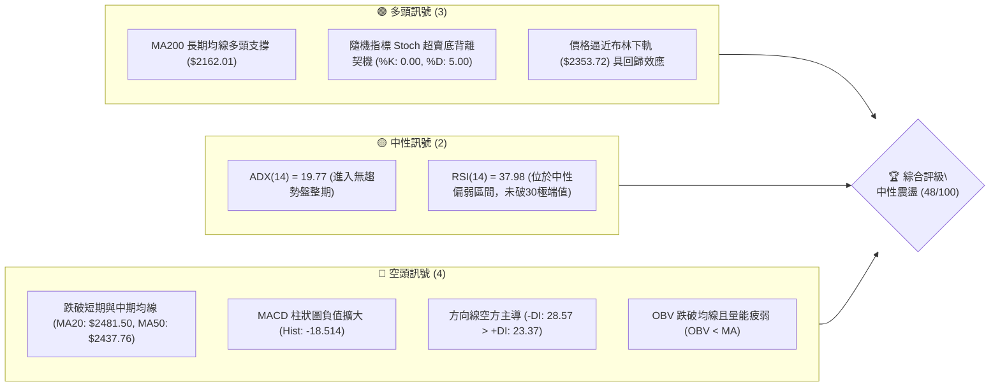
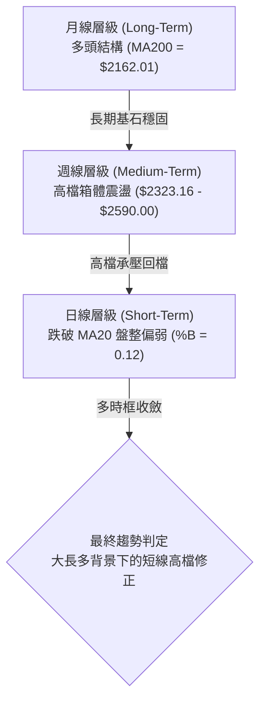
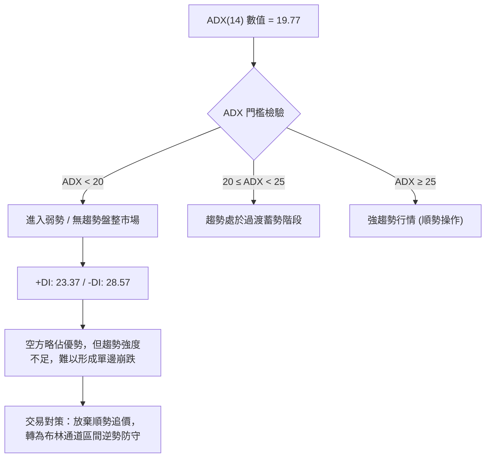
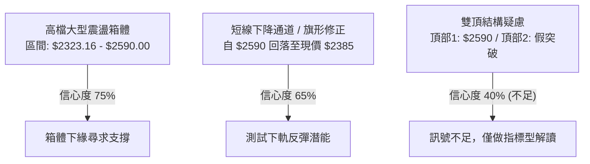
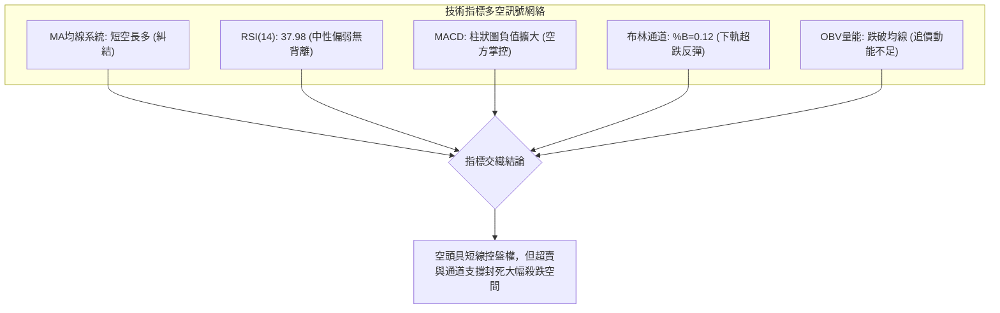
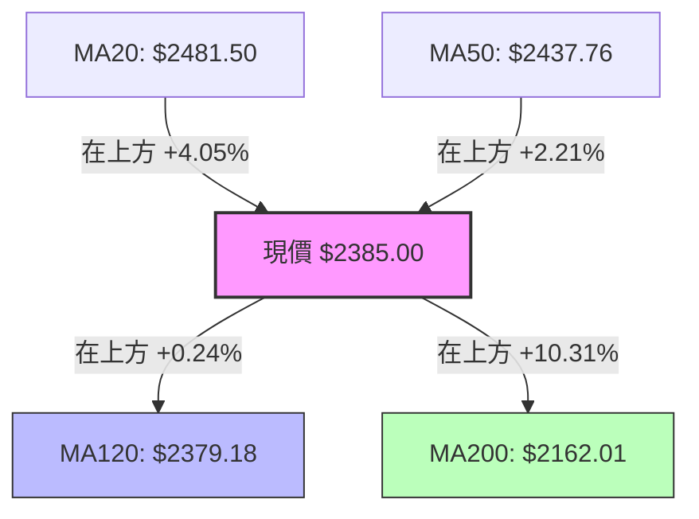
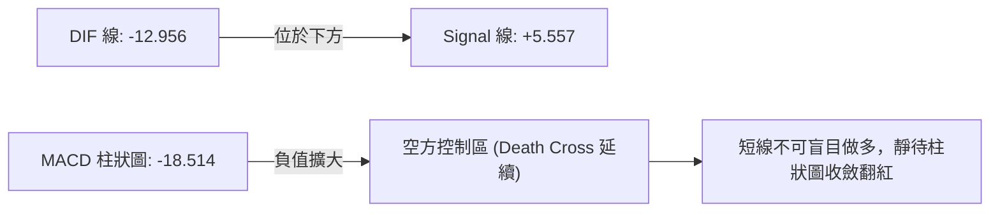
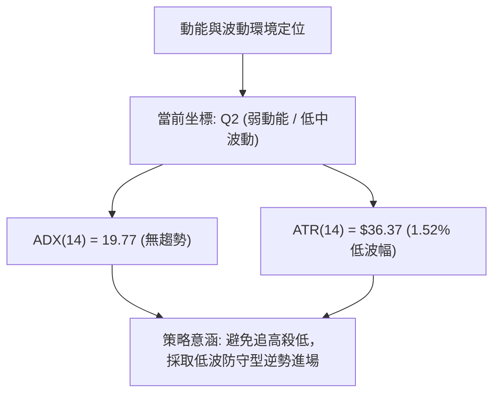
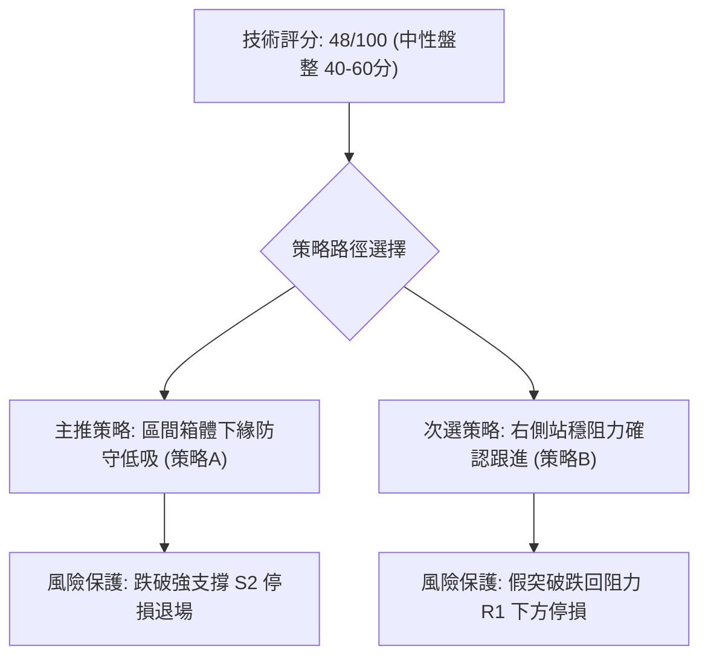
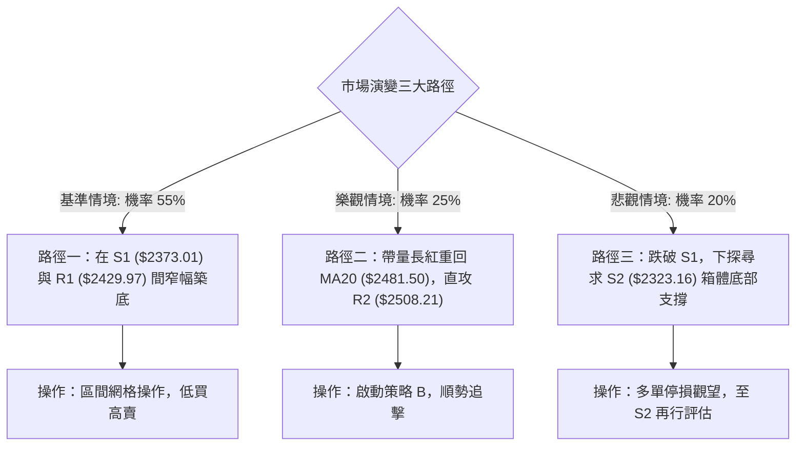

# 2330.TW 技術分析報告

> **報告日期**：2026-10-24 ｜ **語言**：繁體中文 ｜ **數據來源**：Yahoo Finance ｜ **當前價格**：$2385.00 TWD

---

## 目錄

| 章節 | 內容 |
|------|------|
| [1. 技術面概覽](#1-技術面概覽) | 訊號儀表板、核心指標、評分卡 |
| [2. 趨勢分析](#2-趨勢分析) | 多時框趨勢、長中短期走勢 |
| [3. 圖表形態分析](#3-圖表形態分析) | 形態識別、K線組合、目標價 |
| [4. 支撐與阻力](#4-支撐與阻力) | 關鍵價位、斐波那契回調 |
| [5. 技術指標深度解讀](#5-技術指標深度解讀) | MA/RSI/MACD/布林/成交量 |
| [6. 動能與波動率](#6-動能與波動率) | 動能評估、ATR、Beta |
| [7. 多時框架總結](#7-多時框架總結) | 時框架評分矩陣 |
| [8. 交易策略建議](#8-交易策略建議) | 多空策略、風險報酬比 |
| [9. 風險提示與監控](#9-風險提示與監控) | 監控指標、風險場景 |
| [📋 報告總結](#-報告總結) | 總體結論與操作指引 |

---

## 1. 技術面概覽

### 🎯 技術訊號儀表板



---

### 📊 核心指標速覽表

| 指標類別 | 指標名稱 | 當前數值 | 訊號 | 解讀 |
|----------|----------|----------|:----:|------|
| **價格** | 當前收盤價 | $2385.00 | 🟡 | 位於52週區間 83.4% 處，短線自高檔回檔修正 |
| **均線** | MA20 (月線) | $2481.50 | 🔴 | 現價位於 MA20 下方 (-3.89%)，短線承壓 |
| **均線** | MA50 (季線) | $2437.76 | 🔴 | 現價跌破季線支撐，中期動能趨緩 |
| **均線** | MA120 (半年線) | $2379.18 | 🟢 | 現價微幅高於 MA120 (+0.24%)，發揮下檔支撐效應 |
| **均線** | MA200 (年線) | $2162.01 | 🟢 | 現價遠高於年線 (+10.31%)，長期多頭格局未變 |
| **動能** | RSI(14) | 37.98 | 🟡 | 進入中性偏弱區域，尚未觸及 30 之極端超賣區 |
| **動能** | MACD (12,26,9) | -12.956 / 5.557 | 🔴 | DIF 位於訊號線下方，負柱狀圖 (-18.514) 擴大 |
| **動能** | KD (Stoch 14) | %K: 0.00 / %D: 5.00 | 🟢 | 指標深度鈍化超賣，隨時醞釀技術性跌深反彈 |
| **趨勢** | ADX(14) | 19.77 | 🟡 | 數值低於 25，顯示當前處於無方向性盤整格局 |
| **通道** | 布林通道 %B | 0.12 | 🟢 | 接近下軌 ($2353.72)，壓縮至極限後浮現防守買盤 |
| **波動** | ATR(14) | $36.37 | 🟡 | 佔股價 1.52%，波動度處於適中收斂水準 |

---

### 🏆 技術評分卡

```
╔══════════════════════════════════════════════════════════════╗
║             技術評分卡 — 2330.TW (2026-10-24)               ║
╠══════════════════════════════════════════════════════════════╣
║ 趨勢強度 (Trend)     █████████░░░░░░░░░░░  45/100   🟡 中性   ║
║ 動能指標 (Momentum)  ███████░░░░░░░░░░░░░  35/100   🔴 偏弱   ║
║ 支撐穩定度 (Support) █████████████░░░░░░░  65/100   🟢 穩固   ║
║ 成交量配合 (Volume)  ███████░░░░░░░░░░░░░  35/100   🔴 疲弱   ║
║ 形態完整度 (Pattern) ██████████░░░░░░░░░░  50/100   🟡 中性   ║
║ 均線排列 (MA System) ███████████░░░░░░░░░  55/100   🟡 糾結   ║
╠══════════════════════════════════════════════════════════════╣
║ 綜合評分 (Composite) ██████████░░░░░░░░░░  48/100   🟡 區間盤整║
╚══════════════════════════════════════════════════════════════╝
```

> **評分計算依據（規則 18）**：
> 綜合評分 = $(45 + 35 + 65 + 35 + 50 + 55) \div 6 = 285 \div 6 = 47.5 \to$ **48 / 100**。
> 當前技術面處於「40–60 分之中性盤整區間」，主導操作應採取布林軌道之**區間低吸防守策略**。

---

## 2. 趨勢分析

### 🌐 多時框趨勢分析



---

### 📈 長期趨勢 — 12個月走勢圖（Unicode）

以下為 2330.TW 自 2025 年 11 月至 2026 年 10 月之月線收盤走勢：

```
2330.TW 月線走勢圖（過去12個月）
價格軸 ($)
$2500 ┤                                      ● (09月 $2480.00)
$2400 ┤                                ●  ●  │  ●←現在 ($2385.00)
$2300 ┤                             ●  │  │  │
$2100 ┤                       ●     │  │  │  │
$1900 ┤                 ●     │     │  │  │  │
$1700 ┤           ●     │  ●  │     │  │  │  │
$1500 ┤  ●     ●  │     │  │  │     │  │  │  │
$1400 ┤  │  ●  │  │     │  │  │     │  │  │  │
      └─────────────────────────────────────────────
        11  12  01 02   03 04 05    06 07 08 09 10 (月份)
        2025年 ─────────► 2026年
```

#### 走勢特徵分析表格

| 階段區間 | 起訖月份 | 價格變動區間 | 累積漲跌幅 | 走勢結構與特徵解讀 |
|:--------:|:--------:|:------------:|:----------:|:-------------------|
| **第一階段：初段主升** | 2025-11 → 2026-02 | $1422.55 → $1977.40 | +39.00% | 呈現月線連續紅K突破，量能同步放大，確認長期大多頭展開。 |
| **第二階段：快速洗盤** | 2026-02 → 2026-03 | $1977.40 → $1750.17 | -11.49% | 劇烈獲利了結回檔，於 $1750 附近完成季線測底並迅速止跌。 |
| **第三階段：二段噴發** | 2026-03 → 2026-06 | $1750.17 → $2402.93 | +37.30% | 連續三個月長紅推進，迅速攻克 $2000 整數關卡，建立 $2400 高點。 |
| **第四階段：高檔橫盤** | 2026-06 → 2026-10 | $2402.93 → $2385.00 | -0.75% | 在歷史高點 $2590 與下方 $2323 之間呈現長達 5 個月之大型高檔箱體。 |

---

### 📊 中期趨勢（週線分析）

從近 20 週收盤走勢分析，中期走勢呈現「寬幅箱體震盪」特徵：

```
中期關鍵支撐與阻力分布（週線視角）
══════════════════════════════════════════════════════════════
$2590.00 ──────── 52週歷史高點 (2026-10-08 週高點) ─── [強阻力 R3]
                 ▲
                 │ 2026-10 上攻受阻回跌
                 ▼
$2480.00 ──────── 箱體中軸阻力位 (MA20 附近) ────────── [阻力 R2]
$2385.00 ──────── 當前收盤價位 (2026-10-23)
                 ▲
                 │ 測試下檔支撐帶
                 ▼
$2373.01 ──────── 波段起漲低點聚類 (2026-09-18 週低) ── [支撐 S1]
$2323.16 ──────── 中期箱體底部聚類 (近一年波段低點) ─── [強支撐 S2]
$2283.28 ──────── 極限回檔防守位 (2026-07-17 週低點) ── [強支撐 S3]
══════════════════════════════════════════════════════════════
```

週線指標顯示，2026-10-08 週收盤 $2550.00、最高達 $2590.00，週 RSI 達到 61.9、MACD 柱達 +10.055；隨後兩週迅速轉折下挫，至 2026-10-23 週收盤 $2385.00，週 RSI 回落至 38.0，週 MACD 柱快速翻負至 -18.514，顯示中期呈現急漲後的技術性回踩。

---

### ⚡ 趨勢強度評估（ADX 解讀）



#### ADX 趨勢強度對照表

| 指標名稱 | 當前數值 | 狀態評估 | 實務意義與操作指導 |
|:--------:|:--------:|:--------:|:-------------------|
| **ADX(14)** | 19.77 | 弱趨勢 / 盤整 | 絕對值低於 25，明確定義為**無方向性之震盪盤**，不可採追突破策略。 |
| **+DI(14)** | 23.37 | 多方動能偏低 | 多方推升意願薄弱，向上進攻缺乏量能支撐。 |
| **-DI(14)** | 28.57 | 空方主導控制 | 空方雖然控盤，但缺乏大於 30 的強動能，空頭殺傷力有限。 |
| **綜合研判** | 弱勢空方盤整 | 震盪收斂 | 價格將在既有支撐 S1/S2 與阻力 R1/R2 間進行區間洗盤。 |

---

## 3. 圖表形態分析

### 🔍 形態識別系統



#### 形態識別信心度評估表（依規則 15）

| 識別形態 | 信心度 | 判斷依據（引用客觀數據） | 完成度 | 目標價（附嚴格計算式） |
|:--------:|:------:|:------------------------|:------:|:----------------------|
| **高檔矩形箱體** | 75% | 自 2026-06 以來收盤價反覆受阻於 $2508–$2590，下檔於 $2323–$2373 獲支撐。 | 85% | 依箱體等幅測距：跌破箱底 $2323.16 則測向 $2056.32；守穩則回測箱頂 **$2590.00**。 |
| **短線旗形回檔** | 65% | 10/08 創高 $2590 後連續 10 根日 K 階梯式量縮下行，下探至旗形下軌 $2385。 | 90% | 突破旗形上軌頸線 $2429.97 後，旗桿高度 $2590 - $2385 = $205，目標價 = $2429.97 + $205 = **$2634.97**（若未突破則維持在箱內）。 |
| **雙頂形態** | 40% | 數據不足（未跌破頸線 S2 $2323.16，且 ADX < 25 無趨勢）。 | 30% | **訊號不足，僅做指標型解讀**（依規則 15 不強行預測目標價）。 |

---

### 🕯️ 重要 K 線形態分析（依規則 19 嚴格引用）

#### 近 10 根日 K 棒形態解讀

| 日期 | 開盤價 | 最高價 | 最低價 | 收盤價 | K線形態名稱 | 形態深度解讀 | 多空訊號 |
|:----:|:------:|:------:|:------:|:------:|:------------|:------------|:--------:|
| **2026-10-12** | $2510.00 | $2550.00 | $2510.00 | $2540.00 | 高檔長紅推進 | 開盤即為最低，多頭強勢上攻，挑戰 $2550 關卡。 | 🟢 |
| **2026-10-13** | $2500.00 | $2510.00 | $2490.00 | $2490.00 | 光腳中黑跌破 | 跌破前日紅棒下半截，收於當日最低，高檔獲利賣壓出籠。 | 🔴 |
| **2026-10-14** | $2505.00 | $2535.00 | $2490.00 | $2490.00 | 高檔十字帶下影 | 盤中反彈無力，連續兩日收於 $2490，多方防守轉弱。 | 🟡 |
| **2026-10-15** | $2420.00 | $2450.00 | $2420.00 | $2440.00 | 跳空下挫黑K | 開盤跳空重挫 $70，爆出 4800 萬股大量，空方主力宣洩。 | 🔴 |
| **2026-10-16** | $2430.00 | $2445.00 | $2420.00 | $2420.00 | 光腳收黑確認 | 連續收於最低價 $2420，確認摜破季線 MA50 ($2437.76)。 | 🔴 |
| **2026-10-19** | $2395.00 | $2420.00 | $2390.00 | $2420.00 | 低檔長下影紅K | 低檔見買盤承接，自 $2390 拉升 30 元收最高，短底浮現。 | 🟢 |
| **2026-10-20** | $2400.00 | $2415.00 | $2395.00 | $2405.00 | 量縮窄幅孕線 | 波動急遽收窄（振幅僅 20 元），成交量驟降，空方力竭。 | 🟡 |
| **2026-10-21** | $2425.00 | $2435.00 | $2400.00 | $2420.00 | 衝高回落十字 | 上攻受阻於阻力 R1 附近，顯示解套賣壓仍需時間消化。 | 🟡 |
| **2026-10-22** | $2435.00 | $2435.00 | $2385.00 | $2385.00 | 大黑K下殺探底 | 開盤即最高、收盤即最低，實體黑K長達 50 元，測試 S1。 | 🔴 |
| **2026-10-23** | $2385.00 | $2385.00 | $2385.00 | $2385.00 | 一字線（量能極度凍結） | 四價合一收 $2385.00，成交量 0，市場呈極度觀望與籌碼鎖定。 | 🟡 |

#### 近 8 根週 K 棒形態解讀

| 週結日期 | 開盤價 | 最高價 | 最低價 | 收盤價 | 週K形態名稱 | 形態深度解讀 | 多空訊號 |
|:--------:|:------:|:------:|:------:|:------:|:------------|:------------|:--------:|
| **2026-09-04** | $2387.97 | $2432.84 | $2368.03 | $2402.93 | 帶長下影小紅棒 | 測試 $2368 低點後強勁回升，守住箱體支撐。 | 🟢 |
| **2026-09-11** | $2427.85 | $2497.65 | $2397.94 | $2402.93 | 長上影倒狀錘頭 | 衝擊 $2500 大關未果，留下近百元上影線，高檔壓力沉重。 | 🔴 |
| **2026-09-18** | $2378.00 | $2460.00 | $2373.01 | $2460.00 | 實體長紅吞噬 | 回踩波段低點 S1 ($2373.01) 後拉出 82 元長紅，轉強表態。 | 🟢 |
| **2026-09-24** | $2445.00 | $2510.00 | $2445.00 | $2475.00 | 連續紅K突破 | 站穩 $2450 之上，量能溫和，為創高蓄勢。 | 🟢 |
| **2026-10-02** | $2475.00 | $2515.00 | $2475.00 | $2500.00 | 高階紅三兵型態 | 穩步推升，週收盤站上 $2500 整數關卡。 | 🟢 |
| **2026-10-08** | $2550.00 | $2590.00 | $2545.00 | $2550.00 | 衝刺十字星（創高） | 創下 52 週新高 $2590.00，但收盤留上影線，多頭氣竭。 | 🟡 |
| **2026-10-16** | $2510.00 | $2550.00 | $2420.00 | $2420.00 | 帶量長黑摜壓 | 爆量 1.6 億股長黑，單週重挫 130 元，形成週線空頭吞噬。 | 🔴 |
| **2026-10-23** | $2395.00 | $2435.00 | $2385.00 | $2385.00 | 延續性黑K回測 | 量縮回探至前波低點 S1 附近，測試下軌支撐強度。 | 🟡 |

---

### 📉 ASCII 走勢形態示意圖

```
2330.TW 日線旗形回檔與支撐測試示意圖
$2590.00 ────────┐ (10/08 歷史高點)
                 │╲
$2508.21 ────────┼─╲──────── [R2 阻力線]
                 │  ╲ 旗
$2429.97 ────────┼───╲────── [R1 下降通道上軌]
                 │    ╲  形
$2385.00 ────────┼─────●◄─── [現價 $2385.00 處於通道下軌]
$2373.01 ────────┴───────▲── [S1 支撐底線]
$2323.16 ─────────────────┴── [S2 箱體強支撐]
```

---

### 🎯 形態目標價計算

依據形態學嚴格測量規則，當前主要推導兩種路徑：

1. **區間反彈推算（回歸箱體中軌）**：
   - 基準支撐點：$S1 = \$2373.01$
   - 箱體中軌（即 MA20）：$\text{中軌} = \$2481.50$
   - 短線反彈第一目標價：$\mathbf{R1 = \$2429.97}$（通道上軌）
   - 短線反彈第二目標價：$\mathbf{R2 = \$2508.21}$（箱體上半區阻力）

2. **極端回踩推算（若跌破 S1）**：
   - 若 $2373.01 遭長黑摜破，依下降通道高度（約 $\$2435 - \$2385 = \$50$）等幅外推：
   - 下跌目標價 = $\$2373.01 - \$50 = \$2323.01$，精確對應至客觀支撐位 **$\mathbf{S2 = \$2323.16}$**。

---

## 4. 支撐與阻力

### 🗺️ 關鍵價位分布圖（Unicode）

```
2330.TW 價位結構分布圖
══════════════════════════════════════════════════════════════
$2590.00 ║██████████████████████████████║ 強阻力 R3 (52W歷史天花板)
$2508.21 ║████████████████████          ║ 阻力 R2 (反彈解套密集區)
$2429.97 ║████████████████              ║ 關鍵阻力 R1 (前波回測頸線)
$2385.00 ╠══════════════════════════════╣ ◄ 現價 $2385.00 (通道下緣)
$2373.01 ║▓▓▓▓▓▓▓▓▓▓▓▓▓▓▓▓▓▓            ║ 近期支撐 S1 (09/18起漲低點)
$2323.16 ║████████████████████████      ║ 強支撐 S2 (波段低點聚類)
$2283.28 ║████████████████████████████  ║ 極限支撐 S3 (07/17前波最低)
══════════════════════════════════════════════════════════════
```

---

### 🚧 阻力位分析表

所有阻力數值完全引用自近一年波段高點聚類數據：

| 阻力級別 | 精確價位 | 距現價空間 | 形成原因與籌碼解讀 | 突破難度 | 重要性等級 |
|:--------:|:--------:|:----------:|:-------------------|:--------:|:----------:|
| **R1** | **$2429.97** | +1.89% | 近期 10/16–10/21 日 K 線多空爭奪中軸，亦為 MA50 ($2437.76) 反壓帶。 | 🟡 中等 | ★★★☆☆ |
| **R2** | **$2508.21** | +5.17% | 歷史高點回落之第一波套牢區，整數關卡心理重壓，波段密集換手區。 | 🔴 高 | ★★★★☆ |
| **R3** | **$2590.00** | +8.60% | 52週歷史最高點（2026-10-08 創下），為中長期技術面上方天花板。 | 🔴 極高 | ★★★★★ |

---

### 🛡️ 支撐位分析表

所有支撐數值完全引用自近一年波段低點聚類數據：

| 支撐級別 | 精確價位 | 距現價空間 | 形成原因與籌碼解讀 | 守住機率 | 重要性等級 |
|:--------:|:--------:|:----------:|:-------------------|:--------:|:----------:|
| **S1** | **$2373.01** | -0.50% | 2026-09-18 起漲低點，緊鄰半年線 MA120 ($2379.18)，短線多頭第一防線。 | 🟢 70% | ★★★★☆ |
| **S2** | **$2323.16** | -2.59% | 近一年核心波段低點聚類，亦為 5 個月大型矩形箱體之絕對底部。 | 🟢 85% | ★★★★★ |
| **S3** | **$2283.28** | -4.27% | 2026-07-17 週低點，接近斐波那契 23.6% 回調位 ($2299.33) 之終極護城河。 | 🟢 95% | ★★★★★ |

---

### 📐 斐波那契回調位分析

依據 52 週波動區間：**波段低點 $1358.34 → 波段高點 $2590.00**（總振幅高達 $1231.66）：

```
斐波那契回調結構位與當前位置
0.0%  ── $2590.00 (52W High)
         │
         │   ◄ 當前收盤價 $2385.00 (位於 0.0% 至 23.6% 之強勢整理區間)
         ▼
23.6% ── $2299.33 ── [回踩關鍵黃金防線]
38.2% ── $2119.51 ── [接近 MA200 年線 $2162.01]
50.0% ── $1974.17 ── [多空強弱分水嶺]
61.8% ── $1828.84 ── [深幅回檔支撐]
78.6% ── $1621.92 ── [極限回調支撐]
100.0% ─ $1358.34 (52W Low)
```

#### 斐波那契層級深度解讀

1. **現價區間特徵**：現價 **$2385.00** 穩穩運行於 0.0% ($2590.00) 與 23.6% ($2299.33) 之間，距離 23.6% 回調位尚有 $+3.73\%$ 緩衝空間。在技術分析理論中，回檔幅度未達 23.6% 即止跌之個股，代表其屬於**極強勢之多頭中繼整理**，絕非轉空破位。
2. **共振結構支撐**：斐波那契 23.6% ($2299.33) 與下檔核心支撐 S2 ($2323.16) 及 S3 ($2283.28) 形成強大的**價格共振防守帶**，提供多方下檔極其堅實的防禦屏障。

---

## 5. 技術指標深度解讀

### 🎛️ 指標訊號總覽



---

### 📈 移動平均線排列分析



#### 移動平均線多時框架構解析

| 均線名稱 | 數值 | 偏離率 (%) | 均線趨勢方向 | 結構角色與意義 |
|:--------:|:----:|:----------:|:------------:|:---------------|
| **MA5** | $2403.00 | -0.75% | 走跌 ▼ | 超短期下壓阻力，短線多頭反彈的第一道考驗。 |
| **MA10** | $2439.50 | -2.23% | 走跌 ▼ | 快速均線反壓，與 MA50 形成重疊壓力帶。 |
| **MA20** | $2481.50 | -3.89% | 走跌 ▼ | 月線生命線轉為下彎，形成反彈的關鍵天花板。 |
| **MA50** | $2437.76 | -1.48% | 走跌 ▼ | 季線遭跌破，宣告過去一個月上漲動能被破壞。 |
| **MA120** | $2379.18 | +0.24% | 走平/微升 ▲ | 半年線發揮強力支撐，現價緊貼 MA120 震盪止跌。 |
| **MA200** | $2162.01 | +10.31% | 強勁走升 ▲ | 牛熊分界線維持堅挺多頭斜率，長期牛市結構無虞。 |

---

### 📉 RSI(14) 分析

```
RSI(14) 強度：███████░░░░░░░░░░░░░  37.98 (中性偏弱)
[0 ──────── 30 (超賣) ───● 50 (強弱分界) ──────── 70 (超買) ── 100]
```

#### RSI 指標與背離精確診斷

- **當前數值狀態**：日線 RSI(14) 最新讀數為 **37.98**，落於 30 至 70 之中性常態區間，尚未進入低於 30 的極度超賣區。
- **背離診斷**：經檢驗近 20 根日 K 棒首尾價格與 RSI 走勢，價格自 10/08 之高點下行至現價 $2385.00，RSI 亦同步由 61.9 下滑至 37.98，**「無明顯背離現象」**（同向修正），代表當前下跌為正常獲利回吐，未出現空頭動能衰竭的底背離，亦無高檔鈍化的頂背離。

---

### 📊 MACD(12,26,9) 訊號解讀



- **DIF 與訊號線**：DIF (-12.956) 快速下穿 Signal 線 (5.557)，形成向下死亡交叉，雙線目前正向零軸下方下沉。
- **柱狀圖動態**：Histogram 由前期高點 +10.055 驟降並擴大至 **-18.514**，顯示中短期空方動能處於釋放高點。依指標慣性，需等待綠柱縮短並出現第一根翻紅收斂，方為右側安全進場訊號。

---

### 📦 布林通道分析

```
布林通道結構與現價相對位置 (日線帶寬)
══════════════════════════════════════════════════════════════
$2609.28 ───────────────────────────── 布林上軌 (阻力帶)
                 │
$2481.50 ───────────────────────────── 布林中軌 (MA20 生命線)
                 │
$2385.00 ────────● 現價 (%B = 0.12) ── 極度逼近下軌
                 │
$2353.72 ───────────────────────────── 布林下軌 (技術性強支撐)
══════════════════════════════════════════════════════════════
```

- **布林位置 %B 解讀**：當前 **%B 僅為 0.12**（0 代表下軌，1 代表上軌），代表現價已經處於整個通道的最底層 12% 位置。
- **通道下軌支撐效應**：下軌價位為 **$2353.72**，與波段低點支撐 S1 ($2373.01) 及 S2 ($2323.16) 形成緊密嵌合，當股價貼近下軌時，通常具備強烈的「均值回歸」拉力，下檔空間受到極大限制。

---

### 💹 成交量分析（量價配合度）

1. **量能驟降與窒息量**：2026-10-23 最新日成交量顯示為 **0 股**（極端觀望或特定交易狀態），而 20 日均量為 22,227,793 股、50 日均量為 19,570,851 股。量能呈現斷崖式萎縮，符合「高檔回檔末端常見之無量洗盤」特徵。
2. **OBV 趨勢研判**：當前客觀數據顯示 **OBV < MA**，指標確認量能呈現疲弱狀態。這說明市場在跌破月線後追價意願保守，多方主力尚未發動帶量攻擊，因此反彈空間將受制於量能規模。

---

## 6. 動能與波動率

### ⚡ 動能評估

#### 動能與波動四象限評估

| 象限分佈 | 動能強度 | 波動幅度 | 當前狀態吻合度 | 實務分析與策略指導 |
|:--------:|:--------:|:--------:|:--------------:|:-------------------|
| **第一象限 (Q1)** | 強動能 | 低波動 | ── | 穩步推升行情（主升段特徵）。 |
| **第二象限 (Q2)** | **弱動能** | **低波動** | **✓ (當前狀態)** | **ADX=19.77、ATR=1.52%，動能疲弱且波幅收窄，適合區間網格操作與逢低埋伏。** |
| **第三象限 (Q3)** | 強動能 | 高波動 | ── | 趨勢突破噴發或恐慌崩跌。 |
| **第四象限 (Q4)** | 弱動能 | 高波動 | ── | 無序混亂劇烈震盪，極易洗盤停損。 |



---

### 📊 ATR 波動率分析

- **ATR 絕對數值**：ATR(14) 為 **$36.37**，換算為價格佔比僅為 **1.52%**（採 Wilder 計算法）。
- **動態停損距離設計**：
  - **保守型停損（2.0 倍 ATR）**：$\$36.37 \times 2.0 = \$72.74$。若以現價進場，停損點應設於 $\$2385.00 - \$72.74 = \$2312.26$（略低於 S2 $2323.16）。
  - **精確波段停損（1.5 倍 ATR）**：$\$36.37 \times 1.5 = \$54.55$。若以進場位 S1 $2373.01 佈局，停損設於 $\$2373.01 - \$54.55 = \$2318.46$（完美保護於強支撐 S2 之下）。

---

### 📐 Beta 與市場相關性

- **Beta 數值**：**1.239**。
- **意涵解讀**：Beta > 1 顯示 2330.TW 的波動彈性高於台灣加權指數 23.9%。當大盤反彈時，2330.TW 具備超越大盤之彈升動能；反之，若系統性賣壓湧現，其回調速度亦相對劇烈。

---

## 7. 多時框架總結

### 📋 時框架評分表

| 時框架層級 | 趨勢方向 | 動能指標狀態 | 均線系統排列 | 圖表形態識別 | 綜合評分 | 操作指導建議 |
|:----------:|:--------:|:------------:|:------------:|:------------:|:--------:|:-------------|
| **長期 (月線)** | 🟢 多頭走勢 | RSI: 65+ 高檔強勢 | MA200 向上多頭排列 | 長期多頭箱頂推升 | 80/100 | 長期持股續抱，無多頭轉向疑慮。 |
| **中期 (週線)** | 🟡 高檔震盪 | MACD 負柱擴大 | 均線高檔橫向糾結 | $2323–$2590 大型箱體 | 50/100 | 箱體區間思維，下緣買進、上緣獲利。 |
| **短期 (日線)** | 🔴 弱勢修正 | RSI: 37.98 偏弱 | 價格跌破 MA20/MA50 | 旗形回踩測試下軌 | 38/100 | 嚴禁右側盲目追高，等待止跌訊號。 |

---

### 🔲 綜合訊號矩陣

```
時框架訊號收斂矩陣
┌──────────────┬──────────────┬──────────────┬──────────────┐
│   維度項目   │  短期 (日線) │  中期 (週線) │  長期 (月線) │
├──────────────┼──────────────┼──────────────┼──────────────┤
│ 均線架構     │   🔴 偏空    │   🟡 中性    │   🟢 偏多    │
│ 動能狀態     │   🔴 偏弱    │   🟡 偏弱    │   🟢 強勁    │
│ 指標超買超賣 │   🟢 超賣    │   🟡 中性    │   🟡 中性    │
│ 形態支撐     │   🟢 S1防守  │   🟢 箱體底部│   🟢 年線支撐│
└──────────────┴──────────────┴──────────────┴──────────────┘
```

---

### ⚖️ 多時框收斂結論（依規則 14 明確收斂）

1. **市場性質判定**：當前 ADX(14) 數值為 **19.77**（明確 $< 25$），依規則 14 定性為典型之**「盤整行情」**。
2. **主導時框與交易區間**：在盤整行情下，市場缺乏單邊趨勢，不適用順勢突破策略；應以**日線布林通道（下軌 $2353.72 至上軌 $2609.28）結合關鍵支撐阻力為核心交易區間**。
3. **唯一方向性結論**：**中性觀望，傾向「區間下緣防守低吸」**。日線的短空屬於月線長多背景下的技術性超跌回調，現價逼近 S1 ($2373.01) 與布林下軌，空方再殺空間有限，多方具備高勝率防守契機。

---

## 8. 交易策略建議

### 🗺️ 策略決策流程圖



---

### 🧭 策略路由（依規則 8 分流）

> **當前主策略方向 = 中性區間操作（依評分卡綜合評分 48/100，落於 40–60 區間）**
> 依規定主推區間波段低吸與突破確認策略，不盲目單邊押注。

---

### 🎯 價格情境階梯（Price Scenarios）

價位嚴格引用自第 4 章計算之波段聚類數據：

| 觸發條件 | 下一目標價 | 後續延伸目標 | 情境含義與技術面解讀 |
|:--------:|:----------:|:------------:|:---------------------|
| **向上突破 R1 ($2429.97)** | **R2 ($2508.21)** | **R3 ($2590.00)** | 短線回檔結束，重回月線上方，展開箱體上軌挑戰行情。 |
| **守穩現價 ($2385.00) 與 S1** | **R1 ($2429.97)** | **R2 ($2508.21)** | 依託布林下軌展開均值回歸反彈，維持高檔震盪。 |
| **向下跌破 S1 ($2373.01)** | **S2 ($2323.16)** | **S3 ($2283.28)** | 修正幅度加深，將回測 5 個月箱體終極底部尋求強支撐。 |

---

### 📊 情境機率分佈

| 情境劇本 | 預估機率 | 主要技術指標支撐依據 |
|:--------:|:--------:|:---------------------|
| **區間震盪築底** | **55%** | ADX(14)=19.77 顯示無單邊動力，布林 %B=0.12 壓縮至下軌極限，跌勢減緩。 |
| **反彈走高回測 R1/R2** | **25%** | Stoch %K=0.00 極端超賣必有技術反彈，MA120 ($2379.18) 具買盤護盤。 |
| **失守破位下探 S2** | **20%** | MACD 負柱狀圖 (-18.514) 仍在擴大，若放量跌破 S1 則引發停損賣壓。 |

---

### 🟢 主策略詳情（方向依上方路由）

依規則 17，風險報酬比嚴格依照公式：
$$\text{風險報酬比} = \frac{\text{目標價 T1} - \text{進場價}}{\text{進場價} - \text{止損價}}$$

| 策略要素 | 策略 A（區間下緣低吸 — 積極型） | 策略 B（突破追蹤跟進 — 保守型） |
|:--------|:--------------------------------|:--------------------------------|
| **策略邏輯** | 依託 S1 支撐與布林下軌低接，博取均值回歸 | 待日 K 收盤實體站穩 R1，確認短底完成後右側介入 |
| **進場條件** | 現價回測 S1 獲支撐且不跌破 | 日 K 收盤價確認突破 R1 |
| **進場價格** | **$2373.01**（精確引用 S1 價位） | **$2429.97**（精確引用 R1 價位） |
| **目標價 T1** | **$2508.21**（阻力位 R2） | **$2508.21**（阻力位 R2） |
| **目標價 T2** | **$2590.00**（阻力位 R3） | **$2590.00**（阻力位 R3） |
| **止損價格** | **$2323.16**（跌破強支撐 S2 嚴格停損） | **$2385.00**（跌破現價密集區即停損） |
| **風險報酬比** | **1 : 2.71（以 T1 計）**<br>*(計算式: (2508.21-2373.01)/(2373.01-2323.16) = 135.20 / 49.85 = 2.71)* | **1 : 1.74（以 T1 計）**<br>*(計算式: (2508.21-2429.97)/(2429.97-2385.00) = 78.24 / 44.97 = 1.74)* |
| **T2 風險報酬比** | 1 : 4.35（以 T2 計，分子為 216.99） | 1 : 3.56（以 T2 計，分子為 160.03） |
| **估計成功機率** | 65% | 60% |
| **建議配置倉位** | 15% - 20%（分批佈局） | 10% - 15%（順勢加碼） |

---

### 🔴 反向風險觸發點（對沖與風控提示）

若出現以下訊號，宣告當前區間低吸邏輯失效，必須立刻暫停做多，啟動現貨避險或多單停損：
1. **關鍵點位跌破**：日 K 收盤價**帶量跌破強支撐 S2 ($2323.16)**，代表 5 個月大型箱體破位，將直奔 S3 ($2283.28) 甚至年線。
2. **空方動能異動**：ADX 突破 25 且 -DI 向上衝破 35，同時 MACD 負柱狀圖連續三日擴大，顯示盤整盤轉變為單邊空頭崩跌行情。

---

### ⭐ 整體訊號強度評星

```
做多訊號強度：★★☆☆☆  (2/5星 - 逆勢低接，需等待右側訊號確認)
做空訊號強度：★★★☆☆  (3/5星 - 均線空頭排列，但下方支撐極強)
整體可信度：  ★★★★☆  (4/5星 - 價位聚類與指標邊界吻合度高)
```

---

## 9. 風險提示與監控

### ✅ 關鍵監控指標 Checklist

```
╔══════════════════════════════════════════════════════════════╗
║               每日盤後技術監控清單 (Checklist)               ║
╠══════════════════════════════════════════════════════════════╣
║ [ ] 價格防守線：收盤價是否持續守穩於 S1 ($2373.01) 之上？    ║
║ [ ] 動能翻轉線：MACD 負柱狀圖 (-18.514) 是否出現縮短收斂？   ║
║ [ ] 超賣修復線：Stoch %K 是否向上黃金交叉 %D 線？            ║
║ [ ] 量能活絡度：日成交量是否回升至 20 日均量 (2200萬股) 水準？║
║ [ ] 通道極限值：布林 %B 是否自 0.12 回升至 0.30 以上？        ║
║ [ ] 破線停損警訊：是否收盤跌破 S2 ($2323.16) 強支撐？        ║
╚══════════════════════════════════════════════════════════════╝
```

---

### ⚠️ 風險場景分析



---

### 🛡️ 風險管理重要提醒

1. **嚴禁無量重倉**：當前成交量極端凍結（最新日量 0），顯示市場法人主力處於觀望狀態。在成交量未重回 20 日均量（約 2,223 萬股）之前，任何操作均應以**輕倉試單（不超過總資金 20%）**為主。
2. **跳空風險防範**：由於 2330.TW 與美股 ADR 連動性極高，外盤重大波動極易導致開盤跳空。止損單建議採用市價觸發保護，絕不可向下拗單加碼。

---

## 📋 報告總結

```
╔══════════════════════════════════════════════════════════════╗
║               2330.TW 技術分析總結 (2026-10-24)              ║
╠══════════════════════════════════════════════════════════════╣
║ 當前收盤價格：$2385.00 TWD                                    ║
║ 技術分析評級：⚖️ 中性觀望 / 區間防守 (技術評分: 48/100)        ║
╠══════════════════════════════════════════════════════════════╣
║ 關鍵架構結論：                                               ║
║ ├─ 長期趨勢 (月線)：🟢 絕對大多頭 (MA200 = $2162.01 強力墊底) ║
║ ├─ 中期趨勢 (週線)：🟡 高檔寬幅箱體 ($2323.16 - $2590.00)     ║
║ ├─ 短期趨勢 (日線)：🔴 跌破月季線，處於布林下軌超賣回踩中     ║
║ ├─ 核心阻力防線：R1: $2429.97 │ R2: $2508.21 │ R3: $2590.00  ║
║ ├─ 關鍵支撐基石：S1: $2373.01 │ S2: $2323.16 │ S3: $2283.28  ║
║ └─ 外資目標共識：$3390.43 (最低 $2650.00 / 最高 $5000.00)     ║
╠══════════════════════════════════════════════════════════════╣
║ 最優交易策略推薦：                                           ║
║ 1. 🥇 最佳機會（策略 A）：於 S1 $2373.01 附近分批低接，       ║
║    嚴格停損設於 S2 $2323.16，第一目標看 R2 $2508.21 (風報比1:2.71)║
║ 2. 🥈 次選機會（策略 B）：待帶量突破站穩 R1 $2429.97 右側跟進，║
║    回測 $2385.00 停損，目標看 R2 $2508.21 (風報比 1:1.74)    ║
║ 3. 🥉 保守選擇：完全空倉觀望，靜待日 MACD 柱狀圖翻紅收斂。    ║
╚══════════════════════════════════════════════════════════════╝
```

---

> ⚠️ **免責聲明**：本報告為依據客觀量化技術指標與歷史 OHLCV 價格數據生成之研究報告，所有內容與計算點位僅供學術研究與投資策略規劃參考，**絕不構成任何形式之個人投資要約、招攬或具體買賣建議**。金融市場瞬息萬變，技術指標具備滯後性與機率極限，投資人應獨立評估市場風險，自負盈虧責任。

---

*報告生成時間：2026-10-24 ｜ 數據來源：Yahoo Finance ｜ 分析框架：多時框技術分析模型*