# 2330.TW 技術分析報告

> **報告日期**：2026-10-25 ｜ **語言**：繁體中文 ｜ **數據來源**：Yahoo Finance ｜ **當前價格**：$2385.00 TWD

---

## 目錄

| 章節 | 內容 |
|------|------|
| [1. 技術面概覽](#1-技術面概覽) | 訊號儀表板、核心指標、評分卡 |
| [2. 趨勢分析](#2-趨勢分析) | 多時框趨勢、長中短期走勢、ADX解讀 |
| [3. 圖表形態分析](#3-圖表形態分析) | 形態識別、K線組合、目標價計算 |
| [4. 支撐與阻力](#4-支撐與阻力) | 關鍵價位、斐波那契回調結構 |
| [5. 技術指標深度解讀](#5-技術指標深度解讀) | 均線系統、RSI、MACD、布林通道、成交量 |
| [6. 動能與波動率](#6-動能與波動率) | 動能四象限、ATR指標、Beta係數 |
| [7. 多時框架總結](#7-多時框架總結) | 時框架評分矩陣、收斂與衝突判定 |
| [8. 交易策略建議](#8-交易策略建議) | 策略路由、主策略規劃、風險報酬比 |
| [9. 風險提示與監控](#9-風險提示與監控) | 監控清單、情境分析、資金控管 |
| [📋 報告總結](#-報告總結) | 全方位技術總結與決策要點 |

---

## 1. 技術面概覽

### 🎯 技術訊號儀表板

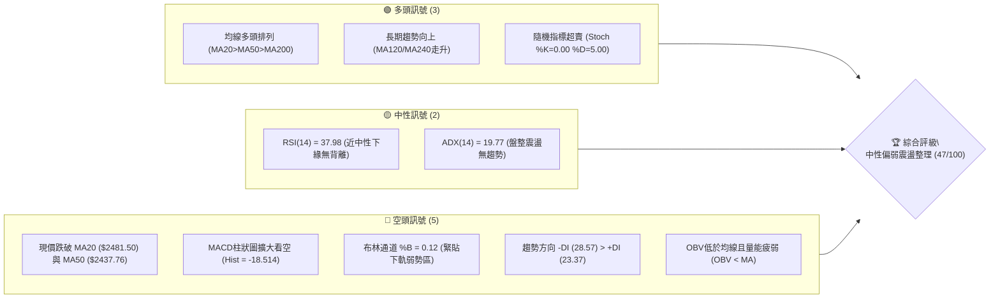

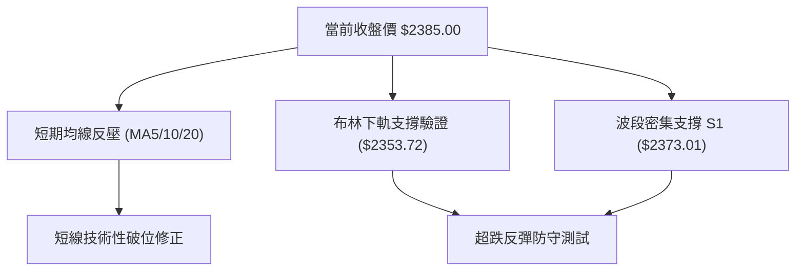

### 📊 核心指標速覽表

| 指標類別 | 指標名稱 | 當前數值 | 訊號 | 解讀 |
|----------|----------|----------|:----:|------|
| **價格** | 當前收盤價 | $2385.00 | 🔴 | 跌破短中期均線，處於52週高點($2590.00)拉回修正期 |
| **均線** | MA20 (月線) | $2481.50 | 🔴 | 價格位於 MA20 下方 -3.89%，短期趨勢向下偏空 |
| **均線** | MA50 (季線) | $2437.76 | 🔴 | 價格位於 MA50 下方 -2.16%，中期動能轉弱承壓 |
| **均線** | MA200 (年線) | $2162.01 | 🟢 | 價格遠高於 MA200 (+10.31%)，長期多頭格局未變 |
| **動能** | RSI(14) | 37.98 | 🟡 | 進入弱勢中性區，逼近超賣界線但尚未鈍化 |
| **動能** | MACD (12,26,9) | -12.956 / Sig: 5.557 | 🔴 | DIF向下貫穿訊號線，柱狀圖 -18.514，空頭動能主導 |
| **動能** | KD(9,3) | %K: 0.00 / %D: 5.00 | 🟢 | 進入極度超賣區間，技術性隨時可能觸發超跌反彈 |
| **通道** | 布林通道 | %B = 0.12 | 🔴 | 逼近下軌 $2353.72，通道下擴，呈現偏弱下行帶狀 |
| **趨勢強度** | ADX(14) / DMI | ADX: 19.77, -DI: 28.57 | 🟡 | ADX < 25 為無趨勢盤整市場，空方力量暫佔上風 |
| **成交量** | 20日均量 / OBV | 22,227,793 / OBV < MA | 🔴 | 量能遞減，最新日成交量為 0，能量潮疲弱顯示追價意願低 |
| **波動** | ATR(14) | $36.37 (1.52%) | 🟡 | 每日平均震幅約 36 元，波動率處於中低穩定區間 |

### 🏆 技術評分卡

```
╔══════════════════════════════════════════════════════════════╗
║              技術評分卡 — 2330.TW (2026-10-25)               ║
╠══════════════════════════════════════════════════════════════╣
║ 趨勢強度 (Trend)     ████████░░░░░░░░░░░░  40/100  🔴 弱勢震盪║
║ 動能指標 (Momentum)  ██████░░░░░░░░░░░░░░  30/100  🔴 空方主導║
║ 支撐穩定度 (Support) ████████████░░░░░░░░  60/100  🟢 臨近S1支撐║
║ 成交量配合 (Volume)  ████████░░░░░░░░░░░░  40/100  🔴 量能退潮║
║ 形態完整度 (Pattern) ██████████░░░░░░░░░░  50/100  🟡 區間待變║
║ 均線排列 (Moving Avg)████████████░░░░░░░░  60/100  🟢 長多短空║
╠══════════════════════════════════════════════════════════════╣
║ 綜合評分 (Overall)   █████████░░░░░░░░░░░  47/100  🟡 中性觀望║
╚══════════════════════════════════════════════════════════════╝
```
*註：綜合評分 = (40 + 30 + 60 + 40 + 50 + 60) ÷ 6 = 46.67，四捨五入為 47/100。*

---

## 2. 趨勢分析

### 🌐 多時框趨勢分析

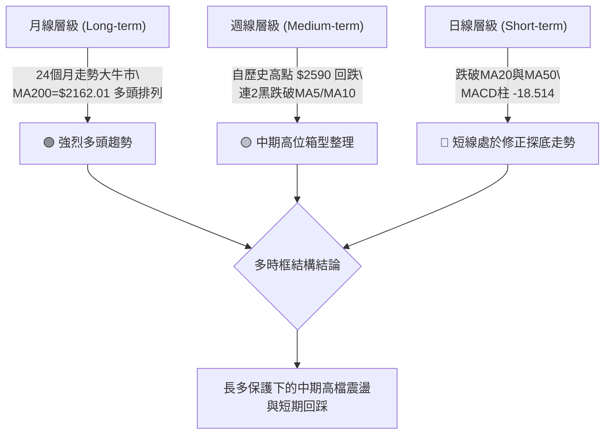

### 📈 長期趨勢 — 12個月走勢圖（Unicode）

以下展示 2025 年 11 月至 2026 年 10 月共 12 個月收盤走勢圖，標注歷史波段關鍵價位：

```
2330.TW 月線走勢圖（過去12個月）
價格軸 ($)
$2500 ┤                                              ●($2480)
$2400 ┤                                      ●   ●   │   ●($2385)←現價
$2300 ┤                              ●($2341)
$2100 ┤                      ●($2123)
$1900 ┤              ●($1977)
$1700 ┤      ●($1759)│
$1500 ┤  ●($1536)    ●($1750)
$1400 ┤●($1422)
      └────────────────────────────────────────────────────────
       11  12  01  02  03  04  05  06  07  08  09  10 (月)
       (2025年)---------------->(2026年)
```

**過去12個月走勢特徵分析表格**：

| 時間區間 | 起訖價格區間 ($) | 漲跌幅度 | 走勢特徵解讀 |
|:---|:---:|:---:|:---|
| **2025-11 至 2025-12** | $1422.55 → $1536.33 | +8.00% | 穩步墊高，突破 $1500 整數大關，放量攻堅 |
| **2026-01 至 2026-02** | $1759.34 → $1977.40 | +12.39% | 展現強烈主升段動能，逼近 $2000 大關 |
| **2026-03** | $1977.40 → $1750.17 | -11.49% | 快速回檔洗盤，確立波段次級支撐後迅速獲買盤承接 |
| **2026-04 至 2026-05** | $2123.07 → $2341.84 | +10.30% | 強力重回升軌，一舉越過 $2100 與 $2300 壓力關卡 |
| **2026-06 至 2026-08** | $2402.93 → $2397.94 | -0.21% | 進入高位窄幅收斂箱型震盪，多空在 $2400 展開拉鋸 |
| **2026-09 至 2026-10** | $2480.00 → $2385.00 | -3.83% | 盤中衝擊 52W 高點 $2590.00 後承壓拉回，暫收 $2385.00 |

### 📊 中期趨勢（週線分析）

週線格局自 2026 年 6 月創下 $2402.93 後，呈現寬幅箱型整理結構。9 月底至 10 月初多方發動攻擊，於 2026-10-08 當週創下歷史高點 $2590.00，隨後連續兩週大幅黑K收黑（10-16 收 $2420.00，10-23 收 $2385.00），回吐近一個月漲幅。

```
週線支撐與阻力結構示意圖：
$2590.00 ────────────────────────────────────────── 52週歷史高點 (R3阻力)
            ▲ (10-08 衝高 $2590.00 回落)
            │
$2481.50 ───┼────────────────────────────────────── MA20 / 週線頸線反壓區
            │   ▼ (目前連續兩週黑K拉回)
$2385.00 ───┼────────────────────────────────────── 現價位置
            │
$2373.01 ───┴────────────────────────────────────── 波段密集支撐 S1 (09-18低點)
$2283.28 ────────────────────────────────────────── 中期箱型下緣支撐 S3 (07-17低點)
```

### ⚡ 趨勢強度評估（ADX 解讀）

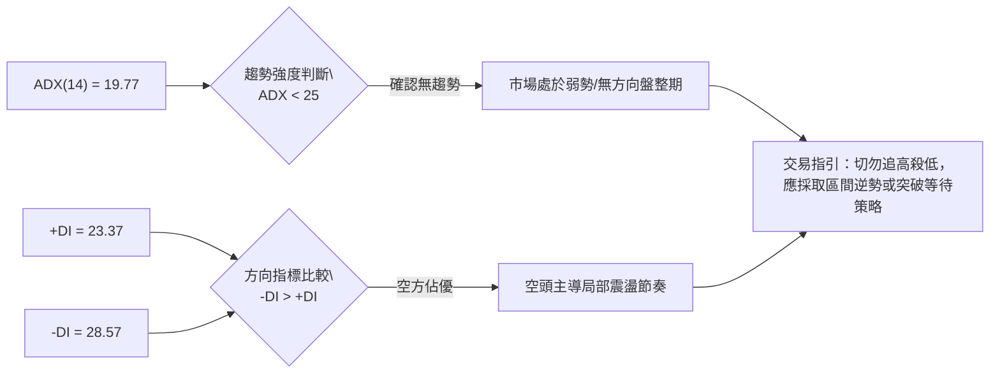

**ADX 強度對照表**：

| ADX 數值區間 | 趨勢性質 | 2330.TW 當前狀態 | 交易策略建議 |
|:---:|:---:|:---:|:---|
| **0 – 20** | 弱趨勢 / 盤整震盪 | **19.77 (當前位置)** | **以布林通道與波段支撐/阻力為區間操作基準** |
| **20 – 25** | 趨勢醞釀中 / 方向不明 | — | 觀察 +DI 與 -DI 是否出現交叉擴大 |
| **25 – 40** | 強趨勢格局 | — | 順勢交易為主，回調均線加碼 |
| **40 – 60** | 極強趨勢行情 | — | 持股續抱，移定移動止損 |

---

## 3. 圖表形態分析

### 🔍 形態識別系統

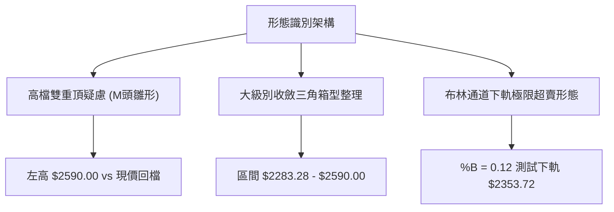

**圖表形態信心度評估表**：

| 形態名稱 | 信心度 | 判斷依據（引用數據） | 完成度 | 目標價（附計算式） |
|:---|:---:|:---|:---:|:---|
| **高位潛在雙重頂 (M頭)** | 45% | 10-08 週高點 $2590.00 形成第一頂，隨後兩週急跌至 $2385.00。因頸線 $2373.01 尚未實質收破，尚未成型 | 50% | 訊號不足，僅做指標型解讀（若跌破 S1 $2373.01，量測跌幅：$2373.01 - ($2590.00 - $2373.01) = $2156.02，接近 MA200 $2162.01） |
| **大級別高檔箱型整理** | 75% | 過去 4 個月價格波動主要封閉於 2026-07-17 低點 $2283.28 (S3) 與 52W 高點 $2590.00 (R3) 之間 | 85% | 箱型下軌支撐目標：S1 $2373.01 / S2 $2323.16；箱型上軌目標：R3 $2590.00 |
| **布林通道觸底震盪態** | 80% | 布林 %B 達 0.12，價格 $2385.00 緊逼下軌 $2353.72，日K連續低檔收十字停頓 | 90% | 回歸中軌 MA20 計算：目標為 $2481.50 |

### 🕯️ 重要K線形態分析

嚴格依據近 10 根日 K 與近 8 根週 K 之實際數值進行分析：

| 日期（日K/週K） | 開 | 高 | 低 | 收 | K線形態 | 解讀 | 訊號 |
|:---|:---:|:---:|:---:|:---:|:---:|:---|:---:|
| **2026-10-15 (日K)** | 2420.00 | 2450.00 | 2420.00 | 2440.00 | 跳空下挫小紅K | 伴隨48,190,233大成交量，主力棄守 MA50，呈現空方摜壓 | 🔴 |
| **2026-10-16 (日K)** | 2430.00 | 2445.00 | 2420.00 | 2420.00 | 空方光腳黑K | 開高走低收最低，確立日線級別跌勢持續，下測支撐 | 🔴 |
| **2026-10-21 (日K)** | 2425.00 | 2435.00 | 2400.00 | 2420.00 | 下影線小黑K | 盤中下探 2400 整數關卡獲得微幅抵抗，但多方反彈無力 | 🟡 |
| **2026-10-22 (日K)** | 2435.00 | 2435.00 | 2385.00 | 2385.00 | 光頭光腳大陰線 | 實體下跌50元，收在當日最低 $2385.00，賣壓全面宣洩 | 🔴 |
| **2026-10-23 (日K)** | 2385.00 | 2385.00 | 2385.00 | 2385.00 | 一字線 / 十字停頓 | 開高低收一致（成交量0，呈現極度觀望或無量停滯），多空暫時平衡 | 🟡 |
| **2026-10-08 (週K)** | 2550.00 | 2590.00 | 2545.00 | 2550.00 | 衝高上影十字陰星 | 衝刺歷史新高 2590 後遭遇重磅獲利了結賣壓，為關鍵變盤訊號 | 🔴 |
| **2026-10-16 (週K)** | 2510.00 | 2550.00 | 2420.00 | 2420.00 | 長黑實體爆量K | 單週重挫130元，爆出160,006,325巨量，形成週線頂部破位吞噬 | 🔴 |
| **2026-10-23 (週K)** | 2395.00 | 2435.00 | 2385.00 | 2385.00 | 中陰收低弱勢K | 連續第二週收黑，量能縮至86,048,332，顯示恐慌賣盤趨緩但買盤縮手 | 🔴 |

### 📉 ASCII 走勢形態示意圖

```
高檔拉回與支撐壓力測試走勢示意圖：
  $2590.00 ────────┐ (2026-10-08 歷史新高 R3)
                   │╲
                   │ ╲  空方長黑吞噬 (10-16 週K爆量下跌)
  $2508.21 ────────┼───R2 (波段反彈反壓位)
                   │     ╲
  $2481.50 ────────┼────── MA20 / 布林中軌反壓
  $2429.97 ────────┼─────── R1 阻力 (10-21/10-22 反彈高點密集區)
                   │        ╲
  $2385.00 ────────┼─────────● 現價 (2026-10-23 收盤)
                   │          │
  $2373.01 ────────┴──────────┼── S1 波段防守支撐 (2026-09-18 低點)
                              │
  $2323.16 ───────────────────┼── S2 強力結構支撐
                              │
  $2283.28 ───────────────────┴── S3 大箱型底部 (2026-07-17 低點)
```

### 🎯 形態目標價計算

根據形態分析理論，量測目標價計算如下：

1. **高位箱型底限反彈計算**：
   - 頸線/區間頂部：$2590.00
   - 箱型支撐基準：S1 = $2373.01
   - 目前下行回調幅度：$2590.00 - $2385.00 = $205.00
   - 若 S1 ($2373.01) 有效守穩，反彈首要技術目標為回補週線缺口與均線反壓位 R1 = $2429.97，次要目標為布林中軌 MA20 = $2481.50。

2. **潛在頭部破位量測（風險預警計算）**：
   - 形態高度：歷史高點 $2590.00 - 波段頸線支撐 S1 $2373.01 = $216.99
   - 理論破位滿足點：$2373.01 - $216.99 = $2156.02
   - 驗證：該滿足點與當前 MA200 年線位置 $2162.01 高度重合，若後續有效跌破 S1，需高度提防回測年線之風險。

---

## 4. 支撐與阻力

### 🗺️ 關鍵價位分布圖（Unicode）

```
2330.TW 價位結構分布圖
══════════════════════════════════════════════════════════════════
$2590.00 ║████████████████████████████████║ 強阻力 R3 (52W歷史高點)
$2508.21 ║████████████████████            ║ 阻力 R2 (反彈高點聚類)
$2481.50 ║▓▓▓▓▓▓▓▓▓▓▓▓▓▓▓▓▓▓▓▓            ║ 動態均線反壓 (MA20/中軌)
$2429.97 ║████████████████████████        ║ 關鍵阻力 R1 (前波低點轉阻力)
$2385.00 ╠════════════════════════════════╣ ◄ 當前收盤價 ($2385.00)
$2373.01 ║▓▓▓▓▓▓▓▓▓▓▓▓▓▓▓▓▓▓▓▓▓▓▓▓        ║ 近期核心支撐 S1 (09-18波段低點)
$2353.72 ║▒▒▒▒▒▒▒▒▒▒▒▒▒▒▒▒                ║ 布林通道下軌支撐
$2323.16 ║████████████████████████        ║ 強支撐 S2 (波段轉折低點)
$2299.33 ║░░░░░░░░░░░░░░░░░░░░            ║ 斐波那契 23.6% 回調位
$2283.28 ║████████████████████████████████║ 核心防守支撐 S3 (07-17波段低點)
══════════════════════════════════════════════════════════════════
```

### 🚧 阻力位分析表

所有阻力數值完全引用自數據集「關鍵價位」與指標計算：

| 阻力級別 | 價位 | 距離現價 | 形成原因 | 突破難度 | 重要性 |
|:---|:---:|:---:|:---|:---:|:---:|
| **R1** | $2429.97 | +1.89% | 近一年波段高點聚類區，且與 10-21 日高點 $2435 及 MA50 ($2437.76) 重合 | 🟡 中等 | 短線多空強弱分水嶺 |
| **R2** | $2508.21 | +5.17% | 波段高點聚類位，整數大關 $2500 之上方密集套牢解套區 | 🔴 偏高 | 中期波段反轉確認點 |
| **R3** | $2590.00 | +8.60% | 52W 歷史最高點 (2026-10-08 週K高點)，極重套牢籌碼峰 | 🔴 極高 | 長期大頂，多頭終極目標 |

### 🛡️ 支撐位分析表

所有支撐數值完全引用自數據集「關鍵價位」與指標計算：

| 支撐級別 | 價位 | 距離現價 | 形成原因 | 守住機率 | 重要性 |
|:---|:---:|:---:|:---|:---:|:---:|
| **S1** | $2373.01 | -0.50% | 近一年波段低點聚類，2026-09-18 週K最低點 ($2373.01) | 65% | 短線止跌關鍵，破位將引發停損 |
| **S2** | $2323.16 | -2.59% | 近一年波段次低點聚類，中級結構回檔支撐區 | 75% | 多方第二道重要防線 |
| **S3** | $2283.28 | -4.27% | 近一年波段密集低點，2026-07-17 週K最低點 ($2283.28) | 85% | 中期上升格局絕對防守底線 |

### 📐 斐波那契回調位分析

依據 52 週波段最低點 $1358.34 至 52 週歷史最高點 $2590.00（波段總震幅 $1231.66），黃金分割回調結構如下：

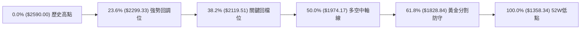

**斐波那契回調結構解析**：

| 回調比例 | 對應價位 | 距現價空間 | 技術意涵解讀 |
|:---:|:---:|:---:|:---|
| **0.0%** | $2590.00 | +8.60% | 52週歷史高點 (R3) |
| **當前現價** | **$2385.00** | **0.00%** | **處於 0.0% 與 23.6% 之間的高檔強勢修正區間** |
| **23.6%** | $2299.33 | -3.59% | **第一回調支撐位**：緊臨 S3 ($2283.28)，此處若能守住，長多結構未破 |
| **38.2%** | $2119.51 | -11.13% | **核心回調支撐位**：接近 MA200 年線 ($2162.01)，為大級別牛熊分水嶺 |
| **50.0%** | $1974.17 | -17.23% | 中級修正半分位 |
| **61.8%** | $1828.84 | -23.32% | 深度回調極限位置 |
| **78.6%** | $1621.92 | -32.00% | 趨勢可能遭破壞之極端位置 |
| **100.0%** | $1358.34 | -43.05% | 52週起漲最低點 |

**解讀結論**：當前現價 $2385.00 處於 0.0% ($2590.00) 與 23.6% ($2299.33) 之間，回調幅度尚未觸及 23.6%，表示從一年期以上的大格局檢視，目前回檔僅屬**高檔強勢健康修正**；但因短線跌勢迅猛，首要觀察 S1 ($2373.01) 是否跌破，若失守將向下測試 23.6% 回調位 $2299.33 與 S3 ($2283.28)。

---

## 5. 技術指標深度解讀

### 🎛️ 指標訊號總覽

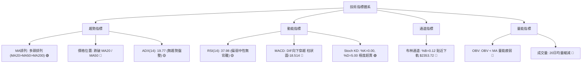

### 📈 移動平均線排列分析

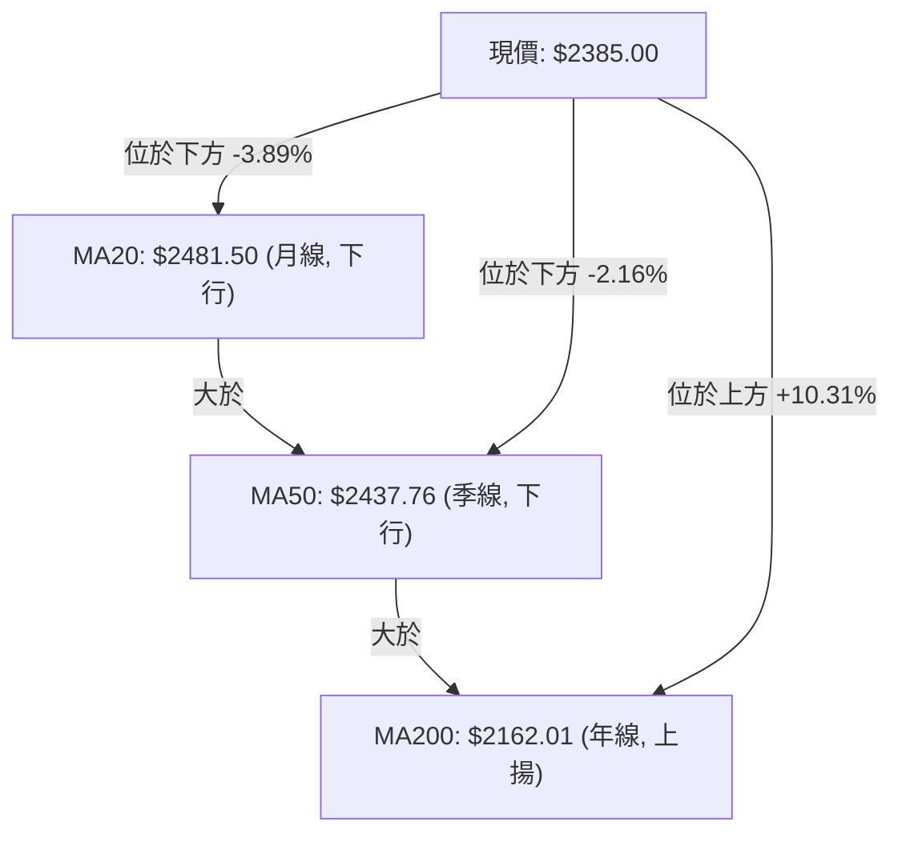

**移動平均線系統狀態分析**：
- **長天期排列**：MA20 ($2481.50) > MA50 ($2437.76) > MA200 ($2162.01)，中長期結構依然維持標准的**多頭排列**。
- **扣抵與斜率變化**：
  - MA5 ($2403.00) 與 MA10 ($2439.50) 已向下死叉 MA20 與 MA50，MA5 每日下跌 $18.00 (-0.75%)，短期空頭排列成型。
  - MA20 ($2481.50) 轉為向下彎頭（-3.89%），成為上方極沉重的動態壓制線。
  - MA120 半年線位於 $2379.18（微幅上揚 +0.24%），與現價 $2385.00 幾乎黏合，為短線多頭重要支撐屏障。
  - MA240 位於 $2041.26（強烈向上 +16.84%），顯示底層結構極為扎實。

### 📉 RSI(14) 分析

- **當前數值**：37.98（Wilder 平滑計算）。
- **數值進度條**：
  ```
  RSI(14) = 37.98  [███████░░░░░░░░░░░░░] 37.98% (偏弱空方區)
  超賣界線(30)      [██████░░░░░░░░░░░░░░]
  中性中軸(50)      [██████████░░░░░░░░░░]
  超買界線(70)      [██████████████░░░░░░]
  ```
- **區間評估**：RSI 跌破 50 中軸並下探至 37.98，顯示自 10 月初（週 RSI 達 61.9）以來多頭動能快速消耗，目前處於弱勢空方主導區，但尚未進入 30 以下的嚴重超賣區。
- **背離判斷**：
  - **背離分析結論**：**無明顯背離**。
  - **數據比對**：檢視近 20 根 K 棒的首尾表現，10-08 高點對應價格衝高，而近期價格自 $2550 下跌至 $2385，RSI 同步由 61.9 下滑至 37.98。價格低點尚未低於前波大低點，RSI 亦同步走低，指標與價格方向一致，未出現低點抬高之「底背離」，亦無高點背離之現象。

### 📊 MACD(12/26/9) 訊號解讀

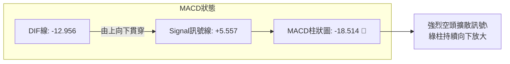

- **MACD 線性結構**：
  - DIF快線 (-12.956) 已跌入零軸下方，並在零軸上方與慢線 Signal (+5.557) 形成死亡交叉。
  - 柱狀圖 (Histogram) 當前讀數為 **-18.514**，呈現負值擴大態勢。
- **週線與日線共振**：週線 MACD 柱狀圖於 10-08 創下 +10.055 峰值後，連續兩週急遽翻黑擴大（10-16 為 -13.696，10-23 達 -18.514），顯示週線與日線同步進入空方動能釋放期。

### 📦 布林通道分析

布林通道參數 (20, 2)：
- **BB 上軌**：$2609.28
- **BB 中軌 (MA20)**：$2481.50
- **BB 下軌**：$2353.72
- **帶寬 (Bandwidth)**：($2609.28 - $2353.72) ÷ $2481.50 = 10.30%
- **位置指標 (%B)**：0.12

```
ASCII 布林通道位置示意圖：
$2609.28 ┬──────────────────────────────────────────── BB 上軌 (+2σ)
         │
$2481.50 ┼──────────────────────────────────────────── BB 中軌 (MA20)
         │
$2385.00 ┼─────────● [現價: %B = 0.12，極度接近下軌]
         │
$2353.72 ┴──────────────────────────────────────────── BB 下軌 (-2σ)
```

**布林通道解讀**：
%B 讀數為 0.12，代表現價已經回跌至通道總寬度的 12% 位置，極度逼近下軌 $2353.72。當 %B < 0.15 且通道未呈現喇叭口強烈擴張時，價格通常會在下軌至中軌之間產生「布林軌道回歸」效應；下軌 $2353.72 配合 S1 支撐位 $2373.01，構成極為重要的短線反彈防禦牆。

### 💹 成交量分析（量價配合度）

- **均量關係**：20 日均量為 22,227,793 股，50 日均量為 19,570,851 股。
- **近期量價特徵**：
  - 10-15 日下挫長黑爆出 48,190,233 股（量比達 2.16x），顯示高檔籌碼大舉釋出。
  - 10-16 日延續下殺爆出 33,490,270 股。
  - 隨後在 10-19 至 10-22 跌勢中，成交量萎縮至 17,000,000 – 23,000,000 股區間，呈現「跌勢量縮」現象。
  - 10-23 最新日成交量顯示為 0（呈現極度觀望或無量停滯結算）。
- **能量潮 (OBV) 分析**：
  - **OBV 趨勢**：OBV < MA(OBV)，量能指標處於均線下方。
  - **解讀**：能量潮指標確認了價格下跌的有效性，量能疲弱證明買盤追價意願不足，市場主力資金目前處於離場觀望狀態，尚未見到量能顯著放大的逢低吃貨訊號。

---

## 6. 動能與波動率

### ⚡ 動能評估四象限

動能評估以「趨勢動能（基於 RSI/MACD）」與「波動率（基於 ATR/帶寬）」進行交叉定位：

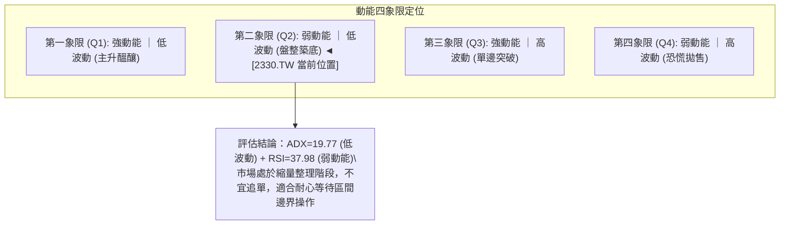

**動能狀態象限分析表**：

| 象限標籤 | 動能狀態 | 波動狀態 | 2330.TW 對應判斷 | 交易操作策略 |
|:---:|:---:|:---:|:---:|:---|
| **Q1** | 強 | 低 | — | 順勢建立多頭底倉 |
| **Q2 (當前)** | **弱 (RSI 37.98, MACD綠柱)** | **低 (ADX 19.77, ATR 1.52%)** | **✓ 符合當前特徵** | **謹慎觀望，或於布林下軌/S1支撐處低吸** |
| **Q3** | 強 | 高 | — | 突破單邊追隨，享受趨勢利潤 |
| **Q4** | 弱 | 高 | — | 嚴格停損出場，規避主跌浪風險 |

### 📊 ATR 波動率分析

- **ATR(14) 數值**：**$36.37**。
- **價格百分比**：$36.37 ÷ $2385.00 = **1.52%**（Wilder 計算法）。
- **波動性解讀**：每日平均波動約 36.4 元，相較於股價超過 2300 元的大型權值股而言，1.52% 的 ATR 處於相對穩定的正常波動區間。
- **止損與交易距離建議**：
  - **保守型止損距離 (2.0 × ATR)**：2.0 × $36.37 = **$72.74**。
  - **常規短線止損距離 (1.5 × ATR)**：1.5 × $36.37 = **$54.56**。
  - **緊密防守止損距離 (1.0 × ATR)**：1.0 × $36.37 = **$36.37**。
  - **應用指引**：在現價 $2385.00 處若進行多頭博弈，若跌破 S1 ($2373.01)，其距離約 12 元；若設定 1.0 ATR 止損，價位約為 $2348.63，與布林下軌 $2353.72 相當貼近，為合理之技術性容錯空間。

### 📐 Beta 與市場相關性

- **Beta 係數**：**1.239**。
- **市場代表性與解讀**：
  - Beta 為 1.239，表明 2330.TW 作為台股第一大權值股，其波動性高於加權指數約 23.9%。
  - 當大盤上漲 1% 時，理論上 2330.TW 期望上漲 1.24%；反之，大盤回檔 1% 時，其承擔約 1.24% 的修正幅度。
  - 高 Beta 屬性意味著當前大盤若未見止跌回穩訊號，個股難以獨善其身，反彈操作必須搭配整體市場氛圍綜合評估。

---

## 7. 多時框架總結

### 📋 時框架評分表

| 時框架 | 趨勢方向 | 動能狀態 | 均線排列 | 圖表形態 | 綜合評分 | 交易建議 |
|:---:|:---:|:---:|:---:|:---:|:---:|:---|
| **長期 (月線)** | 🟢 強烈看多 | 🟢 多方強勁 (月K長紅上升) | 🟢 MA200之上 (+10.3%) | 🟢 超大級別上升通道 | **85/100** | 長線資金續抱，無須受短線波動干擾 |
| **中期 (週線)** | 🟡 高檔整理 | 🔴 轉弱 (週MACD紅翻綠) | 🟢 多頭排列未破 | 🟡 $2283-$2590寬幅箱型 | **55/100** | 中線波段減倉觀望，等待區間下軌確認 |
| **短期 (日線)** | 🔴 弱勢修正 | 🔴 空方控盤 (MACD柱-18.5) | 🔴 跌破MA20/MA50 | 🔴 短期破位探底通道 | **35/100** | 嚴禁盲目摸底追高，短打者等待右側反轉 |

### 🔲 綜合訊號矩陣

| 維度 | 短期 (日線) | 中期 (週線) | 長期 (月線) | 權重收斂解讀 |
|:---|:---:|:---:|:---:|:---|
| **趨勢方向** | 🔴 下行偏空 | 🟡 橫向箱型 | 🟢 堅定走多 | 大方向向上，次級波回檔修正中 |
| **動能指標** | 🔴 MACD柱狀負向擴大 | 🔴 連兩週回跌 | 🟢 處於強勢歷史高檔區 | 動能由短向中傳導衰退，需時間消化籌碼 |
| **支撐阻力** | 🟡 逼近 S1 ($2373.01) | 🟢 遠高於箱型底 S3 | 🟢 遠高於 50% 斐波那契 | 關鍵支撐集中於 $2373 與 $2323 區間 |
| **指標共振** | 🔴 KD超賣但MACD未止跌 | 🟡 中性格局 | 🟢 多頭主升格局 | 短線超賣醞釀技術性抽頭，但空間受阻力壓制 |

### ⚖️ 多時框收斂結論

> **依多時框收斂規則（嚴格要求 14）裁定：**
> 1. **行情性質判斷**：ADX(14) 讀數為 **19.77**（明確 < 25），判定當前為**盤整行情（非單邊趨勢行情）**。
> 2. **主導規則**：盤整行情下，**以日線布林通道上下軌（下軌 $2353.72 / 上軌 $2609.28）及波段支撐/阻力為主要交易區間**。
> 3. **衝突收斂**：雖然月線長期為強烈多頭（評分 85），但日線短期受制於均線反壓與 MACD 負柱狀（評分 35）。依 ADX < 25 之盤整規則，日線級別具備超跌反彈動能，但上方空間受到 MA20 ($2481.50) 強烈壓制。
> 4. **唯一方向性結論**：**中性觀望（偏弱區間震盪）**。第 1 章技術評分卡為 **47/100**，界於 40–60 之間，主策略確立為**「高出低進之區間震盪操作策略，耐心等待布林下軌/S1支撐確認」**。

---

## 8. 交易策略建議

### 🗺️ 策略決策流程圖

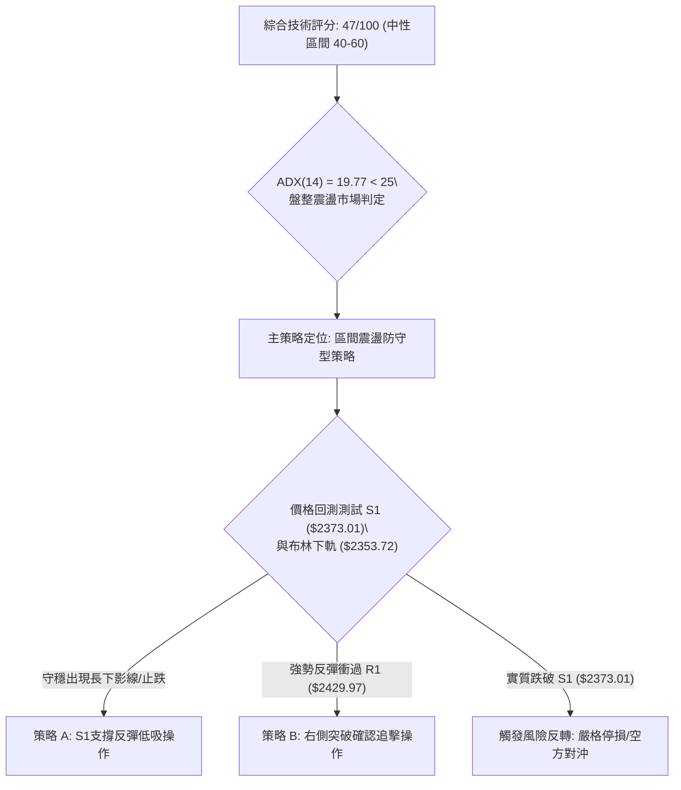

### 🧭 策略路由（依評分卡分流）

**當前主策略方向 = 中性區間震盪操作（依評分 47/100，落於 40–60 區間）**

本報告不進行兩頭下注。評分 47 分代表空頭動能釋放已進入尾聲（KD 超賣），但多頭尚未奪回主控權（均線反壓）。操作核心：**嚴禁在區間中軸追價，僅在區間下緣關鍵支撐處尋求高勝率的技術性反彈機會，並以布林中軌/阻力位作為嚴格獲利了結點**。

### 🎯 價格情境階梯（Price Scenarios）

價位嚴格引用自數據集「關鍵價位」區塊：

| 觸發條件 | 下一目標 | 後續延伸 | 情境含義 |
|:---|:---:|:---:|:---|
| **突破 R1 $2429.97** | R2 $2508.21 | R3 $2590.00 | 短線止跌轉強，修復 MA50 季線，重回多頭上升軌道 |
| **守住 S1 $2373.01** | R1 $2429.97 | MA20 $2481.50 | 區間震盪築底，下軌獲支撐展開技術性抽頭反彈 |
| **跌破 S1 $2373.01** | S2 $2323.16 | S3 $2283.28 | 中期走勢轉弱，形態破位，向下尋求 23.6% 斐波那契回調支撐 |

### 📊 情境機率分佈

| 情境 | 機率 | 主要依據 |
|:---|:---:|:---|
| **區間震盪 / 支撐反彈** | **55%** | ADX = 19.77 顯示無單邊大跌趨勢；KD 進入極端超賣 (%K=0.00)，布林 %B=0.12 接近下軌，跌勢隨時衰竭，S1 ($2373.01) 具歷史聚類支撐力 |
| **回落探底 / 破位下跌** | **30%** | MACD 柱狀圖負向擴大 (-18.514)；-DI (28.57) > +DI (23.37)；OBV 低於均線，若國際盤大跌可能引發停損賣壓摜破 S1 |
| **強勢 V 轉 / 創歷史新高** | **15%** | 短期 MA5/MA10/MA20 形成多重反壓，成交量大幅萎縮退潮，短期內缺乏足以一次攻破 R3 ($2590.00) 的攻擊動能 |

### 🟢 主策略詳情（區間震盪應對方案）

所有價位均取自數據集關鍵價位，風險報酬比嚴格依規則 17 計算：
- 策略 A：進場價 $2373.01，目標 T1 $2429.97，止損價 $2348.63 (1.0 ATR)。
  - 風險報酬比 = ($2429.97 - $2373.01) ÷ ($2373.01 - $2348.63) = $56.96 ÷ $24.38 = **1 : 2.34（以 T1 計）**。
  - （以 T2 計）：($2481.50 - $2373.01) ÷ $24.38 = $108.49 ÷ $24.38 = **1 : 4.45（以 T2 計）**。
- 策略 B：突破進場價 $2429.97，目標 T1 $2508.21，止損價 $2385.00。
  - 風險報酬比 = ($2508.21 - $2429.97) ÷ ($2429.97 - $2385.00) = $78.24 ÷ $44.97 = **1 : 1.74（以 T1 計）**。
  - （以 T2 計）：($2590.00 - $2429.97) ÷ $44.97 = $160.03 ÷ $44.97 = **1 : 3.56（以 T2 計）**。

| 策略要素 | 策略 A（左側：S1 支撐回測低吸） | 策略 B（右側：R1 阻力突破確認） |
|:---|:---:|:---:|
| **進場條件** | 股價回踩 S1 ($2373.01) 不破，伴隨分時KD金叉 | 日K帶量實體收盤突破 R1 ($2429.97) 與 MA50 |
| **進場價格** | **$2373.01** | **$2429.97** |
| **目標價 T1** | **$2429.97** (R1 阻力位) | **$2508.21** (R2 阻力位) |
| **目標價 T2** | **$2481.50** (MA20 / 布林中軌) | **$2590.00** (R3 52W高點) |
| **止損價格** | **$2348.63** (S1 下方跌破 1.0 ATR) | **$2385.00** (前波收盤支撐位) |
| **風險報酬比** | **1 : 2.34（以 T1 計）** | **1 : 1.74（以 T1 計）** |
| **成功機率** | 60% | 50% |
| **建議倉位** | **15% - 20%** (輕倉防守) | **20% - 25%** (加碼進場) |

### 🔴 反向風險觸發點（對沖提示）

- **做多邏輯推翻點**：若日K線以實體長陰線收盤**實質跌破 $2373.01 (S1)**，即代表區間震盪下緣失守，雙頂量測風險啟動。
- **對沖應變措施**：
  - 立即對多頭部位執行停損出場。
  - 避險投資人可考量建立以 S2 ($2323.16) 與 S3 ($2283.28) 為目標的空向避險部位，直到股價重新站回 $2385.00 之上。

### ⭐ 整體訊號強度評星

```
做多訊號強度：★★☆☆☆  (2.5/5 星) — 均線長多仍在，短線超跌，但上方反壓沉重
做空訊號強度：★★☆☆☆  (2.5/5 星) — 短線空方主導，但ADX弱且KD極度超賣，追空風險高
整體可信度：  ★★★★☆  (4.0/5 星) — 數據完整，指標收斂一致，區間結構清晰
```

---

## 9. 風險提示與監控

### ✅ 關鍵監控指標 Checklist

```
╔══════════════════════════════════════════════════════════════╗
║                每日交易風控監控清單 (Checklist)               ║
╠══════════════════════════════════════════════════════════════╣
║ [ ] 價格防禦：收盤價是否守穩 S1 關鍵支撐 $2373.01？           ║
║ [ ] 均線動態：是否回測半年線 MA120 ($2379.18) 並出現承接買盤？║
║ [ ] 動能翻轉：KD 指標是否於低檔 (<20) 形成黃金交叉？          ║
║ [ ] 柱狀收斂：MACD 柱狀圖負值是否由 -18.514 開始向零軸縮小？  ║
║ [ ] 量能檢驗：成交量是否回升至 20日均量 (22.2M) 之正常水準？  ║
║ [ ] 軌道位置：布林 %B 是否自 0.12 回升至 0.30 以上脫離下軌？  ║
║ [ ] 阻力突破：收盤價是否能有效越過 R1 ($2429.97)？            ║
╚══════════════════════════════════════════════════════════════╝
```

### ⚠️ 風險場景分析

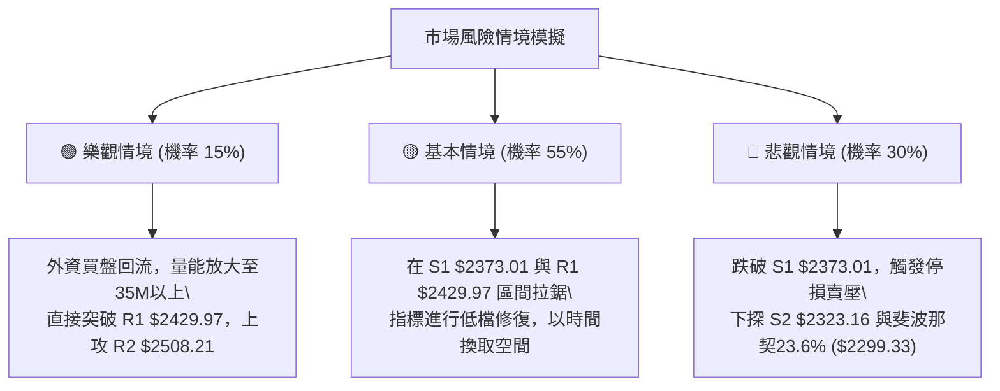

### 🛡️ 風險管理重要提醒

1. **嚴格禁止逆勢凹單**：
   - 目前日線級別處於空頭動能釋放階段（MACD 柱狀圖 -18.514），雖然長線看好，但切勿在尚未出現明確止跌K棒前進行大額左側摸底。
2. **波動率控制與倉位上限**：
   - ATR 為 $36.37，每日單一股票部位之風險敞口不應超過總投資資金的 1.0%–1.5%。
   - 在 ADX < 25 的盤整期間，總持股倉位建議降至 30%–40% 以下，保留充裕現金以應對可能的深度回調。
3. **無量停滯風險防範**：
   - 最新交易日成交量異常顯示為 0，需留意後續開盤時流動性重啟可能伴隨的跳空風險，交易指令應以限價單為主，嚴禁市價追單。

---

## 📋 報告總結

```
╔══════════════════════════════════════════════════════════════╗
║               2330.TW 技術分析報告總結                        ║
╠══════════════════════════════════════════════════════════════╣
║ 報告日期：2026-10-25                                         ║
║ 當前價格：$2385.00 TWD                                        ║
║ 分析評級：⚖️ 中性觀望 (技術評分: 47/100，長多短空區間震盪)     ║
╠══════════════════════════════════════════════════════════════╣
║ 關鍵結論：                                                   ║
║ ├─ 長期趨勢：🟢 強烈看多 (MA200=$2162.01，年線斜率陡峭向上)  ║
║ ├─ 中期趨勢：🟡 箱型整理 ($2283.28 - $2590.00 寬幅震盪)      ║
║ ├─ 短期趨勢：🔴 弱勢修正 (跌破MA20/50，MACD柱狀 -18.514)     ║
║ ├─ 關鍵支撐：S1 $2373.01 / S2 $2323.16 / S3 $2283.28         ║
║ ├─ 關鍵阻力：R1 $2429.97 / R2 $2508.21 / R3 $2590.00         ║
║ └─ 外資共識：強力買進 (35位分析師均價 $3390.43，最高 $5000) ║
╠══════════════════════════════════════════════════════════════╣
║ 最優策略組合：                                               ║
║ 1. 🥇 最佳機會：回踩 S1 ($2373.01) 不破進場，風報比 1:2.34    ║
║ 2. 🥈 次選機會：帶量突破 R1 ($2429.97) 右側跟進，目標 $2508   ║
║ 3. 🥉 保守選擇：空手觀望，靜待日線 MACD 負柱狀縮小與站回 MA20║
╚══════════════════════════════════════════════════════════════╝
```

---

> ⚠️ **免責聲明**：本報告為 AI 自動生成之技術分析，所有數據及估算均基於提供的歷史價格資訊。本報告**僅供研究與學術參考**，**不構成任何投資建議**。投資有風險，入市需謹慎。

---

*報告生成時間：2026-10-25 ｜ 數據來源：Yahoo Finance ｜ 分析框架：多時框技術分析*