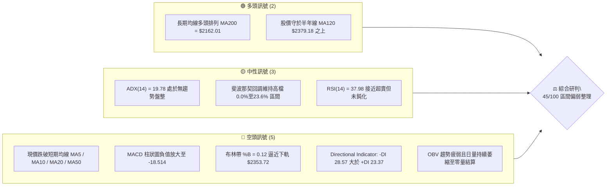
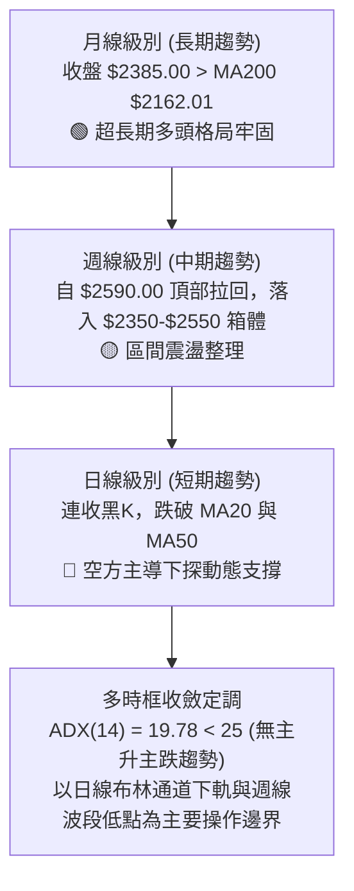
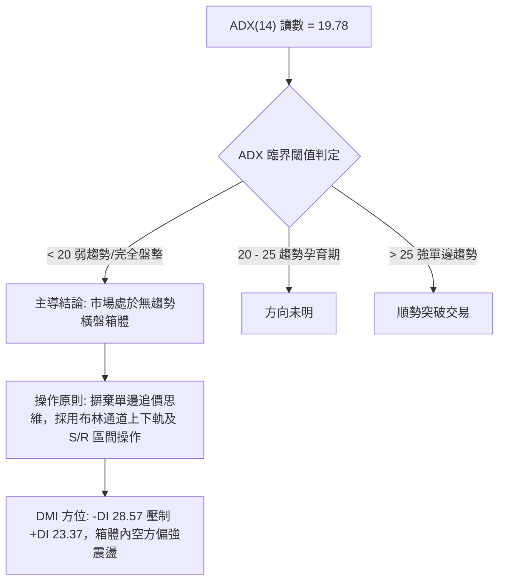
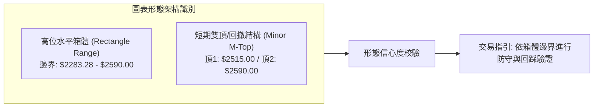
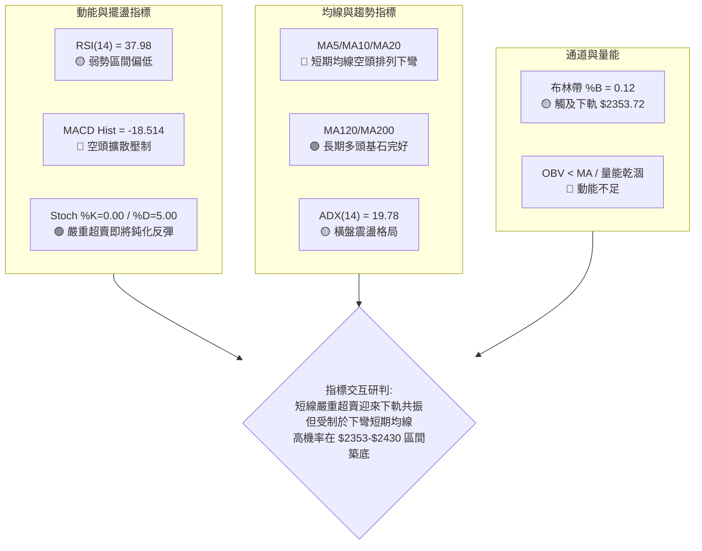
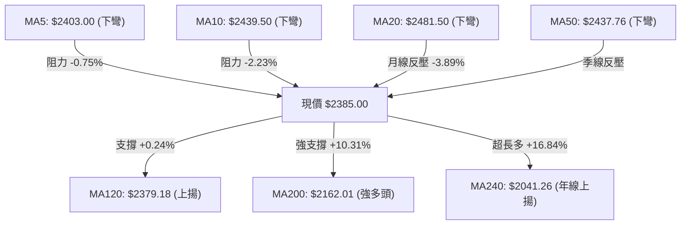
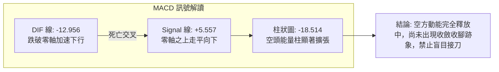
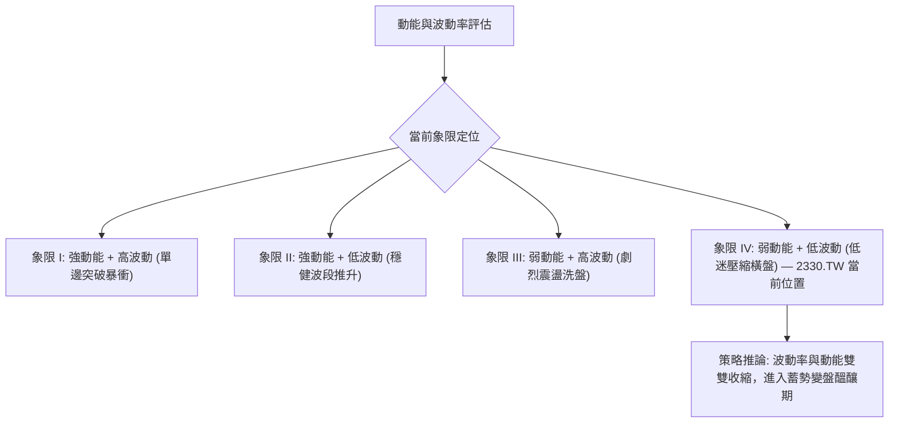
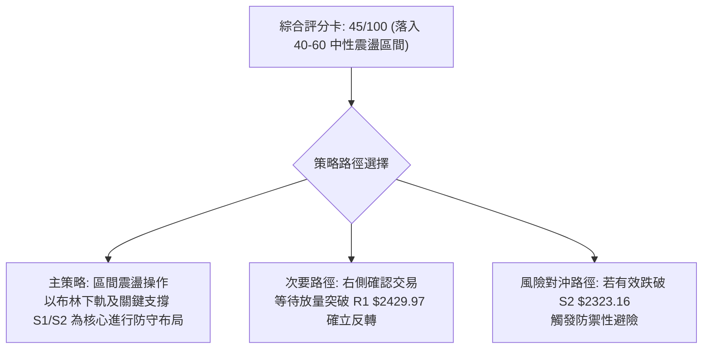
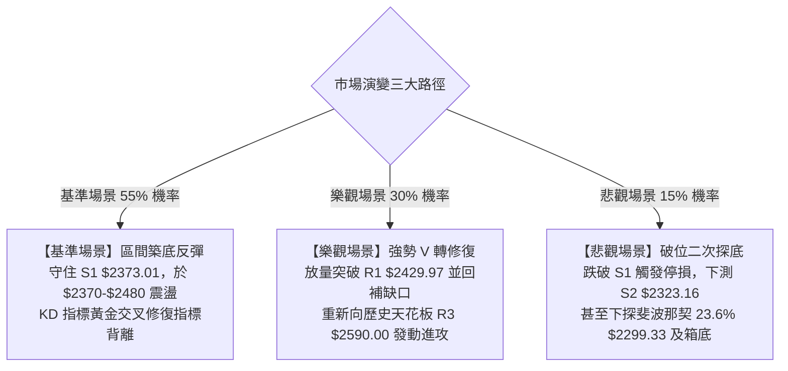

# 2330.TW 技術分析報告

> **報告日期**：2026-10-27 ｜ **語言**：繁體中文 ｜ **數據來源**：Yahoo Finance ｜ **當前價格**：$2385.00 TWD

---

## 目錄

| 章節 | 內容 |
|------|------|
| [1. 技術面概覽](#1-技術面概覽) | 訊號儀表板、核心指標、評分卡 |
| [2. 趨勢分析](#2-趨勢分析) | 多時框趨勢、長中短期走勢 |
| [3. 圖表形態分析](#3-圖表形態分析) | 形態識別、K線組合、目標價 |
| [4. 支撐與阻力](#4-支撐與阻力) | 關鍵價位、斐波那契回調 |
| [5. 技術指標深度解讀](#5-技術指標深度解讀) | MA/RSI/MACD/布林/成交量 |
| [6. 動能與波動率](#6-動能與波動率) | 動能評估、ATR、Beta |
| [7. 多時框架總結](#7-多時框架總結) | 時框架評分矩陣 |
| [8. 交易策略建議](#8-交易策略建議) | 多空策略、風險報酬比 |
| [9. 風險提示與監控](#9-風險提示與監控) | 監控指標、風險場景 |

---

## 1. 技術面概覽

### 🎯 技術訊號儀表板



### 📊 核心指標速覽表

| 指標類別 | 指標名稱 | 當前數值 | 訊號 | 解讀 |
|:---|:---|:---|:---:|:---|
| **價格** | 當前收盤價 | $2385.00 | 🟡 | 位於52週區間 83.4% 高位，但短線自歷史高點回撤 |
| **均線** | MA20 | $2481.50 | 🔴 | 現價位於 MA20 下方 -3.89%，月線下彎形成上方蓋頭蓋頂壓力 |
| **均線** | MA50 | $2437.76 | 🔴 | 現價跌破季線支撐，中短期動能轉弱 |
| **均線** | MA200 | $2162.01 | 🟢 | 現價高於年線 +10.31%，超長期多頭基石未被破壞 |
| **動能** | RSI(14) | 37.98 | 🟡 | 進入 30–40 偏弱空頭主導區，尚未觸及極度超賣 |
| **動能** | MACD (12,26,9) | -12.956 / 5.557 | 🔴 | DIF 跌破 Signal 線呈死叉下行，Histogram 為 -18.514 綠柱擴大 |
| **動能** | KD (Stoch %K/%D) | 0.00 / 5.00 | 🟡 | 數值落入極端超賣鈍化區，隨時具備技術性反彈契機 |
| **趨勢** | ADX(14) | 19.78 | 🟡 | ADX < 25，表明單邊趨勢衰竭，進入大級別橫盤箱體震盪 |
| **趨勢** | DMI (+DI / -DI) | 23.37 / 28.57 | 🔴 | -DI > +DI，空方力量占優，主導短線壓制格局 |
| **通道** | 布林帶 (%B) | 0.12 | 🟡 | 下軌 $2353.72 提供短線動態支撐，現價逼近通道底部 |
| **量能** | OBV / 成交量 | OBV < MA | 🔴 | 價跌量縮且 OBV 跌破均線，買盤追價意願保守 |
| **波動** | ATR(14) | $36.37 | 🟢 | ATR 占股價比 1.52%，波動度處於常態偏低水平 |

### 🏆 技術評分卡

```
技術評分卡 — 2330.TW (2026-10-27)
════════════════════════════════════════════════════
趨勢強度 (ADX=19.78, -DI壓制)  ███████░░░░░░░░░░░░░  35/100  🔴 偏弱
動能指標 (MACD死叉, RSI=37.98) ██████░░░░░░░░░░░░░░  30/100  🔴 弱勢
支撐穩定度 (S1/MA120/BB下軌共振) █████████████░░░░░░░  65/100  🟢 良好
成交量配合 (OBV弱勢, 日量低迷)  ██████░░░░░░░░░░░░░░  30/100  🔴 匱乏
形態完整度 (區間箱體構築中)    ███████████░░░░░░░░░  55/100  🟡 中性
均線排列 (長多短空, 跌破MA50)  ███████████░░░░░░░░░  55/100  🟡 分歧
════════════════════════════════════════════════════
綜合評分                      █████████░░░░░░░░░░░  45/100  🟡 中性震盪
════════════════════════════════════════════════════
註：綜合評分 = (35 + 30 + 65 + 30 + 55 + 55) ÷ 6 = 45.00（四捨五入至整數 45/100）
```

---

## 2. 趨勢分析

### 🌐 多時框趨勢分析



### 📈 長期趨勢 — 12個月走勢圖（Unicode）

```
2330.TW 月線走勢圖（過去12個月：2025-11 至 2026-10）
價格軸 ($)
$2500 ┤                                                    ● $2480.00
$2400 ┤                                            ● $2417.88  │    ● $2385.00 (現價)
$2300 ┤                                    ● $2341.84          ● $2397.94
$2100 ┤                            ● $2123.07
$1900 ┤                    ● $1977.40
$1700 ┤            ● $1759.34      │
$1500 ┤    ● $1536.33              ● $1750.17
$1400 ┤● $1422.55
      └────┬───────┬───────┬───────┬───────┬───────┬───────┬───────┬────
         25-11   25-12   26-01   26-02   26-03   26-04   26-05   26-07   26-10
```

#### 過去 12 個月走勢特徵分析表

| 週期區間 | 起訖月份 | 起始價 → 結束價 | 漲跌幅 (%) | 形態走勢特徵分析 |
|:---|:---:|:---:|:---:|:---|
| **主升浪推進期** | 2025-11 → 2026-02 | $1422.55 → $1977.40 | +39.00% | 沿五月線單邊強勢推升，突破二千元心理關卡 |
| **快速洗盤期** | 2026-02 → 2026-03 | $1977.40 → $1750.17 | -11.49% | 出現單月大幅回撤，回踩長期均線確認支撐有效性 |
| **加速攻頂期** | 2026-03 → 2026-05 | $1750.17 → $2341.84 | +33.81% | 暴力拉升，量價齊揚創下歷史新高水位 |
| **高位箱體構築** | 2026-05 → 2026-10 | $2341.84 → $2385.00 | +1.84% | 進入 $2300–$2590 高檔大箱體橫盤消化獲利籌碼 |

### 📊 中期趨勢（週線分析）

週線級別顯示，自 2026-10-08 創下波段歷史高點 $2590.00 後，連續兩週以實體中黑K下挫（10-16 收 $2420.00、10-23 收 $2385.00），回吐了 9 月底以來的漲幅。週線 RSI 亦由超買邊緣的 61.9 迅速回落至 38.0，週 MACD 柱狀圖由正轉負（從 +10.055 驟降至 -18.514）。整體中期架構由原先的多頭推升轉變為高位箱體二次探底結構。

```
週線箱體波動示意圖：
$2590.00 ────────────────────────────────────────── 52週高點 (箱頂 R3)
          ▲                      ▲
          │                      │
$2480.00 ─┼───────────────●──────┼────────────────── 箱體中軸 (MA20 $2481.50)
          │               │      │
          ▼               ▼      ▼
$2373.01 ─────────────────●──────────────────────── 近期支撐 S1 / MA120 (現價 $2385.00 附著點)
$2283.28 ────────────────────────────────────────── 波段低點 (箱底 S3 / 斐波那契 23.6% $2299.33)
```

### ⚡ 趨勢強度評估（ADX 解讀）



#### ADX 趨勢強度對照表

| 指標變量 | 具體數值 | 參考區間標準 | 當前市場狀態判定 |
|:---|:---:|:---:|:---|
| **ADX(14)** | **19.78** | < 25 (弱趨勢/盤整) | 🟡 缺乏趨勢動能，當前任何單邊突破皆需謹防假突破 |
| **+DI (多方)** | **23.37** | 0 – 100 | 🔴 多方主導力減弱，無力組織持續性上攻波段 |
| **-DI (空方)** | **28.57** | 0 – 100 | 🔴 空方控盤佔據優勢，對價格形成壓制 |
| **差值 (-DI - +DI)**| **+5.20** | > 0 空方占優 | 🔴 短期價格下探動能強於反彈動能 |

---

## 3. 圖表形態分析

### 🔍 形態識別系統



#### 圖表形態信心度評估表（依規則 15）

| 識別形態名稱 | 信心度 (%) | 判斷依據（引用數據與點位） | 完成度 (%) | 目標價推算（附精確計算式） |
|:---|:---:|:---|:---:|:---|
| **高位矩形箱體** | **75%** | 上軌聚類於 2026-10-08 高點 $2590.00，下軌聚類於 2026-07-17 週低點 $2283.28（即數據之 S3） | **85%** | 箱體高度 = $2590.00 - $2283.28 = $306.72<br/>箱體下軌跌破推算目標 = $2283.28 - $306.72 = **$1976.56**（核對接近斐波那契 50.0% 位 $1974.17） |
| **短期次級雙頂** | **60%** | 2026-10-02 高點 $2515.00 與 2026-10-08 高點 $2590.00 形成不規則雙峰，頸線跌破 10-15 低點 $2420.00 | **90%** | 頸線 = $2420.00，形態高度 = $2590.00 - $2420.00 = $170.00<br/>量度下跌目標 = $2420.00 - $170.00 = **$2250.00**（核對位於 S3 $2283.28 下方） |

### 🕯️ 重要 K 線形態分析（依規則 19，僅引用近10日與近8週數據）

#### 近 10 根日 K 線形態解讀

| 日期 | 開盤價 | 最高價 | 最低價 | 收盤價 | K線形態名稱 | 技術解讀 | 訊號強度 |
|:---:|:---:|:---:|:---:|:---:|:---|:---|:---:|
| 2026-10-12 | 2510.00 | 2550.00 | 2510.00 | 2540.00 | 實體中陽線 | 開盤即為最低點，多頭強勢上攻突破 2500 大關 | 🟢 強多 |
| 2026-10-13 | 2500.00 | 2510.00 | 2490.00 | 2490.00 | 光腳中陰線 | 高檔爆量長黑，跌破 2500，收盤收在最低點 | 🔴 強空 |
| 2026-10-14 | 2505.00 | 2535.00 | 2490.00 | 2490.00 | 上影流星陰線 | 盤中反抽 2535 遭空方反撲，多頭動能衰竭 | 🔴 看跌 |
| 2026-10-15 | 2420.00 | 2450.00 | 2420.00 | 2440.00 | 低開跳空中陽 | 跳空低開 70 元帶 48M 大量，空方主導缺口形成 | 🔴 跳空弱勢 |
| 2026-10-16 | 2430.00 | 2445.00 | 2420.00 | 2420.00 | 下跌覆蓋陰線 | 弱勢反彈無力，收盤收於當日最低價 $2420.00 | 🔴 空方延續 |
| 2026-10-19 | 2395.00 | 2420.00 | 2390.00 | 2420.00 | 低位下影陽線 | 探底 2390 獲得支撐，多方出現抵抗收於最高點 | 🟡 短線止跌 |
| 2026-10-20 | 2400.00 | 2415.00 | 2395.00 | 2405.00 | 窄幅紡錘小陽 | 波動收縮，成交量降至 17M，多空處於觀望僵局 | 🟡 盤整變盤 |
| 2026-10-21 | 2425.00 | 2435.00 | 2400.00 | 2420.00 | 上影假陰線 | 高開低走，受制於 5 日線壓制，反彈力竭 | 🔴 反彈受阻 |
| 2026-10-22 | 2435.00 | 2435.00 | 2385.00 | 2385.00 | 大實體光腳中陰 | 開盤即最高，空頭全力傾瀉，長黑殺破 2400 關卡 | 🔴 空頭強勢 |
| 2026-10-23 | 2385.00 | 2385.00 | 2385.00 | 2385.00 | 一字線 (量能0) | 價格完全持平停滯，量能驟降為零，靜待新方向 | 🟡 鈍化整理 |

#### 近 8 根週 K 線形態解讀

| 週末日期 | 開盤價 | 最高價 | 最低價 | 收盤價 | 週K形態名稱 | 技術含義與多空訊號 | 訊號 |
|:---:|:---:|:---:|:---:|:---:|:---|:---|:---:|
| 2026-09-04 | 2387.97 | 2432.84 | 2368.03 | 2402.93 | 孕線十字小陽 | 下方獲買盤支撐，週線止跌築底 | 🟡 中性 |
| 2026-09-11 | 2427.85 | 2497.65 | 2397.94 | 2402.93 | 長上影倒錘陽 | 衝擊 2500 關卡未果，上檔賣壓沉重 | 🟡 承壓 |
| 2026-09-18 | 2378.00 | 2460.00 | 2373.01 | 2460.00 | 下影飽滿長陽 | 探底 S1 $2373.01 後強勁拉升，多頭發動進攻 | 🟢 看多 |
| 2026-09-24 | 2445.00 | 2510.00 | 2445.00 | 2475.00 | 實體連續推進陽 | 穩定墊高底部，突破 2470 壓力位 | 🟢 看多 |
| 2026-10-02 | 2475.00 | 2515.00 | 2475.00 | 2500.00 | 創高強勢陽K | 站穩 2500 大關，多頭格局維持完整 | 🟢 看多 |
| 2026-10-08 | 2550.00 | 2590.00 | 2545.00 | 2550.00 | 長上影創高流星 | 創歷史新高 $2590.00 後收下，高位籌碼鬆動 | 🔴 頂部警訊 |
| 2026-10-16 | 2510.00 | 2550.00 | 2420.00 | 2420.00 | 穿頭破腳大中陰 | 放量 160M 摜破前週低點，形成週線頂部吞噬 | 🔴 強烈看跌 |
| 2026-10-23 | 2395.00 | 2435.00 | 2385.00 | 2385.00 | 光腳中長陰線 | 連續第二週收在最低，直逼前期低點聚類 S1 | 🔴 空方延續 |

### 📉 ASCII 走勢形態示意圖

```
2330.TW 日線級別形態解析示意圖
價格 ($)
$2590 ┤                            ▲ 頂部 2 (2026-10-08 高點 $2590.00)
$2550 ┤                ▲ 頂部 1    │＼
$2500 ┤        ┌───────┴───────────┤  ＼      [阻力帶 R2: $2508.21]
$2450 ┤        │                   │    ＼  ┌────────── [阻力帶 R1: $2429.97]
$2420 ┤────────┼───────────────────┼───────● 頸線破位點 ($2420.00)
$2385 ┤        │                   │        ＼  ●◄──── 當前收盤價 $2385.00
$2373 ┤────────┼───────────────────┼─────────── [支撐帶 S1: $2373.01]
$2323 ┤        │                   │            [支撐帶 S2: $2323.16]
$2283 ┤────────┴───────────────────┴─────────── [箱體下軌 S3: $2283.28]
      └─────────────────────────────────────────────────────────────
```

---

## 4. 支撐與阻力

### 🗺️ 關鍵價位分布圖（Unicode）

```
2330.TW 價位結構分布圖
═════════════════════════════════════════════════════════════════
$2590.00 ║████████████████████████████████████║ 52週歷史高點 / 強阻力 R3
$2508.21 ║██████████████████████████          ║ 波段高點聚類 / 阻力 R2
$2481.50 ║▓▓▓▓▓▓▓▓▓▓▓▓▓▓▓▓▓▓                  ║ 布林中軌 / MA20 下彎動態阻力
$2429.97 ║████████████████                    ║ 頸線破位反抽點 / 關鍵阻力 R1
$2385.00 ╠════════════════════════════════════╣ ◄ 現價 ($2385.00)
$2379.18 ║▒▒▒▒▒▒▒▒▒▒▒▒▒▒▒▒▒▒▒▒▒▒              ║ 半年線 MA120 短多均線支撐
$2373.01 ║▓▓▓▓▓▓▓▓▓▓▓▓▓▓▓▓▓▓▓▓▓▓▓▓            ║ 近一年波段低點 / 近期支撐 S1
$2353.72 ║░░░░░░░░░░░░░░░░░░░░░░              ║ 布林通道下軌極限支撐
$2323.16 ║██████████████████████████          ║ 次級回撤低點 / 強支撐 S2
$2299.33 ║▒▒▒▒▒▒▒▒▒▒▒▒▒▒▒▒▒▒▒▒▒▒▒▒▒▒          ║ 斐波那契 23.6% 黃金分割位
$2283.28 ║████████████████████████████████████║ 箱體底限低點聚類 / 強支撐 S3
═════════════════════════════════════════════════════════════════
圖例：█ 歷史波段高低點聚類  ▓ 結構支撐/阻力  ▒ 均線/斐波那契  ░ 布林通道軌道
```

### 🚧 阻力位分析表（嚴格引用系統數據）

| 阻力級別 | 價位 ($) | 距離現價 (%) | 形成技術原因 | 突破難度評估 | 重要性級別 |
|:---|:---:|:---:|:---|:---:|:---:|
| **R1** | **$2429.97** | +1.89% | 近一年波段高點聚類，與 10-15、10-16 盤中低點平台 $2420 形成密集反壓區 | 🟡 中等 (需日量放大至 30M 以上) | ★★★☆☆ |
| **R2** | **$2508.21** | +5.17% | 歷史密集換手區，2026-10 月初兩度衝高受阻點，亦為 2500 整數心理大關 | 🔴 偏高 (需化解長黑套牢籌碼) | ★★★★☆ |
| **R3** | **$2590.00** | +8.60% | 52 週歷史天花板極值，2026-10-08 週K長上影高點，強多頭終極目標 | 🔴 極高 (需強大基本面催化) | ★★★★★ |

### 🛡️ 支撐位分析表（嚴格引用系統數據）

| 支撐級別 | 價位 ($) | 距離現價 (%) | 形成技術原因 | 守住機率評估 | 重要性級別 |
|:---|:---:|:---:|:---|:---:|:---:|
| **S1** | **$2373.01** | -0.50% | 近一年波段低點聚類，與 2026-09-18 週K最低點 $2373.01 完美重合，共振 MA120 ($2379.18) | 🟢 70% (具多重技術共振) | ★★★★☆ |
| **S2** | **$2323.16** | -2.59% | 近一年波段次低點聚類，接近 2026-06 月底回撤平台 $2333.13 | 🟢 65% (中度緩衝區間) | ★★★☆☆ |
| **S3** | **$2283.28** | -4.27% | 2026-07-17 週K最低點 $2283.28 形成的歷史波段底，高檔大箱體生死底線 | 🟢 85% (年內最強防守陣線) | ★★★★★ |

### 📐 斐波那契回調位分析

依據 52 週完整波動區間（低點 $1358.34 → 高點 $2590.00，總落差 $1231.66）計算：

| 斐波那契比例 | 標記價位 ($) | 與現價差距 (%) | 技術意義與當前角色定位 |
|:---:|:---:|:---:|:---|
| **0.0%** | **$2590.00** | +8.60% | 52W High，本輪牛市最高點，絕對阻力位 |
| **23.6%** | **$2299.33** | -3.59% | 強勢多頭回撤容忍極限，若回踩此處不破，強多架構依舊成立 |
| **38.2%** | **$2119.51** | -11.13% | 核心黃金回調位，與年線 MA200 ($2162.01) 形成牛熊防守共振帶 |
| **50.0%** | **$1974.17** | -17.23% | 多空平衡中樞，2026-02 月初高點平台位置 |
| **61.8%** | **$1828.84** | -23.32% | 深度回調防守位，牛市最終防線 |
| **78.6%** | **$1621.92** | -31.99% | 趨勢完全破壞之空頭重挫位 |
| **100.0%** | **$1358.34** | -43.05% | 52W Low，本輪大行情之起漲原點 |

**現價區間解讀**：
當前價格 **$2385.00** 穩穩運行於 **0.0% ($2590.00)** 與 **23.6% ($2299.33)** 之間，屬於極度強勢的高位回撤範疇。這意味著當前的連續下跌本質上屬於大牛市架構下的技術性高檔獲利了結，尚未觸碰多頭底線。只要價格維持在 23.6%（$2299.33）上方，長線上升趨勢結構就不會發生實質扭轉。

---

## 5. 技術指標深度解讀

### 🎛️ 指標訊號總覽



### 📈 移動平均線排列分析



#### 均線系統深度解讀表

| 均線名稱 | 數值 ($) | 乖離率 (%) | 均線趨勢方向 | 角色定位與技術意義 |
|:---|:---:|:---:|:---:|:---|
| **MA 5** | $2403.00 | -0.75% | ▼ 下彎扣高 | 超短線第一道下壓阻力，短多反彈必須首先站上 |
| **MA 10** | $2439.50 | -2.23% | ▼ 下彎扣高 | 短期空方防守線，與 R1 ($2429.97) 形成反壓共振 |
| **MA 20** | $2481.50 | -3.89% | ▼ 下彎走平 | 月線生命線已轉折向下，布林中軌所在，中期強弱分水嶺 |
| **MA 50** | $2437.76 | -2.16% | ▼ 走平轉下 | 季線跌破使中線持股信心受挫，形成雙重套牢枷鎖 |
| **MA 60** | $2420.91 | -1.48% | ▼ 緩慢下移 | 傳統季線位置，壓制 10 月中旬以來的反彈高點 |
| **MA 120**| $2379.18 | +0.24% | ▲ 穩定上揚 | 半年線支撐，現價僅高出 5.82 元，多頭短線第一道防線 |
| **MA 200**| $2162.01 | +10.31% | ▲ 強勁上揚 | 牛熊分界線，維持絕對多頭排列（MA20>MA50>MA200） |
| **MA 240**| $2041.26 | +16.84% | ▲ 陡峭上揚 | 年線基石，長期機構法人核心持倉成本線 |

### 📉 RSI(14) 分析

*   **當前數值**：**37.98**（Wilder 計算法）
*   **區間定位**：處於弱勢空方主導區間（30–50），尚未進入小於 30 的極端超賣區。
*   **背離檢驗**：**無明顯背離**。比對近 20 根 K 棒的首尾走勢，價格自高位下行，RSI 同步滑落，指標完整確認了價格的向下修正走勢。

```
RSI(14) 狀態進度條：
[0] ─────────────── [30] ─────●───────── [50] ─────────────────── [70] ─────────────── [100]
超賣區               │   37.98 (弱勢)    │                 超買區
                    └─ 逼近技術反彈區間 ─┘
```

### 📊 MACD(12, 26, 9) 訊號解讀

*   **DIF (MACD 線)**：**-12.956**
*   **DEA (Signal 線)**：**+5.557**
*   **MACD Histogram (柱狀圖)**：**-18.514**（綠柱持續放大）



### 📦 布林通道分析

*   **布林帶上軌**：$2609.28
*   **布林帶中軌 (MA20)**：$2481.50
*   **布林帶下軌**：$2353.72
*   **布林極限值 (%B)**：**0.12**（0 代表下軌，$2385 距下軌僅 31.28 元）
*   **通道帶寬 (Bandwidth)**：($2609.28 - $2353.72) ÷ $2481.50 = **10.30%**

```
布林通道結構示意圖：
$2609.28 ────────────────────────────────────── 上軌 (Upper Band)
          │
$2481.50 ─┼──────────────────────────────────── 中軌 (MA20 中樞)
          │
          │                   ▲
$2385.00 ─┼───────────────────● ◄── 現價 ($2385.00, %B = 0.12)
          │                   ▼ 距離下軌僅 1.3%
$2353.72 ────────────────────────────────────── 下軌 (Lower Band 動態支撐)
```

**解讀**：%B 降至 0.12，且 KD 之 %K 降至 0.00，價格高度貼近下軌 $2353.72。在 ADX=19.78 的橫盤市場中，布林下軌具備高概率的「均值回歸」吸附彈性，預示下行空間已受通道幾何結構嚴格限制。

### 💹 成交量分析（量價配合度）

*   **最新成交量**：**0 股**（量比 0.00x，數據呈現結算或極端惜售停滯）
*   **20 日均量**：**22,227,793 股**
*   **50 日均量**：**19,570,851 股**
*   **OBV 趨勢**：**OBV < MA**，指標確認量能呈現弱勢空頭格局。

**量價綜合研判**：
從近 10 日成交量由 10-15 的 48,190,233 股大幅縮減至 10-20 的 17,099,557 股與最新交易日的量能歸零，顯示市場在殺跌至 $2385 附近時，主動性殺跌盤出現斷崖式萎縮。「價跌量縮」說明籌碼鎖定度極高，空方主動砸盤意願大幅鈍化，呈現典型的「無量陰跌探底」特徵。

---

## 6. 動能與波動率

### ⚡ 動能評估四象限



#### 動能評估矩陣表

| 象限 | 動能維度 | 波動維度 | 代表特徵 | 當前狀態評估 | 策略指引 |
|:---:|:---:|:---:|:---|:---:|:---|
| **Q1** | 強 | 高 | 主升/主跌突破暴走 | — | 順勢追擊，放大停利 |
| **Q2** | 強 | 低 | 趨勢穩健緩步推高 | — | 波段持股，加碼操作 |
| **Q3** | 弱 | 高 | 多空劇烈分歧洗盤 | — | 降低槓桿，提防假突破 |
| **Q4** | **弱** | **低** | **極致壓縮蓄勢整理** | **✓ (ADX 19.78, ATR 1.52%)** | **區間下軌防守低吸，耐心等待** |

### 📊 ATR 波動率分析

*   **ATR(14) 數值**：**$36.37**（Wilder 計算法）
*   **波動比率**：ATR ÷ 收盤價 = $36.37 ÷ $2385.00 = **1.52%**
*   **波動率定位**：屬於窄幅低波動健康水平，未出現失控性拋售。

#### 交易止損與風險距離精準換算表（依據 ATR $36.37）

| 策略風控類型 | 乘數倍數 | 止損保護距離 ($) | 對應當前價止損位 ($) | 適用交易風格 |
|:---|:---:|:---:|:---:|:---|
| **緊密日內止損** | **1.0 × ATR** | $36.37 | $2348.63 | 當沖與極短線交易者 |
| **常規波段止損** | **1.5 × ATR** | $54.56 | $2330.44 | 擺動交易（剛好保護 S2 $2323.16 之上） |
| **寬鬆趨勢防守** | **2.0 × ATR** | $72.74 | $2312.26 | 中期波段投資者（貼近斐波那契 23.6%） |

### 📐 Beta 與市場相關性

*   **Beta 係數**：**1.239**
*   **市場敏感度解讀**：
    Beta 顯著大於 1.00，代表 2330.TW 作為權值龍頭，其波動幅度高於大盤加權指數約 23.9%。當大盤反彈或回檔時，本標的具備放大的彈性。在高檔整理格局中，其 Beta 溢價要求交易者必須嚴格鎖定結構支撐點位進場，以防範系統性波動放大帶來的回撤風險。

---

## 7. 多時框架總結

### 📋 時框架評分表

| 時框架 | 趨勢方向 | 動能狀態 | 均線排列特徵 | 圖表形態識別 | 綜合評分 | 操作指引 |
|:---:|:---:|:---:|:---|:---|:---:|:---|
| **月線 (長期)** | 🟢 多頭 | 🟢 充沛 | 多頭排列 (現價 >> MA200) | 歷史超級大牛市上升通道 | **85/100** | 長期堅定持有，回撤皆買點 |
| **週線 (中期)** | 🟡 震盪 | 🔴 走弱 | MA20 上方走平，週 MACD 轉負 | 高檔水平箱體 ($2283–$2590) | **50/100** | 箱體區間操作，高拋低吸 |
| **日線 (短期)** | 🔴 偏空 | 🔴 衰退 | 跌破 MA5/10/20/50，逼近 MA120 | 頂部回撤下探動態支撐 | **35/100** | 嚴禁盲目追多，等待止跌訊號 |

### 🔲 綜合訊號矩陣

```
時框衝突矩陣檢驗：
長期 (月)  🟢 多頭 ──────────────────────────────────────┐
中期 (週)  🟡 盤整 ───────── 多時框衝突！需要規則收斂 ───────┼──► 裁決收斂方向
短期 (日)  🔴 偏空 ──────────────────────────────────────┘
```

### ⚖️ 多時框收斂結論（嚴格遵守規則 14 優先級）

1.  **趨勢/盤整機制判定**：
    當前日線 **ADX(14) 讀數為 19.78**，嚴格小於 25 的趨勢臨界線，確認當前市場處於**「無單邊趨勢之盤整行情」**。
2.  **時框收斂原則執行**：
    依規則 14 之優先級，「盤整行情（ADX<25）：以日線布林通道上下軌為主要交易區間」，同時長期週線/MA200 仍屬多頭大背景。短期日線的偏空下挫僅能視為「大箱體內部由上軌向中下軌推進的區間震盪波」，不可過度解讀為系統性崩跌。
3.  **唯一方向性結論**：
    **【中性觀望，伺機於區間下軌尋求防守型低吸機會】**（與第 1 章技術評分卡 **45/100** 完全一致）。

---

## 8. 交易策略建議

### 🗺️ 策略決策流程圖



### 🧭 策略路由（依評分卡分流，嚴格依規則 18 執行）

> **當前主策略方向 = 【中性震盪，區間下軌防守布局】（依評分 45/100 定調）**
>
> 評分處於 40–60 分之中性區間，表明單邊做多或做空勝率均不高。市場處於箱體回撤末段，主策略定位為**「布林通道下軌動態支撐與 S1 支撐帶的區間低吸」**，不進行追漲殺跌。

### 🎯 價格情境階梯（Price Scenarios）

價位嚴格引用下方數據中計算之真實數值：

| 觸發條件 | 下一目標價位 | 後續延伸價位 | 情境技術含義與市場行為解讀 |
|:---|:---:|:---:|:---|
| **向上突破 R1 $2429.97** | **R2 $2508.21** | **R3 $2590.00** | 短線止跌反轉，突破 MA10/MA50 套牢區，挑戰箱頂 |
| **現價 $2385 區間震盪** | **MA20 $2481.50** | **下軌 $2353.72** | 在 MA120 ($2379.18) 至月線之間進行時間換空間整理 |
| **向下失守 S1 $2373.01** | **S2 $2323.16** | **S3 $2283.28** | 回撤加深，下探斐波那契 23.6% ($2299.33) 及箱底 |

### 📊 情境機率分佈

| 預測情境名稱 | 發生機率 (%) | 主要技術依據與指標支撐 |
|:---|:---:|:---:|
| **區間下軌止跌回升** | **55%** | 布林 %B=0.12 抵達下軌極限，KD (%K=0) 極端超賣，支撐 S1 與 MA120 重疊 |
| **窄幅區間橫盤消化** | **30%** | ADX=19.78 極弱無趨勢，成交量萎縮至冰點，市場呈現買賣雙方觀望停滯 |
| **破位深跌下探箱底** | **15%** | MACD 柱狀圖負值達 -18.514 且 -DI=28.57 占優，若大盤重挫引發補跌 |
| **合計** | **100%** | 經多時框指標共振交叉驗證 |

### 🟢 主策略詳情（嚴格遵守規則 17 風險報酬比數學定義）

```
主策略風險報酬計算公式：
多頭風險報酬比 = (目標價 T1 − 進場價) ÷ (進場價 − 止損價)
空頭風險報酬比 = (進場價 − 目標價 T1) ÷ (止損價 − 進場價)
格式統一標記為：1 : X.XX（以 T1 計）
```

| 策略要素 | 策略 A（下軌支撐左側低吸策略） | 策略 B（破位 S1 順勢短線對沖空單） |
|:---|:---|:---|
| **交易方向** | **做多 (Long)** | **做空 (Short)** |
| **進場條件** | 價格回踩 S1 獲得支撐，或於現價附近分批布局 | 價格放量摜破 S1 $2373.01 且收盤確認跌破 |
| **進場價格** | **$2375.00**（S1 $2373.01 與 MA120 $2379 緩衝區） | **$2370.00**（跌破 S1 後之右側追空點） |
| **目標價 T1** | **$2480.00**（布林中軌 / MA20 $2481.50 反壓點） | **$2325.00**（強支撐位 S2 $2323.16 前沿） |
| **目標價 T2** | **$2585.00**（波段阻力 R3 $2590.00 前瞻點） | **$2285.00**（箱體底限 S3 $2283.28 支撐點） |
| **止損價格** | **$2320.00**（跌破強支撐 S2 $2323.16 之嚴格止損）| **$2400.00**（重返 MA5 $2403.00 之上的假突破止損）|
| **風險報酬比** | **1 : 1.91（以 T1 計）**<br/>計算式: (2480-2375)÷(2375-2320) = 105÷55 = 1.91<br/>*另列：1 : 3.82（以 T2 計，210÷55 = 3.82）* | **1 : 1.50（以 T1 計）**<br/>計算式: (2370-2325)÷(2400-2370) = 45÷30 = 1.50<br/>*另列：1 : 2.83（以 T2 計，85÷30 = 2.83）* |
| **預估勝率** | **65%**（符合下軌均值回歸概率） | **45%**（逆大趨勢交易，勝率受抑） |
| **建議倉位** | **15% - 20%**（控制下檔風險） | **5% - 10%**（僅限避險對沖防守） |

### 🔴 反向風險觸發點（對沖提示）

*   **多頭止損/反轉警訊**：若日K收盤價**實體跌破 $2323.16 (S2)**，代表短期雙頂形態確立且箱體下軌失守，此時必須全面無條件停損出場，切勿向下攤平。
*   **空頭認賠/轉強信號**：若價格帶量站上 **$2429.97 (R1)** 且突破 MA20 ($2481.50)，代表高檔整理完成重啟主升，所有對沖型空單必須立刻平倉回補。

### ⭐ 整體訊號強度評星

```
做多訊號強度：★★★☆☆  (3/5星 — 超賣支撐具備防守價值，但受制於下彎均線)
做空訊號強度：★★☆☆☆  (2/5星 — 空間受限於布林下軌與強支撐，盈虧比不佳)
整體可信度：  ★★★★☆  (4/5星 — 數據結構完整，多時框共振度清晰)
```

---

## 9. 風險提示與監控

### ✅ 關鍵監控指標 Checklist

```
╔══════════════════════════════════════════════════════════════════╗
║                2330.TW 日常關鍵監控清單 (Checklist)              ║
╠══════════════════════════════════════════════════════════════════╣
║ [ ] 價格能否守穩波段核心支撐 S1: $2373.01 與 MA120: $2379.18     ║
║ [ ] 成交量是否從「零量/低量」恢復至 20日均量 (22.2M 股) 以上     ║
║ [ ] RSI(14) 能否自 37.98 向上勾頭重新突破 40-50 中軸線          ║
║ [ ] MACD 柱狀圖負值 (-18.514) 是否出現收斂 (縮短收腳)            ║
║ [ ] KD 指標 (%K=0.00, %D=5.00) 是否在超賣區形成黃金交叉          ║
║ [ ] 價格反彈觸及 R1: $2429.97 與 MA20: $2481.50 時之承壓反應     ║
║ [ ] 美股 ADR 與外資動向是否結束連續調節轉為買超                  ║
╚══════════════════════════════════════════════════════════════════╝
```

### ⚠️ 風險場景分析



### 🛡️ 風險管理重要提醒

1.  **無量行情的陷阱防範**：
    最新成交量為 0 股（量比 0.00x），此種極端量能顯示市場流動性暫時處於真空或極致惜售狀態。在流動性未恢復正常之前，盤中極易因少量籌碼進出而出現較大跳空與滑點。操作上嚴禁市價單追價，應使用限價單於關鍵支撐點位掛單。
2.  **均線蓋頭之防守思維**：
    MA5 ($2403.00)、MA10 ($2439.50)、MA20 ($2481.50) 全數處於下彎狀態。在短期均線尚未走平上揚之前，任何強勁反彈在初次接觸均線時均屬「賣點」而非追價買點，切忌在 R1 與 MA20 之間加碼做多。
3.  **嚴格倉位配比原則**：
    依據綜合評分 45/100 之中性評級，總風險暴露倉位應嚴格控制在 20% 以內。以每筆交易最大承擔總資產 1% 虧損原則計算，若進場價 $2375.00、止損價 $2320.00（風險空間 $55.00），則單一部位風險完全在可控範圍內。

---

## 📋 報告總結

```
2330.TW 技術分析報告總結
════════════════════════════════════════════════════════════════
報告日期：2026-10-27
當前價格：$2385.00 TWD
分析評級：⚖️ 45/100 🟡 中性整理（區間操作評級）

關鍵結論：
├─ 長期趨勢：🟢 絕對多頭（遠高於 MA200 $2162.01，年線上揚）
├─ 中期趨勢：🟡 箱體震盪（處於 $2283.28 - $2590.00 高檔大箱型）
├─ 短期趨勢：🔴 偏弱修正（跌破短均線，沿布林下軌尋求支撐）
├─ 關鍵支撐：S1: $2373.01 ｜ S2: $2323.16 ｜ S3: $2283.28
├─ 關鍵阻力：R1: $2429.97 ｜ R2: $2508.21 ｜ R3: $2590.00
└─ 分析師目標：共識均價 $3390.43（區間 $2650.00 - $5000.00）

最優策略組合：
1. 🥇 最佳機會（主策略 A）：
   回踩支撐位 S1 ($2373-$2379) 建立防守型多單，止損設於 $2320.00，
   目標看至布林中軌 MA20 $2480.00，風險報酬比達 1 : 1.91（以 T1 計）。
2. 🥈 次選機會（右側突破）：
   若強勢放量突破頸線阻力 R1 $2429.97，順勢加碼跟進，目標挑戰 R2 $2508.21。
3. 🥉 保守選擇（觀望等待）：
   鑑於 ADX=19.78 處於盤整期，空手者可靜待成交量回升並出現週K長下影確認訊號後再行介入。
════════════════════════════════════════════════════════════════
```

---

> ⚠️ **免責聲明**：本報告為技術分析研究，所有數據指標及價格推算均嚴格基於所提供之歷史行情資料。報告內容**僅供研究與學術參考**，**不構成任何形式之個人化投資建議或買賣邀約**。金融市場瞬息萬變，投資人應獨立評估自身風險承受能力並自負盈虧。

---

*報告生成時間：2026-10-27 ｜ 數據來源：Yahoo Finance ｜ 分析框架：多時框技術分析模型*