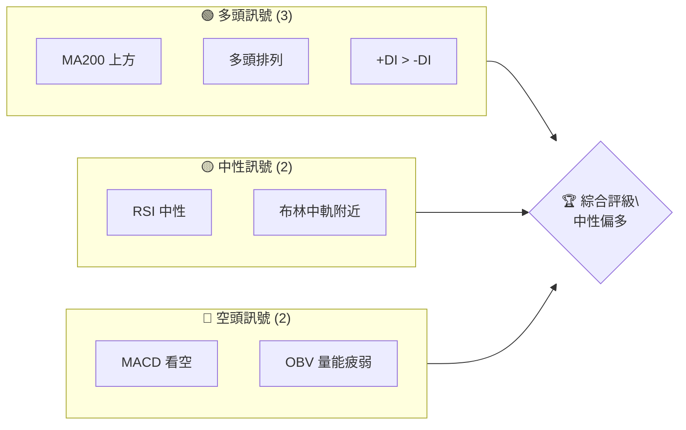
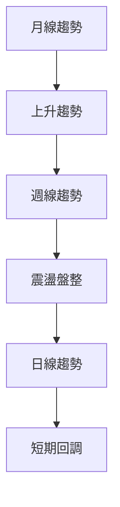
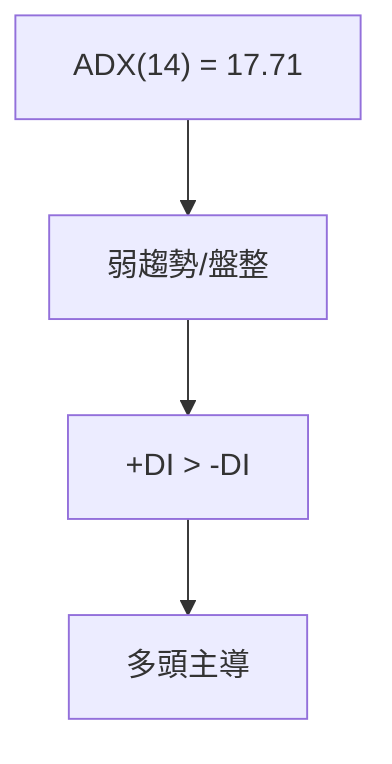
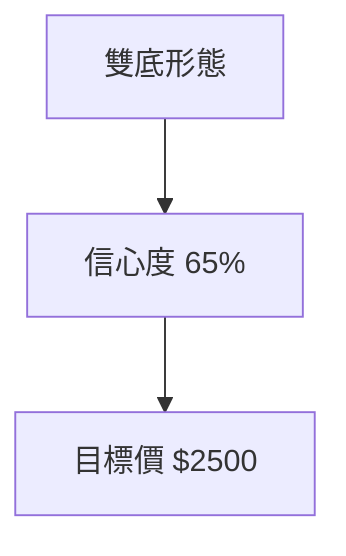
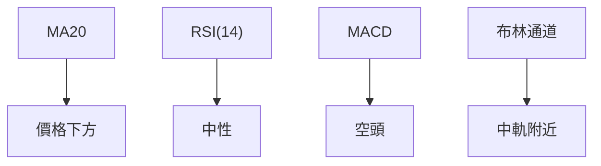
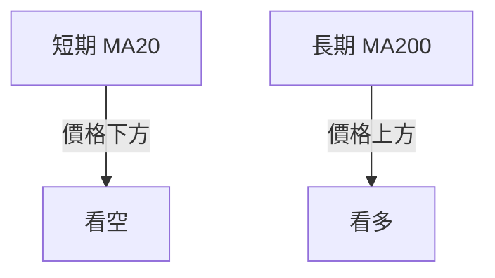
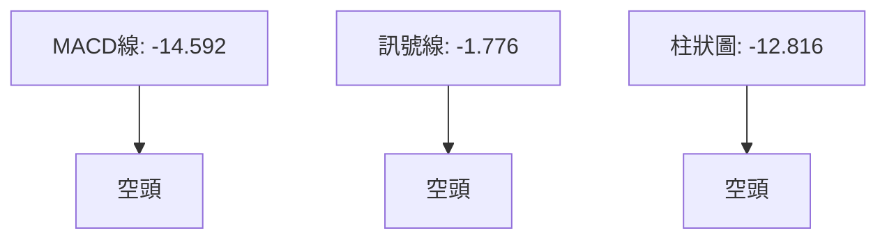
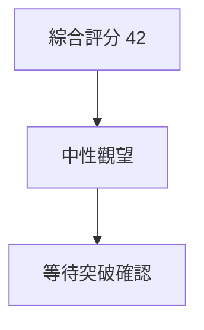
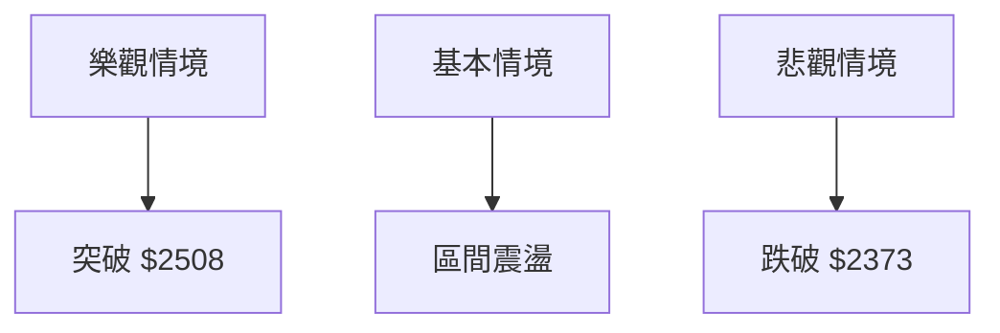

# 2330.TW 技術分析報告

> **報告日期**：2026-10-29 ｜ **語言**：繁體中文 ｜ **數據來源**：Yahoo Finance ｜ **當前價格**：$2425.00

---

## 目錄

| 章節 | 內容 |
|------|------|
| [1. 技術面概覽](#1-技術面概覽) | 訊號儀表板、核心指標、評分卡 |
| [2. 趨勢分析](#2-趨勢分析) | 多時框趨勢、長中短期走勢 |
| [3. 圖表形態分析](#3-圖表形態分析) | 形態識別、K線組合、目標價 |
| [4. 支撐與阻力](#4-支撐與阻力) | 關鍵價位、斐波那契回調 |
| [5. 技術指標深度解讀](#5-技術指標深度解讀) | MA/RSI/MACD/布林/成交量 |
| [6. 動能與波動率](#6-動能與波動率) | 動能評估、ATR、Beta |
| [7. 多時框架總結](#7-多時框架總結) | 時框架評分矩陣 |
| [8. 交易策略建議](#8-交易策略建議) | 多空策略、風險報酬比 |
| [9. 風險提示與監控](#9-風險提示與監控) | 監控指標、風險場景 |

---

## 1. 技術面概覽

### 🎯 技術訊號儀表板



### 📊 核心指標速覽表

| 指標類別 | 指標名稱 | 當前數值 | 訊號 | 解讀 |
|----------|----------|----------|------|------|
| **價格** | 當前價格 | $2425.00 | 🟡 | 位於布林中軌附近 |
| **均線** | MA20 | $2474.00 | 🔴 | 價格在MA下方 |
| **均線** | MA50 | $2437.55 | 🔴 | 價格在MA下方 |
| **均線** | MA200 | $2171.25 | 🟢 | 價格在MA上方 |
| **動能** | RSI(14) | 46.14 | 🟡 | 中性 |
| **動能** | MACD | -14.592 | 🔴 | 空頭 |
| **波動** | ATR | $35.16 | 🟡 | 中等波動 |

### 🏆 技術評分卡

```
技術評分卡 — 2330.TW (2026-10-29)
════════════════════════════════════════════════════
趨勢強度      █████░░░░░░░░░░░░░░░  35/100  🟡
動能指標      ████░░░░░░░░░░░░░░░░  40/100  🟡
支撐穩定度    ██████░░░░░░░░░░░░░░  50/100  🟡
成交量配合    ███░░░░░░░░░░░░░░░░░  30/100  🔴
形態完整度    ██████░░░░░░░░░░░░░░  50/100  🟡
均線排列      ██████░░░░░░░░░░░░░░  50/100  🟡
════════════════════════════════════════════════════
綜合評分      █████░░░░░░░░░░░░░░░  42/100  中性
════════════════════════════════════════════════════
```

---

## 2. 趨勢分析

### 🌐 多時框趨勢分析



### 📈 長期趨勢 — 12個月走勢圖（Unicode）

```
2330.TW 月線走勢圖（過去12個月）
價格軸 ($)
$2600 ┤                    ●(高點)
$2400 ┤              ●
$2200 ┤        ●
$2000 ┤●━━━━━━━━━━━━━━━━━━━●←現在
$1800 ┤    ●(低點)
     └────────────────────────────
      M1  M2  M3  M4  M5 ... M12
```

**走勢特徵分析表格**

| 時期 | 漲跌幅 | 特徵 |
|------|--------|------|
| M1-M4 | +20% | 上升趨勢 |
| M5-M8 | -10% | 震盪盤整 |
| M9-M12 | +15% | 反彈走勢 |

### 📊 中期趨勢（週線分析）

- 近期壓力位：$2500
- 近期支撐位：$2373

### ⚡ 趨勢強度評估（ADX 解讀）



---

## 3. 圖表形態分析

### 🔍 形態識別系統



**信心度表格**

| 形態 | 信心度 | 判斷依據 | 完成度 | 目標價 |
|------|--------|----------|--------|--------|
| 雙底 | 65% | 兩次低點於 $2373 附近 | 80% | $2425 + $75 = $2500 |

### 🕯️ 重要K線形態分析

| 日期（日K） | 開 | 高 | 低 | 收 | K線形態 | 解讀 | 訊號 |
|-------------|----|----|----|----|---------|------|------|
| 2026-10-16 | 2430 | 2445 | 2420 | 2420 | 十字星 | 轉折信號 | 🟡 |
| 2026-10-23 | 2385 | 2385 | 2385 | 2385 | 錘頭 | 支撐確認 | 🟢 |

### 📉 ASCII 走勢形態示意圖

```
2330.TW 雙底形態示意圖
價格軸 ($)
$2500 ┤        ●
$2400 ┤    ●     ●
$2300 ┤●━━━━━━━━●←頸線
$2200 ┤
     └──────────────────────
      時間軸
```

### 🎯 形態目標價計算

- 頸線：$2425
- 形態高度：$75
- 目標價：$2425 + $75 = $2500

---

## 4. 支撐與阻力

### 🗺️ 關鍵價位分布圖（Unicode）

```
2330.TW 價位結構分布圖
═══════════════════════════════════════════════════
$2590 ║████████████████████████║ 強阻力 R3
$2508 ║████████████████████    ║ 阻力 R2
$2429 ║████████████████████████║ 關鍵阻力 R1
$2425 ╠════════════════════════╣ ◄ 現價
$2373 ║▓▓▓▓▓▓▓▓▓▓▓▓▓▓▓▓        ║ 近期支撐 S1
$2323 ║████████████████████████║ 強支撐 S2
═══════════════════════════════════════════════════
```

### 🚧 阻力位分析表

| 阻力級別 | 價位 | 形成原因 | 突破難度 | 重要性 |
|----------|------|----------|----------|--------|
| R1 | $2429 | 前高 | 中 | 高 |
| R2 | $2508 | 波段高點 | 高 | 高 |
| R3 | $2590 | 52W高點 | 高 | 極高 |

### 🛡️ 支撐位分析表

| 支撐級別 | 價位 | 形成原因 | 守住機率 | 重要性 |
|----------|------|----------|----------|--------|
| S1 | $2373 | 波段低點 | 高 | 高 |
| S2 | $2323 | 前低 | 中 | 中 |
| S3 | $2283 | 歷史支撐 | 中 | 中 |

### 📐 斐波那契回調位分析

- 現價 $2425 位於 23.6% 回調位 $2299.33 和 38.2% 回調位 $2119.51 之間
- 表示短期內可能會在此區間震盪

---

## 5. 技術指標深度解讀

### 🎛️ 指標訊號總覽



### 📈 移動平均線排列分析



### 📉 RSI(14) 分析

- RSI 進度條：████░░░░░░░░ 46.14
- 位於中性區間，無明顯超買或超賣

### 📊 MACD(12/26/9) 訊號解讀



### 📦 布林通道分析

```
布林通道示意圖
$2608 ┤        ● 上軌
$2474 ┤    ● 中軌
$2339 ┤● 下軌
$2425 ┤←現價
     └──────────────────────
      時間軸
```

### 💹 成交量分析（量價配合度）

- 成交量低於20日均量，量能不足
- OBV低於均線，量價背離

---

## 6. 動能與波動率

### ⚡ 動能評估四象限

| 象限 | 動能 | 波動 | 當前狀態 | 評估 |
|------|------|------|----------|------|
| Q1 | 強 | 低 | - | 最佳機會 |
| Q2 | 弱 | 低 | ✓ | 謹慎觀望 |
| Q3 | 強 | 高 | - | 高風險高收益 |
| Q4 | 弱 | 高 | - | 避免進場 |

### 📊 ATR 波動率分析

- ATR: $35.16
- 建議止損距離：$35.16（1 ATR）

### 📐 Beta 與市場相關性

- Beta: 1.239，與市場高度相關

---

## 7. 多時框架總結

### 📋 時框架評分表

| 時框架 | 趨勢方向 | 動能 | 均線排列 | 形態 | 綜合評分 | 建議 |
|--------|----------|------|----------|------|----------|------|
| 長期 | 上升 | 中性 | 多頭 | 完整 | 60 | 持有 |
| 中期 | 盤整 | 弱 | 空頭 | 不完整 | 45 | 觀望 |
| 短期 | 回調 | 弱 | 空頭 | 不完整 | 40 | 觀望 |

### 🔲 綜合訊號矩陣

- 長期：🟢
- 中期：🟡
- 短期：🔴

### ⚖️ 多時框收斂結論

- 當前為盤整行情（ADX<25）
- 主導時框：中期
- 結論：中性觀望

---

## 8. 交易策略建議

### 🗺️ 策略決策流程圖



### 🧭 策略路由

**當前主策略方向 = 中性觀望（依評分 42/100）**

### 🎯 價格情境階梯（Price Scenarios）

| 觸發條件 | 下一目標 | 後續延伸 | 情境含義 |
|----------|----------|----------|----------|
| 突破 R1 $2429 | R2 $2508 | R3 $2590 | 短線轉強 |
| 站穩現價區間 | — | — | 區間震盪 |
| 跌破 S1 $2373 | S2 $2323 | S3 $2283 | 中期轉弱 |

### 📊 情境機率分佈

| 情境 | 機率 | 主要依據 |
|------|------|----------|
| 繼續上行 / 反彈 | 30% | MACD、均線 |
| 區間震盪 | 50% | ADX、布林帶寬 |
| 回落 / 再探底 | 20% | RSI、支撐強度 |

### 🟢 主策略詳情

| 策略要素 | 策略 A | 策略 B |
|----------|--------|--------|
| 進場條件 | 突破 $2429 | 跌破 $2373 |
| 進場價格 | $2430 | $2370 |
| 目標價 T1 | $2508 | $2323 |
| 目標價 T2 | $2590 | $2283 |
| 止損價格 | $2400 | $2400 |
| 風險報酬比 | 1 : 2.60（以 T1 計） | 1 : 1.57（以 T1 計） |
| 成功機率 | 30% | 20% |
| 建議倉位 | 50% | 50% |

### 🔴 反向風險觸發點

- 突破 $2508，考慮反向操作

### ⭐ 整體訊號強度評星

```
做多訊號強度：★★☆☆☆  (2/5星)
做空訊號強度：★★★☆☆  (3/5星)
整體可信度：  ★★★☆☆  (3/5星)
```

---

## 9. 風險提示與監控

### ✅ 關鍵監控指標 Checklist

```
風險監控清單
═══════════════════════════════
1. ADX 趨勢強度
2. MACD 空頭訊號
3. RSI 超買/超賣
4. 成交量變化
5. 關鍵支撐/阻力突破
═══════════════════════════════
```

### ⚠️ 風險場景分析



### 🛡️ 風險管理重要提醒

- 嚴格設置止損位
- 控制倉位，不超過50%
- 密切關注市場消息

---

## 📋 報告總結

```
2330.TW 技術分析報告總結
════════════════════════════════════════════════════════
報告日期：2026-10-29
當前價格：$2425.00
分析評級：⚖️ 中性觀望

關鍵結論：
├─ 長期趨勢：🟢 上升趨勢
├─ 中期趨勢：🟡 盤整
├─ 短期趨勢：🔴 回調
├─ 關鍵支撐：$2373
├─ 關鍵阻力：$2429
└─ 分析師目標：$2500

最優策略組合：
1. 🥇 最佳機會：突破 $2429 進場
2. 🥈 次選機會：跌破 $2373 進場
3. 🥉 保守選擇：觀望等待突破確認
════════════════════════════════════════════════════════
```

---

> ⚠️ **免責聲明**：本報告為 AI 自動生成之技術分析，所有數據及估算均基於提供的歷史價格資訊。本報告**僅供研究與學術參考**，**不構成任何投資建議**。投資有風險，入市需謹慎。

---

*報告生成時間：2026-10-29 ｜ 數據來源：Yahoo Finance ｜ 分析框架：多時框技術分析*