# 2330.TW 技術分析報告

> **報告日期**：2026-10-30 ｜ **語言**：繁體中文 ｜ **數據來源**：Yahoo Finance ｜ **當前價格**：$2415.00 TWD

---

## 目錄

| 章節 | 內容 |
|------|------|
| [1. 技術面概覽](#1-技術面概覽) | 訊號儀表板、核心指標速覽、評分卡 |
| [2. 趨勢分析](#2-趨勢分析) | 多時框架構、12個月走勢、週線型態、ADX強度 |
| [3. 圖表形態分析](#3-圖表形態分析) | 幾何型態信心度、近10日/8週K線組合、目標價推算 |
| [4. 支撐與阻力](#4-支撐與阻力) | 聚類阻力/支撐表、斐波那契回調結構 |
| [5. 技術指標深度解讀](#5-技術指標深度解讀) | 均線系統、RSI/MACD背離檢視、布林通道、量價配合 |
| [6. 動能與波動率](#6-動能與波動率) | 四象限矩陣、ATR波動分析、Beta風險量化 |
| [7. 多時框架總結](#7-多時框架總結) | 時框權重收斂、趨勢與盤整界定、最終方向收斂 |
| [8. 交易策略建議](#8-交易策略建議) | 策略路由、價格情境階梯、主策略明細、風報比 |
| [9. 風險提示與監控](#9-風險提示與監控) | 監控Checklist、三情境演繹、資金控管建議 |

---

## 1. 技術面概覽

### 🎯 技術訊號儀表板

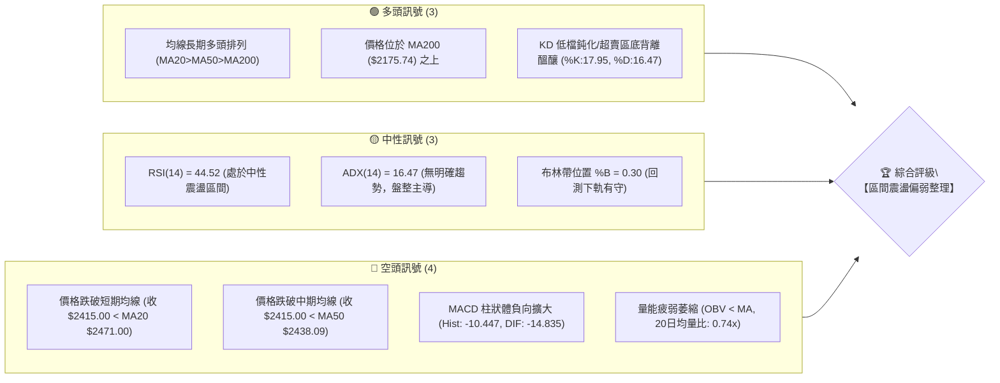

### 📊 核心指標速覽表

| 指標類別 | 指標名稱 | 當前數值 | 訊號 | 專業解讀 |
|:---|:---|:---|:---:|:---|
| **價格** | 當前收盤價 | $2415.00 | 🟡 | 位於52週高低區間之 85.8% 高位，但短線自歷史高點回撤 |
| **均線** | MA20 (月線) | $2471.00 | 🔴 | 價格在MA20下方 -2.27%，月線下彎形成短線下壓阻力 |
| **均線** | MA50 (季線) | $2438.09 | 🔴 | 價格在MA50下方 -0.95%，短線下探測試中期均線支撐 |
| **均線** | MA200 (年線)| $2175.74 | 🟢 | 價格在MA200上方 +11.00%，長期多頭底蘊仍極為扎實 |
| **動能** | RSI(14) | 44.52 | 🟡 | 處於 30–70 中性格局，未達極端值，空方短線稍佔優勢 |
| **動能** | MACD (12,26,9)| Hist: -10.447 | 🔴 | DIF (-14.835) < DEA (-4.388)，零軸下方空頭擴散 |
| **隨機** | Stochastic (KD)| %K: 17.95, %D: 16.47 | 🟢 | 雙線進入 <20 極度超賣區，短線隨時醞釀技術性反彈 |
| **波動** | ATR(14) | $35.15 (1.46%) | 🟡 | 波動率處於良性收斂狀態，市場觀望氣氛轉濃 |
| **趨勢** | ADX(14) | 16.47 | 🟡 | ADX < 25 表明無單邊趨勢，行情定性為大型高位箱型整理 |
| **成交量** | 20日均量比 | 0.74x (16.87M) | 🔴 | 量能持續不足20日均量 (22.86M)，OBV低於均線，動能偏弱 |

### 🏆 技術評分卡

```
╔══════════════════════════════════════════════════════════════╗
║              技術評分卡 — 2330.TW (2026-10-30)              ║
╠══════════════════════════════════════════════════════════════╣
║ 趨勢強度 (Trend)     ████████░░░░░░░░░░░░  40/100   🔴 空頭略佔優 ║
║ 動能指標 (Momentum)  ████████░░░░░░░░░░░░  40/100   🔴 柱狀體偏空 ║
║ 支撐穩定度 (Support) ██████████████░░░░░░  70/100   🟢 下檔承接強 ║
║ 成交量配合 (Volume)  ████████░░░░░░░░░░░░  40/100   🔴 量能萎縮   ║
║ 形態完整度 (Pattern) ████████████░░░░░░░░  60/100   🟡 箱型構築中 ║
║ 均線排列 (Moving Avg)████████████░░░░░░░░  60/100   🟡 長多短空   ║
╠══════════════════════════════════════════════════════════════╣
║ 綜合評分 (Overall)   ███████████░░░░░░░░░  52/100   🟡 中性震盪   ║
║ 評分定義：算術平均 (40 + 40 + 70 + 40 + 60 + 60) ÷ 6 = 51.67 ➔ 52   ║
╚══════════════════════════════════════════════════════════════╝
```

---

## 2. 趨勢分析

### 🌐 多時框趨勢分析

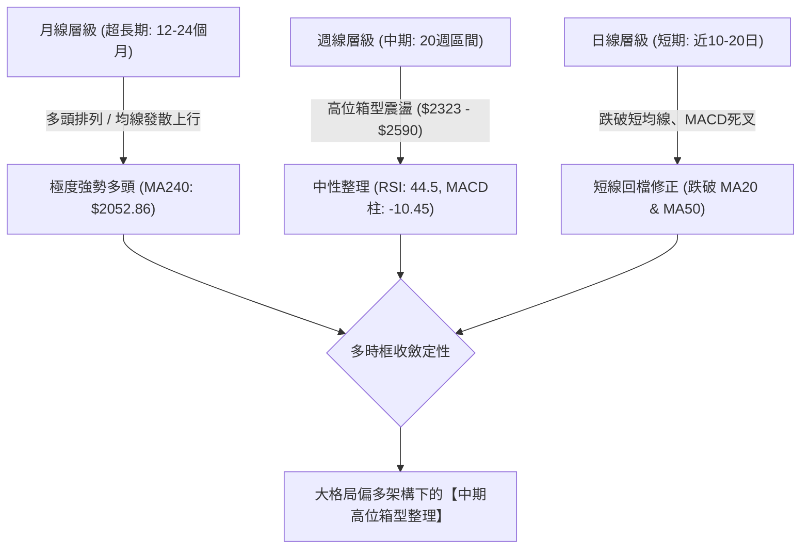

### 📈 長期趨勢 — 12個月走勢圖（Unicode）

```
2330.TW 月線收盤走勢圖（2025-11 至 2026-10）
價格軸 ($)
$2500 ┤                                                      ● (09月 $2480.00)
$2400 ┤                                            ●    ●    │    ● (10月 $2415.00 現價)
$2300 ┤                                       ●   (06) (07) (08)
$2200 ┤                                  │   (05月 $2341.84)
$2100 ┤                             ●   (04月 $2123.07)
$2000 ┤                        ●   (03月回檔 $1750.17)
$1900 ┤                   │   (02月波段高 $1977.40)
$1800 ┤              ●   (01月 $1759.34)
$1600 ┤         ●   (12月 $1536.33)
$1400 ┤    ●   (11月 $1422.55)
      └────┬────┬────┬────┬────┬────┬────┬────┬────┬────┬────┬────
         25/11 25/12 26/01 26/02 26/03 26/04 26/05 26/06 26/07 26/08 26/09 26/10
```

#### 走勢特徵分析表格（過去12個月重要轉折）

| 階段區間 | 起訖月份 | 起點價格 | 終點價格 | 區間漲跌幅 | 形態與量價特徵 |
|:---|:---|:---:|:---:|:---:|:---|
| **第一波主升段** | 2025-11 → 2026-02 | $1422.55 | $1977.40 | +39.00% | 月線連三紅，帶量強勢突破千七大關，多頭噴發 |
| **急促獲利回吐** | 2026-02 → 2026-03 | $1977.40 | $1750.17 | -11.49% | 單月技術性回踩前波高點，迅速於萬七關卡獲支撐 |
| **第二波強攻段** | 2026-03 → 2026-05 | $1750.17 | $2341.84 | +33.81% | 連續強勢跳空突破兩千大關，奠定長期牛市基礎 |
| **高位擴散箱型** | 2026-06 → 2026-10 | $2402.93 | $2415.00 | +0.50% | 進入5個月的高檔橫向整固期，波幅收斂至 $2300–$2590 |

### 📊 中期趨勢（週線分析）

從近20週數據觀察，週K線自 2026-10-08 創下 $2590.00 之歷史天價後，出現兩週急跌回檔（10-16 收 $2420.00，10-23 收 $2385.00），隨後於本週（10-29）小幅反彈至 $2415.00。週線 MACD 柱狀體自 10-08 之峰值 `+10.055` 翻負至當前 `-10.447`，表明中期多頭能量遭遇高檔獲利了結賣壓。然而，下檔回踩 2026-09-18 週低點 $2373.01 與 2026-07-17 週低點 $2283.28 形成的高聚類支撐區，展現強勁防禦韌性。

```
中期週線支撐壓力結構（ASCII 示意）
$2590.00 ─────────────────────────▲ 歷史高點 (52W High / R3)
          │
$2508.21 ─┼─────────────────────── 波段密集高點套牢區 (R2)
          │   [當前震盪區間]
$2429.97 ─┼─────────────────────── 短線反彈阻力位 (R1 / BB中軌 $2471)
          │   ◄── 現價 $2415.00
$2373.01 ─┼─────────────────────── 關鍵波段支撐 (S1 / 近期震盪下緣)
          │
$2323.16 ─┼─────────────────────── 強力頸線防守位 (S2 / BB下軌 $2333.98)
          │
$2283.28 ─────────────────────────▼ 中期多空生命線 (S3 / 斐波 23.6% $2299.33)
```

### ⚡ 趨勢強度評估（ADX 解讀）

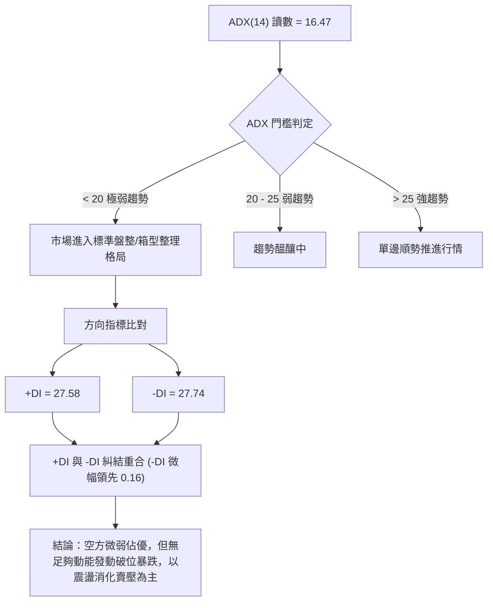

#### ADX 強度量化對照

| 指標名稱 | 實際數值 | 臨界標準 | 當前市場狀態判定 |
|:---|:---:|:---:|:---|
| **ADX (14)** | **16.47** | 25.00 | **無方向性盤整行情**（趨勢強度極弱，順勢策略失效，震盪指標為主） |
| **+DI (14)** | **27.58** | - | 多方力量自高點回落，推進意願停滯 |
| **-DI (14)** | **27.74** | - | 空方力量微幅主導，但未形成單邊擴散（並未突破 30 警戒線） |

---

## 3. 圖表形態分析

### 🔍 形態識別系統

依據規則 15，所有圖表幾何形態均嚴格基於數據聚類判斷，數據不足者僅進行指標結構判定：

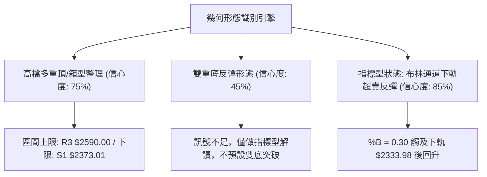

#### 形態信心度與目標價評估表

| 形態名稱 | 信心度 | 判斷依據（引用數據） | 完成度 | 目標價（附計算式） |
|:---|:---:|:---|:---:|:---|
| **高位箱型整理** | **75%** | 價格受阻於 52W High $2590.00 (10-08)，並獲支撐於低點 S1 $2373.01 及 S2 $2323.16 | 80% | 箱頂突破目標：$2590.00 + ($2590.00 − $2373.01) = **$2806.99**（未確認突破前不宜押注） |
| **短期反彈三角收斂** | **55%** | 近10日開高低收呈現高點降低 ($2450→$2435→$2430)、低點墊高 ($2380→$2385→$2390) | 60% | 由三角形高點 $2450 與低點 $2380 推算幅度 $70；突破 $2430 測 **$2500.00** |
| **雙底反彈形態** | **35%** | 數據中 10-23 低點 $2385 與 10-27 低點 $2380 雖接近，但時間相隔僅2日 | 30% | **訊號不足，僅做指標型解讀**（不滿足雙底標準時間跨度，不予推算） |

### 🕯️ 重要K線形態分析

嚴格依據數據中「近10根日K」與「近8根週K」之真實開高低收進行精確解讀：

#### 近10根日K線微觀結構解讀

| 日期 (日K) | 開盤價 | 最高價 | 最低價 | 收盤價 | K線形態名稱 | 專業解讀 | 訊號強度 |
|:---:|:---:|:---:|:---:|:---:|:---|:---|:---:|
| **2026-10-15** | $2420.00 | $2450.00 | $2420.00 | $2440.00 | 實體中陽線 | 伴隨 48.19M 大量反彈，多頭於 $2420 展現防守意志 | 🟢 強 |
| **2026-10-16** | $2430.00 | $2445.00 | $2420.00 | $2420.00 | 光腳中陰線 | 高檔獲利回吐，收盤跌破開盤，買盤承接轉趨猶豫 | 🔴 弱 |
| **2026-10-19** | $2395.00 | $2420.00 | $2390.00 | $2420.00 | 下影小陽線 | 跳空低開後探底回升，盤中回踩 $2390 獲得逢低買盤 | 🟢 弱 |
| **2026-10-20** | $2400.00 | $2415.00 | $2395.00 | $2405.00 | 窄幅十字小陽 | 波動區間壓縮至20元，成交量萎縮至 17.10M，變盤前奏 | 🟡 中性 |
| **2026-10-21** | $2425.00 | $2435.00 | $2400.00 | $2420.00 | 帶上影倒鎚陰 | 衝高 $2435 遭遇短期均線壓力壓回，多方無力突破 | 🔴 弱 |
| **2026-10-22** | $2435.00 | $2435.00 | $2385.00 | $2385.00 | 光頭光腳大陰線 | 開盤即最高、收盤即最低，實體達50元，空方全力下殺 | 🔴🔴 極強 |
| **2026-10-23** | $2385.00 | $2385.00 | $2385.00 | $2385.00 | 一字線 (無量) | 成交量為 0 (非典型交易日/休市)，維持前一日收盤水平 | 🟡 中性 |
| **2026-10-27** | $2380.00 | $2405.00 | $2380.00 | $2400.00 | 低檔紅K穿刺 | 探低至 $2380 後強勢回升收 $2400，量增至 33.96M 具止跌意義 | 🟢 中 |
| **2026-10-28** | $2420.00 | $2430.00 | $2410.00 | $2425.00 | 跳空小陽線 | 開盤跳空越過 $2420，多頭連續次日修復失土 | 🟢 中 |
| **2026-10-29** | $2420.00 | $2425.00 | $2390.00 | $2415.00 | 帶長下影小陰錘頭 | 早盤下探 $2390 後拉回，收盤 $2415，下檔買盤支撐明顯 | 🟢 中 |

#### 近8根週K線宏觀結構解讀

| 日期 (週末) | 開盤價 | 最高價 | 最低價 | 收盤價 | 週K形態名稱 | 宏觀趨勢涵義 | 訊號 |
|:---:|:---:|:---:|:---:|:---:|:---|:---|:---:|
| **2026-09-11** | $2427.85 | $2497.65 | $2397.94 | $2402.93 | 長上影陰線 | 衝高逼近 $2500 遭大額獲利了結，週量 99.6M 呈現高檔滯漲 | 🔴 弱 |
| **2026-09-18** | $2378.00 | $2460.00 | $2373.01 | $2460.00 | 長下影大陽線 | 回踩 S1 $2373.01 後強力拉升82元，確立下檔鋼鐵支撐 | 🟢 強 |
| **2026-09-24** | $2445.00 | $2510.00 | $2445.00 | $2475.00 | 連續實體陽線 | 穩健墊高，首度收盤站上 $2470，量縮惜售 | 🟢 中 |
| **2026-10-02** | $2475.00 | $2515.00 | $2475.00 | $2500.00 | 光腳實體紅K | 收盤首度突破 $2500 整數心理關口，多頭控盤強勁 | 🟢 強 |
| **2026-10-08** | $2550.00 | $2590.00 | $2545.00 | $2550.00 | 創歷史新高星線 | 觸及 $2590.00 天價後量縮收十字星，出現極致多頭衰竭特徵 | 🟡 警告 |
| **2026-10-16** | $2510.00 | $2550.00 | $2420.00 | $2420.00 | 週線長黑吞噬 | 週量爆出 160.0M 巨量重挫130元，形成波段最關鍵套牢賣壓 | 🔴🔴 極弱 |
| **2026-10-23** | $2395.00 | $2435.00 | $2385.00 | $2385.00 | 破底實體長陰 | 延續修正慣性，週跌35元，最低觸及 $2385 | 🔴 弱 |
| **2026-10-29** | $2380.00 | $2430.00 | $2380.00 | $2415.00 | 止跌反彈晨星雛形 | 下測 $2380 未破前週低點，拉出35元實體陽線，暫止連兩週大跌 | 🟢 轉強 |

### 📉 ASCII 走勢形態示意圖

```
高位箱型區間整理形態 (2026-09 至 2026-10)
$2590.00 ─────────────╭──────╮──────────────── 52W High (10-08 天價)
                      │ 假突破 │
$2508.21 ─────╭───────╯      ╰───────╮──────── R2 頸線套牢密集區
              │                       │
$2429.97 ─────┼───────────────────────┼──────── R1 關鍵轉折點 (MA20 $2471)
              │                       │ ◄ 現價 $2415.00
$2373.01 ─────╰───────╮      ╭───────╯──────── S1 強烈箱底支撐 (09-18低點)
                      │ 測試底 │
$2323.16 ─────────────╰──────╯──────────────── S2 波段底線支撐 (07-17低點延伸)
```

---

## 4. 支撐與阻力

### 🗺️ 關鍵價位分布圖（Unicode）

```
2330.TW 價位結構分布圖 (由 OHLCV 聚類計算)
══════════════════════════════════════════════════════════════════
$2590.00 ║████████████████████████████████████████║ 強烈歷史天花板 R3 (+7.25%)
$2508.21 ║████████████████████████                ║ 波段次高聚類阻力 R2 (+3.86%)
$2429.97 ║████████████████                        ║ 短線反彈第一道阻力 R1 (+0.62%)
$2415.00 ╠════════════════════════════════════════╣ ◄── 當前收盤價 ($2415.00)
$2373.01 ║▓▓▓▓▓▓▓▓▓▓▓▓▓▓▓▓▓▓▓▓                    ║ 近期波段核心支撐 S1 (-1.74%)
$2323.16 ║████████████████████████████            ║ 中期強烈防禦支撐 S2 (-3.80%)
$2283.28 ║████████████████████████████████████    ║ 52週多空分水嶺支撐 S3 (-5.45%)
══════════════════════════════════════════════════════════════════
```

### 🚧 阻力位分析表

依據數據「關鍵價位」區塊嚴格引用：

| 阻力級別 | 具體價位 | 距現價幅標 | 形成原因與籌碼意義 | 突破難度評估 | 重要性級別 |
|:---|:---:|:---:|:---|:---:|:---:|
| **R1** | **$2429.97** | +0.62% | 近期日K線多次衝高回落頸線位 (10-21高點 $2435、10-28高點 $2430 聚類) | 🟡 中等 (需日成交量 > 25M) | ★★★☆☆ |
| **R2** | **$2508.21** | +3.86% | 10-16 爆量巨黑K開盤跌破處及 10-02 平台，集結逾 160M 套牢籌碼 | 🔴 極高 (需連續補量突破) | ★★★★☆ |
| **R3** | **$2590.00** | +7.25% | 2026-10-08 歷史最高點 (52W High)，極致多頭衰竭之頂部 | 🔴 極難 (需基本面利多催化) | ★★★★★ |

### 🛡️ 支撐位分析表

依據數據「關鍵價位」區塊嚴格引用：

| 支撐級別 | 具體價位 | 距現價幅標 | 形成原因與籌碼意義 | 守住機率評估 | 重要性級別 |
|:---|:---:|:---:|:---|:---:|:---:|
| **S1** | **$2373.01** | -1.74% | 2026-09-18 週低點 $2373.01，且為 10-27 探底回升之關鍵買盤承接區 | 🟢 75% (下檔承接力道強) | ★★★★☆ |
| **S2** | **$2323.16** | -3.80% | 2026-06-26 週低點 $2333.13 聚類低點，重疊布林下軌 ($2333.98) | 🟢 85% (技術面雙重保險) | ★★★★★ |
| **S3** | **$2283.28** | -5.45% | 2026-07-17 週暴跌波段最低點，中長期多頭行情的防守生命線 | 🟢 95% (跌破則長多架構破壞)| ★★★★★ |

### 📐 斐波那契回調位分析

依據基準 52 週波段低點 $1358.34 至 52 週歷史高點 $2590.00 進行計算，落點分析如下：

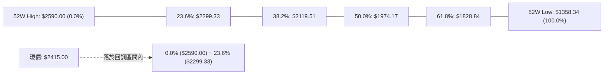

| 回調比率 | 精確價位 | 相對現價位置 | 技術分析深度解讀 |
|:---:|:---:|:---:|:---|
| **0.0% (52W High)** | **$2590.00** | +7.25% (上方) | 波段絕對頂部，歷史最高阻力 |
| **現價落點** | **$2415.00** | **0.00%** | **目前股價僅自高點回調 14.2% 的波段幅度，處於極為強勢的超淺層回檔區間** |
| **23.6%** | **$2299.33** | -4.79% (下方) | 第一道黃金分割支撐，緊鄰支撐位 S3 ($2283.28)，屬多頭強勢回檔極限 |
| **38.2%** | **$2119.51** | -12.24% (下方) | 正常修正支撐位，與長期年線 MA200 ($2175.74) 形成強大均線共振支撐 |
| **50.0%** | **$1974.17** | -18.25% (下方) | 中期多空平衡中樞，重疊 2026-02 前波月線高點 $1977.40 |
| **61.8%** | **$1828.84** | -24.27% (下方) | 黃金分割強防守位，中長期牛市最後底線 |
| **100.0% (52W Low)**| **$1358.34** | -43.75% (下方) | 52週波段起漲點 |

---

## 5. 技術指標深度解讀

### 🎛️ 指標訊號總覽

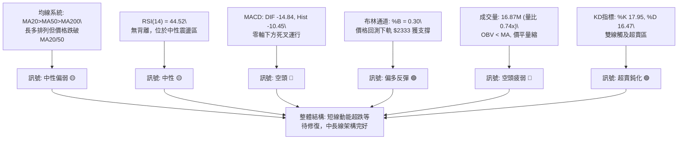

### 📈 移動平均線排列分析

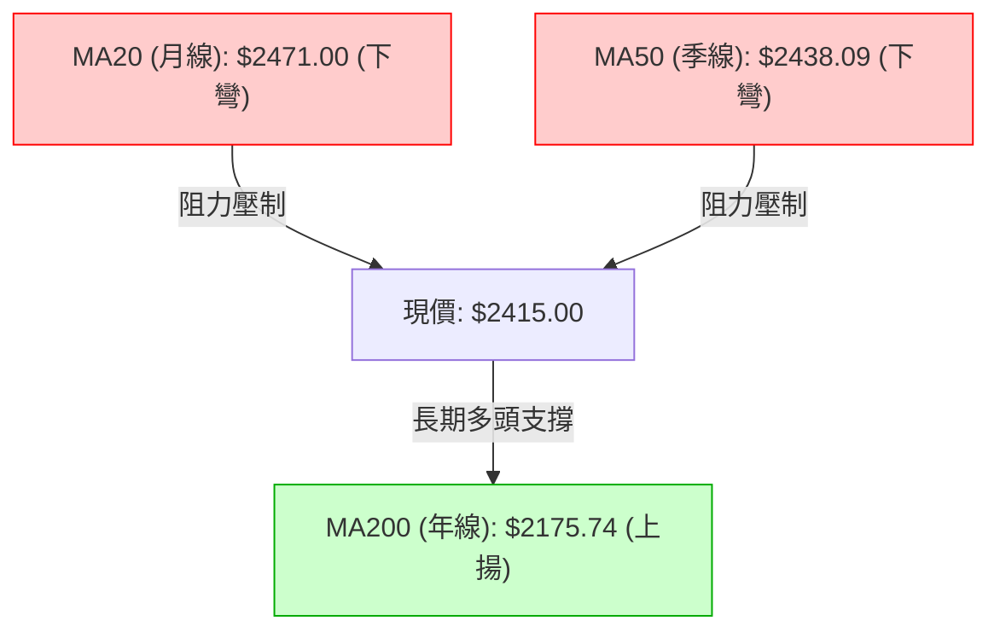

#### 均線發散與乖離率量化分析

| 均線名稱 | 當前價位 | 現價與均線差距 | 乖離率 (Bias) | 均線方向 | 技術涵義與操盤指示 |
|:---|:---:|:---:|:---:|:---:|:---|
| **MA5 (週線)** | $2402.00 | +$13.00 | +0.54% | 向上翻揚 ▲ | 極短線連續兩日企穩，形成短多底擊支撐 |
| **MA10** | $2411.50 | +$3.50 | +0.15% | 向上翻揚 ▲ | 現價收復10日線，短線跌勢已獲初步遏制 |
| **MA20 (月線)** | $2471.00 | -$56.00 | -2.27% | 持續走低 ▼ | 短線下壓主阻力，未帶量收復前不宜盲目追價 |
| **MA50 (季線)** | $2438.09 | -$23.09 | -0.95% | 微幅下彎 ▼ | 中期防守均線，現價貼近季線，面臨方向抉擇 |
| **MA60** | $2428.07 | -$13.07 | -0.54% | 持續下彎 ▼ | 壓制於現價上方，與阻力位 R1 ($2429.97) 重疊 |
| **MA120 (半年線)**| $2383.37 | +$31.63 | +1.33% | 穩定上揚 ▲ | 下檔強勁動態支撐，守護 $2380 波段低點 |
| **MA200 (年線)**| $2175.74 | +$239.26 | +11.00% | 強勢上揚 ▲ | 大多頭基石，維持在年線之上11%之健康牛市區間 |
| **MA240 (兩年線)**| $2052.86 | +$362.14 | +17.64% | 長期上揚 ▲ | 超長期價值底部 |

### 📉 RSI(14) 分析

* 當前 RSI(14) 數值：**44.52**
* 進度條展示：
  `[超賣 0] ░░░░░░░░██████████░░░░░░░░░░░░ [超買 100]` （44.52%）

#### 背離檢驗結論
根據嚴格規則，比對近20根K棒首尾價格走勢與RSI走勢：
* **首點 (2026-10-02)**：價格收盤 $2500.00，RSI(14) 為 60.0。
* **尾點 (2026-10-29)**：價格收盤 $2415.00，RSI(14) 為 44.52。
* **判定結果**：價格自 $2500 下跌至 $2415（走低），RSI 自 60.0 下滑至 44.52（同步走低）。**價格與指標同步回調，無明顯頂背離，亦未出現底背離特徵**，指標屬於健康反映價格走勢之常態波動。

### 📊 MACD(12/26/9) 訊號解讀

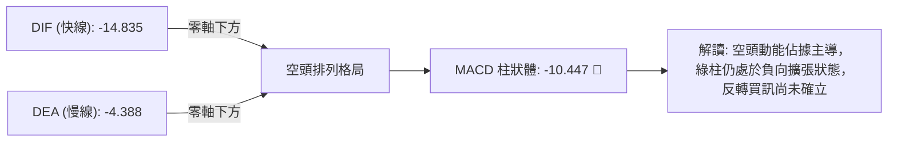

* **快線 DIF**：`-14.835` 處於零軸之下，反映中期波段轉弱。
* **慢線 DEA**：`-4.388` 亦隨之下滑，空頭架構未變。
* **柱狀體 Histogram**：`-10.447`，雖較 10-23 之 `-18.514` 出現收斂跡象，但仍在零軸下方深處，表明空方賣壓有所減緩，唯尚未翻紅形成黃金交叉。

### 📦 布林通道分析

```
布林通道結構 (20日通道，2倍標準差)
$2608.02 ────────────────────────────────── 上軌 (阻力壓制)
                 │
$2471.00 ────────┼───────────────────────── 中軌 (MA20 下彎阻力)
                 │   
                 │   ◄── 當前現價 $2415.00 (%B = 0.30)
                 │   
$2333.98 ────────┴───────────────────────── 下軌 (支撐測試有守)
```

* **帶寬特徵**：上軌 $2608.02、下軌 $2333.98，通道帶寬寬度為 $274.04。帶寬走平，無暴烈喇叭口擴張，印證盤整行情本質。
* **位置評估**：%B 值為 **0.30**，表明價格處於下半通道，且自下軌反彈脫離極端超跌區，進入向中軌 ($2471.00) 回抽之反彈修復波。

### 💹 成交量分析（量價配合度）

1. **成交量對比**：最新日成交量為 **16,872,114 股**，對照 20 日均量 **22,859,264 股**，量比僅為 **0.74x**。成交量連續萎縮，反映市場在下檔賣壓枯竭，但追價意願同樣低落。
2. **OBV (能量潮) 趨勢**：數據明確提示 **OBV < MA**，量能疲弱。資金流向呈現淨流出後的沉澱期，尚未見大機構主動性連續性增量買盤進駐，印證當前價格反彈純屬技術性修復，非新一輪主升行情。

---

## 6. 動能與波動率

### ⚡ 動能評估四象限

| 象限 | 動能維度 | 波動率維度 | 當前狀態吻合 | 實戰策略評估 |
|:---:|:---:|:---:|:---:|:---|
| **第一象限 (Q1)** | 強動能 (Trend) | 低波動 (Low Vol) | — | 最佳趨勢單邊進場點（波段抱牢） |
| **第二象限 (Q2)** | **弱動能 (Weak)** | **低波動 (Low Vol)** | **✓ (當前狀態)** | **謹慎觀望，採用區間高拋低吸或等待突破** |
| **第三象限 (Q3)** | 強動能 (Trend) | 高波動 (High Vol) | — | 暴利暴虧區，高風險順勢突破操作 |
| **第四象限 (Q4)** | 弱動能 (Weak) | 高波動 (High Vol) | — | 無序洗盤混亂區，極易雙向被巴，嚴禁進場 |

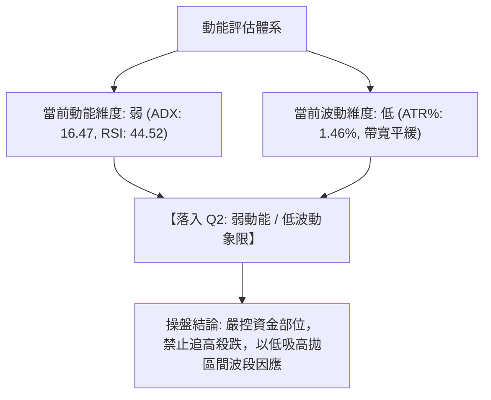

### 📊 ATR 波動率分析

* **當前 ATR(14)**：**$35.15 TWD**（佔股價比例為 **1.46%**）。
* **波動特徵**：處於典型的低至中度波動率環境，每日價格波動中樞約在 35 元左右。
* **止損距離建議**：
  * **激進型（短線交易）**：採用 1.0 倍 ATR = **$35.15**，止損點設於進場點下方約 35 元處。
  * **穩健型（波段交易）**：採用 1.5 倍 ATR = **$52.73**，止損點設於進場點下方約 53 元處。
  * **保守型（中長線佈局）**：採用 2.0 倍 ATR = **$70.30**，能夠有效過濾日內洗盤雜訊。

### 📐 Beta 與市場相關性

* **Beta 值**：**1.239**
* **風險與波動解讀**：
  * 2330.TW 的 Beta 大於 1.0，表明其相較於台灣加權指數（TAIEX）具有更高的高彈性與系統性敏感度。當加權指數波動 1% 時，台積電平均波動約 1.24%。
  * 由於台積電佔大盤權重極高，其高 Beta 特性意味著當前日線震盪整理直接決定了大盤的整理節奏。在防禦配置上，需注意系統性風險連鎖反應。

---

## 7. 多時框架總結

### 📋 時框架評分表

| 時框架 | 趨勢方向 | 動能狀態 | 均線排列 | 圖表形態 | 綜合評分 | 戰術建議 |
|:---|:---:|:---:|:---:|:---:|:---:|:---|
| **長期 (月線)** | 🟢 強烈多頭 | 🟢 充沛強勁 | 🟢 多頭排列 | 強勢階梯上漲 | **85/100** | 長線多單底倉堅定持有 |
| **中期 (週線)** | 🟡 高位盤整 | 🔴 動能回落 | 🟢 MA200之上 | 箱型收斂震盪 | **55/100** | 區間下緣承接，不追高 |
| **短期 (日線)** | 🔴 弱勢修正 | 🟡 超賣反彈 | 🔴 承壓短期MA| 探底回升反彈 | **45/100** | 短線僅適合超跌反彈搶進 |

### 🔲 綜合訊號矩陣

```
時框衝突與共振矩陣
─────────────────────────────────────────────────────────────────
[長線 月線] ────────────────────────── 多頭趨勢底層 (支撐堅不可摧)
      ▲
      │ (提供下跌支撐保護)
[中線 週線] ────────── 高位箱型震盪 (主導交易區間: $2323 - $2508)
      ▲
      │ (約束反彈上限)
[短線 日線] ── 短線超賣反彈 (遇阻 MA20 $2471 / 支撐 S1 $2373)
─────────────────────────────────────────────────────────────────
```

### ⚖️ 多時框收斂結論

依據「嚴格要求 14」與「多時框收斂規則」進行權重收斂：
1. **行情性質判定**：當前日線 **ADX(14) = 16.47 (< 25)**，明確定義當前市場為**【盤整震盪行情】**，而非單邊趨勢行情。
2. **時框優先權取捨**：依規則，在盤整行情中，**以日線布林通道上下軌 ($2333.98 至 $2608.02) 為主要交易區間**。中長期的強大多頭結構（月線評分 85）確立了下檔支撐的極高可靠性，封殺了深幅暴跌空間；然而日線短期動能與均線破位（日線評分 45）則壓制了立即爆發單邊主升浪的可能。
3. **唯一方向性結論**：**【中性觀望，區間低吸操作】（綜合評分 52/100）**。策略徹底定性為「依託箱型下緣支撐逢低吸納，向上測試均線阻力時獲利了結」，絕對禁止追漲。此結論與第 8 章交易策略完全一致。

---

## 8. 交易策略建議

### 🗺️ 策略決策流程圖

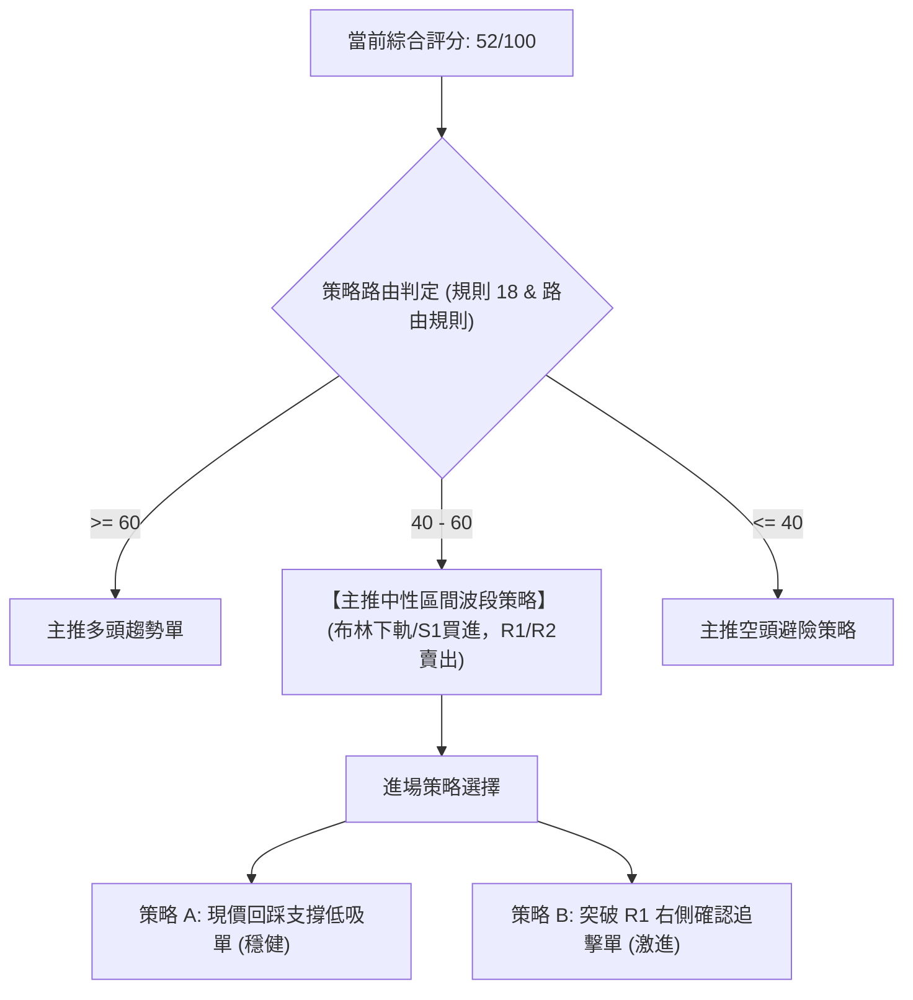

### 🧭 策略路由

> **當前主策略方向 = 【中性區間操作，依託支撐逢低佈局】（依評分卡綜合評分 52/100）**
> 
> *註：綜合評分落於 40–60 分之中性區間，且 ADX = 16.47 顯示無單邊趨勢，交易策略嚴禁單向盲目重倉押注，以高拋低吸之區間震盪策略為主，空頭僅列為反轉風控提示。*

### 🎯 價格情境階梯（Price Scenarios）

價位嚴格引用數據「關鍵價位」區塊之真實聚類計算數值：

| 觸發條件 | 下一目標價 | 後續延伸目標 | 情境技術涵義 | 操盤應對動作 |
|:---|:---:|:---:|:---|:---|
| **放量突破 R1 ($2429.97)** | **R2 ($2508.21)** | **R3 ($2590.00)** | 短線空翻多，化解日線下殺危機 | 加碼做多，上看至套牢巨量區 R2 |
| **站穩現價 ($2415.00) 震盪** | **R1 ($2429.97)** | — | 處於日線下軌回彈之震盪築底階段 | 底倉續抱，等待變盤訊號 |
| **跌破波段 S1 ($2373.01)** | **S2 ($2323.16)** | **S3 ($2283.28)** | 中期型態轉弱，測試布林下軌 | 短多止損離場，退守 S2 重新佈局 |

### 📊 情境機率分佈

| 演繹情境 | 發生機率 | 主要技術與量價指標依據 |
|:---|:---:|:---|
| **區間震盪整理 (維持箱型)** | **55%** | **ADX(14) 僅 16.47 顯示動能不足**，布林帶上下軌走平收斂，成交量持續萎縮至均量以下 |
| **延續超跌反彈 (上測阻力)** | **30%** | KD 進入 <20 嚴重超賣區醞釀金叉，日K連三日收出帶下影紅棒，下檔承接力道顯現 |
| **再度破底回落 (下測 S2)** | **15%** | MACD 柱狀體仍為負 (-10.45)，短期均線 MA20 與 MA50 形成死叉壓制 |

### 🟢 主策略詳情（中性震盪操作）

依據規則 17，所有數值均基於關鍵價位精確計算（**風報比 = (目標價 T1 − 進場價) ÷ (進場價 − 止損價)**）：

| 策略要素 | 策略 A（支撐位回踩低吸 — 穩健型） | 策略 B（右側突破進場 — 激進型） |
|:---|:---:|:---:|
| **策略邏輯** | 依託 S1 ($2373.01) 強力支撐區逢低掛單 | 帶量突破 R1 ($2429.97) 右側順勢切入 |
| **進場價格** | **$2390.00**（回踩 10-29 最低價 $2390） | **$2435.00**（突破 10-21 高點 $2435 確認） |
| **目標價 T1** | **$2471.00**（精確對齊 MA20 / 布林中軌） | **$2508.21**（精確對齊阻力位 R2） |
| **目標價 T2** | **$2508.21**（精確對齊阻力位 R2） | **$2590.00**（精確對齊歷史高點 R3） |
| **止損價格** | **$2355.00**（跌破 S1 $2373 後之 ATR 餘裕點）| **$2400.00**（跌破 10-27 實體起漲點） |
| **風險報酬比 (T1)**| **1 : 2.31** <br>*(2471 − 2390) ÷ (2390 − 2355) = 81 ÷ 35* | **1 : 2.09** <br>*(2508.21 − 2435) ÷ (2435 − 2400) = 73.21 ÷ 35* |
| **風險報酬比 (T2)**| **1 : 3.38** *(以 T2 $2508.21 計)* | **1 : 4.43** *(以 T2 $2590.00 計)* |
| **技術成功機率** | **65%** | **50%** |
| **建議配置倉位** | **15% - 20%**（分批進場） | **10%**（動量試倉） |

### 🔴 反向風險觸發點（對沖與風控提示）

1. **多頭破位停損點**：若價格以實體日K線**放量跌破 S1 $2373.01**，則宣告自 $2380 展開之超跌反彈徹底失敗，後續將無可避免滑向 S2 $2323.16。此時所有短多部位必須無條件停損，並可利用台指期貨建立空頭對沖部位。
2. **空方極限止損點**：若價格出現大額補量（單日成交量 > 35M）並直接**跳空站上 R2 $2508.21**，表明空方波段反撲結束，大戶主力強勢軋空，任何空頭避險單必須即刻平倉。

### ⭐ 整體訊號強度評星

```
做多訊號強度：★★★☆☆  (3/5星 — 超賣有反彈動能，但上方均線壓制)
做空訊號強度：★★☆☆☆  (2/5星 — 下檔支撐強固，ADX極弱不利追空)
整體可信度：  ★★★★☆  (4/5星 — 價位聚類清晰，箱型結構極度明確)
```

---

## 9. 風險提示與監控

### ✅ 關鍵監控指標 Checklist

```
╔══════════════════════════════════════════════════════════════════╗
║              2330.TW 日常關鍵監控清單 (Checklist)               ║
╠══════════════════════════════════════════════════════════════════╣
║ [ ] 價格防守線：收盤價是否守穩波段生命線 S1 $2373.01？             ║
║ [ ] 均線修復度：價格能否帶量重新站回短期 MA20 ($2471.00) 之上？   ║
║ [ ] 動能翻揚點：MACD Histogram 能否由負翻正 (當前 -10.447)？    ║
║ [ ] 指標超買度：Stochastic %K 能否自 <20 超賣區向上金叉 %D？     ║
║ [ ] 成交量警戒：日成交量是否回升至 20日均量 22.86M 之上？        ║
║ [ ] 趨勢變盤度：ADX(14) 是否由 16.47 向上突破 20 啟動單邊趨勢？  ║
╚══════════════════════════════════════════════════════════════════╝
```

### ⚠️ 風險場景分析

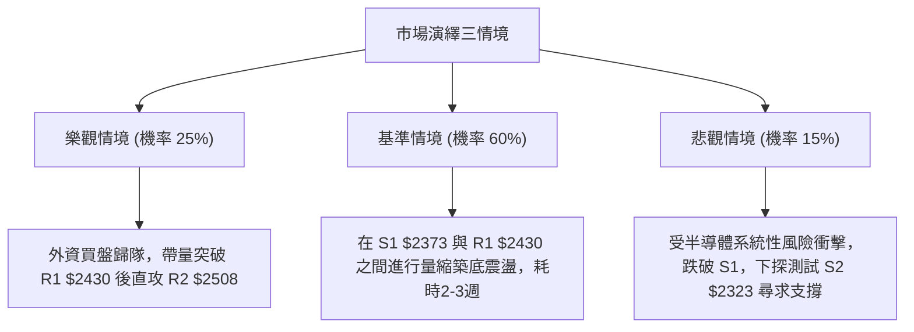

### 🛡️ 風險管理重要提醒

1. **拒絕追高，奉行「支撐買入」原則**：在 ADX = 16.47 的震盪盤整行情中，追高勝率極低（通常會買在日內最高點倒楣處）。嚴格在 S1 ($2373.01) 附近逢低佈局，並於靠近阻力位 R1 ($2429.97) 及 MA20 ($2471.00) 時嚴格分批停利。
2. **總部位曝險控管**：考量到當前短期均線下彎壓制，總持倉水位建議控制在 **30%–40% 以內**，保留 60% 以上現金流，以因應大盤系統性波動（Beta 達 1.239）。
3. **ATR 動態追蹤停利**：若策略 A 進場後獲利，當價格觸及 $2450 以上時，應將停損價上移至進場成本價 $2390，鎖定無風險交易狀態。

---

## 📋 報告總結

```
╔══════════════════════════════════════════════════════════════════╗
║                    2330.TW 技術分析報告總結                      ║
╠══════════════════════════════════════════════════════════════════╣
║ 報告日期：2026-10-30                                             ║
║ 當前價格：$2415.00 TWD                                           ║
║ 分析評級：⚖️ 中性觀望 / 區間高拋低吸 (技術評分: 52/100)            ║
╠══════════════════════════════════════════════════════════════════╣
║ 關鍵結論：                                                       ║
║ ├─ 長期趨勢：🟢 強烈看多 (MA200 $2175 之上 +11%，長多根基穩固)     ║
║ ├─ 中期趨勢：🟡 箱型整理 ($2323 至 $2590 區間整固，ADX 16.47 盤整)║
║ ├─ 短期趨勢：🔴 弱勢修正 (承壓 MA20 $2471 與 MA50 $2438 均線之下)  ║
║ ├─ 核心支撐：S1 $2373.01  /  S2 $2323.16                        ║
║ ├─ 核心阻力：R1 $2429.97  /  R2 $2508.21  /  R3 $2590.00         ║
║ └─ 外資共識：強力買進 (Strong Buy / 目標均價: $3394.71)          ║
╠══════════════════════════════════════════════════════════════════╣
║ 最優策略組合：                                                   ║
║ 1. 🥇 最佳機會：策略 A（回踩 $2390 依託 S1 支撐低吸，風報比 1:2.31）║
║ 2. 🥈 次選機會：策略 B（右側帶量突破 R1 $2435 後順勢短打 R2）      ║
║ 3. 🥉 保守選擇：空手等待 MA20 扣抵結束且日線重新站穩 $2471 再行介入 ║
╚══════════════════════════════════════════════════════════════════╝
```

---

> ⚠️ **免責聲明**：本報告係基於量化技術指標、歷史 OHLCV 價格數據及嚴謹圖表形態學所編制之技術研究報告，所有內容**僅供專業學術研究與投資分析參考**，**絕不構成任何形式的證券買賣要約或操作推薦**。金融市場瞬息萬變，價格具有高度不確定性，投資人應獨立審慎評估風險並自負盈虧。

---

*報告生成時間：2026-10-30 ｜ 數據來源：Yahoo Finance ｜ 分析框架：多時框技術分析體系*