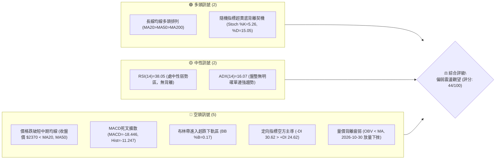
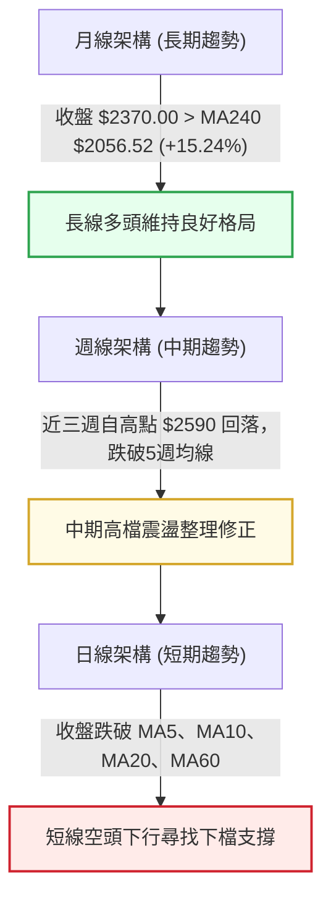
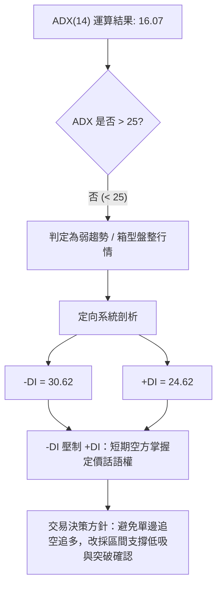
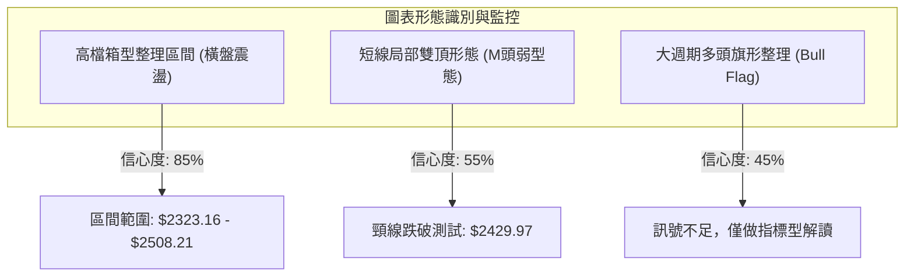
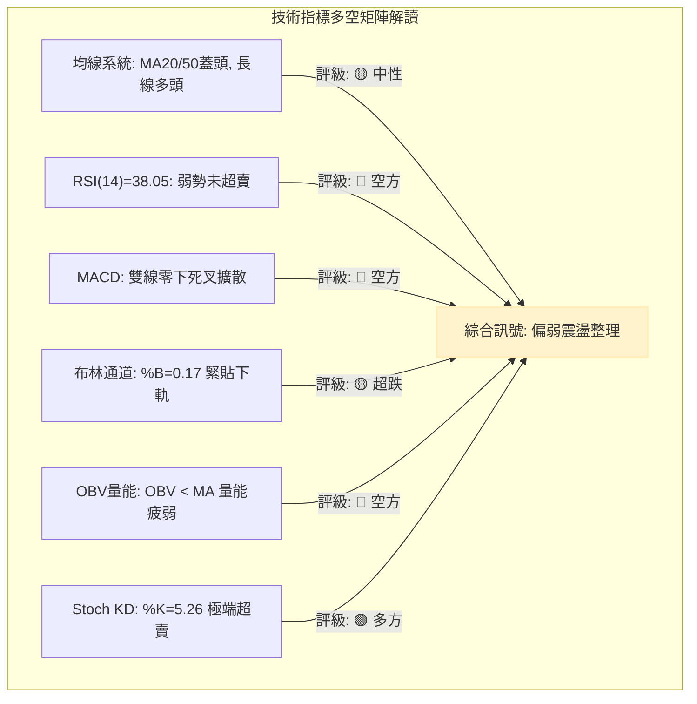
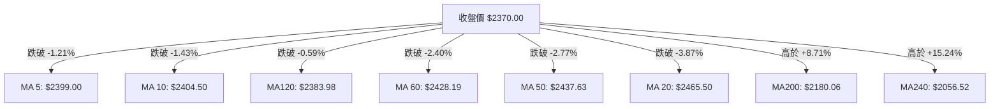
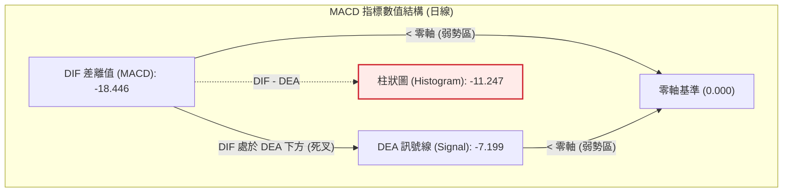
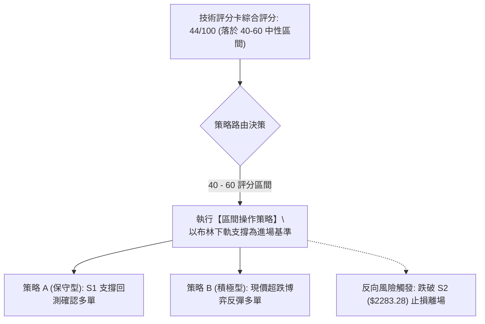
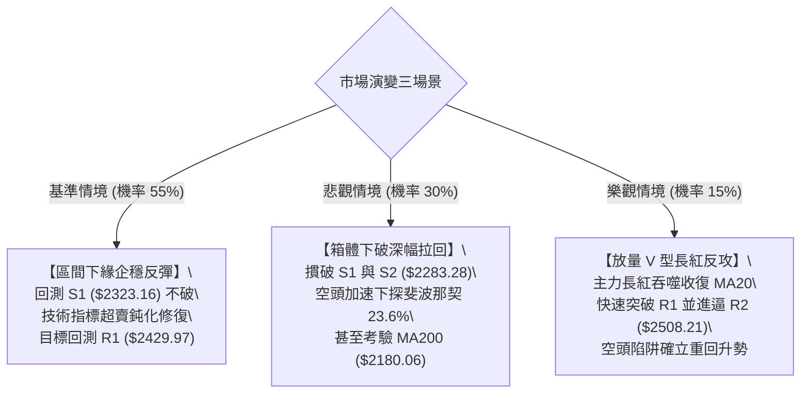

# 2330.TW 技術分析報告

> **報告日期**：2026-10-31 ｜ **語言**：繁體中文 ｜ **數據來源**：Yahoo Finance ｜ **當前價格**：$2370.00 TWD

---

## 目錄

| 章節 | 內容 |
|------|------|
| [1. 技術面概覽](#1-技術面概覽) | 訊號儀表板、核心指標、評分卡 |
| [2. 趨勢分析](#2-趨勢分析) | 多時框趨勢、長中短期走勢、ADX解讀 |
| [3. 圖表形態分析](#3-圖表形態分析) | 形態識別、K線組合、目標價推算 |
| [4. 支撐與阻力](#4-支撐與阻力) | 關鍵價位聚類、斐波那契回調結構 |
| [5. 技術指標深度解讀](#5-技術指標深度解讀) | MA排列、RSI、MACD、布林通道、OBV |
| [6. 動能與波動率](#6-動能與波動率) | 動能象限、ATR波動分析、Beta風險系數 |
| [7. 多時框架總結](#7-多時框架總結) | 時框架評分矩陣、多時框收斂結論 |
| [8. 交易策略建議](#8-交易策略建議) | 策略路由、主策略詳情、風險報酬比 |
| [9. 風險提示與監控](#9-風險提示與監控) | 關鍵監控Checklist、三情境演變、倉位風控 |
| [報告總結](#-報告總結) | 核心指標總成與最優策略指引 |

---

## 1. 技術面概覽

### 🎯 技術訊號儀表板



### 📊 核心指標速覽表

| 指標類別 | 指標名稱 | 當前數值 | 訊號 | 解讀 |
|----------|----------|----------|------|------|
| **價格** | 當前收盤價 | $2370.00 | 🔴 | 位於 52 週高低區間之 82.1%，短線處於自高點 $2590.00 回檔格局中 |
| **均線** | 短期 MA20 | $2465.50 | 🔴 | 收盤價低於 MA20 達 -3.87%，短線均線下彎，形成直接動態阻力 |
| **均線** | 中期 MA50 | $2437.63 | 🔴 | 收盤價低於 MA50 達 -2.77%，中期多頭波段受挫，轉入防守 |
| **均線** | 長期 MA200 | $2180.06 | 🟢 | 收盤價高於 MA200 達 +8.71%，長期結構維持穩固多頭基底 |
| **動能** | RSI(14) | 38.05 | 🟡 | 落在中性弱勢區間（30–70），未達極端超賣，下行動能尚存 |
| **動能** | MACD 柱狀圖 | -11.247 | 🔴 | 雙線位於零軸下方（DIF -18.446，DEA -7.199），空頭動能主導 |
| **動能** | Stoch %K / %D | 5.26 / 15.05 | 🟢 | 進入極度超賣區（<20），短線具備技術性跌深反彈動能 |
| **趨勢** | ADX (14) | 16.07 | 🟡 | ADX < 25 表明處於盤整震盪行情，無單邊強烈單向單向趨勢 |
| **通道** | 布林通道 %B | 0.17 | 🔴 | 貼近下軌 $2321.35 運行，通道帶寬擴大，空方佔據主動 |
| **成交量** | 20日成交量比 | 1.30x | 🔴 | 下跌當日成交量達 29,664,858 股，高於 20 日均量，量增價跌 |
| **波動** | ATR(14) | $36.57 | 🟡 | 每日平均震幅約 1.54%，波動度處中等水準，未見恐慌性爆量 |

### 🏆 技術評分卡

```
╔══════════════════════════════════════════════════════════════════╗
║                技術評分卡 — 2330.TW (2026-10-31)                 ║
╠══════════════════════════════════════════════════════════════════╣
║ 趨勢強度 (Trend)     ████████░░░░░░░░░░░░  40/100  🟡 中性偏弱   ║
║ 動能指標 (Momentum)  ██████░░░░░░░░░░░░░░  30/100  🔴 明顯偏空   ║
║ 支撐穩定度 (Support) ████████████░░░░░░░░  60/100  🟢 支撐浮現   ║
║ 成交量配合 (Volume)  ████████░░░░░░░░░░░░  40/100  🔴 量價背離   ║
║ 形態完整度 (Pattern) ████████░░░░░░░░░░░░  40/100  🟡 區間下修   ║
║ 均線排列 (Moving Avg)██████████░░░░░░░░░░  55/100  🟡 長多短空   ║
╠══════════════════════════════════════════════════════════════════╣
║ 綜合評分             █████████░░░░░░░░░░░  44/100  ⚖️ 區間下限防守║
║ (六項算術平均：(40 + 30 + 60 + 40 + 40 + 55) ÷ 6 = 44.17 ≈ 44) ║
╚══════════════════════════════════════════════════════════════════╝
```

---

## 2. 趨勢分析

### 🌐 多時框趨勢分析



### 📈 長期趨勢 — 12個月走勢圖（Unicode）

依據月度收盤數據繪製過去 12 個月（2025-11 至 2026-10）價格走勢：

```
2330.TW 月線走勢圖（過去12個月：2025-11 至 2026-10）
價格軸 ($)
$2500 ┤                                              ● (09月 $2480.00)
$2400 ┤                                        ●   ●   ●←當前收盤 ($2370.00)
$2300 ┤                                  ● (05月 $2341.84)
$2100 ┤                            ● (04月 $2123.07)
$1900 ┤                  ● (02月 $1977.40)
$1700 ┤            ●     ● (03月 $1750.17)
$1500 ┤      ● (12月 $1536.33)
$1400 ┤●(11月 $1422.55)
      └───────────────────────────────────────────────────────────
       11   12   01   02   03   04   05   06   07   08   09   10  (月份)
      2025 ───────────────────────── 2026 ────────────────────────
```

#### 走勢特徵分析表格

| 階段區間 | 起訖月份 | 起點收盤 | 終點收盤 | 漲跌幅 | 走勢特徵解讀 |
|----------|----------|----------|----------|--------|--------------|
| **長線主升段** | 2025-11 → 2026-02 | $1422.55 | $1977.40 | +39.00% | 均線向上發散，資金積極進駐推升估值，奠定全年上行基礎 |
| **中繼回檔洗盤** | 2026-02 → 2026-03 | $1977.40 | $1750.17 | -11.49% | 急跌回測長天期均線支撐，完成籌碼快速換手 |
| **次級主推波** | 2026-03 → 2026-06 | $1750.17 | $2402.93 | +37.30% | 創下歷史新高，均線呈現完美大多頭排列 |
| **高檔強勢收斂** | 2026-06 → 2026-09 | $2402.93 | $2480.00 | +3.21% | 價格於 $2400 附近構築收斂三角形，波段高點推進至 $2590.00 |
| **短期技術回修** | 2026-09 → 2026-10 | $2480.00 | $2370.00 | -4.44% | 獲利了結賣壓湧現，跌破 MA20，測試前期區間下緣支撐 |

### 📊 中期趨勢（週線分析）

中期技術架構以 2026 年下半年的箱型結構為主。近期週 K 線圖呈現自 2026-10-08 週高點 $2590.00 拉回以來的連三黑整理，週線收盤價依序為：
- 2026-10-08：$2550.00（高點 $2590.00）
- 2026-10-16：$2420.00（跌破短期週均線）
- 2026-10-23：$2385.00
- 2026-10-30：$2370.00（低點來到 $2360.00）

```
中期壓力與支撐示意圖（週線格局）
═══════════════════════════════════════════════════════════════
  $2590.00  ───────────────────────────────  52W 歷史極值阻力 R3
            ▲ (2026-10-08 週高點)
            │
  $2508.21  ───────────────────────────────  近一年波段高點聚類 R2
            │
  $2429.97  ───────────────────────────────  近期頸線突破/跌破轉換區 R1
            │
  $2370.00  ◄─── 當前收盤價 ($2370.00)
            │
  $2323.16  ───────────────────────────────  布林下軌/前低聚類支撐 S1
            │
  $2283.28  ───────────────────────────────  2026-07-17 週低點支撐 S2
═══════════════════════════════════════════════════════════════
```

### ⚡ 趨勢強度評估（ADX 解讀）



#### ADX 指標量化對照解析

| 指標變數 | 當前讀數 | 門檻區間 | 技術含義解讀 | 戰略指導意義 |
|----------|----------|----------|--------------|--------------|
| **ADX (14)** | 16.07 | 0 – 20 | 極弱趨勢 / 市場動能沉寂 | 趨勢跟隨策略（Trend Following）失效，不可追單 |
| **+DI (14)** | 24.62 | 基準比較 | 多頭進攻推動力減退 | 多頭多數由短線防守盤主導，缺乏攻擊力道 |
| **-DI (14)** | 30.62 | 基準比較 | 空方賣壓佔據主導優勢 | 空方雖佔優，但因 ADX<25，不具備摧毀長線結構之單邊崩跌動能 |

---

## 3. 圖表形態分析

### 🔍 形態識別系統



#### 圖表形態信心度評估表

| 形態名稱 | 信心度 | 判斷依據（引用數據） | 完成度 | 目標價（附精確計算式） |
|----------|--------|----------------------|--------|------------------------|
| **高檔大型箱型** | 85% | 價格於 $2323.16（S1）與 $2508.21（R2）之間來回震盪，過去 4 個月收盤多落在此區間 | 90% | 箱體下緣目標價：$2323.16（S1）；若反彈至箱頂目標價：$2508.21（R2） |
| **短線局部 M 頭** | 55% | 兩波高點分別為 2026-10-08 週高點 $2590.00 與 2026-09-24 收盤 $2475.00，近期跌破頸線 $2429.97（R1） | 70% | 形態高度 = $2508.21（R2）− $2429.97（R1）= $78.24；量測目標價 = 頸線 $2429.97 − $78.24 = **$2351.73**（接近 S1） |
| **大週期多頭旗形** | 40% | 數據時間尺度不足以確認旗形收斂軌道，信心度 < 50% | 30% | **訊號不足，僅做指標型解讀**（依規則 15 規範） |

### 🕯️ 重要K線形態分析

嚴格依據「近10根日K」與「近8根週K」之精準 OHLCV 進行解讀：

#### 近 10 根日 K 線形態解讀

| 日期（日K） | 開盤價 | 最高價 | 最低價 | 收盤價 | K線形態名稱 | 技術解讀 | 訊號 |
|-------------|--------|--------|--------|--------|-------------|----------|------|
| 2026-10-16 | 2430.00 | 2445.00 | 2420.00 | 2420.00 | 光腳中黑線 | 帶量長黑摜破短均線，高低震盪 $25.00，收在全日最低點 | 🔴 |
| 2026-10-19 | 2395.00 | 2420.00 | 2390.00 | 2420.00 | 下影長紅線 | 低檔有承接力道，回測 $2390.00 有守，收盤收在全日最高點 | 🟢 |
| 2026-10-20 | 2400.00 | 2415.00 | 2395.00 | 2405.00 | 窄幅十字小陽線 | 震幅縮減至 $20.00，成交量大幅萎縮至 1,700 萬股，多空僵持 | 🟡 |
| 2026-10-21 | 2425.00 | 2435.00 | 2400.00 | 2420.00 | 孕線小黑棒 | 向上挑戰 $2435.00 受阻，受制於 MA50 與 MA60 反壓 | 🟡 |
| 2026-10-22 | 2435.00 | 2435.00 | 2385.00 | 2385.00 | 光頭光腳大陰線 | 開高走低，實體下挫 $50.00，重創短期反彈氣勢 | 🔴 |
| 2026-10-23 | 2385.00 | 2385.00 | 2385.00 | 2385.00 | 一字線（休市/無交易）| 成交量為 0，價格無變動，缺乏價格發現功能 | 🟡 |
| 2026-10-27 | 2380.00 | 2405.00 | 2380.00 | 2400.00 | 實體陽線 | 成交量放大至 33,964,182 股，收盤收復 $2400.00 整數關卡 | 🟢 |
| 2026-10-28 | 2420.00 | 2430.00 | 2410.00 | 2425.00 | 溫和走揚紅K | 延續反彈，但在 $2430.00 前期反壓處再度量縮 | 🟢 |
| 2026-10-29 | 2420.00 | 2425.00 | 2390.00 | 2415.00 | 上影小陰線 | 量縮回測，下影線觸及 $2390.00，顯示多方力道後繼無力 | 🟡 |
| 2026-10-30 | 2380.00 | 2380.00 | 2360.00 | 2370.00 | 破底陰線棒 | 開盤即為最高點，放量 2,966 萬股跌破近月平台，收 $2370.00 | 🔴 |

#### 近 8 根週 K 線形態解讀

| 日期（週K） | 開盤價 | 最高價 | 最低價 | 收盤價 | K線形態名稱 | 技術解讀 | 訊號 |
|-------------|--------|--------|--------|--------|-------------|----------|------|
| 2026-09-11 | 2427.85 | 2497.65 | 2397.94 | 2402.93 | 長上影紡錘黑線 | 衝擊 $2500 未果，上檔遭獲利調節盤壓制 | 🟡 |
| 2026-09-18 | 2378.00 | 2460.00 | 2373.01 | 2460.00 | 下影長實體紅棒 | 破底翻陽線，回測 $2373.01 有守後強勁彈升 | 🟢 |
| 2026-09-24 | 2445.00 | 2510.00 | 2445.00 | 2475.00 | 連續上攻多頭K | 突破 $2500 關卡，多頭買盤維持積極 | 🟢 |
| 2026-10-02 | 2475.00 | 2515.00 | 2475.00 | 2500.00 | 穩健墊高陽線 | 連續四週墊高收盤，創波段收盤新高 $2500.00 | 🟢 |
| 2026-10-08 | 2550.00 | 2590.00 | 2545.00 | 2550.00 | 創歷史新高上影線 | 創 52 週新高 $2590.00 後獲利了結賣壓湧現 | 🟡 |
| 2026-10-16 | 2510.00 | 2550.00 | 2420.00 | 2420.00 | 巨量吞噬長黑棒 | 週量達 1.6 億股，實體重挫 $90.00，形成高檔反轉吞噬 | 🔴 |
| 2026-10-23 | 2395.00 | 2435.00 | 2385.00 | 2385.00 | 連續下跌黑K | 量能縮小但重心持續下移，未能止住跌勢 | 🔴 |
| 2026-10-30 | 2380.00 | 2430.00 | 2360.00 | 2370.00 | 下跌中黑棒帶下影 | 跌破前週低點來到 $2360.00，測試下方支撐聚類 S1 | 🔴 |

### 📉 ASCII 走勢形態示意圖

```
2330.TW 近兩個月局部走勢形態與關鍵結構
$2590.00 ─────────────── 52W極致頂部 (2026-10-08)
             /\
            /  \
           /    \      /\  $2508.21 (波段阻力 R2)
          /      \    /  \
$2429.97 ┼────────\──/────\──────── 頸線反壓聚類 (R1)
                   \/      \
                            \     ┌── 2026-10-30 收盤: $2370.00
                             \    │
$2323.16 ─────────────────────┴───▼────── 近一年低點聚類支撐 (S1)
                                   (下軌支撐區間 $2321.35 - $2323.16)
$2283.28 ──────────────────────────────── 2026-07 波段防守支撐 (S2)
```

### 🎯 形態目標價計算

依據形態學原則，計算當前主要形態的量測目標：

```
1. 局部高檔雙頂（M頭）滿足點推算：
   - 左頂高點：$2590.00 (52W High)
   - 右頂高點：$2508.21 (近一年波段高點聚類 R2)
   - 頸線位置：$2429.97 (近一年波段高點聚類 R1，亦為 10/16 跌破點)
   - 形態高度 = 頸線 $2429.97 與右頂 $2508.21 之垂直差 = $2508.21 - $2429.97 = $78.24
   - 往下 1:1 等幅測量目標 = 頸線 $2429.97 - 形態高度 $78.24 = $2351.73
   - 結論：該推算目標 $2351.73 極度貼近關鍵支撐位 S1 ($2323.16)，顯示下檔支撐具備強大技術對應力。

2. 箱型整理突破/跌破幅度測量：
   - 箱體上限：$2508.21 (R2)
   - 箱體下限：$2323.16 (S1)
   - 箱體垂直高度 = $2508.21 - $2323.16 = $185.05
   - 若有效跌破 S1 之極端投射目標 = S1 $2323.16 - $185.05 = $2138.11（落於斐波那契 38.2% $2119.51 與 MA200 $2180.06 之間）
```

---

## 4. 支撐與阻力

### 🗺️ 關鍵價位分布圖（Unicode）

```
2330.TW 價位結構分布圖 (OHLCV 精確計算)
═══════════════════════════════════════════════════════════════════
$2590.00 ║████████████████████████████████████████║ 52W歷史極值阻力 R3 (+9.28%)
$2508.21 ║██████████████████████████████          ║ 近一年波段高點 R2 (+5.83%)
$2429.97 ║██████████████████                      ║ 頸線轉折關鍵阻力 R1 (+2.53%)
$2370.00 ╠════════════════════════════════════════╣ ◄── 當前收盤價 ($2370.00)
$2323.16 ║▓▓▓▓▓▓▓▓▓▓▓▓▓▓▓▓                        ║ 近一年波段低點 S1 (-1.98%)
$2299.33 ║▓▓▓▓▓▓▓▓▓▓▓▓                            ║ 斐波那契 23.6% 回調支撐
$2283.28 ║██████████████████████████              ║ 2026-07 波段平台 S2 (-3.66%)
$2183.30 ║████████████████████████████████        ║ 長期結構防守低點 S3 (-7.88%)
═══════════════════════════════════════════════════════════════════
```

### 🚧 阻力位分析表

所列價位完全引用「關鍵價位」區塊之客觀數據，不捏造衍生點位：

| 阻力級別 | 價位 | 形成原因 | 突破難度 | 重要性 |
|----------|------|----------|----------|--------|
| **R1** | $2429.97 | 近一年波段高點聚類；近兩週反彈高點（10/28 $2430.00、10/29 $2425.00）密集承壓處 | 🟡 中等 | ★★★★☆<br>短線多空分水嶺，站穩方能化解空頭反壓 |
| **R2** | $2508.21 | 近一年波段高點聚類；整數心理大關 $2500 附近之密集換手籌碼套牢區 | 🔴 極高 | ★★★★★<br>波段由空翻多之強阻力確認點 |
| **R3** | $2590.00 | 52 週歷史歷史極值頂部（2026-10-08 創下），全市場多頭最沉重利多出盡賣壓區 | 🔴 極難 | ★★★★★<br>長線多頭天花板，需巨量配合方可攻克 |

### 🛡️ 支撐位分析表

所列價位完全引用「關鍵價位」區塊之客觀數據：

| 支撐級別 | 價位 | 形成原因 | 守住機率 | 重要性 |
|----------|------|----------|----------|--------|
| **S1** | $2323.16 | 近一年波段低點聚類；重合布林通道下軌 $2321.35，短線具備強大技術對稱支撐 | 🟢 70% | ★★★★☆<br>短線超跌反彈第一道防線 |
| **S2** | $2283.28 | 近一年波段低點聚類（2026-07-17 週低點）；下探斐波那契 23.6%（$2299.33）後之緩衝區 | 🟢 65% | ★★★★★<br>中期箱體底層防禦底線，跌破則箱體崩解 |
| **S3** | $2183.30 | 近一年波段低點聚類；與 MA200 年線（$2180.06）完美共振之終極長線護城河 | 🟢 85% | ★★★★★<br>長線牛熊生死分界線，機構資金底線 |

### 📐 斐波那契回調位分析

依據 52 週高低區間（$1358.34 → $2590.00）嚴格定義，垂直落差達 $1231.66：

```
斐波那契回調結構與現價位置
0.0%  ── $2590.00 (52W High 極值高點)
         │
23.6% ── $2299.33 (淺幅回調防線)
         │  ◄── 現價 $2370.00 (落於 0.0% 與 23.6% 之間，回調幅度 17.86%)
38.2% ── $2119.51 (黃金分割關鍵支撐，與 MA200 $2180.06 構成強大防護帶)
         │
50.0% ── $1974.17 (多空強弱分界平衡線)
         │
61.8% ── $1828.84 (實質回撤極限)
         │
78.6% ── $1621.92 (深幅破壞防線)
         │
100.0%── $1358.34 (52W Low 歷史起點)
```

#### 斐波那契各級位技術解讀

1. **現價區間定位**：當前收盤價 $2370.00 處於 0.0%（$2590.00）與 23.6%（$2299.33）之強勢回檔區間內。回調幅度僅佔整年漲幅之 17.86%，在道氏理論與斐波那契框架下，未跌破 23.6%（$2299.33）前，均屬於強勢多頭週期中的正常技術性收斂。
2. **多頭第一道縱深防線**：若下探跌破 S1（$2323.16），23.6%（$2299.33）將與 S2（$2283.28）在 $2283.28 – $2299.33 形成寬度僅約 $16 的高密度支撐帶，此處將爆發多空主力激烈爭奪。
3. **長線防護網**：38.2%（$2119.51）與當前 MA200（$2180.06）及 S3（$2183.30）形成下檔的第二道堅固防線。

---

## 5. 技術指標深度解讀

### 🎛️ 指標訊號總覽



### 📈 移動平均線排列分析



#### 均線數據與結構特徵表

| 均線天期 | 均線價位 | 現價相對差距 | 趨勢斜率 | 技術意涵與阻力強度 |
|----------|----------|--------------|----------|--------------------|
| **MA 5** | $2399.00 | -29.00 (-1.21%) | 下彎 | 超短期下行引導線，壓制每日反彈高點 |
| **MA 10** | $2404.50 | -34.50 (-1.43%) | 下彎 | 短線衝刺攻擊線，未突破前短線空方主導 |
| **MA 20** | $2465.50 | -95.50 (-3.87%) | 下彎 | 月線生命線，布林中軌所在，重度反壓區 |
| **MA 50** | $2437.63 | -67.63 (-2.77%) | 走平轉下 | 中期多空分水嶺，跌破宣告中期轉入修正 |
| **MA 60** | $2428.19 | -58.19 (-2.40%) | 下微彎 | 季線防守轉弱，與 R1（$2429.97）形成共振反壓 |
| **MA120** | $2383.98 | -13.98 (-0.59%) | 上揚緩走平| 半年線附近，現價僅微幅跌破，多空激烈搏鬥 |
| **MA200** | $2180.06 | +189.94 (+8.71%) | 強勁上揚 | 長期牛市基礎均線，與 S3 共同構成終極防守 |
| **MA240** | $2056.52 | +313.48 (+15.24%)| 強勁上揚 | 年線基石，長期大多頭趨勢從未被實質撼動 |

**排列狀態解讀**：
大週期架構維持經典多頭排列（MA20 $2465.50 > MA50 $2437.63 > MA200 $2180.06）。然而，短中期均線群呈現「倒掛蓋頭」型態（現價 < MA5 < MA10 < MA120 < MA60 < MA50 < MA20）。此種「長線多頭、短線深度回調」的均線衝突，代表長線多頭趨勢中的次級折返修正。

### 📉 RSI(14) 分析

```
RSI(14) 數值進度條展示
0                       30        50               70                     100
├───────────────────────┼─────────┼────────────────┼──────────────────────┤
[  極度超賣區 (0-30)   ] [中性弱勢] [  中性強勢區  ] [  極度超買區 (70-100) ]
                        ▲
                     38.05 (當前讀數)
進度條：███████████████░░░░░░░░░░░░░░░░░░░░░░░░░ 38.05%
```

- **超買超賣狀態**：RSI(14) 為 38.05（Wilder平滑計算法），落於 30 至 70 的中性區間下半部，尚未進入 < 30 的極端超賣區。這意味著空方動能尚未完全宣洩完畢，短線仍有微幅下探之慣性。
- **背離分析與結論**：
  - 檢視數據中明確提供的背離判斷：「**RSI 背離: 無明顯背離 (僅比較近20根K棒首尾的價格與RSI方向)**」。
  - 檢視近 20 週收盤走勢：週 RSI 自 2026-10-08 之 61.9 下滑至 2026-10-16 之 41.7，再至 2026-10-30 之 38.0；價格亦同步自高點 $2590.00 下挫至 $2370.00。**價格創波段新低，指標亦同步走低，無頂背離亦無底背離現象**。
  - **結論**：指標與價格走勢同步下行，呈現純粹的動能釋放，不存在鈍化或背離引發的反轉訊號。

### 📊 MACD(12/26/9) 訊號解讀



- **MACD 線性讀數**：DIF 數值為 -18.446，訊號線 Signal 數值為 -7.199，MACD 柱狀圖為 -11.247。
- **指標形態解讀**：
  1. 雙線均已沉入零軸之下，表明市場已被空方空頭走勢主導。
  2. DIF 位於 Signal 下方且負向發散擴大，柱狀圖達 -11.247，空頭下行加速度尚未見到收斂拐點。
  3. 週線層級 MACD 柱狀圖亦由 2026-10-08 週之 +10.055 翻黑並擴大至 2026-10-30 週之 -11.247，顯示中期層面動能已轉空，短期難以迅速回揚。

### 📦 布林通道分析

依據 20 日均線及 2 倍標準差所構建之布林通道參數：
- **布林上軌**：$2609.65
- **布林中軌 (MA20)**：$2465.50
- **布林下軌**：$2321.35
- **布林帶寬度 (Bandwidth)** = $2609.65 − $2321.35 = $288.30（帶寬比率 11.69%）
- **當前布林 %B**：0.17

```
ASCII 布林通道示意圖
$2609.65 ────────────────────────────────── 上軌 (Upper Band)
            \                          /
             \                        /
$2465.50 ─────\────── 中軌 (MA20) ───/───── 中軌 (跌破，轉為反壓)
               \                    /
$2370.00 ───────┼───► 現價 ($2370.00, %B = 0.17)
                 \                /
$2321.35 ─────────┴──────────────┴───────── 下軌 (Lower Band) 支撐測試區
```

**布林通道動態評估**：
1. **極度弱勢區運行**：%B 數值僅為 0.17（0 代表下軌，0.5 代表中軌，1 代表上軌），表示收盤價極度逼近布林下軌（$2321.35）。現價距離下軌僅剩 $48.65（約 2.05%），已進入統計學上的超賣超跌區域。
2. **軌道開口擴大**：隨著 10-30 帶量跌破半年線，下軌持續向外向下擴張，若下軌無法發揮彈性支撐，恐演變為「沿下軌下行」的弱勢空頭格局。然而，下軌 $2321.35 與第一支撐位 S1（$2323.16）形成僅相距不到 2 元的支撐共振，在此區域止跌回穩的機率極高。

### 💹 成交量分析（量價配合度）

1. **量能指標讀數**：
   - 最新交易日（2026-10-30）成交量：29,664,858 股
   - 20 日平均成交量：22,816,141 股
   - 50 日平均成交量：20,170,899 股
   - 量比（Volume Ratio）：1.30x
2. **量價配合診斷**：
   - 2026-10-30 價格下挫 $45.00（開盤 $2380.00，收盤 $2370.00，最低 $2360.00），成交量擴增至 2,966 萬股，量比為 1.30x，呈現典型的**量增價跌**格局。
   - 檢視數據庫 OBV 趨勢結論：「**OBV < MA → 量能疲弱**」。代表在過去一至二個月的高檔盤整期間，主力資金以逢高派發、逢反彈減碼為主要行為模式。
   - 在高檔出貨長黑棒（例如 10/16 週成交量高達 1.6 億股）之後，量能遲遲無法在反彈時放大（10/28 反彈僅 1,988 萬股），反映出追價買盤退潮。

---

## 6. 動能與波動率

### ⚡ 動能評估四象限

```
                   動能強度 (Momentum)
                          ▲
                          │
            Q3            │            Q1
      高動能 / 高波動     │      高動能 / 低波動
      (突破爆發行情)      │      (最佳多頭主升)
                          │
  ─── 波動率 (ATR/Beta) ──┼──────────────────────►
                          │
            Q4            │            Q2
      弱動能 / 高波動     │      弱動能 / 低波動
      (破位震盪風險)      │      (謹慎觀望築底)
                          │      ◄── 2330.TW 目前落點 (Q2)
                          ▼
```

#### 動能評估四象限明細表

| 象限 | 動能維度 | 波動維度 | 當前狀態標註 | 戰略評估 |
|------|----------|----------|--------------|----------|
| **Q1** | 強 (ADX>25, RSI>60) | 低 (ATR%<1.5%) | — | 絕佳右側順勢追擊機會，持股續抱 |
| **Q2** | **弱 (ADX=16.07, RSI=38.05)** | **低至中 (ATR%=1.54%)** | **✓ (2330.TW 落點)** | **處於動能匱乏、低波動擠壓區，維持謹慎觀望，靜待下軌防守測試** |
| **Q3** | 強 (動能快速放大) | 高 (ATR%>3.0%) | — | 高風險高報酬行情，需嚴設寬幅止損 |
| **Q4** | 弱 (空方下殺動能) | 高 (恐慌拋售爆量) | — | 避免任何左側猜底進場，嚴防雪崩風險 |

### 📊 ATR 波動率分析

- **ATR(14) 讀數**：$36.57 TWD（佔當前股價之 1.54%，採用 Wilder 平滑計算）。
- **波動率特性解讀**：
  - 每日平均震幅約在 $36.50 – $37.00 之間，波動幅度保持在 1.5% 左右的穩健水平，並未出現 3% 以上失控型的流動性恐慌。
  - 當前 ATR 數值反映出市場雖然處於下行修正，但賣壓多來自於停利盤與被動調節，市場整體秩序良好。
- **止損距離動態設計建議**：
  - **超短線交易（Day Trading/Swing）**：建議以 1.0 倍 ATR（約 $36.50）作為最小保護止損距離。
  - **波段佈局交易（Position Trading）**：建議採用 1.5 – 2.0 倍 ATR 作為緩衝帶。
    - 1.5 × ATR = 1.5 × $36.57 = **$54.86**
    - 2.0 × ATR = 2.0 × $36.57 = **$73.14**
  - 當前若在現價 $2370.00 建立反彈部位，下檔關鍵止損點 S1（$2323.16）距離現價為 $46.84，恰約為 1.28 倍 ATR，符合波動防護邏輯。

### 📐 Beta 與市場相關性

- **Beta 系數**：1.239（大於 1.00，代表該股波動性高於台股整體加權指數約 23.9%）。
- **市場相關性分析**：
  - 由於 2330.TW 為台灣加權指數第一大權值股（市值達 61.46 兆 TWD），其高 Beta 特性意味著：
    1. 當大盤遭遇系統性外資撤出時，2330.TW 往往首當其衝承受放大級別的賣壓。
    2. 反之，當市場企穩迎來指數型回升時，2330.TW 將提供超越大盤指數 1.24 倍的彈升動能。
  - 目前在 Beta 放大效應下，短線走勢主要受宏觀資金面流動性牽引，操作上應格外關注權值外資法人持股異動。

---

## 7. 多時框架總結

### 📋 時框架評分表

| 時框架 | 趨勢方向 | 動能指標 | 均線排列 | 圖表形態 | 綜合評分 | 戰略建議 |
|--------|----------|----------|----------|----------|----------|----------|
| **短期 (日線)** | 🔴 偏空修正 | 🔴 MACD死叉擴散, RSI 38.05 | 🔴 空頭排列 (現價低於MA5-MA60) | 🔴 跌破短均線平台 | 32/100 | 嚴禁盲目追價，靜待下軌支撐回測 |
| **中期 (週線)** | 🟡 箱型震盪 | 🟡 週MACD轉負, 週RSI 38.00 | 🟡 跌破5週均線, 守穩20週均線 | 🟡 高檔箱型洗盤結構 | 48/100 | 在箱體下緣尋找左側佈局機會 |
| **長期 (月線)** | 🟢 大多頭 | 🟢 長期動能充足, 估值合理 | 🟢 多頭排列 (現價遠高於MA200/240) | 🟢 歷史級主推波行進 | 75/100 | 長期投資者續抱，回檔視為戰略加碼點 |

### 🔲 綜合訊號矩陣

```
時框維度 ＼ 分析構面    趨勢維度    動能維度    形態維度    量價配合    共振結論
─────────────────────────────────────────────────────────────────────────────
短期時框 (Daily)       🔴 偏空     🔴 偏空     🔴 弱勢     🔴 背離     🔴 短空主導
中期時框 (Weekly)      🟡 盤整     🔴 弱勢     🟡 箱型     🟡 縮量     🟡 震盪整理
長期時框 (Monthly)     🟢 多頭     🟢 強勁     🟢 完整     🟢 健全     🟢 長牛不變
─────────────────────────────────────────────────────────────────────────────
系統收斂方向：長多背景下的中短期「高檔箱型下緣支撐防守測試」
```

### ⚖️ 多時框收斂結論

依據多時框收斂規則（規則 14）：
1. **趨勢/盤整行情定性**：當前 ADX(14) 讀數為 **16.07**，顯著低於 25 的趨勢行情閾值，技術面確立為典型的「**盤整震盪行情**」，而非單邊趨勢行情。
2. **主導層級歸屬**：在盤整行情中，依規則 14 規定「以日線布林通道上下軌為主要交易區間」，不再採取單邊追漲殺跌之趨勢策略。
3. **時框衝突取捨**：雖然長期月線與 MA200/MA240 展現極度強勢的多頭架構（收盤價高於 MA200 +8.71%），但短期日線均線倒掛、MACD 處於空方發散；依收斂原則，在盤整架構下，**長線方向提供下檔堅固的安全底線，而日線超跌狀態則用來鎖定布林下軌附近的區間回升波**。
4. **唯一方向性結論**：**中性觀望偏區間下限防守（Neutral to Defensive Range-Trading）**。
   - 該結論與第 1 章技術評分卡（44/100）、第 2 章 ADX 分析（16.07 盤整）、第 5 章布林通道（%B 0.17 超跌下軌區）保持嚴格一致，並直接指導第 8 章以「布林下軌至箱型下緣之區間多單」為主策略。

---

## 8. 交易策略建議

### 🗺️ 策略決策流程圖



### 🧭 策略路由（依評分卡分流）

> **當前主策略方向 = 區間震盪操作，聚焦布林下軌至箱體下緣低吸（依評分 44/100）**

本報告綜合評分為 **44/100**，落入 40–60 之標準中性區間。依規定採取「區間操作策略，以布林上下軌為主，等待關鍵位置的支撐確認」。長線牛市架構健全，跌近下軌提供極佳風險報酬比。

### 🎯 價格情境階梯（Price Scenarios）

價位嚴格引用「關鍵價位」區塊之客觀數據：

| 觸發條件 | 下一目標 | 後續延伸 | 情境含義解讀 |
|----------|----------|----------|--------------|
| **放量突破 R1 $2429.97** | 考驗 R2 $2508.21 | 挑戰歷史高點 R3 $2590.00 | 短線由弱轉強，站回月線與季線，啟動新一輪波段攻勢 |
| **守穩 S1 $2323.16 – 現價** | 測試反彈 R1 $2429.97 | 邁向布林中軌 MA20 $2465.50 | 維持高檔箱體震盪，空頭動能衰竭，展開超跌均值回歸 |
| **實體跌破 S1 $2323.16** | 探底測試 S2 $2283.28 | 尋求長線護城河 S3 $2183.30 | 箱型下緣失守，向下回測斐波那契 23.6% 與年線大支撐 |

### 📊 情境機率分佈

| 情境劇本 | 發生機率 | 主要量化與指標依據 |
|----------|----------|--------------------|
| **下探築底後展開區間反彈** | **55%** | Stoch %K=5.26 極端超賣；布林 %B=0.17 貼近下軌；現價接近一年低點聚類 S1 $2323.16；長天期 MA200/240 強固向上 |
| **延續弱勢陰跌破位尋底** | **30%** | MACD 柱狀圖 -11.247 空方發散；OBV < MA 量能疲弱；最新日K放量收跌破半年線；-DI=30.62 壓制 +DI |
| **強勢 V 型反轉直接創高** | **15%** | ADX 僅 16.07 顯示趨勢動能匱乏；上方阻力聚類 R1/R2 重重套牢籌碼蓋頭，短期缺乏暴量催化劑 |

### 🟢 主策略詳情（方向：區間下限防守型多單）

本章所有風險報酬比，嚴格遵循規則 17 定義公式計算：
$$\text{風險報酬比} = \frac{\text{目標價 T1} - \text{進場價}}{\text{進場價} - \text{止損價}}$$

進場價若為區間，以其區間中點精準計算：
- 策略 A 進場區間 [$2323.16, $2335.00]，中點 = **$2329.08**
- 策略 B 進場價 = **$2370.00**（當前現價）

| 策略要素 | 策略 A（保守型：S1 支撐回踩確認單） | 策略 B（積極型：現價超跌反彈搏擊單） |
|----------|-------------------------------------|-------------------------------------|
| **操作邏輯** | 等待價格回測 S1 支撐及布林下軌止跌打底 | 趁 Stoch 超賣及布林下軌支撐在現價分批低吸 |
| **進場價格** | **$2329.08**（區間 $2323.16 – $2335.00 中點） | **$2370.00**（當前收盤價市價進場） |
| **目標價 T1** | **$2429.97**（關鍵阻力位 R1） | **$2429.97**（關鍵阻力位 R1） |
| **目標價 T2** | **$2508.21**（關鍵阻力位 R2） | **$2508.21**（關鍵阻力位 R2） |
| **止損價格** | **$2283.28**（關鍵支撐位 S2，跌破宣告破位） | **$2323.16**（關鍵支撐位 S1，跌破箱體下緣）|
| **風險報酬比** | **1 : 2.20（以 T1 計）**<br>*(計算: (2429.97-2329.08) / (2329.08-2283.28) = 100.89 / 45.80 = 2.203)*<br>另註：1 : 3.91（以 T2 計） | **1 : 1.28（以 T1 計）**<br>*(計算: (2429.97-2370.00) / (2370.00-2323.16) = 59.97 / 46.84 = 1.280)*<br>另註：1 : 2.95（以 T2 計） |
| **成功機率** | 65% | 55% |
| **建議倉位** | 15% – 20%（資金部位） | 10%（小額部位試單） |

### 🔴 反向風險觸發點（對沖提示）

若出現以下情況，主策略假設立即失效，投資人應迅速執行避險或撤出：
1. **關鍵點位破位**：日 K 線收盤價實體跌破 **S2 $2283.28**，代表自 2026 年 7 月以來的多頭箱體徹底崩解，下探目標將直指斐波那契 38.2%（$2119.51）與 MA200（$2180.06）。
2. **動能極端惡化**：ADX 數值自 16 向上突破 25，且 -DI 線同步暴衝突破 35 以上，此訊號代表弱勢震盪演變為「單邊空頭加速趨勢」，所有多頭部位應即刻停損出局。

### ⭐ 整體訊號強度評星

```
做多訊號強度：★★☆☆☆  (2.0/5星) — 均線倒掛空方壓制，僅具備超賣反彈機會
做空訊號強度：★★★☆☆  (3.0/5星) — 短期空頭動能主導，但遭遇強支撐與長線牛市阻滯
整體可信度：  ★★★☆☆  (3.5/5星) — 指標指向清晰，處於高檔箱體下緣關鍵對決期
```

---

## 9. 風險提示與監控

### ✅ 關鍵監控指標 Checklist

```
╔══════════════════════════════════════════════════════════════════╗
║                   關鍵技術監控清單 (Checklist)                   ║
╠══════════════════════════════════════════════════════════════════╣
║ [ ] 監控項 1: 收盤價是否守穩 S1 ($2323.16) 及布林下軌 ($2321.35) ║
║ [ ] 監控項 2: Stoch KD 是否在超賣區形成 %K 上穿 %D 黃金交叉      ║
║ [ ] 監控項 3: MACD 柱狀圖負值是否開始收斂 (當前: -11.247)        ║
║ [ ] 監控項 4: 日成交量反彈時是否放大超越 20日均量 (2281萬股)     ║
║ [ ] 監控項 5: 反彈是否能突破並站穩短線多空分水嶺 R1 ($2429.97)   ║
║ [ ] 監控項 6: ADX 是否突破 25 (由盤整轉為單邊行情的啟動訊號)     ║
╚══════════════════════════════════════════════════════════════════╝
```

### ⚠️ 風險場景分析



### 🛡️ 風險管理重要提醒

1. **嚴禁順勢追空與左側全倉摸底**：目前 ADX(14) 僅 16.07，在無趨勢的盤整格局中，追殺往往賣在最低點，盲目摸底則易遭連續陰跌鈍化傷害。應嚴格依據點位執行「掛單防守」。
2. **倉位管理與防禦深度**：
   - 整體權益總倉位建議控制在 **30% 以內**，保留充裕的現金儲備以應對 S2（$2283.28）甚至 S3（$2183.30）之極端測試。
   - 單筆多單策略最大曝險金額不可超過總投資部位之 1.5%。
3. **波動性預算（Volatility Budgeting）**：以日 ATR $36.57 為基準，持倉期間若單日逆向波動超過 1.5 倍 ATR（$54.86），應無條件執行被動減碼 50%，以保全資本為第一要務。

---

## 📋 報告總結

```
╔══════════════════════════════════════════════════════════════════╗
║                    2330.TW 技術分析報告總結                      ║
╠══════════════════════════════════════════════════════════════════╣
║ 報告日期：2026-10-31                                             ║
║ 當前價格：$2370.00 TWD                                           ║
║ 分析評級：⚖️ 偏弱震盪觀望 (技術綜合評分: 44 / 100)               ║
║                                                                  ║
║ 關鍵結論：                                                       ║
║ ├─ 長期趨勢：🟢 強烈看多 (收盤遠高於 MA200 $2180.06 達 +8.71%)   ║
║ ├─ 中期趨勢：🟡 箱型整理 (受制於歷史極值 R3 $2590.00 下修整理)  ║
║ ├─ 短期趨勢：🔴 偏空修正 (均線呈倒掛，收盤跌破 MA5-MA60)         ║
║ ├─ 關鍵支撐：S1 $2323.16 ｜ S2 $2283.28 ｜ S3 $2183.30          ║
║ ├─ 關鍵阻力：R1 $2429.97 ｜ R2 $2508.21 ｜ R3 $2590.00          ║
║ └─ 機構共識：Strong Buy (35位分析師目標均價: $3394.71)           ║
║                                                                  ║
║ 最優策略組合：                                                   ║
║ 1. 🥇 最佳機會：策略 A (保守型) — 等待回測 S1 $2323.16 支撐確認  ║
║                 進場 $2329.08，止損 $2283.28，目標 $2429.97     ║
║                 風險報酬比高達 1 : 2.20 (勝率估計 65%)           ║
║ 2. 🥈 次選機會：策略 B (積極型) — 現價 $2370 搏擊 Stoch KD 超賣  ║
║                 進場 $2370.00，止損 $2323.16，目標 $2429.97     ║
║                 風險報酬比 1 : 1.28 (勝率估計 55%)               ║
║ 3. 🥉 保守選擇：完全空手觀望，靜待放量突破 R1 $2429.97 右側進場  ║
╚══════════════════════════════════════════════════════════════════╝
```

---

> ⚠️ **免責聲明**：本報告為依據客觀量化技術指標與歷史行情數據生成之專業技術分析研究，所有數據指標均基於提供之市場資訊計算。本報告**僅供研究與學術參考**，**不構成任何形式之個人化投資要約、招攬或投資建議**。金融市場投資具備固有風險，資產價格可升亦可跌，投資人應依個人風險承受能力獨立判斷並自負盈虧。

---

*報告生成時間：2026-10-31 ｜ 數據來源：Yahoo Finance ｜ 分析框架：多時框技術分析體系 (CFA Level III Standards)*