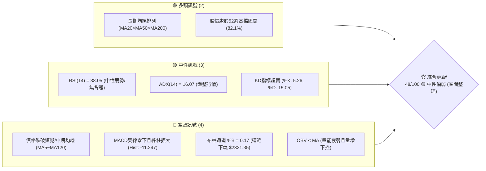
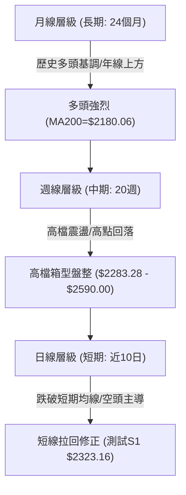
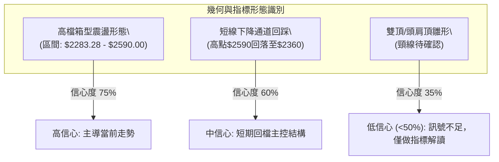
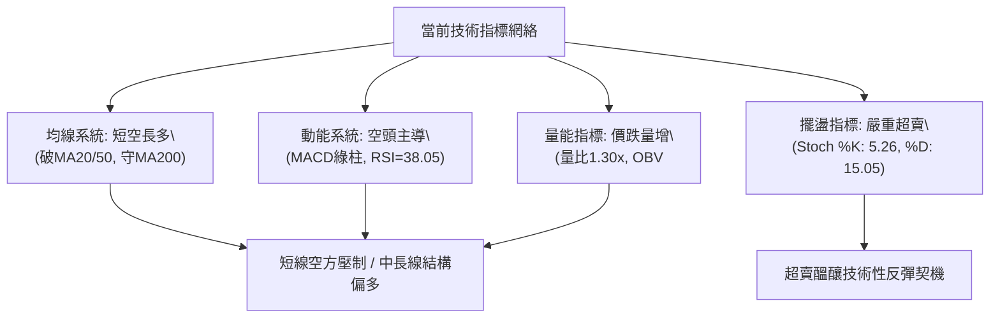
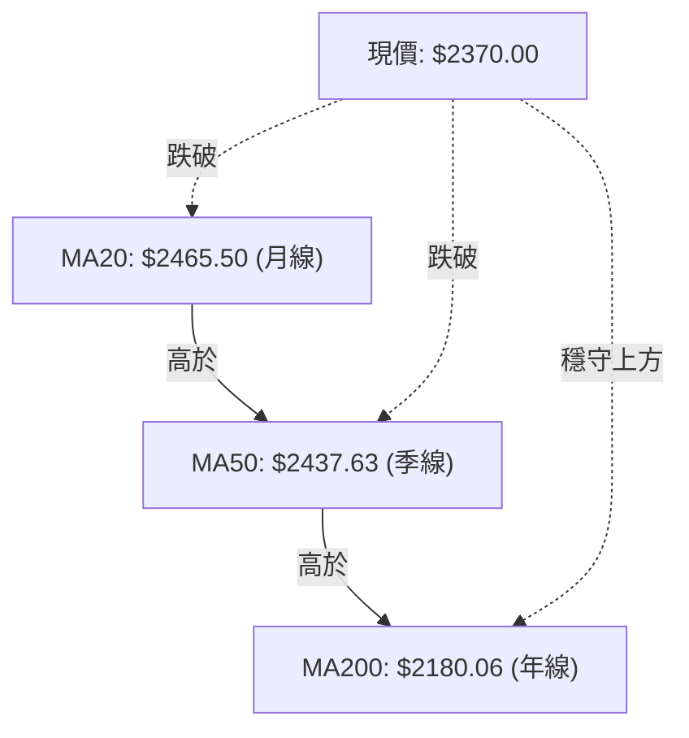
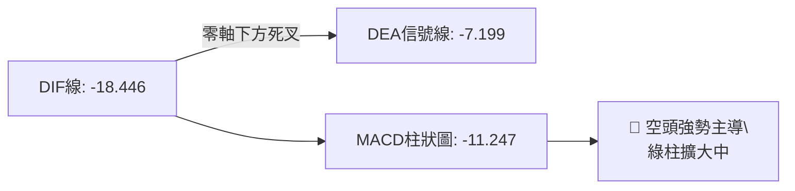
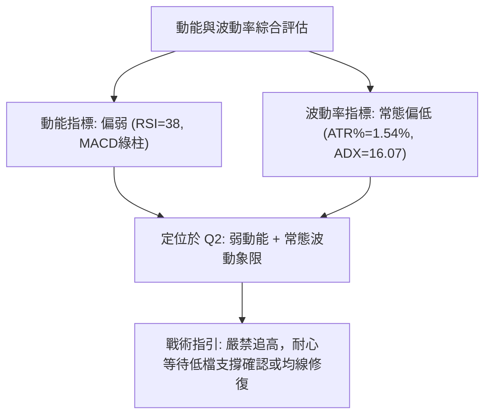
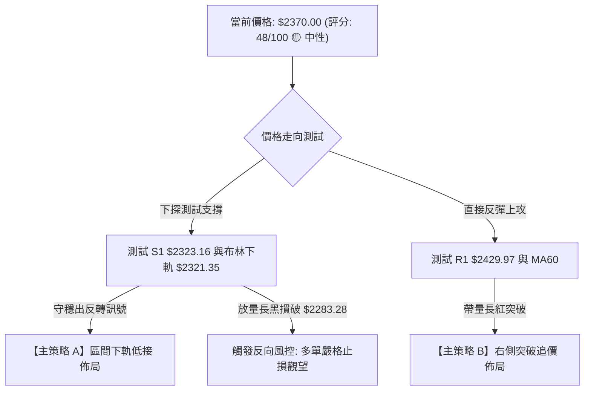
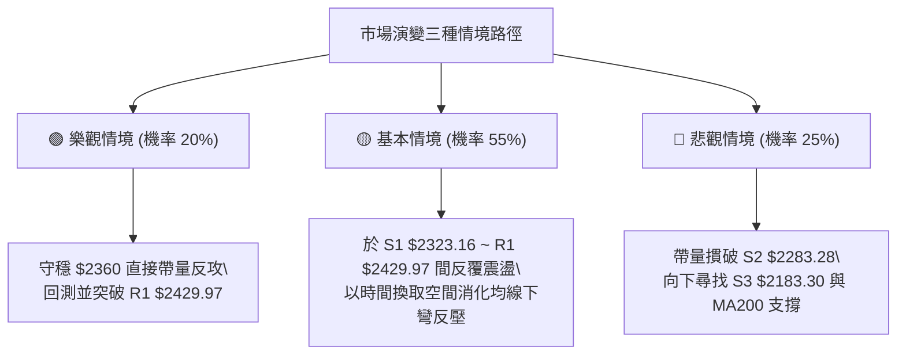

# 2330.TW 技術分析報告

> **報告日期**：2026-11-01 ｜ **語言**：繁體中文 ｜ **數據來源**：Yahoo Finance ｜ **當前價格**：$2370.00 TWD

---

## 目錄

| 章節 | 內容 |
|------|------|
| [1. 技術面概覽](#1-技術面概覽) | 訊號儀表板、核心指標速覽表、技術評分卡 |
| [2. 趨勢分析](#2-趨勢分析) | 多時框趨勢、12個月歷史走勢圖、中期週線走勢、ADX趨勢強度評估 |
| [3. 圖表形態分析](#3-圖表形態分析) | 形態識別系統與信心度、近10日/8週K線組合、ASCII形態示意圖、形態目標價 |
| [4. 支撐與阻力](#4-支撐與阻力) | 價位結構分布圖、阻力位分析表、支撐位分析表、斐波那契回調深度解讀 |
| [5. 技術指標深度解讀](#5-技術指標深度解讀) | 指標訊號網絡、均線系統、RSI背離、MACD柱狀圖、布林通道、OBV量能分析 |
| [6. 動能與波動率](#6-動能與波動率) | 動能評估四象限、ATR波動率與止損模型、Beta市場相關性 |
| [7. 多時框架總結](#7-多時框架總結) | 時框架評分矩陣、綜合訊號一致性、多時框收斂唯一結論 |
| [8. 交易策略建議](#8-交易策略建議) | 策略決策流程圖、主策略路由、價格情境階梯、機率分佈、多空策略詳解 |
| [9. 風險提示與監控](#9-風險提示與監控) | 關鍵監控Checklist、風險情境路徑、風控與資金管理模型 |

---

## 1. 技術面概覽

### 🎯 技術訊號儀表板



### 📊 核心指標速覽表

| 指標類別 | 指標名稱 | 當前數值 | 訊號 | 解讀 |
|:---|:---|:---|:---:|:---|
| **價格** | 當前收盤價 | $2370.00 | 🟡 | 位於52週區間82.1%高位，短線處於回檔整理階段 |
| **均線** | MA20 (月線) | $2465.50 | 🔴 | 現價位於MA20下方 -3.87%，短線格局偏空 |
| **均線** | MA50 (季線) | $2437.63 | 🔴 | 現價跌破MA50支撐，中期動能出現轉弱警訊 |
| **均線** | MA200 (年線) | $2180.06 | 🟢 | 現價高於MA200達 +8.71%，長期多頭趨勢未變 |
| **動能** | RSI(14) | 38.05 | 🟡 | 位於30-70中性偏弱區，未跌破30超賣區，無背離現象 |
| **動能** | MACD(12,26,9) | -18.446 | 🔴 | DIF及DEA皆為負值，Histogram為 -11.247，空頭動能主導 |
| **趨勢** | ADX(14) | 16.07 | 🟡 | ADX < 25 指標顯示無強趨勢，當前屬於盤整震盪市場 |
| **通道** | 布林帶 (%B) | 0.17 | 🔴 | 逼近布林下軌 $2321.35，通道開口微幅擴大 |
| **成交量**| 最新量 / 20MA | 1.30x | 🔴 | 當日量能2,966萬股高於均量，收黑K帶長下影，量增價跌 |
| **波動** | ATR(14) | $36.57 | 🟡 | 波動率佔股價 1.54%，處於常態波動區間內 |

### 🏆 技術評分卡

```
╔══════════════════════════════════════════════════════════════╗
║             技術評分卡 — 2330.TW (2026-11-01)                 ║
╠══════════════════════════════════════════════════════════════╣
║ 趨勢強度 (ADX=16.07, -DI>+DI)   ████████░░░░░░░░░░░░  40/100 🔴 ║
║ 動能指標 (RSI=38, MACD綠柱)     ███████░░░░░░░░░░░░░  36/100 🔴 ║
║ 支撐穩定度 (靠近S1與斐波23.6%)  █████████████░░░░░░░  64/100 🟢 ║
║ 成交量配合 (OBV<MA, 量增下探)   ████████░░░░░░░░░░░░  40/100 🔴 ║
║ 形態完整度 (箱型區間回檔測試)   ██████████░░░░░░░░░░  52/100 🟡 ║
║ 均線排列 (長多短空，扣抵壓力)   ███████████░░░░░░░░░  56/100 🟡 ║
╠══════════════════════════════════════════════════════════════╣
║ 綜合評分 (六項子評分算術平均)   ██████████░░░░░░░░░░  48/100 🟡 ║
║ 評級結論：中性偏弱震盪 (40–60區間，主推區間下軌防守與回踩驗證)║
╚══════════════════════════════════════════════════════════════╝
```

---

## 2. 趨勢分析

### 🌐 多時框趨勢分析



### 📈 長期趨勢 — 12個月走勢圖（Unicode）

以下為 2330.TW 過去 12 個月（2025-11 至 2026-10）收盤價月線走勢圖與關鍵高低點標註：

```
2330.TW 月線收盤走勢圖（2025-11 至 2026-10）
價格軸 ($)
$2500 ┤                                                 ● 2480.00
$2400 ┤                                   ● 2402.93 ● 2417.88  ● 2370.00 (現價)
$2300 ┤                             ● 2341.84         ● 2397.94
$2200 ┤
$2100 ┤                       ● 2123.07
$2000 ┤
$1900 ┤                 ● 1977.40
$1800 ┤
$1700 ┤           ● 1759.34     ● 1750.17 (波段修正低)
$1600 ┤
$1500 ┤     ● 1536.33
$1400 ┤● 1422.55
      └─────┬─────┬─────┬─────┬─────┬─────┬─────┬─────┬─────┬─────┬─────┬─────
          25-11 25-12 26-01 26-02 26-03 26-04 26-05 26-06 26-07 26-08 26-09 26-10
```

#### 走勢特徵分析表格

| 階段區間 | 起訖月份 | 起訖價格 ($) | 漲跌幅 (%) | 核心特徵與量價型態 |
|:---|:---|:---|:---:|:---|
| **主升攻擊段** | 2025-11 ~ 2026-02 | $1422.55 → $1977.40 | +39.00% | 均線多頭發散，單月急漲突破歷史阻力，形成強趨勢推升 |
| **首度回踩段** | 2026-02 ~ 2026-03 | $1977.40 → $1750.17 | -11.49% | 急漲後快速洗盤，月K線回測長期支撐，隨後快速被買盤收復 |
| **次級推升段** | 2026-03 ~ 2026-05 | $1750.17 → $2341.84 | +33.81% | 突破$2000大關，成交量溫和放大，確立長期多頭波段延續 |
| **高檔收斂段** | 2026-05 ~ 2026-10 | $2341.84 → $2370.00 | +1.20% | 進入$2300~$2500高位平台箱型震盪，波幅收斂，呈現籌碼沉澱 |

### 📊 中期趨勢（週線分析）

從近 20 週收盤走勢觀察，週線在 2026-10-08 創下 52 週新高 $2590.00 後，連續三週拉回，分別收在 $2420.00、$2385.00 及當前 $2370.00。

```
2330.TW 週線壓力與支撐架構示意圖
═══════════════════════════════════════════════════════════
  $2590.00 ───┼── 52週歷史高點 (2026-10-08 週K高點 R3)
              │   ▲
  $2508.21 ───┼── 區間中級反彈高點聚類 (阻力 R2)
              │   ▲
  $2429.97 ───┼── 週線轉折波段壓力 (阻力 R1 / 跌破頸線)
              │   
  $2370.00 ───┼── [當前收盤價] ◄── 測試布林下軌與前波低點群
              │   ▼
  $2323.16 ───┼── 近一年波段低點聚類 (支撐 S1)
              │   ▼
  $2283.28 ───┼── 2026-07-17 週K波段低點 (強支撐 S2)
═══════════════════════════════════════════════════════════
```

### ⚡ 趨勢強度評估（ADX 解讀）

```mermaid
graph TD
    A["ADX(14) 讀數 = 16.07"] --> B{"ADX 門檻檢驗"}
    B -->|"< 25 (弱趨勢/無方向)|" C["市場處於橫盤整理/無明確趨勢"]
    B -->|"-DI: 30.62 > +DI: 24.62|" D["空方佔據短線主導優勢"]
    C --> E["策略收斂: 遵循規則 14"]
    D --> E
    E --> F["以日線布林通道 ($2321.35 - $2609.65) 作為主要震盪邊界"]
```

#### ADX 趨勢強度對照表

| 指標變數 | 當前讀數 | 門檻標準 | 狀態判斷 | 操作指導含義 |
|:---|:---:|:---:|:---:|:---|
| **ADX(14)** | **16.07** | 25.00 | 🟡 弱趨勢 / 盤整 | 趨勢跟隨策略（如突破追價）勝率降低；震盪指標高出低進勝率提升 |
| **+DI(14)** | **24.62** | - | 🟡 多方動能轉弱 | 多頭買盤力道收縮，無法發起單邊上攻行情 |
| **-DI(14)** | **30.62** | - | 🔴 空方動能佔優 | 空方力道顯著高於多方（差值 6.00），短線價格容易受到壓制 |

---

## 3. 圖表形態分析

### 🔍 形態識別系統

依據規則 15，各幾何形態必須嚴格標註信心度，未達 50% 者僅作指標型解讀。



#### 形態識別與信心度評估表

| 形態類別 | 信心度 (%) | 判斷依據（引用數據） | 完成度 (%) | 目標價（附計算式，依規則13） |
|:---|:---:|:---|:---:|:---|
| **高檔箱型整理** | **75%** | 箱底獲 2026-07-17 低點 $2283.28 支撐，箱頂受限於 52W 高點 $2590.00 | 85% | 區間震盪無方向突破。若向上突破 R3：目標 $2590.00 + ($2590.00 - $2283.28) = $2896.72；若跌破 S2 則回測 S3 $2183.30 |
| **短線下降修正通道** | **60%** | 高點由 10-08 之 $2590.00 連續壓低至 10-30 低點 $2360.00，MA5、MA10 壓制 | 70% | 通道下緣支撐對應 S1 **$2323.16** 與布林下軌 **$2321.35** |
| **疑似頭肩頂結構** | **35%** | 僅有單一高點 $2590.00，右肩與頸線皆未確立形態特徵 | 20% | **訊號不足，僅做指標型解讀**（不預設破位目標價） |

### 🕯️ 重要K線形態分析

根據數據中「近 10 根日 K」與「近 8 根週 K」之實際開高低收數據進行嚴格判讀（依規則 19）：

#### 近 10 根日 K 棒分析

| 日期 | 開盤價 ($) | 最高價 ($) | 最低價 ($) | 收盤價 ($) | K線形態名稱 | 技術解讀 | 訊號 |
|:---|:---:|:---:|:---:|:---:|:---|:---|:---:|
| 2026-10-16 | 2430.00 | 2445.00 | 2420.00 | 2420.00 | 光腳中陰線 | 收於當日最低，跌破短期支撐，展現拋售壓力 | 🔴 |
| 2026-10-19 | 2395.00 | 2420.00 | 2390.00 | 2420.00 | 光頭小陽線 | 低開後向上拉升，下檔 $2390.00 初步顯露承接力 | 🟢 |
| 2026-10-20 | 2400.00 | 2415.00 | 2395.00 | 2405.00 | 窄幅十字小實體 | 上下影線對稱，量縮至1,709萬股，多空觀望膠著 | 🟡 |
| 2026-10-21 | 2425.00 | 2435.00 | 2400.00 | 2420.00 | 帶長下影小陰線 | 盤中下探 $2400.00 獲支撐回升，買盤低接意願強 | 🟡 |
| 2026-10-22 | 2435.00 | 2435.00 | 2385.00 | 2385.00 | 光頭光腳長黑線 | 開盤即最高、收盤即最低，空頭全盤掌控，摜破 $2400 | 🔴 |
| 2026-10-23 | 2385.00 | 2385.00 | 2385.00 | 2385.00 | 一字線 (成交量0) | 無交易量（可能休市或特殊撮合），價格完全停滯 | 🟡 |
| 2026-10-27 | 2380.00 | 2405.00 | 2380.00 | 2400.00 | 實體陽線 | 開盤即最低，多方反彈站回 $2400，成交量擴至3,396萬 | 🟢 |
| 2026-10-28 | 2420.00 | 2430.00 | 2410.00 | 2425.00 | 跳空高開小陽線 | 向上跳空挑戰 MA20 反壓，量縮顯示跟風意願不足 | 🟡 |
| 2026-10-29 | 2420.00 | 2425.00 | 2390.00 | 2415.00 | 帶下影倒錘陰線 | 衝高無力回落，再次失守 $2420，買盤後繼乏力 | 🔴 |
| 2026-10-30 | 2380.00 | 2380.00 | 2360.00 | 2370.00 | 長下影鎚頭陰線 | 破底至 $2360 後量增拉回10元，空頭雖強但低檔買盤浮現 | 🟡 |

#### 近 8 根週 K 棒分析

| 週結算日 | 開盤價 ($) | 最高價 ($) | 最低價 ($) | 收盤價 ($) | 週K形態名稱 | 技術解讀 | 訊號 |
|:---|:---:|:---:|:---:|:---:|:---|:---|:---:|
| 2026-09-11 | 2427.85 | 2497.65 | 2397.94 | 2402.93 | 倒長上影流星陰線 | 試探 $2500 關卡未果，高檔解套與獲利盤湧出 | 🔴 |
| 2026-09-18 | 2378.00 | 2460.00 | 2373.01 | 2460.00 | 下探回升大長陽 | 週線下探 $2373.01 後長紅拉起，重啟多頭攻勢 | 🟢 |
| 2026-09-24 | 2445.00 | 2510.00 | 2445.00 | 2475.00 | 實體攀升紅K | 順利站上 $2470，低點墊高，多頭進一步推進 | 🟢 |
| 2026-10-02 | 2475.00 | 2515.00 | 2475.00 | 2500.00 | 突破整數紅K | 收盤首度站穩 $2500，呈現強勢突破氣勢 | 🟢 |
| 2026-10-08 | 2550.00 | 2590.00 | 2545.00 | 2550.00 | 創高滯漲十字星 | 刷下 52 週新高 $2590 後量縮滯漲，多頭動能耗竭 | 🔴 |
| 2026-10-16 | 2510.00 | 2550.00 | 2420.00 | 2420.00 | 放量長陰吞噬線 | 成交量擴至1.6億股，巨量貫穿前兩週低點，確立轉折 | 🔴 |
| 2026-10-23 | 2395.00 | 2435.00 | 2385.00 | 2385.00 | 弱勢反彈中陰線 | 彈升無力，高不過前週低點，持續向下尋求支撐 | 🔴 |
| 2026-10-30 | 2380.00 | 2430.00 | 2360.00 | 2370.00 | 帶下影下探小陰線 | 跌破前週低點至 $2360，留10元下影線，跌勢初見收斂 | 🟡 |

### 📉 ASCII 走勢形態示意圖

```
2330.TW 日線級別短線回踩通道與箱體示意圖
價格 ($)
$2590 ┤                 ● (52W 高點 2026-10-08)
$2540 ┤                ╱ ╲
$2490 ┤               ╱   ╲   (下降通道上軌壓力)
$2440 ┤   ●──────────╱─────● (10-28 高點 $2430)
$2390 ┤  ╱ ╲        ╱       ╲      
$2370 ┤ ╱   ╲      ╱         ● <─ 現價 $2370.00 (測試通道下軌)
$2323 ┤●─────●─────●──────────── (支撐 S1 / 布林下軌 $2321.35)
$2283 ┤(前波低點 S2 $2283.28)
      └─────────────────────────────────────────────────────
```

### 🎯 形態目標價計算

根據高檔箱型整理與通道修正形態推算關鍵測量目標：
1. **箱體上限阻力**：$2590.00（52 週高點）
2. **箱體下限強支撐**：$2283.28（近一年波段低點 S2）
3. **箱體垂直波幅**：$2590.00 − $2283.28 = **$306.72**
4. **極端情境目標推算**：
   - **多頭向上完全突破目標**：$2590.00 + $306.72 = **$2896.72**
   - **空頭向下完全破位目標**：$2283.28 − $306.72 = **$1976.56**（極接近 50% 斐波那契回調位 $1974.17）

---

## 4. 支撐與阻力

### 🗺️ 關鍵價位分布圖（Unicode）

```
2330.TW 價位結構分布圖 (由 OHLCV 實際計算)
═══════════════════════════════════════════════════════════════
$2590.00 ║████████████████████████████████████████║ 強阻力 R3 (52W High)
$2508.21 ║██████████████████████████████      ║ 阻力 R2 (反彈高點聚類)
$2429.97 ║████████████████████████            ║ 關鍵阻力 R1 (頸線/MA60)
$2370.00 ╠════════════════════════════════════╣ ◄ 現價 ($2370.00)
$2323.16 ║▓▓▓▓▓▓▓▓▓▓▓▓▓▓▓▓▓▓▓▓▓▓              ║ 近期支撐 S1 (波段低點聚類)
$2283.28 ║██████████████████████████████      ║ 強支撐 S2 (7月波段起漲點)
$2183.30 ║████████████████████████████████████║ 核心支撐 S3 (MA200 年線區)
═══════════════════════════════════════════════════════════════
```

### 🚧 阻力位分析表

所列價位完全引用自關鍵數據聚類結果：

| 阻力級別 | 精確價位 | 距現價幅動 (%) | 形成技術依據與歷史意義 | 突破難度評級 | 重要性 |
|:---|:---:|:---:|:---|:---:|:---:|
| **R1** | **$2429.97** | +2.53% | 近一年波段高點聚類、MA60 ($2428.19) 及近5日高點密集區 | 🟡 中等 | ★★★★☆ |
| **R2** | **$2508.21** | +5.83% | 突破$2500後之成交密集套牢平台，前波整數關卡轉折區 | 🔴 極高 | ★★★★☆ |
| **R3** | **$2590.00** | +9.28% | 52 週歷史天花板高點（2026-10-08 週K最高價），全市場多頭終極目標 | 🔴 極難 | ★★★★★ |

### 🛡️ 支撐位分析表

所列價位完全引用自關鍵數據聚類結果：

| 支撐級別 | 精確價位 | 距現價幅動 (%) | 形成技術依據與歷史意義 | 守住機率評估 | 重要性 |
|:---|:---:|:---:|:---|:---:|:---:|
| **S1** | **$2323.16** | -1.98% | 近一年波段低點聚類，與布林下軌 $2321.35 高度重合 | 🟢 65% | ★★★★☆ |
| **S2** | **$2283.28** | -3.66% | 2026-07-17 週K波段下探低點，近三個月最強水平頸線防線 | 🟢 75% | ★★★★★ |
| **S3** | **$2183.30** | -7.88% | 近一年波段極限低點聚類，與當前 MA200 ($2180.06) 形成多頭防禦重鎮 | 🟢 90% | ★★★★★ |

### 📐 斐波那契回調位分析

依據 52 週極值區間（低點 **$1358.34** 至 高點 **$2590.00**，垂直總落差 $1231.66）精確計算回調點位：

```
斐波那契回調階梯 (52W Low: $1358.34 → 52W High: $2590.00)
0.0%  (52W High)  $2590.00 ──────────────────────────────────────────
23.6% 回調位       $2299.33 ───────┐
現價 ($2370.00)   $2370.00 ◄──────┼─ 位於 0.0% 至 23.6% 極淺層回調區間內
38.2% 回調位       $2119.51 ───────┘
50.0% 回調位       $1974.17 ──────────────────────────────────────────
61.8% 黃金分割     $1828.84 ──────────────────────────────────────────
78.6% 深層支撐     $1621.92 ──────────────────────────────────────────
100.0%(52W Low)   $1358.34 ──────────────────────────────────────────
```

#### 斐波那契空間解讀
- **現價位置定位**：現價 **$2370.00** 處於 0.0%（$2590.00）與 23.6%（**$2299.33**）之間。
- **技術意涵**：自 52 週低點上漲逾 90% 以來，股價回檔甚至尚未觸及第一道黃金分割回調位 23.6%（$2299.33）。這代表長線多頭架構極為強勁，當前拉回在長期級別僅屬於「極淺層強勢整理」，只要 $2299.33 ~ S2（$2283.28）未被帶量長黑有效跌破，長多趨勢完全完好。

---

## 5. 技術指標深度解讀

### 🎛️ 指標訊號總覽



### 📈 移動平均線排列分析



#### 各期移動平均線狀態詳解

| 均線名稱 | 數值 ($) | 偏離現價幅度 | 趨勢方向 | 形態解讀 |
|:---|:---:|:---:|:---:|:---|
| **MA 5** | $2399.00 | -1.21% | ▼ 下彎 | 短線第一道蓋頭反壓，抑制日內反彈空間 |
| **MA 10** | $2404.50 | -1.43% | ▼ 下彎 | 短期空方阻力線，與 $2400 整數關卡形成重疊反壓 |
| **MA 20** | $2465.50 | -3.87% | ▼ 下彎 | 月線下行，布林帶中軌所在，中短線轉弱的客觀標誌 |
| **MA 50** | $2437.63 | -2.77% | ▼ 下彎 | 季線跌破，中線動能自攻擊轉入整理防禦 |
| **MA 60** | $2428.19 | -2.40% | ▼ 下彎 | 與 R1（$2429.97）高度吻合，構成波段第一道重壓 |
| **MA 120** | $2383.98 | -0.59% | ▼ 下彎 | 半年線位處現價上方僅 14 元，短線多空必爭之分水嶺 |
| **MA 200** | $2180.06 | +8.71% | ▲ 上揚 | 長期多頭生命線，強勁多頭斜率支撐，遠低於現價 |
| **MA 240** | $2056.52 | +15.24% | ▲ 上揚 | 兩年超長期均線，穩定向上推進 |

### 📉 RSI(14) 分析

- **當前 RSI(14) 讀數**：**38.05**
- **進度條展示**：
  `RSI(14) = 38.05`：`███████░░░░░░░░░░░░░` 38.05% （處於弱勢整理區間）
- **超買超賣區間劃分**：
  - 80–100：極度超買
  - 70–80：超買警示區
  - 30–70：常態波動區間 ◄── **當前位置 38.05**
  - 20–30：超賣預警區
  - 0–20：極度超賣
- **背離判斷結論**：
  **無明顯背離**（比對近 20 根 K 棒價格與 RSI 走勢，價格走低伴隨 RSI 同步震盪走低，未出現破底而 RSI 抬高之底背離，亦未出現創高而指標走低之頂背離）。RSI 位於 38.05 顯示空頭動能尚未耗竭，但已逐步向 30 超賣門檻逼近。

### 📊 MACD(12/26/9) 訊號解讀



- **MACD 指標數值**：
  - DIF快線：**-18.446**
  - DEA慢線（Signal）：**-7.199**
  - MACD 柱狀體（Histogram）：**-11.247**
- **深度研判**：
  DIF 與 DEA 均位於零軸之下，且快線大幅低於慢線，柱狀體為負值（-11.247）呈現綠柱放大型態。這說明近期的價格回檔具有實質動能，空頭在日線級別佔據明確主動權，目前尚未見到柱狀體收斂轉紅的止跌訊號。

### 📦 布林通道分析

```
2330.TW 布林通道空間示意圖 (帶寬帶值)
═══════════════════════════════════════════════════════════════
$2609.65 ───┬── 布林上軌 (通道頂部阻力)
            │
            │   帶寬: $288.30 (11.69%)
$2465.50 ───┼── 布林中軌 (MA20 基準反壓)
            │
$2370.00 ───┼── [現價位置: %B = 0.17] ◄── 逼近下軌超賣區
            │
$2321.35 ───┴── 布林下軌 (通道底部強支撐)
═══════════════════════════════════════════════════════════════
```

- **通道參數解讀**：
  - 上軌：**$2609.65**
  - 中軌（MA20）：**$2465.50**
  - 下軌：**$2321.35**
  - **%B 指標**：**0.17**（0 代表下軌，0.5 代表中軌，1 代表上軌）
- **通道位置含義**：%B 降至 0.17 代表股價已跌至通道最底部的 17% 空間，極度逼近下軌支撐 **$2321.35**。在 ADX = 16.07 的盤整市場特徵下，布林通道下軌往往構成極佳的短線技術性防守反彈區域。

### 💹 成交量分析（量價配合度）

- **最新交易日成交量**：**29,664,858 股**
- **20 日均量 (MA20)**：**22,816,141 股**（量比：**1.30x**）
- **50 日均量 (MA50)**：**20,170,899 股**
- **量價特徵解讀**：
  1. 最新成交量擴大至 2,966 萬股，較 20 日均量放大 30%，但當日股價下跌 1.86%（收在 $2370.00），呈現典型的「量增價跌」背離現象。
  2. 觀察當日 K 棒留下 $2360.00 至 $2370.00 之 10 元下影線，顯示下檔 $2360 附近有主力買盤進場承接，但整體量能結構尚未扭轉。
  3. **OBV 能量潮分析**：數據顯示 `OBV < MA`，代表累計量能走勢疲弱，資金仍呈現淨流出狀態，量能尚未對多頭反轉給予正面確認。

---

## 6. 動能與波動率

### ⚡ 動能評估四象限

| 象限 | 動能強度 | 波動率水準 | 當前匹配 | 市場技術含義與應對策略 |
|:---:|:---:|:---:|:---:|:---|
| **Q1** | 強動能 (Bullish) | 低波動 (Low Vol) | — | 穩定單邊上行趨勢，最佳加碼與順勢持股階段 |
| **Q2** | **弱動能 (Bearish)** | **低/常態波動 (Normal)** | **✓ (當前)** | **回檔整理與盤整洗盤，空方控盤但未爆恐慌，適合區間操作** |
| **Q3** | 強動能 (Breakout) | 高波動 (High Vol) | — | 急速突破或主升浪行情，高報酬但伴隨高震盪風險 |
| **Q4** | 弱動能 (Panic) | 高波動 (High Vol) | — | 恐慌崩跌或多殺多放量拋售，嚴格空倉觀望 |



### 📊 ATR 波動率分析

- **ATR(14) 讀數**：**$36.57**（佔當前股價約 **1.54%**，採 Wilder 平滑）
- **波動率特性**：每日常態波動振幅約在 36 至 40 元之間，屬於大型權值股的常態收斂整理區間，無失控暴震現象。
- **動態止損與風控模型構建**：
  - **超短線當沖/隔日沖止損（1.0x ATR）**：$36.57。
  - **波段交易防守止損（1.5x ATR）**：1.5 × $36.57 = **$54.86**。
  - **中線部位安全緩衝（2.0x ATR）**：2.0 × $36.57 = **$73.14**。

### 📐 Beta 與市場相關性

- **Beta 係數**：**1.239**
- **解讀與意涵**：
  - 2330.TW 的 Beta 值為 1.239，顯著高於大盤基準（1.000）。
  - 這意味著該股波動幅度約為加權指數的 1.24 倍。當大盤處於多頭攻擊時，具備強於指數的超額收益潛力；但在大盤回檔修正週期中，其下行波動與承壓程度亦高於整體市場。

---

## 7. 多時框架總結

### 📋 時框架評分表

| 時框架 | 趨勢方向 | 動能指標狀態 | 均線排列特徵 | 形態識別結論 | 綜合評分 | 操作戰略建議 |
|:---|:---:|:---:|:---:|:---:|:---:|:---|
| **長期 (月線)** | 🟢 多頭 | 穩定強勢 (高檔) | MA200 遠在下方陡峭上揚 | 長期大多頭上升旗形平台 | **85/100** | 核心長期多單續抱，無系統性風險 |
| **中期 (週線)** | 🟡 震盪 | 柱狀縮小轉負 | 處於箱體中軌，守穩季線 | $2283.28~$2590 高檔大箱型 | **55/100** | 區間震盪看待，嚴控倉位等待方向 |
| **短期 (日線)** | 🔴 偏空 | RSI=38, MACD死叉 | 跌破 MA5~MA120 短期均線 | 沿下降通道向下尋求支撐 | **38/100** | 嚴禁逆勢盲目摸底，等待止跌紅K |

### 🔲 綜合訊號矩陣

| 分析維度 | 短期 (日線級別) | 中期 (週線級別) | 長期 (月線/年線級別) | 時框一致性評估 |
|:---|:---:|:---:|:---:|:---|
| **均線架構** | 🔴 空頭壓制 (跌破MA20) | 🟡 中性平整 (糾結於季線) | 🟢 強烈多頭 (MA200向上) | 衝突：長多短空，處於中期洗盤階段 |
| **動能狀態** | 🔴 弱勢 (MACD綠柱擴大) | 🟡 中性收斂 (RSI=50附近) | 🟢 充沛 (長期牛市架構) | 短期超跌醞釀反彈，中期動能重置中 |
| **通道/界限** | 🔴 貼近布林下軌 (%B=0.17) | 🟡 處於週線布林中軌 | 🟢 處於月線長期上軌通道 | 短線到達超賣極值，支撐效應增強 |

### ⚖️ 多時框收斂結論

嚴格依據**規則 14（多時框收斂優先級）**：
1. **行情定性檢驗**：當前 ADX(14) = **16.07 < 25**，客觀定義為**「盤整行情」**。
2. **收斂法則**：在盤整行情中，趨勢指標失效，中長期均線（MA200）僅提供宏觀安全墊，市場定價以**日線布林通道（$2321.35 ~ $2609.65）及近一年波段密集支撐阻力區間（$2283.28 ~ $2508.21）**為主要交易邊界。
3. **唯一方向性結論**：
   **【中性偏弱震盪整理，下檔尋求支撐】**。
   短期受空頭壓制下探，但下方緊鄰 S1（$2323.16）、布林下軌（$2321.35）及 23.6% 斐波那契回調位（$2299.33）三重重磅支撐，做空空間極為狹窄且盈虧比差；故主策略鎖定在**支撐區間低接防守**與**突破轉強追價**，嚴禁盲目追空。

---

## 8. 交易策略建議

### 🗺️ 策略決策流程圖



### 🧭 策略路由（依評分卡分流，不得兩頭下注）

- **當前綜合評分**：**48/100**（落在 40–60 中性區間）。
- **當前主策略方向**：**【中性區間交易，以布林下軌與關鍵支撐分批佈局為主，等待確認訊號】**。
- **路由方針**：絕不採取激進單邊重倉，聚焦於「下檔支撐位 S1 的左側防守低接」與「突破 R1 的右側確認追價」，空頭僅列為風控止損與防禦條件。

### 🎯 價格情境階梯（Price Scenarios）

所涉價位完全引用第 4 章及關鍵數據算出的真實價位：

| 觸發條件 | 第一目標位 | 後續延伸位 | 技術情境含義解讀 |
|:---|:---:|:---:|:---|
| **強勢突破 R1 ($2429.97)** | **R2 ($2508.21)** | **R3 ($2590.00)** | 收復季線與月線，短空扭轉為波段反彈，多頭重掌控盤權 |
| **維持於現價 ($2370.00) 附近** | — | — | 於 $2323.16 至 $2429.97 間狹幅拉鋸，消化套牢籌碼 |
| **跌破支撐 S1 ($2323.16)** | **S2 ($2283.28)** | **S3 ($2183.30)** | 跌破布林下軌，考驗 7 月波段起漲點及年線防線 |

### 📊 情境機率分佈

| 運行情境 | 發生機率 (%) | 主要技術指標依據 |
|:---|:---:|:---|
| **情境一：下探支撐後區間震盪反彈** | **55%** | ADX=16.07 顯示盤整主導；KD 嚴重超賣（%K=5.26）；現價距 S1（$2323.16）僅 1.98% |
| **情境二：摜破支撐再探深層波段低點** | **30%** | MACD 綠柱擴大（-11.247）；OBV < MA 顯示量能疲弱；價格跌破全套短期均線 |
| **情境三：直接拔高展開 V 型強勢反轉** | **15%** | 缺乏量能支撐（僅2,966萬股）；MA20 與 MA50 形成雙重下蓋反壓 |

### 🟢 主策略詳情（精確數據計算，依規則 17）

所有價位均嚴格取自關鍵數據區塊：

| 策略要素 | 策略 A：區間下軌支撐低接（左側/勝率型） | 策略 B：突破頸線 R1 追價（右側/順勢型） |
|:---|:---|:---|
| **進場條件** | 股價回踩 S1（$2323.16）附近出現下影線或止跌紅K | 日線收盤價帶量放量突破 R1（$2429.97）並站穩 |
| **進場價格** | **$2323.16**（支撐位 S1 準位） | **$2429.97**（阻力位 R1 準位） |
| **目標價 T1** | **$2429.97**（關鍵阻力位 R1） | **$2508.21**（波段阻力位 R2） |
| **目標價 T2** | **$2508.21**（波段阻力位 R2） | **$2590.00**（52W高點 R3） |
| **止損價格** | **$2283.28**（跌破強支撐 S2） | **$2370.00**（回跌破當前收盤價分水嶺） |
| **風險報酬比** | **1 : 2.68（以 T1 計）**<br>*(計算式: (2429.97-2323.16)/(2323.16-2283.28) = 106.81/39.88)*<br>**1 : 4.64（以 T2 計）**<br>*(計算式: (2508.21-2323.16)/(2323.16-2283.28) = 185.05/39.88)* | **1 : 1.30（以 T1 計）**<br>*(計算式: (2508.21-2429.97)/(2429.97-2370.00) = 78.24/59.97)*<br>**1 : 2.67（以 T2 計）**<br>*(計算式: (2590.00-2429.97)/(2429.97-2370.00) = 160.03/59.97)* |
| **預估勝率** | 60% | 50% |
| **建議倉位** | 15% ~ 20% 資金（分批建倉） | 10% ~ 15% 資金（突破加碼） |

### 🔴 反向風險觸發點（對沖與止損提示）

供風控主管與交易員嚴格防禦參考，非完整放空策略：
1. **多頭總防守線**：**$2283.28（支撐 S2）**。若日線收盤價跌破此價位，代表高檔箱體正式破位向下，所有短多部位必須無條件全部離場。
2. **中期轉向空頭警戒點**：跌破斐波那契 23.6% 回調位 **$2299.33** 且連續兩日未能收復，需啟動現貨減倉或買入認售權證進行避險對沖。

### ⭐ 整體訊號強度評星

```
做多訊號強度：★★☆☆☆  (2/5星 — 短線受阻均線，僅靠下軌超賣支撐)
做空訊號強度：★★★☆☆  (3/5星 — 動能偏空，但受限於大盤盤整與下方強支撐)
整體可信度：  ★★★★☆  (4/5星 — 價位完全依據量價密集聚類，空間界限分明)
```

---

## 9. 風險提示與監控

### ✅ 關鍵監控指標 Checklist

```
╔══════════════════════════════════════════════════════════════╗
║               2330.TW 交易與風控每日監控清單                  ║
╠══════════════════════════════════════════════════════════════╣
║ [ ] 價格防守線：日K收盤價是否守穩 S1 $2323.16 / S2 $2283.28   ║
║ [ ] 動能修復：MACD 柱狀圖是否由負值 -11.247 開始顯著收斂     ║
║ [ ] 擺盪指標：Stoch %K 是否向上金叉 %D（脫離極度超賣區）      ║
║ [ ] 均線爭奪：價格是否重新站回 MA120 ($2383.98) 與整數 $2400  ║
║ [ ] 量能變化：上攻時成交量是否能超越 20日均量 (2,281萬股)      ║
║ [ ] 趨勢確認：ADX 是否突破 25，結束盤整走出新單邊方向         ║
╚══════════════════════════════════════════════════════════════╝
```

### ⚠️ 風險場景分析



### 🛡️ 風險管理重要提醒

1. **單筆交易風險敞口控制**：
   嚴格限制單筆交易之最大實質虧損金額不得超過總投資組合淨值的 **1.0% ~ 1.5%**。依據策略 A 之止損幅度（$2323.16 − $2283.28 = $39.88，約 1.72%），反推持倉資金比重最高不應超過總淨值的 50%。
2. **法人籌碼變動警示**：
   當前機構持股比例高達 **43.4%**，外資法人動向具決定性影響。在 OBV 尚未翻揚突破均線前，切忌單筆全額進場，嚴禁於均線反壓處進行「逆勢攤平」。
3. **數據缺漏說明**：
   市場數據中「做空比率（Short Ratio）」與「融券餘額佔流通股比（Short % Float）」顯示為 **N/A（數據未提供）**，因此無法評估軋空（Short Squeeze）潛力，交易應純粹基於現貨量價結構進行決策。

---

## 📋 報告總結

```
╔══════════════════════════════════════════════════════════════╗
║               2330.TW 技術分析報告總結 (2026-11-01)          ║
╠══════════════════════════════════════════════════════════════╣
║ 當前收盤價：$2370.00 TWD          52週區間：$1358.34 - $2590.00 ║
║ 綜合技術評分：48/100              整體評級：🟡 中性偏弱 (區間盤整)║
╠══════════════════════════════════════════════════════════════╣
║ 關鍵技術維度結論：                                            ║
║ ├─ 長期趨勢 (月/年線)：🟢 強烈多頭 (MA200=$2180.06 陡峭向上)   ║
║ ├─ 中期趨勢 (週線)：  🟡 箱型震盪 ($2283.28 - $2590.00 區間)   ║
║ ├─ 短期趨勢 (日線)：  🔴 空頭壓制 (跌破短期均線，MACD柱狀為負) ║
║ ├─ 核心關鍵支撐：    S1: $2323.16  ｜  S2: $2283.28          ║
║ ├─ 核心關鍵阻力：    R1: $2429.97  ｜  R2: $2508.21          ║
║ └─ 法人共識目標價：  平均值 $3394.71 (共識：強烈買進 Strong Buy)║
╠══════════════════════════════════════════════════════════════╣
║ 最優交易策略指引：                                            ║
║ 1. 🥇 最佳機會（策略 A）：回踩 S1 $2323.16 低接，止損設 S2    ║
║    $2283.28，目標看 R1 $2429.97，風險報酬比達 1 : 2.68。       ║
║ 2. 🥈 次選機會（策略 B）：突破 R1 $2429.97 右側追價，目標看   ║
║    R2 $2508.21，止損設 $2370.00，風險報酬比 1 : 1.30。         ║
║ 3. 🥉 保守選擇：空倉觀望，等待 MACD 綠柱收斂轉正再行進場。    ║
╚══════════════════════════════════════════════════════════════╝
```

---

> ⚠️ **免責聲明**：本報告為 AI 自動生成之量化技術分析，所有數據、圖表及價位推算均嚴格基於所提供之歷史 OHLCV 價格資訊。本報告**僅供學術研究與參考**，**絕不構成任何形式的投資招攬或買賣建議**。金融市場瞬息萬變，投資人應獨立判斷並自負投資盈虧與風險。

---

*報告生成時間：2026-11-01 ｜ 數據來源：Yahoo Finance ｜ 分析框架：多時框技術分析模型*