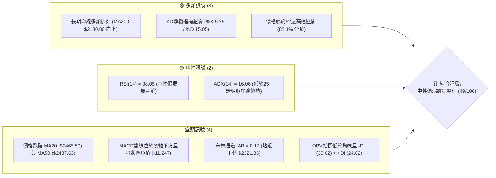
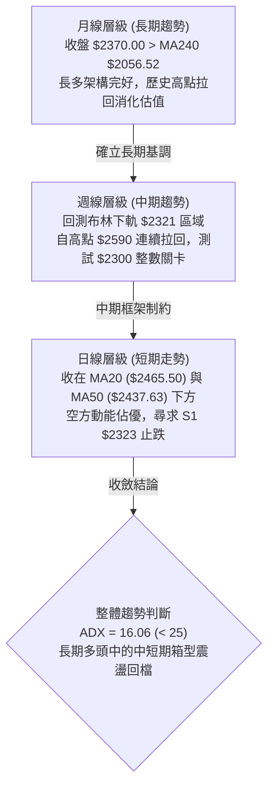
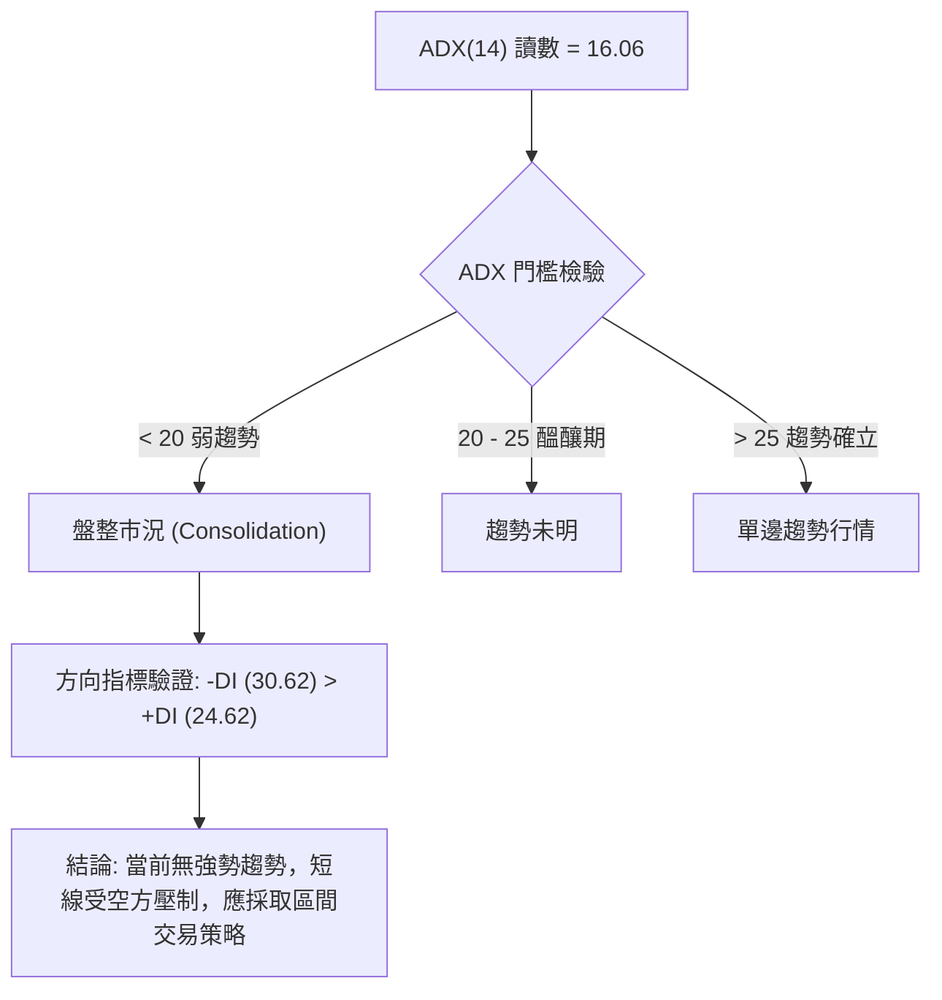
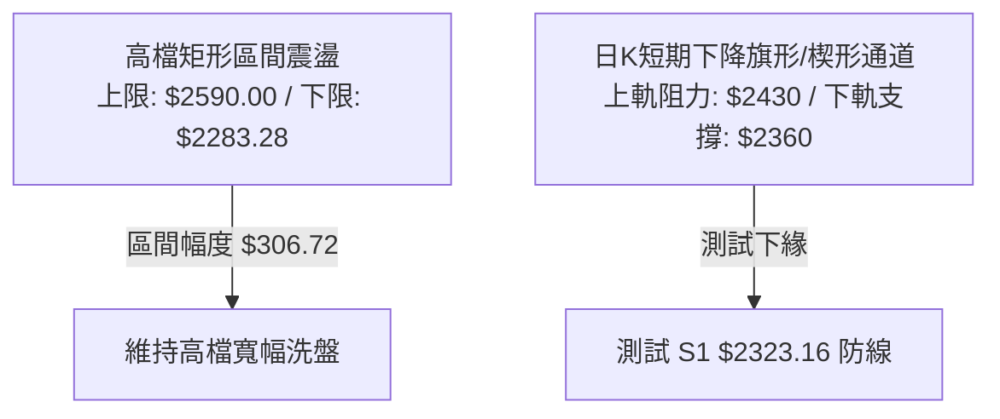
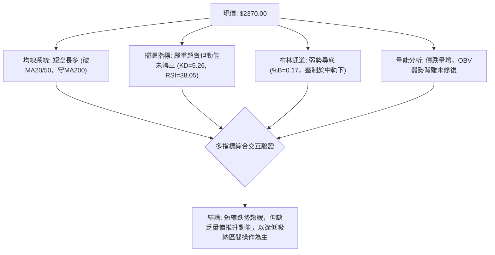
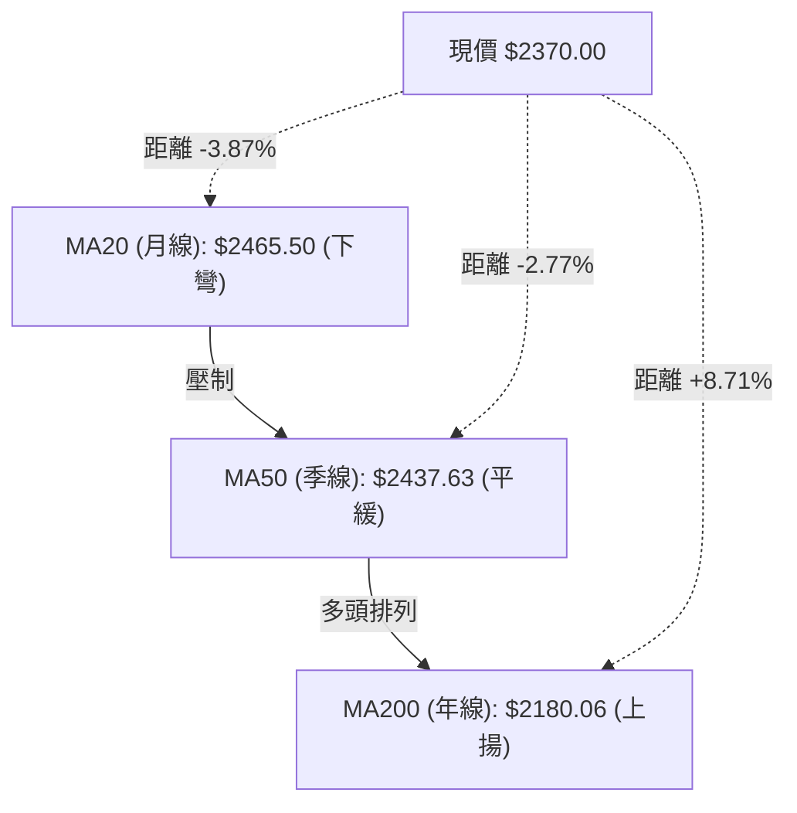
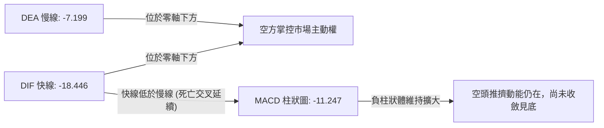
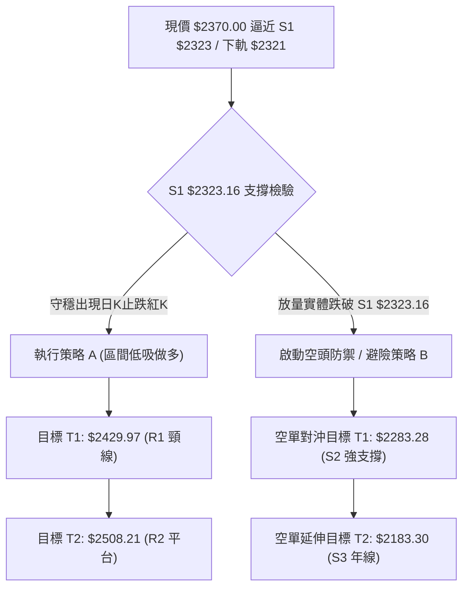
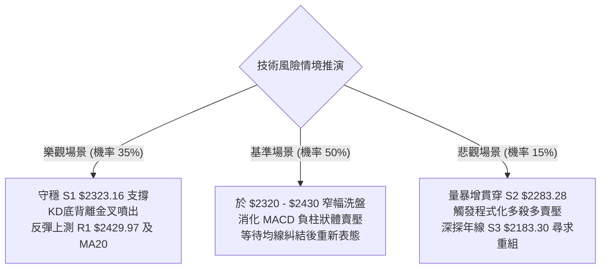

# 2330.TW 技術分析報告

> **報告日期**：2026-11-02 ｜ **語言**：繁體中文 ｜ **數據來源**：Yahoo Finance ｜ **當前價格**：$2370.00 TWD

---

## 目錄

| 章節 | 內容 |
|------|------|
| [1. 技術面概覽](#1-技術面概覽) | 訊號儀表板、核心指標、評分卡 |
| [2. 趨勢分析](#2-趨勢分析) | 多時框趨勢、長中短期走勢、ADX解讀 |
| [3. 圖表形態分析](#3-圖表形態分析) | 形態識別、K線組合、目標價推算 |
| [4. 支撐與阻力](#4-支撐與阻力) | 關鍵價位結構、斐波那契回調分析 |
| [5. 技術指標深度解讀](#5-技術指標深度解讀) | 均線系統、RSI、MACD、布林通道、量價配合 |
| [6. 動能與波動率](#6-動能與波動率) | 動能四象限、ATR波動分析、Beta敏感度 |
| [7. 多時框架總結](#7-多時框架總結) | 時框架矩陣、多時框收斂定論 |
| [8. 交易策略建議](#8-交易策略建議) | 決策路由、情境階梯、主策略詳情、評星 |
| [9. 風險提示與監控](#9-風險提示與監控) | 監控Checklist、風險場景樹、風控法則 |

---

## 1. 技術面概覽

### 🎯 技術訊號儀表板



---

### 📊 核心指標速覽表

| 指標類別 | 指標名稱 | 當前數值 | 訊號 | 解讀 |
|:---|:---|:---|:---:|:---|
| **價格基準** | 當前收盤價 | $2370.00 | 🟡 | 位於52週高低點區間之 82.1%，近期自歷史高點回檔整理 |
| **短期均線** | MA20 (月線) | $2465.50 | 🔴 | 現價在 MA20 下方 -3.87%，短線均線下彎形成動態反壓 |
| **中期均線** | MA50 (季線) | $2437.63 | 🔴 | 現價在 MA50 下方 -2.77%，中期多頭動能受阻，等待重新收復 |
| **長期均線** | MA200 (年線)| $2180.06 | 🟢 | 現價高於 MA200 達 +8.71%，長週期牛市架構依然穩固完整 |
| **動能震盪** | RSI(14) | 38.05 | 🟡 | 位於 30–70 中性弱勢區，未見極端超賣，亦無頂/底背離跡象 |
| **趨勢動能** | MACD (12/26/9)| -18.446 / 柱 -11.247 | 🔴 | DIF 線與訊號線雙雙在零軸下方運行，空方佔據短線主導動能 |
| **擺盪指標** | Stoch %K / %D | 5.26 / 15.05 | 🟢 | 進入 20 以下嚴重超賣區，醞釀技術性跌深反彈動能 |
| **通道位置** | Bollinger %B | 0.17 | 🔴 | 位於下軌 $2321.35 與中軌 $2465.50 間，偏向下軌尋求支撐 |
| **趨勢強度** | ADX(14) | 16.06 | 🟡 | ADX < 25 表示單邊趨勢疲弱，盤面本質為大區間震盪整理 |
| **成交量能** | 當日量 / 20日均量 | 29,664,858 / 22,816,141 | 🔴 | 量比 1.30x，但 OBV < MA，黑K帶量回落顯示短期賣壓尚未出盡 |
| **市場波動** | ATR(14) | $36.57 (1.54%) | 🟡 | 波動度處於中等收斂水位，單日標準價格變動空間約 $36.50 |

---

### 🏆 技術評分卡

```
╔══════════════════════════════════════════════════════════════╗
║             技術評分卡 — 2330.TW (2026-11-02)                ║
╠══════════════════════════════════════════════════════════════╣
║ 趨勢強度 (ADX=16.06, 弱趨勢/震盪)  █████████░░░░░░░ 45/100 🟡 ║
║ 動能指標 (MACD負向, Stoch超賣)     ████████░░░░░░░░ 40/100 🔴 ║
║ 支撐穩定度 (S1 $2323 / S2 $2283)   █████████████░░░ 65/100 🟡 ║
║ 成交量配合 (量比1.3x, OBV偏弱)     ████████░░░░░░░░ 42/100 🔴 ║
║ 形態完整度 (高檔箱型收斂回檔)      ██████████░░░░░░ 50/100 🟡 ║
║ 均線排列 (短空長多, 破MA20/50)     ██████████░░░░░░ 52/100 🟡 ║
╠══════════════════════════════════════════════════════════════╣
║ 綜合評分 (六項子評分算術平均)       ██████████░░░░░░ 49/100 🟡 ║
║ 評級結論：【中性偏弱震盪整理】— 區間操作為宜，嚴控回調風險   ║
╚══════════════════════════════════════════════════════════════╝
```
*(備註：綜合評分 = (45 + 40 + 65 + 42 + 50 + 52) ÷ 6 = 294 ÷ 6 = 49 分，依據規則 18 嚴格執行算術平均計算)*

---

## 2. 趨勢分析

### 🌐 多時框趨勢分析



---

### 📈 長期趨勢 — 12個月走勢圖（Unicode）

依據月度收盤價數據，過去 12 個月（2025-11 至 2026-10）價格由 $1422.55 攀升至 52 週高點 $2590.00，近期回調至 $2370.00：

```
2330.TW 月線走勢圖（過去12個月：2025-11 至 2026-10）
價格軸 (TWD)
$2600 ┤                                              ● 52W高點 ($2590.00)
$2450 ┤                                      ●   ●   │   ●
$2300 ┤                              ●   ●   │   │   │   │   ● ← 現價 ($2370.00)
$2150 ┤                      ●       │   │   │   │   │   │   │
$2000 ┤              ●       │       │   │   │   │   │   │   │
$1850 ┤          ●   │   ●   │       │   │   │   │   │   │   │
$1700 ┤          │   │   │   │       │   │   │   │   │   │   │
$1550 ┤      ●   │   │   │   │       │   │   │   │   │   │   │
$1400 ┤  ●   │   │   │   │   │       │   │   │   │   │   │   │
      └────────────────────────────────────────────────────────
        M11 M12 M01 M02 M03 M04 M05 M06 M07 M08 M09 M10
       2025                    2026
```

#### 走勢特徵分析表格

| 階段區間 | 起訖月份 | 起訖價格 (TWD) | 漲跌幅 | 結構性技術特徵與驅動因素 |
|:---|:---|:---|:---:|:---|
| **主升段初期** | 2025-11 → 2026-02 | $1422.55 → $1977.40 | +39.00% | 均線多頭發散，單邊推升強勢突破 $1500 與 $1800 關卡 |
| **首輪深度回踩**| 2026-02 → 2026-03 | $1977.40 → $1750.17 | -11.49% | 獲利了結賣壓湧現，回測季線支撐確認長多底部結構 |
| **主升段次波** | 2026-03 → 2026-06 | $1750.17 → $2402.93 | +37.30% | 突破 $2000 歷史心理整數大關，形成強烈趨勢動能噴出 |
| **高檔強勢鈍化**| 2026-06 → 2026-08 | $2402.93 → $2397.94 | -0.21% | 進入 $2400 附近高檔盤整，量能收斂，醞釀續攻能量 |
| **衝刺與回檔** | 2026-08 → 2026-10 | $2397.94 → $2370.00 | -1.16% | 2026-09創收盤新高 $2480，10月摸頂 $2590 後帶量拉回至 $2370 |

---

### 📊 中期趨勢（週線分析）

中期技術面目前呈現「高檔衝高未果後的次級回檔波」。自 2026-10-08 當週創下 52 週高點 $2590.00 後，連續三週走低（$2550 → $2420 → $2385 → $2370）：

```
週線級別價格壓力與支撐結構示意圖：
$2590.00 ───────┬─────────────────────────────── [52W 歷史天花板 R3]
                │     ▲ 假突破拉回
$2508.21 ───────┼─────┴────────── [週線震盪上軌 R2]
                │
$2429.97 ───────┼──────────────── [頸線轉折反壓 R1]
                │
$2370.00 ◀──────┴─────────────── [當前收盤價位]
                │
$2323.16 ───────┬──────────────── [近一年低點聚類支撐 S1]
$2283.28 ───────┴──────────────── [前波回檔低點防線 S2]
```

---

### ⚡ 趨勢強度評估（ADX 解讀）



#### ADX 強度量化對照表

| 指標名稱 | 實際數值 | 門檻標準 | 狀態判定 | 技術意涵 |
|:---|:---:|:---:|:---:|:---|
| **ADX (14)** | 16.06 | 25.00 | 弱勢/無單邊趨勢 🟡 | 趨勢動能極弱，嚴禁追漲殺跌，任何破位常屬洗盤震盪 |
| **+DI (多方)** | 24.62 | — | 多頭退守 | 多方主動推升意願薄弱，動能不足以發動逆轉攻擊 |
| **-DI (空方)** | 30.62 | — | 空頭暫居優勢 🔴 | 空方居於微幅主導地位，推動短線向 S1/下軌回測 |
| **DI 差值** | -6.00 | 0.00 | 空方差值擴大 | 尚未達到極端擴散狀態（>-15），跌勢屬於溫和回調 |

---

## 3. 圖表形態分析

### 🔍 形態識別系統



#### 形態識別信心度與目標價評估表

| 圖表形態 | 信心度 (%) | 判斷依據（嚴格引用已知數據） | 形態完成度 | 理論目標價（附精確計算式） |
|:---|:---:|:---|:---:|:---|
| **高檔大型箱型整理** | 75% | 自 2026-07 觸及低點 S2 $2283.28 以來，高點見 R3 $2590.00，價格多次於此區間折返 | 80% | 箱體高度 = $2590.00 - $2283.28 = $306.72。<br/>若下破 S2，目標 = $2283.28 - $306.72 = $1976.56；<br/>若上破 R3，目標 = $2590.00 + $306.72 = $2896.72 |
| **短期微型雙頂回測** | 62% | 10-02 高點 $2515 與 10-08 高點 $2590 形成局部雙頭，頸線位於 R1 $2429.97 | 90% (已跌破頸線) | 形態高度 = $2590.00 - $2429.97 = $160.03。<br/>量度跌幅 = 頸線 $2429.97 - $160.03 = **$2269.94**（逼近 S2 $2283.28） |
| **頭肩底 / 複合底** | 25% | 目前無客觀左肩與頭部結構，數據無法支撐 | 0% | 訊號不足，僅做指標型解讀，不予預測 |

---

### 🕯️ 重要K線形態分析

嚴格依據提供的「近10根日K」與「近8根週K」原始數據進行技術判別：

#### 近10根日K形態精解

| 日期 | 開盤價 | 最高價 | 最低價 | 收盤價 | 成交量 | K線形態識別 | 技術解讀與訊號 |
|:---|:---:|:---:|:---:|:---:|:---:|:---|:---|
| 2026-10-16 | 2430.00 | 2445.00 | 2420.00 | 2420.00 | 33,490,270 | 光腳大黑K (帶長上影) | 長黑灌破短期均線，帶量下殺確立回調波段 🔴 |
| 2026-10-19 | 2395.00 | 2420.00 | 2390.00 | 2420.00 | 23,696,850 | 低檔中紅K (實體收復) | 低檔買盤承接，但未能站上五日線 🟡 |
| 2026-10-20 | 2400.00 | 2415.00 | 2395.00 | 2405.00 | 17,099,557 | 窄幅縮量小黑紡錘線 | 追高意願薄弱，交投降溫進入觀望 🟡 |
| 2026-10-21 | 2425.00 | 2435.00 | 2400.00 | 2420.00 | 22,321,809 | 小黑帶下影線 | 盤中衝高至 $2435 受阻於 R1 壓力 🔴 |
| 2026-10-22 | 2435.00 | 2435.00 | 2385.00 | 2385.00 | 22,930,116 | 光頭光腳大黑K | 開盤即最高、收盤即最低，空頭完全控盤 🔴 |
| 2026-10-23 | 2385.00 | 2385.00 | 2385.00 | 2385.00 | 0 | 一字線 (休市/無成交) | 市場停滯，未提供新流動性方向 🟡 |
| 2026-10-27 | 2380.00 | 2405.00 | 2380.00 | 2400.00 | 33,964,182 | 出量溫和紅K | 伴隨33.9M大量反彈，多頭低檔集結抵抗 🟢 |
| 2026-10-28 | 2420.00 | 2430.00 | 2410.00 | 2425.00 | 19,880,613 | 高開收高小紅K | 再次挑戰 R1 $2430 關卡未果，量能萎縮 🟡 |
| 2026-10-29 | 2420.00 | 2425.00 | 2390.00 | 2415.00 | 16,872,114 | 小陰十字星 (長下影) | 高檔受壓、低檔有撐，多空陷入焦土戰 🟡 |
| 2026-10-30 | 2380.00 | 2380.00 | 2360.00 | 2370.00 | 29,664,858 | 出量倒垂破底黑K | 跳空下行，最低挫至 $2360，賣壓再度擴大 🔴 |

#### 近8根週K形態精解

| 日期 (週結) | 週開盤 | 週最高 | 週最低 | 週收盤 | 週成交量 | 週K線形態 | 技術意義 |
|:---|:---:|:---:|:---:|:---:|:---:|:---|:---|
| 2026-09-11 | 2427.85 | 2497.65 | 2397.94 | 2402.93 | 99,595,927 | 長上影十字陰線 | 逼近 $2500 關卡見主力調節賣壓 🟡 |
| 2026-09-18 | 2378.00 | 2460.00 | 2373.01 | 2460.00 | 101,132,173 | 破底翻大中陽線 | 下探 $2373 獲強力支撐並收復高點 🟢 |
| 2026-09-24 | 2445.00 | 2510.00 | 2445.00 | 2475.00 | 66,944,987 | 穩步上攻中紅K | 成功站上 $2470，奠定衝頂基礎 🟢 |
| 2026-10-02 | 2475.00 | 2515.00 | 2475.00 | 2500.00 | 87,707,137 | 高檔震盪帶上影小陽 | 首次收於 $2500 之上，但推升阻力顯現 🟡 |
| 2026-10-08 | 2550.00 | 2590.00 | 2545.00 | 2550.00 | 77,343,774 | 衝頂長上影流星陰線 | 創 52 週新高 $2590 後大幅回落，天花板確立 🔴 |
| 2026-10-16 | 2510.00 | 2550.00 | 2420.00 | 2420.00 | 160,006,325 | 出量崩跌大長黑K | 爆量1.6億股長黑摜破，確立中期轉向整理 🔴 |
| 2026-10-23 | 2395.00 | 2435.00 | 2385.00 | 2385.00 | 86,048,332 | 縮量陰線續跌 | 跌勢稍歇但毫無反彈動能 🔴 |
| 2026-10-30 | 2380.00 | 2430.00 | 2360.00 | 2370.00 | 100,381,767 | 出量中黑K破新低 | 帶量跌破前週低點 $2385，測試 S1 支撐 🔴 |

---

### 📉 ASCII 走勢形態示意圖

```
2330.TW 日線級別近期走勢結構與頸線位置示意圖：
$2590.00 ┤              ▲ (2026-10-08 52W High 流星線)
         │             ╱ ╲
$2508.21 ┤   ▲       ╱   ╲     (波段高點 R2)
         │  ╱ ╲     ╱     ╲
$2429.97 ┼─┼───▼───┼───────▼───────────────── [頸線反壓 R1]
         │ │     │ │       │
$2370.00 ┤ │     │ │       └───● 現價 ($2370.00)
         │ │     │ │
$2323.16 ┼─┴─────┴─┴──────────────────────── [波段低點防線 S1]
$2283.28 ┴──────────────────────────────────────── [波段強支撐 S2]
```

---

## 4. 支撐與阻力

### 🗺️ 關鍵價位分布圖（Unicode）

```
2330.TW 價位結構分布圖 (Resistance & Support Map)
══════════════════════════════════════════════════════════════════
$2590.00 ║████████████████████████████████║ 強阻力 R3 (52W歷史最高點)
$2508.21 ║████████████████████            ║ 阻力 R2 (波段高點聚類)
$2429.97 ║████████████████████████        ║ 關鍵阻力 R1 (頸線/短線動態壓力)
$2370.00 ╠════════════════════════════════╣ ◄ 當前收盤價 ($2370.00)
$2323.16 ║▓▓▓▓▓▓▓▓▓▓▓▓▓▓▓▓                ║ 近期關鍵支撐 S1 (波段低點聚類)
$2283.28 ║████████████████████████        ║ 強支撐 S2 (7月波段起漲防線)
$2183.30 ║████████████████████████████████║ 核心防線 S3 (接近 MA200 年線)
══════════════════════════════════════════════════════════════════
```

---

### 🚧 阻力位分析表

阻力數值完全引用自已知技術數據中波段高點聚類：

| 阻力級別 | 精確價位 | 距現價空間 | 形成原因與技術意涵 | 突破難度 | 重要性 |
|:---|:---:|:---:|:---|:---:|:---:|
| **R1 (第一阻力)** | $2429.97 | +2.53% | 近一年波段高點聚類，且與 MA60 ($2428.19) 及 MA50 ($2437.63) 重疊形成複合反壓帶 | 🟡 中等 | ★★★★☆ |
| **R2 (第二阻力)** | $2508.21 | +5.83% | 10月初震盪平台高點聚類，$2500 整數心理防線 | 🔴 極高 | ★★★★☆ |
| **R3 (強阻力)** | $2590.00 | +9.28% | 52 週歷史天花板，10-08 週K長上影線頂部，為波段空方防守極限 | 🔴 極難 | ★★★★★ |

---

### 🛡️ 支撐位分析表

支撐數值完全引用自已知技術數據中波段低點聚類：

| 支撐級別 | 精確價位 | 距現價空間 | 形成原因與技術意涵 | 守住機率 | 重要性 |
|:---|:---:|:---:|:---|:---:|:---:|
| **S1 (第一支撐)** | $2323.16 | -1.98% | 近一年波段低點聚類，貼近布林通道下軌 $2321.35，短線第一道防線 | 🟡 65% | ★★★★☆ |
| **S2 (第二支撐)** | $2283.28 | -3.66% | 2026-07-17 週線拉回低點聚類，亦為斐波那契 23.6% ($2299.33) 防守重鎮 | 🟢 78% | ★★★★★ |
| **S3 (強支撐)** | $2183.30 | -7.88% | 近一年深幅波段回檔低點，貼合 MA200 ($2180.06)，為長多牛熊分界線 | 🟢 90% | ★★★★★ |

---

### 📐 斐波那契回調位分析

依據 52 週區間完整回調計算（自 52W Low $1358.34 至 52W High $2590.00，垂直振幅 $1231.66）：

| 回調比例 | 對應價位 (TWD) | 距現價距離 | 技術角色與市場含義解讀 |
|:---|:---:|:---:|:---|
| **0.0% (52W High)**| $2590.00 | +9.28% | 歷史高點天花板，波段牛市極限點 |
| **23.6% 回調** | **$2299.33** | -2.98% | **極強勢回檔極限**：目前現價 ($2370.00) 穩健運行於 23.6% 回調位之上，代表過去一年的大牛市多頭結構在技術上尚未遭受任何實質破壞 |
| **38.2% 回調** | $2119.51 | -10.57% | 標準健康回調位：位於 MA200 ($2180.06) 下方，若觸及代表中期進入深幅修正 |
| **50.0% 回調** | $1974.17 | -16.70% | 多空平衡中樞：整數關卡 $2000 大關保護區 |
| **61.8% 回調** | $1828.84 | -22.83% | 黃金分割防線：牛市生命線，跌破則長期多頭宣告終結 |
| **78.6% 回調** | $1621.92 | -31.56% | 深幅回撤防線 |
| **100.0% (52W Low)**| $1358.34 | -42.69% | 起漲點基石 |

**斐波那契位置結論**：現價 $2370.00 精確座落於 **0.0% ($2590.00) 與 23.6% ($2299.33)** 之間的強勢高檔整理區間。回調幅度連 23.6% 都未跌破，技術上僅屬於大上升趨勢中的正常高檔蓄勢洗盤。

---

## 5. 技術指標深度解讀

### 🎛️ 指標訊號總覽



---

### 📈 移動平均線排列分析



#### 移動平均線數據對照與排列解讀

| 均線名稱 | 數值 (TWD) | 現價與均線差 | 乖離率 (%) | 均線斜率 | 均線信號評價 |
|:---|:---:|:---:|:---:|:---:|:---|
| **MA 5** | $2399.00 | -$29.00 | -1.21% | ▼ 下彎 | 短線極速下殺，五日線構成直接動態下壓 🔴 |
| **MA 10** | $2404.50 | -$34.50 | -1.43% | ▼ 下彎 | 雙週扣高走低，反彈首要減壓關卡 🔴 |
| **MA 20** | $2465.50 | -$95.50 | -3.87% | ▼ 下彎 | 月線下彎，與布林中軌完全重疊，為反轉多頭必須站上之天塹 🔴 |
| **MA 50** | $2437.63 | -$67.63 | -2.77% | ▼ 下彎 | 季線跌破，中期上漲節奏暫時中斷 🔴 |
| **MA 60** | $2428.19 | -$58.19 | -2.40% | ▼ 下彎 | 剛好落在 R1 ($2429.97) 附近，形成強反壓共振 🔴 |
| **MA 120** | $2383.98 | -$13.98 | -0.59% | ▼ 走平 | 半年線位處現價頭頂，極易引發爭奪 🟡 |
| **MA 200** | $2180.06 | +$189.94 | +8.71% | ▲ 上揚 | 年線穩健向上，長線牛市骨架絲毫未損 🟢 |
| **MA 240** | $2056.52 | +$313.48 | +15.24%| ▲ 上揚 | 長期價值中樞，提供深厚長期安全邊際 🟢 |

**排列總結**：整體呈現「長多短空、均線糾結回踩」格局。長週期均線仍維持標準多頭排列（MA20 > MA50 > MA200），但短週期因價格連續下挫，收盤價已落於 MA5、MA10、MA20、MA60 之下，說明短線處於空方主導的修正走勢。

---

### 📉 RSI(14) 分析

*   **當前數值**：**38.05** (Wilder 平滑法計算)
*   **強度可視化進度條**：
    `[超賣 0] ────── [30] ████████░░░░░░░░░░░░░░░░░░░░ [70] ────── [100 超買]` （38.05%）
*   **區間定位**：處於 30–70 中性弱勢區，雖未進入 <30 的絕對超賣區，但已相當接近超賣邊界。
*   **背離檢驗結論**：
    *   價格在 10-16 創低 $2420，隨後 10-30 創低 $2360；
    *   週線級別 RSI 於 10-23 為 38.0，10-30 亦維持在 38.0；
    *   依據最近 20 根 K 棒比對，**無明顯頂背離或底背離**。此現象代表目前的下跌為動能正常釋放，尚未出現空方力竭的底背離反轉訊號。

---

### 📊 MACD(12/26/9) 訊號解讀



*   **技術數據解讀**：
    *   DIF (-18.446) 遠低於訊號線 DEA (-7.199)，兩者均跌入零軸下方，確認當前處於標準的「日線級別空頭修正波」。
    *   MACD 柱狀圖讀數為 **-11.247**，綠柱實體未見明顯收斂，顯示短線賣方拋壓仍在釋放，左側摸底買盤必須提高警覺。

---

### 📦 布林通道分析

```
布林通道當前結構與現價相對位置示意圖 (Bollinger Bands, 20, 2)：
$2609.65 ───────────────────────────── 上軌 (Upper Band)
         │
$2465.50 ───────────────────────────── 中軌 (Middle Band = MA20)
         │
$2370.00 ◀────── [現價 $2370.00，%B = 0.17]
         │
$2321.35 ───────────────────────────── 下軌 (Lower Band)
```

*   **帶寬與軌道數值**：
    *   布林上軌：**$2609.65**
    *   布林中軌 (MA20)：**$2465.50**
    *   布林下軌：**$2321.35**
    *   通道帶寬 (Bandwidth)：($2609.65 - $2321.35) ÷ $2465.50 = **11.69%**（帶寬溫和擴張）
*   **%B 指標深度解讀**：
    *   當前 **%B = 0.17**，意即現價距離布林下軌僅剩 17% 的通道空間，極度貼近下軌支撐。
    *   統計學上，當 %B 跌入 0.20 以下時，股價極易受到軌道約束產生均值回歸反彈；且下軌 $2321.35 與第一支撐 S1 ($2323.16) 高度重合，形成堅實的技術面反彈緩衝網。

---

### 💹 成交量分析（量價配合度）

*   **量能基本數據**：
    *   最新日成交量：**29,664,858 股**
    *   20 日平均成交量：**22,816,141 股**
    *   **量比 (Volume Ratio)**：**1.30x**（放量 30%）
*   **量價關係檢視**：
    *   10-30 當日收跌 -1.86%（開 $2380，收 $2370，最低 $2360），但成交量自前一日的 16.8M 急劇放大至 29.6M。
    *   **價跌量增**：顯示在回測 $2360 關卡時，有特定停損賣壓湧出，但亦有低檔承接買盤進場換手。
*   **能量潮 OBV 走勢**：
    *   目前呈現 **OBV < MA**，代表資金在過去一個月中持續呈現淨流出。
    *   在 OBV 尚未有效向上穿越其均線前，成交量的放大仍需審慎視為「被動拋壓」而非「主動攻擊籌碼」。

---

## 6. 動能與波動率

### ⚡ 動能評估四象限

```
動能與波動率二維評估矩陣：
       高波動率 (High Volatility)
                 │
       Q3 (高危) │ Q4 (突破追價)
                 │
─────────────────┼─────────────────
                 │
       Q2 (謹慎) │ Q1 (低吸蓄勢)
    [★ 當前位置] │
                 │
       低波動率 (Low Volatility)
  弱動能 ◄───────┴───────► 強動能
```

#### 動能狀態定位分析

| 象限分區 | 動能特性 | 波動特性 | 當前匹配度 | 戰略應對方針 |
|:---|:---:|:---:|:---:|:---|
| **Q1 (最佳低吸)** | 強動能 (多頭) | 低波動 (蓄勢) | — | 趨勢初升段，全力加碼順勢做多 |
| **Q2 (震盪沉澱)** | **弱動能 (空頭/整理)** | **低/中波動 (收斂)** | **✓ (極度符合)** | **謹慎觀望、嚴禁追價，利用支撐進行高拋低吸** |
| **Q3 (破位風險)** | 弱動能 (空頭) | 高波動 (恐慌) | — | 停損離場，嚴防雪崩式多殺多 |
| **Q4 (強勢爆發)** | 強動能 (多頭) | 高波動 (噴出) | — | 主升浪行情，抱牢持股移動止盈 |

---

### 📊 ATR 波動率分析

*   **ATR(14) 數值**：**$36.57 TWD**
*   **價格相對波動率**：$36.57 ÷ $2370.00 = **1.54%**
*   **止損與動態波幅設定指南**：
    *   **保守型交易者止損距離 (2.0 × ATR)**：2.0 × $36.57 = **$73.14**
    *   **積極型短線客止損距離 (1.5 × ATR)**：1.5 × $36.57 = **$54.86**
    *   **當前單日合理震盪空間**：[$2370 - $36.57, $2370 + $36.57] = **[$2333.43, $2406.57]**，此區間與當前近幾日實際走勢高度吻合。

---

### 📐 Beta 與市場相關性

*   **Beta 係數**：**1.239**（相較於加權指數展現較高的系統性彈性）
*   **市場敏感度解讀**：
    *   作為台股權重核心，Beta 達 1.239 代表當大盤上漲 1% 時，2330.TW 理論上揚 1.24%；反之大盤回檔 1% 時，其回調幅度達 1.24%。
    *   高 Beta 屬性意味著目前技術面回測受大盤資金外流及外資提款影響較深，待大盤止跌時，其反彈爆發力亦將高於市場平均。

---

## 7. 多時框架總結

### 📋 時框架評分表

| 時框架 | 趨勢方向 | 動能狀態 | 均線排列狀況 | 圖表形態特徵 | 綜合評分 | 戰略操作建議 |
|:---|:---:|:---:|:---|:---|:---:|:---|
| **日線層級 (短期)** | 偏空 🔴 | 弱勢超賣 (RSI 38.05) | 空頭排列 (破 MA20/MA50) | 下降通道測底，逼近 S1 | 38/100 | 短線切忌追空，等待 S1 止跌信號 |
| **週線層級 (中期)** | 震盪 🟡 | 中性沉澱 (MACD柱走平) | 糾結整理 (回測 MA10/20) | 衝頂 $2590 後高檔大箱型 | 55/100 | 區間下限逢低分批布局 |
| **月線層級 (長期)** | 多頭 🟢 | 強勢牛市 (遠高於年線) | 多頭排列 (MA20>50>200) | 大上升趨勢中的強勢回調 | 85/100 | 堅定中長多思維，把握拉回機會 |

---

### 🔲 綜合訊號矩陣

```
時框交叉驗證矩陣表：
┌───────────┬───────────────┬───────────────┬───────────────┐
│ 分析維度  │ 日線 (短期)   │ 週線 (中期)   │ 月線 (長期)   │
├───────────┼───────────────┼───────────────┼───────────────┤
│ 均線方向  │ 🔴 向下壓制   │ 🟡 走平糾結   │ 🟢 向上發散   │
│ 指標動能  │ 🔴 DIF轉負    │ 🟡 柱體收縮   │ 🟢 處於強勢區 │
│ 量價結構  │ 🔴 跌增漲縮   │ 🟡 正常換手   │ 🟢 溫和增量   │
│ 支撐防守  │ 🟡 考驗 S1    │ 🟢 守穩 23.6% │ 🟢 遠離 MA200 │
└───────────┴───────────────┴───────────────┴───────────────┘
```

---

### ⚖️ 多時框收斂結論

嚴格依據**規則 14（多時框收斂優先級規則）**進行邏輯閉環收斂：
1.  **趨勢強度檢驗**：日線 ADX(14) 讀數為 **16.06**，明顯低於 25 的趨勢行情門檻。依規則，市場當前屬於**典型的「盤整行情（ADX < 25）」**，不可使用單邊突破或趨勢跟隨模型。
2.  **主導時框判定**：在盤整行情中，**以日線布林通道上下軌（$2321.35 ～ $2609.65）為主要交易區間**，並受制於波段關鍵支撐 S1 ($2323.16) 與阻力 R1 ($2429.97)。
3.  **衝突取捨裁決**：日線雖然短線破線偏空，但受到長期均線牛市架構保護，且價格已殺至布林下軌極端值（%B = 0.17）與超賣區（KD < 20）。
4.  **唯一方向性結論**：**【中性觀望，區間下緣低吸】**。短線空方動能已至強弩之末，嚴禁在下軌處盲目殺跌；整體策略必須圍繞「箱型下軌守穩做反彈、上軌受阻做減碼」開展，完全符合第 1 章評分卡 49/100 的中性評級。

---

## 8. 交易策略建議

### 🗺️ 策略決策流程圖



---

### 🧭 策略路由（依評分卡分流）

> **當前主策略方向 = 【中性區間操作，布林下軌低吸】（依據綜合評分 49/100）**
> *由於綜合評分落於 40–60 分的中性震盪區間，主策略不單邊押注突破，而以布林通道下軌（$2321.35）至第一支撐 S1（$2323.16）間之止跌訊號為主，嚴格執行區間波段低買高賣。*

---

### 🎯 價格情境階梯（Price Scenarios）

價位嚴格引用自第 4 章波段計算點位：

| 觸發條件 | 下一目標點位 | 後續延伸目標 | 技術情境含義解讀 |
|:---|:---:|:---:|:---|
| **強勢突破 R1 $2429.97** | R2 $2508.21 | R3 $2590.00 | 短線空頭結構扭轉，收復季線，重啟對歷史高點的挑戰 |
| **站穩現價 $2370 區間** | R1 $2429.97 | — | 於布林下半部進行時間換空間之橫向築底震盪 |
| **放量跌破 S1 $2323.16** | S2 $2283.28 | S3 $2183.30 | 中期回調擴大，下探斐波那契 23.6% 防線與 MA200 年線 |

---

### 📊 情境機率分佈

| 情境劃分 | 機率預估 | 主要技術指標依據 |
|:---|:---:|:---|
| **區間下緣築底反彈** | **50%** | KD 嚴重超賣 (%K 5.26)、%B = 0.17 逼近下軌、S1 聚類支撐強勁 |
| **窄幅區間橫向震盪** | **35%** | ADX = 16.06 無單邊趨勢、量能萎縮觀望、均線糾結 |
| **向下破位深幅探底** | **15%** | MACD 柱狀圖負值、OBV 偏弱、-DI (30.62) 主導市場 |

---

### 🟢 主策略詳情

依據規則 17，所有數值嚴格鎖定於已知關鍵價位，進場價取區間中點計算：

| 策略要素 | 策略 A：區間下軌逢低吸納多單（主推） | 策略 B：突破頸線順勢追擊多單（右側） |
|:---|:---|:---|
| **進場條件** | 股價回踩 S1 ($2323.16) 至下軌 ($2321.35) 見止跌紅K | 帶量突破並收復 R1 關鍵頸線 ($2429.97) |
| **進場價格** | **$2325.00**（S1/下軌重疊支撐區間中點） | **$2435.00**（突破 R1 確立後進場點） |
| **目標價 T1** | **$2429.97**（精確對應阻力位 R1） | **$2508.21**（精確對應阻力位 R2） |
| **目標價 T2** | **$2508.21**（精確對應阻力位 R2） | **$2590.00**（精確對應阻力位 R3 / 52W高點）|
| **止損價格** | **$2275.00**（跌破 S2 $2283.28 支撐防線） | **$2395.00**（跌回 MA5 / 前日高點下方） |
| **風險報酬比** | **1 : 2.10（以 T1 計）**<br>*(計算式: ($2429.97 - $2325.00) ÷ ($2325.00 - $2275.00) = $104.97 ÷ $50.00 = 2.10)* | **1 : 1.83（以 T1 計）**<br>*(計算式: ($2508.21 - $2435.00) ÷ ($2435.00 - $2395.00) = $73.21 ÷ $40.00 = 1.83)* |
| **T2 風險報酬比**| 1 : 3.66（以 T2 計，($2508.21 - $2325) ÷ 50 = 3.66） | 1 : 3.88（以 T2 計，($2590.00 - $2435) ÷ 40 = 3.88） |
| **成功機率** | 65% | 55% |
| **建議倉位** | 20% - 25% | 15% - 20% |

---

### 🔴 反向風險觸發點（對沖提示）

為防止非預期黑天鵝破位，設定以下反向風控觸發條件：
*   **空頭防禦觸發點**：若日K線收盤價**實體跌破 S1 $2323.16**，且成交量放大超過 20 日均量 1.5 倍，主策略多單必須無條件離場。
*   **對沖空單進場點**：空方激進者可於跌破 $2320 時建立小額避險部位，停損設在 $2360（下軌內側），第一對沖目標看 **S2 $2283.28**，極限對沖目標看 **S3 $2183.30**。

---

### ⭐ 整體訊號強度評星

```
做多訊號強度：★★★☆☆  (3/5 星 — 超賣醞釀反彈，但受制於均線反壓)
做空訊號強度：★★☆☆☆  (2/5 星 — 空間受限於 S1/S2 重疊支撐，殺跌性價比差)
整體可信度：  ★★★★☆  (4/5 星 — ADX 弱趨勢與布林下軌邊界信號高度收斂)
```

---

## 9. 風險提示與監控

### ✅ 關鍵監控指標 Checklist

```
╔══════════════════════════════════════════════════════════════╗
║               2330.TW 交易部位每日監控清單                   ║
╠══════════════════════════════════════════════════════════════╣
║ [ ] 價格是否跌破 S1 第一支撐點位 $2323.16                     ║
║ [ ] RSI(14) 是否跌破 30 進入極端恐慌超賣區                   ║
║ [ ] MACD 柱狀圖是否開始收斂（讀數大於 -11.247）              ║
║ [ ] 日成交量是否在反彈時放大超越 20日均量 (22.8M)             ║
║ [ ] 盤中價格是否重新站上 MA5 ($2399.00) 突破短空降壓線        ║
║ [ ] 跌破 S2 ($2283.28) 是否果斷觸發多單全面停損               ║
╚══════════════════════════════════════════════════════════════╝
```

---

### ⚠️ 風險場景分析



---

### 🛡️ 風險管理重要提醒

1.  **單筆交易虧損上限**：任何單一交易帳戶對 2330.TW 之止損金額，嚴禁超過總資產淨值的 **1.5% - 2.0%**。
2.  **ATR 波動頭寸調整**：因當前 ATR 高達 $36.57，持股波動度顯著，嚴禁在 $2370.00 現價至 S1 之間建立超過 30% 以上之高槓桿或融資部位。
3.  **黑天鵝防範**：若大盤出現系統性崩跌導致直接跳空跌破 S2 $2283.28，切勿於第一時間加碼攤平，必須等待至少 2 根日K線站穩且不再破底後方可重新介入。

---

## 📋 報告總結

```
╔══════════════════════════════════════════════════════════════╗
║               2330.TW 技術分析報告總結                        ║
╠══════════════════════════════════════════════════════════════╣
║ 報告日期：2026-11-02                                         ║
║ 當前價格：$2370.00 TWD                                        ║
║ 分析評級：⚖️ 中性偏弱震盪整理 (綜合評分: 49/100)               ║
║                                                              ║
║ 關鍵結論：                                                   ║
║ ├─ 長期趨勢：🟢 完好多頭 (高於年線 MA200 $2180.06 達 8.71%)   ║
║ ├─ 中期趨勢：🟡 箱型整理 (受阻於 R3 $2590，測試 S2 $2283)     ║
║ ├─ 短期趨勢：🔴 偏空回調 (跌破 MA20 $2465.50，空方動能主導)   ║
║ ├─ 關鍵支撐：S1 $2323.16 / S2 $2283.28 / S3 $2183.30          ║
║ ├─ 關鍵阻力：R1 $2429.97 / R2 $2508.21 / R3 $2590.00          ║
║ └─ 分析師目標：均價 $3394.71 (區間 $2700.00 - $5000.00)       ║
║                                                              ║
║ 最優策略組合：                                               ║
║ 1. 🥇 最佳機會：於 S1 ($2323.16) 至下軌處低吸，看 R1 反彈    ║
║    (進場 $2325 / 停損 $2275 / 目標 $2430，風報比 1 : 2.10)   ║
║ 2. 🥈 次選機會：突破頸線 R1 ($2429.97) 後順勢追擊至 R2      ║
║    (進場 $2435 / 停損 $2395 / 目標 $2508，風報比 1 : 1.83)   ║
║ 3. 🥉 保守選擇：空手觀望，靜待日線 MACD 翻紅金叉後再行布局    ║
╚══════════════════════════════════════════════════════════════╝
```

---

> ⚠️ **免責聲明**：本報告由資深技術分析研究模型自動整合生成，所有提及之數據、統計指標、價位與圖表均依據客觀歷史交易數據客觀計算。本報告**僅供學術研究、量化驗證與投資參考**，**絕不構成任何形式的要約、招攬或投資買賣建議**。金融市場瞬息萬變，技術指標存在時間滯後與失靈之固有風險，投資人應獨立審慎評估，自負投資盈虧風險。

---
*報告生成時間：2026-11-02 ｜ 數據來源：Yahoo Finance ｜ 分析框架：多時框架量化技術分析*