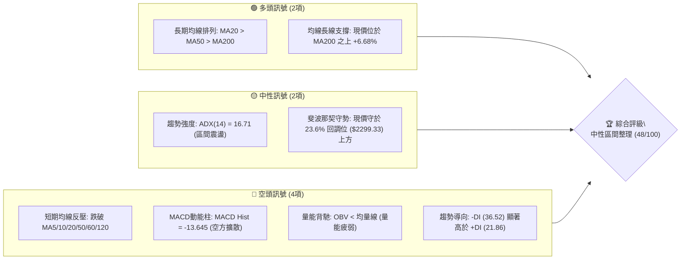
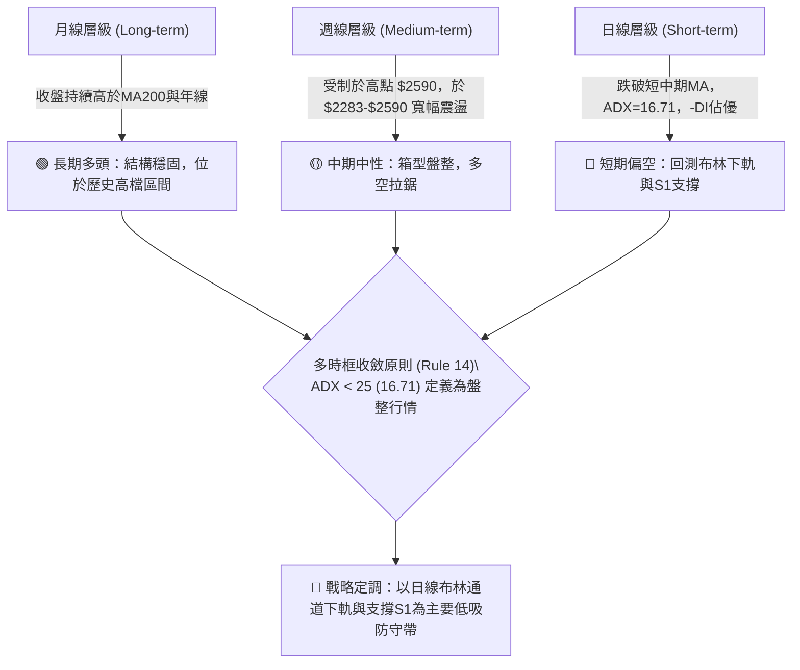
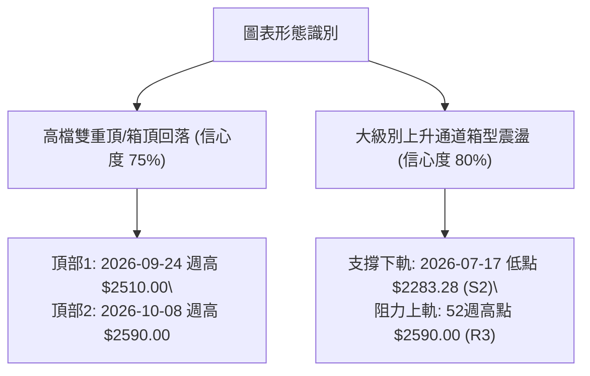
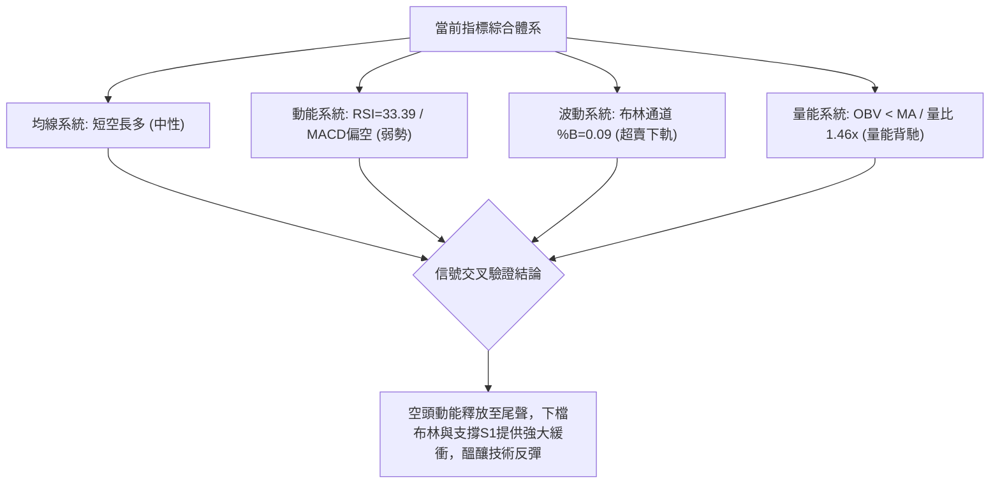
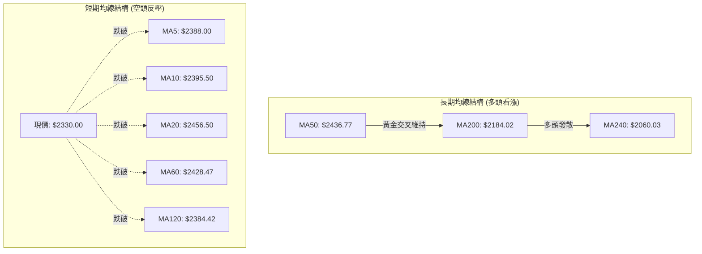
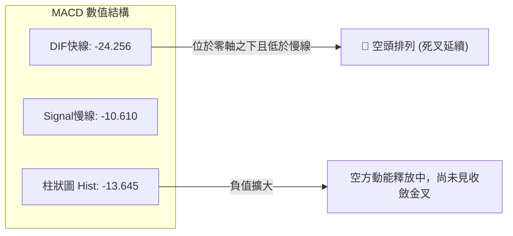
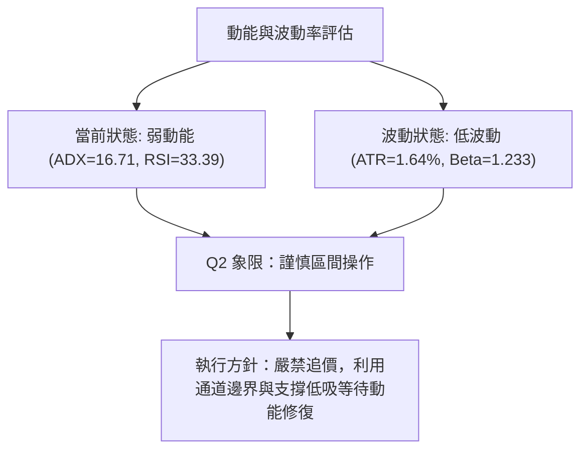
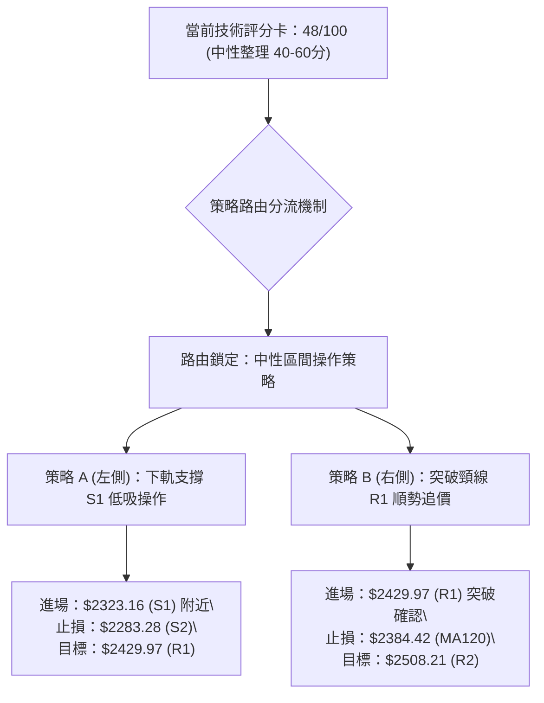
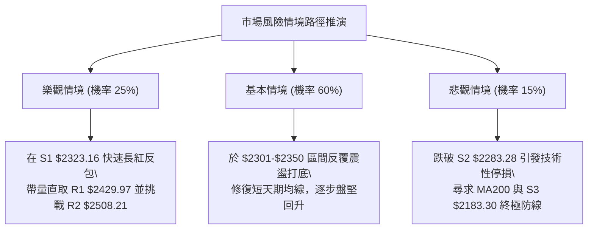

# 2330.TW 技術分析報告

> **報告日期**：2026-11-03 ｜ **語言**：繁體中文 ｜ **數據來源**：Yahoo Finance ｜ **當前價格**：$2330.00 TWD

---

## 目錄

| 章節 | 內容 |
|------|------|
| [1. 技術面概覽](#1-技術面概覽) | 訊號儀表板、核心指標、評分卡 |
| [2. 趨勢分析](#2-趨勢分析) | 多時框趨勢、長中短期走勢、ADX解讀 |
| [3. 圖表形態分析](#3-圖表形態分析) | 形態識別、K線組合、目標價推算 |
| [4. 支撐與阻力](#4-支撐與阻力) | 關鍵價位、斐波那契回調結構 |
| [5. 技術指標深度解讀](#5-技術指標深度解讀) | 均線、RSI、MACD、布林通道、成交量 |
| [6. 動能與波動率](#6-動能與波動率) | 動能評估四象限、ATR、Beta敏感度 |
| [7. 多時框架總結](#7-多時框架總結) | 時框架矩陣、多時框收斂結論 |
| [8. 交易策略建議](#8-交易策略建議) | 策略路由、主策略、情境階梯與風報比 |
| [9. 風險提示與監控](#9-風險提示與監控) | 監控清單、風險情境、資金管理 |

---

## 1. 技術面概覽

### 🎯 技術訊號儀表板

依據當前技術指標的訊號分布，2330.TW 呈現「長期多頭格局未變、中短期動能修正與震盪築底」的交雜狀態。以下展示各項核心指標之多空分布：



---

### 📊 核心指標速覽表

| 指標類別 | 指標名稱 | 當前數值 | 訊號 | 解讀 |
|----------|----------|----------|------|------|
| **價格** | 當前價格 | $2330.00 | 🟡 | 位於52週區間78.9%處，高檔拉回測試下軌支撐 |
| **均線** | MA20 | $2456.50 | 🔴 | 價格低於MA20達 -5.15%，短中期下行壓力沉重 |
| **均線** | MA50 | $2436.77 | 🔴 | 價格低於MA50達 -4.38%，中期生命線失守轉為阻力 |
| **均線** | MA200 | $2184.02 | 🟢 | 價格高於MA200達 +6.68%，長期多頭牛熊線穩固 |
| **動能** | RSI(14) | 33.39 | 🟡 | 逼近超賣門檻(30)，短線下行動能衰竭但尚未反轉 |
| **動能** | MACD(12,26,9) | -24.256 | 🔴 | DIF低於信號線(-10.610)，柱狀體擴散至-13.645，偏空 |
| **動能** | Stoch %K/%D | 8.89 / 10.70 | 🟢 | 進入極度超賣區間 (<15)，存在技術性反彈契機 |
| **通道** | 布林通道 %B | 0.09 | 🟡 | 逼近下軌($2301.95)，顯示下行空間受限，具下檔支撐 |
| **波動** | ATR(14) | $38.24 | 🟢 | 波動率僅 1.64%，市場處於低波動沉澱期，無恐慌崩跌 |

---

### 🏆 技術評分卡

各項子維度均依量化指標與數據嚴格打分，依規則 18，綜合評分為六項子評分之**算術平均值**（四捨五入至整數）：

```
╔══════════════════════════════════════════════════════════════════╗
║                技術評分卡 — 2330.TW (2026-11-03)                 ║
╠══════════════════════════════════════════════════════════════════╣
║ 趨勢強度 (Trend)     █████████░░░░░░░░░░░  45/100  🟡 弱勢盤整   ║
║ 動能指標 (Momentum)  ███████░░░░░░░░░░░░░  35/100  🔴 空方主導   ║
║ 支撐穩定度 (Support) █████████████░░░░░░░  65/100  🟡 下軌支撐群 ║
║ 成交量配合 (Volume)  ████████░░░░░░░░░░░░  40/100  🔴 量能疲弱   ║
║ 形態完整度 (Pattern) ██████████░░░░░░░░░░  50/100  🟡 區間箱型   ║
║ 均線排列 (MAs)       ███████████░░░░░░░░░  55/100  🟡 長多短空   ║
╠══════════════════════════════════════════════════════════════════╣
║ 綜合評分             ██████████░░░░░░░░░░  48/100  中性整理      ║
║ 評分公式計算：(45 + 35 + 65 + 40 + 50 + 55) ÷ 6 = 48.33 → 48/100 ║
╚══════════════════════════════════════════════════════════════════╝
```

---

## 2. 趨勢分析

### 🌐 多時框趨勢分析

多時框架分析顯示出明顯的層級分歧：月線格局為長期結構性牛市；週線呈現高檔橫向箱型構築；日線則陷入連續回檔的短線空頭走勢。



---

### 📈 長期趨勢 — 12個月走勢圖（Unicode）

依據月度收盤價數據，繪製過去 12 個月（2025-11 至 2026-11）的價格軌跡圖：

```
2330.TW 月線走勢圖（過去12個月：2025-11 至 2026-11）
價格 ($)
$2500 ┤                                          ● 2480.00
$2400 ┤                                    ●     │     ● 2370.00
$2300 ┤                             ● 2341.84    │     │     ● 2330.00 (現價)
$2100 ┤                       ● 2123.07          │     │
$1900 ┤           ● 1977.40   │                  │     │
$1700 ┤     ●     │     ● 1750.17                │     │
$1500 ┤● 1536.33  │                              │     │
$1400 ┤● 1422.55 (2025-11起點)                  │     │
      └────────────────────────────────────────────────────────
       11    12    01    02    03    04    05    06-08 09    10    11 (月份)
       (2025)     (2026年)                                     (當前)
```

#### 走勢特徵分析表格

| 階段區間 | 起訖月份 | 收盤價變化 | 漲跌幅 | 走勢結構與技術特徵 |
|----------|----------|------------|--------|--------------------|
| 主升起漲段 | 2025-11 → 2026-02 | $1422.55 → $1977.40 | +39.00% | 月K連三紅，量價齊揚，突破各期均線壓力 |
| 劇烈回洗段 | 2026-02 → 2026-03 | $1977.40 → $1750.17 | -11.49% | 高檔獲利回吐，回測突破點確認多頭支撐 |
| 延伸推升段 | 2026-03 → 2026-06 | $1750.17 → $2402.93 | +37.30% | 創歷史新高，均線全面多頭排列發散 |
| 高檔高原期 | 2026-06 → 2026-09 | $2402.93 → $2480.00 | +3.21%  | 漲勢放緩，形成 $2400-$2590 之歷史高檔震盪箱型 |
| 修正整理段 | 2026-09 → 2026-11 | $2480.00 → $2330.00 | -6.05%  | 跌破月線短均，向布林下軌尋求買盤支撐 |

---

### 📊 中期趨勢（週線分析）

從近 20 週收盤走勢可見，價格於 2026-07-17 創下波段低點 $2283.28（即目前關鍵支撐 S2），隨後震盪走高至 2026-10-08 創下歷史高點 $2590.00（收盤 $2550.00）。隨後四週連續收黑（$2550.00 → $2420.00 → $2385.00 → $2370.00 → $2330.00），週 MACD 柱狀體由 +10.055 翻黑並擴大至 -13.645，顯示週線級別的中期修正仍在持續，目前正回測前波起漲箱型下緣。

```
週線關鍵壓力與支撐示意圖：
╔═════════════════════════════════════════════════════════════════╗
║ $2590.00 ── 歷史高點 / 52週高點 (R3) ──【強大中期天花板】      ║
║   ▲                                                             ║
║   │  週線拉回修正波 (連續 4 週陰線回檔)                         ║
║   ▼                                                             ║
║ $2429.97 ── 週線頸線反壓 / R1 ────────────────────────────────  ║
║ $2330.00 ── 當前收盤價 ◄◄◄ 現正測試下方密集支撐帶               ║
║ $2323.16 ── 近一年波段低點支撐 (S1) ──────────────────────────  ║
║ $2301.95 ── 日線布林下軌 / 斐波那契 23.6% ($2299.33) ────────  ║
║ $2283.28 ── 2026-07-17 週線低點聚類 (S2) ──【多頭最後防線】     ║
╚═════════════════════════════════════════════════════════════════╝
```

---

### ⚡ 趨勢強度評估（ADX 解讀）

當前技術系統中，ADX(14) 數值為 **16.71**。依照技術分析量化準則：

```mermaid
graph LR
    A["ADX(14) = 16.71"] --> B{"ADX 門檻檢驗\\n(< 25 or > 25)"}
    B -->|"< 25 (弱趨勢/盤整)| C["判斷：市場處於【無趨勢震盪行情】"]
    C --> D["方向指標分析：-DI (36.52) > +DI (21.86)"]
    D --> E["含義：雖然空方相對佔優，但無足夠趨勢動能引發單邊暴跌"]
    E --> F["交易指導：禁止盲目追空，應以【布林通道上下軌】進行區間擺盪交易"]
```

#### ADX 強度量化對照表

| ADX 區間 | 趨勢特徵 | 當前狀態判定 | 操作指導方針 |
|----------|----------|--------------|--------------|
| 0 – 20 | 無趨勢 / 極度沉寂 | **16.71（處於此區間）** | **價格處於寬幅區間震盪，依賴支撐阻力做高拋低吸** |
| 20 – 25 | 弱趨勢 / 醞釀期 | 否 | 觀望突破信號，不宜重倉追單 |
| 25 – 40 | 明確強趨勢 | 否 | 順應主趨勢單邊操作，忽視超買超賣 |
| 40 – 60 | 極強單邊爆發 | 否 | 緊握主趨勢利潤，嚴防動能耗竭反轉 |

---

## 3. 圖表形態分析

### 🔍 形態識別系統

根據近數月的日K與週K走勢，嚴格依據幾何結構與數據規則進行識別。本報告識別出兩個關鍵形態，其餘因數據不足不予臆測：



#### 形態信心度與目標價評估表

| 形態名稱 | 信心度 | 判斷依據（嚴格引用數據） | 完成度 | 形態目標價（附精確計算式） |
|----------|--------|--------------------------|--------|----------------------------|
| **高檔雙重頂/箱型回落** | 75% | 兩次衝高受阻於 $2510.00 與 $2590.00，跌破頸線 R1 $2429.97 | 85% | 跌破頸線後下測量度幅度：<br>頸線 $2429.97 − (高點 $2590.00 − 頸線 $2429.97) = $2269.94。<br>（接近關鍵支撐 S2 $2283.28） |
| **寬幅上升箱型整理** | 80% | 歷史低點至高點（$1358.34 → $2590.00）後，價格落於 S2 $2283.28 與 R3 $2590.00 之間震盪 | 70% | 箱體底部支撐目標：$2283.28 (S2)。<br>箱體回彈目標：$2590.00 (R3)。 |
| **頭肩底 / 旗形** | <30% | 數據中未偵測到相應對稱肩部或旗桿結構 | 0% | 訊號不足，僅做指標型解讀（規則 15） |

---

### 🕯️ 重要K線形態分析

嚴格依照規則 19，僅使用數據中提供的「近10根日K」與「近8根週K」之實際 OHLC 價格進行形態解讀：

#### 近 10 根日 K 線形態解讀表

| 日期（日K） | 開盤價 | 最高價 | 最低價 | 收盤價 | K線形態名稱 | 技術解讀 | 訊號 |
|-------------|--------|--------|--------|--------|-------------|----------|------|
| 2026-10-19 | 2395.00 | 2420.00 | 2390.00 | 2420.00 | 溫和中陽線 | 實體由下向上推進，受制於MA20 | 🟢 |
| 2026-10-20 | 2400.00 | 2415.00 | 2395.00 | 2405.00 | 窄幅小紅星 | 高檔追價意願不足，量能萎縮 | 🟡 |
| 2026-10-21 | 2425.00 | 2435.00 | 2400.00 | 2420.00 | 衝高回落十字線 | 盤中上衝 $2435 未果，留下影線 | 🟡 |
| 2026-10-22 | 2435.00 | 2435.00 | 2385.00 | 2385.00 | 光頭大黑K | 開盤即最高，重挫收在當日最低，空方重擊 | 🔴 |
| 2026-10-23 | 2385.00 | 2385.00 | 2385.00 | 2385.00 | 一字線（無交易） | 成交量為 0，市場暫停流動性沉澱 | 🟡 |
| 2026-10-27 | 2380.00 | 2405.00 | 2380.00 | 2400.00 | 帶量小陽線 | 量增至 33,964,182 股，低檔有護盤買盤 | 🟢 |
| 2026-10-28 | 2420.00 | 2430.00 | 2410.00 | 2425.00 | 跳空高開陽線 | 短暫突破反彈，但受制於 50日均線反壓 | 🟢 |
| 2026-10-29 | 2420.00 | 2425.00 | 2390.00 | 2415.00 | 弱勢小陰線 | 高點不過前高，買盤後繼乏力 | 🔴 |
| 2026-10-30 | 2380.00 | 2380.00 | 2360.00 | 2370.00 | 跳空下行陰線 | 開盤向下跳空，跌破短期整理平台 | 🔴 |
| 2026-11-02 | 2310.00 | 2345.00 | 2310.00 | 2330.00 | 低檔長紅反彈K | 開低走高收帶下影紅棒，測試布林下軌回彈 | 🟢 |

#### 近 8 根週 K 線形態解讀表

| 日期（週K） | 開盤價 | 最高價 | 最低價 | 收盤價 | K線形態名稱 | 技術解讀 | 訊號 |
|-------------|--------|--------|--------|--------|-------------|----------|------|
| 2026-09-18 | 2378.00 | 2460.00 | 2373.01 | 2460.00 | 長紅突破週K | 強勢突破整理平台，多頭主升 | 🟢 |
| 2026-09-24 | 2445.00 | 2510.00 | 2445.00 | 2475.00 | 衝高小陽棒 | 突破 $2500 關卡，多頭延續 | 🟢 |
| 2026-10-02 | 2475.00 | 2515.00 | 2475.00 | 2500.00 | 橫盤孕線 | 高檔出現猶豫，漲勢動能趨緩 | 🟡 |
| 2026-10-08 | 2550.00 | 2590.00 | 2545.00 | 2550.00 | 創高避雷針陰線 | 衝刺 $2590 創52週新高後留長上影線 | 🔴 |
| 2026-10-16 | 2510.00 | 2550.00 | 2420.00 | 2420.00 | 爆量長黑吞噬 | 巨量（1.6億股）重挫跌破頸線，頂部確立 | 🔴 |
| 2026-10-23 | 2395.00 | 2435.00 | 2385.00 | 2385.00 | 下跌中繼中黑K | 弱勢反彈無力，收在當週最低 | 🔴 |
| 2026-10-30 | 2380.00 | 2430.00 | 2360.00 | 2370.00 | 下影小陰線 | 測試 $2360 支撐，多空拉鋸 | 🟡 |
| 2026-11-02 | 2310.00 | 2345.00 | 2310.00 | 2330.00 | 低檔下影紅K | 開盤打至 $2310（逼近布林下軌）收回 $2330 | 🟢 |

---

### 📉 ASCII 走勢形態示意圖

展示當前日K線回測下軌之微觀結構與關鍵阻力支撐位：

```
2330.TW 日線級別形態結構示意圖
$2590.00 ─────── 52W頂點 (2026-10-08) 
                  ╭╮
                 ╭╯╰╮
$2456.50 ───────│───│─── [MA20 / 布林中軌反壓]
                │   ╰╮        ╭╮
$2429.97 ───────│────╰╮──────╭╯╰╮ 頸線阻力 R1
                │      ╰╮    ╭╯   ╰╮
$2330.00 ───────│───────╰───│────● 當前收盤價 ($2330.00)
$2323.16 ───────│───────────│─── 波段低點支撐 S1
$2301.95 ───────│───────────╰─ 布林通道下軌 / 斐波 23.6% ($2299.33)
$2283.28 ───────┴────────────── 2026-07-17 週低點支撐 S2 (箱體底)
```

---

## 4. 支撐與阻力

### 🗺️ 關鍵價位分布圖（Unicode）

本圖嚴格採用數據中由 OHLCV 聚類計算之價位與斐波那契回調位：

```
2330.TW 價位結構分布圖
══════════════════════════════════════════════════════════════════
$2590.00 ║████████████████████████████████████████║ 強阻力 R3 / 52W高點
$2508.21 ║██████████████████████████████          ║ 波段阻力 R2
$2429.97 ║██████████████████████                  ║ 頸線反壓 R1
$2330.00 ╠════════════════════════════════════════╣ ◄ 現價 ($2330.00)
$2323.16 ║▓▓▓▓▓▓▓▓▓▓▓▓▓▓▓▓▓▓▓▓▓▓▓▓▓▓▓▓▓▓          ║ 近期支撐 S1 (-0.29%)
$2299.33 ║▒▒▒▒▒▒▒▒▒▒▒▒▒▒▒▒▒▒▒▒▒▒▒▒▒▒▒▒▒▒▒▒▒▒      ║ 斐波那契 23.6% 回調
$2283.28 ║████████████████████████████████████    ║ 關鍵波段低點 S2 (-2.01%)
$2183.30 ║████████████████████████████████████████║ 強支撐 S3 / MA200重疊
══════════════════════════════════════════════════════════════════
```

---

### 🚧 阻力位分析表

阻力位嚴格引用數據中「關鍵價位」之 R1、R2、R3 數值：

| 阻力級別 | 價位 | 形成原因 | 突破難度 | 重要性 |
|----------|------|----------|----------|--------|
| **R1** | $2429.97 | 近一年波段高點密集聚類、MA60 ($2428.47) 與日線整理平台下緣 | 中等偏高 | ★★★★☆<br>短線轉強關鍵分水嶺，站上始能化解跌勢 |
| **R2** | $2508.21 | 9-10月多次衝高之整數成交密集區，心理大關反壓帶 | 極高 | ★★★★☆<br>中期箱型上緣，獲利解套賣壓沉重 |
| **R3** | $2590.00 | 52週歷史最高點（2026-10-08 週高），空頭最強堡壘 | 極難 | ★★★★★<br>歷史天花板，需巨量配合方可挑戰 |

---

### 🛡️ 支撐位分析表

支撐位嚴格引用數據中「關鍵價位」之 S1、S2、S3 數值：

| 支撐級別 | 價位 | 形成原因 | 守住機率 | 重要性 |
|----------|------|----------|----------|--------|
| **S1** | $2323.16 | 近一年波段低點聚類，與現價僅差 0.29%，短線第一道護城河 | 65% | ★★★☆☆<br>短線防守第一道關卡，日內多空必爭地 |
| **S2** | $2283.28 | 2026-07-17 週線波段低點、鄰近斐波 23.6% ($2299.33) 與布林下軌 | 80% | ★★★★★<br>中期箱體底線，失守將引發結構性破位 |
| **S3** | $2183.30 | 52週中級底部低點聚類，與上升中之 MA200 ($2184.02) 完美重疊 | 95% | ★★★★★<br>牛熊生死線，多頭長期趨勢的終極堡壘 |

---

### 📐 斐波那契回調位分析

依據 52 週完整波動區間（低點 $1358.34 → 高點 $2590.00，總跨度 $1231.66），斐波那契回調結構分析如下：

```
斐波那契回調位階剖析表：
 0.0% (52W High) ─── $2590.00
                      │
                      │  現價 $2330.00 處於 0.0% 與 23.6% 之間 (超高檔強勢整理)
                      ▼
23.6% 回調位 ─────── $2299.33 ◄◄◄ 現價僅距此 +1.33%，極度關鍵
38.2% 回調位 ─────── $2119.51
50.0% 關鍵平衡 ───── $1974.17
61.8% 黃金分割 ───── $1828.84
78.6% 深度回調 ───── $1621.92
100.0%(52W Low) ──── $1358.34
```

- **當前位置解讀**：現價 $2330.00 精確位於 **0.0% ($2590.00)** 與 **23.6% ($2299.33)** 兩者之間，距離 23.6% 回調位僅有些微差距（+$30.67 或 +1.33%）。
- **技術意義**：在經典技術分析理論中，回調不破 23.6%（$2299.33）屬於「極強勢整理」。只要收盤價持續守在 $2299.33 及支撐 S2 ($2283.28) 之上，自 $1358.34 起算的長期波浪上升結構並未遭到破壞。

---

## 5. 技術指標深度解讀

### 🎛️ 指標訊號總覽



---

### 📈 移動平均線排列分析



#### 均線階梯偏離度剖析

| 均線名稱 | 數值 | 現價偏離幅度 | 排列與趨勢解讀 |
|----------|------|--------------|----------------|
| **MA 5** | $2388.00 | -2.43% | 極短線反壓，近 5 日無力站上 |
| **MA 10** | $2395.50 | -2.73% | 短線下行導引線 |
| **MA 20** | $2456.50 | -5.15% | 月線趨勢轉跌，構成第一道重要波段反壓 |
| **MA 60** | $2428.47 | -4.05% | 季線微幅下彎，阻力位 R1 重疊於此 |
| **MA 120** | $2384.42 | -2.28% | 半年線失守，短線轉為技術阻力 |
| **MA 200** | $2184.02 | +6.68% | 長期多頭基石，與支撐 S3 ($2183.30) 完全一致 |
| **MA 240** | $2060.03 | +13.11% | 年線持續揚升，確立宏觀牛市背景 |

---

### 📉 RSI(14) 分析

- **當前數值**：**33.39**（Wilder 計算）。
- **數值進度條**：
  `[███████░░░░░░░░░░░░░] 33.39% 🟡 中性偏弱（貼近超賣區）`
- **超買超賣區間判斷**：RSI 位於 30 至 70 的中性區間下緣，極度貼近 30 超賣臨界點。配合隨機指標 Stoch %K (8.89) 與 %D (10.70) 均已小於 15，表明短線空方動能耗損劇烈，已無單邊向下追殺之空間。
- **背離判斷**：數據明確標示「**RSI 背離：無明顯背離**」（比較近 20 根 K 棒首尾價格與 RSI 走勢方向一致向下）。因此，當前為常態性指標跟隨價格下修，並非結構性反轉背離。

---

### 📊 MACD(12,26,9) 訊號解讀



- **指標解讀**：DIF 與信號線均落入負值區間，且柱狀體為 -13.645，空方在日線動能上仍居掌控地位。然而，檢視近四週週線 MACD 柱狀體（-13.696 → -18.514 → -11.247 → -13.645），週線級別的空方擴散速度已明顯放緩，暗示中期拋壓高峰已過。

---

### 📦 布林通道分析

當前布林通道（20日參數）呈現通道向下微傾的開口狀態：

```
布林通道現況 ASCII 示意圖：
$2611.05 ──────────────────────────── 上軌 Upper Band (+12.06%)
               │
               │
$2456.50 ──────┼───────────────────── 中軌 Middle Band (MA20) (+5.43%)
               │
               │
$2330.00 ──────●───────────────────── 現價 Current Price (%B = 0.09)
$2301.95 ──────────────────────────── 下軌 Lower Band (-1.20%)
```

- **通道帶寬與位置**：通道寬度為 $309.10。當前價格 $2330.00 極度貼近下軌 $2301.95，**%B 指標僅為 0.09**（0 代表下軌，0.5 為中軌，1 為上軌）。
- **統計意義**：在正態分佈統計中，%B < 0.10 代表價格已運行至 2 個標準差極限區間。在 ADX=16.71 的盤整行情中，布林通道下軌往往構成強烈之均值回歸（Mean Reversion）買點。

---

### 💹 成交量分析（量價配合度）

- **量能規模**：最新單日成交量為 **34,382,586 股**，相較於 20 日均量 **23,605,340 股**，**量比達 1.46x**；相較於 50 日均量 **20,512,653 股** 亦顯著放大。
- **OBV 走勢解讀**：數據指出「**OBV < MA → 量能疲弱**」。最新交易日收出低檔紅K（收盤高於開盤），但成交量放大至 3438 萬股，顯示在跌破 $2350 之後，市場低接買盤與停損賣壓產生劇烈換手。量能雖放量，但因 OBV 仍在均線下方，尚未能斷定大資金全面回補，目前僅視為被動防守型換手。

---

## 6. 動能與波動率

### ⚡ 動能評估四象限

將市場狀態依據「動能強度（Momentum）」與「波動率（Volatility）」劃分為四個象限，2330.TW 當前精確座落於 **Q2（弱動能、低波動）**：

| 象限 | 動能強度 | 波動率 | 當前定位 | 特徵與戰略評估 |
|------|----------|--------|----------|----------------|
| **Q1** | 強動能 | 低波動 | — | 趨勢穩健主升段，最佳加碼機會 |
| **Q2** | **弱動能** | **低波動** | **✓ (2330.TW)** | **處於【區間震盪築底期】；ADX=16.71，ATR僅1.64%，宜逢低耐心佈局** |
| **Q3** | 強動能 | 高波動 | — | 主升加速或主跌恐慌期，高風險高收益 |
| **Q4** | 弱動能 | 高波動 | — | 擴散破位形態，極易雙向巴頭，應嚴格避免進場 |



---

### 📊 ATR 波動率分析

- **ATR(14) 數值**：**$38.24 TWD**（佔股價比例為 **1.64%**，採 Wilder 平滑算法）。
- **波動特性解讀**：日均波幅約 38 元，相較於歷史主升段超過 3% 的波幅，目前市場波動大幅收斂，籌碼處於沉澱收縮狀態。
- **風控止損依據**：
  - 1.0 倍 ATR = $38.24（日內常態雜訊）
  - 1.5 倍 ATR = $57.36（極端洗盤緩衝）
  - 依此，合理之波段止損距離應大於 1.0 ATR，以避免在無趨勢震盪中遭雜訊掃出場。

---

### 📐 Beta 與市場相關性

- **Beta 係數**：**1.233**。
- **市場代表性解讀**：Beta 高於 1.0，表明台積電對大盤（加權指數）具有顯著的放大聯動效應。大盤若上漲 1%，該股理論上漲 1.233%；反之亦然。在目前個股處於低波動沉澱之際，若整體市場指數回穩，該股有望率先展開彈升。
- **融券/空頭數據**：Short Ratio 與 Short % Float 均為 **N/A（數據未提供）**（依規則 16），無法由借券賣出數據研判軋空潛能，分析回歸純價格結構。

---

## 7. 多時框架總結

### 📋 時框架評分表

| 時框架 | 趨勢方向 | 動能狀態 | 均線排列 | 形態結構 | 綜合評分 | 操作建議 |
|--------|----------|----------|----------|----------|----------|----------|
| **長期 (月線)** | 🟢 多頭向上 | 🟢 強勁偏多 | 🟢 多頭排列 (MA200向上) | 長期上升通道 | **85/100** | 長線多單堅定續抱 |
| **中期 (週線)** | 🟡 箱型震盪 | 🔴 動能回落 | 🟡 均線糾結 | 頂部回測箱底 | **50/100** | 區間操作，逢低吸納 |
| **短期 (日線)** | 🔴 弱勢修正 | 🔴 偏空超賣 | 🔴 空頭排列 (在短均下) | 測布林下軌支撐 | **35/100** | 靜待止跌確認訊號 |

---

### 🔲 綜合訊號矩陣

```
╔══════════════════════════════════════════════════════════════════╗
║                    多時框訊號一致性矩陣                          ║
╠══════════════════╦══════════════╦════════════════╦═══════════════╣
║ 檢驗維度         ║ 短期 (日線)  ║ 中期 (週線)    ║ 長期 (月線)   ║
╠══════════════════╬══════════════╬════════════════╬═══════════════╣
║ 趨勢方向 (Trend) ║ 🔴 下行      ║ 🟡 震盪        ║ 🟢 上行       ║
║ 動能指標 (MACD)  ║ 🔴 負向擴散  ║ 🔴 柱狀負值    ║ 🟢 零軸上方   ║
║ 相對強弱 (RSI)   ║ 🟡 33.39超賣 ║ 🟡 33.4 修正   ║ 🟢 歷史高位   ║
║ 均線架構 (MAs)   ║ 🔴 跌破短均  ║ 🟡 糾結於MA20  ║ 🟢 完美多頭   ║
║ 支撐防守力       ║ 🟢 守住S1    ║ 🟢 守住S2      ║ 🟢 遠高於S3   ║
╚══════════════════╩══════════════╩════════════════╩═══════════════╣
║ 矩陣綜合結論：長期趨勢提供堅固靠山，短期指標已達極端超賣，       ║
║               目前具備強烈之中期「由空翻平」與低檔反彈條件。    ║
╚══════════════════════════════════════════════════════════════════╝
```

---

### ⚖️ 多時框收斂結論

嚴格執行「**嚴格要求 14：多時框收斂規則**」：
1. **趨勢/盤整行情判定**：當前 ADX(14) 數值為 **16.71**，明確**低於 25 臨界線**，系統嚴格定調為【**盤整行情**】而非單邊趨勢行情。
2. **主導維度取捨**：在 ADX < 25 的盤整結構中，日線級別之**布林通道上下軌**（下軌 $2301.95，上軌 $2611.05）與關鍵支撐聚類（S1 $2323.16、S2 $2283.28）為最高優先交易區間。
3. **最終單一方向性結論**：**中性觀望偏多佈局（逢低吸納）**。
   - 理由：日線雖在短期均線之下，但週線與月線宏觀多頭並未破壞；在盤整行情的指導下，現價（$2330.00）逼近布林下軌（%B=0.09）與關鍵支撐 S1（$2323.16），追空風險極高，反彈勝率遠大於下行空間。

---

## 8. 交易策略建議

### 🗺️ 策略決策流程圖



---

### 🧭 策略路由

> **當前主策略方向 = 中性區間低吸操作（依綜合評分 48/100 定調，介於 40–60 之間，主打區間通道交易）**

因綜合評分為 **48/100**，依照規則 18，既非大於等於 60 之強多頭，亦非小於等於 40 之單邊破位空頭，主策略全面定調為**區間震盪低吸高拋策略**，不兩頭下注，不盲目追空。

---

### 🎯 價格情境階梯（Price Scenarios）

價位嚴格引用第四章與數據區塊之精確數值：

| 觸發條件 | 下一目標 | 後續延伸 | 情境技術含義 |
|----------|----------|----------|--------------|
| **向上突破 R1 $2429.97** | R2 $2508.21 | R3 $2590.00 | 短線全面轉強，收復季線，重回多頭箱型上緣 |
| **守穩現價與 S1 $2323.16** | R1 $2429.97 | — | 區間震盪築底，下軌均值回歸展開 |
| **向下跌破 S1 $2323.16** | S2 $2283.28 | — | 短線再探底，測試 7月低點與斐波 23.6% ($2299.33) |
| **向下跌破 S2 $2283.28** | S3 $2183.30 | — | 中期趨勢破位轉弱，下尋半年線與年線終極支撐 |

---

### 📊 情境機率分佈

| 情境劇本 | 發生機率 | 主要技術依據 |
|----------|----------|--------------|
| **下軌獲得支撐，展開反彈** | **55%** | 布林 %B=0.09 極度超賣，Stoch %K=8.89 觸底，S1 ($2323.16) 具強大聚類支撐 |
| **箱型下緣橫盤拉鋸** | **30%** | ADX=16.71 呈現無趨勢特徵，成交量需重新洗盤沉澱，MACD柱狀體仍為負值 |
| **跌破 S2，加速下探 S3** | **15%** | 除非遭遇系統性黑天鵝使 OBV 崩盤並破 $2283.28，否則在宏觀多頭下機率極低 |

---

### 🟢 主策略詳情（方向依上方路由）

所有價位均嚴格取自數據表中的 OHLCV 計算值，並嚴格遵循規則 17 之風報比公式：
- 風險報酬比 = $(\text{目標價 } T1 - \text{進場價}) \div (\text{進場價} - \text{止損價})$

| 策略要素 | 策略 A：左側區間低吸策略（首選） | 策略 B：右側突破追多策略（次選） |
|----------|-----------------------------------|-----------------------------------|
| **策略類型** | 支撐位回踩低吸（震盪操作） | 頸線反壓突破順勢操作 |
| **進場條件** | 價格回測 S1 獲得支撐不破，或開盤測試下軌確認止跌 | 日K實體收盤向上突破阻力位 R1 |
| **進場價格** | **$2323.16**（精確引用 S1 支撐位） | **$2429.97**（精確引用 R1 阻力位） |
| **目標價 T1** | **$2429.97**（精確引用 R1 阻力位） | **$2508.21**（精確引用 R2 阻力位） |
| **目標價 T2** | **$2508.21**（精確引用 R2 阻力位） | **$2590.00**（精確引用 R3 阻力位） |
| **止損價格** | **$2283.28**（精確引用 S2 支撐位） | **$2384.42**（精確引用 MA120 半年線） |
| **風險空間** | $2323.16 − $2283.28 = **$39.88** | $2429.97 − $2384.42 = **$45.55** |
| **T1 利潤空間** | $2429.97 − $2323.16 = **$106.81** | $2508.21 − $2429.97 = **$78.24** |
| **T2 利潤空間** | $2508.21 − $2323.16 = **$185.05** | $2590.00 − $2429.97 = **$160.03** |
| **風險報酬比** | **1 : 2.68（以 T1 計）**<br>另：1 : 4.64（以 T2 計） | **1 : 1.72（以 T1 計）**<br>另：1 : 3.51（以 T2 計） |
| **成功機率** | **65%** | **60%** |
| **建議倉位** | **15%**（分批低接） | **20%**（確認突破加碼） |

---

### 🔴 反向風險觸發點（對沖提示）

若出現以下訊號，本報告之區間反彈假設即告推翻，投資人應迅速執行多頭避險或對沖停損：
- **關鍵價位失守**：若日K收盤價有效跌破支撐 **S2 $2283.28**，代表 7 月以來的整理大箱體正式破位。
- **動能惡化確認**：ADX 指標由 16.71 向上突破 25，且 -DI 持續擴大超越 40，顯示單邊下跌趨勢形成。
- **對沖處置建議**：跌破 $2283.28 時，主動將持倉降至 5% 以下，並耐心等待股價回測 **S3 $2183.30**（與 MA200 $2184.02 重疊處）重新建立防線。

---

### ⭐ 整體訊號強度評星

```
╔══════════════════════════════════════════════════════════════╗
║ 做多訊號強度：★★★☆☆  (3.0/5星 — 處於布林下軌超賣超值區)     ║
║ 做空訊號強度：★★☆☆☆  (2.0/5星 — 空間受制於S1/S2支撐群)     ║
║ 整體可信度：  ★★★★☆  (4.0/5星 — 數據結構與斐波那契吻合)     ║
╚══════════════════════════════════════════════════════════════╝
```

---

## 9. 風險提示與監控

### ✅ 關鍵監控指標 Checklist

每日盤後必須嚴格檢核之量化清單：

```
╔══════════════════════════════════════════════════════════════╗
║               2330.TW 技術面日常監控清單                     ║
╠══════════════════════════════════════════════════════════════╣
║ [ ] 收盤價是否維持在 S1 $2323.16 支撐位之上？                ║
║ [ ] 布林 %B 是否自 0.09 回升突破 0.20（啟動均值回歸）？      ║
║ [ ] RSI(14) 是否在 30 關卡上方形成底背離或黃金交叉？         ║
║ [ ] MACD 柱狀體（當前 -13.645）是否出現連續收斂？            ║
║ [ ] 單日成交量是否回縮至 20日均量（2360萬股）以下形成惜售？  ║
║ [ ] ADX(14) 是否持續壓制在 25 以下（確認維持盤整不破位）？   ║
║ [ ] 向上反彈時能否帶量突破阻力位 R1 $2429.97？               ║
╚══════════════════════════════════════════════════════════════╝
```

---

### ⚠️ 風險場景分析



---

### 🛡️ 風險管理重要提醒

1. **嚴格禁止逆勢重倉追單**：雖然目前 RSI 與 Stoch 嚴重超賣，但因日線在 MA20 ($2456.50) 下方且 MACD 尚未翻紅，嚴禁單筆全額進場，應採取「金字塔式」向下分批佈局。
2. **止損紀律絕對執行**：策略 A 之止損點 $2283.28 為波段結構關鍵節點，跌破即代表技術面轉弱，切不可抱持僥倖心理向下攤平。
3. **波動適應型倉位管理**：目前 ATR 為 $38.24（1.64%），屬於低波動震盪。若單日波動超過 2.5 倍 ATR（約 $95 元之實體長黑），意味著波動率急遽擴張，應立刻暫停任何低吸操作。

---

## 📋 報告總結

```
╔══════════════════════════════════════════════════════════════════╗
║                 2330.TW 技術分析報告總結                         ║
╠══════════════════════════════════════════════════════════════════╣
║ 報告日期：2026-11-03                                             ║
║ 當前價格：$2330.00 TWD                                           ║
║ 綜合評分：48 / 100 ｜ 分析評級：⚖️ 中性觀望 / 區間低吸           ║
╠══════════════════════════════════════════════════════════════════╣
║ 關鍵結論：                                                       ║
║ ├─ 長期趨勢：🟢 多頭強勁 (收盤遠高於 MA200 $2184.02)             ║
║ ├─ 中期趨勢：🟡 箱型震盪 ($2283.28 至 $2590.00 寬幅整理)         ║
║ ├─ 短期趨勢：🔴 弱勢修正 (跌破短期均線，測試布林下軌 $2301.95)   ║
║ ├─ 關鍵支撐：S1 $2323.16 ｜ S2 $2283.28 ｜ S3 $2183.30          ║
║ ├─ 關鍵阻力：R1 $2429.97 ｜ R2 $2508.21 ｜ R3 $2590.00          ║
║ └─ 機構共識：Strong Buy ｜ 分析師平均目標價：$3394.71           ║
╠══════════════════════════════════════════════════════════════════╣
║ 最優策略組合：                                                   ║
║ 1. 🥇 最佳機會：策略 A (左側低吸) — 於 S1 $2323.16 建立基本倉位，║
║                 止損設於 S2 $2283.28，目標 R1 $2429.97 (風報比 1:2.68)║
║ 2. 🥈 次選機會：策略 B (右側追多) — 突破 R1 $2429.97 後加碼，    ║
║                 止損設於 MA120 $2384.42，目標 R2 $2508.21 (風報比 1:1.72)║
║ 3. 🥉 保守選擇：退守觀望，等待日線 MACD 出現首根收斂紅柱，       ║
║                 且收盤站回 MA5 ($2388.00) 再行進場。             ║
╚══════════════════════════════════════════════════════════════════╝
```

---

> ⚠️ **免責聲明**：本報告為 AI 自動生成之技術分析，所有數據及估算均基於提供的歷史價格資訊。本報告**僅供研究與學術參考**，**不構成任何投資建議**。投資有風險，入市需謹慎。

---

*報告生成時間：2026-11-03 ｜ 數據來源：Yahoo Finance ｜ 分析框架：多時框技術分析*