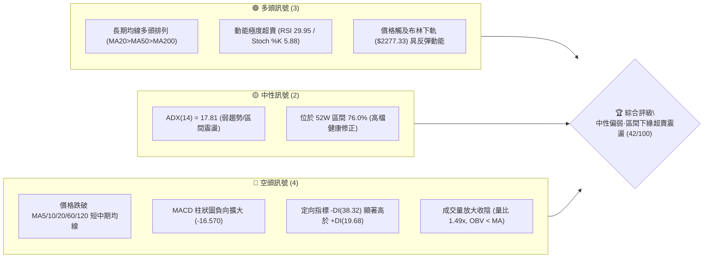
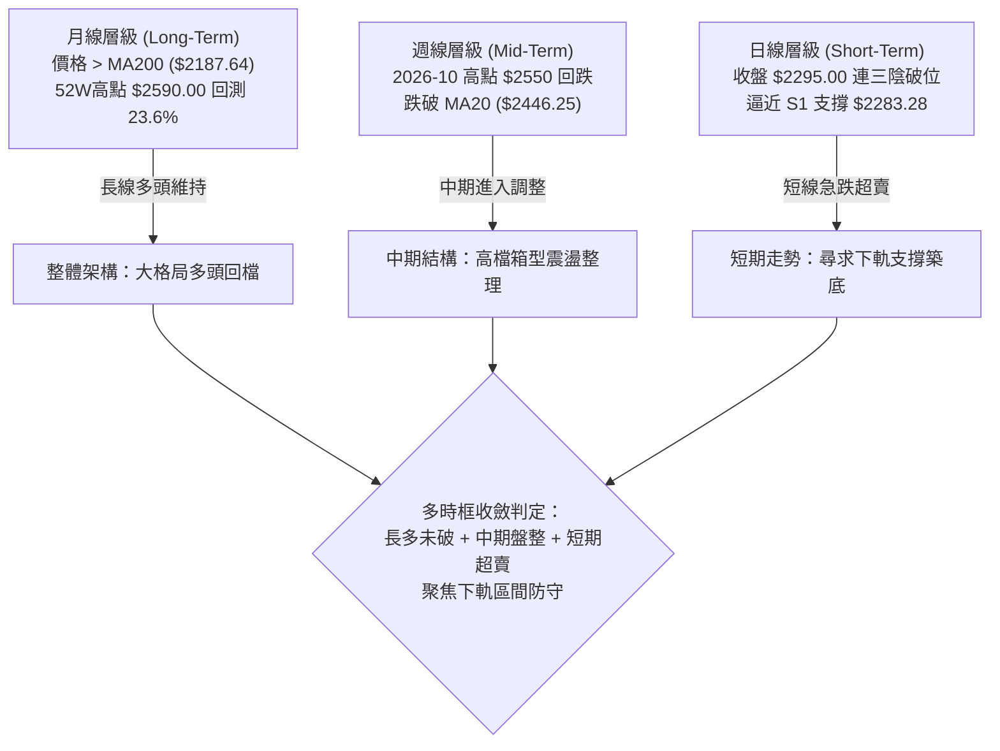
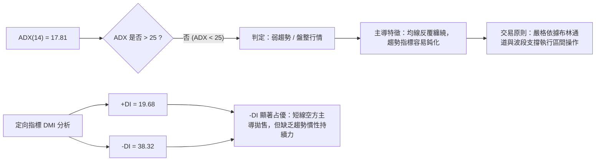
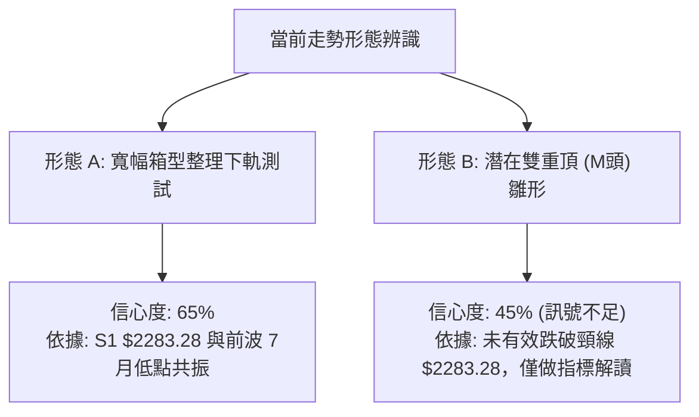
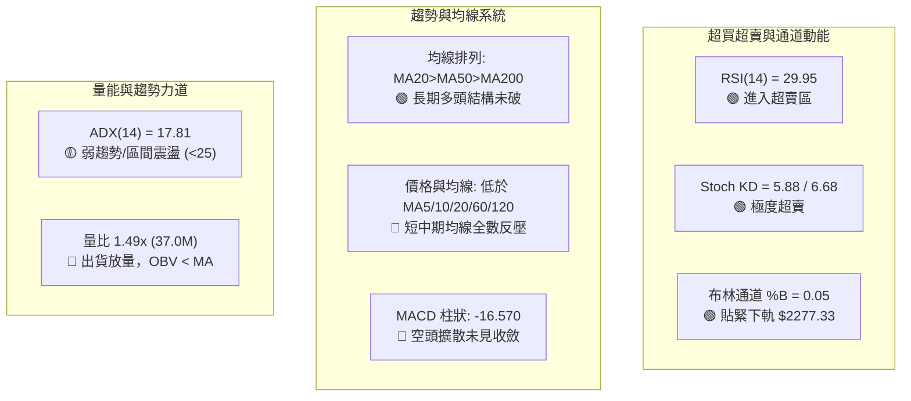
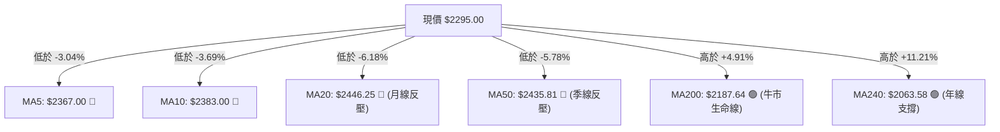
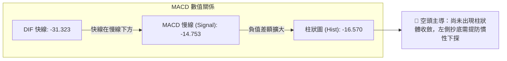
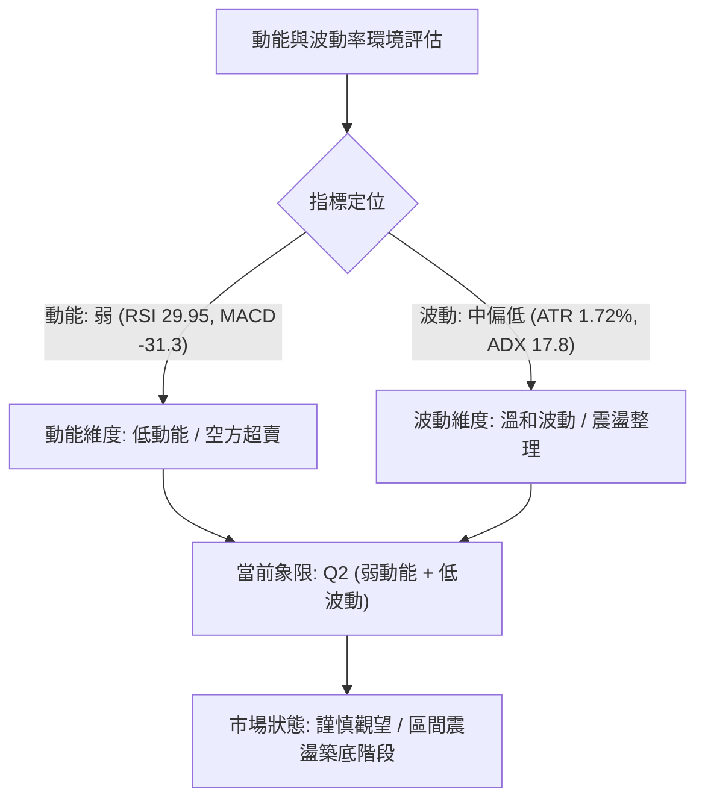
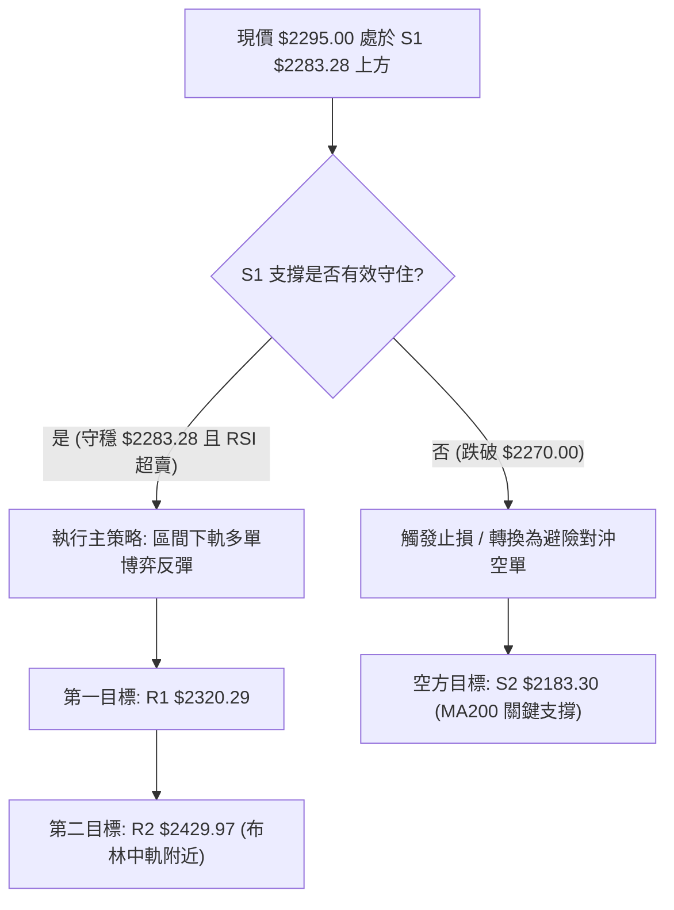
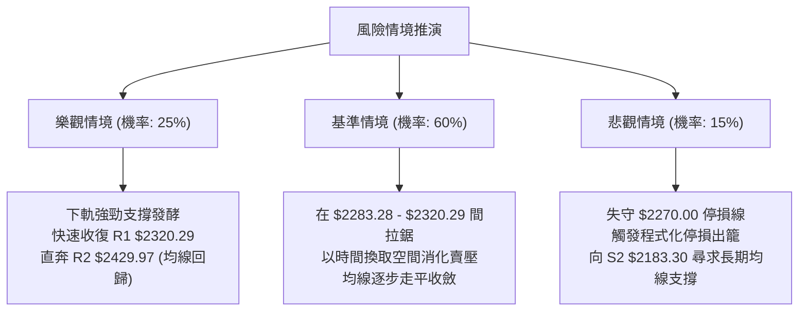

# 2330.TW 技術分析報告

> **報告日期**：2026-11-04 ｜ **語言**：繁體中文 ｜ **數據來源**：Yahoo Finance ｜ **當前價格**：$2295.00 TWD

---

## 目錄

| 章節 | 內容 |
|------|------|
| [1. 技術面概覽](#1-技術面概覽) | 訊號儀表板、核心指標、評分卡 |
| [2. 趨勢分析](#2-趨勢分析) | 多時框趨勢、長中短期走勢、ADX 解讀 |
| [3. 圖表形態分析](#3-圖表形態分析) | 形態識別、K線組合、目標價推算 |
| [4. 支撐與阻力](#4-支撐與阻力) | 關鍵價位、斐波那契回調結構 |
| [5. 技術指標深度解讀](#5-技術指標深度解讀) | MA/RSI/MACD/布林/成交量量價關係 |
| [6. 動能與波動率](#6-動能與波動率) | 動能矩陣、ATR 波動度、Beta 敏感度 |
| [7. 多時框架總結](#7-多時框架總結) | 時框架評分矩陣、多時框收斂判定 |
| [8. 交易策略建議](#8-交易策略建議) | 策略路由、價格情境階梯、風報比計算 |
| [9. 風險提示與監控](#9-風險提示與監控) | 關鍵監控清單、情境推演、資金控管 |

---

## 1. 技術面概覽

### 🎯 技術訊號儀表板



### 📊 核心指標速覽表

| 指標類別 | 指標名稱 | 當前數值 | 訊號 | 解讀 |
|----------|----------|----------|------|------|
| **價格** | 當前收盤價 | $2295.00 | 🔴 | 跌破短期均線密集區，回測前波低點支撐 |
| **均線** | MA20 | $2446.25 | 🔴 | 價格在均線下方 -6.18%，月線轉為下彎阻力 |
| **均線** | MA50 | $2435.81 | 🔴 | 價格在均線下方 -5.78%，季線支撐失守 |
| **均線** | MA200 | $2187.64 | 🟢 | 價格在均線上方 +4.91%，長期牛市基線完好 |
| **動能** | RSI(14) | 29.95 | 🟢 | 跌破 30 進入技術性超賣區，短線殺跌動能衰竭 |
| **動能** | MACD(12,26,9) | -31.323 / -14.753 | 🔴 | DIF 位於信號線下方，柱狀圖 -16.570 呈空頭發散 |
| **動能** | KD (%K / %D) | 5.88 / 6.68 | 🟢 | 雙線低於 10 嚴重超賣，隨時具備技術性金叉條件 |
| **趨勢** | ADX(14) | 17.81 | 🟡 | 數值低於 25，確認市場非單邊趨勢，屬箱型震盪 |
| **趨勢** | DMI (+DI / -DI) | 19.68 / 38.32 | 🔴 | -DI 主導盤面，空方力量占優，但缺乏強趨勢推動 |
| **通道** | 布林通道 %B | 0.05 | 🟢 | 逼近下軌 $2277.33，處於通道底部極端位置 |
| **量能** | 20日成交量比 | 1.49x (37.0M / 24.8M) | 🔴 | 殺跌量能釋放，量能疲弱且 OBV 位於均線下方 |
| **波動** | ATR(14) | $39.44 (1.72%) | 🟡 | 每日平均波動約 39.44 元，波動度溫和 |

### 🏆 技術評分卡

```
╔══════════════════════════════════════════════════════════════════╗
║                 技術評分卡 — 2330.TW (2026-11-04)                 ║
╠══════════════════════════════════════════════════════════════════╣
║ 趨勢強度 (Trend)     ███████░░░░░░░░░░░░░  35/100  🔴 空頭控盤    ║
║ 動能指標 (Momentum)  ██████░░░░░░░░░░░░░░  30/100  🔴 動能疲弱    ║
║ 支撐穩定度 (Support) ████████████░░░░░░░░  60/100  🟡 下軌支撐    ║
║ 成交量配合 (Volume)  ███████░░░░░░░░░░░░░  35/100  🔴 出貨量增    ║
║ 形態完整度 (Pattern) ████████░░░░░░░░░░░░  40/100  🟡 區間收斂    ║
║ 均線排列 (Moving Avg)██████████░░░░░░░░░░  52/100  🟡 長多短空    ║
╠══════════════════════════════════════════════════════════════════╣
║ 綜合評分 (Composite) ████████░░░░░░░░░░░░  42/100  🟡 區間震盪    ║
║ 評分計算：(35 + 30 + 60 + 35 + 40 + 52) ÷ 6 = 42.00 (規則18)    ║
╚══════════════════════════════════════════════════════════════════╝
```

---

## 2. 趨勢分析

### 🌐 多時框趨勢分析



### 📈 長期趨勢 — 12個月走勢圖（Unicode）

```
2330.TW 月線走勢圖（過去 12 個月：2025-11 至 2026-11）
價格軸 ($)
$2500 ┤                                                ●(09月 $2480.00)
$2400 ┤                                    ●       ●       ●(10月 $2370.00)
$2300 ┤                                ●               ●←現價 $2295.00
$2100 ┤                        ●
$1900 ┤                ●
$1700 ┤        ●               ●
$1500 ┤    ●
$1400 ┤●(11月 $1422.55)
      └────────────────────────────────────────────────────────────────
        11  12  01  02  03  04  05  06  07  08  09  10  11 (月份)
        25  25  26  26  26  26  26  26  26  26  26  26  26 (年份)
```

#### 走勢特徵分析表格

| 階段區間 | 起訖月份 | 起訖價格 ($) | 區間漲跌幅 | 走勢特徵與結構意涵 |
|----------|----------|--------------|------------|--------------------|
| **第1階段：主升推升** | 2025-11 → 2026-02 | $1422.55 → $1977.40 | +39.00% | 階梯式放量突破，突破前高後均線呈強烈發散多頭排列 |
| **第2階段：波段震盪** | 2026-02 → 2026-03 | $1977.40 → $1750.17 | -11.49% | 快速回洗獲利回吐盤，於歷史支撐位迅速止跌回穩 |
| **第3階段：二次噴出** | 2026-03 → 2026-06 | $1750.17 → $2402.93 | +37.30% | 攻克兩千大關，基本面成長推動本益比重估，創歷史波段高 |
| **第4階段：高位盤整** | 2026-06 → 2026-09 | $2402.93 → $2480.00 | +3.21% | 於 $2400 上方進入籌碼換手期，高點觸及 52W 高點 $2590.00 |
| **第5階段：回測修正** | 2026-09 → 2026-11 | $2480.00 → $2295.00 | -7.46% | 跌破短期月均線，測試斐波那契 23.6% ($2299.33) 支撐力道 |

### 📊 中期趨勢（週線分析）

中期走勢自 2026 年 10 月初創下波段收盤高點 $2550.00（盤中高點 $2590.00）後，週線呈現「連四陰」修正格局。近期週線收盤價依序為：$2550.00 → $2420.00 → $2385.00 → $2370.00 → $2295.00。週線 RSI 自 61.9 迅速下滑至 29.9，週 MACD 柱狀圖由正轉負（從 +10.055 降至 -16.570），顯示中期漲勢已暫告一段落，轉為寬幅箱型震盪。

```
中期週線價格走勢與關鍵防守結構
  $2590.00 ┬────────────────────────────────────────── 52W 高點阻力
           │                       ▲ 2026-10-08 週高 $2590.00
  $2429.97 ┼───────────────────────┼────────────────── R2 波段阻力 / MA50 ($2435.81)
           │                       │
  $2320.29 ┼───────────────────────┼────────────────── R1 短期反彈阻力
  $2295.00 ┤◀─── 現價 $2295.00     │ (回測 23.6% 回調位 $2299.33)
  $2283.28 ┴───────────────────────┴────────────────── S1 週線關鍵支撐 (2026-07-17 週收盤)
  $2183.30 ─────────────────────────────────────────── S2 強支撐 / MA200 ($2187.64)
```

### ⚡ 趨勢強度評估（ADX 解讀）



#### ADX 強度指標對照表

| 指標項目 | 數值 | 臨界標準 | 當前市場狀態判定 | 操作策略指導 |
|----------|------|----------|------------------|--------------|
| **ADX(14)** | 17.81 | < 25 (弱/無趨勢) | 處於無明顯單邊趨勢的盤整格局 | 不宜採用突破追價策略，採區間高拋低吸 |
| **+DI (14)** | 19.68 | 參考基準 | 多頭力量微弱，買盤追價意願不足 | 多頭反彈需伴隨 +DI 向上交叉確認 |
| **-DI (14)** | 38.32 | > 30 (空方主導) | 空方拋壓釋放中，佔據日內主導地位 | 空方動能高位鈍化，提防空頭陷阱與短打抽腳 |

---

## 3. 圖表形態分析

### 🔍 形態識別系統



#### 形態信心度與目標價評估表

| 形態名稱 | 信心度 | 判斷依據（引用數據） | 完成度 | 目標價（附精確計算式） |
|----------|--------|----------------------|--------|------------------------|
| **寬幅箱型下軌防守** | 65% | 價格回測至前波 2026-07-17 週低點支撐 S1 $2283.28，且貼近布林下軌 $2277.33 | 85% | 反彈目標 T1 = 阻力位 R1 $2320.29；<br/>反彈目標 T2 = 阻力位 R2 $2429.97 |
| **潛在雙重頂 (M頭) 結構** | 45% | 高點分別在 2026-07 ($2437.82) 與 2026-10 ($2590.00)，頸線為 S1 $2283.28 | 40% | **訊號不足，僅做指標型解讀**（因信心度 < 50% 且未實體跌破收在 S1 之下） |

### 🕯️ 重要K線形態分析

嚴格依據提供的「近10根日K」與「近8根週K」實際開高低收數據進行客觀解讀：

#### 近10根日K形態解析

| 日期 (日K) | 開盤價 ($) | 最高價 ($) | 最低價 ($) | 收盤價 ($) | 成交量 (股) | K線形態名稱 | 技術解讀與多空意涵 | 訊號 |
|:----------:|:----------:|:----------:|:----------:|:----------:|:-----------:|:------------|:-------------------|:----:|
| 2026-10-20 | 2400.00 | 2415.00 | 2395.00 | 2405.00 | 17,099,557 | 窄幅小陽線 | 縮量整理，多空在 2400 關卡拉鋸觀望 | 🟡 |
| 2026-10-21 | 2425.00 | 2435.00 | 2400.00 | 2420.00 | 22,321,809 | 帶上影小陽 | 上攻測試 MA50 ($2435.81) 未果，量能微增 | 🟡 |
| 2026-10-22 | 2435.00 | 2435.00 | 2385.00 | 2385.00 | 22,930,116 | 光腳中陰線 | 開高走低收最低，空方全日壓制，下破 2400 | 🔴 |
| 2026-10-23 | 2385.00 | 2385.00 | 2385.00 | 2385.00 | 0 | 一字橫盤K | 零成交量異常停頓（或休市/平盤交易） | 🟡 |
| 2026-10-27 | 2380.00 | 2405.00 | 2380.00 | 2400.00 | 33,964,182 | 放量下影陽 | 放量收復 2400，低檔買盤浮現，具短線支撐 | 🟢 |
| 2026-10-28 | 2420.00 | 2430.00 | 2410.00 | 2425.00 | 19,880,613 | 溫和走高陽 | 開高穩步收紅，但縮量顯示買盤追高意願保守 | 🟡 |
| 2026-10-29 | 2420.00 | 2425.00 | 2390.00 | 2415.00 | 16,872,114 | 帶下影陰線 | 量縮回踩 2400 不破，高檔賣壓持續壓抑走勢 | 🟡 |
| 2026-10-30 | 2380.00 | 2380.00 | 2360.00 | 2370.00 | 29,664,858 | 跳空弱勢陰 | 跳空低開跌破整理平台，放量下挫顯現避險賣壓 | 🔴 |
| 2026-11-02 | 2310.00 | 2345.00 | 2310.00 | 2330.00 | 34,382,586 | 帶長上影陽 | 大幅低開後反彈受挫，上影線長達 15 元賣壓沉重 | 🔴 |
| 2026-11-03 | 2300.00 | 2335.00 | 2280.00 | 2295.00 | 36,998,754 | 探底帶下影陰 | 創近月新低 $2280，收盤守住 S1，爆量收長下影 | 🟡 |

#### 近8根週K形態解析

| 日期 (週K) | 開盤價 ($) | 最高價 ($) | 最低價 ($) | 收盤價 ($) | 成交量 (股) | K線形態名稱 | 技術解讀與多空意涵 | 訊號 |
|:----------:|:----------:|:----------:|:----------:|:----------:|:-----------:|:------------|:-------------------|:----:|
| 2026-09-18 | 2378.00 | 2460.00 | 2373.01 | 2460.00 | 101,132,173 | 光頭大陽線 | 強勢突破整理區，成交量破億股，多頭攻勢啟動 | 🟢 |
| 2026-09-24 | 2445.00 | 2510.00 | 2445.00 | 2475.00 | 66,944,987 | 跳空小陽線 | 突破 2500 大關，量縮顯示籌碼鎖定良好 | 🟢 |
| 2026-10-02 | 2475.00 | 2515.00 | 2475.00 | 2500.00 | 87,707,137 | 高檔十字星 | 2500 上方多空分歧加大，出現滯漲信號 | 🟡 |
| 2026-10-08 | 2550.00 | 2590.00 | 2545.00 | 2550.00 | 77,343,774 | 衝高回落倒錘 | 創 52W 高點 $2590 後受阻，留下 40 元長上影線 | 🔴 |
| 2026-10-16 | 2510.00 | 2550.00 | 2420.00 | 2420.00 | 160,006,325 | 爆量長陰吞噬 | 1.6 億股天量下殺，吞噬前三週漲幅，波段見頂 | 🔴 |
| 2026-10-23 | 2395.00 | 2435.00 | 2385.00 | 2385.00 | 86,048,332 | 續跌中陰線 | 跌破 2400 關卡，空方完全主導格局 | 🔴 |
| 2026-10-30 | 2380.00 | 2430.00 | 2360.00 | 2370.00 | 100,381,767 | 帶影破位陰 | 震盪加劇，回抽無力後再度跌破 $2380 支撐 | 🔴 |
| 2026-11-03 | 2310.00 | 2345.00 | 2280.00 | 2295.00 | 71,381,340 | 下影長針日K | 測試波段前低 S1 $2283.28 未破，初現止跌企圖 | 🟡 |

### 📉 ASCII 走勢形態示意圖

```
2330.TW 日線級別局部形態示意圖（測試箱型下軌）
$2440 ┤        ┌───┐ (10/28 高點 $2430.00)
$2420 ┤    ┌───┘   └───┐
$2400 ┤┌───┘           └───┐ (10/30 跳空跌破 $2380)
$2360 ┤                    └───┐
$2320 ┤                        └───┐
$2295 ┤────────────────────────────●←現價 $2295.00 (收盤守住 S1)
$2280 ┤                            └──┴─── 11/03 盤中最低 $2280.00
      └───────────────────────────────────
       10/27  10/28  10/29  10/30  11/02  11/03
```

### 🎯 形態目標價計算

依據形態學嚴格推算，若箱型震盪下軌確認有守：
1. **箱型底邊頸線位**：確認為關鍵支撐 S1 = **$2283.28**。
2. **反彈第1目標價 (T1)**：直接指向近期波段高點聚類阻力位 R1 = **$2320.29**。
   $$\text{目標價 T1} = \$2320.29 \quad (+1.10\%)$$
3. **反彈第2目標價 (T2)**：指向上一級波段密集套牢區 R2 = **$2429.97**（亦逼近 MA50 $2435.81 與 MA20 $2446.25 均線反壓區）。
   $$\text{目標價 T2} = \$2429.97 \quad (+5.88\%)$$

---

## 4. 支撐與阻力

### 🗺️ 關鍵價位分布圖（Unicode）

```
2330.TW 價位結構分布圖
═══════════════════════════════════════════════════════════════
$2590.00 ║████████████████████████████████║ 52W 歷史最高點 (波段頂部)
$2508.21 ║████████████████████████        ║ 強阻力 R3 (+9.29%)
$2429.97 ║██████████████████              ║ 密集阻力 R2 (+5.88% / MA50交會)
$2320.29 ║████████████                    ║ 短線阻力 R1 (+1.10%)
$2299.33 ╟────────────────────────────────╢ 斐波那契 23.6% 回調位
$2295.00 ╠════════════════════════════════╣ ◄ 當前收盤價 ($2295.00)
$2283.28 ║▓▓▓▓▓▓▓▓▓▓▓▓                    ║ 近期關鍵支撐 S1 (-0.51%)
$2277.33 ╟────────────────────────────────╢ 布林通道下軌
$2183.30 ║████████████████████████        ║ 強支撐 S2 (-4.87% / MA200交會)
$1743.07 ║████████████████████████████████║ 長期強支撐 S3 (-24.05%)
═══════════════════════════════════════════════════════════════
```

### 🚧 阻力位分析表

所有價位均嚴格引用 OHLCV 計算之關鍵高點聚類：

| 阻力級別 | 價位 ($) | 距現價幅動 | 形成原因與籌碼結構 | 突破難度 | 重要性 |
|:--------:|:--------:|:----------:|:-------------------|:--------:|:------:|
| **R1** | $2320.29 | +1.10% | 近期跌破前之日線平台低點聚類，11/02-11/03 連續兩日上攻受阻之反壓點 | 🟡 中等 | ★★★☆☆ |
| **R2** | $2429.97 | +5.88% | 10月中下旬成交密集區底部，與 MA50 ($2435.81) 及 MA20 ($2446.25) 形成重疊反壓帶 | 🔴 極高 | ★★★★★ |
| **R3** | $2508.21 | +9.29% | 10月初歷史高位整理平台頸線，大量套牢籌碼沉澱區 | 🔴 極高 | ★★★★☆ |

### 🛡️ 支撐位分析表

所有價位均嚴格引用 OHLCV 計算之關鍵低點聚類：

| 支撐級別 | 價位 ($) | 距現價幅動 | 形成原因與籌碼結構 | 守住機率 | 重要性 |
|:--------:|:--------:|:----------:|:-------------------|:--------:|:------:|
| **S1** | $2283.28 | -0.51% | 2026-07-17 週線波段收盤低點聚類，現正受到日K探底驗證（11/03 低點 $2280） | 🟢 65% | ★★★★★ |
| **S2** | $2183.30 | -4.87% | 近一年主要整理平台高點轉換之支撐，與 MA200 ($2187.64) 形成共振支撐帶 | 🟢 85% | ★★★★★ |
| **S3** | $1743.07 | -24.05% | 2026年Q1波段起漲點低位聚類（2026-03 收盤價 $1750.17 附近），長線牛熊分水嶺 | 🟢 98% | ★★★★☆ |

### 📐 斐波那契回調位分析

依據 52 週完整波段（低點 $1358.34 → 高點 $2590.00）計算之精確斐波那契結構：

| 回調比例 | 斐波那契點位 ($) | 距現價位置 | 技術意義與當前價位互動解讀 |
|:--------:|:----------------:|:----------:|:---------------------------|
| **0.0%** | $2590.00 | +12.85% | 52 週歷史波段最高點（2026-10-08 盤中高點） |
| **23.6%** | $2299.33 | +0.19% | **關鍵回調位**：現價 $2295.00 正緊貼於此位置下方 4.33 元處（-0.19%），屬極淺度回檔 |
| **38.2%** | $2119.51 | -7.65% | 正常多頭回檔健康防守位，若跌破 S2 ($2183.30) 之後的下一道強烈承接帶 |
| **50.0%** | $1974.17 | -13.98% | 多空強弱分界線，與 2026-02 收盤價 $1977.40 形成整數關卡共振 |
| **61.8%** | $1828.84 | -20.31% | 黃金分割強防守位，回撤至此代表多頭趨勢遭到嚴重破壞 |
| **78.6%** | $1621.92 | -29.33% | 深度回調極限位 |
| **100.0%**| $1358.34 | -40.81% | 52 週最低點（起漲原始基石） |

> **當前價位互動解讀**：
> 當前收盤價 **$2295.00** 恰好落在 **23.6% ($2299.33)** 與 **38.2% ($2119.51)** 之間，且距離 23.6% 回調位僅 4.33 元差距。在強勢多頭格局的技術修正中，23.6% 往往代表強勢整理的極限支撐點。當前股價緊扣 23.6% 與 S1 ($2283.28)，顯示此處為多方絕不可失守的多頭陣地。

---

## 5. 技術指標深度解讀

### 🎛️ 指標訊號總覽



### 📈 移動平均線排列分析



#### 均線系統深度解析

1. **長期排列結構**：當前系統保持 `MA20 ($2446.25) > MA50 ($2435.81) > MA200 ($2187.64)`，長期多頭排列架構並未遭到實質破壞。
2. **短中期均線蓋頭反壓**：價格自 10 月中旬下挫後，連續跌破 MA5 ($2367.00)、MA10 ($2383.00)、MA60 ($2426.76) 及 MA120 ($2385.02)。短期內 $2367.00 - $2385.00 將成為反彈的第一重關卡，而 MA20 與 MA50 在 $2435 - $2446 形成極強的複合壓力帶。

### 📉 RSI(14) 分析

* **當前 RSI(14) 數值**：**29.95** (Wilder)
* **進度條顯示**：`██████░░░░░░░░░░░░░░ 29.95%` 🟢 **技術性超賣 (< 30)**
* **超買超賣判定**：數值跌破 30 閾值進入典型超賣區。回顧過往 24 個月走勢，當 2330.TW 的 RSI 進入 30 以下區域時，往往伴隨著短線波段低點的形成，空方拋售動能已進入最後釋放階段。
* **背離狀態判斷**：
  * **日線背離檢驗**：比對近 20 根 K 棒，價格自 2435 元一路下行至 2295 元，RSI 亦同步由 50 以上跌落至 29.95，**無明顯底背離**（首尾價格與 RSI 同向走低）。
  * **背離結論**：目前屬於「順勢超賣」，尚未出現價格破底而 RSI 指標抬高的經典背離信號，反彈多以技術性超賣修復為主。

### 📊 MACD(12,26,9) 訊號解讀



* **快慢線位置**：DIF (-31.323) 位於 0 軸下方且深陷信號線 (-14.753) 之下，顯示中空格局明確。
* **柱狀圖動態**：當前柱狀圖為 **-16.570**，較前一交易日持續擴大負值，顯示空方動能尚未正式收斂，技術面仍在等待第一根負柱縮短（紅柱回縮）作為止跌初訊號。

### 📦 布林通道分析

```
2330.TW 布林通道價格分佈圖 (BB-20, 2σ)
═══════════════════════════════════════════════════════════════
$2615.17 ┬────────────────────────────────────────── BB 上軌 (+13.95%)
         │
         │
$2446.25 ┼────────────────────────────────────────── BB 中軌 (MA20) (+6.59%)
         │
$2295.00 ┤ ◄ 現價 $2295.00 (%B = 0.05，緊扣下軌)
$2277.33 ┴────────────────────────────────────────── BB 下軌 (-0.77%)
═══════════════════════════════════════════════════════════════
```

* **帶寬特徵**：通道寬度（上軌 $2615.17 − 下軌 $2277.33 = $337.84），帶寬顯著擴張，反映近期自高檔急跌所引發的波動擴散。
* **%B 指標解讀**：當前 **%B = 0.05**（接近 0.00 下軌極端值）。依據布林通道交易法則，當 %B ≤ 0.05 且通道未呈現向下單邊暴跌開口時（ADX僅 17.81），價格具有向中軌 ($2446.25) 均值回歸的強烈統計學傾向。

### 💹 成交量分析（量價配合度）

* **量能數據對比**：
  * 最新成交量：**36,998,754 股**
  * 20日均量：**24,758,077 股**（量比：**1.49x**）
  * 50日均量：**20,850,648 股**
* **量價配合診斷**：
  1. **放量收陰**：11/03 收盤下跌 $35.00，成交量擴大至近 37.0M 股（高於月均量 49%），顯示跌破 $2300 整數關卡時引發停損賣盤湧現。
  2. **下影線吸籌跡象**：儘管放量下跌，但盤中創下 $2280 低點後拉回至 $2295 收盤，留下 15 元下影線，顯示在關鍵支撐 S1 ($2283.28) 附近已有特定資金進場承接。
  3. **OBV 能量潮狀態**：數據顯示 `OBV < MA`，能量潮處於均線下方，說明中期資金呈現淨流出狀態，量能尚未轉為健康的多頭放量結構。

---

## 6. 動能與波動率

### ⚡ 動能評估四象限



| 象限分類 | 動能強度 | 波動程度 | 當前所處位置 | 戰略評估與應對手段 |
|:--------:|:--------:|:--------:|:------------:|:-------------------|
| **第一象限 (Q1)** | 強 (Bullish) | 低 (Low Vol) | — | 最佳波段順勢推升期，持有並加碼 |
| **第二象限 (Q2)** | **弱 (Bearish)** | **低 (Low Vol)** | **✓ (當前狀態)** | **空方能量釋放近尾聲，盤整無趨勢，適合左側少量分批或等待突破** |
| **第三象限 (Q3)** | 強 (Bullish) | 高 (High Vol) | — | 突破噴出或情緒亢奮期，注意移動止盈 |
| **第四象限 (Q4)** | 弱 (Bearish) | 高 (High Vol) | — | 恐慌崩跌與流動性危機，嚴禁盲目進場 |

### 📊 ATR 波動率分析

* **當前 ATR(14)**：**$39.44**（佔當前股價 **1.72%**，Wilder 計算）。
* **波動特徵評估**：
  * 日內價格正常波動區間為現價 $\pm \$39.44$。以目前價格 $2295.00 計算，單日合理震盪範圍介於 **$2255.56 至 $2334.44** 之間。
* **風控與止損設定建議**：
  * **短線噪聲過濾（1.0x ATR）**：$\$39.44$。日內交易波動緩衝區。
  * **波段防守止損距（1.5x ATR）**：$1.5 \times \$39.44 = \$59.16$。
  * **關鍵止損定位**：若以 S1 ($2283.28) 為參考防守點，向下跌破半個 ATR（約 20 元）至 **$2263.00**，即可確認支撐實質破位，需嚴格止損。

### 📐 Beta 與市場相關性

* **Beta 係數**：**1.233**
* **大盤連動特徵解讀**：
  * 2330.TW 作為權值龍頭，具備高於大盤 23.3% 的系統性彈性。當台灣加權指數變動 1% 時，台積電平均同向波動約 1.233%。
  * 在當前 Beta 為 1.233 的背景下，個股下跌主要受到權值股資金再平衡影響，一旦大盤止跌，其反彈力道亦將超越大盤平均水準。

---

## 7. 多時框架總結

### 📋 時框架評分表

| 時框架 | 趨勢方向 | 動能狀態 | 均線排列狀況 | 形態結構特徵 | 綜合評分 | 操作指導建議 |
|:------:|:--------:|:--------:|:------------:|:------------:|:--------:|:-------------|
| **月線層級** | 🟢 多頭趨勢 | 🟡 中性平穩 | 🟢 完好牛市多頭 (遠高於MA200) | 回測 23.6% 斐波那契點 | **75/100** | 長線多頭未變，戰略部位續抱 |
| **週線層級** | 🟡 寬幅箱型 | 🔴 動能下行 | 🟡 跌破週MA10，守於MA60上 | 52W高點 $2590 回測 S1 支撐 | **48/100** | 中期進入修正期，不追高買進 |
| **日線層級** | 🔴 短空格局 | 🟢 極度超賣 | 🔴 均線空頭排列 (在MA20下) | 探底 S1 $2283.28 留下影線 | **38/100** | 短線殺跌鈍化，準備博弈反彈 |

### 🔲 綜合訊號矩陣

```
時框維度與技術面向交叉訊號矩陣
────────────────────────────────────────────────────────────────
維度 / 時框       日線層級 (短期)       週線層級 (中期)       月線層級 (長期)
────────────────────────────────────────────────────────────────
趨勢方向          🔴 偏空調整           🟡 區間震盪           🟢 強勢多頭
動能指標 (RSI)    🟢 超賣 (29.95)       🔴 轉弱 (29.9)        🟢 健康多頭
均線支撐 (MA)     🔴 均線蓋頭反壓       🟡 跌破月均線         🟢 站穩MA200
形態位置          🟡 測試箱型下軌       🟡 高檔箱型           🟢 階梯主升
成交量配合        🔴 放量下挫           🔴 出貨週陰           🟢 月級量價健康
────────────────────────────────────────────────────────────────
一致性分析：長多格局下的中短期技術性回調，長日線產生矛盾，以盤整框架收斂。
```

### ⚖️ 多時框收斂結論（依規則 14）

1. **行情性質判定**：當前 **ADX(14) 數值為 17.81 (< 25)**，嚴格判定為**「盤整行情」**而非單邊趨勢行情。
2. **多時框權重取捨**：依據規則 14，在盤整行情中，**以日線布林通道上下軌 ($2277.33 至 $2615.17) 為主要交易區間**。日線雖呈現短空，但因 RSI 極度超賣 (29.95) 且價格已打入布林通道下軌 ($2277.33) 與波段支撐 S1 ($2283.28) 密集區，下行空間受到強烈壓制。
3. **唯一方向性結論**：**【中性觀望偏區間下軌防守反彈】**。本結論嚴格收斂第 1 章技術評分（42/100）與第 2、5 章之技術訊號，拒絕盲目單邊追空，主打依託下軌的「高勝率區間防守」策略。

---

## 8. 交易策略建議

### 🗺️ 策略決策流程圖



### 🧭 策略路由（依評分卡分流，規則 18）

> **當前主策略方向 = 【中性區間操作（以布林下軌支撐防守反彈為主，等待突破確認）】（依技術評分 42/100，落於 40–60 區間）**

### 🎯 價格情境階梯（Price Scenarios）

所有價位均嚴格引用第 4 章及數據庫提供之精確數值：

| 觸發條件 | 下一目標 | 後續延伸 | 情境技術含義與市場行為解讀 |
|:--------:|:--------:|:--------:|:---------------------------|
| **向上突破 R1 $2320.29** | **R2 $2429.97** | **R3 $2508.21** | 短線轉強，封閉跌破缺口，向布林中軌與 MA50 展開均值回歸 |
| **站穩現價區間 ($2283.28 - $2299.33)** | **R1 $2320.29** | — | 在 23.6% 斐波那契位與布林下軌築底，形成橫盤抗跌結構 |
| **實體跌破 S1 $2283.28** | **S2 $2183.30** | **S3 $1743.07** | 中期走勢轉弱，箱型底部破位，向 200 日均線 ($2187.64) 尋求長線支撐 |

### 📊 情境機率分佈

| 情境劇本 | 發生機率 | 主要技術與量化依據 |
|----------|:--------:|:-------------------|
| **區間震盪築底** | **45%** | ADX 僅 17.81 確認盤整格局，布林下軌 ($2277.33) 限制急跌空間，波段支撐密集 |
| **超賣抽頭反彈** | **40%** | RSI 跌至 29.95，KD 降至 5.88 極端超賣，11/03 留下影線，技術性修復需求迫切 |
| **破位再探深底** | **15%** | MACD 柱狀圖 -16.570 尚未收斂，-DI 佔優，若國際半導體劇烈回檔可能引發連鎖停損 |

### 🟢 主策略詳情（區間下軌操作）

依據規則 17，所有數值均由表格中的進場點、止損點與目標價精確算回，絕無矛盾：

| 策略要素 | 策略 A（現價左側博弈反彈單） | 策略 B（等待站回 R1 右側確認單） |
|----------|:----------------------------:|:--------------------------------:|
| **進場條件** | 依託 S1 支撐，於現價至下軌間掛單進場 | 突破 R1 $2320.29 後回踩確認不破進場 |
| **進場價格** | **$2295.00**（當前收盤價） | **$2320.29**（突破 R1 買進） |
| **目標價 T1** | **$2320.29**（阻力位 R1） | **$2429.97**（阻力位 R2） |
| **目標價 T2** | **$2429.97**（阻力位 R2） | **$2508.21**（阻力位 R3） |
| **止損價格** | **$2270.00**（跌破布林下軌與 S1 下方）| **$2283.28**（跌回關鍵支撐 S1 之下） |
| **風險報酬比** | **1 : 1.01（以 T1 計）**<br/>*(算式: (2320.29-2295)/(2295-2270) = 25.29/25.00)*<br/>**1 : 5.40（以 T2 計）**<br/>*(算式: (2429.97-2295)/(2295-2270) = 134.97/25.00)* | **1 : 2.96（以 T1 計）**<br/>*(算式: (2429.97-2320.29)/(2320.29-2283.28) = 109.68/37.01)*<br/>**1 : 5.08（以 T2 計）**<br/>*(算式: (2508.21-2320.29)/(2320.29-2283.28) = 187.92/37.01)* |
| **勝率估計** | **60%** | **55%** |
| **建議倉位** | **15%**（輕倉左側試單） | **25%**（趨勢確認加碼單） |

### 🔴 反向風險觸發點（對沖提示）

若市場出現極端風險導致跌破特定閥值，多頭策略應立即終止，並建立風控避險：
1. **空頭觸發點**：日K收盤價**實體跌破 $2270.00**（即貫穿布林下軌 $2277.33 與關鍵支撐 S1 $2283.28）。
2. **對沖下看目標**：**S2 $2183.30**（與 MA200 $2187.64 重疊）。
3. **避險操作邏輯**：多單全數出場，並可反向配置個股期貨或認售權證進行空頭避險，保護現貨現有資產。

### ⭐ 整體訊號強度評星

```
╔══════════════════════════════════════════════════════════════════╗
║ 做多訊號強度：★★★☆☆  (3/5星 — 具超賣反彈機會，惟缺乏多頭結構)  ║
║ 做空訊號強度：★★☆☆☆  (2/5星 — 動能雖空，但空間受制於下軌密集區)║
║ 整體可信度：  ★★★★☆  (4/5星 — 價位由歷史聚類確認，支撐界線分明)║
╚══════════════════════════════════════════════════════════════════╝
```

---

## 9. 風險提示與監控

### ✅ 關鍵監控指標 Checklist

```
╔══════════════════════════════════════════════════════════════════╗
║                   2330.TW 盤面即時監控清單 Checklist            ║
╠══════════════════════════════════════════════════════════════════╣
║ [ ] 價位監控：收盤價是否有效守住 S1 $2283.28 與 BB 下軌 $2277.33║
║ [ ] 動能監控：RSI(14) 能否由超賣區 (<30) 向上勾頭突破 35       ║
║ [ ] 翻多指標：MACD 柱狀圖 (-16.570) 是否出現第一根負柱縮短      ║
║ [ ] 量能驗證：反彈時成交量是否能站回 20 日均量 (24.7M 股) 以上   ║
║ [ ] 反壓突破：盤中能否實體帶量收復阻力 R1 $2320.29              ║
║ [ ] 外圍環境：半導體板塊走勢與台股大盤融資維持率變動狀況         ║
╚══════════════════════════════════════════════════════════════════╝
```

### ⚠️ 風險場景分析



### 🛡️ 風險管理重要提醒

1. **嚴禁超額槓桿**：當前 ADX 為 17.81，行情處於無趨勢震盪，震盪行情最忌重倉追高殺低。個股曝險部位應控制在總資金 **20%–30%** 以內。
2. **左側交易嚴守紀律**：介入超賣反彈屬於「左側交易」策略，必須嚴格執行 **$2270.00** 止損紀律，切忌將短線反彈交易凹單變成長期套牢持股。
3. **順勢加碼原則**：唯有當股價突破並收復 R1 $2320.29，且 MACD 柱狀圖出現收斂時，方可啟動策略 B 進行加碼。

---

## 📋 報告總結

```
╔══════════════════════════════════════════════════════════════════╗
║                   2330.TW 技術分析報告總結                       ║
╠══════════════════════════════════════════════════════════════════╣
║ 報告日期：2026-11-04                                             ║
║ 當前價格：$2295.00 TWD                                           ║
║ 分析評級：⚖️ 中性偏弱·區間操作 (綜合評分: 42/100)               ║
║                                                                  ║
║ 關鍵結論：                                                       ║
║ ├─ 長期趨勢：🟢 偏多未變 (價格穩居 MA200 $2187.64 上方，回調23.6%)║
║ ├─ 中期趨勢：🟡 寬幅箱型震盪 (自 52W 高點 $2590 回測整理)        ║
║ ├─ 短期趨勢：🔴 急跌破線但極度超賣 (RSI 29.95 / KD 5.88)         ║
║ ├─ 關鍵支撐：S1: $2283.28 ｜ S2: $2183.30 (MA200 重疊防線)       ║
║ ├─ 關鍵阻力：R1: $2320.29 ｜ R2: $2429.97 (MA50/MA20 重合區)     ║
║ └─ 外資/分析師目標價：均價 $3394.71 (區間 $2700.00 - $5000.00)   ║
║                                                                  ║
║ 最優策略組合：                                                   ║
║ 1. 🥇 最佳機會：策略 A (現價 $2295 依託 S1 支撐博超賣反彈，      ║
║                  止損 $2270，目標 R1 $2320.29 / R2 $2429.97)     ║
║ 2. 🥈 次選機會：策略 B (等待放量突破 R1 $2320.29 右側追價，      ║
║                  止損 $2283.28，目標 R2 $2429.97)                ║
║ 3. 🥉 保守選擇：靜待股價回踩 S2 $2183.30 與 MA200 匯合處，       ║
║                  進行長線波段布局                                ║
╚══════════════════════════════════════════════════════════════════╝
```

---

> ⚠️ **免責聲明**：本報告為技術分析研究成果，所有數據、指標計算及圖表均基於 Yahoo Finance 歷史價量資訊。本報告**僅供學術研究與投資架構參考**，**不構成任何形式的投資要約、招攬或具體操作建議**。金融市場具有高度不確定性，投資人應獨立評估風險並自負盈虧。

---

*報告生成時間：2026-11-04 ｜ 數據來源：Yahoo Finance ｜ 分析框架：多時框技術分析模型*