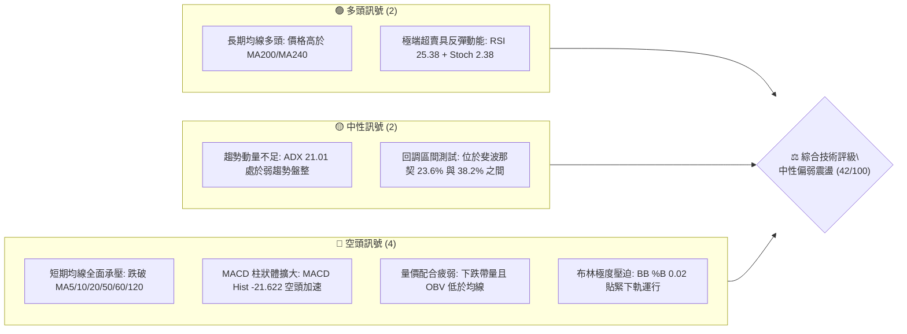
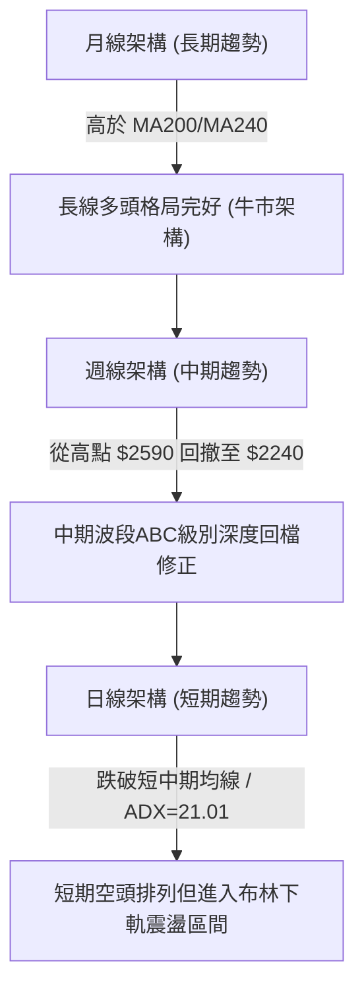
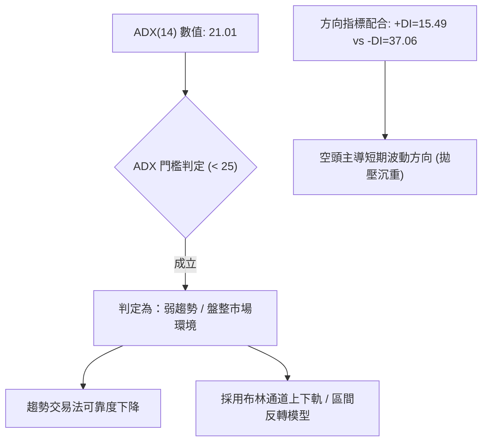
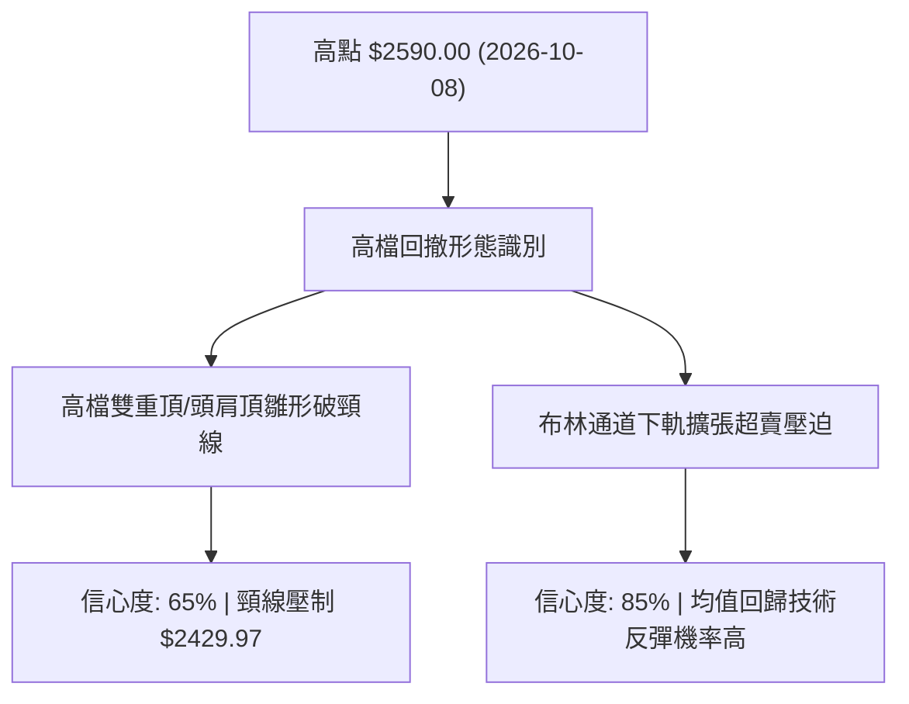
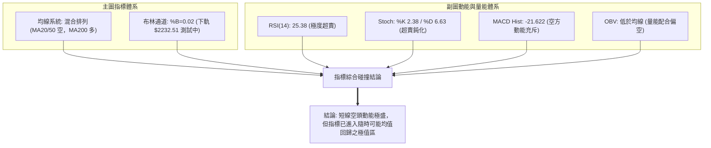
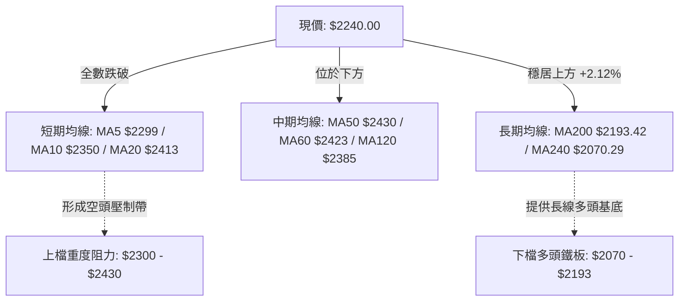
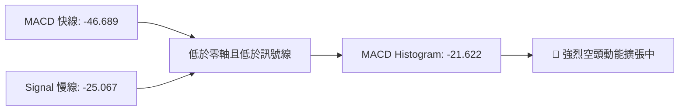
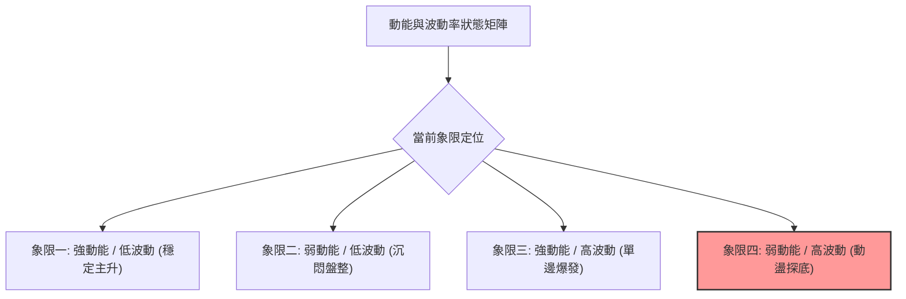
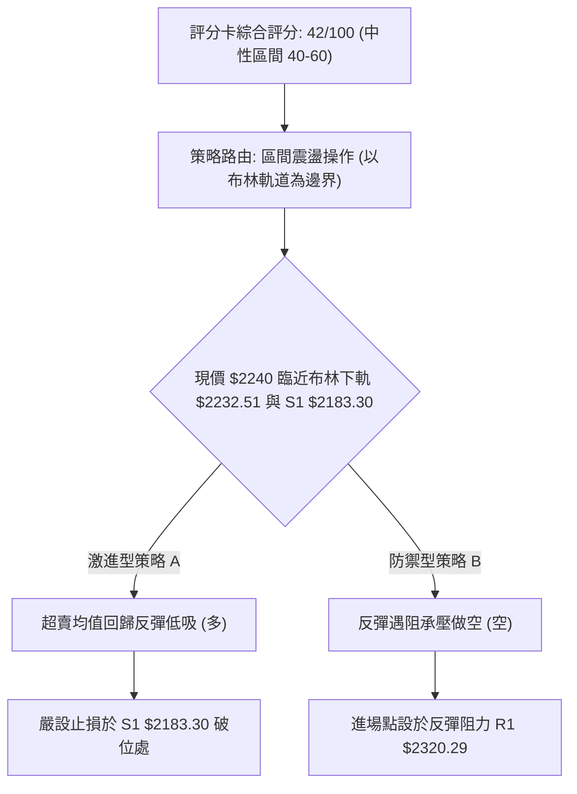
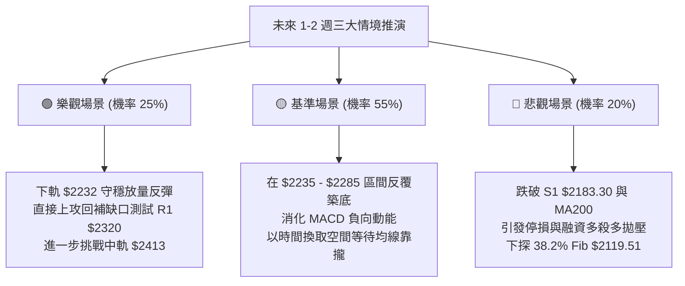

# 2330.TW 技術分析報告

> **報告日期**：2026-11-06 ｜ **語言**：繁體中文 ｜ **數據來源**：Yahoo Finance ｜ **當前價格**：$2240.00

---

## 目錄

| 章節 | 內容 |
|------|------|
| [1. 技術面概覽](#1-技術面概覽) | 訊號儀表板、核心指標、評分卡 |
| [2. 趨勢分析](#2-趨勢分析) | 多時框趨勢、長中短期走勢、ADX解讀 |
| [3. 圖表形態分析](#3-圖表形態分析) | 形態識別、K線組合、形態目標價 |
| [4. 支撐與阻力](#4-支撐與阻力) | 關鍵價位分布、阻力支撐表、斐波那契回調 |
| [5. 技術指標深度解讀](#5-技術指標深度解讀) | MA均線、RSI、MACD、布林通道、量價配合 |
| [6. 動能與波動率](#6-動能與波動率) | 動能四象限、ATR波動分析、Beta敏感度 |
| [7. 多時框架總結](#7-多時框架總結) | 時框評分、訊號矩陣、多時框收斂結論 |
| [8. 交易策略建議](#8-交易策略建議) | 策略路由、價格情境階梯、主策略與對沖 |
| [9. 風險提示與監控](#9-風險提示與監控) | 監控Checklist、情境路徑、風控規則 |

---

## 1. 技術面概覽

### 🎯 技術訊號儀表板



### 📊 核心指標速覽表

| 指標類別 | 指標名稱 | 當前數值 | 訊號 | 解讀 |
|:---|:---|:---|:---:|:---|
| **價格** | 當前收盤價 | $2240.00 | 🔴 | 跌破短期所有支撐，位於52週區間 71.6% 位置 |
| **均線** | MA20 (月線) | $2413.25 | 🔴 | 價格低於 MA20 達 -7.18%，短期下行趨勢顯著 |
| **均線** | MA50 (季線) | $2430.39 | 🔴 | 價格低於 MA50，中期修正壓力沉重 |
| **均線** | MA200 (年線) | $2193.42 | 🟢 | 價格高於 MA200 達 +2.12%，長期牛市基底未破 |
| **動能** | RSI(14) | 25.38 | 🟢 | 進入深度超賣區（<30），隨時醞釀技術性均值回歸 |
| **動能** | MACD (12,26,9) | -46.689 / Hist: -21.622 | 🔴 | 雙線位於零軸下方且負向柱狀擴大，空方動能主導 |
| **動能** | 隨機指標 (Stoch) | %K: 2.38 / %D: 6.63 | 🟢 | 處於極度鈍化超賣區，短線殺跌動能接近耗盡臨界點 |
| **波動** | ATR(14) | $43.21 (1.93%) | 🟡 | 日內平均振幅適中，未見失控恐慌性拋售 |
| **趨勢** | ADX(14) | 21.01 (-DI: 37.06) | 🟡 | ADX < 25 判定為非單邊弱趨勢/區間震盪，空方主導節奏 |
| **通道** | 布林通道 (%B) | 0.02 (下軌 $2232.51) | 🔴 | 價格緊貼布林下軌邊界，面臨通道下軌支撐測試 |
| **籌碼** | 量比 (20日) | 1.38x (OBV < MA) | 🔴 | 下跌帶量（36.86M），量能指標疲弱，籌碼短期流出 |

### 🏆 技術評分卡

```
╔══════════════════════════════════════════════════════════════╗
║                技術評分卡 — 2330.TW (2026-11-06)             ║
╠══════════════════════════════════════════════════════════════╣
║ 趨勢強度 (Trend)     ▓▓▓▓▓▓▓░░░░░░░░░░░░░  38/100  🔴 空方主導 ║
║ 動能指標 (Momentum)  ▓▓▓▓▓▓▓░░░░░░░░░░░░░  36/100  🔴 動能疲弱 ║
║ 支撐穩定度 (Support) ▓▓▓▓▓▓▓▓▓▓▓░░░░░░░░░  58/100  🟡 臨近支撐 ║
║ 成交量配合 (Volume)  ▓▓▓▓▓▓▓░░░░░░░░░░░░░  36/100  🔴 價跌量增 ║
║ 形態完整度 (Pattern) ▓▓▓▓▓▓▓▓░░░░░░░░░░░░  42/100  🟡 修正下探 ║
║ 均線排列 (MAs)       ▓▓▓▓▓▓▓▓░░░░░░░░░░░░  42/100  🟡 混合排列 ║
╠══════════════════════════════════════════════════════════════╣
║ 綜合評分 (Overall)   ▓▓▓▓▓▓▓▓░░░░░░░░░░░░  42/100  ⚖️ 震盪偏弱 ║
║ 評分算術平均：(38 + 36 + 58 + 36 + 42 + 42) ÷ 6 = 42.0       ║
╚══════════════════════════════════════════════════════════════╝
```

---

## 2. 趨勢分析

### 🌐 多時框趨勢分析



### 📈 長期趨勢 — 12個月走勢圖（Unicode）

以下為 2330.TW 過去 12 個月（2025-12 至 2026-11）之月線收盤走勢追蹤，記錄自突破 $1500 以來至創下歷史新高後拉回之價格路徑：

```
2330.TW 月線走勢圖（2025-12 至 2026-11）
價格軸 ($)
$2500 ┤                                     ●(09月 $2480)
$2400 ┤                           ●     ●         ●(10月 $2370)
$2300 ┤                     ●                             ●←現價 $2240 (11月)
$2200 ┤
$2100 ┤               ●
$2000 ┤         ●(02月 $1977.40)
$1900 ┤
$1800 ┤   ●
$1700 ┤         ●(03月 $1750.17 回踩)
$1600 ┤
$1500 ┤ ●(12月 $1536.33)
      └─────────────────────────────────────────────────────
        12M   01M   02M   03M   04M   05M   06M   07M   08M   09M   10M   11M
       (25)  (26)  (26)  (26)  (26)  (26)  (26)  (26)  (26)  (26)  (26)  (26)
```

#### 走勢特徵分析表格

| 階段區間 | 月份 | 起迄價格 ($) | 區間漲跌幅 | 核心技術特徵 |
|:---|:---|:---|:---:|:---|
| **主升啟動** | 2025-12 ~ 2026-02 | $1536.33 → $1977.40 | +28.71% | 連續強勢跳空突破，月K連續長紅，成交量溫和擴大 |
| **中繼洗盤** | 2026-02 ~ 2026-03 | $1977.40 → $1750.17 | -11.49% | 急促獲利了結回踩，確認前波高點支撐有效性 |
| **二階主升** | 2026-03 ~ 2026-06 | $1750.17 → $2402.93 | +37.30% | 權值股帶頭上攻，突破 $2000 大關，呈現強烈均線發散多頭 |
| **高位構築** | 2026-06 ~ 2026-09 | $2402.93 → $2480.00 | +3.21% | 盤整蓄勢，於 $2400 上方構築頂部平台，推進至 $2590 歷史高點 |
| **高檔回撤** | 2026-09 ~ 2026-11 | $2480.00 → $2240.00 | -9.68% | 跌破短期上升趨勢線，連跌兩個月，現正尋求波段支撐 |

### 📊 中期趨勢（週線分析）

週線架構顯示，本波從 2026-10-08 週之歷史高點 $2590.00 回落以來，已連續 4 週收黑（2026-10-16 收 $2420、10-23 收 $2385、10-30 收 $2370、11-05 收 $2240）。
- **週線 MACD 柱狀體**：由 2026-10-08 的 `+10.055` 驟降至當前的 `-21.622`，空頭動能呈現週線級別的單邊下壓。
- **週線 RSI**：由超買邊緣的 61.9 直線滑落至 25.4，顯示中期技術面已進入嚴重超賣修正區。

```
近期週線壓力與支撐階梯示意圖
  $2590.00 ───┬── 52W 歷史極限阻力 (2026-10-08 週高點)
              │
  $2429.97 ───┼── R2 阻力位（前週密集破線頸線位）
              │
  $2320.29 ───┼── R1 阻力位（上週反彈受阻高點群）
              │
  $2240.00 ───┼── 當前收盤價（貼緊布林下軌 $2232.51）
              │
  $2183.30 ───┴── S1 近期波段關鍵支撐（近一年波段低點聚類）
```

### ⚡ 趨勢強度評估（ADX 解讀）



#### ADX 強度對照表

| 指標變數 | 數值 | 狀態評估 | 戰略含義 |
|:---|:---:|:---:|:---|
| **ADX (14)** | **21.01** | 弱趨勢 / 區間盤整 (< 25) | 行情不具備持續性單邊暴跌或暴漲條件，偏向區間擴大震盪 |
| **+DI (14)** | **15.49** | 多頭動能匱乏 | 買盤缺乏連續推升力道，拉升多屬被動回補 |
| **-DI (14)** | **37.06** | 空頭明顯主導 | 賣方掌控市場節奏，短線價格重心維持向下滑移 |
| **綜合解讀** | **弱勢震盪** | **盤整空方控盤** | **依規則 14：盤整行情以日線布林通道上下軌（$2232.51 - $2593.99）為主要交易區間** |

---

## 3. 圖表形態分析

### 🔍 形態識別系統



#### 形態識別信心度評估表

| 形態類別 | 信心度 | 判斷依據（嚴格引用數據） | 形態完成度 | 目標價（附嚴格計算式） |
|:---|:---:|:---|:---:|:---|
| **波段高檔破頸線回調** | 65% | 2026-10-08 週創高點 $2590.00 後連續跌破頸線聚集帶 $2429.97 (R2)，並摜破 MA50 ($2430.39) | 85% | 由形態高度推算：頸線 $2429.97 − (高點 $2590.00 − 頸線 $2429.97) = $2429.97 − $160.03 = **$2269.94**（目前價格 $2240 已達成並超跌至 S1 附近） |
| **布林帶下軌極度超賣鈍化** | 85% | 布林 %B 達 0.02，現價 $2240 貼緊下軌 $2232.51，同時 RSI 達 25.38 極度超賣 | 90% | 由通道均值回歸推算：首要反彈目標為中軌 MA20 = **$2413.25** |
| **複合大型底部形態** | <30% | 數據不足以確認中長線雙底或頭肩底，下檔僅有波段低點聚類 S1 $2183.30 | 0% | 訊號不足，僅做指標型解讀，不預設大型底部成形 |

### 🕯️ 重要 K 線形態分析

依數據提供之近 10 根日 K 與近 8 根週 K，嚴格列出開、高、低、收價格進行組合分析：

#### 近 10 根日 K 線形態解讀

| 日期 | 開 | 高 | 低 | 收 | 成交量 | K線形態 | 解讀與技術訊號 | 訊號 |
|:---|:---:|:---:|:---:|:---:|:---:|:---|:---|:---:|
| 2026-10-22 | 2435.00 | 2435.00 | 2385.00 | 2385.00 | 22,930,116 | 光頭大黑K | 開盤即最高，空方重挫 50 點，長黑壓頂 | 🔴 |
| 2026-10-23 | 2385.00 | 2385.00 | 2385.00 | 2385.00 | 0 | 一字無量盤 | 特殊休市或無搓合交易，量能停滯 | 🟡 |
| 2026-10-27 | 2380.00 | 2405.00 | 2380.00 | 2400.00 | 33,964,182 | 低檔小紅K | 伴隨放量回補，多方試圖反抗，小幅收高 | 🟢 |
| 2026-10-28 | 2420.00 | 2430.00 | 2410.00 | 2425.00 | 19,880,613 | 跳空上揚紅K | 跳空高開並站上 $2420，但量能萎縮至 19.8M 顯現追價無力 | 🟡 |
| 2026-10-29 | 2420.00 | 2425.00 | 2390.00 | 2415.00 | 16,872,114 | 墓碑小黑星 | 上攻乏力，回吐日內漲幅，成交量持續萎縮量價背離 | 🔴 |
| 2026-10-30 | 2380.00 | 2380.00 | 2360.00 | 2370.00 | 29,664,858 | 空頭跳空黑K | 跳空跌破 $2380，放量下殺，正式確認反彈結束 | 🔴 |
| 2026-11-02 | 2310.00 | 2345.00 | 2310.00 | 2330.00 | 34,382,586 | 低開震盪紅K | 跳空大幅低開 60 點，多方反抗拉出 20 點實體但整體重心驟降 | 🔴 |
| 2026-11-03 | 2300.00 | 2335.00 | 2280.00 | 2295.00 | 36,998,754 | 帶上影下探黑K | 盤中反彈受壓於 $2335，收盤跌破 $2300 整數關卡，賣壓沉重 | 🔴 |
| 2026-11-04 | 2320.00 | 2320.00 | 2235.00 | 2260.00 | 45,456,849 | 長下影巨量黑K | 開盤即最高，盤中暴跌至 $2235 爆出 45.4M 大量，尾盤收斂跌幅 | 🟡 |
| 2026-11-05 | 2250.00 | 2285.00 | 2235.00 | 2240.00 | 36,863,278 | 雙底探針假十字 | 二次探測 $2235 低點未破，帶有下影線，顯示下軌有承接力道 | 🟢 |

#### 近 8 根週 K 線形態解讀

| 日期 | 開 | 高 | 低 | 收 | 週成交量 | K線形態 | 解讀與技術訊號 | 訊號 |
|:---|:---:|:---:|:---:|:---:|:---:|:---|:---|:---:|
| 2026-09-18 | 2378.00 | 2460.00 | 2373.01 | 2460.00 | 101,132,173 | 實體長紅K | 多頭攻堅大漲，收在當週最高點，主升波特徵 | 🟢 |
| 2026-09-24 | 2445.00 | 2510.00 | 2445.00 | 2475.00 | 66,944,987 | 高檔震盪紅K | 首度觸碰 $2500 大關，但週量縮減，呈現籌碼鎖定態勢 | 🟢 |
| 2026-10-02 | 2475.00 | 2515.00 | 2475.00 | 2500.00 | 87,707,137 | 高檔十字星 | 多空在 $2500 關卡劇烈爭奪，高檔滯漲警訊顯現 | 🟡 |
| 2026-10-08 | 2550.00 | 2590.00 | 2545.00 | 2550.00 | 77,343,774 | 創天價墓碑紅 | 創 52 週歷史高點 $2590 後大幅回落，長上影線量能不濟 | 🔴 |
| 2026-10-16 | 2510.00 | 2550.00 | 2420.00 | 2420.00 | 160,006,325 | 爆量長黑吞噬 | 巨量 160M 摜破前週低點，形成週線級別空頭吞噬反轉 | 🔴 |
| 2026-10-23 | 2395.00 | 2435.00 | 2385.00 | 2385.00 | 86,048,332 | 弱勢破線黑K | 跌破 $2400 關卡，空頭持續主導，買盤退縮觀望 | 🔴 |
| 2026-10-30 | 2380.00 | 2430.00 | 2360.00 | 2370.00 | 100,381,767 | 破底帶上影黑K | 盤中反彈受阻於 $2430，收盤再破新低 $2370 | 🔴 |
| 2026-11-05 | 2310.00 | 2345.00 | 2235.00 | 2240.00 | 153,701,467 | 帶量加速下探K | 週跌幅擴大，觸及 $2235 低點，週量暴增至 153M 接近恐慌盤 | 🟡 |

### 📉 ASCII 走勢形態示意圖

```
2330.TW 日K線近兩週走勢與下軌回踩形態
價格 ($)
$2435 ┤  ┌──┐ (10/22 高點)
$2420 ┤  │  │        ┌──┐ ┌──┐ (10/28-29 高檔平台反彈夭折)
$2380 ┤──┴──┴────────┼──┼─┴──┴──┐
$2340 ┤               │  │        │  ┌──┐ (11/02-03 跳空下行缺口)
$2300 ┤               └──┘        └──┼──┼──┐
$2260 ┤                              │  │  │  ┌──┐ (11/04 放量長下影)
$2240 ┤                                 └──┴──┼──┤ ◄── 現價 $2240.00
$2235 ┤                                        ┴──┴ ◄── 11/04-05 連續雙日下影支撐
      └────────────────────────────────────────────────────────
        10/22 10/23 10/27 10/28 10/29 10/30 11/02 11/03 11/04 11/05
```

### 🎯 形態目標價計算

根據近一個月之高檔破位形態，計算關鍵測量目標：
1. **頸線確認位**：以 2026-10-16 當週長黑實體下緣及日線反彈阻力聚類 R2 = **$2429.97** 作為高檔反轉形態之有效頸線。
2. **形態頂部高點**：52 週歷史高點 = **$2590.00**。
3. **垂直形態高度**：$2590.00 − $2429.97 = **$160.03**。
4. **等幅下行滿足點（第一目標）**：
   $$\text{頸線} - \text{形態高度} = \$2429.97 - \$160.03 = \mathbf{\$2269.94}$$
   *驗證：當前收盤價 $2240.00 已有效跌破並完成等幅測量滿足點，顯示第一波下殺目標已達成。*
5. **延伸目標（1.618 倍黃金下行延伸）**：
   $$\$2429.97 - (\$160.03 \times 1.618) = \$2429.97 - \$258.93 = \mathbf{\$2171.04}$$
   *對應意涵：該價位極度貼近數據中提供之核心波段支撐位 S1 **$2183.30** 與 MA200 **$2193.42**。*

---

## 4. 支撐與阻力

### 🗺️ 關鍵價位分布圖（Unicode）

```
2330.TW 價位結構分布圖
═════════════════════════════════════════════════════════════════════
$2590.00 ║██████████████████████████████║ 52W 歷史天花板 (0.0% Fib)
$2508.21 ║████████████████████████      ║ 強阻力 R3 (波段高點聚類)
$2429.97 ║████████████████████          ║ 關鍵阻力 R2 (反彈強阻力 / 頸線)
$2320.29 ║████████████                  ║ 短線阻力 R1 (日K跳空壓力區間)
$2299.33 ╟──────────────────────────────╢ 斐波那契回調 23.6% 壓力
$2240.00 ╠══════════════════════════════╣ ◄── 當前收盤價 (布林下軌 $2232.51)
$2183.30 ║▓▓▓▓▓▓▓▓▓▓▓▓▓▓▓▓▓▓▓▓          ║ 核心關鍵支撐 S1 (近一年波段低點聚類)
$2119.51 ╟──────────────────────────────╢ 斐波那契回調 38.2% 防線
$1743.07 ║██████████████████████████████║ 長線鐵底強支撐 S2 (波段深幅聚類)
$1437.37 ║██████████████████████████████║ 終極歷史防線 S3 (年線下方聚類)
═════════════════════════════════════════════════════════════════════
```

### 🚧 阻力位分析表

所有價位嚴格引用自數據之「關鍵價位」阻力數值：

| 阻力級別 | 價位 ($) | 距現價空間 | 形成原因（嚴格依據數據） | 突破難度 | 重要性 |
|:---|:---:|:---:|:---|:---:|:---:|
| **R1** | **$2320.29** | +3.58% | 近一年波段高點聚類，近 4 日高點壓制區（11/02高 $2345、11/03高 $2335、11/04高 $2320） | 🟡 中等 | 短線多空換手分水嶺 |
| **R2** | **$2429.97** | +8.48% | 波段高點聚類，高度共振 MA50 ($2430.39) 與月線 MA20 ($2413.25)，形態頸線破位處 | 🔴 極高 | 中期多空生命線 |
| **R3** | **$2508.21** | +11.97% | 前波歷史次高密集成交區（09/24高 $2510、10/02高 $2515），強烈心理整數關卡 | 🔴 極高 | 長期天花板阻力 |

### 🛡️ 支撐位分析表

所有價位嚴格引用自數據之「關鍵價位」支撐數值：

| 支撐級別 | 價位 ($) | 距現價空間 | 形成原因（嚴格依據數據） | 守住機率 | 重要性 |
|:---|:---:|:---:|:---|:---:|:---:|
| **S1** | **$2183.30** | -2.53% | 近一年波段低點聚類，下方共振長期年線 MA200 ($2193.42)，下檔最強緩衝防線 | 🟢 70% | 短線多頭最後護城河 |
| **S2** | **$1743.07** | -22.18% | 近一年波段低點聚類，對齊 2026 年 3 月回踩低點 $1750.17 之結構性大型支撐 | 🟢 85% | 中期戰略價值底座 |
| **S3** | **$1437.37** | -35.83% | 近一年波段低點聚類，對應 2025 年末起漲平台密集換手區 | 🟢 95% | 長期絕對價值底線 |

### 📐 斐波那契回調位分析

依據 52 週完整波動區間（最低點 **$1358.34** 至最高點 **$2590.00**，垂直總落差 **$1231.66**）進行回調位定位：

```
斐波那契回調階梯（52週波動區間）
0.0%  (52W High)  $2590.00 ──────────────────────────────────────────
23.6%             $2299.33 ────────────────── ▲ 阻力區
                                               │ (現價 $2240 處於回調 23.6% ~ 38.2% 區間)
38.2%             $2119.51 ────────────────── ▼ 支撐區
50.0%             $1974.17 ──────────────────────────────────────────
61.8% (黃金分割)  $1828.84 ──────────────────────────────────────────
78.6%             $1621.92 ──────────────────────────────────────────
100.0% (52W Low)  $1358.34 ──────────────────────────────────────────
```

#### 斐波那契層級深度解讀
- **現價位置落點**：當前收盤價 **$2240.00**，正精確座落於 **23.6% ($2299.33)** 與 **38.2% ($2119.51)** 之間。
- **技術意義解析**：
  1. 價格跌破 23.6% ($2299.33) 宣告強勢單邊多頭暫告段落，行情進入波段等級的深度整理。
  2. 38.2% 回調位 ($2119.51) 與 S1 ($2183.30) 及 MA200 ($2193.42) 形成約 70 點之「寬幅緩衝帶」。只要守穩 38.2% 之上，本波自 $1358.34 暴漲至 $2590.00 之大級別多頭結構並未被破壞，仍屬健康修正範疇。

---

## 5. 技術指標深度解讀

### 🎛️ 指標訊號總覽



### 📈 移動平均線排列分析



#### 移動平均線數據對照與排列狀態

| 均線名稱 | 數值 ($) | 距現價差幅 | 斜率走勢 | 多空判定 | 解讀 |
|:---|:---:|:---:|:---:|:---:|:---|
| **MA 5** | $2299.00 | -59.00 (-2.57%) | 快速下行 ▼ | 🔴 空頭 | 短線壓制線，5日內追高籌碼全數套牢 |
| **MA 10** | $2350.50 | -110.50 (-4.70%) | 快速下行 ▼ | 🔴 空頭 | 雙週扣高下壓，反彈之次要阻力 |
| **MA 20** | $2413.25 | -173.25 (-7.18%) | 拐頭向下 ▼ | 🔴 空頭 | 月線破位，布林中軌所在，中期轉弱 |
| **MA 50** | $2430.39 | -190.39 (-7.83%) | 走平轉下 ▼ | 🔴 空頭 | 季線下彎，與 R2 形成共振強阻力區 |
| **MA 60** | $2423.07 | -183.07 (-7.56%) | 走平轉下 ▼ | 🔴 空頭 | 季線級別生命線失守 |
| **MA 120**| $2385.44 | -145.44 (-6.10%) | 走平微下 ▼ | 🔴 空頭 | 半年線失守，中長期籌碼鬆動 |
| **MA 200**| $2193.42 | +46.58 (+2.12%) | 堅挺上揚 ▲ | 🟢 多頭 | 牛熊分水嶺，年線上揚支撐極強 |
| **MA 240**| $2070.29 | +169.71 (+8.20%)| 強勁上揚 ▲ | 🟢 多頭 | 長期牛市底座，實質無崩盤危機 |
| **排列性質**| **混合排列** | — | — | 🟡 中性 | **中短期空頭排列，但長期均線仍呈強大多頭排列** |

### 📉 RSI(14) 分析

當前 Wilder 計算之 RSI(14) 讀數為 **25.38**。

```
RSI(14) 數值儀表板:
0 ─────── 20 ─── 25.38 ─── 30 ──────────────────────── 70 ─────── 100
[ 極端超賣區 ]    ▲         [     常態波動區間     ]   [ 極端超買區 ]
                現值
進度條展示: ▓▓▓▓▓░░░░░░░░░░░░░░░ 25.38% (超賣臨界)
```

- **超買超賣判定**：RSI 顯著低於 30 閾值，正式進入技術性「極端超賣區」。歷史統計中，權值龍頭股在無基本面崩壞下，RSI 破 25 往往伴隨 3–5 個交易日內之技術反抽。
- **背離診斷**：數據明載「RSI背離：無明顯背離（近20根K棒首尾之價格與RSI方向一致向下）」。因此目前純屬動能極致釋放後的超賣，尚未出現多頭底背離結構，不可盲目重倉追多。

### 📊 MACD(12/26/9) 訊號解讀



- **數值關係**：MACD 線 (-46.689) 深陷負值區，大幅落後於 Signal 線 (-25.067)，導致柱狀體 (Histogram) 擴大至 **-21.622**。
- **動能評估**：負向柱體連續數日放大，顯示空方動量仍未見顯著收斂痕跡。唯有見到 MACD 負柱體首度縮短（由 -21.622 向上收斂），方可視為日線級別動能止跌訊號。

### 📦 布林通道分析

```
布林通道當前結構分布 ($)
$2593.99 ┤ ══════════════════════════════════════ 上軌 (Upper Band)
$2500    ┤
$2413.25 ┤ ────────────────────────────────────── 中軌 (MA20)
$2300    ┤
$2240.00 ┤  ● (現價 $2240.00)
$2232.51 ┤ ══════════════════════════════════════ 下軌 (Lower Band)
```

- **通道參數解讀**：
  - 上軌：$2593.99
  - 中軌 (MA20)：$2413.25
  - 下軌：$2232.51
  - 通道寬度 (Bandwidth)：$2593.99 − $2232.51 = $361.48 (約 14.97% 寬幅，通道處於喇叭口向下擴張期)
- **當前位置 (%B)**：
  $$\%B = \frac{2240.00 - 2232.51}{2593.99 - 2232.51} = \frac{7.49}{361.48} \approx \mathbf{0.02}$$
- **走勢涵義**：%B 讀數為 0.02（極度逼近下軌 0.00）。價格連續兩日下影線回測下軌 $2232.51 未跌破，顯示布林通道下軌正發揮強大之「軌道物理邊界支撐」效應。

### 💹 成交量分析（量價配合度）

- **最新日成交量**：36,863,278 股（36.86M）。
- **基準比較**：相較於 20 日均量（26.75M），**量比達 1.38x**；相較於 50 日均量（21.88M），放量更為顯著。
- **量價形態解讀**：
  1. 連續兩日（11/04 成交 45.46M、11/05 成交 36.86M）在跌破 $2300 之際爆出大量，呈現典型之「低檔承接帶量」態勢。
  2. 數據顯示「OBV趨勢：OBV < MA → 量能疲弱」，顯示中線累積能量線仍由空方控盤，主力資金目前以被動掛單低吸為主，主動性攻擊買盤尚未進場點火。

---

## 6. 動能與波動率

### ⚡ 動能評估四象限



#### 動能狀態評估矩陣

| 象限代號 | 動能維度 (Momentum) | 波動維度 (Volatility) | 當前狀態匹配 | 操作戰略含義 |
|:---|:---:|:---:|:---:|:---|
| **Q1** | 強 (Bullish) | 低 (Low ATR) | — | 最佳波段順勢抱牢時機 |
| **Q2** | 弱 (Bearish) | 低 (Low ATR) | — | 狹幅無聊整理，觀望為主 |
| **Q3** | 強 (Bullish) | 高 (High ATR) | — | 高風險高收益之突破追擊 |
| **Q4 (當前)** | **弱 (Bearish)** | **中高 (擴大震盪)** | **✓ 命中當前狀態** | **防禦性操作，等待超賣修復，嚴禁左側無底限重倉** |

- **動能評分**：由於 RSI=25.38、Stoch=2.38、MACD 柱狀體擴大，動能全面向下釋放。
- **波動狀態**：ATR(14) 處於 $43.21，占股價比約 1.93%，顯示市場雖有拋壓但尚未演變成無序崩跌。

### 📊 ATR 波動率分析

- **ATR(14) 當前值**：**$43.21**（占股價比例 1.93%，Wilder 平滑法）。
- **止損距離建議**：
  - **短線交易者（激進）**：1.0 × ATR = **$43.21**（設定於進場點下方約 43 點）。
  - **波段交易者（標準）**：1.5 × ATR = **$64.82**。若以現價 $2240 入場，止損位約在 $2175.18，正好覆蓋 S1 關鍵支撐位 **$2183.30** 之防守緩衝區。
  - **中長線投資者（防守）**：2.0 × ATR = **$86.42**。

### 📐 Beta 與市場相關性

- **Beta 係數**：**1.233**。
- **市場特徵分析**：
  1. 2330.TW 的 Beta 為 1.233，具有顯著高於大盤之系統性敏感度。當加權指數波動時，該股通常放大 1.23 倍波動。
  2. 在當前大盤修正波段中，高 Beta 意味著回檔跌幅較重；然而一旦大盤企穩，高 Beta 特性亦將賦予該股極強的彈升爆發力。

---

## 7. 多時框架總結

### 📋 時框架評分表

| 時框架 | 趨勢方向 | 動能狀態 | 均線排列 | 形態位階 | 綜合評分 | 戰略建議 |
|:---|:---:|:---:|:---:|:---:|:---:|:---|
| **日線 (短期)** | 🔴 空方 | 🔴 極度超賣 | 🔴 空頭排列 (跌破 MA20) | 布林下軌探針 | 35/100 | 等待超賣反彈，不宜盲目追空 |
| **週線 (中期)** | 🟡 修正 | 🔴 柱狀下行 | 🟡 跌破短期均線但高於季線 | 高檔破位尋底 | 42/100 | 波段震盪防守，緊盯 S1 支撐 |
| **月線 (長期)** | 🟢 多頭 | 🟡 高檔降溫 | 🟢 完大多頭 (高於 MA200) | 歷史多頭主升回調 | 75/100 | 長線多頭未改，波段回調提供佈局 |

### 🔲 綜合訊號矩陣

```
時框交叉驗證矩陣
┌──────────────┬──────────────────┬──────────────────┬──────────────────┐
│ 維度 \ 時框   │ 日線 (短期, 1-5D) │ 週線 (中期, 2-8W) │ 月線 (長期, 1-3Y) │
├──────────────┼──────────────────┼──────────────────┼──────────────────┤
│ 均線架構     │ 🔴 跌破 MA5/10/20 │ 🔴 跌破 MA5/10   │ 🟢 高於 MA200/240│
│ 動能方向     │ 🟢 極度超賣醞釀反彈│ 🔴 MACD柱狀負向  │ 🟢 大級別牛市週期 │
│ 支撐測試     │ 🟡 測試布林下軌  │ 🟡 逼近 S1 支撐帶 │ 🟢 遠高於長期均線 │
│ 籌碼量價     │ 🔴 帶量下跌 OBV弱│ 🔴 連續四週陰線  │ 🟢 長期量能紮實   │
└──────────────┴──────────────────┴──────────────────┴──────────────────┘
```

### ⚖️ 多時框收斂結論

依據技術分析規範（嚴格要求第 14 條）進行多時框權重收斂：
1. **趨勢強度定性**：當前 ADX(14) 讀數為 **21.01**（< 25），在量化模型中嚴格定義為「**非單邊趨勢之盤整/震盪行情**」。
2. **多時框收斂優先級**：
   - 盤整行情（ADX < 25）中，日線技術邊界以「**布林通道上下軌**」（下軌 $2232.51 至上軌 $2593.99）為首要交易區間。
   - 週線與日線呈現短期回調走勢，但月線長期均線（MA200 $2193.42）展現強大結構支撐。
3. **收斂結論**：
   **【唯一方向性結論：中性偏弱震盪整理，下檔臨近高勝率均值回歸支撐區】**。
   目前市場不具備持續性單邊崩跌條件，現價 $2240 已高度貼近布林下軌 $2232.51 與年線緩衝區 S1 $2183.30，下行空間受限，但受制於短期均線下壓，亦缺乏立即反轉暴漲之動能。整體節奏定調為「**布林通道下軌極限抗跌、區間低吸高拋之震盪防禦格局**」。

---

## 8. 交易策略建議

### 🗺️ 策略決策流程圖



### 🧭 策略路由

> **當前主策略方向 = 中性震盪區間操作（依評分卡綜合評分 42/100，落於 40–60 區間）**

本策略依據布林通道下軌（$2232.51）與關鍵支撐 S1（$2183.30）構建防守型低吸策略；同時於上檔反彈阻力 R1（$2320.29）與中軌設置阻力反壓觀察點。**不盲目追空，以高勝率之區間均值回歸與階梯防禦為主**。

### 🎯 價格情境階梯（Price Scenarios）

所有價位嚴格引用自數據之計算結果：

| 觸發條件 | 下一目標 | 後續延伸 | 情境技術含義 |
|:---|:---:|:---:|:---|
| **強勢突破 R1 $2320.29** | R2 $2429.97 | R3 $2508.21 | 宣告短線極端超賣修正完成，展開回抽 MA20/MA50 之中期反彈行情 |
| **守穩現價與下軌區間 ($2232.51 - $2240.00)** | R1 $2320.29 | — | 於布林下軌構築雙底打底平台，呈現窄幅技術性震盪整理 |
| **放量跌破 S1 $2183.30** | 38.2% Fib $2119.51 | S2 $1743.07 | 跌破 MA200 ($2193.42) 年線防線，中期修正級別擴大，需無條件停損 |

### 📊 情境機率分佈

| 預測情境 | 機率 | 主要技術依據（引用數據指標） |
|:---|:---:|:---|
| **區間下軌企穩技術反彈** | **55%** | RSI(14) 達 25.38 深度超賣；Stoch %K=2.38 極度鈍化；布林 %B=0.02 緊貼下軌 $2232.51，短線殺跌力道衰竭 |
| **橫盤弱勢窄幅震盪** | **30%** | ADX=21.01 (<25) 判定弱趨勢盤整；OBV < MA 顯示買方以低接為主無主動追價意願 |
| **跌破 S1 延續深度下殺** | **15%** | MACD 負柱狀 Hist -21.622 持續擴張；-DI 達 37.06 空頭主導；短期日K線均線呈空頭排列 |

### 🟢 主策略詳情

本報告擬定兩套操作策略：**策略 A（主要操作：超賣均值回歸短多）** 與 **策略 B（次要操作：逢反彈遇阻做空）**。

所有進場、止損、目標價嚴格引用數據，風險報酬比嚴格按公式計算：
- 多頭盈虧比 $= (T1 - \text{進場價}) \div (\text{進場價} - \text{止損價})$
- 空頭盈虧比 $= (\text{進場價} - T1) \div (\text{止損價} - \text{進場價})$

| 策略要素 | 策略 A：布林下軌超賣均值回歸 (多) | 策略 B：反彈遇阻順勢放空 (空) |
|:---|:---|:---|
| **操作方向** | 做多（均值回歸反彈） | 做空（反彈遇阻做空） |
| **進場條件** | 現價 $2240.00 獲得布林下軌 $2232.51 支撐確認 | 股價反彈至 R1 遇阻回落且未破 R2 |
| **進場價格** | **$2240.00**（以當前收盤價進場） | **$2320.29**（嚴格引用 R1 阻力價位） |
| **目標價 T1** | **$2320.29**（嚴格引用 R1 阻力位） | **$2240.00**（嚴格引用當前收盤價位） |
| **目標價 T2** | **$2429.97**（嚴格引用 R2 阻力位 / MA50） | **$2183.30**（嚴格引用 S1 支撐位） |
| **止損價格** | **$2183.30**（嚴格引用 S1 支撐位破位） | **$2429.97**（嚴格引用 R2 阻力位突破） |
| **風險報酬比** | **1 : 1.42（以 T1 計）**<br>*(2320.29−2240.00) ÷ (2240.00−2183.30) = 80.29 ÷ 56.70 = 1.416*<br>*(以 T2 計為 1 : 3.35)* | **1 : 0.73（以 T1 計）**<br>*(2320.29−2240.00) ÷ (2429.97−2320.29) = 80.29 ÷ 109.68 = 0.732*<br>*(以 T2 計為 1 : 1.25)* |
| **勝率評估** | 60% | 45% |
| **建議倉位** | 15%（防禦型部位） | 10%（對沖型部位） |

### 🔴 反向風險觸發點（對沖提示）

- **多頭反轉翻空觸發點**：若日 K 實體跌破 **S1 $2183.30**，代表 MA200 年線防線正式失守，下檔將直逼 38.2% 斐波那契回調位 **$2119.51**，多頭必須立即停損離場，甚至啟動反手對沖。
- **空頭平倉認賠觸發點**：若盤中強勢突破 **R1 $2320.29** 並站穩，顯示多方回補買盤爆發，空單必須全數撤離，防範向上直撲 **R2 $2429.97**。

### ⭐ 整體訊號強度評星

```
做多訊號強度：★★☆☆☆  (2.5/5星 — 僅屬超賣反彈，非主升波)
做空訊號強度：★★★☆☆  (3.0/5星 — 短期空頭控盤，但下檔空間逼近強支撐)
整體可信度：  ★★★★☆  (4.0/5星 — 數據高度收斂於布林軌道與S1防禦帶)
```

---

## 9. 風險提示與監控

### ✅ 關鍵監控指標 Checklist

```
╔══════════════════════════════════════════════════════════════╗
║               2330.TW 日常交易監控 Checklist                  ║
╠══════════════════════════════════════════════════════════════╣
║ [ ] 價格是否跌破布林下軌 $2232.51 並形成有效破位？           ║
║ [ ] RSI(14) 是否由 25.38 向上突破 30.00 形成超賣黃金交叉？   ║
║ [ ] MACD 柱狀體是否由 -21.622 出現收斂拐點？                 ║
║ [ ] 成交量是否低於 20日均量 (26.75M) 呈現縮量回穩止跌？     ║
║ [ ] 股價是否觸及或跌破 S1 核心支撐 $2183.30？                ║
║ [ ] 向上反彈時能否帶量突破 R1 阻力位 $2320.29？              ║
╚══════════════════════════════════════════════════════════════╝
```

### ⚠️ 風險場景分析



### 🛡️ 風險管理重要提醒

1. **單筆嚴格風控原則**：任何單筆交易之最大實質損失不得超過總投資部位之 **1.5%**。以操作策略 A 為例，若進場點為 $2240.00，止損設於 $2183.30，每股承擔風險為 $56.70（約 2.53%），資金部位配置建議上限為總資產之 **15% 至 20%**。
2. **禁止逆勢左側加碼**：當前 MACD 負柱狀體仍在擴大（Hist: -21.622），在出現明確底部 K 線組合（如吞噬紅 K 或晨星）之前，嚴禁在下殺過程中向下無底限攤平。
3. **ATR 動態調倉機制**：日 ATR 為 $43.21，代表日內波動劇烈。當盤中波動超過 1.5 倍 ATR 時，應主動降低部位槓桿，防範洗盤式停損。

---

## 📋 報告總結

```
╔══════════════════════════════════════════════════════════════╗
║                   2330.TW 技術分析報告總結                   ║
╠══════════════════════════════════════════════════════════════╣
║ 報告日期：2026-11-06                                         ║
║ 當前價格：$2240.00 TWD                                       ║
║ 分析評級：⚖️ 中性偏弱震盪整理 (評分 42/100)                   ║
╠══════════════════════════════════════════════════════════════╣
║ 關鍵結論：                                                   ║
║ ├─ 長期趨勢：🟢 多頭格局未變 (股價高於 MA200 $2193.42)       ║
║ ├─ 中期趨勢：🔴 ABC 級別深度回檔修正 (自高點 $2590 跌破頸線) ║
║ ├─ 短期趨勢：🟡 極端超賣下探布林下軌 (RSI 25.38, %B 0.02)    ║
║ ├─ 關鍵支撐：S1 $2183.30 (近一年低點聚類) / MA200 $2193.42  ║
║ ├─ 關鍵阻力：R1 $2320.29 (近期波段高點) / R2 $2429.97 (頸線) ║
║ └─ 法人共識：強力買進 (35位分析師，目標價均值 $3409.80)      ║
╠══════════════════════════════════════════════════════════════╣
║ 最優策略組合：                                               ║
║ 1. 🥇 最佳機會：於現價 $2240 / 下軌 $2232 布局超賣反彈，     ║
║                 目標 R1 $2320.29，止損 S1 $2183.30 (風報比1:1.42)║
║ 2. 🥈 次選機會：若反彈至 R1 $2320.29 遇阻無力突破，建立防禦  ║
║                 對沖空單，目標下看 S1 $2183.30 (風報比1:1.25)║
║ 3. 🥉 保守選擇：完全空倉觀望，等待日K站穩 MA5 ($2299) 且     ║
║                 RSI 突破 30 超賣區後，再順勢右側進場。       ║
╚══════════════════════════════════════════════════════════════╝
```

---

> ⚠️ **免責聲明**：本報告為 AI 自動生成之技術分析，所有數據及估算均嚴格基於所提供之歷史價格資訊（OHLCV）。本報告**僅供研究與學術參考**，**不構成任何投資建議與買賣邀約**。金融市場存在高度波動與本金損失風險，投資人應依個人風險承受度獨立判斷並自負盈虧。

---

*報告生成時間：2026-11-06 ｜ 數據來源：Yahoo Finance ｜ 分析框架：多時框技術分析模型*