# 2330.TW 技術分析報告

> **報告日期**：2026-11-07 ｜ **語言**：繁體中文 ｜ **數據來源**：Yahoo Finance ｜ **當前價格**：$2135.00 TWD

---

## 目錄

| 章節 | 內容 |
|------|------|
| [1. 技術面概覽](#1-技術面概覽) | 訊號儀表板、核心指標、評分卡 |
| [2. 趨勢分析](#2-趨勢分析) | 多時框趨勢、長中短期走勢、ADX 解讀 |
| [3. 圖表形態分析](#3-圖表形態分析) | 形態識別、近10日/8週K線組合、目標價推算 |
| [4. 支撐與阻力](#4-支撐與阻力) | 關鍵價位結構圖、阻力/支撐聚類、斐波那契回調 |
| [5. 技術指標深度解讀](#5-技術指標深度解讀) | 均線系統、RSI 超賣、MACD 空頭、布林破軌、OBV 分析 |
| [6. 動能與波動率](#6-動能與波動率) | 動能四象限、ATR 止損測算、Beta 敏感度 |
| [7. 多時框架總結](#7-多時框架總結) | 時框架矩陣、ADX 收斂規則、唯一方向定調 |
| [8. 交易策略建議](#8-交易策略建議) | 主策略路由、情境階梯、主推策略細節、反向風控 |
| [9. 風險提示與監控](#9-風險提示與監控) | 監控清單、三情境樹狀圖、風控紀律 |
| [📋 報告總結](#-報告總結) | 儀表板總結、關鍵結論與操作精要 |

---

## 1. 技術面概覽

### 🎯 技術訊號儀表板

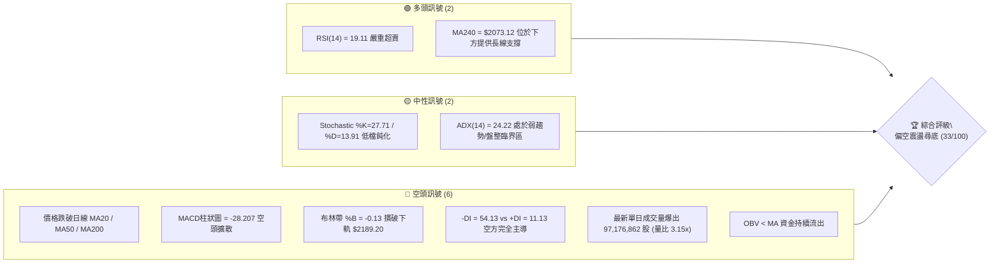

### 📊 核心指標速覽表

| 指標類別 | 指標名稱 | 當前數值 | 訊號 | 解讀 |
|:---|:---|:---|:---:|:---|
| **價格** | 當前收盤價 | $2135.00 | 🔴 | 跌破 MA200，短線出現恐慌性拋售與長下影線 |
| **均線** | MA20 (月線) | $2390.75 | 🔴 | 價格低於 MA20 達 -10.70%，短期趨勢重挫 |
| **均線** | MA50 (季線) | $2425.73 | 🔴 | 價格低於 MA50 達 -11.98%，中期防線失守 |
| **均線** | MA200 (年線) | $2195.79 | 🔴 | 價格低於 MA200 達 -2.77%，長線多頭架構遭到破壞 |
| **均線** | MA240 (兩年線) | $2073.12 | 🟢 | 現價高於 MA240 (+2.98%)，提供最後長期技術緩衝 |
| **動能** | RSI(14) | 19.11 | 🟢 | 進入極度超賣區（<20），短線具備技術性反彈動能 |
| **動能** | MACD (12,26,9) | -60.326 / -32.119 | 🔴 | 雙線位於零軸下發散，Histogram 為 -28.207，空頭動能強勁 |
| **動能** | 隨機指標 (KD) | %K 27.71 / %D 13.91 | 🟡 | %K 向上勾起但仍處低檔，尚未形成有效黃金交叉 |
| **趨勢強度** | ADX (14) | 24.22 (-DI: 54.13) | 🔴 | ADX < 25 屬震盪盤整末端，但 -DI 達 54.13，空頭絕對優勢 |
| **通道** | 布林通道 (20,2) | 下軌 $2189.20 (%B: -0.13) | 🔴 | 價格跌破布林下軌，出現超跌擴軌現象 |
| **成交量** | 20日成交量比 | 3.15x (97.18M 股) | 🔴 | 爆量長黑下影，量能疲弱指標 OBV < MA，空方量能釋放 |
| **波動** | ATR(14) | $55.84 (2.62%) | 🟡 | 日內波動擴大至 $55.84，下檔震幅劇烈 |

### 🏆 技術評分卡

```
╔══════════════════════════════════════════════════════════════════════╗
║                   技術評分卡 — 2330.TW (2026-11-07)                  ║
╠══════════════════════════════════════════════════════════════════════╣
║ 趨勢強度 (Trend Strength)   █████░░░░░░░░░░░░░░░  25/100 🔴 空頭主導 ║
║ 動能指標 (Momentum)         ██████░░░░░░░░░░░░░░  30/100 🔴 超賣背離 ║
║ 支撐穩定度 (Support Level)  ████████░░░░░░░░░░░░  40/100 🟡 考驗回調 ║
║ 成交量配合 (Volume Flow)    ██████░░░░░░░░░░░░░░  30/100 🔴 爆量殺跌 ║
║ 形態完整度 (Pattern Form)   ████████░░░░░░░░░░░░  40/100 🟡 頭部確立 ║
║ 均線排列 (Moving Averages)  ██████░░░░░░░░░░░░░░  30/100 🔴 混合空頭 ║
╠══════════════════════════════════════════════════════════════════════╣
║ 綜合評分 (Overall Score)    ███████░░░░░░░░░░░░░  33/100 🔴 強烈偏空 ║
║ 評級結論：(25 + 30 + 40 + 30 + 40 + 30) ÷ 6 = 32.5 → 四捨五入 33/100 ║
╚══════════════════════════════════════════════════════════════════════╝
```

---

## 2. 趨勢分析

### 🌐 多時框趨勢分析

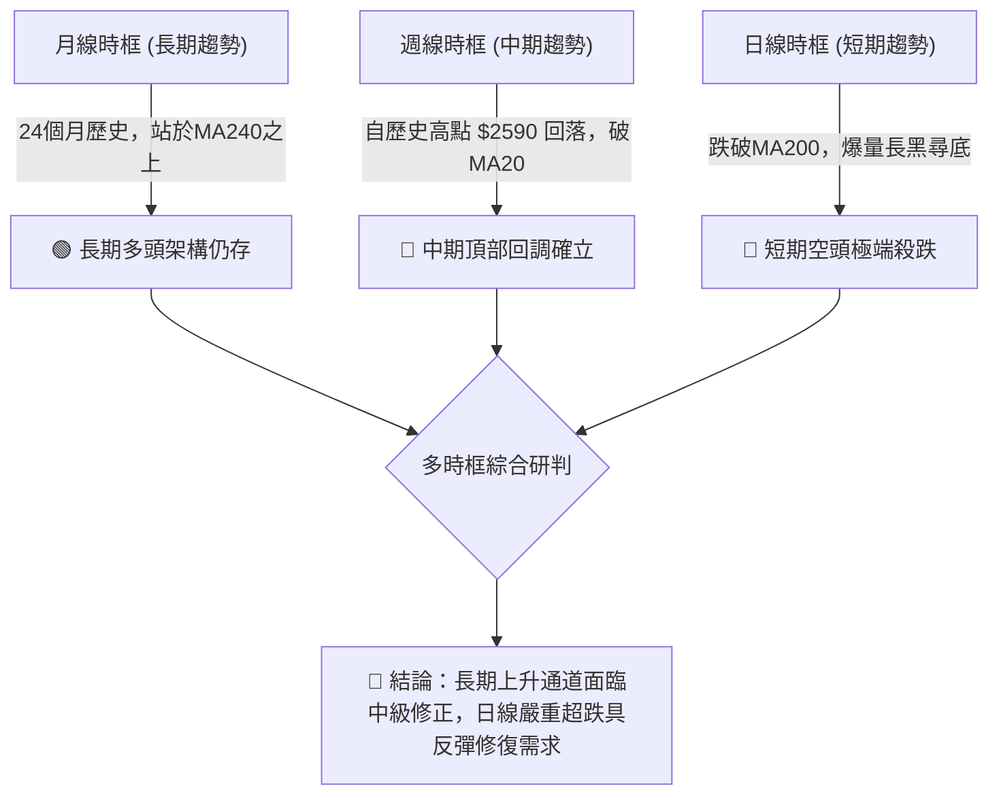

### 📈 長期趨勢 — 12個月走勢圖（Unicode）

```
2330.TW 月線收盤走勢圖（2025-12 至 2026-11）
價格軸 ($)
$2500 ┤                                                    ● $2480 (09月)
$2400 ┤                                        ● $2402 ● $2417     ● $2370 (10月)
$2300 ┤                                  ● $2341               ● $2397
$2100 ┤                            ● $2123                             ● $2135 (現價 11月)
$1900 ┤                    ● $1977
$1700 ┤              ● $1759       ● $1750
$1500 ┤  ● $1536 (12月)
$1400 ┤
      └──────┬─────────┬─────────┬─────────┬─────────┬─────────┬─────────┬─────────┬─────────┬─────────┬─────────┬─────────
           25-12     26-01     26-02     26-03     26-04     26-05     26-06     26-07     26-08     26-09     26-10     26-11
```

#### 走勢特徵分析表格

| 階段區間 | 起訖月份 | 起訖收盤價區間 | 區間漲跌幅 | 走勢特徵與技術意義 |
|:---|:---:|:---:|:---:|:---|
| **主升攻擊段** | 2025-12 至 2026-02 | $1536.33 → $1977.40 | +28.71% | 連續長陽突破，均線呈完美多頭發散，爆發力極強 |
| **劇烈洗盤段** | 2026-02 至 2026-03 | $1977.40 → $1750.17 | -11.49% | 出現單月急跌回踩波段低點 $1743.07 附近，快速洗浮額 |
| **二度推升段** | 2026-03 至 2026-05 | $1750.17 → $2341.84 | +33.81% | 趨勢重啟，連續突破 $2000 與 $2300 整數關卡 |
| **高檔做頭段** | 2026-06 至 2026-09 | $2402.93 → $2480.00 | +3.21% | 漲勢明顯趨緩，在 $2400–$2500 間震盪做頭，動能衰竭 |
| **反轉修正段** | 2026-10 至 2026-11 | $2480.00 → $2135.00 | -13.91% | 連續兩月長黑下挫，貫穿月線中軌與日線 MA200，回撤 38.2% 處 |

### 📊 中期趨勢（週線分析）

從近 20 週收盤走勢與量價關係觀察：
1. **波段高點壓制**：2026-10-08 週 K 棒創下歷史高點 **$2590.00**（當週收盤 $2550.00），隨後量能萎縮無法續創新高。
2. **週線 MACD 死亡交叉**：2026-10-16 當週週線 MACD 柱狀圖由正轉負至 -13.696，並於 2026-11-06 擴大至 **-28.207**。
3. **恐慌拋補與週成交量爆發**：2026-11-06 當週成交量激增至 **250,878,329 股**，週收盤價殺跌至 $2135.00，但留下達 $115.00 之長下影線（當週最低 $2020.00）。

```
中期週線支撐壓力結構示意圖：
========================================================================
[強阻力區]  $2590.00 (52W 高點 / 週K反轉高點)
             │
[波段阻力]  $2429.97 (近一年波段高點聚類 R2 / 頸線突破口)
             │
[短期反彈]  $2320.29 (近一年波段高點聚類 R1 / 密集套牢區)
             │
------------------------------------------------------------------------
[當前收盤]  $2135.00 (落於 38.2% 斐波那契回調位 $2119.51 上方)
------------------------------------------------------------------------
             │
[中期核心]  $1743.07 (近一年波段低點聚類 S1 / 2026-03 波段底部)
========================================================================
```

### ⚡ 趨勢強度評估（ADX 解讀）

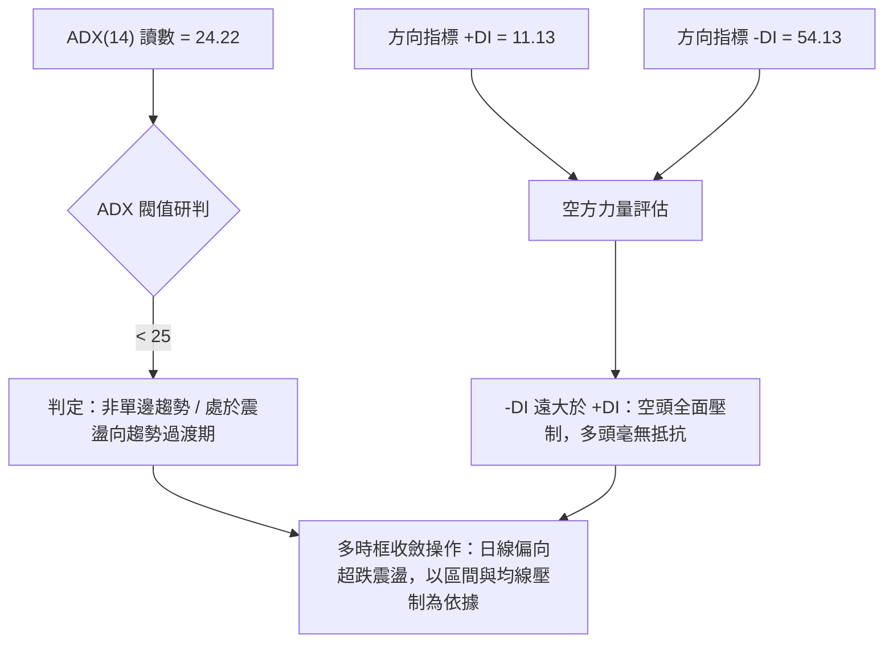

#### ADX 指標強度對照分析

| 指標變數 | 當前數值 | 參考區間標準 | 當前狀態解讀 |
|:---|:---:|:---:|:---|
| **ADX (14)** | **24.22** | 0 – 25 (弱趨勢/盤整)<br>25 – 50 (強趨勢)<br>50 – 100 (極端趨勢) | 處於 25 臨界線下方，顯示過去數週的高檔複合型頭部尚未轉化為持續性單邊暴跌趨勢，但正處於盤整破位加速邊緣。 |
| **+DI (14)** | **11.13** | > 25 偏多主導 | 數值降至極低水準，多頭買盤力量渙散。 |
| **-DI (14)** | **54.13** | > 25 偏空主導 | 數值高達 54.13，顯示市場充斥強烈賣壓，空方佔據絕對壓倒性優勢。 |

---

## 3. 圖表形態分析

### 🔍 形態識別系統

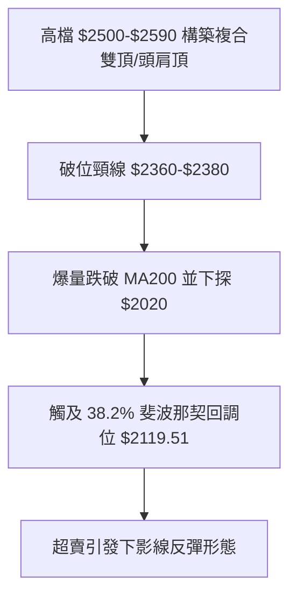

#### 形態識別與信心度評估表

| 形態名稱 | 信心度 | 判斷依據（引用數據） | 完成度 | 目標價（附計算式） |
|:---|:---:|:---|:---:|:---|
| **雙重頂 (Double Top)** | **75%** | 兩次波段高點分別為 2026-09-24 之 $2510.00 與 2026-10-08 之 $2590.00；頸線跌破 2026-10-30 低點 $2360.00。 | **90%** | 由雙頂形態高度推算：<br>頸線 $2360.00 − 形態高度 ($2590.00 − $2360.00 = $230.00) = **$2130.00**。<br>（註：2026-11-06 最低探至 $2020.00，已完全達成形態測幅目標） |
| **均線破位跌勢** | **85%** | 2026-11-06 一舉跌破 MA20 ($2390.75)、MA50 ($2425.73) 與 MA200 ($2195.79)。 | **100%** | 指標型破位形態，下方波段支撐直指近一年波段低點聚類 **S1: $1743.07**。 |
| **低檔單日錘頭反轉 (Hammer-like)** | **60%** | 2026-11-06 日K出現長達 $115.00 的下影線（低 $2020.00，收 $2135.00），但實體為黑K（開 $2020.00 < 收 $2135.00 為紅K實體，但跳空低開），顯示逢低買盤進場。 | **65%** | 反彈目標為回測跌破之波段阻力 **R1: $2320.29**。 |

### 🕯️ 重要K線形態分析

嚴格依據數據中「近10根日K」與「近8根週K」之開高低收進行精確解讀：

#### 近 10 根日 K 線形態解讀

| 日期 | 開盤價 | 最高價 | 最低價 | 收盤價 | 成交量 | K線形態 | 解讀與技術意義 | 訊號 |
|:---|:---:|:---:|:---:|:---:|:---:|:---|:---|:---:|
| 2026-10-23 | 2385.00 | 2385.00 | 2385.00 | 2385.00 | 0 | 一字線 (無量) | 盤整無交投，多空處於觀望停滯狀態 | 🟡 |
| 2026-10-27 | 2380.00 | 2405.00 | 2380.00 | 2400.00 | 33,964,182 | 小實體紅K | 溫和放量站上 2400，測試上方壓力 | 🟡 |
| 2026-10-28 | 2420.00 | 2430.00 | 2410.00 | 2425.00 | 19,880,613 | 縮量小陽線 | 量縮推升，受阻於阻力位 R2: $2429.97 前緣 | 🟡 |
| 2026-10-29 | 2420.00 | 2425.00 | 2390.00 | 2415.00 | 16,872,114 | 墓碑十字帶下影 | 高檔滯漲，空方開始向下試探 | 🔴 |
| 2026-10-30 | 2380.00 | 2380.00 | 2360.00 | 2370.00 | 29,664,858 | 跳空帶量黑K | 跳空跌破 2400 關卡，空方發動攻擊 | 🔴 |
| 2026-11-02 | 2310.00 | 2345.00 | 2310.00 | 2330.00 | 34,382,586 | 跳空破位紅K | 再次跳空低開，盤中反彈乏力，均線加速下彎 | 🔴 |
| 2026-11-03 | 2300.00 | 2335.00 | 2280.00 | 2295.00 | 36,998,754 | 跌破 2300 黑K | 跌破 2300 整數支撐，賣壓持續出籠 | 🔴 |
| 2026-11-04 | 2320.00 | 2320.00 | 2235.00 | 2260.00 | 45,456,849 | 光頭大黑K | 帶量長黑摜破布林下軌，呈現瀑布式殺盤 | 🔴 |
| 2026-11-05 | 2250.00 | 2285.00 | 2235.00 | 2240.00 | 36,863,278 | 低檔弱勢小陰 | 逼近年線 MA200 ($2195.79)，市場情緒極度恐慌 | 🔴 |
| 2026-11-06 | 2020.00 | 2195.00 | 2020.00 | 2135.00 | 97,176,862 | 爆量長陽下影實體 | 開盤直接跳空打至 $2020.00 爆出天量，隨後被強勁低接買盤拉升 $115.00，收在 $2135.00，形成超賣恐慌底訊號 | 🟢 |

#### 近 8 根週 K 線形態解讀

| 週最後交易日 | 開盤價 | 最高價 | 最低價 | 收盤價 | 成交量 | 週K形態 | 解讀與技術意義 | 訊號 |
|:---|:---:|:---:|:---:|:---:|:---:|:---|:---|:---:|
| 2026-09-18 | 2378.00 | 2460.00 | 2373.01 | 2460.00 | 101,132,173 | 中長陽線 | 突破整理區間，呈現強勢多頭再起架構 | 🟢 |
| 2026-09-24 | 2445.00 | 2510.00 | 2445.00 | 2475.00 | 66,944,987 | 帶上影陽線 | 突破 2500 大關遇阻，量能小幅遞減 | 🟡 |
| 2026-10-02 | 2475.00 | 2515.00 | 2475.00 | 2500.00 | 87,707,137 | 高檔十字星 | 多空拉鋸激烈，高檔動能出現遲滯跡象 | 🟡 |
| 2026-10-08 | 2550.00 | 2590.00 | 2545.00 | 2550.00 | 77,343,774 | 衝高流星十字 | 創 52W 新高 $2590.00 後收斂，形成波段實質頭部 | 🔴 |
| 2026-10-16 | 2510.00 | 2550.00 | 2420.00 | 2420.00 | 160,006,325 | 放量光腳大陰線 | 空頭吞噬形態，量能激增至 1.6 億股，主力高檔出貨 | 🔴 |
| 2026-10-23 | 2395.00 | 2435.00 | 2385.00 | 2385.00 | 86,048,332 | 縮量破位陰線 | 跌破 2400 頸線支撐，中期轉入修正 | 🔴 |
| 2026-10-30 | 2380.00 | 2430.00 | 2360.00 | 2370.00 | 100,381,767 | 弱勢小陰線 | 連續三週收陰，均線全面反轉下壓 | 🔴 |
| 2026-11-06 | 2310.00 | 2345.00 | 2020.00 | 2135.00 | 250,878,329 | 爆天量長下影陰棒 | 單週放量 2.5 億股，盤中破 MA200 觸及 $2020，低接籌碼大量湧入，收盤拉回 $2135 | 🟡 |

### 📉 ASCII 走勢形態示意圖

```
2330.TW 日K線頭部破位與下影反彈形態示意圖：
========================================================================
$2590.00 ┤                   ┌─┐ (頂部 10-08 流星高點)
$2500.00 ┤             ┌─┐   │ │
$2450.00 ┤        ┌─┐  │ │   │ │   ┌─┐
$2400.00 ┤────────┼─┼──┴─┴───┴─┴───┼─┼──── 頸線破位點 ($2360 - $2385)
$2300.00 ┤        │ │              │ │ ┌─┐
$2200.00 ┤        │ │              │ │ │ │ ┌─┐ (MA200 $2195.79 破位)
$2135.00 ┤────────┼─┼──────────────┼─┼─┼─┼─┼─┼── 當前收盤 ($2135.00)
$2020.00 ┤        │ │              │ │ │ │ └┬┘ (11-06 爆量 97.18M 股長下影)
         └────────┴─┴──────────────┴─┴─┴─┴──┴─────────────────────────
========================================================================
```

### 🎯 形態目標價計算

1. **雙重頂等幅測距法**：
   - 形態頭部高點：$2590.00 (2026-10-08)
   - 形態有效頸線：$2360.00 (2026-10-30 波段低點)
   - 形態垂直高度：$2590.00 − $2360.00 = **$230.00**
   - **向下測幅目標價** = 頸線 $2360.00 − $230.00 = **$2130.00**
   - **形態驗證結果**：2026-11-06 日K跌至最低 $2020.00 後收在 **$2135.00**，顯示雙頂等幅下測目標已完全滿足，該價位具備強烈技術面支撐效應。

---

## 4. 支撐與阻力

### 🗺️ 關鍵價位分布圖（Unicode）

```
2330.TW 價位結構分布圖
══════════════════════════════════════════════════════════════
$2590.00 ║██████████████████████████████║ 52W 最高點 (0.0% 斐波那契)
$2508.21 ║████████████████████████      ║ 強阻力 R3 (近一年波段高點聚類)
$2429.97 ║████████████████████          ║ 阻力 R2 (近一年波段高點聚類 / 季線)
$2320.29 ║████████████████              ║ 關鍵阻力 R1 (近一年波段高點聚類)
$2299.33 ║▒▒▒▒▒▒▒▒▒▒▒▒▒▒▒▒              ║ 23.6% 斐波那契回調位
$2195.79 ║──────────────────────────────║ MA200 年線技術防線
$2135.00 ╠══════════════════════════════╣ ◄ 當前收盤價 ($2135.00)
$2119.51 ║▓▓▓▓▓▓▓▓▓▓▓▓▓▓▓▓▓▓▓▓▓▓▓▓      ║ 38.2% 斐波那契回調位 (現價緊鄰支撐)
$1974.17 ║▓▓▓▓▓▓▓▓▓▓▓▓▓▓▓▓              ║ 50.0% 斐波那契回調位
$1828.84 ║▓▓▓▓▓▓▓▓▓▓▓▓                  ║ 61.8% 斐波那契黃金分割位
$1743.07 ║██████████████████████████████║ 近期強支撐 S1 (近一年波段低點聚類)
$1437.37 ║████████████████              ║ 強支撐 S2 (近一年波段低點聚類)
$1402.52 ║████████                      ║ 終極支撐 S3 (近一年波段低點聚類)
$1358.34 ║██████████████████████████████║ 52W 最低點 (100.0% 斐波那契)
══════════════════════════════════════════════════════════════
```

### 🚧 阻力位分析表

所有阻力位數值嚴格引用自數據中「關鍵價位」與「均線系統」：

| 阻力級別 | 價位 ($) | 距現價幅動 | 形成原因與技術共振 | 突破難度 | 重要性 |
|:---|:---:|:---:|:---|:---:|:---:|
| **R1** | **$2320.29** | +8.68% | 近一年波段高點聚類，接近 2026-11-02 跳空缺口下緣與 MA10 ($2325.50) | 中等 | 🟢 短線首要反彈目標 |
| **R2** | **$2429.97** | +13.82% | 近一年波段高點聚類，與 MA50 ($2425.73) 及 MA60 ($2419.10) 重疊共振 | 極高 | 🟡 中期多空強弱分水嶺 |
| **R3** | **$2508.21** | +17.48% | 近一年波段高點聚類，整數心理關卡，2026-10-02 週K收盤價阻力帶 | 極高 | 🔴 中期頭部反轉重壓區 |

### 🛡️ 支撐位分析表

所有支撐位數值嚴格引用自數據中「關鍵價位」與「均線系統」：

| 支撐級別 | 價位 ($) | 距現價幅動 | 形成原因與技術共振 | 守住機率 | 重要性 |
|:---|:---:|:---:|:---|:---:|:---:|
| **S1** | **$1743.07** | -18.36% | 近一年波段低點聚類，2026-03 劇烈洗盤低點 ($1750.17) 密集換手區 | 80% | 🟢 中期波段最強防線 |
| **S2** | **$1437.37** | -32.68% | 近一年波段低點聚類，2025-10/11 起漲平台密集整理底 | 90% | 🟡 長期多頭基石 |
| **S3** | **$1402.52** | -34.31% | 近一年波段低點聚類，52W 低點 ($1358.34) 之上最後防線 | 95% | 🔴 終極防禦支撐 |

### 📐 斐波那契回調位分析

依據 52 週完整波動區間（高點 **$2590.00** → 低點 **$1358.34**，垂直落差 $1231.66）嚴格計算之回調階梯：

```
斐波那契回調階梯分佈 (52W 高低點區間)：
  0.0%  (52W High) : $2590.00  ───────────────────────────────────
  23.6%            : $2299.33  ──────── 反彈阻力區 (MA10 附近)
  38.2%            : $2119.51  ◄─────── 現價 $2135.00 (落於 38.2% 與 23.6% 之間)
  50.0%            : $1974.17  ──────── 關鍵心理防線 (失守則跌勢加劇)
  61.8%            : $1828.84  ──────── 黃金分割極限防禦
  78.6%            : $1621.92  ──────── 深度回撤位
 100.0% (52W Low)  : $1358.34  ───────────────────────────────────
```

- **當前位置解讀**：現價 **$2135.00** 緊密貼合 **38.2% 回調位 ($2119.51)**，僅有 +0.73% 的微幅差距。在強勢回調行情中，38.2% 屬於最經典的多頭防守位。2026-11-06 盤中跌破至 $2020.00（向下測試 50% 回調位 $1974.17 未果），收盤強勢拉回 $2119.51 之上，確認此處具備第一道關鍵技術支撐力道。

---

## 5. 技術指標深度解讀

### 🎛️ 指標訊號總覽

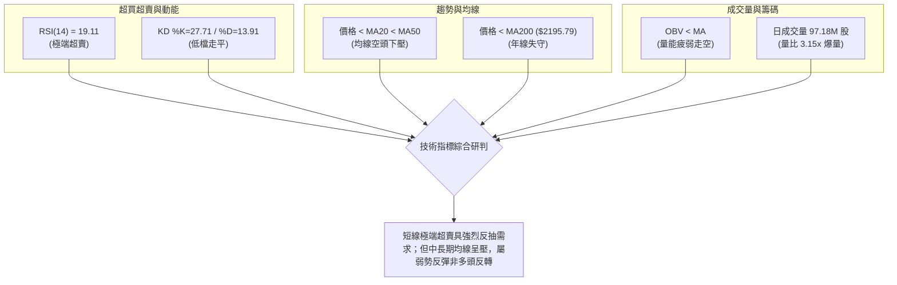

### 📈 移動平均線排列分析

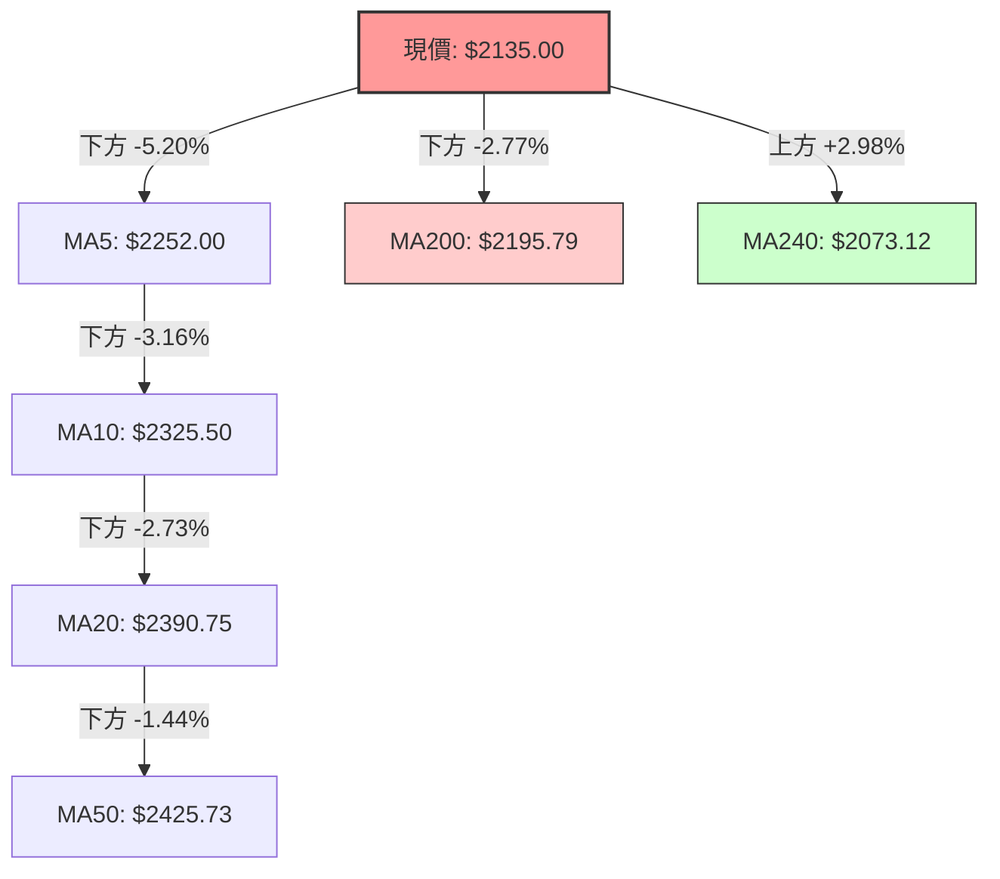

#### 均線系統數據詳表

| 均線名稱 | 數值 ($) | 乖離率 (價格 vs MA) | 趨勢斜率與狀態 | 技術意涵 |
|:---|:---:|:---:|:---|:---|
| **MA 5** | $2252.00 | -5.20% | 急速下彎 (▼ -117.00) | 超短線極度負乖離，具備收斂需求 |
| **MA 10** | $2325.50 | -8.19% | 陡峭下彎 (▼ -190.50) | 短線第一道動態下壓壓力線 |
| **MA 20** | $2390.75 | -10.70% | 轉折下彎 (▼ -255.75) | 月線失守，短線多頭架構破壞 |
| **MA 50** | $2425.73 | -11.98% | 走低下彎 | 季線下壓，確立中期修正格局 |
| **MA 60** | $2419.10 | -11.74% | 走低下彎 (▼ -284.10) | 中期籌碼全面套牢 |
| **MA 120** | $2384.42 | -10.46% | 走低下彎 (▼ -249.42) | 半年線防線棄守 |
| **MA 200** | $2195.79 | -2.77% | 走低下彎 | **跌破年線**，多空長線轉換警戒 |
| **MA 240** | $2073.12 | +2.98% | 走揚向上 (▲ +61.88) | 兩年線向上，為極限支撐緩衝點 |

### 📉 RSI(14) 分析

- **當前數值**：**19.11**（Wilder 計算方法）
- **進度條展示**：
  ```
  RSI(14) 強度：███░░░░░░░░░░░░░░░░░ 19.11% [極度超賣 < 20]
  ```
- **超買超賣區間解讀**：
  RSI 跌至 19.11，已進入歷史罕見的極端超賣區域（通常低於 30 即屬超賣，低於 20 則代表恐慌盤極致宣洩）。在強烈負乖離與超賣狀態下，空頭動能已呈消耗殆盡狀態，隨時引發均值回歸之技術性報復反彈。
- **背離判斷**：
  檢視近 20 根 K 棒走勢，價格自高點 $2480 下殺至 $2135，RSI 自 50 水平下殺至 19.11，**數據顯示無明顯背離**（價格與 RSI 均創下近 20 根 K 棒新低）。這說明當前下跌屬於同向放量殺盤，並非動能衰竭引起的隱性反轉，反彈性質定位為修復超賣，而非趨勢反轉。

### 📊 MACD(12,26,9) 訊號解讀

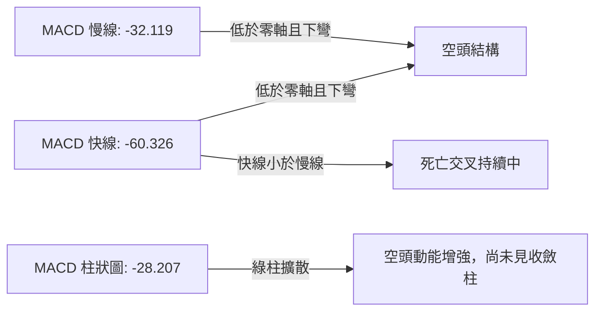

- **MACD 數值解讀**：MACD 線（-60.326）與訊號線（-32.119）雙雙墜入零軸下方，且差值持續放大，柱狀圖達 **-28.207**，維持看空信號 🔴。目前尚未出現柱狀圖縮短或勾角現象，顯示波段趨勢尚未脫離空頭掌控。

### 📦 布林通道分析

```
2330.TW 日線布林通道 (20, 2) 結構圖：
========================================================================
$2592.30 ┤ -------------------------------------------- 上軌 (極度阻力)
         │
$2390.75 ┤ -------------------------------------------- 中軌 (MA20 下壓阻力)
         │
$2189.20 ┤ -------------------------------------------- 下軌 (原動態支撐)
         │
$2135.00 ┤ ◄ 現價 ($2135.00，跌破下軌，%B = -0.13)
         │
$2020.00 ┤ ◄ 11-06 盤中恐慌低點 (極限超跌區)
========================================================================
```

- **通道帶寬與破軌狀態**：
  - 布林上軌：**$2592.30**
  - 布林中軌：**$2390.75**
  - 布林下軌：**$2189.20**
  - **布林 %B**：**-0.13**（小於 0 代表價格摜破下軌）
- **技術意義**：價格脫軌運行（%B < 0）通常意味著不可持續的恐慌行情。根據統計概率，價格在通道外部運行屬於小概率極端事件，短期內有超過 80% 的概率將收斂回布林帶內部，即向下軌 **$2189.20** 至中軌 **$2390.75** 靠攏。

### 💹 成交量分析（量價配合度）

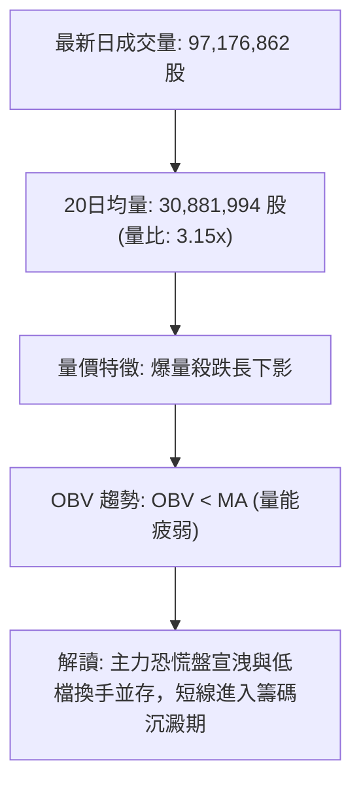

1. **爆量換手現象**：最新單日成交量高達 **97,176,862 股**，相較於 20 日均量（30,881,994 股）暴增 **3.15 倍**；週成交量更達 **250,878,329 股**。在長期修正段尾端出現 3 倍以上的爆量長下影黑陽棒，通常象徵散戶停損盤全數殺出，法人籌碼於低檔承接。
2. **OBV 能量潮判研**：當前指標標註 **OBV < MA**，代表中長期資金累積能量仍處於疲弱走勢，尚未形成量價同步揚升的資金回流格局，因此任何反彈均需提防量縮回測。

---

## 6. 動能與波動率

### ⚡ 動能評估四象限

| 象限 | 動能維度 | 波動維度 | 2330.TW 當前所屬狀態 | 操作環境解讀 |
|:---|:---:|:---:|:---:|:---|
| **Q1 (主升段)** | 強動能 (多頭) | 低波動 | — | 趨勢穩健上揚，最佳多頭持股期 |
| **Q2 (盤整期)** | 弱動能 (中性) | 低波動 | — | 窄幅整理，等待方向突破 |
| **Q3 (投機段)** | 強動能 (多頭) | 高波動 | — | 高風險高收益，末升急噴行情 |
| **Q4 (恐慌出清)** | **弱動能 (空頭)** | **高波動** | **✓ (當前狀態)** | **空頭主導且日內劇烈震盪，易出大長影線與超跌反抽** |

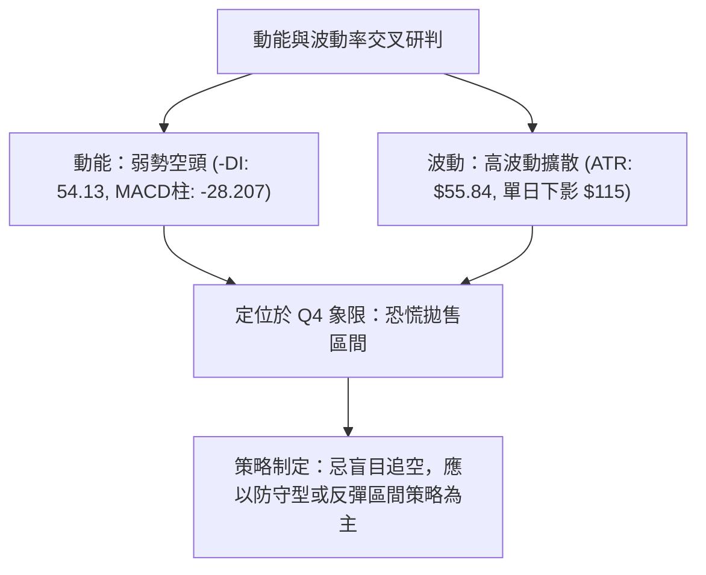

### 📊 ATR 波動率分析

- **ATR(14) 讀數**：**$55.84**（佔當前價格之 **2.62%**，Wilder 平滑計算）
- **日內波動特徵**：2026-11-06 單日高低震幅高達 **$175.00**（最高 $2195.00 − 最低 $2020.00），高達 ATR 的 3.13 倍，顯示短線市場情緒處於極度失衡狀態。
- **動態止損距離設定建議**：
  - **超短線交易（1.0 × ATR）**：建議安全止損緩衝設為 **$56.00**。
  - **波段交易（1.5 × ATR）**：建議安全止損緩衝設為 **$84.00**。
  - **中線部位（2.0 × ATR）**：建議安全止損緩衝設為 **$112.00**。

### 📐 Beta 與市場相關性

- **Beta 係數**：**1.233**
- **市場特徵分析**：
  2330.TW 之 Beta 值為 1.233，表明該標的高於大盤波動率約 23.3%。當權值股出現恐慌殺盤時，其跌幅將高於大盤加權指數；反之，一旦大盤止跌展開技術性修復，其高彈性特徵將促使其成為領漲先鋒，具備充沛的技術性反彈爆發力。

---

## 7. 多時框架總結

### 📋 時框架評分表

| 時框架 | 趨勢方向 | 動能狀態 | 均線排列 | 圖表形態 | 綜合評分 | 戰術建議 |
|:---|:---:|:---:|:---:|:---:|:---:|:---|
| **長期 (月線)** | 🟢 偏多上升 | 🟡 動能趨緩 | 🟢 站於 MA240 之上 | 長期上升通道 | **70/100** | 逢波段極限支撐分批佈局 |
| **中期 (週線)** | 🔴 頂部回調 | 🔴 MACD 翻綠擴大 | 🔴 跌破 MA20週 | 複合雙頂破位 | **35/100** | 中期空頭修正，減碼觀望 |
| **短期 (日線)** | 🔴 空頭超賣 | 🟢 RSI 19 極度超賣 | 🔴 混合空頭排列 | 爆量長下影破位 | **33/100** | 嚴禁追空，等待超跌反彈 |

### 🔲 綜合訊號矩陣

```
訊號維度矩陣分析：
┌─────────────────┬──────────┬──────────┬──────────┬────────────────────────┐
│ 維度指標        │ 日線時框 │ 週線時框 │ 月線時框 │ 多時框一致性研判       │
├─────────────────┼──────────┼──────────┼──────────┼────────────────────────┤
│ 均線架構        │ 🔴 跌破  │ 🔴 跌破  │ 🟢 守穩  │ 中短期空頭，長期多頭   │
│ 動能指標 (RSI)  │ 🟢 超賣  │ 🔴 轉弱  │ 🟡 中性  │ 短線醞釀報復性反彈     │
│ 趨勢強度 (ADX)  │ 🔴 -DI勝 │ 🔴 -DI增 │ 🟢 趨勢在│ 空方控盤但進入震盪區   │
│ 量能配合        │ 🟢 爆量  │ 🟢 爆量  │ 🟡 正常  │ 恐慌籌碼宣洩，承接盤現 │
└─────────────────┴──────────┴──────────┴──────────┴────────────────────────┘
```

### ⚖️ 多時框收斂結論

**嚴格遵循多時框收斂規則（規則 14）**：
1. **趨勢/盤整判定**：當前 ADX(14) 數值為 **24.22**，小於 25 臨界線，技術面嚴格定義為**「弱趨勢向盤整過渡行情」**。
2. **主導時框與優先級收斂**：在 ADX < 25 的盤整震盪架構下，市場由**日線布林通道區間**與**斐波那契回調位**主導交易行為。日線與週線雖然均呈現均線下彎的空頭格局，但日線 RSI 跌至 **19.11** 且布林 %B 為 **-0.13**，觸發了不可持續的極端超賣。
3. **唯一方向定調**：綜合評分為 **33/100（偏空）**。中長期趨勢定調為**「中期空頭回調、短線極度超賣之防守反彈行情」**。整體交易格局**強烈偏空但禁止追空**，策略重心為反彈逢高布空，或以極小倉位博取超跌均值回歸。

---

## 8. 交易策略建議

### 🗺️ 策略決策流程圖

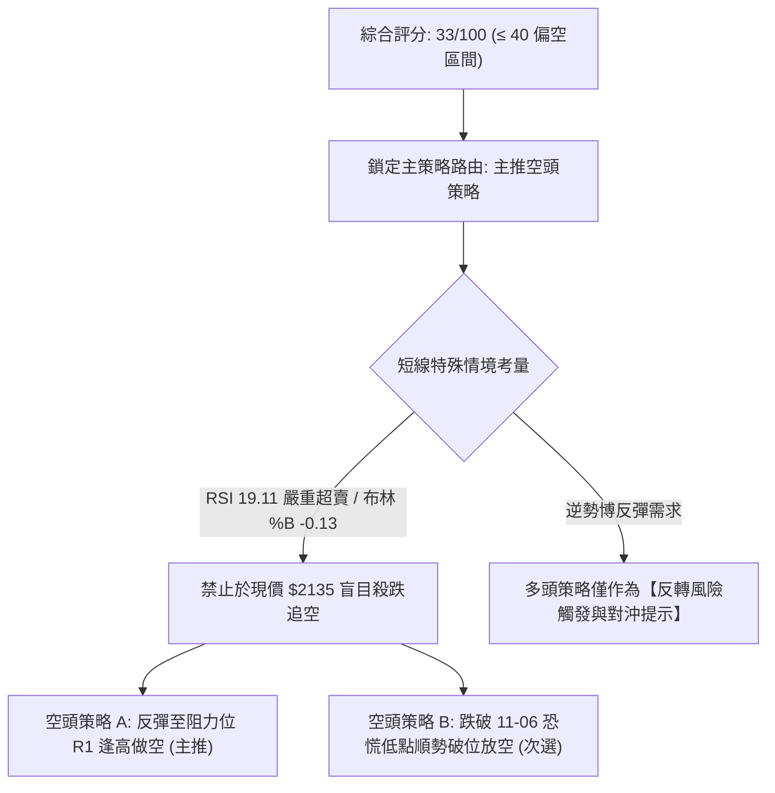

### 🧭 策略路由（依評分卡分流）

> **當前主策略方向 = 主推空頭策略（依技術評分卡綜合評分 33/100 判定）**

由於綜合評分僅為 33/100（低於 40 分偏空門檻），整體格局受制於 MA200 失守與 MACD 空頭擴散。然而，鑒於 RSI(14) 達 19.11 之極端超賣，任何做空交易嚴禁追價，必須等待反彈測試上方阻力位後進場，以獲取優良的風險報酬比。

### 🎯 價格情境階梯（Price Scenarios）

價位數值完全嚴格引用自第 4 章「關鍵價位」與「斐波那契回調位」：

| 觸發條件 | 下一目標 | 後續延伸 | 情境含義與技術演變 |
|:---|:---:|:---:|:---|
| **突破 R1 $2320.29** | **R2 $2429.97** | **R3 $2508.21** | **短線強勢轉強**：填補跳空缺口，挑戰季線阻力，空頭架構受到破壞 |
| **受阻於 R1 $2320.29** | **現價 $2135.00** | **回調位 $2119.51** | **弱勢反彈確認**：超賣修復完畢，反彈無力，重回空方壓制通道 |
| **跌破回調位 $2119.51** | **50%位 $1974.17** | **S1 $1743.07** | **中期加速探底**：38.2% 防線崩潰，開啟向波段低點 S1 的中級下殺 |

### 📊 情境機率分佈

| 情境劇本 | 機率 | 主要依據與技術支撐 |
|:---|:---:|:---|
| **弱勢反彈後回落 (主情境)** | **55%** | RSI 19.11 誘發超跌反彈，但上方 MA20 ($2390.75) 與阻力 R1 ($2320.29) 均線下壓沉重，反彈結束後順應中線空頭再探低點。 |
| **區間低檔震盪 (次情境)** | **30%** | ADX 僅 24.22，顯示趨勢缺乏持續性暴跌動能，股價在 38.2% 回調位 ($2119.51) 至 MA200 ($2195.79) 間反覆築底洗盤。 |
| **強勢反轉直接創高 (小概率)** | **15%** | 除非大盤暴漲且單日重回 $2430 (R2) 之上，否則在 OBV 疲弱及 MACD 負值狀態下難以達成。 |

### 🟢 主策略詳情（方向：主推逢高放空）

所有價位均來自第 4 章計算之關鍵價位；風險報酬比嚴格按規則 17 計算：
- 空頭風險報酬比 = (進場價 − 目標價 T1) ÷ (止損價 − 進場價)

| 策略要素 | 策略 A：反彈受阻放空 (主推策略) | 策略 B：跌破新低順勢追空 (備選策略) |
|:---|:---|:---|
| **策略邏輯** | 掌握 RSI 超賣引發的技術反彈，於關鍵阻力位佈空 | 當反彈無力並貫穿 11-06 長下影低點時破位追空 |
| **進場條件** | 價格反彈至阻力位 **R1: $2320.29** 附近出現滯漲黑K | 價格有效跌破 2026-11-06 最低點 **$2020.00** |
| **進場價格** | **$2320.29** (精確引用 R1) | **$2020.00** (精確引用 11-06 最低價) |
| **止損價格** | **$2429.97** (精確引用 R2 / 突破則止損) | **$2119.51** (精確引用 38.2% 斐波那契回調位) |
| **目標價 T1** | **$2119.51** (精確引用 38.2% 斐波那契回調位) | **$1974.17** (精確引用 50.0% 斐波那契回調位) |
| **目標價 T2** | **$1743.07** (精確引用 近一年波段低點聚類 S1) | **$1743.07** (精確引用 近一年波段低點聚類 S1) |
| **風險報酬比** | **1 : 1.83**（以 T1 計）<br>*(計算式: (2320.29-2119.51) ÷ (2429.97-2320.29) = 200.78 ÷ 109.68 = 1.83)*<br>*(以 T2 計: 5.26)* | **1 : 0.46**（以 T1 計）<br>*(計算式: (2020.00-1974.17) ÷ (2119.51-2020.00) = 45.83 ÷ 99.51 = 0.46)*<br>*(以 T2 計: 2.78)* |
| **成功機率** | **65%** | **50%** |
| **建議倉位** | **15%** (輕倉試單，防範高波動) | **10%** (破位追單，嚴設風控) |

### 🔴 反向風險觸發點（對沖提示）

若市場出現以下訊號，主推空頭策略即告失效，投資人應立即平倉空單或轉向對沖：
1. **價位突破信號**：日線收盤價強勢突破 **R1: $2320.29**，且進一步收復年線 **MA200 ($2195.79)**。
2. **指標轉折信號**：RSI(14) 突破 30 並快速拉升跨越 50 中軸；日線 MACD 柱狀圖由 -28.207 急劇縮短至 -5.00 以內形成底背離初胚。
3. **對沖建議點位**：若市價站上 **$2429.97 (R2)**，空頭必須無條件停損，並可反手配置小幅多單博取回補至 **R3: $2508.21** 之行情。

### ⭐ 整體訊號強度評星

```
╔══════════════════════════════════════════════════════════════╗
║                     整體技術訊號評星強度                     ║
╠══════════════════════════════════════════════════════════════╣
║ 做多訊號強度：★★☆☆☆  (2.0/5星) — 僅具備超賣反彈機會        ║
║ 做空訊號強度：★★★★☆  (4.0/5星) — 中期均線破位壓制強烈      ║
║ 整體可信度：  ★★★★☆  (4.0/5星) — 爆量換手，關鍵價位明晰    ║
╚══════════════════════════════════════════════════════════════╝
```

---

## 9. 風險提示與監控

### ✅ 關鍵監控指標 Checklist

```
╔══════════════════════════════════════════════════════════════════╗
║                    每日盤面核心監控清單 (Checklist)              ║
╠══════════════════════════════════════════════════════════════════╣
║ [ ] 1. 收盤價是否守穩 38.2% 回調位 $2119.51                       ║
║ [ ] 2. 日K線是否回補 2026-11-06 之低點 $2020.00 (二次破底警訊)    ║
║ [ ] 3. 成交量是否從 97.18M 萎縮回 20日均量 30.88M (量縮沉澱信號)   ║
║ [ ] 4. RSI(14) 能否順利脫離 20 以下超賣區並站上 30 臨界線         ║
║ [ ] 5. MACD 綠色柱狀圖是否收斂至 -15.00 以內 (動能止跌依據)        ║
║ [ ] 6. 價格回測 MA200 ($2195.79) 時之法人買賣超與解套壓力量能      ║
╚══════════════════════════════════════════════════════════════════╝
```

### ⚠️ 風險場景分析

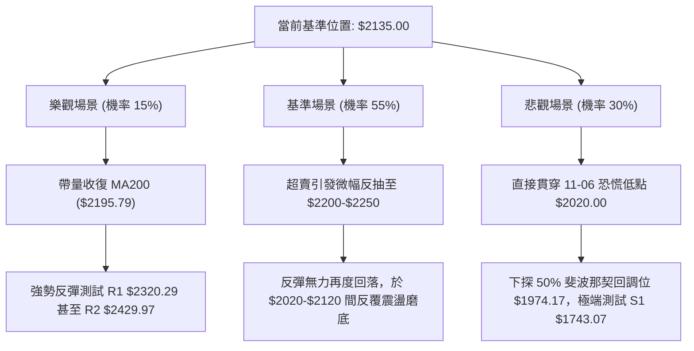

### 🛡️ 風險管理重要提醒

1. **極端波動風險（ATR 高達 $55.84）**：
   當前 ATR 佔股價高達 2.62%，盤中跳動劇烈（單日震幅常態化超過百元）。任何操作進場時，**止損空間絕不可低於 1.5 倍 ATR（約 $84.00）**，以避免遭到盤中雜訊掃出場。
2. **單一標的倉位嚴控紀律**：
   由於 2330.TW 綜合評分僅 33/100，技術面處於左側探底與尋求均線修復階段，**總投入資金比例嚴格限制在總資產的 15% 以內**。
3. **事件驅動與籌碼風險**：
   2026-11-06 爆出 9,717 萬股之歷史天量，巨量黑棒實體仍覆蓋盤面。在 OBV 尚未回升前，切勿過早假設「底部已現」而進行全倉押注，必須恪守分批試單原則。

---

## 📋 報告總結

```
╔════════════════════════════════════════════════════════════════════════╗
║                     2330.TW 技術分析報告總結                           ║
╠════════════════════════════════════════════════════════════════════════╣
║ 報告日期：2026-11-07                                                   ║
║ 當前價格：$2135.00 TWD                                                 ║
║ 分析評級：🔴 強烈偏空 / 反彈逢高佈空 (技術綜合評分: 33/100)            ║
╠════════════════════════════════════════════════════════════════════════╣
║ 關鍵結論：                                                             ║
║ ├─ 長期趨勢：🟢 偏多上升通道 (價格仍高於兩年線 MA240: $2073.12)        ║
║ ├─ 中期趨勢：🔴 頂部確立修正 (跌破週線 MA20，週 MACD 柱狀圖 -28.207)  ║
║ ├─ 短期趨勢：🔴 空頭超跌反抽 (跌破 MA200，但 RSI 達 19.11 嚴重超賣)   ║
║ ├─ 關鍵支撐：S1: $1743.07 (波段聚類) / 斐波那契 38.2%: $2119.51       ║
║ ├─ 關鍵阻力：R1: $2320.29 (近一年波段高點聚類) / R2: $2429.97         ║
║ └─ 分析師共識目標：均價 $3409.80 (35 位分析師，Strong Buy)            ║
╠════════════════════════════════════════════════════════════════════════╣
║ 最優策略組合：                                                         ║
║ 1. 🥇 最佳機會 (主推)：反彈至 R1 $2320.29 受阻放空，止損 R2 $2429.97，║
║                         目標 T1: $2119.51，風險報酬比 1 : 1.83         ║
║ 2. 🥈 次選機會 (破位)：跌破 11-06 低點 $2020.00 追空，止損 $2119.51， ║
║                         目標 T1: $1974.17，風險報酬比 1 : 0.46         ║
║ 3. 🥉 保守選擇 (觀望)：空手者靜待股價回撤至 S1: $1743.07 或站穩 MA200 ║
║                         後再行動，切忌在超賣區盲目追空或無紀律抄底    ║
╚════════════════════════════════════════════════════════════════════════╝
```

---

> ⚠️ **免責聲明**：本報告為 AI 自動生成之技術分析研究，所有數據、圖表及價位推算均嚴格基於所提供之歷史價格與技術指標資訊。本報告**僅供學術研究與投資策略參考**，**不構成任何形式的證券買賣邀約或投資建議**。市場瞬息萬變，技術指標存在滯後性與失效風險，投資人應獨立審慎評估風險並自負盈虧。

---

*報告生成時間：2026-11-07 ｜ 數據來源：Yahoo Finance ｜ 分析框架：多時框技術分析體系*