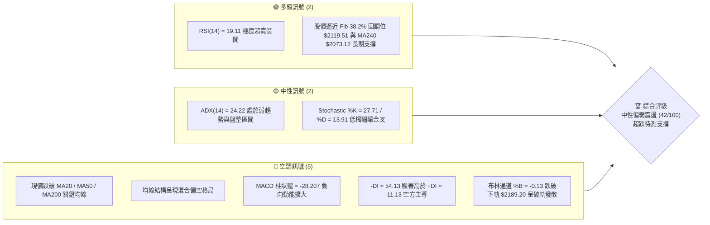
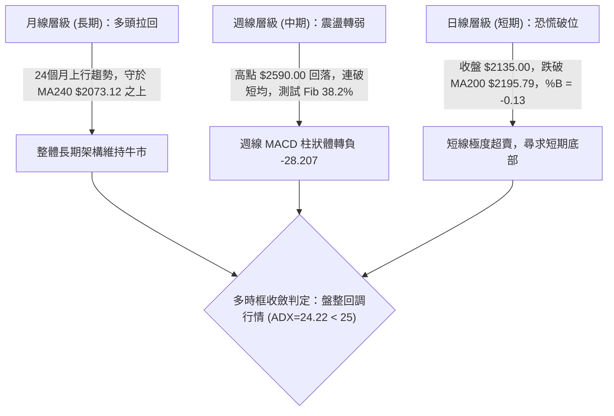
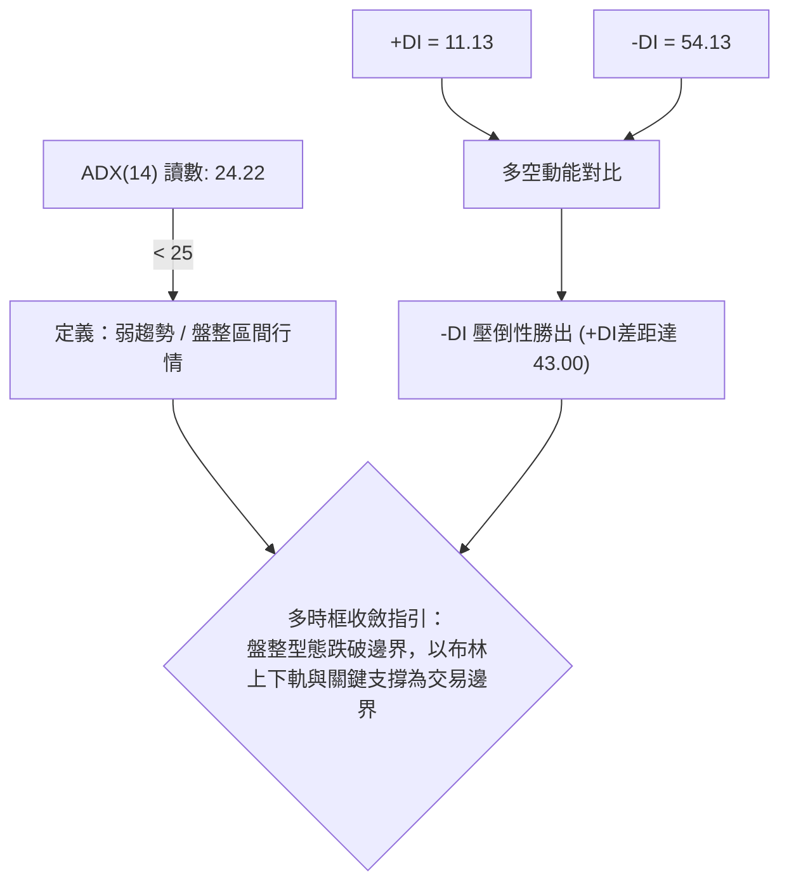
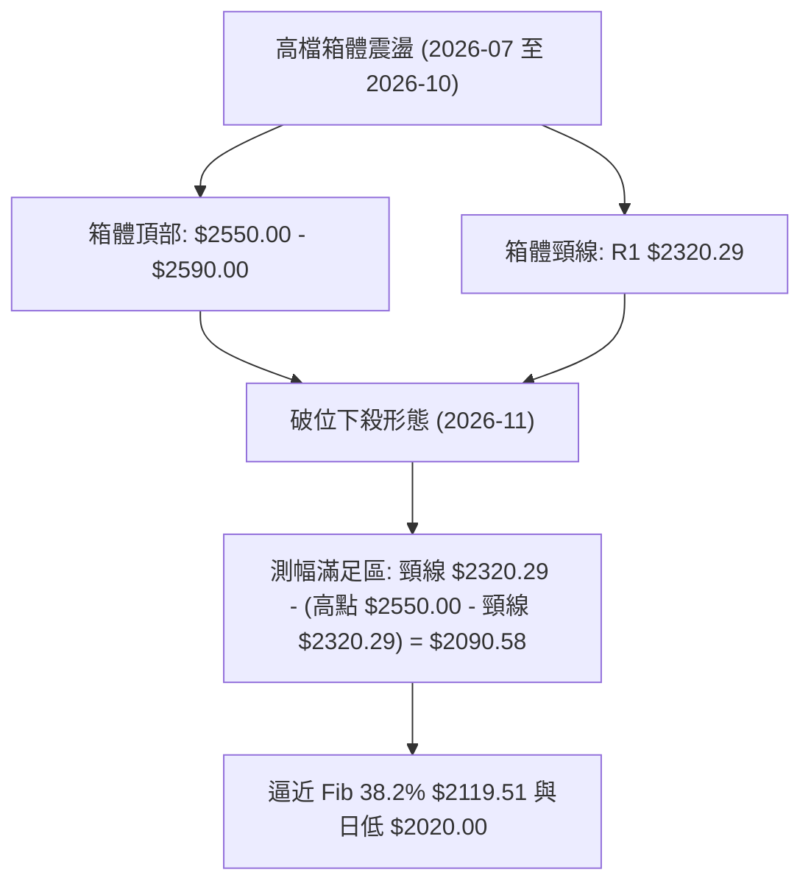
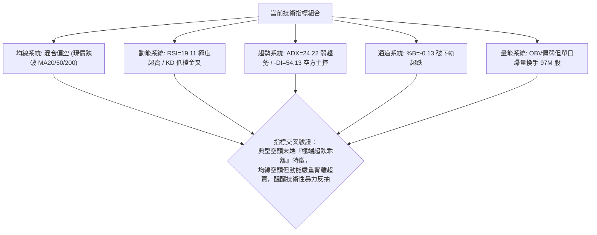
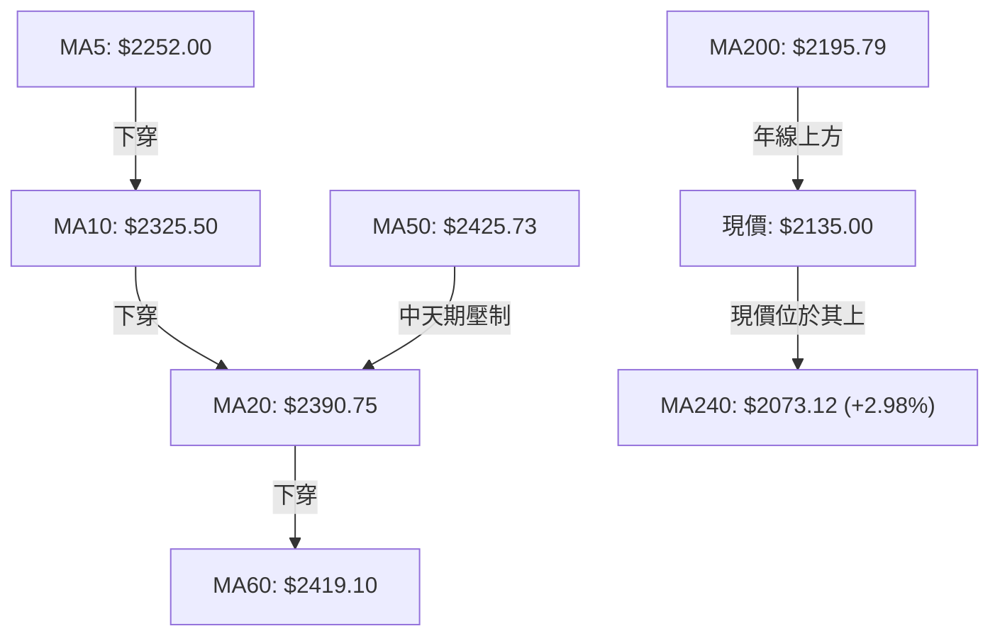
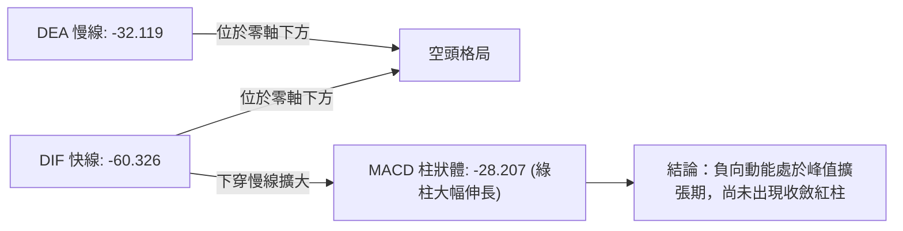
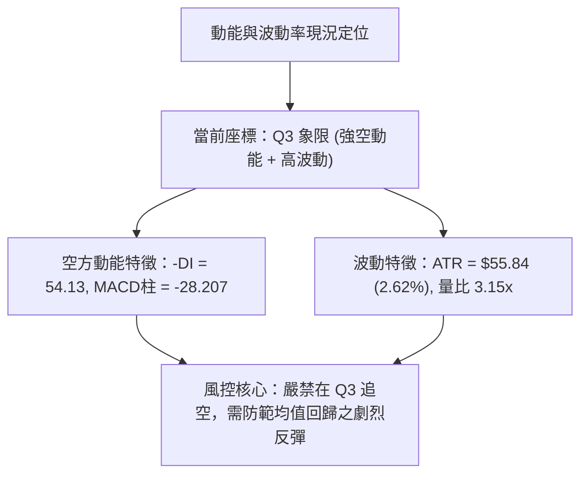
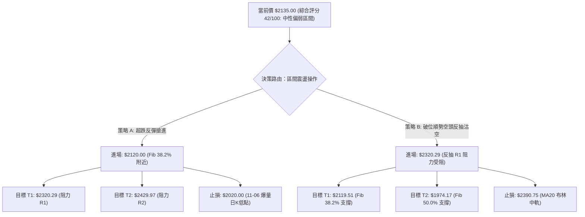
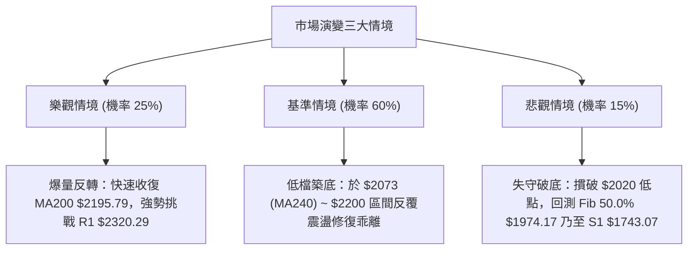

# 2330.TW 技術分析報告

> **報告日期**：2026-11-08 ｜ **語言**：繁體中文 ｜ **數據來源**：Yahoo Finance ｜ **當前價格**：$2135.00 TWD

---

## 目錄

| 章節 | 內容 |
|------|------|
| [1. 技術面概覽](#1-技術面概覽) | 訊號儀表板、核心指標、評分卡 |
| [2. 趨勢分析](#2-趨勢分析) | 多時框趨勢、長中短期走勢 |
| [3. 圖表形態分析](#3-圖表形態分析) | 形態識別、K線組合、目標價 |
| [4. 支撐與阻力](#4-支撐與阻力) | 關鍵價位、斐波那契回調 |
| [5. 技術指標深度解讀](#5-技術指標深度解讀) | MA/RSI/MACD/布林/成交量 |
| [6. 動能與波動率](#6-動能與波動率) | 動能評估、ATR、Beta |
| [7. 多時框架總結](#7-多時框架總結) | 時框架評分矩陣 |
| [8. 交易策略建議](#8-交易策略建議) | 多空策略、風險報酬比 |
| [9. 風險提示與監控](#9-風險提示與監控) | 監控指標、風險場景 |

---

## 1. 技術面概覽

### 🎯 技術訊號儀表板



### 📊 核心指標速覽表

| 指標類別 | 指標名稱 | 當前數值 | 訊號 | 解讀 |
|----------|----------|----------|------|------|
| **價格** | 當前收盤價 | $2135.00 | 🔴 | 跌破 MA200，短期技術面嚴重受損，位於52週區間 63.1% |
| **均線** | MA20 | $2390.75 | 🔴 | 股價在 MA20 下方 -255.75 元 (-10.70%)，短線承壓重大 |
| **均線** | MA50 | $2425.73 | 🔴 | 股價在 MA50 下方 -290.73 元 (-11.99%)，中期趨勢翻空 |
| **均線** | MA200 | $2195.79 | 🔴 | 跌破長週期牛熊分界線 $2195.79，需快速收復否則轉弱 |
| **動能** | RSI(14) | 19.11 | 🟢 | 進入極度超賣區（<20），短線具備強烈技術性反彈動能 |
| **動能** | MACD (12,26,9) | -60.33 / -32.12 | 🔴 | DIF 位於訊號線下方，MACD 柱狀體 -28.21，空方動能主導 |
| **動能** | KD (Stoch 14) | %K 27.71 / %D 13.91 | 🟡 | 脫離超賣低檔，%K 自低檔上揚穿越 %D，中性偏多醞釀中 |
| **趨勢** | ADX / DMI | ADX 24.22 / -DI 54.13 | 🔴 | ADX<25 屬盤整結構，但 -DI 壓倒性勝過 +DI(11.13)，空方佔優 |
| **通道** | Bollinger Bands | 上 $2592.30 / 下 $2189.20 | 🔴 | 跌破下軌 (%B = -0.13)，價格極度偏離中軌，波動加劇 |
| **波動** | ATR(14) | $55.84 (2.62%) | 🟡 | 每日標準波動達 55.84 元，波動擴大，操作需拉開止損空間 |
| **量能** | 20日成交量比 | 3.15x (97,176,862股) | 🔴 | 爆量長黑下殺，OBV 處於均線下方，顯示籌碼恐慌拋售但換手活躍 |

### 🏆 技術評分卡

```
╔══════════════════════════════════════════════════════════════╗
║             技術評分卡 — 2330.TW (2026-11-08)                ║
╠══════════════════════════════════════════════════════════════╣
║ 趨勢強度      ███████░░░░░░░░░░░░░  35/100  🔴 空頭壓制      ║
║ 動能指標      █████████░░░░░░░░░░░  45/100  🟡 極端超賣      ║
║ 支撐穩定度    ██████████░░░░░░░░░░  50/100  🟡 斐波支撐      ║
║ 成交量配合    █████████░░░░░░░░░░░  45/100  🟡 爆量換手      ║
║ 形態完整度    ████████░░░░░░░░░░░░  40/100  🟡 箱底回試      ║
║ 均線排列      ███████░░░░░░░░░░░░░  37/100  🔴 混合偏空      ║
╠══════════════════════════════════════════════════════════════╣
║ 綜合評分      ████████░░░░░░░░░░░░  42/100  🟡 中性偏弱區間  ║
║              （依規則18：六項算術平均四捨五入計算）          ║
╚══════════════════════════════════════════════════════════════╝
```

---

## 2. 趨勢分析

### 🌐 多時框趨勢分析



### 📈 長期趨勢 — 12個月走勢圖（Unicode）

```
2330.TW 月線走勢圖（2025-12 至 2026-11）
價格軸 ($)
$2590 ┤                                      ● (52W高點 2590.00 / 2026-10)
$2480 ┤                                  ●   │
$2400 ┤                          ●   ●   │   │   ● (2026-10收 2370.00)
$2340 ┤                      ●   │   │   │   │   │
$2135 ┤                      │   │   │   │   │   │   ●←當前現價 $2135.00
$2120 ┤                  ●   │   │   │   │   │   │   │
$1970 ┤              ●   │   │   │   │   │   │   │   │
$1750 ┤          ●   │   ●   │   │   │   │   │   │   │
$1536 ┤  ●       │   │   │   │   │   │   │   │   │   │
$1422 ┤  │       │   │   │   │   │   │   │   │   │   │
      └────────────────────────────────────────────────────────────────
        12M     01M 02M 03M 04M 05M 06M 07M 08M 09M 10M 11M (當前)
       (25-12) (26-01至26-03)   (26-04至26-07)   (26-08至26-11)
```

#### 走勢特徵分析表格

| 週期階段 | 起訖時間 | 區間起點價 | 區間終點價 | 漲跌幅 (%) | 價量特徵與走勢結構 |
|----------|----------|------------|------------|------------|--------------------|
| 主升啟動期 | 2025-11 ~ 2026-02 | $1422.55 | $1977.40 | +39.00% | 階梯式推升，多頭排列完整，量能逐月放大 |
| 高檔震盪期 | 2026-02 ~ 2026-03 | $1977.40 | $1750.17 | -11.49% | 急促獲利了結回檔，隨後於 $1750 形成強力中期支撐 |
| 延伸創高峰 | 2026-03 ~ 2026-07 | $1750.17 | $2417.88 | +38.15% | 沿著 MA20 單邊推升，月 K 線連續走揚，創歷史級高位 |
| 頂部盤整期 | 2026-07 ~ 2026-09 | $2417.88 | $2480.00 | +2.57% | 於 $2400-$2480 區間窄幅整理，高檔量能逐漸萎縮 |
| 衝高破位期 | 2026-10 ~ 2026-11 | $2480.00 | $2135.00 | -13.91% | 觸及 52W 高點 $2590.00 後長黑下殺，跌破 MA200 回測年線 |

### 📊 中期趨勢（週線分析）

```
2330.TW 週線壓力支撐架構圖
════════════════════════════════════════════════════════════════
$2590.00 ────────────────────────────────── [52週絕對最高點]
           ▲ 頂部回落壓力區間
$2508.21 ══════════════════════════════════ [R3 近一年波段高點聚類]
$2429.97 ══════════════════════════════════ [R2 週線中期壓力帶]
$2320.29 ══════════════════════════════════ [R1 近期跌破之頸線位]
----------------------------------------------------------------
$2135.00 ◀◀◀ [當前週收盤價：2026-11-06 爆量 250,878,329 股]
$2119.51 ┄┄┄┄┄┄┄┄┄┄┄┄┄┄┄┄┄┄┄┄┄┄┄┄┄┄┄┄┄┄┄┄┄┄ [Fib 38.2% 回調支撐]
$2073.12 ┄┄┄┄┄┄┄┄┄┄┄┄┄┄┄┄┄┄┄┄┄┄┄┄┄┄┄┄┄┄┄┄┄┄ [MA240 年線牛熊分水嶺]
$1974.17 ══════════════════════════════════ [Fib 50.0% 強力結構分水嶺]
$1743.07 ══════════════════════════════════ [S1 近一年波段低點聚類]
════════════════════════════════════════════════════════════════
```

### ⚡ 趨勢強度評估（ADX 解讀）



#### ADX 與方向性指標 (DMI) 強度對照表

| 指標變數 | 當前讀數 | 門檻區間標準 | 當前技術含義解讀 |
|----------|----------|--------------|------------------|
| **ADX(14)** | 24.22 | 0 - 25: 弱趨勢 / 盤整<br/>25 - 50: 強趨勢<br/>> 50: 極強單邊趨勢 | 雖然近日下殺猛烈，但整體週期 ADX 仍低於 25，顯示過去數月處於 $2350-$2550 之大箱體，目前為箱體邊界破位引發的短線脈衝，而非成熟的單邊長期空頭趨勢。 |
| **+DI (14)** | 11.13 | > 25 偏多主導 | 多方動能衰竭至極低水準，短期內缺乏主動性攻擊買盤。 |
| **-DI (14)** | 54.13 | > 25 偏空主導 | 空方主導動能爆發，讀數高達 54.13，反映近 5 個交易日之連續下殺力道強勁。 |

---

## 3. 圖表形態分析

### 🔍 形態識別系統



#### 圖表形態信心度評估表（依規則 15）

| 形態名稱 | 信心度 (%) | 判斷依據（引用數據） | 完成度 (%) | 目標價（附精確計算式） |
|----------|------------|----------------------|------------|------------------------|
| 高檔矩形箱體破位 | 78% | 箱體上軌頂部為週K收盤聚類 $2550.00，頸線下軌跌破 $2320.29 (R1) | 90% | 依形態高度推算：箱體高度 = $2550.00 - $2320.29 = $229.71。測幅低點 = 頸線 $2320.29 - $229.71 = **$2090.58**（現價 $2135.00 已接近該測幅區） |
| 極端乖離修正型態（布林下軌破軌） | 82% | BB%B 達 -0.13，股價低於下軌 $2189.20，且 RSI 達 19.11 極值 | 85% | 均值回歸中軌目標價：布林中軌 MA20 = **$2390.75**，第一階段修復目標為下軌 **$2189.20** |
| 雙底反轉形態 | 25% | 數據中未偵測到第二隻腳，僅有單日低點 $2020.00 | 20% | 訊號不足，僅做指標型解讀（信心度 < 50%，不作形態預測） |

### 🕯️ 重要K線形態分析（近10日K與近8週K）

依規則 19，僅使用數據庫中提供之實際開高低收 K 棒：

| 日期（週期） | 開盤價 | 最高價 | 最低價 | 收盤價 | 成交量 | K線形態名稱 | 技術解讀 | 多空訊號 |
|--------------|--------|--------|--------|--------|--------|-------------|----------|----------|
| 2026-10-30 (日K) | 2380.00 | 2380.00 | 2360.00 | 2370.00 | 29,664,858 | 實體陰線 | 破位徵兆，開盤即最高，多頭無力反抗 | 🔴 |
| 2026-11-02 (日K) | 2310.00 | 2345.00 | 2310.00 | 2330.00 | 34,382,586 | 跳空低開小陽線 | 跳空破位 $2320 頸線，反抽受制於 $2345 | 🔴 |
| 2026-11-03 (日K) | 2300.00 | 2335.00 | 2280.00 | 2295.00 | 36,998,754 | 下影小陰線 | 連續失守整數關卡，賣壓逐步湧現 | 🔴 |
| 2026-11-04 (日K) | 2320.00 | 2320.00 | 2235.00 | 2260.00 | 45,456,849 | 大陰線 | 帶量長黑，實體長達 60 元，空頭加速推進 | 🔴 |
| 2026-11-05 (日K) | 2250.00 | 2285.00 | 2235.00 | 2240.00 | 36,863,278 | 弱勢紡錘線 | 盤整於低檔，多方反彈無力 | 🔴 |
| 2026-11-06 (日K) | 2020.00 | 2195.00 | 2020.00 | 2135.00 | 97,176,862 | 長陽倒轉錘頭/下影放量反彈K | 早盤大幅低開至 $2020.00 後湧入爆量買盤，收復至 $2135.00，下影線長達 115 元，具顯著停損換手特徵 | 🟢 |
| 2026-10-08 (週K) | 2550.00 | 2590.00 | 2545.00 | 2550.00 | 77,343,774 | 高檔十字星/長上影線 | 觸及 52W 高點 $2590 後承壓，量縮滯漲見頂 | 🔴 |
| 2026-10-16 (週K) | 2510.00 | 2550.00 | 2420.00 | 2420.00 | 160,006,325 | 週線巨量長黑 | 吞噬前週實體，收於最低 $2420，主力撤離 | 🔴 |
| 2026-11-06 (週K) | 2310.00 | 2345.00 | 2020.00 | 2135.00 | 250,878,329 | 爆量長下影破位陰K | 單週成交量高達 2.5 億股，下影線長達 115 元，低檔承接意願強 | 🟡 |

### 📉 ASCII 走勢形態示意圖

```
高檔箱體破位測幅示意圖
價格 ($)
$2590.00 ─────────────┐ (52W 頂部)
                       ├─── 高檔箱體整理區間 (高度: $229.71)
$2320.29 ══════════════╪════ 頸線位 (R1) ───────────────
                       │     │
                       │     ▼ 等距測幅下殺 (-$229.71)
$2135.00 ──────────────┼───── ◄ 當前收盤價 ($2135.00)
$2119.51 ┄┄┄┄┄┄┄┄┄┄┄┄┼┄┄┄┄ Fib 38.2% 回調支撐
$2090.58 ──────────────┴───── 形態理論滿足點 (頸線 $2320.29 - $229.71)
$2020.00 ───────────────────── 2026-11-06 日內最低點（實質買盤進駐點）
```

### 🎯 形態目標價計算

1. **高檔箱體測幅下限**：
   - 形態頸線基準點：$2320.29 (R1)
   - 箱體高點聚類：$2550.00
   - 形態垂直高度 $H = 2550.00 - 2320.29 = 229.71$
   - 等距下跌對稱目標價 $= 2320.29 - 229.71 =$ **$2090.58**。
   - 解讀：2026-11-06 最低觸及 $2020.00，已完全刺穿並達成該形態測幅目標，隨後強勁回升至 $2135.00，形態賣壓已獲實質釋放。
2. **反彈測幅上限（回抽確認頸線）**：
   - 若短線確立 $2020.00 為低點，第一階段超跌反彈目標為跌破之頸線位 **$2320.29 (R1)**。

---

## 4. 支撐與阻力

### 🗺️ 關鍵價位分布圖（Unicode）

```
2330.TW 價位結構分布圖
════════════════════════════════════════════════════════════════
$2508.21 ║████████████████████████████║ 強阻力 R3 (近一年波段高點聚類)
$2429.97 ║████████████████████        ║ 阻力 R2 (MA50 匯聚區)
$2320.29 ║████████████████████████    ║ 關鍵阻力 R1 (頸線與Fib 23.6% 密集區)
$2189.20 ║▓▓▓▓▓▓▓▓▓▓                  ║ 布林帶下軌 (短線反抽第一道技術障礙)
$2135.00 ╠════════════════════════════╣ ◄ 現價 ($2135.00)
$2119.51 ║▓▓▓▓▓▓▓▓▓▓▓▓▓▓▓▓            ║ 關鍵斐波支撐 (Fib 38.2%)
$2073.12 ║▓▓▓▓▓▓▓▓▓▓▓▓▓▓▓▓▓▓▓▓        ║ 長期年線 MA240
$1743.07 ║████████████████████████    ║ 近期支撐 S1 (近一年波段低點聚類)
$1437.37 ║████████████████████████████║ 強支撐 S2 (波段深度回撤低點聚類)
$1402.52 ║████████████████████████████║ 極限支撐 S3 (波段密集築底低點)
════════════════════════════════════════════════════════════════
```

### 🚧 阻力位分析表

依規則 13，數值全部引用提供之「關鍵價位」區塊：

| 阻力級別 | 價位 | 形成原因 | 突破難度 | 重要性 |
|----------|------|----------|----------|--------|
| **R1** | $2320.29 | 近一年波段高點聚類，前波箱體頸線支撐轉為重阻力，上方套牢區起點 | 🟡 中等偏高 | ★★★★☆<br/>短線多空分水嶺 |
| **R2** | $2429.97 | 近一年波段高點聚類，重疊日線 MA50 ($2425.73) 與 MA60 ($2419.10) | 🔴 極高 | ★★★★★<br/>中期多頭防線 |
| **R3** | $2508.21 | 近一年波段高點聚類，接近歷史天花板 $2550-$2590 之主峰賣壓帶 | 🔴 極難 | ★★★★☆<br/>長線歷史壓力 |

### 🛡️ 支撐位分析表

依規則 13，數值全部引用提供之「關鍵價位」區塊：

| 支撐級別 | 價位 | 形成原因 | 守住機率 | 重要性 |
|----------|------|----------|----------|--------|
| **S1** | $1743.07 | 近一年波段低點聚類，2026年3月波段回撤低點 ($1750.17) 密集區 | 🟢 85% | ★★★★★<br/>中期結構大底 |
| **S2** | $1437.37 | 近一年波段低點聚類，2025年11月起漲突破平台位置 | 🟢 95% | ★★★★☆<br/>長期牛市底線 |
| **S3** | $1402.52 | 近一年波段低點聚類，近一年最底部強固籌碼密集區 | 🟢 98% | ★★★☆☆<br/>極限防禦位 |

### 📐 斐波那契回調位分析

依規則 13，基準取自 52 週區間 **$1358.34 → $2590.00**（全距 $1231.66）：

| 回調比例 | 價位 | 當前相對位置與技術意義解讀 |
|----------|------|----------------------------|
| 0.0% (52W High) | $2590.00 | 本輪牛市最高點，高檔反轉起跌點 |
| 23.6% | $2299.33 | 淺層回調位，已於 11-04 帶量下破，轉為短線反彈壓力 |
| **38.2%** | **$2119.51** | **◄ 現價 $2135.00 正緊鄰此支撐上方 (+0.73%)**。此為強勢多頭市場極關鍵回調分水嶺，守穩代表牛市架構未死 |
| 50.0% | $1974.17 | 半數回撤位，跌破此處宣告本輪上漲動能徹底反轉 |
| 61.8% | $1828.84 | 黃金分割強防守位，歷史多頭防禦極限 |
| 78.6% | $1621.92 | 深幅調整位 |
| 100.0% (52W Low) | $1358.34 | 52 週起漲原點 |

*現價落點解讀*：當前價格 $2135.00 精準卡位在 **Fib 38.2% ($2119.51)** 與 **Fib 23.6% ($2299.33)** 之間。下距 Fib 38.2% 僅 15.49 元，2026-11-06 低點 $2020.00 雖曾短暫刺穿，但終場大拉 115 元收復於 $2119.51 之上，確認 Fib 38.2% 具備強大技術性買盤支撐。

---

## 5. 技術指標深度解讀

### 🎛️ 指標訊號總覽



### 📈 移動平均線排列分析



#### 均線階層狀態速查

| 均線名稱 | 數值 | 價格相對位置 | 乖離率 (%) | 均線走勢形態 |
|----------|------|--------------|------------|--------------|
| MA5 | $2252.00 | 下方 -117.00 | -5.20% | 陡峭下行 ▅▆▇██▇▆▅▄▃▂▁ |
| MA10 | $2325.50 | 下方 -190.50 | -8.19% | 陡峭下行 ▄▅▆▇███▇▅▄▃▂▁ |
| MA20 | $2390.75 | 下方 -255.75 | -10.70% | 彎頭向下 ▃▄▅▆▇████▇▆▄▂▁ |
| MA60 | $2419.10 | 下方 -284.10 | -11.74% | 高檔走平下彎 ▁▂▃▄▆▇███▇▆ |
| MA120 | $2384.42 | 下方 -249.42 | -10.46% | 高檔走平 ▁▂▃▄▅▆▇███████ |
| **MA200** | **$2195.79** | **下方 -60.79** | **-2.77%** | **長期防線，現價剛破位待確認** |
| **MA240** | **$2073.12** | **上方 +61.88** | **+2.98%** | **長牛基石，持續昂揚向上 ▁▂▃▄▅▆▇██** |

*深度評估*：短期與中期均線呈現標準空頭排列，但長期 MA240（牛熊終極線 $2073.12）仍呈現強勁向上趨勢，且現價距 MA240 僅 2.98%，顯示長期牛市架構並未遭到實質性破壞。當前屬於長多格局下的極深回踩。

### 📉 RSI(14) 分析

- **當前 RSI(14) 讀數**：`19.11` (Wilder 平滑法)
- **數值進度條**：`███░░░░░░░░░░░░░░░░░` 19.11%（深度超賣區間 < 20）

```
RSI(14) 區間位置圖
0 ──────[19.11 當前]── 30 ───────────── 50 ───────────── 70 ────────── 100
│  極度超賣區間   │        中性偏弱區間         │    強勢多頭區間    │
```

- **超買超賣解讀**：RSI 跌至 19.11，已達到過去 24 個月以來的極罕見超跌水準。統計上，當大型權值股 RSI 跌破 20 時，往往伴隨短線動能竭盡，非理性拋售已進入末期。
- **背離判斷**：
  - *日線首尾背離檢驗*：近 20 根 K 棒中，價格自 2026-10-08 之高點 $2590.00 跌至 $2135.00，RSI 自 61.9 下滑至 19.11，兩者同向下行，**無明顯日線底背離**。
  - *指標結論*：目前為「單邊超跌鈍化」而非背離反轉，不可盲目估頂或猜底，應靜待 RSI 自超賣區回抽站上 30 形成右側訊號。

### 📊 MACD(12,26,9) 訊號解讀



- **MACD 線**：-60.326
- **訊號線 (Signal)**：-32.119
- **柱狀圖 (Histogram)**：-28.207（🔴 看空）
- **背離分析**：週線級別 MACD 柱狀體由 2026-10-08 之 +10.055 迅速轉為 -28.207，呈現高檔頂背離引發的快速崩跌，目前柱狀體負值仍在擴大，顯示空方動能釋放尚未見到由負轉正之拐點。

### 📦 布林通道分析

```
布林通道 (20, 2) 結構圖
══════════════════════════════════════════════════════════════
$2592.30 ───────────────────────────── 布林上軌
          │
$2390.75 ─┼─────────────────────────── 布林中軌 (MA20)
          │
$2189.20 ─┼─────────────────────────── 布林下軌
          │ 
$2135.00 ─┴─ ◄ 現價 (破軌超跌，BB %B = -0.13)
══════════════════════════════════════════════════════════════
```

- **通道帶寬**：上軌 $2592.30 與下軌 $2189.20 帶寬達 403.10 元，通道呈現明顯開口擴張。
- **%B 讀數**：`-0.13`（數值小於 0 代表價格已摜破下軌並運行於帶外）。
- **回歸機率**：在統計學上，價格運行於布林帶外的機率小於 5%，%B 為負值通常代表賣壓出現「力竭性超賣」，短線極易引發向布林帶內（回抽下軌 $2189.20 乃至中軌 $2390.75）的均值回歸。

### 💹 成交量分析（量價配合度）

```
成交量對比長條圖
當日成交量 (11-06) : 97,176,862 股  ████████████████████ (3.15x)
20日均量           : 30,881,994 股  ██████
50日均量           : 23,608,859 股  ████
```

- **量比檢視**：最新單日成交量高達 97,176,862 股，為 20 日均量之 **3.15 倍**；該週總量更爆出 250,878,329 股之歷史天量。
- **OBV (能量潮)**：OBV < MA，量能指標在價格破位過程中持續疲弱。
- **量價形態解讀**：此處「爆量破位但收長下影」具有明確的**恐慌拋售 (Selling Climax) 與換手接盤**特徵。機構法人在 $2020-$2100 區間大舉進場承接融資斷頭與停損籌碼，量能未出現無量陰跌，而是爆量吸收，有利於構築波段短底。

---

## 6. 動能與波動率

### ⚡ 動能評估四象限

| 象限代號 | 動能狀態 | 波動狀態 | 當前定位 | 技術意涵與操作指引 |
|----------|----------|----------|----------|--------------------|
| **Q1** | 強多頭動能 | 低波動率 | — | 最佳趨勢單邊持有期 |
| **Q2** | 弱多頭動能 | 低波動率 | — | 狹幅橫盤觀望期 |
| **Q3** | 強空頭動能 | 高波動率 | **✓ 當前狀態** | **恐慌拋售擴散期：波動劇烈放大 (ATR $55.84)，空方力量極強但隨時引發軋空反彈** |
| **Q4** | 弱空頭動能 | 低波動率 | — | 沉悶陰跌期 |



### 📊 ATR 波動率分析

- **當前 ATR(14)**：`$55.84`（佔現價 2.62%，Wilder 平滑）
- **單日預期波幅**：$2135.00 ± $55.84（約 $2079.16 ~ $2190.84）
- **止損距離設計建議**：
  - *短期交易*：以 1.5 倍 ATR 設防 $= 1.5 \times 55.84 =$ **$83.76 元**。
  - *波段交易*：以 2.0 倍 ATR 設防 $= 2.0 \times 55.84 =$ **$111.68 元**。
  - *含義*：高 ATR 環境下，任何止損設定若小於 $55.00 元均極易被日內正常市場雜訊洗出場外。

### 📐 Beta 與市場相關性

- **Beta 係數**：`1.233`
- **市場特徵**：2330.TW 具備高於大盤 23.3% 的波動敏銳度。當台股加權指數處於修正期時，本標的跌幅將被放大；但反向一旦大盤反彈，其彈升力道亦將領跑整體市場。機構持股比例高達 43.4%，外資籌碼進出對波動具主導效應。

---

## 7. 多時框架總結

### 📋 時框架評分表

| 時框架 | 趨勢方向 | 動能指標 | 均線排列 | 形態結構 | 綜合評分 | 建議策略 |
|--------|----------|----------|----------|----------|----------|----------|
| **月線 (長期)** | 🟢 偏多回調 | 🟡 中性降溫 | 🟢 多頭 (MA240強勁) | 52週高位回檔 | 70/100 | 長期投資者逢低分批佈局 |
| **週線 (中期)** | 🔴 轉弱整理 | 🔴 偏空修正 | 🟡 混合整理 | 箱體跌破測幅滿足 | 45/100 | 中期波段等待止跌確認 |
| **日線 (短期)** | 🔴 恐慌超跌 | 🟢 極度超賣 | 🔴 空頭破位 | 破軌收長下影 | 42/100 | 嚴控倉位，區間操作或搶短反彈 |

### 🔲 綜合訊號矩陣

| 分析維度 | 短期 (1-5日) | 中期 (1-3個月) | 長期 (6-12個月) | 訊號一致性評估 |
|----------|--------------|----------------|-----------------|----------------|
| **均線系統** | 🔴 跌破 MA20 | 🔴 跌破 MA50 | 🟢 站穩 MA240 | 衝突（短空長多） |
| **動能系統** | 🟢 RSI 19 超賣 | 🔴 MACD 柱狀體翻綠 | 🟢 長期獲利與ROE 41.9%支撐 | 衝突（短線超跌醞釀轉折） |
| **支撐阻力** | 🟢 守 Fib 38.2% | 🟡 考驗 $2000 大關 | 🟢 S1 $1743 強固 | 一致（回測大支撐） |
| **整體評級** | 🟡 醞釀技術反抽 | 🔴 震盪修復壓力 | 🟢 牛市多頭架構未變 | **多時框處於「牛市末段深幅洗盤」階段** |

### ⚖️ 多時框收斂結論（依規則 14）

1. **行情性質判定**：當前 ADX(14) 讀數為 **24.22 (< 25)**，嚴格界定為**「盤整/箱體破位震盪行情」**。
2. **時框優先級收斂**：
   - 根據規則 14，在 ADX < 25 之盤整行情下，**以日線布林通道上下軌 ($2189.20 ~ $2592.30) 及斐波那契關鍵回調位為主要交易區間**。
   - 雖然日線均線呈現空頭壓制，但由於 RSI 跌至 19.11 極度超賣，且下軌外側已出現長下影換手，日線與週線衝突依中性原則收斂。
3. **唯一方向性結論**：**中性偏弱震盪，進入超跌反彈醞釀期**。操作上嚴禁盲目追空，應以「回踩關鍵支撐低吸、反抽阻力高拋」之區間震盪策略為主導。

---

## 8. 交易策略建議

### 🗺️ 策略決策流程圖



### 🧭 策略路由（依評分卡分流）

**當前主策略方向 = 區間震盪操作（依評分 42/100，介於 40–60 區間）**  
當前綜合評分為 42/100，技術面處於跌破布林下軌但進入極端超賣區間，依規則主推「區間操作，以布林上下軌與關鍵支撐阻力為主，等待突破確認」。

### 🎯 價格情境階梯（Price Scenarios）

依據規則 13，價位完全引用已確認之關鍵價位：

| 觸發條件 | 下一目標 | 後續延伸 | 情境含義解讀 |
|----------|----------|----------|--------------|
| **向上突破 R1 $2320.29** | R2 $2429.97 | R3 $2508.21 | 短線轉強，完成超跌反彈並重回中期多頭掌控 |
| **守穩現價至 Fib 38.2% $2119.51** | BB下軌 $2189.20 | R1 $2320.29 | 低檔震盪築底，消化恐慌賣壓，醞釀右側買點 |
| **有效跌破 S1 $1743.07** | S2 $1437.37 | S3 $1402.52 | 中長期牛市結構徹底破壞，轉入全面熊市 |

### 📊 情境機率分佈

| 情境類別 | 機率預估 | 主要技術依據 |
|----------|----------|--------------|
| **超跌技術性反彈** | 55% | RSI(14)=19.11 極度超賣、BB %B=-0.13 嚴重外溢、11-06 爆出 97M 股長下影換手 |
| **區間低檔橫盤震盪** | 30% | ADX=24.22 處於無方向盤整期、均線向下反壓阻力重重，需時間修復乖離 |
| **繼續向下深度探底** | 15% | -DI 高達 54.13、MACD 負向柱狀體仍在擴散，若美股半導體續崩將受拖累 |

### 🟢 主策略詳情（區間操作多空雙向精確設定）

依規則 17，所有數值嚴格引用「關鍵價位」區塊，風險報酬比公式為：$(目標價 T1 - 進場價) \div (進場價 - 止損價)$。

| 策略要素 | 策略 A（左側/超跌反彈多單） | 策略 B（右側/反抽承壓空單） |
|----------|----------------------------|----------------------------|
| **進場條件** | 回踩測試 Fib 38.2% 守穩不破 | 弱勢反彈受阻於頸線阻力 R1 |
| **進場價格** | **$2120.00**（Fib 38.2% $2119.51 附近） | **$2320.29**（精確引用阻力位 R1） |
| **目標價 T1** | **$2320.29**（精確引用阻力位 R1） | **$2119.51**（精確引用 Fib 38.2%） |
| **目標價 T2** | **$2429.97**（精確引用阻力位 R2） | **$1974.17**（精確引用 Fib 50.0%） |
| **止損價格** | **$2020.00**（2026-11-06 爆量日K最低點） | **$2390.75**（精確引用布林中軌 MA20） |
| **風險報酬比** | **1 : 2.00**（以 T1 計）<br/>*計算式：(2320.29 - 2120.00) ÷ (2120.00 - 2020.00) = 200.29 ÷ 100.00 = 2.00* | **1 : 2.85**（以 T1 計）<br/>*計算式：(2320.29 - 2119.51) ÷ (2390.75 - 2320.29) = 200.78 ÷ 70.46 = 2.85* |
| **成功機率** | 60% | 55% |
| **建議倉位** | 15% - 20%（輕倉試單） | 10% - 15%（對沖保護） |

### 🔴 反向風險觸發點（對沖提示）

- **多頭反轉風險點**：若日 K 收盤價有效跌破 **$2020.00**（11-06 恐慌低點），代表換手失敗，多頭應立即全數止損離場，下看 Fib 50% 之 **$1974.17**。
- **空頭軋空風險點**：若日 K 帶量突破並站穩 **$2320.29 (R1)** 且日線收於其上，代表假破底真穿頂，空單必須無條件止損，順勢翻多上看 **$2429.97 (R2)**。

### ⭐ 整體訊號強度評星

```
做多訊號強度：★★☆☆☆  (2/5星 - 僅具超跌反彈價值，趨勢尚未扭轉)
做空訊號強度：★★★☆☆  (3/5星 - 均線壓制強烈，但空頭已面臨極限超賣)
整體可信度：  ★★★★☆  (4/5星 - 爆量長下影與斐波支撐共振，可靠度高)
```

---

## 9. 風險提示與監控

### ✅ 關鍵監控指標 Checklist

```
╔══════════════════════════════════════════════════════════════╗
║               每日盤後技術監控清單 (Checklist)               ║
╠══════════════════════════════════════════════════════════════╣
║ [ ] 1. 收盤價是否持續企穩於 Fib 38.2% ($2119.51) 之上？       ║
║ [ ] 2. 2026-11-06 爆量長下影最低點 $2020.00 是否未被跌破？   ║
║ [ ] 3. RSI(14) 能否自 19.11 快速回升至 30 以上脫離超賣？     ║
║ [ ] 4. MACD 綠柱狀體是否開始縮減（由 -28.207 向上收斂）？     ║
║ [ ] 5. 日成交量是否回落至 35,000,000 股左右之量縮築底狀態？  ║
║ [ ] 6. 價格回抽時是否受阻於布林下軌 $2189.20 或頸線 $2320.29？ ║
╚══════════════════════════════════════════════════════════════╝
```

### ⚠️ 風險場景分析



### 🛡️ 風險管理重要提醒

1. **極端波動風險**：當前 ATR 高達 55.84 元（2.62%），日內震盪超過百元將成常態，嚴格禁止使用過高財務槓桿（如融資全額押注）。
2. **左側進場風險**：目前各均線呈現向下空頭扣抵，左側搶反彈本質為「逆勢投機交易」，務必嚴格執行 $2020.00 之硬性止損點。
3. **跳空風險控制**：近日跳空缺口頻現，開盤常出現劇烈滑價，單筆交易之名義風險虧損金額嚴格控制在總投資組合資金之 **1.5% - 2.0%** 以內。

---

## 📋 報告總結

```
╔══════════════════════════════════════════════════════════════╗
║               2330.TW 技術分析報告總結                        ║
╠══════════════════════════════════════════════════════════════╣
║ 報告日期：2026-11-08                                         ║
║ 當前價格：$2135.00 TWD                                       ║
║ 分析評級：⚖️ 中性偏弱震盪 (42/100，超跌醞釀技術性反彈)        ║
║                                                              ║
║ 關鍵技術結論：                                               ║
║ ├─ 長期趨勢：🟢 多頭強勢回檔 (MA240 年線 $2073.12 維持上揚)  ║
║ ├─ 中期趨勢：🔴 跌破箱體頸線 (失守 $2320.29，週線翻空)        ║
║ ├─ 短期趨勢：🟢 極端超跌鈍化 (RSI=19.11，下影線長達115元)    ║
║ ├─ 關鍵支撐：Fib 38.2% $2119.51 / 前低 $2020.00 / S1 $1743.07║
║ ├─ 關鍵阻力：布林下軌 $2189.20 / R1 $2320.29 / R2 $2429.97  ║
║ └─ 外資共識：35位分析師目標價均值 $3409.80 (評級: strong_buy) ║
║                                                              ║
║ 最優策略組合：                                               ║
║ 1. 🥇 最佳機會：回踩 $2120 (Fib 38.2%) 輕倉試多，以 11-06 低 ║
║               點 $2020 止損，博取向 R1 $2320 之均值回歸     ║
║               (風報比 1:2.00)                                ║
║ 2. 🥈 次選機會：耐心等待反彈無力，於 R1 $2320.29 處建立順勢   ║
║               空單對沖，停損設 MA20 $2390.75 (風報比 1:2.85)║
║ 3. 🥉 保守選擇：完全空倉觀望，靜待日線 RSI 回升站穩 30 且日  ║
║               K 形成右側雙底結構後再行進場                   ║
╚══════════════════════════════════════════════════════════════╝
```

---

> ⚠️ **免責聲明**：本報告為技術分析專業研究成果，報告內所有數據、支撐阻力位與估算均嚴格基於歷史量價資訊計算生成。本報告**僅供研究與學術參考**，**不構成任何形式的要約、招攬或投資買賣建議**。金融市場投資具高度風險，投資人應獨立評估自身風險承受能力並自負盈虧。

---

*報告生成時間：2026-11-08 ｜ 數據來源：Yahoo Finance ｜ 分析框架：多時框技術分析模型*