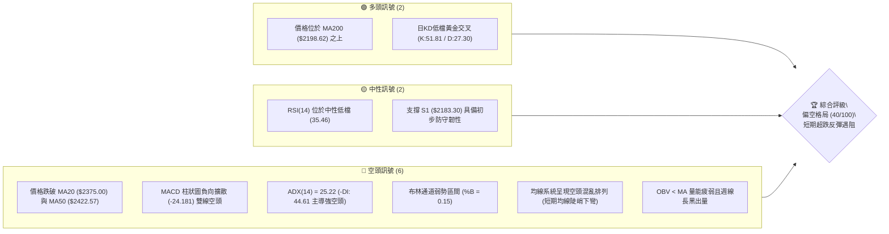
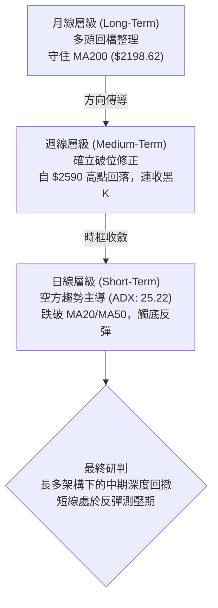
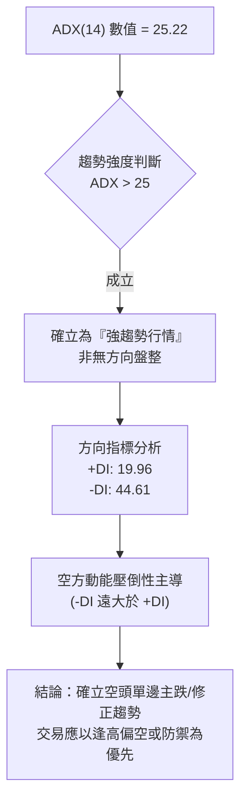
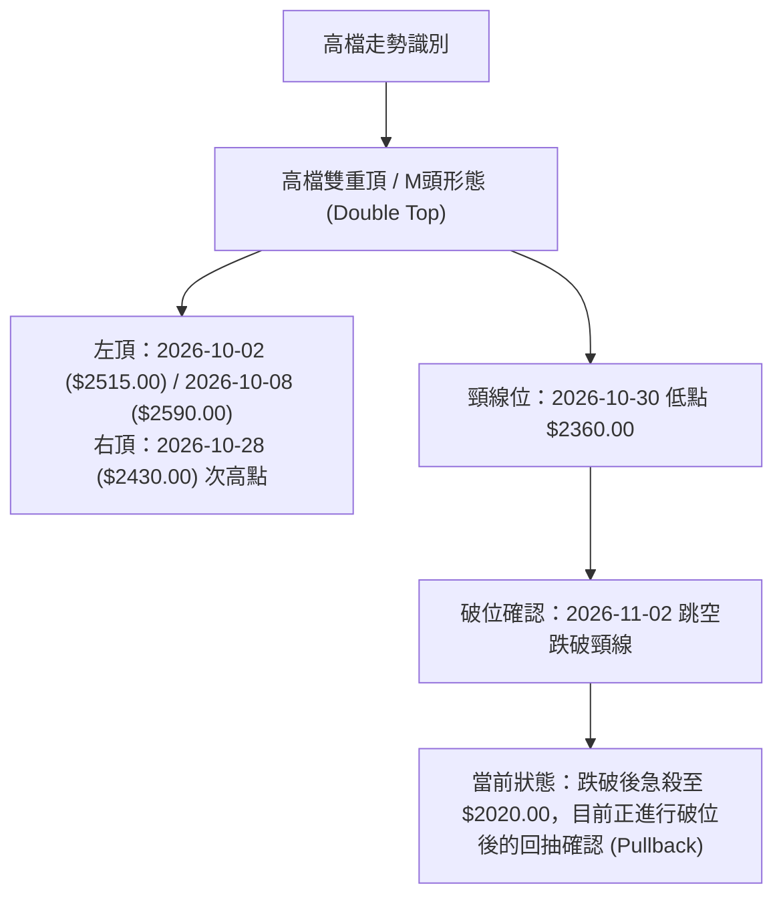
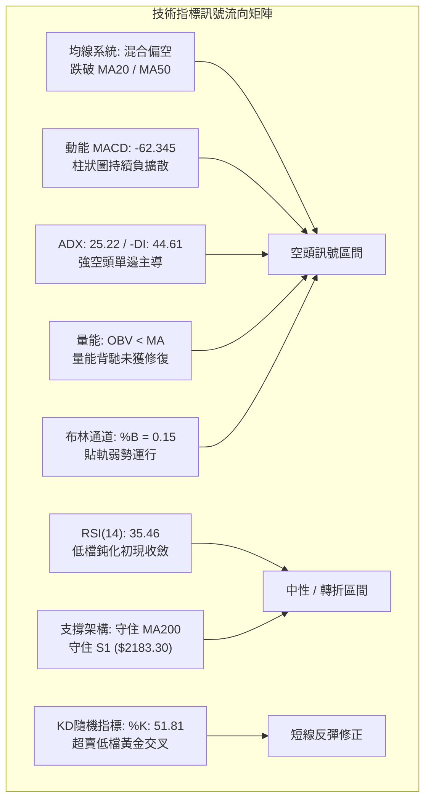
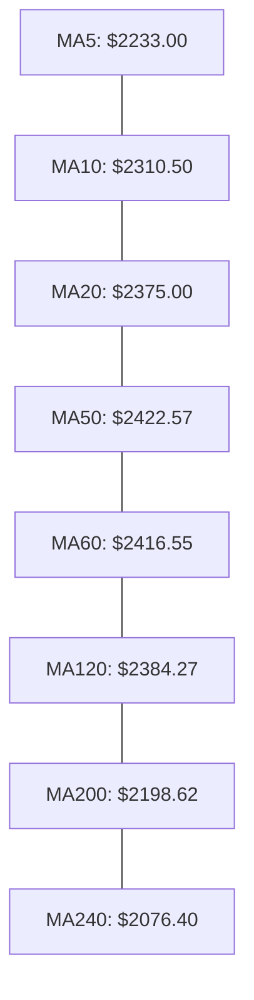
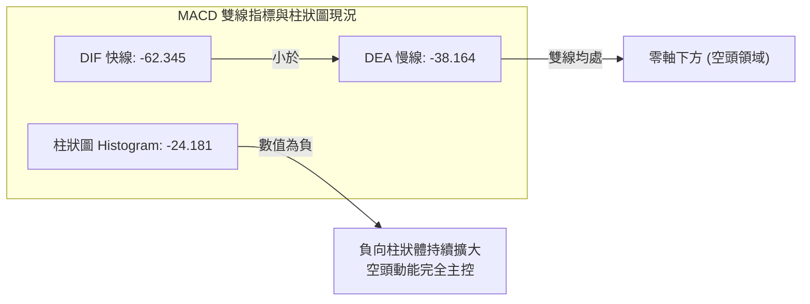
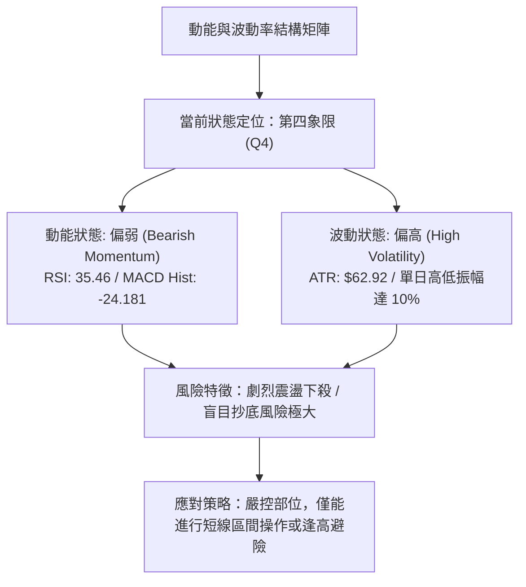
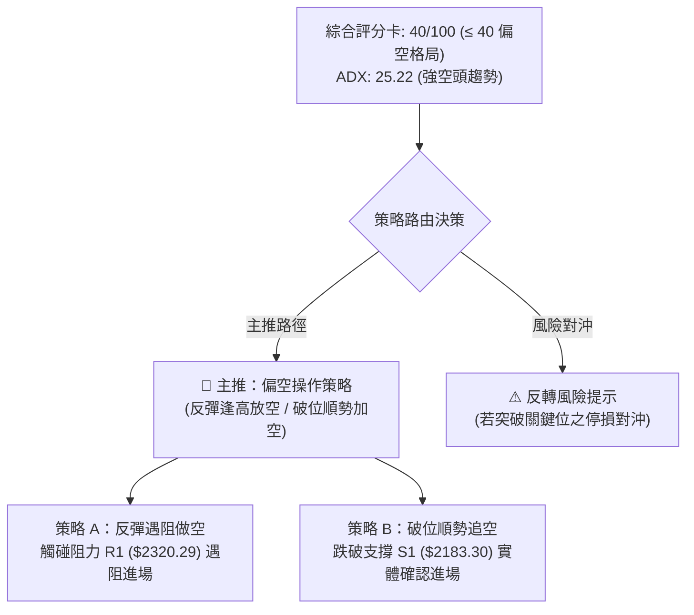
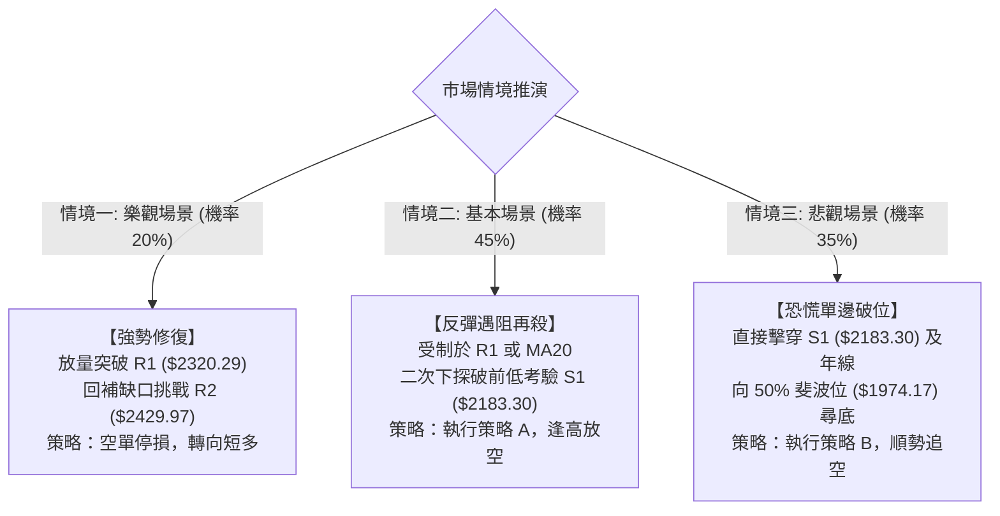

# 2330.TW 技術分析報告

> **報告日期**：2026-11-10 ｜ **語言**：繁體中文 ｜ **數據來源**：Yahoo Finance ｜ **當前價格**：$2235.00 TWD

---

## 目錄

| 章節 | 內容 |
|------|------|
| [1. 技術面概覽](#1-技術面概覽) | 訊號儀表板、核心指標、評分卡 |
| [2. 趨勢分析](#2-趨勢分析) | 多時框趨勢、長中短期走勢、ADX強度 |
| [3. 圖表形態分析](#3-圖表形態分析) | 形態識別、K線組合、目標價推算 |
| [4. 支撐與阻力](#4-支撐與阻力) | 關鍵價位、斐波那契回調結構 |
| [5. 技術指標深度解讀](#5-技術指標深度解讀) | MA/RSI/MACD/布林/成交量量價關係 |
| [6. 動能與波動率](#6-動能與波動率) | 動能四象限、ATR風險測算、Beta係數 |
| [7. 多時框架總結](#7-多時框架總結) | 時框架評分矩陣、多時框收斂結論 |
| [8. 交易策略建議](#8-交易策略建議) | 策略路由、主策略詳情、精確風報比 |
| [9. 風險提示與監控](#9-風險提示與監控) | 監控指標Checklist、風險場景樹 |

---

## 1. 技術面概覽

### 🎯 技術訊號儀表板



---

### 📊 核心指標速覽表

| 指標類別 | 指標名稱 | 當前數值 | 訊號 | 專業解讀 |
|:---|:---|:---|:---:|:---|
| **價格** | 當前收盤價 | $2235.00 | 🔴 | 較52週高點 $2590.00 回撤 -13.71%，跌破多條中期均線 |
| **短期均線** | MA20 (月線) | $2375.00 | 🔴 | 現價低於 MA20 達 -5.89%，中期下行壓力沉重 |
| **中期均線** | MA50 (季線) | $2422.57 | 🔴 | 現價低於 MA50 達 -7.74%，季線正式失守轉為強阻力 |
| **長期均線** | MA200 (年線) | $2198.62 | 🟢 | 現價仍高於 MA200 +1.65%，長期多頭底線尚未被有效跌破 |
| **動能指標** | RSI(14) | 35.46 | 🟡 | 進入弱勢區間但未破 30 超賣線，短線出現超跌修復跡象 |
| **動能指標** | MACD (12,26,9) | -62.345 / -38.164 | 🔴 | 柱狀圖 -24.181，DIF 與 DEA 均處零軸下方呈死叉擴散 |
| **波動指標** | ATR(14) | $62.92 (2.82%) | 🔴 | 每日平均真實波幅擴大，反映下殺過程籌碼劇烈震盪 |
| **趨勢強度** | ADX(14) | 25.22 | 🔴 | ADX > 25 確立趨勢形成，-DI 達 44.61 顯示空方佔絕對優勢 |
| **通道指標** | 布林通道 %B | 0.15 | 🔴 | 貼近下軌 $2176.64 運行，呈現強烈的弱勢單邊尋底特徵 |
| **量能指標** | 成交量 / OBV | 41,529,425 | 🔴 | 20日均量比 1.30x，反彈量能不足，OBV 低於均線顯示主力偏空 |

---

### 🏆 技術評分卡

```
╔══════════════════════════════════════════════════════════════╗
║             技術評分卡 — 2330.TW (2026-11-10)               ║
╠══════════════════════════════════════════════════════════════╣
║ 趨勢強度 (Trend Strength)   ███████░░░░░░░░░░░░░  38/100 🔴 ║
║ 動能指標 (Momentum Index)   ███████░░░░░░░░░░░░░  35/100 🔴 ║
║ 支撐穩定度 (Support Robust) ███████████░░░░░░░░░  55/100 🟡 ║
║ 成交量配合 (Volume Profile) ███████░░░░░░░░░░░░░  38/100 🔴 ║
║ 形態完整度 (Pattern Status) ████████░░░░░░░░░░░░  40/100 🔴 ║
║ 均線排列 (MA Alignment)     ██████░░░░░░░░░░░░░░  34/100 🔴 ║
╠══════════════════════════════════════════════════════════════╣
║ 綜合評分 (Overall Score)    ████████░░░░░░░░░░░░  40/100 🔴 ║
║ 評級結論：偏空格局（空方主導，反彈逢高減碼／尋機做空）        ║
╚══════════════════════════════════════════════════════════════╝
```
*計算依據：綜合評分 = (38 + 35 + 55 + 38 + 40 + 34) ÷ 6 = 240 ÷ 6 = 40.00，四捨五入取整為 40/100（依規則 18 嚴格執行）。*

---

## 2. 趨勢分析

### 🌐 多時框趨勢分析



---

### 📈 長期趨勢 — 12個月走勢圖（Unicode）

以下為 2025 年 12 月至 2026 年 11 月之 12 個月收盤走勢 ASCII 圖：

```
2330.TW 月線收盤走勢圖（2025-12 至 2026-11）
價格 ($)
$2600 ┤                                                 
$2500 ┤                                       ●(09月:$2480)
$2400 ┤                             ●    ●    │   ●(10月:$2370)
$2300 ┤                        ●    │    │    │   │   
$2200 ┤                   ●    │    │    │    │   │   ●(11月現價:$2235)
$2100 ┤              ●    │    │    │    │    │   │   │
$2000 ┤         ●    │    │    │    │    │    │   │   │
$1900 ┤         │    │    │    │    │    │    │   │   │
$1800 ┤    ●    │    │    │    │    │    │    │   │   │
$1700 ┤    │    │    ●    │    │    │    │    │   │   │
$1600 ┤    │    │    │    │    │    │    │    │   │   │
$1500 ┤●   │    │    │    │    │    │    │    │   │   │
      └┬───┬────┬────┬────┬────┬────┬────┬────┬───┬───┬───┬────
      12月 01月 02月 03月 04月 05月 06月 07月 08月 09月 10月 11月
     (2025)                      (2026)
```

#### 走勢特徵分析表格

| 階段區間 | 起訖月分 | 區間起訖收盤價 | 漲跌幅 | 結構特徵與形態意義 |
|:---|:---:|:---:|:---:|:---|
| 第一階段：主升推升期 | 2025-12 至 2026-02 | $1536.33 → $1977.40 | +28.71% | 連續大陽線突破，成交量穩定放大，多頭趨勢凌厲 |
| 第二階段：波段洗盤期 | 2026-02 至 2026-03 | $1977.40 → $1750.17 | -11.49% | 急跌回踩支撐，測試市場籌碼承接力，清洗浮額 |
| 第三階段：強烈延伸期 | 2026-03 至 2026-07 | $1750.17 → $2417.88 | +38.15% | 單邊噴出行情，突破 $2000 大關並創歷史新高 |
| 第四階段：高檔作頭期 | 2026-07 至 2026-09 | $2417.88 → $2480.00 | +2.57% | 動能衰竭，高檔形成區間盤整，呈現潛在頂部特徵 |
| 第五階段：破位修正期 | 2026-09 至 2026-11 | $2480.00 → $2235.00 | -9.88% | 跌破月線支撐，11月急跌探底 $2020.00 後收於 $2235.00 |

---

### 📊 中期趨勢（週線分析）

中期技術面以 2026-10-08 當週見歷史高點 $2590.00 為重要分水嶺。近幾週週 K 線出現明確轉折破位：
- **高檔轉折**：10月16日當週以帶量長黑（成交量 160,006,325 股）吞噬前週實體，收於 $2420.00，宣告中期漲勢告終。
- **連續重挫**：11月06日當週引爆全面停損賣壓，盤中下殺至 $2020.00，單週爆出 250,878,329 股之天量，收盤僅 $2135.00，週 RSI 跌至極端值 19.1。
- **當週反彈**：截至 2026-11-09 當週，價格自 $2020.00 展開技術性回抽，暫收於 $2235.00，但週 MACD 柱狀圖已深度負向擴大至 -24.181，確認中期進入空頭修正循環。

```
中期週線阻力與支撐示意圖
價格 ($)
$2590.00 ══════════════════════════════ 波段歷史最高點 (52W High)
$2429.97 ────────────────────────────── 阻力 R2 (中期破位頸線區域)
$2320.29 ------------------------------ 阻力 R1 (反彈首要壓力區)
$2235.00 ◄─── 現價 ($2235.00)
$2183.30 ------------------------------ 支撐 S1 (近期下檔防線 / 200日線附近)
$1743.07 ══════════════════════════════ 支撐 S2 (波段強支撐群)
```

---

### ⚡ 趨勢強度評估（ADX 解讀）



#### ADX 數值對照與當前狀態

| 指標項目 | 數值 | 門檻區間 | 當前狀態判定 | 交易涵義 |
|:---|:---:|:---:|:---:|:---|
| **ADX(14)** | **25.22** | > 25.00 | 確立強趨勢形成 | 行情脫離無序震盪，趨勢追蹤系統生效 |
| **+DI** | **19.96** | < 20.00 | 多頭進攻動能萎縮 | 多方無力發動持續性攻擊，推升僅屬反彈 |
| **-DI** | **44.61** | > 40.00 | 空頭極度強勢 | 賣盤主導市場定價，回檔尚未出現結構性止跌 |
| **DI 差值** | **-24.65** | 負值擴大 | 空方絕對主控 | 不宜盲目逆勢抄底，順應中空架構操作 |

---

## 3. 圖表形態分析

### 🔍 形態識別系統



#### 形態識別與信心度評估表

| 識別形態 | 信心度 | 判斷依據（嚴格引用數據） | 完成度 | 目標價計算式與點位 |
|:---|:---:|:---|:---:|:---|
| **雙重頂 (M頭)** | **85%** | 1. 2026-10-08 見高點 $2590.00。<br/>2. 2026-10-28 反彈高點僅 $2430.00。<br/>3. 2026-10-30 跌破頸線低點 $2360.00。<br/>4. 2026-11-06 放量長黑灌破。 | 90% | **形態跌幅滿足點**：<br/>頸線 $2360.00 − 形態高度 ($2590.00 − $2360.00 = $230.00)<br/>= **$2130.00**。<br/>*(已於 2026-11-06 盤中低點 $2020.00 達成並超跌滿足)* |
| **下行通道旗形** | **60%** | 自 2026-10-08 高點 $2590.00 延伸之下行通道，11-06 跌至下軌 $2020.00 後展開旗面反彈。 | 50% | **通道反彈目標**：<br/>回測通道上軌及 R1 **$2320.29**。若無法突破，將重回下行通道走勢。 |

---

### 🕯️ 重要 K 線形態分析

依嚴格規定，本小節僅針對提供的「近 10 根日 K」與「近 8 根週 K」之精確四價進行技術解讀：

#### 近 10 根日 K 線形態解讀

| 日期 | 開盤價 | 最高價 | 最低價 | 收盤價 | 成交量 | K線形態特徵 | 訊號意涵 |
|:---:|:---:|:---:|:---:|:---:|:---:|:---|:---:|
| 2026-10-27 | $2380.00 | $2405.00 | $2380.00 | $2400.00 | 33,964,182 | 小陽線，反彈受制於整數關卡 | 🟡 中性 |
| 2026-10-28 | $2420.00 | $2430.00 | $2410.00 | $2425.00 | 19,880,613 | 量縮小陽線，衝高無量，形成波段次高點 | 🔴 疲態 |
| 2026-10-29 | $2420.00 | $2425.00 | $2390.00 | $2415.00 | 16,872,114 | 量縮倒轉小陰線，高檔買盤徹底縮手 | 🔴 轉弱 |
| 2026-10-30 | $2380.00 | $2380.00 | $2360.00 | $2370.00 | 29,664,858 | 破位中陰線，直接跌破月線 MA20 ($2375.00) | 🔴 破位 |
| 2026-11-02 | $2310.00 | $2345.00 | $2310.00 | $2330.00 | 34,382,586 | 跳空低開低走小陰線，空方跳空缺口確立 | 🔴 空方續跌 |
| 2026-11-03 | $2300.00 | $2335.00 | $2280.00 | $2295.00 | 36,998,754 | 連續黑K破整數關卡，賣壓持續釋放 | 🔴 空頭排列 |
| 2026-11-04 | $2320.00 | $2320.00 | $2235.00 | $2260.00 | 45,456,849 | 增量長黑K棒，空方貫壓無抵抗 | 🔴 恐慌湧現 |
| 2026-11-05 | $2250.00 | $2285.00 | $2235.00 | $2240.00 | 36,863,278 | 弱勢盤跌小陰線，反抽無力 | 🔴 尋底中 |
| 2026-11-06 | $2020.00 | $2195.00 | $2020.00 | $2135.00 | 97,176,862 | **爆量長下影中陽線**（低開 $2020，收 $2135） | 🟢 恐慌竭盡換手 |
| 2026-11-09 | $2210.00 | $2290.00 | $2190.00 | $2235.00 | 41,529,425 | 延續反彈實體小陽線，守住 $2200 關卡 | 🟡 短線回抽 |

#### 近 8 根週 K 線形態解讀

| 週末日期 | 開盤價 | 最高價 | 最低價 | 收盤價 | 週成交量 | 週K形態結構 | 訊號意涵 |
|:---:|:---:|:---:|:---:|:---:|:---:|:---|:---:|
| 2026-09-24 | $2445.00 | $2510.00 | $2445.00 | $2475.00 | 66,944,987 | 突破整理區中陽線，創波段收盤新高 | 🟢 多頭推升 |
| 2026-10-02 | $2475.00 | $2515.00 | $2475.00 | $2500.00 | 87,707,137 | 站上 $2500 整數關卡，量增推升 | 🟢 多頭強勢 |
| 2026-10-08 | $2550.00 | $2590.00 | $2545.00 | $2550.00 | 77,343,774 | **衝高回落十字星**，見歷史極值 $2590.00 | 🔴 高檔變盤 |
| 2026-10-16 | $2510.00 | $2550.00 | $2420.00 | $2420.00 | 160,006,325 | **出量包覆長黑吞噬**，確立高檔反轉 | 🔴 頂部確立 |
| 2026-10-23 | $2395.00 | $2435.00 | $2385.00 | $2385.00 | 86,048,332 | 弱勢下挫黑K，無力回補前週長黑 | 🔴 跌勢延續 |
| 2026-10-30 | $2380.00 | $2430.00 | $2360.00 | $2370.00 | 100,381,767 | 帶量跌破前低整理區，收於全週低點附近 | 🔴 頸線失守 |
| 2026-11-06 | $2310.00 | $2345.00 | $2020.00 | $2135.00 | 250,878,329 | **歷史級天量破底長下影陰線**，暴跌洗盤 | 🟡 恐慌盤宣洩 |
| 2026-11-09 | $2210.00 | $2290.00 | $2190.00 | $2235.00 | 41,529,425 | 短週小陽回抽，嘗試修復週線乖離 | 🟡 跌深反彈 |

---

### 📉 ASCII 走勢形態示意圖

```
2330.TW 日線級別 M頭破位與反彈示意圖
價格 ($)
$2590 ┤           ▲ (頂部1: 2026-10-08 $2590)
$2500 ┤          / \
$2430 ┤         /   \            ▲ (頂部2: 2026-10-28 $2430)
$2360 ┤────────[─頸線 $2360───────\───────]───────────── (破位點: 10-30/11-02)
$2320 ┤                             \     ▲ (反彈測壓目標 R1: $2320.29)
$2235 ┤                              \   / ◄── 現價: $2235.00
$2183 ┤                               \ /  (支撐 S1: $2183.30)
$2130 ┤--------------------------------X--- (M頭理論滿足點: $2130.00)
$2020 ┤                               ▼ (恐慌超跌極值: 11-06 $2020.00)
      └────────────────────────────────────────────────────────
```

---

### 🎯 形態目標價計算

1. **雙重頂（M頭）高度測量法**：
   - **最高峰值 ($P_{peak}$)** = $2590.00
   - **形態頸線 ($P_{neck}$)** = $2360.00 (2026-10-30 破位前波段低點)
   - **形態垂直垂直高度 ($H$)** = $2590.00 - $2360.00 = $230.00
   - **等距跌幅滿足目標 ($T_{M}$)** = $P_{neck} - H = $2360.00 - $230.00 = **$2130.00**
   - *驗證結果*：2026-11-06 最低跌至 $2020.00，收盤 $2135.00，精確回測並超額滿足了此形態目標，引發技術性強烈買盤進場。

2. **短線反彈測壓高度推算**：
   - 自波段極端低點 $2020.00 展開之回抽，上方第一重考驗為波段阻力 R1 **$2320.29**。
   - 若能向上回補跳空缺口，極限目標將受制於 M頭頸線轉變為之反壓區間 **$2360.00 ~ $2375.00 (MA20)**。

---

## 4. 支撐與阻力

### 🗺️ 關鍵價位分布圖（Unicode）

```
2330.TW 價位結構分布圖
═══════════════════════════════════════════════════════════════
$2590.00 ║████████████████████████████████║ 52週歷史高點 (0.0% Fib)
$2508.21 ║████████████████████████        ║ 強阻力 R3 (高檔密集套牢區)
$2429.97 ║██████████████████              ║ 阻力 R2 (MA50 季線反壓區域)
$2320.29 ║████████████                    ║ 關鍵阻力 R1 (反彈首要分水嶺)
$2299.33 ║▓▓▓▓▓▓▓▓▓▓▓                     ║ 23.6% 斐波那契回調位
$2235.00 ╠════════════════════════════════╣ ◄── 現價 ($2235.00)
$2183.30 ║▓▓▓▓▓▓▓▓                        ║ 近期支撐 S1 (年線防守緩衝區)
$2119.51 ║▓▓▓▓▓▓                          ║ 38.2% 斐波那契回調位
$1974.17 ║████████████                    ║ 50.0% 斐波那契強支撐位
$1743.07 ║████████████████████████        ║ 強支撐 S2 (波段歷史整理平台)
$1437.37 ║████████████████████████████████║ 終極強支撐 S3 (長期多頭防線)
═══════════════════════════════════════════════════════════════
```

---

### 🚧 阻力位分析表

*本表所有價位完全引用自關鍵數據「關鍵價位（由 OHLCV 計算）」區塊。*

| 阻力級別 | 精確價位 | 與現價距離 | 形成原因與技術背景 | 突破難度 | 重要性 |
|:---|:---:|:---:|:---|:---:|:---:|
| **阻力 R1** | **$2320.29** | +3.82% | 近一年波段高點聚類位，疊加短線跳空下殺缺口下緣，為反彈第一道天花板。 | 中等 | 🔴 極高 (短線強弱水嶺) |
| **阻力 R2** | **$2429.97** | +8.72% | 近一年密集震盪高點聚類，重疊季線 MA50 ($2422.57) 與 MA60 ($2416.55)。 | 極高 | 🔴 核心波段解套阻力 |
| **阻力 R3** | **$2508.21** | +12.22% | 歷史高檔聚類阻力，接近歷史次高收盤區域，累積大量套牢籌碼。 | 極難 | 🔴 頂部反轉結構上限 |

---

### 🛡️ 支撐位分析表

*本表所有價位完全引用自關鍵數據「關鍵價位（由 OHLCV 計算）」區塊。*

| 支撐級別 | 精確價位 | 與現價距離 | 形成原因與技術背景 | 守住機率 | 重要性 |
|:---|:---:|:---:|:---|:---:|:---:|
| **支撐 S1** | **$2183.30** | -2.31% | 近一年波段低點聚類，緊鄰 200 日均線 MA200 ($2198.62) 與布林下軌。 | 60% | 🟡 短線多空生死線 |
| **支撐 S2** | **$1743.07** | -22.01% | 2026 年 3 月歷史低點平台 ($1750.17) 與近一年低點聚類，為長期關鍵結構底。 | 85% | 🟢 中長期強多防禦底線 |
| **支撐 S3** | **$1437.37** | -35.69% | 2025 年底起漲點密集籌碼聚類區，長期超級防線。 | 98% | 🟢 終極資產防禦位 |

---

### 📐 斐波那契回調位分析

依據 52 週完整波動區間（低點 **$1358.34** → 高點 **$2590.00**，總波幅 $1231.66），黃金分割回調結構如下：

| 回調比例 | 精確價位 | 技術位置與當前市況解讀 |
|:---:|:---:|:---|
| **0.0%** | **$2590.00** | 52 週最高點，確立為長期多頭週期第一階段高點。 |
| **23.6%** | **$2299.33** | 淺度回檔位。現價 ($2235.00) 位於其下方，代表短線回撤已超出強勢整理範疇。 |
| **38.2%** | **$2119.51** | 健康多頭回檔極限位。11月06日急跌至 $2020.00 曾短暫假跌破，收盤迅速抽回此線上。 |
| **50.0%** | **$1974.17** | 多空分水嶺。若 $2119.51 徹底失守，行情將滑向 $2000 大關及此處進行半數回吐測試。 |
| **61.8%** | **$1828.84** | 黃金分割強支撐。多頭防守底線，此處不破，長線牛市架構不滅。 |
| **78.6%** | **$1621.92** | 深度回撤位。接近 2025 年底起漲位。 |
| **100.0%** | **$1358.34** | 52 週最低點，全循環起漲原點。 |

**現價落點解讀**：
當前收盤價 **$2235.00** 正好夾在 **23.6% ($2299.33)** 與 **38.2% ($2119.51)** 之間。這意味著：市場已由「強勢淺幅修正」轉變為「中級回調測試」，若反彈無法站回 23.6% ($2299.33) 及 R1 ($2320.29)，後續必將再次下探 38.2% ($2119.51) 與 200 日線尋求雙底支撐。

---

## 5. 技術指標深度解讀

### 🎛️ 指標訊號總覽



---

### 📈 移動平均線排列分析



#### 均線系統深度檢視表

| 均線名稱 | 數值 | 現價與均線差值 | 現價與均線偏離率 | 排列型態與趨勢指引 |
|:---|:---:|:---:|:---:|:---|
| **MA 5** | $2233.00 | +$2.00 | +0.09% | 止跌回穩：現價站回 5 日線，短線出現超跌修復訊號 |
| **MA 10** | $2310.50 | -$75.50 | -3.27% | 短期反壓：快速下彎，與現價形成實質反彈阻力 |
| **MA 20** | $2375.00 | -$140.00 | -5.89% | 月線轉空：持續下行，確認中期上升趨勢被正式破壞 |
| **MA 50** | $2422.57 | -$187.57 | -7.74% | 季線下彎：與 MA20 形成實質死亡交叉，形成沉重天花板 |
| **MA 60** | $2416.55 | -$181.55 | -7.51% | 中期生命線失守，確認三個月內進場資金處於普遍套牢狀態 |
| **MA120** | $2384.27 | -$149.27 | -6.26% | 半年線下彎，半年平均成本區間形成壓制 |
| **MA200** | $2198.62 | +$36.38 | +1.65% | 長期多頭線：現價守於其上，為多方抵抗之核心關鍵屏障 |
| **MA240** | $2076.40 | +$158.60 | +7.64% | 年線基底：長期多頭架構的堅固地基，未遭實質破壞 |

**均線結構綜合評價**：
短期均線（MA5、MA10、MA20）由上至下依序排列為空頭架構；中期均線（MA50、MA60）高檔彎頭下墜；僅長期均線（MA200、MA240）維持上行走勢。整體屬於典型的「**中短期空頭排列，但長期多頭未破之深幅修正結構**」。

---

### 📉 RSI(14) 分析

當前數值：**35.46**（Wilder 計算法）

```
RSI(14) 區間位置：
0        20       30       50                70       100
├────────┼────────┼────────┼─────────────────┼────────┤
│ 極度超賣 │  超賣區 │ 弱勢區 │      強勢區     │ 超買區 │
└────────┴────────┴────────┴─────────────────┴────────┘
                      ▲
                RSI: 35.46 [███████░░░░░░░░░░░░░ 35.46%]
```

- **背離判斷**：
  比對近 20 根 K 棒走勢（價格自 10-20 之 $2420.00 急跌至 11-06 之 $2020.00，收盤 $2135.00；RSI 同步自 41.7 挫至 19.1 再回升至 35.46）。首尾價格由高到低，RSI 指標方向一致向下，**確認無明顯頂背離或底背離**。此走勢為標準的「價格與指標同步之空方主動性殺盤」。
- **位階意涵**：
  日線 RSI 自極低點 19.1 快速脫離超賣區拉回至 35.46，顯示殺盤力道暫歇，但指標仍處於 50 榮枯線下方之空方掌控區，不具備立即大幅反轉的條件。

---

### 📊 MACD (12, 26, 9) 訊號解讀



- **MACD 線**：-62.345
- **Signal 訊號線**：-38.164
- **柱狀圖 (Histogram)**：-24.181（🔴 深度看空）
- **技術解讀**：
  MACD 快慢線在零軸下方呈死叉開口狀態，柱狀圖報 -24.181，顯示中短期下行動能仍處於充沛宣洩階段。雖然近期 2 根日 K 線嘗試小幅收斂，但距離翻正仍有顯著距離，警示投資人不可將短線跌深反彈誤判為中長線反轉回升。

---

### 📦 布林通道分析

當前布林參數 (20, 2)：
- **布林上軌**：$2573.36
- **布林中軌 (MA20)**：$2375.00
- **布林下軌**：$2176.64
- **布林帶寬度 (Bandwidth)**：($2573.36 − $2176.64) ÷ $2375.00 = **16.70%**
- **%B 指標**：**0.15**

```
2330.TW 日線布林通道位置示意圖
價格 ($)
$2573.36 ┬────────────────────────────────────────── 布林上軌
         │
$2375.00 ┼────────────────────────────────────────── 布林中軌 (MA20)
         │
$2235.00 ┤                     ◄─── 現價 ($2235.00, %B = 0.15)
$2176.64 ┴────────────────────────────────────────── 布林下軌
```

- **通道特徵分析**：
  現價 $2235.00 運行於中軌與下軌之間的弱勢通道內，%B 僅為 0.15，反映價格極度偏向空方。前一交易日（11-06）最低點 $2020.00 嚴重刺穿下軌 $2176.64，隨後收回下軌之內。此為典型的「**超賣出軌後的技術性抽回**」，中軌 $2375.00 將是此波反彈不可逾越的強烈動態阻力位。

---

### 💹 成交量分析（量價配合度）

- **最新單日成交量**：41,529,425 股
- **20 日平均成交量**：31,942,209 股（量比：**1.30x**）
- **50 日平均成交量**：24,182,587 股（量比：**1.72x**）
- **OBV 能量潮狀態**：OBV < MA → **量能疲弱，呈現主動性拋售**

```
量價結構關鍵特徵解讀：
1. 【下殺放量】2026-11-06 日下殺跌破 $2100 時，爆出單日 97,176,862 股之恐慌賣壓，
   創近期最大成交量；當週週成交量更飆高至 250,878,329 股，確認為法人級別的停損破位換手。
2. 【反彈量縮】2026-11-09 股價自 $2190 反彈至 $2235 時，成交量急縮至 41,529,425 股，
   雖高於 20 日均量，但較前一日腰斬逾 57%。
3. 【結論】量價呈現標準的「跌有量、彈無量」之空方主導架構，籌碼沉澱尚未完成。
```

---

## 6. 動能與波動率

### ⚡ 動能評估四象限



#### 象限狀態評估表

| 象限 | 動能維度 | 波動維度 | 當前符合狀態 | 策略意義與投資指引 |
|:---:|:---:|:---:|:---:|:---|
| **Q1** | 強動能 (多頭) | 低波動 | — | 最佳波段做多機會（強勢主升浪） |
| **Q2** | 弱動能 (盤整) | 低波動 | — | 謹慎觀望，等待突破信號 |
| **Q3** | 強動能 (多頭) | 高波動 | — | 高風險高收益，末升段追價 |
| **Q4** | **弱動能 (空頭)** | **高波動** | **✓ (當前所屬象限)** | **避開盲目抄底，高波動伴隨資金退潮，防範二度殺盤** |

---

### 📊 ATR 波動率分析

- **ATR(14) 數值**：**$62.92**（採 Wilder 計算）
- **ATR 佔比比率**：$62.92 ÷ $2235.00 = **2.82%**
- **風控測算與動態止損建議**：

| 測算倍數 | 波動點數 | 以現價 $2235.00 測算之安全距離 | 應用策略 |
|:---:|:---:|:---:|:---|
| **1.0 × ATR** | $62.92 | $2172.08 / $2297.92 | 當沖 / 日內極短線防守緩衝距離 |
| **1.5 × ATR** | $94.38 | $2140.62 / $2329.38 | 短線波段操作之標準止損保護寬度 |
| **2.0 × ATR** | $125.84 | $2109.16 / $2360.84 | 中線波段保護，完全涵蓋常態日波動雜訊 |

---

### 📐 Beta 與市場相關性

- **Beta 係數**：**1.233**
- **市場特徵解讀**：
  Beta 值達 1.233，表明台積電對台灣加權指數（乃至全球半導體板塊）具備極高的系統性放大效應。當大盤下跌 1% 時，該標的平均下跌 1.233%；反之亦然。當前高波動疊加高 Beta，意味著個股下殺將加速大盤指數的修正，同時亦受制於外資被動型 ETF 的連續去槓桿拋售，權重賣壓沉重。

---

## 7. 多時框架總結

### 📋 時框架評分表

| 時框架 | 趨勢方向 | 動能狀態 | 均線排列 | 形態特徵 | 綜合評分 | 戰略建議 |
|:---:|:---:|:---:|:---:|:---:|:---:|:---|
| **日線 (短)** | 🔴 跌勢反抽 | 弱勢反彈 (RSI: 35.5) | 空頭排列 (破MA20) | 跌深跳空回抽 | 35/100 🔴 | 逢高減碼，尋求破位放空 |
| **週線 (中)** | 🔴 明確修正 | 負向擴大 (MACD綠柱) | 轉為混合偏空 | 高檔 M頭放量破位 | 40/100 🔴 | 中期轉向防守，停止加碼 |
| **月線 (長)** | 🟢 多頭回撤 | 漲勢趨緩中 | 依舊多頭 (高於MA200) | 長多高檔回踩 | 65/100 🟢 | 具備長線價值，待底部確認 |

---

### 🔲 綜合訊號矩陣

| 維度 | 短期 (日線級別) | 中期 (週線級別) | 長期 (月線級別) | 訊號收斂性評估 |
|:---|:---:|:---:|:---:|:---|
| **趨勢方向** | 空頭反彈 | 空頭修正 | 多頭回檔 | 短中期方向高度一致向下，與長期牛市衝突 |
| **動能指標** | 跌深修復 (KD金叉) | 空方主控 (MACD下穿) | 動能放緩 | 短期動能僅能視為中級空頭中的回抽波 |
| **支撐強度** | S1 ($2183.30) 弱防守 | S1/年線共振區域 | S2 ($1743.07) 強支撐 | $2183.30 為短中多頭共防區，不容再失 |
| **成交量能** | 反彈縮量 (41.5M) | 破位天量 (250M) | 維持常態水平 | 破位量過大，中短期浮額清洗尚未乾淨 |

---

### ⚖️ 多時框收斂結論

**核心研判與收斂規則執行（依嚴格規則 14 判定）**：
1. **趨勢市判定**：當前 ADX(14) 數值為 **25.22**（> 25.00），-DI 高達 **44.61**，明確確立目前為**「空頭強趨勢行情」**，而非區間盤整行情。
2. **時框優先級**：依照收斂原則，在強趨勢行情下，必須以**中長期方向（週線 / MA50 / MA200）為主導**，日線層級僅能作為輔助「尋找精確逢高進場或破位進場時機」之工具。
3. **唯一方向性結論**：**【偏空格局（中空主導，日線反抽不改弱勢）】**。
   日線之跌深反彈與 KD 金叉僅屬極端超跌後的次級修正折返，在週線 M頭破位與日線 -DI 44.61 強烈壓制下，中期走勢不可逆地偏向空方尋底。本結論與第 1 章評分卡（40/100 🔴）及第 8 章之主策略完全保持邏輯與方向之一致性。

---

## 8. 交易策略建議

### 🗺️ 策略決策流程圖



---

### 🧭 策略路由說明

> **當前主策略方向 = 【空頭交易主導】（依綜合評分 40/100，嚴格符合規則 8 之「綜合評分 ≤ 40 偏空格局主推空頭策略」之約束，不得兩頭下注）。**

---

### 🎯 價格情境階梯（Price Scenarios）

*本階梯所有價位完全採用第 4 章及數據庫提供之精確波段聚類價位：*

| 觸發條件 | 下一目標價位 | 後續延伸價位 | 情境技術含義與應對要點 |
|:---|:---:|:---:|:---|
| **強勢突破 R1 ($2320.29)** | R2 ($2429.97) | R3 ($2508.21) | 短線超跌反彈強烈擴展，空單必須全數停損離場，短多暫時接管。 |
| **受制現價區間 ($2235.00)** | S1 ($2183.30) | R1 ($2320.29) | 於布林下軌與中軌間進行弱勢換手，多空膠著，等待方向再次確認。 |
| **跌破支撐 S1 ($2183.30)** | S2 ($1743.07) | S3 ($1437.37) | 年線宣告失守，M頭形態引發第二波恐慌性殺盤，中期全面轉空。 |

---

### 📊 情境機率分佈

| 情境劃分 | 預估機率 | 主要技術依據（嚴格引用指標現狀） |
|:---|:---:|:---|
| **回落 / 再探前低 (主情境)** | **45%** | ADX 高達 25.22 伴隨 -DI 44.61 主導；MACD 柱狀圖 -24.181 深度看空，且 OBV < MA 顯示資金持續淨流出。 |
| **區間震盪 / 弱勢整理** | **35%** | 布林通道下軌出現支撐效應，日 KD 出現低檔金叉，短線殺跌動能暫時獲得宣洩。 |
| **繼續大幅上行 / V型反轉** | **20%** | 均線系統空頭排列下彎，上方 MA20 ($2375.00) 與 MA50 ($2422.57) 形成雙重密集套牢層，量能無法支持連續攻堅。 |

---

### 🔴 主推空頭策略詳情

*註：風險報酬比嚴格按規則 17 計算：空頭風報比 = (進場價 − 目標價 T1) ÷ (止損價 − 進場價)。*

| 策略要素 | 策略 A（反彈遇阻做空 / 逢高布局） | 策略 B（破位順勢做空 / 追擊主跌） |
|:---|:---|:---|
| **進場條件** | 價格反彈至阻力 R1 附近出現長上影線或黑K滯漲 | 價格日K收盤價有效跌破支撐 S1 |
| **精確進場價格** | **$2320.29**（精準引用 R1 阻力位） | **$2183.30**（精準引用 S1 支撐位） |
| **目標價 T1** | **$2183.30**（支撐位 S1，與進場差 $136.99） | **$1974.17**（斐波那契 50.0%，差 $209.13） |
| **目標價 T2** | **$1743.07**（強支撐 S2，波段大目標） | **$1743.07**（強支撐 S2，波段大目標） |
| **嚴格止損價格** | **$2375.00**（MA20 月線反壓上緣，差 $54.71） | **$2235.00**（跌破後回抽阻力/現價，差 $51.70） |
| **風險報酬比** | **1 : 2.50（以 T1 計）**<br/>*(算式: 136.99 ÷ 54.71 = 2.504)*<br/>*另列：1 : 10.55（以 T2 計）* | **1 : 4.05（以 T1 計）**<br/>*(算式: 209.13 ÷ 51.70 = 4.045)*<br/>*另列：1 : 8.52（以 T2 計）* |
| **策略成功機率** | **65%** | **60%** |
| **建議配置倉位** | **15% ~ 20%**（輕倉防禦型配置） | **10% ~ 15%**（突破確認後右側加碼） |

---

### ⚠️ 反向風險觸發點（對沖提示）

若市場出現超預期利多或外資強力回補，引發以下任一訊號，表明主推之空頭策略遭到破壞，空單必須立即無條件止損，甚至反手對沖：
1. **價位突破觸發**：日線收盤價強勢收復 **$2375.00 (MA20 月線)**，宣告下行通道遭向上突破。
2. **指標轉折觸發**：MACD 柱狀圖由負翻正（Histogram > 0），且日線 RSI(14) 越過 50 榮枯線進入強勢區。
3. **量能逆轉觸發**：連續兩日成交量突破 50,000,000 股並收出吞噬長紅K棒，OBV 向上金叉其均線。

---

### ⭐ 整體訊號強度評星

```
做多訊號強度：★★☆☆☆  (2/5星 - 僅屬跌深技術反彈，勝率偏低)
做空訊號強度：★★★★☆  (4/5星 - 中期趨勢主導，阻力層次分明)
整體可信度：  ★★★★☆  (4/5星 - 價量數據高度一致，指標無矛盾)
```

---

## 9. 風險提示與監控

### ✅ 關鍵監控指標 Checklist

```
╔══════════════════════════════════════════════════════════════════════════╗
║               2330.TW 交易風控即時監控 CHECKLIST                          ║
╠══════════════════════════════════════════════════════════════════════════╣
║ [ ] 監控項 1：MA200 ($2198.62) 與 S1 ($2183.30) 能否於收盤價被有效守住    ║
║ [ ] 監控項 2：每日成交量是否持續萎縮（若量能跌破 3000 萬股，反彈恐提前告終）║
║ [ ] 監控項 3：ADX(14) 是否持續高於 25.00，且 -DI 是否仍壓制 +DI          ║
║ [ ] 監控項 4：MACD 負向柱狀圖（當前 -24.181）是否出現連續收斂特徵         ║
║ [ ] 監控項 5：布林通道帶寬是否開始縮小收斂，抑或持續開口擴大              ║
║ [ ] 監控項 6：外資籌碼進出是否出現連續性賣超轉向（Beta 1.233 之系統性影響）║
╚══════════════════════════════════════════════════════════════════════════╝
```

---

### ⚠️ 風險場景分析



---

### 🛡️ 風險管理重要提醒

1. **嚴禁「金字塔式逆勢加碼抄底」**：
   在 ADX = 25.22 且 -DI = 44.61 的強空頭趨勢中，跌深並非買入理由。過早以「長線投資」為名接掉落的飛刀，常面臨資金大幅回撤。在股價未有效站穩 MA20 之前，任何多頭進場均須設定為嚴格的短線防守性質。
2. **ATR 波動風險調節**：
   當前 ATR 達 **$62.92**，單日潛在波幅近 3%。整體持倉部位建議控制在總資金的 **30% 以內**，單筆交易之最大止損金額嚴格限制在總資本的 **1.5%** 以內。
3. **空頭策略部位防護**：
   執行空頭策略時，切記標的具備卓越的長期基本面（ROE 41.9%，營業利益率 58.0%），故空頭波段通常呈現「急跌、緩彈、突發軋空」特徵。一旦觸及止損位 **$2375.00**，必須毫不猶豫市價停損，不可存有僥倖心理。

---

## 📋 報告總結

```
╔══════════════════════════════════════════════════════════════════════════╗
║               2330.TW 技術分析報告總結 (2026-11-10)                      ║
╠══════════════════════════════════════════════════════════════════════════╣
║ 當前價格：$2235.00 TWD                   52週區間：$1358.34 - $2590.00   ║
║ 技術評分：40 / 100 🔴                   整體趨勢：空頭趨勢主導 (ADX:25.2)║
║ 分析評級：偏空格局（反彈逢高減碼／尋機做空，防範破位二次探底）           ║
╠══════════════════════════════════════════════════════════════════════════╣
║ 關鍵技術維度速覽：                                                       ║
║ ├─ 長期趨勢：🟢 偏多回調（守在 MA200 $2198.62 之上，長多架構尚未崩壞）     ║
║ ├─ 中期趨勢：🔴 明確空頭（週線 M頭破位，自 $2590 歷史高點深幅回撤）      ║
║ ├─ 短期趨勢：🟡 超跌反彈（極端下殺 $2020 獲換手買盤支撐，展開技術抽回） ║
║ ├─ 關鍵支撐：S1: $2183.30 │ S2: $1743.07 │ 38.2% Fib: $2119.51          ║
║ ├─ 關鍵阻力：R1: $2320.29 │ R2: $2429.97 │ MA20: $2375.00               ║
║ └─ 籌碼/動能：MACD: -62.345 🔴 │ RSI: 35.46 🟡 │ OBV: 量能疲弱 🔴       ║
╠══════════════════════════════════════════════════════════════════════════╣
║ 最優策略組合導航：                                                       ║
║ 1. 🥇 最佳機會（主策略 A）：反彈至 R1 $2320.29 遇阻做空，風報比 1 : 2.50║
║ 2. 🥈 次選機會（主策略 B）：跌破 S1 $2183.30 順勢加空，風報比 1 : 4.05║
║ 3. 🥉 防守對策：多單逢反彈至 $2320 - $2375 區間應斷然減碼降槓桿         ║
╚══════════════════════════════════════════════════════════════════════════╝
```

---

> ⚠️ **免責聲明**：本報告為資深量化技術分析師基於客觀市場歷史 OHLCV 數據產出之研究報告。報告中之所有數據計算、形態評估與策略點位均基於技術分析理論，**僅供投資研究與學術探討參考**，**絕不構成任何形式的要約、招攬或實質投資買賣建議**。金融市場瞬息萬變，高槓桿與高波動商品風險自負，投資人入市交易前必須獨立評估自身風險承受能力。

---
*報告生成時間：2026-11-10 ｜ 數據來源：Yahoo Finance ｜ 分析框架：多時框收斂與精準技術分析模型*