# 2330.TW 技術分析報告

> **報告日期**：2026-11-11 ｜ **語言**：繁體中文 ｜ **數據來源**：Yahoo Finance ｜ **當前價格**：$2285.00 TWD

---

## 目錄

| 章節 | 內容 |
|------|------|
| [1. 技術面概覽](#1-技術面概覽) | 訊號儀表板、核心指標、評分卡 |
| [2. 趨勢分析](#2-趨勢分析) | 多時框趨勢、長中短期走勢 |
| [3. 圖表形態分析](#3-圖表形態分析) | 形態識別、K線組合、目標價 |
| [4. 支撐與阻力](#4-支撐與阻力) | 關鍵價位、斐波那契回調 |
| [5. 技術指標深度解讀](#5-技術指標深度解讀) | MA/RSI/MACD/布林/成交量 |
| [6. 動能與波動率](#6-動能與波動率) | 動能評估、ATR、Beta |
| [7. 多時框架總結](#7-多時框架總結) | 時框架評分矩陣 |
| [8. 交易策略建議](#8-交易策略建議) | 多空策略、風險報酬比 |
| [9. 風險提示與監控](#9-風險提示與監控) | 監控指標、風險場景 |

---

## 1. 技術面概覽

### 🎯 技術訊號儀表板

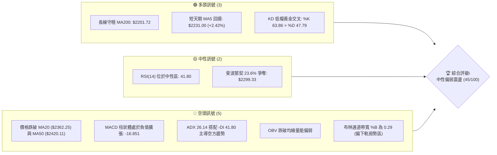

### 📊 核心指標速覽表

| 指標類別 | 指標名稱 | 當前數值 | 訊號 | 解讀 |
|:---|:---|:---|:---:|:---|
| **價格** | 當前收盤價 | $2285.00 | 🟡 | 位於52週高低區間 75.2% 位置，短線自低檔反彈但受制於短期均線 |
| **均線** | MA20 | $2362.25 | 🔴 | 股價位於月線下方 -3.27%，月線下彎形成上方動態阻力 |
| **均線** | MA50 | $2420.11 | 🔴 | 股價低於季線，中天期空方占據主導地位 |
| **均線** | MA200 | $2201.72 | 🟢 | 股價維持在半年線/年線上方 +3.78%，長線多頭格局基礎未破 |
| **動能** | RSI(14) | 41.80 | 🟡 | Wilder RSI 處於 30–70 中性偏弱區，無極端超賣，短線動能偏弱 |
| **動能** | MACD (12,26,9) | -59.228 | 🔴 | MACD 線低於訊號線 (-42.377)，Hist 為 -16.851，空方動能尚未衰竭 |
| **趨勢** | ADX(14) / ±DI | 26.14 | 🔴 | ADX > 25 確立趨勢形成，-DI (41.80) 遠高於 +DI (18.70)，空頭趨勢明確 |
| **通道** | 布林通道 %B | 0.29 | 🔴 | 股價游移於下軌 ($2176.14) 與中軌 ($2362.25) 之間，偏向弱勢區運作 |
| **波動** | ATR(14) | $62.36 | 🟡 | 日波動率為 2.73%，波動幅度放大，風控應拉大防守間距 |
| **成交量**| 量比 (Vol / 20MA)| 1.05x | 🟡 | 最新成交量 34,242,582 股微幅超越20日均量，但 OBV < MA 顯示主力買盤不強 |

### 🏆 技術評分卡

```
╔══════════════════════════════════════════════════════════════╗
║              技術評分卡 — 2330.TW (2026-11-11)              ║
╠══════════════════════════════════════════════════════════════╣
║ 趨勢強度 (Trend)     █████████░░░░░░░░░░░  45/100   🔴 弱勢  ║
║ 動能指標 (Momentum)  ████████░░░░░░░░░░░░  40/100   🔴 偏空  ║
║ 支撐穩定度 (Support) ███████████░░░░░░░░░  55/100   🟡 中性  ║
║ 成交量配合 (Volume)  ████████░░░░░░░░░░░░  40/100   🔴 疲弱  ║
║ 形態完整度 (Pattern) ██████████░░░░░░░░░░  50/100   🟡 築底  ║
║ 均線排列 (Moving Avg)████████░░░░░░░░░░░░  40/100   🔴 糾結  ║
╠══════════════════════════════════════════════════════════════╣
║ 綜合評分             █████████░░░░░░░░░░░  45/100   🟡 中性  ║
║ 評級結論             區間弱勢震盪，等待打底確認突破中軌       ║
╚══════════════════════════════════════════════════════════════╝
```
*(註：綜合評分由六項子評分算術平均所得：(45 + 40 + 55 + 40 + 50 + 40) / 6 = 45.00，依規則四捨五入為 45/100)*

---

## 2. 趨勢分析

### 🌐 多時框趨勢分析

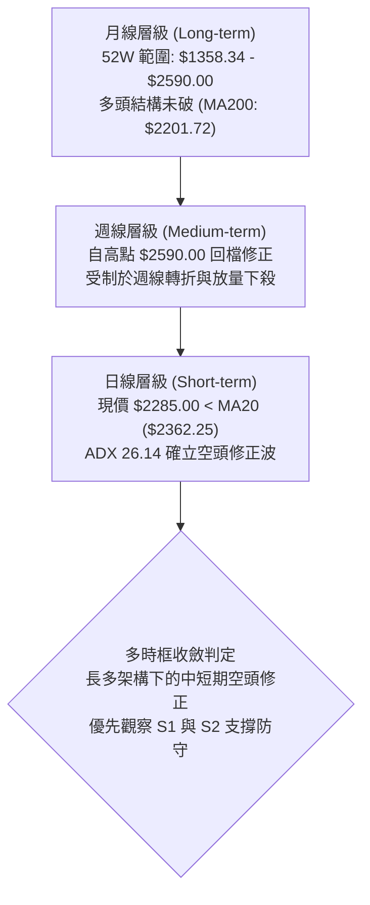

### 📈 長期趨勢 — 12個月走勢圖（Unicode）

以下為 2330.TW 過去 12 個月（2025-12 至 2026-11）的月線收盤走勢 ASCII 圖表：

```
2330.TW 月線走勢圖（過去12個月）
價格軸 ($)
$2500 ┤                                      ● (2026-09: $2480.00)
$2400 ┤                            ●    ●    │   ● (2026-10: $2370.00)
$2300 ┤                       ●    │    │    │   │   ●←當前現價 ($2285.00)
$2200 ┤                  ●    │    │    │    │   │   │
$2100 ┤             ●    │    │    │    │    │   │   │
$2000 ┤        ●    │    │    │    │    │    │   │   │
$1900 ┤        │    │    │    │    │    │    │   │   │
$1800 ┤   ●    │    │    │    │    │    │    │   │   │
$1700 ┤   │    │    ● (2026-03: $1750.17)   │   │   │
$1600 ┤   │    │                             │   │   │
$1500 ┤●  │    │                             │   │   │
      └─┬──┼────┼────┼────┼────┼────┼────┼────┼───┼───┼───
       12  01   02   03   04   05   06   07   08  09  10  11 (月/年)
      '25 '26  '26  '26  '26  '26  '26  '26  '26 '26 '26 '26
```

#### 長期走勢階段特徵分析

| 階段區間 | 起訖月份 | 起訖價格 ($) | 漲跌幅 (%) | 走勢特徵與技術解讀 |
|:---|:---|:---|:---:|:---|
| **主升段一** | 2025-12 → 2026-02 | $1536.33 → $1977.40 | +28.71% | 連續三個月大陽線放量推升，突破千七與千九關卡 |
| **中繼回踩** | 2026-02 → 2026-03 | $1977.40 → $1750.17 | -11.49% | 急跌回測波段支撐，洗盤清洗籌碼浮額 |
| **主升段二** | 2026-03 → 2026-07 | $1750.17 → $2417.88 | +38.15% | 單邊噴出行情，連續刷新歷史高點，月線層級均線多頭發散 |
| **高檔高震** | 2026-07 → 2026-09 | $2417.88 → $2480.00 | +2.57% | 於高檔兩千四百元形成箱體震盪，最高推升至歷史極值 $2590.00 |
| **波段修正** | 2026-09 → 2026-11 | $2480.00 → $2285.00 | -7.86% | 10月與11月遭遇獲利回吐賣壓，跌破月線並測向季線與MA200防線 |

### 📊 中期趨勢（週線分析）

中期走勢近8週呈現典型的見頂回落格局：
- 2026-10-08 週線見到歷史波段高點 **$2590.00**，隨後於 2026-10-16 當週開出長黑K摜破短期均線，週收盤落至 $2420.00，成交量放大至 160,006,325 股。
- 2026-11-06 當週出現恐慌性下殺，週低點見到 **$2020.00**，單週爆出 250,878,329 股歷史天量，收盤於 $2135.00，留下長下影線（影線長達 115 元）。
- 截至 2026-11-10 週收盤回升至 **$2285.00**，顯示 $2020.00~$2183.30 區域浮現強力機構逢低承接盤，惟週線 MACD 柱狀體仍為 -16.851，週線級別的反彈尚未化解中天期的空方修正壓力。

```
中期週線壓力與支撐架構圖 ($)
  $2590.00 ┬─ 52W 歷史極值 (強壓力區)
           │
  $2429.97 ┼─ R2 阻力位 / 週線跌破頸線位置
           │
  $2320.29 ┼─ R1 阻力位 / 近期反彈第一道反壓
  $2285.00 ┼─◄ 當前現價 ($2285.00)
  $2283.28 ┼─ S1 支撐位 / 密集成交低點聚類 (目前測試中)
           │
  $2183.30 ┼─ S2 強支撐位 / 波段低點與 MA200 ($2201.72) 匯聚防線
           │
  $2020.00 ┴─ 2026-11-06 恐慌探底極值 (下影線底部)
```

### ⚡ 趨勢強度評估（ADX 解讀）

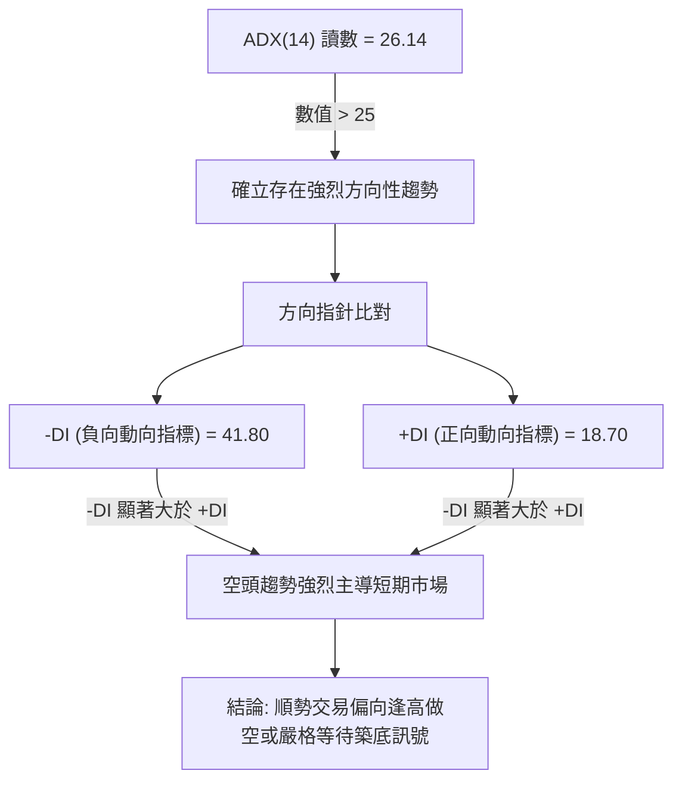

#### ADX 趨勢強度對照表

| 指標變數 | 當前讀數 | 門檻區間 | 趨勢狀態判定 | 交易意涵 |
|:---|:---:|:---:|:---:|:---|
| **ADX(14)** | **26.14** | 25 – 50 | 強趨勢 (Strong Trend) | 行情擺脫盤整，具有延續性單邊動力 |
| **+DI** | **18.70** | < 20 | 多方動能衰竭 | 多頭買盤力道薄弱，難以發動突破 |
| **-DI** | **41.80** | > 40 | 空方極度強勢 | 賣壓強勁，下行慣性依然存在 |
| **趨勢方向** | 空頭 | -DI > +DI | 熊市趨勢控制 | 日線級別反彈皆視為技術性修正，非反轉 |

---

## 3. 圖表形態分析

### 🔍 形態識別系統

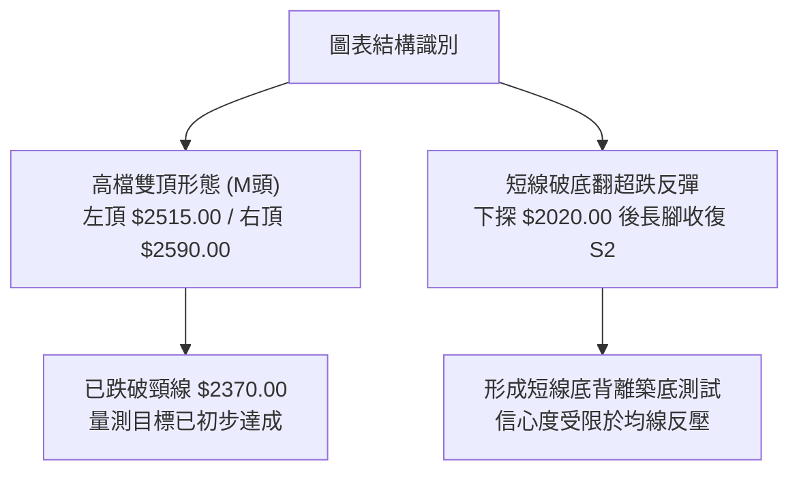

#### 形態識別與信心度評估表

| 形態名稱 | 信心度 | 判斷依據（引用數據） | 完成度 | 目標價（附計算式） |
|:---|:---:|:---|:---:|:---|
| **高檔雙重頂 (M頭)** | **75%** | 2026-10-02 高點 $2515.00 與 2026-10-08 高點 $2590.00 形成雙峰，頸線跌破 2026-10-30 低點 $2360.00 | 100% | 頸線 $2360.00 - 形態高度 ($2590.00 - $2360.00 = $230.00) = **$2130.00**（已於 11-06 跌至 $2020.00 超額達成） |
| **破底翻短底 (V型急洗)** | **55%** | 2026-11-06 爆出 2.5億股天量下影線低點 $2020.00，隨後連續兩日收紅站回 S1 $2283.28 | 60% | 形態高度 = 突破點 R1 $2320.29 - 底點 $2020.00 = $300.29；推算量測目標 = $2320.29 + $300.29 = **$2620.58**（尚未突破頸線確認） |
| **下降通道修正** | **45%** | 高點逐步降低 ($2590.00 → $2430.00 → $2345.00)，低點探低 | 70% | 訊號不足，僅做指標型解讀，暫不依此推算幾何目標價 |

### 🕯️ 重要K線形態分析

根據提供的近10根日K與近8根週K真實數據，進行 K 線形態解讀：

| 日期（級別） | 開盤 ($) | 最高 ($) | 最低 ($) | 收盤 ($) | 成交量 (股) | K線形態 | 技術解讀與多空訊號 |
|:---|:---:|:---:|:---:|:---:|:---:|:---:|:---|
| **2026-11-04 (日)** | 2320.00 | 2320.00 | 2235.00 | 2260.00 | 45,456,849 | 光頭大黑K | 🔴 開盤即最高，空頭全力傾瀉，帶量破位下殺 |
| **2026-11-05 (日)** | 2250.00 | 2285.00 | 2235.00 | 2240.00 | 36,863,278 | 弱勢小陰線 | 🔴 延續跌勢，反彈無力，收盤收在全日偏低位 |
| **2026-11-06 (日)** | 2020.00 | 2195.00 | 2020.00 | 2135.00 | 97,176,862 | 暴量長下影長陽棒 | 🟢 跳空低開於 $2020.00 後強力抽腳大漲 115 元，主力換手承接極強 |
| **2026-11-09 (日)** | 2210.00 | 2290.00 | 2190.00 | 2235.00 | 41,529,425 | 跳空陽線十字 | 🟡 跳空開高消化獲利籌碼，守穩 $2200 整數防線 |
| **2026-11-10 (日)** | 2265.00 | 2285.00 | 2230.00 | 2285.00 | 34,242,582 | 光腳實體小陽K | 🟢 步步墊高收於當日最高價 $2285.00，測試 S1 支撐轉阻力點 |
| **2026-10-16 (週)** | 2510.00 | 2550.00 | 2420.00 | 2420.00 | 160,006,325 | 週級別長黑破位 | 🔴 週頂背離確立，跌破MA20週線，確認波段頭部成立 |
| **2026-11-06 (週)** | 2310.00 | 2345.00 | 2020.00 | 2135.00 | 250,878,329 | 爆天量極長下影線 | 🟢 週線層級於 $2020.00 爆天量長腳，具備極強的波段停損底特徵 |
| **2026-11-10 (週)** | 2210.00 | 2290.00 | 2190.00 | 2285.00 | 75,772,007 | 連續回升陽線 | 🟡 止跌回穩初露端倪，量能微縮等待動能補量 |

### 📉 ASCII 走勢形態示意圖

```
2330.TW 日K線「破底翻強彈」形態示意
價格 ($)
$2450 ┬           ● 10-28 ($2425)
      │          ╱ ╲
$2400 ┼         ●   ● 10-30 ($2370)
      │        ╱     ╲
$2350 ┼       ╱       ● 11-02 ($2330)
      │      ╱         ╲
$2300 ┼     ╱           ● 11-03 ($2295)   ● 11-10 現價 ($2285) 測試 S1/R1
      │    ╱             ╲               ╱
$2250 ┼───╱───────────────● 11-04 ($2260)──● 11-09 ($2235)
      │  ╱                  ╲           ╱
$2200 ┼─●                   ● 11-05 ($2240)
      │                      │
$2150 ┼                      ● 11-06 收盤 ($2135)
      │                     ╱
$2100 ┼                    ╱
      │                   │  (爆出 9700 萬股天量)
$2050 ┼                   │
      │                   │
$2020 ┴───────────────────● 11-06 恐慌低點 ($2020.00 破底翻腳印)
```

### 🎯 形態目標價計算

1. **已實現形態：雙重頂 (M-Top) 下跌滿足點**
   - 左頂高點：$2515.00 (2026-10-02)
   - 右頂高點：$2590.00 (2026-10-08)
   - 跌破頸線：$2360.00 (2026-10-30 低點)
   - 形態垂直高度：$2590.00 - $2360.00 = $230.00
   - 理論下跌目標價 = 頸線 $2360.00 - 形態高度 $230.00 = **$2130.00**
   - *驗證結果*：2026-11-06 最低觸及 $2020.00，收盤 $2135.00，下跌滿足點已精準達成並觸發技術性報復反彈。

2. **潛在形態：短線破底翻 (Reversal Thrust) 反彈目標**
   - 形態底部：$2020.00 (2026-11-06 低點)
   - 關鍵頸線阻力：**R1 ($2320.29)**
   - 形態反彈垂直幅度 = $2320.29 - $2020.00 = $300.29
   - 若能帶量收復 R1，理論測量目標價 = R1 ($2320.29) + 形態幅度 ($300.29) = **$2620.58**
   - *重要提示*：該形態尚未確認突破頸線 R1 ($2320.29)，完成度僅 60%，目前仍處於回測與打底階段。

---

## 4. 支撐與阻力

### 🗺️ 關鍵價位分布圖（Unicode）

```
2330.TW 價位結構分布圖
═════════════════════════════════════════════════════════════════
$2590.00 ║████████████████████████████████║ 52W 歷史極值高點
$2508.21 ║████████████████████████        ║ 強阻力 R3 (高檔籌碼密集套牢區)
$2429.97 ║████████████████                ║ 重要阻力 R2 (MA50 季線匯聚帶)
$2320.29 ║██████████                      ║ 關鍵短線阻力 R1 (頸線反壓)
$2299.33 ║▓▓▓▓▓▓▓▓▓▓                      ║ 斐波那契 23.6% 回調關鍵位
$2285.00 ╠════════════════════════════════╣ ◄ 當前收盤價 ($2285.00)
$2283.28 ║▓▓▓▓▓▓▓▓▓▓▓▓▓▓▓▓                ║ 近期波段核心支撐 S1 (近一年波段低點聚類)
$2183.30 ║████████████████████████        ║ 強支撐 S2 (MA200 / 07-17 密集低點)
$2119.51 ║████████████                    ║ 斐波那契 38.2% 回調位
$1743.07 ║████████████████████████████████║ 長期鋼底 S3 (2026-03 波段起漲點)
═════════════════════════════════════════════════════════════════
```

### 🚧 阻力位分析表

阻力位完全引用 OHLCV 計算所得之波段高點聚類數據：

| 阻力級別 | 精確價位 | 距現價幅動 | 形成原因與籌碼解讀 | 突破難度 | 重要性 |
|:---|:---:|:---:|:---|:---:|:---:|
| **R1** | **$2320.29** | +1.54% | 近期跌破之區間平台低點轉阻力，亦為日線 MA10 ($2299.00) 附近反壓區 | 🟡 中等 | ★★★☆☆ |
| **R2** | **$2429.97** | +6.34% | 波段前高密集成交平台，重合 MA50 ($2420.11) 與 MA60 ($2414.51)，季線反壓 | 🔴 極高 | ★★★★☆ |
| **R3** | **$2508.21** | +9.77% | 歷史天價高點密集區 ($2500–$2550) 前緣，套牢解套賣壓最沉重處 | 🔴 極高 | ★★★★★ |

### 🛡️ 支撐位分析表

支撐位完全引用 OHLCV 計算所得之波段低點聚類數據：

| 支撐級別 | 精確價位 | 距現價幅動 | 形成原因與籌碼解讀 | 守住機率 | 重要性 |
|:---|:---:|:---:|:---|:---:|:---:|
| **S1** | **$2283.28** | -0.08% | 近一年多次波段回檔低點（如 2026-07-17 收盤價 $2283.28），現正貼身防守 | 🟡 55% | ★★★★☆ |
| **S2** | **$2183.30** | -4.45% | 布林通道下軌 ($2176.14) 與長期均線 MA200 ($2201.72) 共振保護帶 | 🟢 80% | ★★★★★ |
| **S3** | **$1743.07** | -23.72%| 2026年首季起漲點大型平台（2026-03 收盤價 $1750.17 處），長線牛熊分水嶺 | 🟢 95% | ★★★★★ |

### 📐 斐波那契回調位分析

依據 52 週完整波動區間（低點 **$1358.34** 至 高點 **$2590.00**，總垂直落差 $1231.66）計算之精確斐波那契回調位如下：

| 回調比例 | 精確價位 ($) | 與當前價關係 | 技術意涵與防禦角色 |
|:---:|:---:|:---:|:---|
| **0.0%** (52W High) | **$2590.00** | +13.35% | 多頭終極天花板，歷史歷史峰值 |
| **23.6%** | **$2299.33** | +0.63% | **關鍵回調位**：現價 $2285.00 緊貼於此位置下方，構成直接短線反壓 |
| **38.2%** | **$2119.51** | -7.24% | **強支撐位**：強勢回調防禦極限，11-06 下殺低點 $2020 曾短暫刺穿後快速拉回 |
| **50.0%** | **$1974.17** | -13.60% | 多空中樞分水嶺，跌破意味著多頭結構徹底瓦解 |
| **61.8%** | **$1828.84** | -19.96% | 黃金分割防禦點，長線深幅修正容忍底線 |
| **78.6%** | **$1621.92** | -29.02% | 極端空頭修正防禦線 |
| **100.0%** (52W Low) | **$1358.34** | -40.55% | 52週起漲基石 |

**斐波那契區間定位判讀**：
當前收盤價 **$2285.00** 正落於 **23.6% 回調位 ($2299.33)** 與 **38.2% 回調位 ($2119.51)** 之間。在技術分析中，多頭強勢市場的回調通常受制於 23.6% 或於 38.2% 止跌。目前現價已跌破 23.6%，正努力收復 $2299.33。若能有效站上 $2299.33，回檔被定性為「強勢回調」；反之，若持續承壓，則價格恐二度下探 38.2% ($2119.51) 與 S2 ($2183.30) 尋求支撐。

---

## 5. 技術指標深度解讀

### 🎛️ 指標訊號總覽

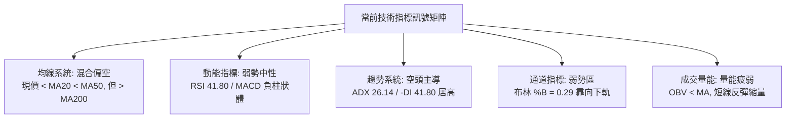

### 📈 移動平均線排列分析

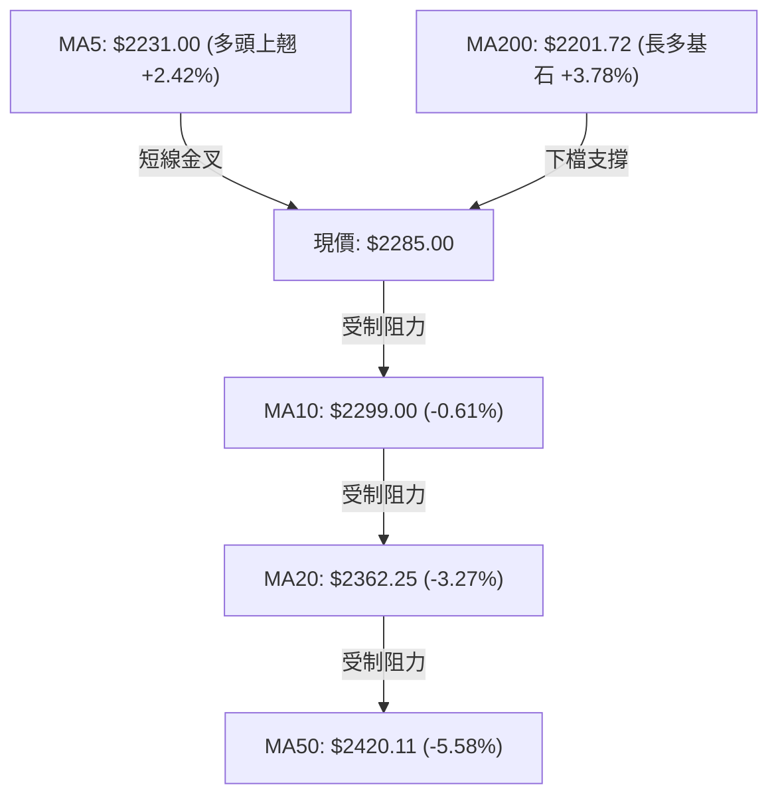

#### 均線數據與結構分析表

| 均線名稱 | 數值 ($) | 與現價乖離 | 走勢狀態 | 結構角色解讀 |
|:---|:---:|:---:|:---:|:---|
| **MA 5** | 2231.00 | +2.42% | ▲ 上彎 | 超跌反彈發動，短線提供第一道墊高支撐 |
| **MA 10** | 2299.00 | -0.61% | ▼ 下彎 | 短線首要反壓，與斐波那契 23.6% ($2299.33) 形成重疊反壓點 |
| **MA 20** | 2362.25 | -3.27% | ▼ 下彎 | 中期生命線，已由支撐轉為重度動態反壓 |
| **MA 50** | 2420.11 | -5.58% | ▼ 下彎 | 中期波段反壓，與 R2 ($2429.97) 匯聚 |
| **MA 60** | 2414.51 | -5.36% | ▼ 下彎 | 季線下彎，確立中期空方波段掌控權 |
| **MA 120** | 2384.75 | -4.18% | ▼ 下彎 | 半年線走跌，均線壓制帶寬密集於 $2360–$2420 |
| **MA 200** | 2201.72 | +3.78% | ▲ 上揚 | 長期牛市防線，為多頭主力不可退讓之最後底線 |
| **MA 240** | 2079.85 | +9.86% | ▲ 上揚 | 年線多頭發散，提供宏觀長線強力護盤力道 |

*結論*：均線系統呈現「長多、中空、短反彈」的典型**混合排列**。現價受制於下彎的短期與中期均線群，上行面臨重重解套賣壓。

### 📉 RSI(14) 分析

```
RSI(14) 動能強度表
0               30             50             70            100
├───────────────┼──────────────┼──────────────┼──────────────┤
│    超賣區     │    弱勢區    │    強勢區    │    超買區    │
└───────────────┴──────────────┴──────────────┴──────────────┘
                    ▲ 41.80 (Wilder)
進度條: [████████████████░░░░░░░░░░░░░░] 41.80%
```

- **當前讀數**：Wilder RSI(14) 讀數為 **41.80**，處於 30 至 50 之間的弱勢整理區。
- **超買超賣判讀**：未落入 30 以下之極端超賣區，亦遠未達到 70 以上超買區。此讀數顯示 11-06 的恐慌下殺使 RSI 短暫下探低檔後，目前隨反彈回到中性偏弱水位。
- **背離判斷**：
  - *日線層級*：根據數據比對近20根K棒首尾，價格自 2480 下跌至 2285，RSI 自 50 水平下行至 41.80，**無明顯背離**（同向向下修正）。
  - *週線層級*：2026-10-08 高點 $2550.00 時週 RSI 為 61.9；而前波 2026-10-02 高點 $2500 時週 RSI 為 60.0，高點與指標未見顯著頂背離；但 11-06 週線收盤 $2135 時週 RSI 曾暴跌至 19.1 極端超賣，目前 11-10 回升至 41.8，呈現超賣後的修復性彈升。

### 📊 MACD(12,26,9) 訊號解讀

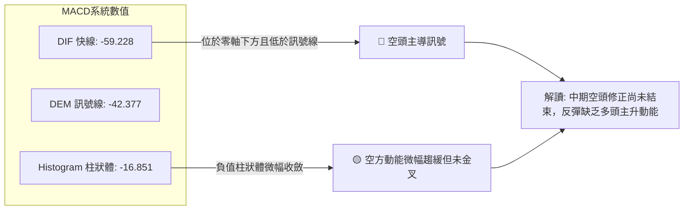

- **MACD 指標數值**：
  - 快線 (MACD Line)：**-59.228**
  - 訊號線 (Signal Line)：**-42.377**
  - 柱狀體 (MACD Histogram)：**-16.851**
- **訊號解析**：MACD 兩線均深入零軸下方，且快線仍位於訊號線下方（空頭排列）。儘管柱狀體自 11-06 週線級別的 -28.207 收斂至 -16.851，顯示空方殺跌力道減緩，但在 DIF 快線向上穿越 DEM 訊號線形成正式「零下黃金交叉」前，任何反彈均應以弱勢修正視之。

### 📦 布林通道分析

```
布林通道結構示意圖 (帶寬範圍 $2176.14 - $2548.36)
$2548.36 ┬────────────────────────────────────────── 布林上軌 (BB Upper)
         │
$2450.00 ┼
         │
$2362.25 ┼┈┈┈┈┈┈┈┈┈┈┈┈┈┈┈┈┈┈┈┈┈┈┈┈┈┈┈┈┈┈┈┈┈┈┈┈┈┈┈┈ 布林中軌 (MA20)
         │
$2285.00 ┼─────────● 現價 ($2285.00, %B = 0.29)
         │
$2176.14 ┴────────────────────────────────────────── 布林下軌 (BB Lower)
```

- **上軌 (Upper Band)**：**$2548.36**
- **中軌 (Middle Band / MA20)**：**$2362.25**
- **下軌 (Lower Band)**：**$2176.14**
- **帶寬指標 %B**：**0.29**（%B = (2285 - 2176.14) / (2548.36 - 2176.14) = 108.86 / 372.22 ≈ 0.29）
- **通道技術解讀**：%B 讀數為 0.29，表明股價正處於布林帶下半部運作。股價在 11-06 跌破下軌 ($2020.00) 引發強烈均值回歸拉回帶內，目前正在向下軌與中軌之間進行修復。中軌 $2362.25 構成上方強大動態磁吸阻力與防線。

### 💹 成交量分析（量價配合度）

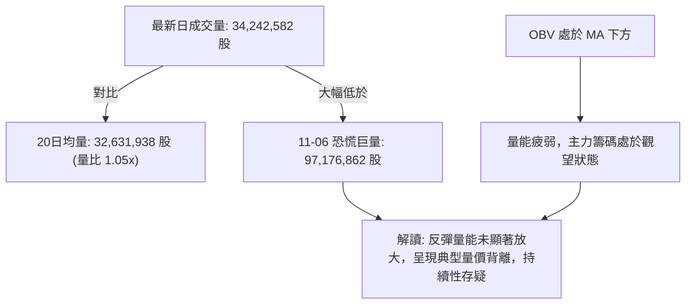

- **量價關係現狀**：
  - 11-06 當日殺低至 $2020.00 爆出 **97,176,862 股** 之歷史級換手量，形成巨量換手紅棒。
  - 隨後 11-09 成交量驟降至 **41,529,425 股**，11-10 現價上漲至 $2285.00 時成交量再度萎縮至 **34,242,582 股**（量比僅 1.05x）。
  - **量價背離判定**：股價自 $2135 連續上漲至 $2285，但成交量呈現階梯式遞減（97M → 41M → 34M）。此為典型的「價漲量縮」技術背離，說明買盤追價意願謹慎，反彈主因來自賣壓暫歇而非新增資金全力進駐。
  - **OBV 趨勢**：OBV 指標目前持續位於其移動平均線下方，官方指標快照明確指出「OBV < MA → 量能疲弱」，籌碼面尚未提供扎實的做多支撐。

---

## 6. 動能與波動率

### ⚡ 動能評估分析

在動能強度與波動率的交互矩陣中，當前 2330.TW 呈現「**弱動能、高波動**」的典型空頭修正後特徵：

| 象限區間 | 動能特徵 | 波動特徵 | 當前狀態判定 | 戰略應對評估 |
|:---:|:---:|:---:|:---:|:---|
| **Q1 (強動能/低波動)** | 強勁突破 | 平穩上升 | — | 最佳波段加碼機會 |
| **Q2 (弱動能/低波動)** | 橫向盤整 | 帶寬收窄 | — | 謹慎觀望，等待突破方向確立 |
| **Q3 (強動能/高波動)** | 單邊噴出 | 劇烈震盪 | — | 趨勢順勢交易，高收益伴隨高風險 |
| **Q4 (弱動能/高波動)** | **負向偏空** | **急跌急彈** | **✓ 當前落點** | **震盪劇烈且多頭動能不足，避免盲目追高** |

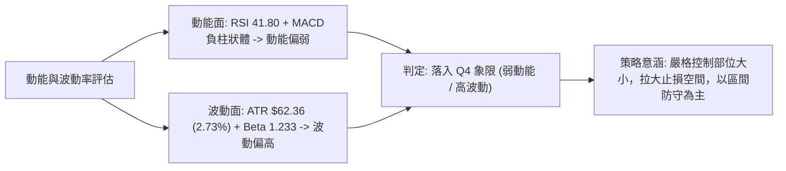

### 📊 ATR 波動率分析

- **ATR(14) 讀數**：**$62.36**（Wilder 計算法，佔股價比例高達 **2.73%**）。
- **歷史波動對比**：相較於一般半導體權值股 1.5%–1.8% 的常態波動率，當前 ATR 達到 $62.36，顯示每日股價上下震盪區間逾 60 元，屬於短期高波動狀態。
- **止損與部位建議**：
  - *短線當沖/隔日沖止損距離*：建議設定為 1.0 倍 ATR（即約 **$62.00**）。
  - *波段持倉止損距離*：建議設定為 1.5 至 2.0 倍 ATR（即 **$93.50 至 $124.70**），避免在盤中劇烈晃蕩時遭到非理性洗盤出場。

### 📐 Beta 與市場相關性

- **Beta 係數**：**1.233**。
- **市場敏感度分析**：2330.TW 的 Beta 顯著高於 1.00，代表其對台灣加權指數及全球科技板塊（如 SOX 費城半導體指數）具有放大效應。當整體市場下跌 1% 時，該股平均傾向下挫 1.233%；反之，大盤回暖時其反彈彈性亦相對放大。在目前宏觀環境偏空的格局下，高 Beta 特質將放大回檔過程中的下行風險。

---

## 7. 多時框架總結

### 📋 時框架評分表

| 時框架 | 趨勢方向 | 動能狀態 | 均線排列 | 圖表形態 | 綜合評分 | 建議操作操作方向 |
|:---|:---:|:---:|:---:|:---|:---:|:---|
| **短期 (日線)** | 🔴 下行反彈 | 🔴 疲弱 (RSI 41.8) | 🔴 糾結弱勢 (現價<MA20) | 🟡 破底翻打底中 | **42/100** | 逢高減碼 / 區間短打 |
| **中期 (週線)** | 🔴 波段修正 | 🔴 修正 (Hist -16.8) | 🔴 跌破MA20週線 | 🔴 M頭頸線跌破 | **40/100** | 偏空防守 / 觀望 |
| **長期 (月線)** | 🟢 宏觀牛市 | 🟢 偏多 (均線向上) | 🟢 多頭 (現價>MA200) | 🟢 長期上升通道 | **53/100** | 長線分批建倉逢低關注 |

### 🔲 綜合訊號矩陣

```
時框架訊號矩陣一覽
┌───────────┬─────────────┬─────────────┬─────────────┐
│ 分析維度  │  短期 (日)  │  中期 (週)  │  長期 (月)  │
├───────────┼─────────────┼─────────────┼─────────────┤
│ 趨勢方向  │  🔴 偏空反彈 │  🔴 空頭主導 │  🟢 多頭未破 │
│ 均線系統  │  🔴 偏空混合 │  🔴 死叉下彎 │  🟢 多頭發散 │
│ 動能指標  │  🟡 中性偏弱 │  🔴 負向擴張 │  🟢 維持正值 │
│ 成交量配合│  🔴 量價背離 │  🟡 爆量換手 │  🟢 結構良好 │
│ 關鍵防線  │  S1 $2283.28│  S2 $2183.30│ MA200 $2201 │
└───────────┴─────────────┴─────────────┴─────────────┘
```

### ⚖️ 多時框收斂結論

依據多時框收斂規則嚴格檢驗：
1. **行情性質判定**：當前 ADX(14) 讀數為 **26.14**，大於 25 臨界值，確立當前市場處於**強趨勢行情**而非無方向的盤整震盪。
2. **主導方向判定**：趨勢指標中，負向動向指標 -DI 高達 **41.80**，遠凌駕於正向動向指標 +DI (**18.70**)。儘管長期月線 MA200 ($2201.72) 仍然向上維持長期牛市結構，但依收斂規則，中長期中期方向（週線跌破 MA20、MACD 負向、高檔 M 頭確立）佔據主導地位，日線等級的連三紅反彈僅為空頭趨勢中的**技術性反抽（Bear Market Rally）**。
3. **收斂唯一方向性結論**：**中性偏弱、區間防守（評分 45/100）**。反彈面對上檔均線重度壓制，在未帶量有效突破 R1 ($2320.29) 及收復 MA20 ($2362.25) 前，絕不可貿然追價，操作應以「防守至上、區間因應」為主導方針。

---

## 8. 交易策略建議

### 🗺️ 策略決策流程圖

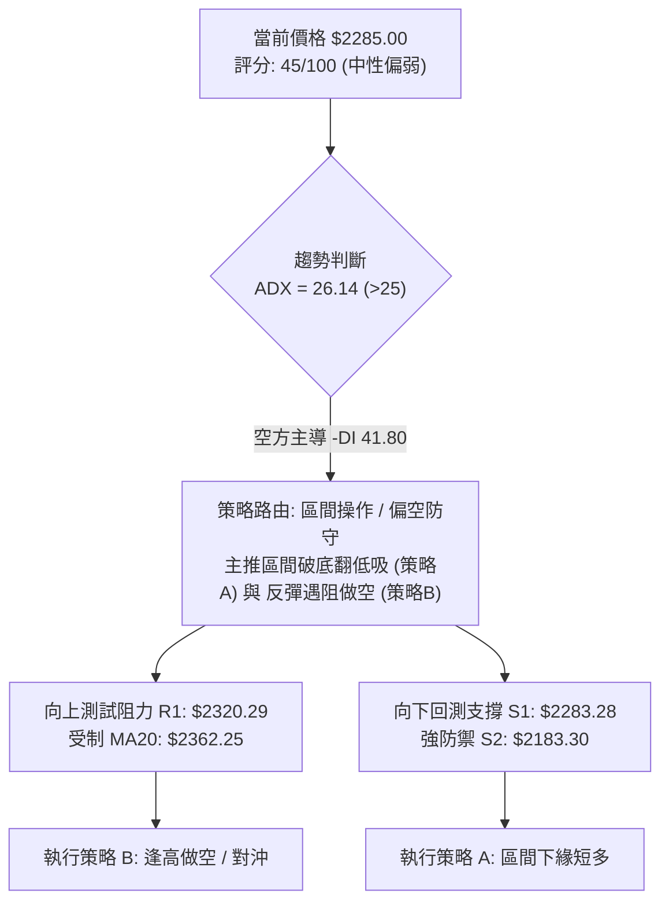

### 🧭 策略路由

> **當前主策略方向 = 中性區間操作，以高拋低吸為主，明確等待突破確認（依評分 45/100）**

因技術評分卡綜合評分為 **45/100**（落入 40–60 中性區間），市場處於上有重重均線反壓、下有長期 MA200 與百萬天量長下影保護的夾心區間。本報告提供兩套嚴格遵守風險報酬比之操作策略：
- **策略 A（區間低吸 / 逆勢反彈多單）**：著眼於 S1 守穩與超跌回升。
- **策略 B（逢高空單 / 順應 ADX 空頭趨勢對沖單）**：著眼於反彈至動態均線反壓區承壓受阻。

### 🎯 價格情境階梯（Price Scenarios）

價格完全引用「關鍵價位」區塊之客觀數值：

| 觸發條件 | 下一目標 | 後續延伸 | 情境含義 |
|:---|:---:|:---:|:---|
| **帶量突破 R1 ($2320.29)** | **R2 ($2429.97)** | **R3 ($2508.21)** | 短線空頭結構瓦解，挑戰季線與密集套牢區 |
| **徘徊於 S1 ($2283.28) ~ R1 ($2320.29)**| — | — | 弱勢震盪打底，消化 11-06 恐慌賣壓 |
| **跌破 S1 ($2283.28)** | **S2 ($2183.30)** | **S3 ($1743.07)** | 短底失效，空頭重啟跌勢，考驗半年線/年線 |

### 📊 情境機率分佈

| 情境劇本 | 機率 | 主要依據與技術支撐 |
|:---|:---:|:---|
| **弱勢區間震盪 (S1 ~ R1 夾層整理)** | **50%** | ADX 高檔但量能急縮，短線多空在此拉鋸，等待均線下移收斂 |
| **遇反壓回落 / 二度探底 (測試 S2)** | **35%** | -DI 高達 41.80，均線群呈蓋頭反壓，MACD 負向柱狀體尚未翻紅 |
| **強勢突破反轉 (突破 R1 挑戰 R2)** | **15%** | 量能萎縮呈現價量背離，缺乏主力買盤量能奧援，直接 V 轉難度極高 |

### 🟢 交易策略詳情

*(所有點位嚴格引用提供的關鍵價位數值，風險報酬比嚴格依定義計算)*

| 策略要素 | 策略 A：區間下緣低吸多單 (短線) | 策略 B：反彈遇阻順勢做空 (波段) |
|:---|:---|:---|
| **操作方向** | 做多（逆勢短多） | 做空（順勢避險） |
| **進場條件** | 回踩測試 S1 守穩不破，或現價附近分批進場 | 反彈觸及 R1 遇阻滯漲，收出上影線確認受阻 |
| **進場價格** | **$2285.00**（當前現價） | **$2320.29**（精確 R1 阻力點） |
| **目標價 T1** | **$2320.29**（精確 R1 阻力位） | **$2183.30**（精確 S2 強支撐位） |
| **目標價 T2** | **$2429.97**（精確 R2 阻力位） | **$1743.07**（精確 S3 長期支撐位） |
| **止損價格** | **$2265.00**（跌破今日開盤價與短線防線） | **$2362.25**（精確突破 MA20 中軌止損） |
| **風險報酬比** | **1 : 1.76（以 T1 計）**<br>*(2320.29 - 2285.00) ÷ (2285.00 - 2265.00)<br>= 35.29 ÷ 20.00 = 1.764*<br>*(以 T2 計則為 1 : 7.25)* | **1 : 3.26（以 T1 計）**<br>*(2320.29 - 2183.30) ÷ (2362.25 - 2320.29)<br>= 136.99 ÷ 41.96 = 3.264*<br>*(以 T2 計則為 1 : 13.75)* |
| **成功機率** | 45% | 60% |
| **建議倉位** | 10%–15%（輕倉短打） | 20%–25%（標準對沖倉位） |

### 🔴 反向風險觸發點（對沖提示）

- **多頭反轉停損與全面翻空觸發點**：若日K收盤價有效跌破 **S1 ($2283.28)** 且成交量放大，意味著 11-06 的跳空長腳僅為下跌中繼，多頭應立即全面停損離場，並啟動向 **S2 ($2183.30)** 尋求避險的保護性空單。
- **空頭回補與止損觸發點**：若價格帶量站穩 **MA20 ($2362.25)**，代表中期空頭架構被破壞，空單應無條件停損出場，行情將演變為挑戰 **R2 ($2429.97)** 的波段反轉。

### ⭐ 整體訊號強度評星

```
╔══════════════════════════════════════════════════════════════╗
║ 做多訊號強度：★★☆☆☆  (2/5星) — 動能與均線壓制，僅屬弱反彈  ║
║ 做空訊號強度：★★★☆☆  (3/5星) — 空頭趨勢明確，但下有百萬支撐║
║ 整體可信度：  ★★★★☆  (4/5星) — 數據結構清晰，關鍵價位扎實║
╚══════════════════════════════════════════════════════════════╝
```

---

## 9. 風險提示與監控

### ✅ 關鍵監控指標 Checklist

```
╔══════════════════════════════════════════════════════════════╗
║                 每日收盤關鍵技術監控清單                     ║
╠══════════════════════════════════════════════════════════════╣
║ [ ] 價格能否守穩核心支撐 S1: $2283.28 (低於此點空方再度主導) ║
║ [ ] 反彈能否放量越過 R1: $2320.29 (突破代表破底翻確認)       ║
║ [ ] MACD Histogram 能否由負翻正 (翻正代表動能扭轉)          ║
║ [ ] 成交量能否回升至 50日均量之上 (> 24,514,185 股)         ║
║ [ ] -DI 是否持續下彎跌破 30 (低於 30 代表空方殺盤動能消退)   ║
║ [ ] 布林通道 %B 能否重返 0.50 (站上中軌 $2362.25)           ║
╚══════════════════════════════════════════════════════════════╝
```

### ⚠️ 風險場景分析

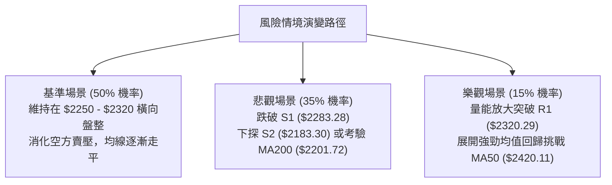

### 🛡️ 風險管理重要提醒

1. **ATR 波動風險管控**：由於目前 ATR 高達 **$62.36 (2.73%)**，日內洗盤振幅巨大。交易者切忌滿倉操作，單筆交易的最大資金承擔風險應嚴格控制在總權益的 **1.0%–1.5%** 之內。
2. **大盤聯動與 Beta 風險**：2330.TW 的 Beta 值為 **1.233**，身為台股權值核心，其技術走勢深受美股科技板塊及台指期結算效應牽動。外資機構持股比例達 **43.4%**，在近期成交量未能連續放大前，須提防外資藉由反彈進行調節提款的被動賣壓。
3. **不可抗力跳空風險**：近期日K多次出現大跳空（如 11-06 開盤重挫至 $2020），隔夜持倉務必預留足夠保證金，避免因突發性跳空直接貫穿硬性停損點。

---

## 📋 報告總結

```
╔══════════════════════════════════════════════════════════════════╗
║               2330.TW 技術分析報告總結                          ║
╠══════════════════════════════════════════════════════════════════╣
║ 報告日期：2026-11-11                                            ║
║ 當前價格：$2285.00 TWD                                          ║
║ 分析評級：⚖️ 中性觀望 / 區間偏空防守 (技術評分: 45/100)          ║
║                                                                  ║
║ 關鍵結構結論：                                                   ║
║ ├─ 長期趨勢：🟢 偏多未變，股價高於 MA200 ($2201.72) 與年線       ║
║ ├─ 中期趨勢：🔴 空頭修正，受制於下彎季線 MA50 ($2420.11) 與M頭反壓║
║ ├─ 短期趨勢：🟡 跌深反彈，自 $2020 抽腳後正於 S1 邊緣測試築底    ║
║ ├─ 關鍵支撐：S1: $2283.28 ｜ S2: $2183.30 ｜ S3: $1743.07       ║
║ ├─ 關鍵阻力：R1: $2320.29 ｜ R2: $2429.97 ｜ R3: $2508.21       ║
║ └─ 分析師目標：共識均價 $3409.80 (35位分析師，基本面強烈看多)   ║
║                                                                  ║
║ 最優操作策略配置：                                               ║
║ 1. 🥇 最佳機會（高盈虧比）：等待反彈至 R1 ($2320.29) 遇阻承壓，  ║
║    建立空頭避險部位，停損設 MA20 ($2362.25)，目標 S2 ($2183.30) ║
║ 2. 🥈 次選機會（短線逆勢）：現價 $2285.00 輕倉博弈短彈，停損設   ║
║    $2265.00，目標上檔 R1 ($2320.29)，盈虧比 1:1.76              ║
║ 3. 🥉 保守選擇（長線投資）：完全觀望，靜待日線 MACD 零下金叉或  ║
║    價格回測 S2 / MA200 ($2200 附近) 確立雙底後再行長線佈局      ║
╚══════════════════════════════════════════════════════════════════╝
```

---

> ⚠️ **免責聲明**：本報告為技術分析研究，所有數據指標及幾何估算均完全基於歷史客觀量價資訊。本報告**僅供研究與學術參考**，**不構成任何買賣要約或投資建議**。市場具有高度不確定性，投資人應獨立評估風險並自負盈虧。

---

*報告生成時間：2026-11-11 ｜ 數據來源：Yahoo Finance ｜ 分析框架：多時框技術分析系統*